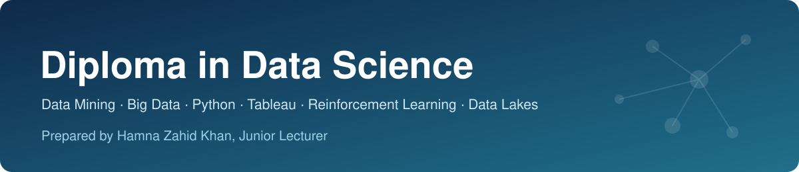

# Diploma in Data Science

Prepared by **Hamna Zahid Khan**, Junior Lecturer

Session-by-session lecture notes, worked examples and runnable code for the **Diploma in Data Science**.
Every session has a Markdown lesson and a matching `code/` folder (Python scripts, WEKA command-line scripts, ARFF datasets and notebooks).

> 🚧 **Work in progress.** Sessions are published as they are written. Items marked *coming soon* are on the way.

## 📚 Contents

## [Term 2 · Advanced Data Science, Big Data and Analytics](term-2/README.md)

*6 modules · 69 sessions · 188 hours*

### Module 1 · Data Mining with WEKA

*24 hours · 8 sessions · 🚧 7/8 sessions*

| # | Session | Status |
|---|---|---|
| 1 | [Introduction to Data Mining and WEKA](term-2/01-data-mining-with-weka/session-01-introduction-to-data-mining-and-weka.md) | ✅ Ready |
| 2 | [Data Warehousing and Data Pre-processing](term-2/01-data-mining-with-weka/session-02-data-warehousing-and-preprocessing.md) | ✅ Ready |
| 3 | [Association Rule Mining](term-2/01-data-mining-with-weka/session-03-association-rule-mining.md) | ✅ Ready |
| 4 | [Classification and Decision Trees](term-2/01-data-mining-with-weka/session-04-classification-and-decision-trees.md) | ✅ Ready |
| 5 | [Regression Techniques](term-2/01-data-mining-with-weka/session-05-regression-techniques.md) | ✅ Ready |
| 6 | [Clustering Techniques](term-2/01-data-mining-with-weka/session-06-clustering-techniques.md) | ✅ Ready |
| 7 | [Text Mining and Web Mining](term-2/01-data-mining-with-weka/session-07-text-mining-and-web-mining.md) | ✅ Ready |
| 8 | Designing a Real-World Data Mining Project | ⏳ Coming soon |

### Module 2 · Foundations of Big Data Systems with Hadoop

*40 hours · 15 sessions · ⏳ coming soon*

| # | Session | Status |
|---|---|---|
| 1 | Introduction to Big Data and the Hadoop Ecosystem | ⏳ Coming soon |
| 2 | Configuring Hadoop and Setting Up a Cluster | ⏳ Coming soon |
| 3 | Understanding HDFS and Its Goals | ⏳ Coming soon |
| 4 | Exploring YARN and Classic MapReduce | ⏳ Coming soon |
| 5 | Demonstrating MapReduce Algorithms | ⏳ Coming soon |
| 6 | Understanding Sqoop and Joins in MapReduce | ⏳ Coming soon |
| 7 | Exploring Hadoop Architecture and Components | ⏳ Coming soon |
| 8 | Working with Hive and Impala | ⏳ Coming soon |
| 9 | Introduction to Apache Pig | ⏳ Coming soon |
| 10 | Pig Latin Data Model and Operators | ⏳ Coming soon |
| 11 | Introduction to Apache Spark | ⏳ Coming soon |
| 12 | Spark Statistics for Interactive Dashboards | ⏳ Coming soon |
| 13 | Data Analysis with Spark: Clustering and Forecasting | ⏳ Coming soon |
| 14 | Special Field Types, Generated Fields and Parameters in Spark | ⏳ Coming soon |
| 15 | Final Project and Next Steps | ⏳ Coming soon |

### Module 3 · Advanced Data Science with Python

*36 hours · 15 sessions · ⏳ coming soon*

| # | Session | Status |
|---|---|---|
| 1 | Fundamentals of Advanced Data Science | ⏳ Coming soon |
| 2 | Supervised Learning | ⏳ Coming soon |
| 3 | Advanced Supervised Learning: Regression Techniques | ⏳ Coming soon |
| 4 | Advanced Supervised Learning: Classification Techniques | ⏳ Coming soon |
| 5 | Advanced Supervised Learning: Time Series Analysis | ⏳ Coming soon |
| 6 | Unsupervised Learning | ⏳ Coming soon |
| 7 | Advanced Unsupervised Learning: Clustering Algorithms | ⏳ Coming soon |
| 8 | Advanced Unsupervised Learning: Dimensionality Reduction | ⏳ Coming soon |
| 9 | Pattern Mining and Visualization with Seaborn | ⏳ Coming soon |
| 10 | Reinforcement Learning Basics | ⏳ Coming soon |
| 11 | Reinforcement Learning Principles | ⏳ Coming soon |
| 12 | Deep Learning Models | ⏳ Coming soon |
| 13 | Advanced Deep Learning Techniques | ⏳ Coming soon |
| 14 | Model Performance Evaluation | ⏳ Coming soon |
| 15 | Model Interpretability and Interoperability | ⏳ Coming soon |

### Module 4 · Visual Analytics with Tableau

*40 hours · 15 sessions · ⏳ coming soon*

| # | Session | Status |
|---|---|---|
| 1 | Getting Started with Tableau | ⏳ Coming soon |
| 2 | Exploring and Installing Tableau | ⏳ Coming soon |
| 3 | Tableau Prep Builder | ⏳ Coming soon |
| 4 | Data Cleaning in Tableau Prep Builder | ⏳ Coming soon |
| 5 | Combining Files and Creating Workflows | ⏳ Coming soon |
| 6 | Dimensions, Measures and Tableau Server | ⏳ Coming soon |
| 7 | Connecting Tableau with Different Tools | ⏳ Coming soon |
| 8 | Organizing and Customizing Fields in the Data Pane | ⏳ Coming soon |
| 9 | Tableau Calculations | ⏳ Coming soon |
| 10 | Tableau Components | ⏳ Coming soon |
| 11 | Tableau Basic Charts | ⏳ Coming soon |
| 12 | Tableau Advanced Charts | ⏳ Coming soon |
| 13 | Visualization and Interactivity in Tableau | ⏳ Coming soon |
| 14 | Tableau Dashboards | ⏳ Coming soon |
| 15 | AI Features in Tableau | ⏳ Coming soon |

### Module 5 · Reinforcement Learning with Data Science

*24 hours · 8 sessions · ⏳ coming soon*

| # | Session | Status |
|---|---|---|
| 1 | Introduction to Reinforcement Learning | ⏳ Coming soon |
| 2 | Exploring RL Environments | ⏳ Coming soon |
| 3 | Tabular Solutions: DP, Monte Carlo and TD | ⏳ Coming soon |
| 4 | Non-Linear Value Function Approximation | ⏳ Coming soon |
| 5 | Policy Gradient Methods | ⏳ Coming soon |
| 6 | Foundational Concepts and Advanced Applications of RL | ⏳ Coming soon |
| 7 | Hyperparameter Tuning in RL | ⏳ Coming soon |
| 8 | Bandit Algorithms and Bellman Optimality | ⏳ Coming soon |

### Module 6 · Introduction to Data Lakes

*24 hours · 8 sessions · ⏳ coming soon*

| # | Session | Status |
|---|---|---|
| 1 | Introduction to Data Lakes | ⏳ Coming soon |
| 2 | Data Ingestion Pipelines | ⏳ Coming soon |
| 3 | Data Management and Optimization | ⏳ Coming soon |
| 4 | Data Processing Frameworks | ⏳ Coming soon |
| 5 | Data Lake Integration with BI Tools | ⏳ Coming soon |
| 6 | Data Lake Governance and Compliance | ⏳ Coming soon |
| 7 | End-to-End Machine Learning with Data Lakes | ⏳ Coming soon |
| 8 | Data Lake Deployment and Operations | ⏳ Coming soon |

## 🛠️ How to use this repository

1. Open a module, then read the sessions in order. Each session ends with exercises.
2. Run the examples in the module's `code/` folder:
   - Python: `pip install pandas numpy scikit-learn mlxtend matplotlib` then `python3 <script>.py`
   - WEKA: install [WEKA](https://ml.cms.waikato.ac.nz/weka) (Java 11+) and run the `.sh` scripts, or load the `.arff` files in the WEKA Explorer.
3. Notebooks (`.ipynb`) open in Jupyter or Google Colab.

---

Diploma in Data Science · Prepared by **Hamna Zahid Khan**, Junior Lecturer
