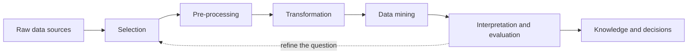
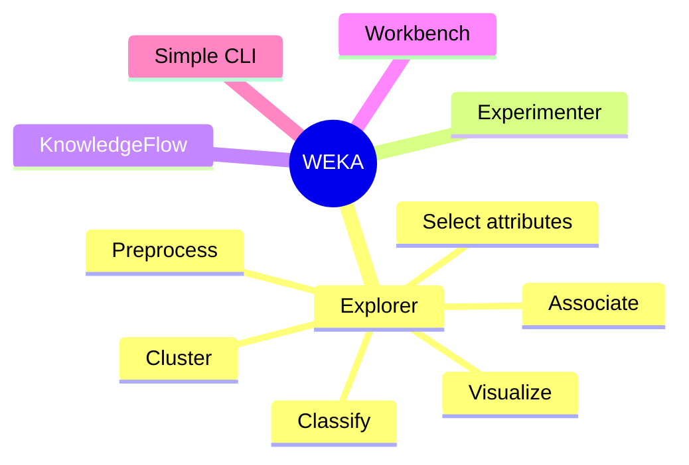
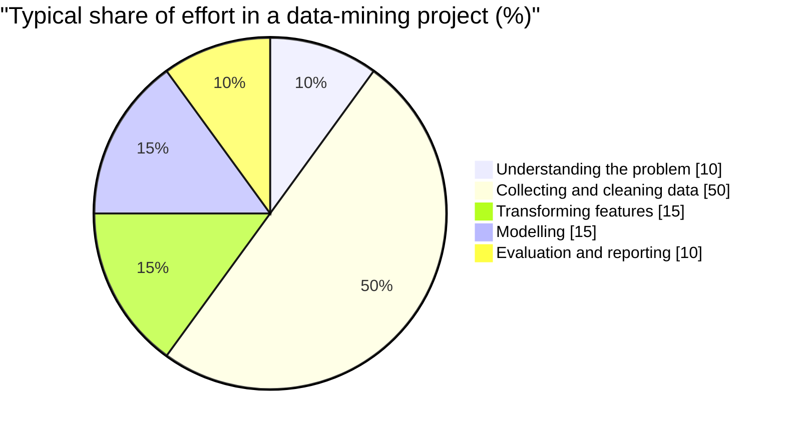

# Session 1 · Introduction to Data Mining and WEKA

[](https://colab.research.google.com/github/Hamnakhan123/Diploma-in-Data-Science/blob/main/term-2/01-data-mining-with-weka/code/session-01-introduction-to-data-mining-and-weka.ipynb)

> 📍 [Diploma in Data Science](../../README.md) › [Term 2](../README.md) › [Data Mining with WEKA](README.md) › **Session 1**

| ⏱ Estimated time | 🧩 Prerequisites | 💻 Tools |
|---|---|---|
| 2 hours (1 h concepts + 1 h lab) | Term 1 Python and statistics basics | WEKA 3.8, Python 3 (pandas, scikit-learn) |

[⬅ Previous: Module overview](README.md) · [🏠 Module home](README.md) · [Next: Session 2 · Data Warehousing and Data Pre-processing ➡](session-02-data-warehousing-and-preprocessing.md)

---

## 🎯 Learning objectives

By the end of this session you will be able to:

- Define **data mining** and place it inside the wider Knowledge Discovery in Databases (KDD) process.
- Name the main families of data-mining tasks (classification, regression, clustering, association, anomaly detection) and match each to a business question.
- Explain what **WEKA** is, what its five interfaces do, and why it is popular for teaching and prototyping.
- Install WEKA, load a dataset in the **ARFF** format and read the summary statistics it shows.
- Reproduce the same first look at a dataset in Python so you can move between both tools.

## 📖 Concepts

### 1. What is data mining?

Organisations collect far more data than any person can read. **Data mining** is the practice of automatically searching large datasets for patterns that are *valid*, *novel*, *useful* and *understandable*. A supermarket that discovers "customers who buy nappies on Friday evenings often buy juice too" has mined a pattern; a bank that learns which loan applications tend to default has mined a predictive model.

Think of a data miner as a **gold prospector**: the raw dataset is a mountain of rock, the algorithms are the tools, and the "gold" is a small number of patterns worth acting on. Most rock is discarded, and that is normal.

### 2. Data mining inside KDD

Data mining is one step in a longer pipeline called **Knowledge Discovery in Databases (KDD)**:

| Step | What happens | Example (university admissions data) |
|---|---|---|
| 1. Selection | Choose the data relevant to the question | Pick applicant records from the last 5 years |
| 2. Pre-processing | Clean errors, fill missing values | Fix "Karachi" vs "karachi", fill blank marks |
| 3. Transformation | Reshape, derive, scale features | Convert marks to percentages, bucket ages |
| 4. **Data mining** | Apply algorithms to find patterns | Train a decision tree predicting "enrolled" |
| 5. Interpretation / evaluation | Check patterns are valid and useful | Accuracy on unseen years, discuss with admissions office |

In industry the same idea appears as **CRISP-DM** (Business understanding → Data understanding → Data preparation → Modelling → Evaluation → Deployment). The names differ; the loop is the same.

### 3. Families of data-mining tasks

| Task | Question it answers | Output | Typical WEKA tab |
|---|---|---|---|
| **Classification** | Which category does this record belong to? | Label (yes/no, spam/ham) | Classify |
| **Regression** | What numeric value should we expect? | Number (price, marks) | Classify |
| **Clustering** | Which records naturally group together? | Group IDs | Cluster |
| **Association rules** | Which items occur together? | If-then rules | Associate |
| **Attribute selection** | Which columns matter most? | Ranked features | Select attributes |
| **Anomaly detection** | Which records look unusual? | Outlier flags | Filters / Cluster |

**Supervised** tasks (classification, regression) learn from examples that already carry the right answer, called the **class attribute**. **Unsupervised** tasks (clustering, association) have no answer column; they look for structure.

### 4. What is WEKA?

**WEKA** (Waikato Environment for Knowledge Analysis) is a free, open-source data-mining workbench written in Java at the University of Waikato, New Zealand. (The weka is also a flightless bird found only in New Zealand, hence the logo.) It bundles more than 100 algorithms behind a point-and-click interface, so you can try ideas without writing code, and it has a Java API and command line for automation.

**Why use it?** It is free and runs on Windows, macOS and Linux; you need no programming to experiment; every algorithm uses the same input format; and results such as confusion matrices come out in a standard report.

**Limits:** the whole dataset must fit in memory, the GUI can feel dated, and very large or streaming data belongs in tools such as Spark (Module 2).

### 5. The WEKA toolkit: five interfaces

| Interface | Use it when you want to… |
|---|---|
| **Explorer** | Explore one dataset interactively: pre-process, classify, cluster, associate, select attributes, visualise. *You will use this most.* |
| **Experimenter** | Compare several algorithms on several datasets with repeated cross-validation and significance tests. |
| **KnowledgeFlow** | Build a drag-and-drop pipeline (load → filter → train → evaluate), useful for repeatable workflows. |
| **Workbench** | All of the above in one window with tabs. |
| **Simple CLI** | Type WEKA commands, exactly like the command-line examples in this repository. |

The Explorer has six tabs that mirror the task families: **Preprocess, Classify, Cluster, Associate, Select attributes, Visualize**.

### 6. The ARFF file format

WEKA's native format is **ARFF** (Attribute-Relation File Format), a plain-text file with a header that declares each column's type, followed by the data:

- `@relation name` names the dataset.
- `@attribute name type` declares a column: `numeric`, a nominal set like `{yes,no}`, `string` or `date`.
- `@data` starts comma-separated rows; `?` means a missing value.

WEKA also opens CSV files directly and can convert them to ARFF (File → Save as).

### 7. Installing and setting up WEKA

1. Install a 64-bit **Java** runtime if your WEKA download does not bundle one (Windows and macOS installers include it).
2. Download the current stable **WEKA 3.8** installer from the University of Waikato website.
3. Run the installer, accept the defaults and launch **WEKA GUI Chooser**.
4. Optional: open **Tools → Package manager** to add extra algorithms (for example, `LibSVM`).
5. If WEKA runs out of memory on a large file, raise the heap limit in the `RunWeka.ini` file (`maxheap=4g`).

On Google Colab or Linux you can also run WEKA head-less from the command line with `java -cp weka.jar <ClassName> <options>`, which is how the outputs in this repository were produced.

## 🧭 Diagrams





## 💻 Worked examples

### Example 1 · Write your first ARFF file

We will use a tiny dataset about whether students passed a lab exam. Save it as `students.arff`.

📄 [`code/students.arff`](code/students.arff)

```text
@relation students

@attribute attendance numeric
@attribute assignments numeric
@attribute shift {morning,evening}
@attribute passed {yes,no}

@data
92,8,morning,yes
85,7,evening,yes
60,3,evening,no
78,6,morning,yes
55,2,morning,no
70,5,evening,yes
48,4,evening,no
88,9,morning,yes
65,?,morning,no
95,10,evening,yes
72,6,evening,yes
58,3,morning,no
```

### Example 2 · Ask WEKA for a dataset summary

In the Explorer you would click **Open file…** in the Preprocess tab. From the command line, `weka.core.Instances` prints the same summary panel:

📄 [`code/session-01_summary.sh`](code/session-01_summary.sh)

```bash
weka weka.core.Instances students.arff
```

**Output** (real WEKA 3.8.6 run)

```text
Relation Name:  students
Num Instances:  12
Num Attributes: 4

     Name                      Type  Nom  Int Real     Missing      Unique  Dist
1 attendance                 Num   0% 100%   0%     0 /  0%    12 /100%    12
2 assignments                Num   0%  92%   0%     1 /  8%     7 / 58%     9
3 shift                      Nom 100%   0%   0%     0 /  0%     0 /  0%     2
4 passed                     Nom 100%   0%   0%     0 /  0%     0 /  0%     2
```

Read it like this: **Type** is `Num` (numeric) or `Nom` (nominal); **Int** says what share of values are whole numbers; **Missing** shows one missing `assignments` value (8%); **Unique** counts values that appear exactly once and **Dist** counts distinct values. In the Explorer, clicking `passed` would also show a bar chart of the labels (7 yes, 5 no).

### Example 3 · A first model in one line

Clicking **Classify → Choose → trees → J48 → Start** trains a decision tree. Here is the same run, evaluated with 3-fold cross-validation:

📄 [`code/session-01_j48.sh`](code/session-01_j48.sh)

```bash
weka weka.classifiers.trees.J48 -t students.arff -x 3 -v
```

**Output** (real WEKA 3.8.6 run)

```text
=== Classifier model (full training set) ===

J48 pruned tree
------------------

attendance <= 65: no (5.0)
attendance > 65: yes (7.0)

Number of Leaves  : 	2

Size of the tree : 	3

=== Stratified cross-validation ===

Correctly Classified Instances          11               91.6667 %
Incorrectly Classified Instances         1                8.3333 %
Kappa statistic                          0.8235
Mean absolute error                      0.0833
Root mean squared error                  0.2887
Relative absolute error                 16.6667 %
Root relative squared error             56.9803 %
Total Number of Instances               12

=== Detailed Accuracy By Class ===

                 TP Rate  FP Rate  Precision  Recall   F-Measure  MCC      ROC Area  PRC Area  Class
                 1.000    0.200    0.875      1.000    0.933      0.837    0.900     0.875     yes
                 0.800    0.000    1.000      0.800    0.889      0.837    0.900     0.883     no
Weighted Avg.    0.917    0.117    0.927      0.917    0.915      0.837    0.900     0.878

=== Confusion Matrix ===

 a b   <-- classified as
 7 0 | a = yes
 1 4 | b = no
```

`-v` hides the training-set statistics so you see only the tree and the honest cross-validated result. The tree needs a single question about `attendance`, and cross-validation gets 11 of 12 students right. Session 4 explains every number in this report.

### Example 4 · The same first look in Python

Moving between WEKA and Python is a core skill in this course. pandas gives the same summary:

📄 [`code/session-01_first_look.py`](code/session-01_first_look.py)

```python
import io
import pandas as pd

csv = """attendance,assignments,shift,passed
92,8,morning,yes
85,7,evening,yes
60,3,evening,no
78,6,morning,yes
55,2,morning,no
70,5,evening,yes
48,4,evening,no
88,9,morning,yes
65,,morning,no
95,10,evening,yes
72,6,evening,yes
58,3,morning,no"""
df = pd.read_csv(io.StringIO(csv))

print("Shape:", df.shape)
print("\nMissing values per column:")
print(df.isna().sum())
print("\nNumeric summary:")
print(df.describe().round(2))
print("\nClass balance:")
print(df["passed"].value_counts())
print("\nMean attendance by outcome:")
print(df.groupby("passed")["attendance"].mean().round(1))
```

**Output**

```text
Shape: (12, 4)

Missing values per column:
attendance     0
assignments    1
shift          0
passed         0
dtype: int64

Numeric summary:
       attendance  assignments
count       12.00        11.00
mean        72.17         5.73
std         15.51         2.61
min         48.00         2.00
25%         59.50         3.50
50%         71.00         6.00
75%         85.75         7.50
max         95.00        10.00

Class balance:
passed
yes    7
no     5
Name: count, dtype: int64

Mean attendance by outcome:
passed
no     57.2
yes    82.9
Name: attendance, dtype: float64
```

Notice that students who passed attended about 83% of classes on average versus 57% for those who did not, which is exactly why the WEKA tree chose `attendance` for its split.

### Example 5 · Converting CSV to ARFF in Python

If a colleague sends you a CSV, you can generate an ARFF header automatically:

📄 [`code/session-01_csv_to_arff.py`](code/session-01_csv_to_arff.py)

```python
import pandas as pd

df = pd.DataFrame({
    "temperature": [30.5, 28.0, 35.2, 22.1],
    "humidity": [70, 65, 80, 50],
    "outlook": ["sunny", "rainy", "sunny", "overcast"],
    "play": ["no", "yes", "no", "yes"],
})

def to_arff(frame, relation):
    lines = [f"@relation {relation}", ""]
    for col in frame.columns:
        if pd.api.types.is_numeric_dtype(frame[col]):
            kind = "numeric"
        else:
            kind = "{" + ",".join(sorted(frame[col].dropna().unique())) + "}"
        lines.append(f"@attribute {col} {kind}")
    lines += ["", "@data"]
    for row in frame.itertuples(index=False):
        lines.append(",".join("?" if pd.isna(v) else str(v) for v in row))
    return "\n".join(lines)

print(to_arff(df, "weather"))
```

**Output**

```text
@relation weather

@attribute temperature numeric
@attribute humidity numeric
@attribute outlook {overcast,rainy,sunny}
@attribute play {no,yes}

@data
30.5,70,sunny,no
28.0,65,rainy,yes
35.2,80,sunny,no
22.1,50,overcast,yes
```

## 📊 Where data-mining effort goes

Practitioner surveys repeatedly report that preparing data, not modelling, consumes most of a project. A typical split looks like this:



## 🧪 Lab / practice tasks

### 🟢 Task 1 · Easy

Install WEKA, open the GUI Chooser and launch the Explorer. Load `students.arff` and write down the minimum, maximum, mean and standard deviation of `attendance`.

<details><summary>💡 Hint</summary>

Click the `attendance` attribute in the left list; the statistics appear in the right-hand "Selected attribute" panel.

</details>

### 🟢 Task 2 · Easy

Add three more students (one with a missing `shift`) to `students.arff` and reload it. Confirm WEKA reports the missing value.

<details><summary>💡 Hint</summary>

A missing value is written as `?` in the `@data` section.

</details>

### 🟡 Task 3 · Medium

In the Classify tab run J48 and then `ZeroR`. Compare their accuracies. Why is ZeroR a useful **baseline**?

<details><summary>💡 Hint</summary>

ZeroR always predicts the majority class; any real model must beat it to be worth using.

</details>

### 🟠 Task 4 · Hard

Use the **Visualize** tab to plot `attendance` against `assignments`, coloured by `passed`. Describe the boundary you see in one sentence.

<details><summary>💡 Hint</summary>

Look for a region of the plot where nearly all points are one colour.

</details>

### 🔴 Task 5 · Challenge

Write a Python function that reads an ARFF file (header + data) into a pandas DataFrame without any extra library, then test it on `students.arff`.

<details><summary>💡 Hint</summary>

Split the file at `@data`; parse `@attribute` lines with `str.split()`; replace `?` with `None`.

</details>


## ✅ Quick quiz

**Q1.** In the KDD process, which step comes immediately before data mining?

- **A)** Selection
- **B)** Interpretation
- **C)** Transformation
- **D)** Deployment

<details><summary>Show answer</summary>

**C** — Data is selected, cleaned and transformed before algorithms are applied.

</details>

**Q2.** Which WEKA interface is designed for comparing many algorithms with statistical tests?

- **A)** Explorer
- **B)** Experimenter
- **C)** Simple CLI
- **D)** Visualize tab

<details><summary>Show answer</summary>

**B** — The Experimenter runs repeated cross-validation across datasets and algorithms and tests significance.

</details>

**Q3.** In an ARFF file, how is a missing value written?

- **A)** NA
- **B)** null
- **C)** ?
- **D)** blank

<details><summary>Show answer</summary>

**C** — WEKA uses a question mark for missing values.

</details>

**Q4.** Grouping customers by similar purchasing behaviour with no labels is an example of…

- **A)** Classification
- **B)** Clustering
- **C)** Regression
- **D)** Association

<details><summary>Show answer</summary>

**B** — No class attribute is given, so it is unsupervised clustering.

</details>

**Q5.** Why do we run ZeroR before a real classifier?

- **A)** It is the most accurate algorithm
- **B)** It gives a baseline to beat
- **C)** It removes missing values
- **D)** It converts CSV to ARFF

<details><summary>Show answer</summary>

**B** — ZeroR predicts the majority class; a useful model must do better.

</details>


## 📝 Summary

- **Data mining** finds valid, novel, useful and understandable patterns in large data; it is the modelling step of **KDD**.
- Tasks: **classification**, **regression** (supervised); **clustering**, **association** (unsupervised); plus attribute selection and anomaly detection.
- **WEKA** is a free Java workbench with **Explorer, Experimenter, KnowledgeFlow, Workbench** and **Simple CLI**.
- **ARFF** = `@relation`, `@attribute` (numeric / nominal / string / date), `@data`; `?` = missing.
- Always compare a model against a **baseline** such as ZeroR.

### 🎤 Interview / viva questions

1. How is data mining different from simply querying a database with SQL?
2. Walk through the KDD steps using an example from your own city or university.
3. When would you choose WEKA, and when would you choose Python or Spark instead?
4. What problems might a nominal attribute with 500 different values cause in WEKA?
5. Why is the class attribute usually placed last in an ARFF file?

---

[⬅ Previous: Module overview](README.md) · [🏠 Module home](README.md) · [Next: Session 2 · Data Warehousing and Data Pre-processing ➡](session-02-data-warehousing-and-preprocessing.md)

<sub>Diploma in Data Science · Prepared by **Hamna Zahid Khan**, Junior Lecturer</sub>
