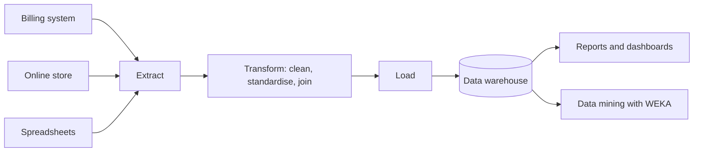
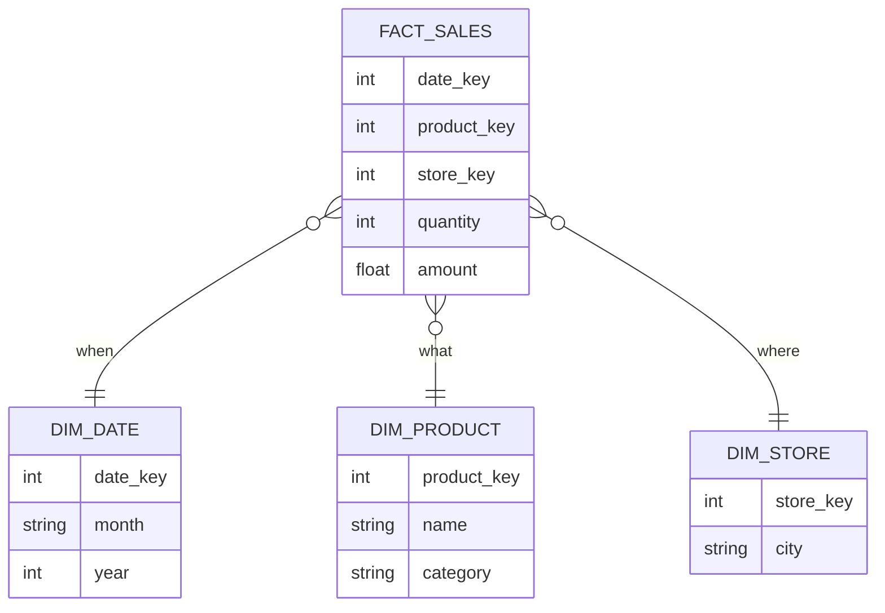

# Session 2 · Data Warehousing and Data Pre-processing

[](https://colab.research.google.com/github/Hamnakhan123/Diploma-in-Data-Science/blob/main/term-2/01-data-mining-with-weka/code/session-02-data-warehousing-and-preprocessing.ipynb)

> 📍 [Diploma in Data Science](../../README.md) › [Term 2](../README.md) › [Data Mining with WEKA](README.md) › **Session 2**

| ⏱ Estimated time | 🧩 Prerequisites | 💻 Tools |
|---|---|---|
| 2 hours | Session 1, basic SQL (Term 1) | WEKA 3.8, Python 3 (pandas, sqlite3) |

[⬅ Previous: Session 1 · Introduction to Data Mining and WEKA](session-01-introduction-to-data-mining-and-weka.md) · [🏠 Module home](README.md) · [Next: Session 3 · Association Rule Mining ➡](session-03-association-rule-mining.md)

---

## 🎯 Learning objectives

- Explain what a **data warehouse** is and how it differs from an operational (OLTP) database.
- Design a simple **star schema** with fact and dimension tables and describe the **ETL** process that fills it.
- Compare common open-source and commercial warehouse tools.
- Apply the main **pre-processing** techniques: cleaning, missing-value handling, normalisation, discretisation and attribute removal.
- Use WEKA **filters** and the equivalent pandas code to prepare data for mining.

## 📖 Concepts

### 1. Why a data warehouse?

A shop's billing system is built to record thousands of small transactions quickly and safely. That is **OLTP** (Online Transaction Processing). Asking it "what were monthly sales per city for the last five years?" would be slow and could even disturb the tills. A **data warehouse** is a separate store, designed for **analysis** (OLAP, Online Analytical Processing), that collects cleaned, historical data from many systems.

Bill Inmon's classic definition says a warehouse is **subject-oriented** (organised around sales, students, patients), **integrated** (consistent codes and units), **time-variant** (keeps history) and **non-volatile** (data is loaded and read, rarely updated).

| Feature | OLTP database | Data warehouse |
|---|---|---|
| Purpose | Run the business | Analyse the business |
| Typical query | Insert one order | Summarise millions of rows |
| Data | Current, detailed | Historical, integrated, often summarised |
| Design | Normalised (3NF) | Denormalised (star / snowflake) |
| Users | Clerks, apps | Analysts, managers, data miners |

### 2. Building a warehouse: ETL and the star schema

**ETL** stands for **Extract** (pull data from source systems), **Transform** (clean, standardise, join, derive) and **Load** (write into the warehouse). Modern cloud platforms often do **ELT**: load raw data first, then transform inside the warehouse.

The most common design is the **star schema**:

- A central **fact table** stores measurable events (sales amount, quantity) plus foreign keys.
- Surrounding **dimension tables** describe the context: *when* (date), *what* (product), *where* (store), *who* (customer).

A **snowflake schema** normalises dimensions further (for example, product → category table). It saves space but needs more joins.

Common warehouse operations are **roll-up** (day → month), **drill-down** (year → quarter), **slice** (fix one dimension, e.g. year = 2025), **dice** (fix several) and **pivot** (rotate rows and columns).

### 3. Warehouse tools

| Type | Examples | Notes |
|---|---|---|
| Open-source databases | PostgreSQL, MySQL, ClickHouse, Apache Druid | Free; ClickHouse and Druid are column stores built for fast analytics |
| Open-source ETL | Apache NiFi, Airbyte, Pentaho Data Integration, dbt Core | Move and transform data |
| Commercial / cloud | Snowflake, Amazon Redshift, Google BigQuery, Azure Synapse, Oracle, Teradata | Pay-as-you-go, scale automatically, managed backups |
| Commercial ETL | Informatica, Talend, SSIS | Visual designers, enterprise support |

For teaching, SQLite or PostgreSQL is enough to learn star schemas. In industry, the choice depends on data size, budget, skills and which cloud the company already uses.

### 4. Why pre-process?

Real data is **dirty**: missing values, typos, duplicates, inconsistent units, outliers and irrelevant columns. "Garbage in, garbage out" applies to every algorithm. Pre-processing usually takes more time than modelling.

| Problem | Example | Technique | WEKA filter |
|---|---|---|---|
| Missing values | Blank marks | Replace with mean / mode, or drop rows | `ReplaceMissingValues` |
| Different scales | Salary (50 000) vs age (25) | **Normalise** to 0–1 or **standardise** to mean 0, sd 1 | `Normalize`, `Standardize` |
| Numeric needed as category | Age → young / middle / senior | **Discretise** into bins | `Discretize` |
| Irrelevant columns | Student ID | Remove attribute | `Remove` |
| Text categories needed as numbers | City | One-hot / binary encoding | `NominalToBinary` |
| Outliers | Height = 900 cm | Detect and cap or remove | `InterquartileRange` |
| Too many rows | 10 million rows | Sampling | `Resample` |

WEKA splits filters into **supervised** (use the class label, e.g. supervised discretisation) and **unsupervised** (ignore it), and into **attribute** filters (change columns) and **instance** filters (change rows).

**Normalisation formula:** `x' = (x − min) / (max − min)`. **Standardisation:** `z = (x − mean) / sd`.

## 🧭 Diagrams





## 💻 Worked examples

### Example 1 · A mini star schema in SQL

We emulate a warehouse with SQLite (the same SQL runs on PostgreSQL) and perform a roll-up and a slice.

📄 [`code/session-02_star_schema.py`](code/session-02_star_schema.py)

```python
import sqlite3

con = sqlite3.connect(":memory:")
cur = con.cursor()
cur.executescript("""
CREATE TABLE dim_date(date_key INTEGER PRIMARY KEY, month TEXT, year INTEGER);
CREATE TABLE dim_product(product_key INTEGER PRIMARY KEY, name TEXT, category TEXT);
CREATE TABLE dim_store(store_key INTEGER PRIMARY KEY, city TEXT);
CREATE TABLE fact_sales(date_key INT, product_key INT, store_key INT, quantity INT, amount REAL);

INSERT INTO dim_date VALUES (1,'Jan',2025),(2,'Feb',2025),(3,'Jan',2026);
INSERT INTO dim_product VALUES (1,'Notebook','Stationery'),(2,'Pen','Stationery'),(3,'Headphones','Electronics');
INSERT INTO dim_store VALUES (1,'Karachi'),(2,'Lahore');
INSERT INTO fact_sales VALUES
 (1,1,1,40,4000),(1,2,1,100,2000),(1,3,2,5,25000),
 (2,1,2,30,3000),(2,3,1,8,40000),(3,2,2,150,3000),(3,3,1,6,30000);
""")

print("Roll-up: total sales by year and category")
for row in cur.execute("""
    SELECT d.year, p.category, SUM(f.amount) AS total
    FROM fact_sales f
    JOIN dim_date d ON f.date_key = d.date_key
    JOIN dim_product p ON f.product_key = p.product_key
    GROUP BY d.year, p.category ORDER BY d.year, total DESC"""):
    print(row)

print("\nSlice: 2025 only, sales by city")
for row in cur.execute("""
    SELECT s.city, SUM(f.amount), SUM(f.quantity)
    FROM fact_sales f
    JOIN dim_date d ON f.date_key = d.date_key
    JOIN dim_store s ON f.store_key = s.store_key
    WHERE d.year = 2025 GROUP BY s.city"""):
    print(row)
```

**Output**

```text
Roll-up: total sales by year and category
(2025, 'Electronics', 65000.0)
(2025, 'Stationery', 9000.0)
(2026, 'Electronics', 30000.0)
(2026, 'Stationery', 3000.0)

Slice: 2025 only, sales by city
('Karachi', 46000.0, 148)
('Lahore', 28000.0, 35)
```

### Example 2 · A dirty dataset

📄 [`code/employees.arff`](code/employees.arff)

```text
@relation employees

@attribute age numeric
@attribute salary numeric
@attribute city {Karachi,Lahore,Islamabad}
@attribute experience numeric
@attribute promoted {yes,no}

@data
25,45000,Karachi,1,no
32,?,Lahore,6,yes
41,120000,Karachi,15,yes
29,52000,?,4,no
?,61000,Islamabad,7,yes
36,88000,Lahore,10,yes
23,38000,Karachi,0,no
45,135000,Islamabad,20,yes
27,47000,Lahore,3,no
33,70000,Karachi,?,no
```

### Example 3 · Replace missing values with a WEKA filter

`ReplaceMissingValues` fills numeric gaps with the **mean** and nominal gaps with the **mode**. In the Explorer: Preprocess → Filter → Choose → unsupervised → attribute → ReplaceMissingValues → Apply.

📄 [`code/session-02_replace_missing.sh`](code/session-02_replace_missing.sh)

```bash
weka weka.filters.unsupervised.attribute.ReplaceMissingValues -i employees.arff -o filled.arff
grep -A 12 "@data" filled.arff
```

**Output** (real WEKA 3.8.6 run)

```text
@data

25,45000,Karachi,1,no
32,72888.888889,Lahore,6,yes
41,120000,Karachi,15,yes
29,52000,Karachi,4,no
32.333333,61000,Islamabad,7,yes
36,88000,Lahore,10,yes
23,38000,Karachi,0,no
45,135000,Islamabad,20,yes
27,47000,Lahore,3,no
33,70000,Karachi,7.333333,no
```

### Example 4 · Normalise and discretise

Chaining filters: first fill gaps, then scale numbers to 0–1, then cut `age` (attribute 1) into 3 equal-width bins.

📄 [`code/session-02_normalize_discretize.sh`](code/session-02_normalize_discretize.sh)

```bash
weka weka.filters.unsupervised.attribute.ReplaceMissingValues -i employees.arff -o step1.arff
weka weka.filters.unsupervised.attribute.Normalize -i step1.arff -o step2.arff
weka weka.filters.unsupervised.attribute.Discretize -B 3 -R 1 -i step1.arff -o step3.arff
echo "--- normalised (first 4 rows) ---"
grep -A 4 "@data" step2.arff | tail -4
echo "--- age discretised into 3 bins ---"
grep "@attribute age" step3.arff
```

**Output** (real WEKA 3.8.6 run)

```text
--- normalised (first 4 rows) ---

0.090909,0.072165,Karachi,0.05,no
0.409091,0.359679,Lahore,0.3,yes
0.818182,0.845361,Karachi,0.75,yes
--- age discretised into 3 bins ---
@attribute age {'\'(-inf-30.333333]\'','\'(30.333333-37.666667]\'','\'(37.666667-inf)\''}
```

### Example 5 · The same pipeline in pandas

📄 [`code/session-02_preprocess_pandas.py`](code/session-02_preprocess_pandas.py)

```python
import pandas as pd
import numpy as np

df = pd.DataFrame({
    "age": [25, 32, 41, 29, np.nan, 36, 23, 45, 27, 33],
    "salary": [45000, np.nan, 120000, 52000, 61000, 88000, 38000, 135000, 47000, 70000],
    "city": ["Karachi", "Lahore", "Karachi", None, "Islamabad", "Lahore", "Karachi", "Islamabad", "Lahore", "Karachi"],
    "experience": [1, 6, 15, 4, 7, 10, 0, 20, 3, np.nan],
    "promoted": ["no", "yes", "yes", "no", "yes", "yes", "no", "yes", "no", "no"],
})
print("Missing before:", df.isna().sum().to_dict())

num = ["age", "salary", "experience"]
df[num] = df[num].fillna(df[num].mean())            # like ReplaceMissingValues
df["city"] = df["city"].fillna(df["city"].mode()[0])
print("Missing after: ", df.isna().sum().to_dict())

norm = (df[num] - df[num].min()) / (df[num].max() - df[num].min())   # like Normalize
print("\nNormalised (first 4 rows):")
print(norm.head(4).round(3))

df["age_band"] = pd.cut(df["age"], bins=3, labels=["young", "middle", "senior"])  # like Discretize
print("\nAge bands:")
print(df[["age", "age_band"]].head(6))

encoded = pd.get_dummies(df[["city"]], prefix="city").astype(int)   # like NominalToBinary
print("\nOne-hot encoded city:")
print(encoded.head(4))
```

**Output**

```text
Missing before: {'age': 1, 'salary': 1, 'city': 1, 'experience': 1, 'promoted': 0}
Missing after:  {'age': 0, 'salary': 0, 'city': 0, 'experience': 0, 'promoted': 0}

Normalised (first 4 rows):
     age  salary  experience
0  0.091   0.072        0.05
1  0.409   0.360        0.30
2  0.818   0.845        0.75
3  0.273   0.144        0.20

Age bands:
         age age_band
0  25.000000    young
1  32.000000   middle
2  41.000000   senior
3  29.000000    young
4  32.333333   middle
5  36.000000   middle

One-hot encoded city:
   city_Islamabad  city_Karachi  city_Lahore
0               0             1            0
1               0             0            1
2               0             1            0
3               0             1            0
```

### Example 6 · Detecting outliers with the IQR rule

📄 [`code/session-02_iqr_outliers.py`](code/session-02_iqr_outliers.py)

```python
import pandas as pd

marks = pd.Series([62, 70, 68, 75, 71, 66, 69, 300, 73, 5], name="marks")
q1, q3 = marks.quantile([0.25, 0.75])
iqr = q3 - q1
low, high = q1 - 1.5 * iqr, q3 + 1.5 * iqr
print(f"Q1={q1}, Q3={q3}, IQR={iqr}, fences=({low}, {high})")
print("Outliers:", marks[(marks < low) | (marks > high)].tolist())
print("Capped:  ", marks.clip(low, high).tolist())
```

**Output**

```text
Q1=66.5, Q3=72.5, IQR=6.0, fences=(57.5, 81.5)
Outliers: [300, 5]
Capped:   [62.0, 70.0, 68.0, 75.0, 71.0, 66.0, 69.0, 81.5, 73.0, 57.5]
```

## 📊 How each filter changes data

| Filter | Before | After |
|---|---|---|
| ReplaceMissingValues | `?` in salary | column mean |
| Normalize | 38 000 … 135 000 | 0.0 … 1.0 |
| Standardize | 38 000 … 135 000 | mean 0, sd 1 |
| Discretize (3 bins) | 23 … 45 | three ranges of equal width |
| NominalToBinary | city = Lahore | city=Karachi 0, city=Lahore 1, city=Islamabad 0 |

## 🧪 Lab / practice tasks

### 🟢 Task 1 · Easy

Load `employees.arff` in the Explorer, apply `ReplaceMissingValues`, and use **Undo** to compare before and after for `salary`.

<details><summary>💡 Hint</summary>

The Preprocess tab keeps a history; the Undo button restores the previous version.

</details>

### 🟡 Task 2 · Medium

Design a star schema (fact + 3 dimensions) for a hospital that wants to analyse patient visits by doctor, department and month. Draw it as a Mermaid `erDiagram`.

<details><summary>💡 Hint</summary>

The measurable event is the visit; measures could be fee and duration.

</details>

### 🟡 Task 3 · Medium

Apply `Discretize` to `salary` with 4 bins using equal **frequency** instead of equal width (option `-F`). Compare the bin edges.

<details><summary>💡 Hint</summary>

Equal frequency puts roughly the same number of rows in each bin.

</details>

### 🟠 Task 4 · Hard

Add a `YEAR`-to-`MONTH` drill-down query to Example 1 and a **pivot** that shows cities as columns.

<details><summary>💡 Hint</summary>

Use `CASE WHEN city='Karachi' THEN amount END` inside `SUM()` to pivot in SQL.

</details>

### 🔴 Task 5 · Challenge

Write a reusable pandas function `prepare(df, target)` that fills missing values, scales numeric columns, one-hot encodes nominal columns and returns X and y.

<details><summary>💡 Hint</summary>

Use `select_dtypes` to separate numeric and object columns.

</details>


## ✅ Quick quiz

**Q1.** Which property means warehouse data keeps history over time?

- **A)** Subject-oriented
- **B)** Integrated
- **C)** Time-variant
- **D)** Volatile

<details><summary>Show answer</summary>

**C** — Time-variant: every record is tied to a time period.

</details>

**Q2.** In a star schema, numeric measures such as sales amount live in the…

- **A)** Dimension table
- **B)** Fact table
- **C)** Lookup table
- **D)** Staging area

<details><summary>Show answer</summary>

**B** — The fact table holds measures and foreign keys to dimensions.

</details>

**Q3.** WEKA's ReplaceMissingValues fills a nominal attribute with the…

- **A)** Mean
- **B)** Median
- **C)** Mode
- **D)** Zero

<details><summary>Show answer</summary>

**C** — Nominal gaps use the most frequent value (mode).

</details>

**Q4.** Viewing yearly totals after looking at daily totals is called…

- **A)** Drill-down
- **B)** Roll-up
- **C)** Slice
- **D)** Pivot

<details><summary>Show answer</summary>

**B** — Roll-up aggregates to a coarser level.

</details>

**Q5.** Which formula does min-max normalisation use?

- **A)** (x − mean)/sd
- **B)** (x − min)/(max − min)
- **C)** x / max
- **D)** log(x)

<details><summary>Show answer</summary>

**B** — It rescales values into the 0–1 range.

</details>


## 📝 Summary

- **OLTP** runs the business; a **data warehouse** (OLAP) analyses it: subject-oriented, integrated, time-variant, non-volatile.
- **ETL / ELT** fills the warehouse; **star schema** = fact table + dimension tables; **snowflake** normalises dimensions.
- OLAP operations: **roll-up, drill-down, slice, dice, pivot**.
- Pre-processing: missing values, scaling, discretisation, encoding, outliers, attribute removal, sampling.
- WEKA filters: `ReplaceMissingValues`, `Normalize`, `Standardize`, `Discretize`, `NominalToBinary`, `Remove`, `Resample`.

### 🎤 Interview / viva questions

1. Why not run analytical queries directly on the production database?
2. Star vs snowflake schema: give one advantage of each.
3. When would you drop rows with missing values instead of imputing them?
4. Why do distance-based algorithms such as k-NN and k-Means need normalised data?
5. What is the risk of using supervised discretisation before cross-validation?

---

[⬅ Previous: Session 1 · Introduction to Data Mining and WEKA](session-01-introduction-to-data-mining-and-weka.md) · [🏠 Module home](README.md) · [Next: Session 3 · Association Rule Mining ➡](session-03-association-rule-mining.md)

<sub>Diploma in Data Science · Prepared by **Hamna Zahid Khan**, Junior Lecturer</sub>
