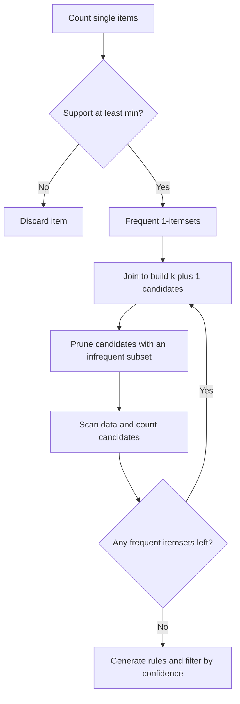
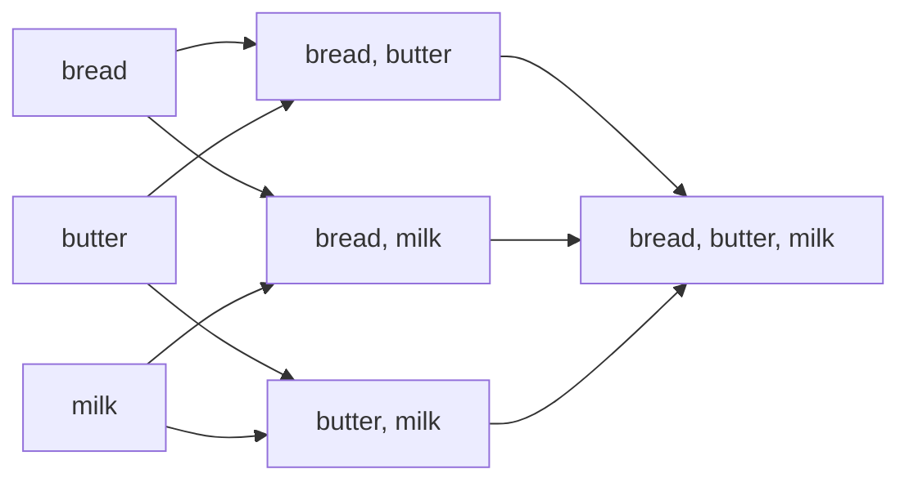
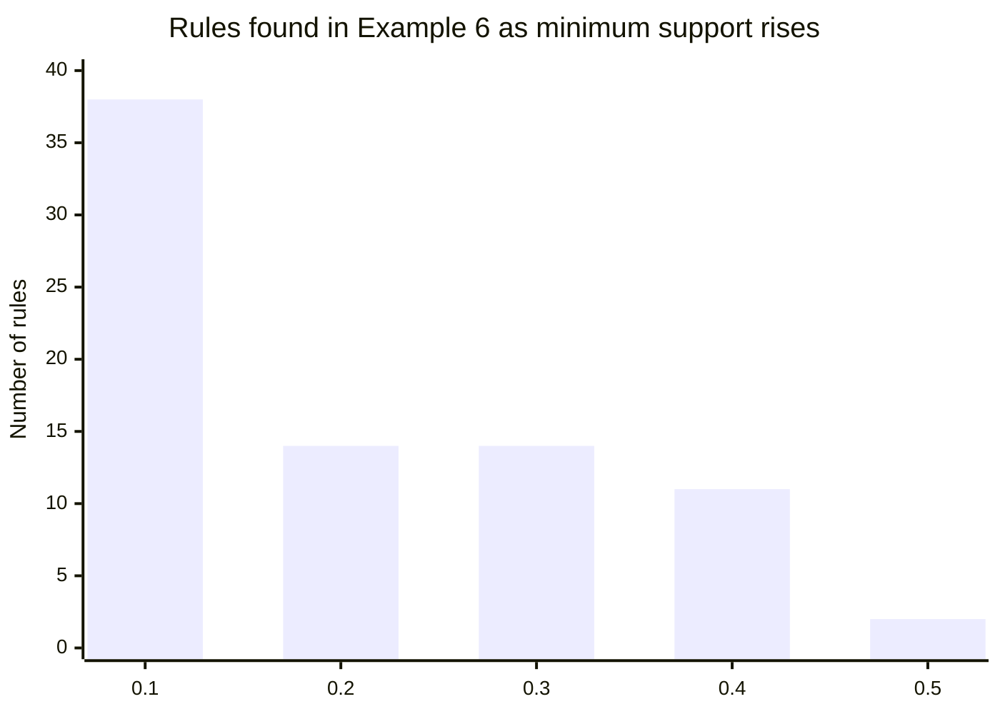

# Session 3 · Association Rule Mining

[](https://colab.research.google.com/github/Hamnakhan123/Diploma-in-Data-Science/blob/main/term-2/01-data-mining-with-weka/code/session-03-association-rule-mining.ipynb)

> 📍 [Diploma in Data Science](../../README.md) › [Term 2](../README.md) › [Data Mining with WEKA](README.md) › **Session 3**

| ⏱ Estimated time | 🧩 Prerequisites | 💻 Tools |
|---|---|---|
| 2 hours | Sessions 1–2, basic probability | WEKA 3.8 (Apriori), Python 3 (mlxtend) |

[⬅ Previous: Session 2 · Data Warehousing and Data Pre-processing](session-02-data-warehousing-and-preprocessing.md) · [🏠 Module home](README.md) · [Next: Session 4 · Classification and Decision Trees ➡](session-04-classification-and-decision-trees.md)

---

## 🎯 Learning objectives

- Explain what **association rule mining** is and why retailers, streaming services and hospitals use it.
- Calculate **support**, **confidence** and **lift** by hand for a small set of transactions.
- Describe how the **Apriori** algorithm prunes the search space using the *downward-closure* property.
- Run Apriori in WEKA and in Python and read the rules it produces.
- Tune minimum support and confidence and explain the effect on the number and quality of rules.

## 📖 Concepts

### 1. What is association rule mining?

**Association rule mining** discovers items that frequently appear together in transactions. The result is a set of **rules** written `X ⇒ Y` ("if a basket contains X, it is likely to contain Y"). X is the **antecedent** (left-hand side), Y the **consequent** (right-hand side).

| Domain | Transaction | Example rule |
|---|---|---|
| Supermarket | One basket | {bread, butter} ⇒ {milk} |
| Online store | One order | {phone} ⇒ {phone cover} |
| Streaming | One user's watch list | {Drama A, Drama B} ⇒ {Drama C} |
| Healthcare | One patient record | {diabetes, high BP} ⇒ {kidney test} |
| University | One student's courses | {Statistics} ⇒ {Data Mining} |

Uses include product placement, "frequently bought together" widgets, bundle pricing, cross-selling and catalogue design. This kind of analysis is often called **Market Basket Analysis**.

### 2. Measuring a rule

For N transactions:

- **Support(X)** = transactions containing X ÷ N. *How common is the itemset?*
- **Confidence(X ⇒ Y)** = Support(X ∪ Y) ÷ Support(X). *When X appears, how often does Y appear too?*
- **Lift(X ⇒ Y)** = Confidence(X ⇒ Y) ÷ Support(Y). *Is the pair more common than chance?*

| Lift | Meaning |
|---|---|
| > 1 | X and Y occur together **more** than expected; a positive association |
| = 1 | Independent; the rule tells you nothing |
| < 1 | They occur together **less** than expected (substitutes) |

WEKA also reports **leverage** (Support(X∪Y) − Support(X)·Support(Y)) and **conviction**, which are other ways of measuring surprise.

### 3. Worked calculation

Five baskets: {bread, milk}, {bread, butter, milk}, {bread, butter}, {milk, eggs}, {bread, butter, milk, eggs}.

- Support({bread, butter}) = 3/5 = 0.6
- Support({bread, butter, milk}) = 2/5 = 0.4
- Confidence({bread, butter} ⇒ {milk}) = 0.4 / 0.6 = 0.67
- Support({milk}) = 4/5 = 0.8 → Lift = 0.67 / 0.8 = 0.83 (slightly *below* 1, because milk is in almost every basket anyway)

This shows why confidence alone can mislead: a very popular consequent gives high confidence for nearly any rule.

### 4. The Apriori algorithm

Checking every possible itemset is impossible: 100 products have 2¹⁰⁰ subsets. **Apriori** (Agrawal and Srikant, 1994) uses one key idea:

> **Downward closure:** every subset of a frequent itemset must also be frequent. So if {pen} is rare, {pen, ink} must be rare too, and we never need to count it.

Steps:

1. Count every single item; keep those with support ≥ *min_support* (frequent 1-itemsets, L1).
2. **Join** frequent k-itemsets to make (k+1)-candidates.
3. **Prune** any candidate that has an infrequent subset.
4. Scan the data to count the remaining candidates; keep the frequent ones.
5. Repeat until no new frequent itemsets appear.
6. From each frequent itemset, generate rules and keep those with confidence ≥ *min_confidence*.

### 5. Tuning support and confidence

| Setting | Too low | Too high |
|---|---|---|
| Minimum support | Thousands of rules, slow, many flukes | Only obvious rules about best-sellers |
| Minimum confidence | Weak, unreliable rules | Misses useful but less certain rules |

WEKA's Apriori starts with a high support (`upperBoundMinSupport`, default 1.0) and lowers it by `delta` (default 0.05) until it finds `numRules` (default 10) rules above `minMetric` (default confidence 0.9) or reaches `lowerBoundMinSupport`. You can also rank rules by lift instead (`metricType`).

## 🧭 Diagrams





## 💻 Worked examples

### Example 1 · Support, confidence and lift by hand in Python

📄 [`code/session-03_measures.py`](code/session-03_measures.py)

```python
baskets = [
    {"bread", "milk"},
    {"bread", "butter", "milk"},
    {"bread", "butter"},
    {"milk", "eggs"},
    {"bread", "butter", "milk", "eggs"},
]
N = len(baskets)

def support(items):
    return sum(items <= b for b in baskets) / N

X, Y = {"bread", "butter"}, {"milk"}
s_xy = support(X | Y)
conf = s_xy / support(X)
lift = conf / support(Y)
print(f"support(X)      = {support(X):.2f}")
print(f"support(X u Y)  = {s_xy:.2f}")
print(f"confidence      = {conf:.2f}")
print(f"lift            = {lift:.2f}")
```

**Output**

```text
support(X)      = 0.60
support(X u Y)  = 0.40
confidence      = 0.67
lift            = 0.83
```

### Example 2 · A shop's transactions in ARFF

WEKA's Apriori needs **nominal** attributes. A common trick is one column per product with the single value `t` (true) and `?` for "not bought", so only purchases count.

📄 [`code/shop.arff`](code/shop.arff)

```text
@relation shop

@attribute bread {t}
@attribute butter {t}
@attribute milk {t}
@attribute eggs {t}
@attribute jam {t}
@attribute tea {t}

@data
t,t,t,?,?,?
t,t,?,?,t,?
t,?,t,?,?,t
?,?,t,t,?,t
t,t,t,?,t,?
t,t,?,?,t,t
?,?,t,t,?,?
t,t,t,t,?,?
?,?,?,?,?,t
t,t,?,?,t,?
```

### Example 3 · Apriori in WEKA

Explorer: Associate → Choose → Apriori → set `minMetric` 0.8 and `numRules` 6 → Start.

📄 [`code/session-03_apriori.sh`](code/session-03_apriori.sh)

```bash
weka weka.associations.Apriori -t shop.arff -N 6 -C 0.8 -M 0.2
```

**Output** (real WEKA 3.8.6 run)

```text
Apriori
=======

Minimum support: 0.45 (4 instances)
Minimum metric <confidence>: 0.8
Number of cycles performed: 11

Generated sets of large itemsets:

Size of set of large itemsets L(1): 5

Size of set of large itemsets L(2): 4

Size of set of large itemsets L(3): 1

Best rules found:

1. butter=t 6 ==> bread=t 6    <conf:(1)> lift:(1.43) lev:(0.18) [1] conv:(1.8)
2. jam=t 4 ==> bread=t 4    <conf:(1)> lift:(1.43) lev:(0.12) [1] conv:(1.2)
3. jam=t 4 ==> butter=t 4    <conf:(1)> lift:(1.67) lev:(0.16) [1] conv:(1.6)
4. butter=t jam=t 4 ==> bread=t 4    <conf:(1)> lift:(1.43) lev:(0.12) [1] conv:(1.2)
5. bread=t jam=t 4 ==> butter=t 4    <conf:(1)> lift:(1.67) lev:(0.16) [1] conv:(1.6)
6. jam=t 4 ==> bread=t butter=t 4    <conf:(1)> lift:(1.67) lev:(0.16) [1] conv:(1.6)

=== Evaluation ===

Elapsed time: 0.055s
```

Each rule reads `antecedent count ==> consequent count <conf:(…)> lift:(…)`. For example `jam=t 4 ==> butter=t 4` means all 4 jam baskets also had butter, so confidence is 1.

### Example 4 · Rank by lift instead of confidence

Option `-T 1` switches the metric to lift; the threshold `-C` now means a minimum lift.

📄 [`code/session-03_apriori_lift.sh`](code/session-03_apriori_lift.sh)

```bash
weka weka.associations.Apriori -t shop.arff -N 5 -T 1 -C 1.2 -M 0.2 | sed -n '/Best rules/,$p'
```

**Output** (real WEKA 3.8.6 run)

```text
Best rules found:

1. jam=t 4 ==> butter=t 4    conf:(1) < lift:(1.67)> lev:(0.16) [1] conv:(1.6)
2. jam=t 4 ==> bread=t butter=t 4    conf:(1) < lift:(1.67)> lev:(0.16) [1] conv:(1.6)
3. bread=t jam=t 4 ==> butter=t 4    conf:(1) < lift:(1.67)> lev:(0.16) [1] conv:(1.6)
4. butter=t 6 ==> jam=t 4    conf:(0.67) < lift:(1.67)> lev:(0.16) [1] conv:(1.2)
5. butter=t 6 ==> bread=t jam=t 4    conf:(0.67) < lift:(1.67)> lev:(0.16) [1] conv:(1.2)

=== Evaluation ===

Elapsed time: 0.051s
```

### Example 5 · Apriori in Python with mlxtend

📄 [`code/session-03_mlxtend_apriori.py`](code/session-03_mlxtend_apriori.py)

```python
import pandas as pd
from mlxtend.preprocessing import TransactionEncoder
from mlxtend.frequent_patterns import apriori, association_rules

transactions = [
    ["bread", "butter", "milk"], ["bread", "butter", "jam"], ["bread", "milk", "tea"],
    ["milk", "eggs", "tea"], ["bread", "butter", "milk", "jam"], ["bread", "butter", "jam", "tea"],
    ["milk", "eggs"], ["bread", "butter", "milk", "eggs"], ["tea"], ["bread", "butter", "jam"],
]
te = TransactionEncoder()
onehot = pd.DataFrame(te.fit(transactions).transform(transactions), columns=te.columns_)

frequent = apriori(onehot, min_support=0.3, use_colnames=True)
print("Frequent itemsets (support >= 0.3):")
show = frequent.copy()  # keep the frozensets intact for association_rules
show["itemsets"] = show["itemsets"].apply(lambda s: ", ".join(sorted(s)))
print(show.sort_values("support", ascending=False).to_string(index=False))

rules = association_rules(frequent, metric="confidence", min_threshold=0.8)
cols = ["antecedents", "consequents", "support", "confidence", "lift"]
rules = rules[cols].sort_values("lift", ascending=False)
rules["antecedents"] = rules["antecedents"].apply(lambda s: ", ".join(sorted(s)))
rules["consequents"] = rules["consequents"].apply(lambda s: ", ".join(sorted(s)))
print("\nRules (confidence >= 0.8):")
print(rules.round(2).to_string(index=False))
```

**Output**

```text
Frequent itemsets (support >= 0.3):
 support            itemsets
     0.7               bread
     0.6              butter
     0.6                milk
     0.6       bread, butter
     0.4                 jam
     0.4                 tea
     0.4          bread, jam
     0.4         bread, milk
     0.4         butter, jam
     0.4  bread, butter, jam
     0.3                eggs
     0.3        butter, milk
     0.3          eggs, milk
     0.3 bread, butter, milk

Rules (confidence >= 0.8):
 antecedents   consequents  support  confidence  lift
         jam        butter      0.4        1.00  1.67
        eggs          milk      0.3        1.00  1.67
  bread, jam        butter      0.4        1.00  1.67
         jam bread, butter      0.4        1.00  1.67
       bread        butter      0.6        0.86  1.43
      butter         bread      0.6        1.00  1.43
         jam         bread      0.4        1.00  1.43
 butter, jam         bread      0.4        1.00  1.43
butter, milk         bread      0.3        1.00  1.43
```

### Example 6 · How min_support changes the result

📄 [`code/session-03_tuning.py`](code/session-03_tuning.py)

```python
import pandas as pd
from mlxtend.preprocessing import TransactionEncoder
from mlxtend.frequent_patterns import apriori, association_rules

transactions = [
    ["bread", "butter", "milk"], ["bread", "butter", "jam"], ["bread", "milk", "tea"],
    ["milk", "eggs", "tea"], ["bread", "butter", "milk", "jam"], ["bread", "butter", "jam", "tea"],
    ["milk", "eggs"], ["bread", "butter", "milk", "eggs"], ["tea"], ["bread", "butter", "jam"],
]
te = TransactionEncoder()
onehot = pd.DataFrame(te.fit(transactions).transform(transactions), columns=te.columns_)

print("min_support  itemsets  rules(conf>=0.6)")
for ms in [0.1, 0.2, 0.3, 0.4, 0.5]:
    fi = apriori(onehot, min_support=ms, use_colnames=True)
    r = association_rules(fi, metric="confidence", min_threshold=0.6) if len(fi) else []
    print(f"{ms:>10}  {len(fi):>8}  {len(r):>6}")
```

**Output**

```text
min_support  itemsets  rules(conf>=0.6)
       0.1        35      38
       0.2        16      14
       0.3        14      14
       0.4        10      11
       0.5         4       2
```

As support rises, both itemsets and rules shrink sharply. Pick the setting that gives a manageable number of rules a manager can actually read.

## 📊 Rules vs support threshold



## 🧪 Lab / practice tasks

### 🟢 Task 1 · Easy

For the five baskets in Concept 3, calculate support, confidence and lift for {butter} ⇒ {bread} by hand, then check with Example 1's code.

<details><summary>💡 Hint</summary>

Butter appears in 3 baskets and bread is in all of them.

</details>

### 🟡 Task 2 · Medium

Run Apriori in the WEKA Explorer on `shop.arff` with `numRules = 20` and `minMetric = 0.6`. Which rule has the highest lift? Is it useful to a shop manager?

<details><summary>💡 Hint</summary>

Click on the result list entry to see the full rule list; sort mentally by lift.

</details>

### 🟡 Task 3 · Medium

Add 10 baskets to the Python example that include "tea" with "biscuits". Re-run and find the new rules.

<details><summary>💡 Hint</summary>

Remember to add biscuits as a new column in the WEKA ARFF if you also update `shop.arff`.

</details>

### 🟠 Task 4 · Hard

Explain, with a numeric example, why a rule can have confidence 0.9 but lift below 1.

<details><summary>💡 Hint</summary>

Make the consequent appear in about 95% of all baskets.

</details>

### 🔴 Task 5 · Challenge

Implement Apriori yourself (join, prune, count) in fewer than 40 lines of Python and verify that it finds the same frequent itemsets as mlxtend.

<details><summary>💡 Hint</summary>

Use `itertools.combinations` to check that every (k−1)-subset of a candidate is frequent.

</details>


## ✅ Quick quiz

**Q1.** Support of an itemset is…

- **A)** P(Y given X)
- **B)** the share of transactions containing the itemset
- **C)** confidence divided by support
- **D)** always greater than confidence

<details><summary>Show answer</summary>

**B** — Support = count of transactions containing it ÷ total transactions.

</details>

**Q2.** A lift of exactly 1 means…

- **A)** perfect rule
- **B)** X and Y are independent
- **C)** X always implies Y
- **D)** negative association

<details><summary>Show answer</summary>

**B** — Lift 1 means the combination occurs as often as chance predicts.

</details>

**Q3.** The downward-closure property states that…

- **A)** supersets of frequent sets are frequent
- **B)** subsets of frequent sets are frequent
- **C)** confidence decreases with support
- **D)** rules must have one consequent

<details><summary>Show answer</summary>

**B** — Every subset of a frequent itemset is frequent, so infrequent subsets prune candidates.

</details>

**Q4.** Raising minimum support usually…

- **A)** increases the number of rules
- **B)** decreases the number of rules
- **C)** has no effect
- **D)** changes lift values

<details><summary>Show answer</summary>

**B** — Fewer itemsets pass a stricter threshold, so fewer rules are produced.

</details>

**Q5.** WEKA's Apriori requires attributes that are…

- **A)** numeric
- **B)** string
- **C)** nominal
- **D)** date

<details><summary>Show answer</summary>

**C** — Apriori works on nominal values; numeric data must be discretised first.

</details>


## 📝 Summary

- Association rules `X ⇒ Y` find co-occurring items; also called **market basket analysis**.
- **Support** = how common; **confidence** = how reliable; **lift** = how surprising (> 1 positive, < 1 negative).
- **Apriori** grows itemsets level by level and prunes using **downward closure**.
- In WEKA: nominal data only; key options `-N` rules, `-C` min metric, `-T` metric type, `-M` lower bound support.
- Tune thresholds to get a small set of high-lift, actionable rules.

### 🎤 Interview / viva questions

1. Why is lift often more useful than confidence for business decisions?
2. What are the main performance weaknesses of Apriori, and how does FP-Growth address them?
3. How would you prepare a sales table (one row per item sold) for Apriori?
4. Give an example of an association rule that is statistically strong but useless to a business.
5. How would you validate that a rule still holds next month?

---

[⬅ Previous: Session 2 · Data Warehousing and Data Pre-processing](session-02-data-warehousing-and-preprocessing.md) · [🏠 Module home](README.md) · [Next: Session 4 · Classification and Decision Trees ➡](session-04-classification-and-decision-trees.md)

<sub>Diploma in Data Science · Prepared by **Hamna Zahid Khan**, Junior Lecturer</sub>
