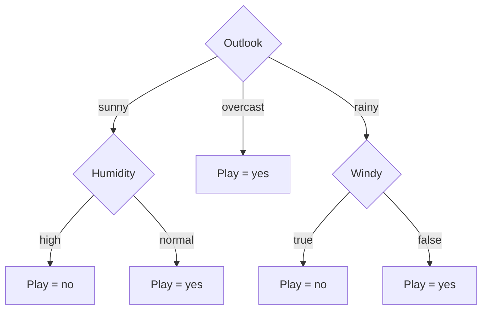

# Session 4 · Classification and Decision Trees

[](https://colab.research.google.com/github/Hamnakhan123/Diploma-in-Data-Science/blob/main/term-2/01-data-mining-with-weka/code/session-04-classification-and-decision-trees.ipynb)

> 📍 [Diploma in Data Science](../../README.md) › [Term 2](../README.md) › [Data Mining with WEKA](README.md) › **Session 4**

| ⏱ Estimated time | 🧩 Prerequisites | 💻 Tools |
|---|---|---|
| 2 hours | Sessions 1–3, logarithms and probability | WEKA 3.8 (Id3, J48), Python 3 (scikit-learn) |

[⬅ Previous: Session 3 · Association Rule Mining](session-03-association-rule-mining.md) · [🏠 Module home](README.md) · [Next: Session 5 · Regression Techniques ➡](session-05-regression-techniques.md)

---

## 🎯 Learning objectives

- Explain **classification** and the train → test → predict workflow.
- Compute **entropy** and **information gain** and use them to choose a split, as the **ID3** algorithm does.
- Build ID3 and J48 (C4.5) trees in WEKA and read the tree output.
- Interpret the evaluation report: **accuracy, precision, recall, F-measure, kappa, ROC area** and the **confusion matrix**.
- Choose between hold-out, cross-validation and training-set evaluation.

## 📖 Concepts

### 1. Classification

A **classifier** learns a mapping from input attributes to a **class label** using labelled examples, then predicts labels for new records. Examples: approve / reject a loan, spam / not spam, which programme an applicant is likely to choose.

Common classifier families in WEKA:

| Family | WEKA examples | Idea |
|---|---|---|
| Rules | ZeroR, OneR, JRip | Simple if-then rules |
| Trees | Id3, J48, RandomForest | Ask questions about attributes, branch by answer |
| Bayes | NaiveBayes | Use probabilities of each attribute given the class |
| Functions | Logistic, SMO (SVM), MultilayerPerceptron | Fit a mathematical boundary |
| Lazy | IBk (k-NN) | Compare with the most similar stored examples |

### 2. Decision trees

A **decision tree** is a flowchart: each **internal node** tests an attribute, each **branch** is an outcome, each **leaf** gives a class. Trees are popular because humans can read and explain them, which matters in banking, health and education.

### 3. Entropy and information gain (ID3)

**Entropy** measures how mixed a set of labels is:

`H(S) = − Σ pᵢ · log₂ pᵢ`

- All one class → H = 0 (pure).
- 50/50 split of two classes → H = 1 (most mixed).

**Information gain** of splitting on attribute A is the drop in entropy:

`Gain(S, A) = H(S) − Σ (|Sᵥ| / |S|) · H(Sᵥ)`

**ID3** (Ross Quinlan, 1986) picks the attribute with the highest gain at the root, splits the data, and repeats on each branch until nodes are pure or no attributes are left.

**Worked mini-example.** 10 applicants: 6 admitted, 4 rejected → H = −(0.6 log₂0.6 + 0.4 log₂0.4) = **0.971**. Split on *test score* (high / low): high = 5 admitted, 1 rejected (H = 0.650); low = 1 admitted, 3 rejected (H = 0.811). Weighted = 0.6·0.650 + 0.4·0.811 = 0.714 → **Gain = 0.257**. Example 1 verifies this in code.

### 4. From ID3 to C4.5 / J48

| Limitation of ID3 | How C4.5 (WEKA: **J48**) fixes it |
|---|---|
| Only nominal attributes | Finds the best threshold for numeric attributes |
| Prefers attributes with many values (like an ID) | Uses **gain ratio** to penalise many-valued splits |
| No missing values | Spreads missing cases across branches with weights |
| Grows until pure → **overfits** | **Prunes** branches that do not help (confidence factor `-C 0.25`, min leaf `-M 2`) |

### 5. Evaluating a classifier

The **confusion matrix** for a yes/no problem:

| | Predicted yes | Predicted no |
|---|---|---|
| **Actual yes** | TP | FN |
| **Actual no** | FP | TN |

| Metric | Formula | Question it answers |
|---|---|---|
| Accuracy | (TP+TN)/all | How often is the model right overall? |
| Precision | TP/(TP+FP) | When it says yes, how often is that true? |
| Recall (TP rate) | TP/(TP+FN) | Of the real yes cases, how many did it catch? |
| F-measure | 2·P·R/(P+R) | Balance of precision and recall |
| FP rate | FP/(FP+TN) | How many no cases were wrongly flagged? |
| Kappa | agreement beyond chance | 0 = chance level, 1 = perfect |
| ROC area | area under ROC curve | 0.5 = random, 1.0 = perfect ranking |

**Test options in WEKA:** *Use training set* (optimistic, avoid for judging), *Supplied test set*, *Cross-validation* (default 10 folds, best for small data) and *Percentage split* (e.g. 66% train).

## 🧭 Diagrams




## 💻 Worked examples

### Example 1 · Entropy and information gain from scratch

📄 [`code/session-04_entropy.py`](code/session-04_entropy.py)

```python
from math import log2

def entropy(counts):
    total = sum(counts)
    return -sum(c / total * log2(c / total) for c in counts if c)

parent = entropy([6, 4])
high, low = entropy([5, 1]), entropy([1, 3])
weighted = 6 / 10 * high + 4 / 10 * low
print(f"H(parent) = {parent:.3f}")
print(f"H(high)   = {high:.3f}   H(low) = {low:.3f}")
print(f"Weighted  = {weighted:.3f}")
print(f"Gain      = {parent - weighted:.3f}")
```

**Output**

```text
H(parent) = 0.971
H(high)   = 0.650   H(low) = 0.811
Weighted  = 0.715
Gain      = 0.256
```

### Example 2 · The classic weather data

📄 [`code/weather.arff`](code/weather.arff)

```text
@relation weather

@attribute outlook {sunny,overcast,rainy}
@attribute temperature {hot,mild,cool}
@attribute humidity {high,normal}
@attribute windy {TRUE,FALSE}
@attribute play {yes,no}

@data
sunny,hot,high,FALSE,no
sunny,hot,high,TRUE,no
overcast,hot,high,FALSE,yes
rainy,mild,high,FALSE,yes
rainy,cool,normal,FALSE,yes
rainy,cool,normal,TRUE,no
overcast,cool,normal,TRUE,yes
sunny,mild,high,FALSE,no
sunny,cool,normal,FALSE,yes
rainy,mild,normal,FALSE,yes
sunny,mild,normal,TRUE,yes
overcast,mild,high,TRUE,yes
overcast,hot,normal,FALSE,yes
rainy,mild,high,TRUE,no
```

### Example 3 · Information gain ranking in WEKA

Before building the tree, ask WEKA which attribute ID3 would pick at the root (Select attributes tab → InfoGainAttributeEval + Ranker):

📄 [`code/session-04_infogain.sh`](code/session-04_infogain.sh)

```bash
weka weka.attributeSelection.InfoGainAttributeEval -i weather.arff -s "weka.attributeSelection.Ranker" | sed -n '/Ranked attributes/,/Selected/p'
```

**Output** (real WEKA 3.8.6 run)

```text
Ranked attributes:
 0.2467  1 outlook
 0.1518  3 humidity
 0.0481  4 windy
 0.0292  2 temperature

Selected attributes: 1,3,4,2 : 4
```

### Example 4 · J48 decision tree with 10-fold cross-validation

`Id3` lives in the optional *simpleEducationalLearningSchemes* package; J48 is built in and gives the same tree here because all attributes are nominal.

📄 [`code/session-04_j48_weather.sh`](code/session-04_j48_weather.sh)

```bash
weka weka.classifiers.trees.J48 -t weather.arff -x 10 -v
```

**Output** (real WEKA 3.8.6 run)

```text
=== Classifier model (full training set) ===

J48 pruned tree
------------------

outlook = sunny
|   humidity = high: no (3.0)
|   humidity = normal: yes (2.0)
outlook = overcast: yes (4.0)
outlook = rainy
|   windy = TRUE: no (2.0)
|   windy = FALSE: yes (3.0)

Number of Leaves  : 	5

Size of the tree : 	8

=== Stratified cross-validation ===

Correctly Classified Instances           7               50      %
Incorrectly Classified Instances         7               50      %
Kappa statistic                         -0.0426
Mean absolute error                      0.4167
Root mean squared error                  0.5984
Relative absolute error                 87.5    %
Root relative squared error            121.2987 %
Total Number of Instances               14

=== Detailed Accuracy By Class ===

                 TP Rate  FP Rate  Precision  Recall   F-Measure  MCC      ROC Area  PRC Area  Class
                 0.556    0.600    0.625      0.556    0.588      -0.043   0.633     0.758     yes
                 0.400    0.444    0.333      0.400    0.364      -0.043   0.633     0.457     no
Weighted Avg.    0.500    0.544    0.521      0.500    0.508      -0.043   0.633     0.650

=== Confusion Matrix ===

 a b   <-- classified as
 5 4 | a = yes
 3 2 | b = no
```

The tree is exactly the diagram above. Cross-validation accuracy is modest because 14 rows is very little data; each test fold has only one or two examples.

### Example 5 · The same tree in scikit-learn

📄 [`code/session-04_sklearn_tree.py`](code/session-04_sklearn_tree.py)

```python
import pandas as pd
from sklearn.tree import DecisionTreeClassifier, export_text
from sklearn.model_selection import cross_val_score

rows = """sunny,hot,high,FALSE,no
sunny,hot,high,TRUE,no
overcast,hot,high,FALSE,yes
rainy,mild,high,FALSE,yes
rainy,cool,normal,FALSE,yes
rainy,cool,normal,TRUE,no
overcast,cool,normal,TRUE,yes
sunny,mild,high,FALSE,no
sunny,cool,normal,FALSE,yes
rainy,mild,normal,FALSE,yes
sunny,mild,normal,TRUE,yes
overcast,mild,high,TRUE,yes
overcast,hot,normal,FALSE,yes
rainy,mild,high,TRUE,no"""
df = pd.DataFrame([r.split(",") for r in rows.split("\n")],
                  columns=["outlook", "temperature", "humidity", "windy", "play"])
X = pd.get_dummies(df.drop(columns="play")).astype(int)
y = df["play"]

tree = DecisionTreeClassifier(criterion="entropy", random_state=0).fit(X, y)
print(export_text(tree, feature_names=list(X.columns)))
scores = cross_val_score(DecisionTreeClassifier(criterion="entropy", random_state=0), X, y, cv=7)
print("7-fold CV accuracy:", scores.round(2), "mean =", round(scores.mean(), 3))
```

**Output**

```text
|--- outlook_overcast <= 0.50
|   |--- humidity_normal <= 0.50
|   |   |--- outlook_rainy <= 0.50
|   |   |   |--- class: no
|   |   |--- outlook_rainy >  0.50
|   |   |   |--- windy_FALSE <= 0.50
|   |   |   |   |--- class: no
|   |   |   |--- windy_FALSE >  0.50
|   |   |   |   |--- class: yes
|   |--- humidity_normal >  0.50
|   |   |--- windy_TRUE <= 0.50
|   |   |   |--- class: yes
|   |   |--- windy_TRUE >  0.50
|   |   |   |--- temperature_cool <= 0.50
|   |   |   |   |--- class: yes
|   |   |   |--- temperature_cool >  0.50
|   |   |   |   |--- class: no
|--- outlook_overcast >  0.50
|   |--- class: yes

7-fold CV accuracy: [1.  0.5 0.5 0.5 0.5 0.5 0.5] mean = 0.571
```

scikit-learn builds **binary** splits on one-hot columns (`outlook_overcast <= 0.5`), so the tree looks different but encodes the same logic.

### Example 6 · Computing the metrics yourself

📄 [`code/session-04_metrics.py`](code/session-04_metrics.py)

```python
from sklearn.metrics import confusion_matrix, classification_report, cohen_kappa_score

actual    = ["yes"] * 9 + ["no"] * 5
predicted = ["yes", "yes", "yes", "yes", "yes", "yes", "yes", "no", "no",
             "yes", "no", "no", "no", "yes"]
print("Confusion matrix (rows = actual yes/no):")
print(confusion_matrix(actual, predicted, labels=["yes", "no"]))
print()
print(classification_report(actual, predicted, labels=["yes", "no"], digits=3))
print("Kappa:", round(cohen_kappa_score(actual, predicted), 3))
```

**Output**

```text
Confusion matrix (rows = actual yes/no):
[[7 2]
 [2 3]]

              precision    recall  f1-score   support

         yes      0.778     0.778     0.778         9
          no      0.600     0.600     0.600         5

    accuracy                          0.714        14
   macro avg      0.689     0.689     0.689        14
weighted avg      0.714     0.714     0.714        14

Kappa: 0.378
```

## 📊 Choosing an evaluation method

| Data size | Recommended test option | Why |
|---|---|---|
| < 1 000 rows | 10-fold cross-validation | Uses all data for both training and testing |
| 1 000 – 100 000 | Cross-validation or 66% split | Both reliable |
| > 100 000 | Percentage split / separate test file | CV becomes slow; one split is stable |
| Time-ordered data | Train on past, test on future | Avoids "seeing the future" |

## 🧪 Lab / practice tasks

### 🟢 Task 1 · Easy

Compute by hand the information gain of `windy` on the weather data and check it against the WEKA ranking in Example 3.

<details><summary>💡 Hint</summary>

windy=TRUE has 3 yes / 3 no; windy=FALSE has 6 yes / 2 no.

</details>

### 🟡 Task 2 · Medium

Run J48 on `weather.arff` with *Percentage split 66%*, then with *Use training set*. Explain why the training-set accuracy is higher.

<details><summary>💡 Hint</summary>

The model has already seen every training row.

</details>

### 🟡 Task 3 · Medium

Change J48's `minNumObj` (`-M`) from 2 to 4. How does the tree size change?

<details><summary>💡 Hint</summary>

Larger minimum leaf size forces a smaller tree.

</details>

### 🟠 Task 4 · Hard

Install the *simpleEducationalLearningSchemes* package via the Package Manager and run `Id3`. Compare its tree with J48.

<details><summary>💡 Hint</summary>

Tools → Package manager → search "simpleEducational".

</details>

### 🔴 Task 5 · Challenge

Write a recursive ID3 in Python (nominal attributes only) that prints the tree for the weather data.

<details><summary>💡 Hint</summary>

At each node: if all labels are equal, return a leaf; else pick max-gain attribute and recurse per value.

</details>


## ✅ Quick quiz

**Q1.** Entropy of a node with 5 yes and 5 no is…

- **A)** 0
- **B)** 0.5
- **C)** 1
- **D)** 2

<details><summary>Show answer</summary>

**C** — A 50/50 split of two classes has maximum entropy, 1 bit.

</details>

**Q2.** ID3 chooses the split attribute with the highest…

- **A)** entropy
- **B)** information gain
- **C)** number of values
- **D)** accuracy

<details><summary>Show answer</summary>

**B** — It maximises the reduction in entropy.

</details>

**Q3.** J48 is WEKA's implementation of…

- **A)** CART
- **B)** ID3
- **C)** C4.5
- **D)** CHAID

<details><summary>Show answer</summary>

**C** — J48 is a Java re-implementation of C4.5 release 8.

</details>

**Q4.** Recall is calculated as…

- **A)** TP/(TP+FP)
- **B)** TP/(TP+FN)
- **C)** TN/(TN+FP)
- **D)** (TP+TN)/all

<details><summary>Show answer</summary>

**B** — Recall = share of actual positives that were found.

</details>

**Q5.** Why is "Use training set" a poor way to judge a model?

- **A)** It is too slow
- **B)** It ignores the class
- **C)** It gives optimistic results on data the model has memorised
- **D)** It needs a test file

<details><summary>Show answer</summary>

**C** — The model is tested on the same rows it learned from.

</details>


## 📝 Summary

- **Classification** predicts a nominal class from attributes using labelled training data.
- **Entropy** measures impurity; **information gain** measures how much a split reduces it. ID3 greedily maximises gain.
- **J48 (C4.5)** adds numeric thresholds, gain ratio, missing-value handling and **pruning**.
- Read reports through the **confusion matrix**: accuracy, precision, recall, F1, kappa, ROC area.
- Prefer **cross-validation** for small datasets; never trust training-set accuracy alone.

### 🎤 Interview / viva questions

1. Why might a "student ID" attribute get the highest information gain, and why is that a problem?
2. What is overfitting in a decision tree and how does pruning help?
3. In a cancer-screening model, would you prioritise precision or recall? Why?
4. What does a kappa of 0.05 tell you even if accuracy is 90%?
5. How does 10-fold cross-validation work, step by step?

---

[⬅ Previous: Session 3 · Association Rule Mining](session-03-association-rule-mining.md) · [🏠 Module home](README.md) · [Next: Session 5 · Regression Techniques ➡](session-05-regression-techniques.md)

<sub>Diploma in Data Science · Prepared by **Hamna Zahid Khan**, Junior Lecturer</sub>
