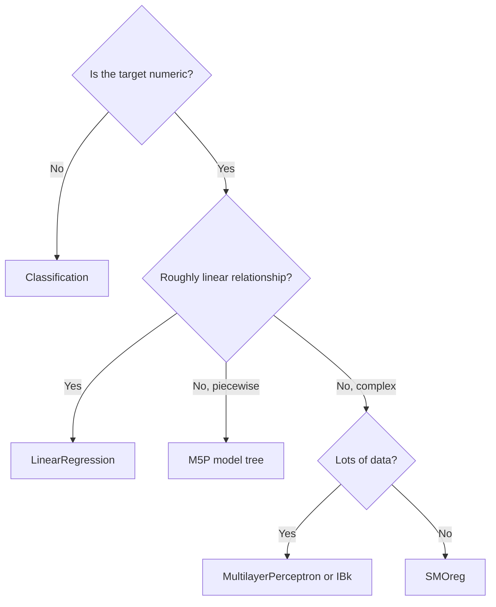
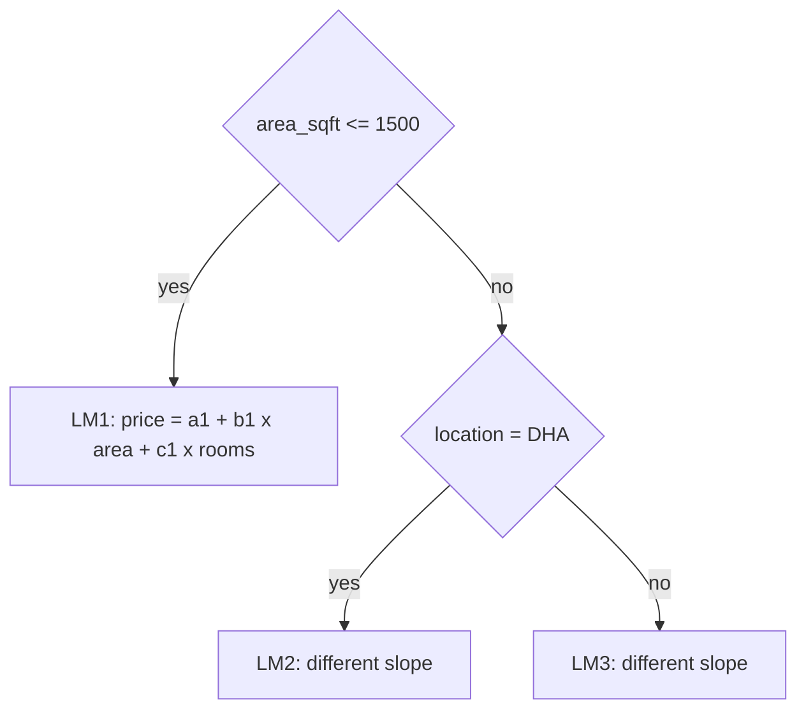
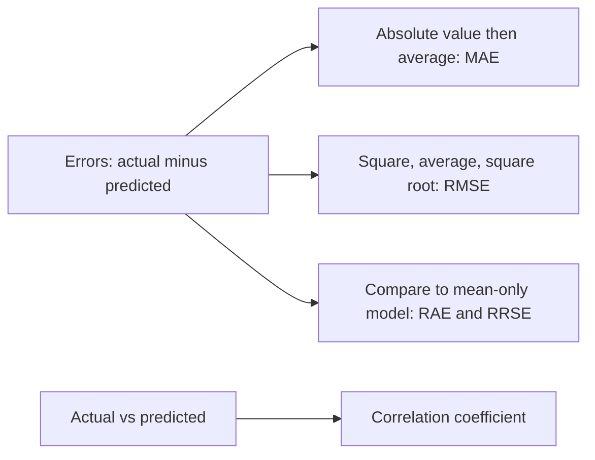

# Session 5 · Regression Techniques

[](https://colab.research.google.com/github/Hamnakhan123/Diploma-in-Data-Science/blob/main/term-2/01-data-mining-with-weka/code/session-05-regression-techniques.ipynb)

> 📍 [Diploma in Data Science](../../README.md) › [Term 2](../README.md) › [Data Mining with WEKA](README.md) › **Session 5**

| ⏱ Estimated time | 🧩 Prerequisites | 💻 Tools |
|---|---|---|
| 2 hours | Session 4, correlation and regression (Term 1 statistics) | WEKA 3.8 (LinearRegression, M5P, SMOreg, IBk), Python 3 (scikit-learn) |

[⬅ Previous: Session 4 · Classification and Decision Trees](session-04-classification-and-decision-trees.md) · [🏠 Module home](README.md) · [Next: Session 6 · Clustering Techniques ➡](session-06-clustering-techniques.md)

---

## 🎯 Learning objectives

- Distinguish **regression** (numeric prediction) from classification.
- Explain simple and multiple **linear regression**, regression trees, **model trees (M5P)**, k-NN regression and support vector regression.
- Run regression schemes in WEKA and read the coefficients and error measures.
- Evaluate regression models with **MAE, RMSE, correlation coefficient** and relative errors.
- Choose a regression method based on data size, linearity and the need for explanation.

## 📖 Concepts

### 1. What is regression?

**Regression** predicts a **numeric** target: house price, monthly electricity units, exam marks, delivery time. The class attribute in WEKA is numeric, and the Classify tab automatically shows only schemes that can handle it.

### 2. Linear regression

**Simple linear regression** fits a straight line `y = b₀ + b₁x` that minimises the sum of squared errors (**least squares**). **Multiple linear regression** uses several inputs: `y = b₀ + b₁x₁ + b₂x₂ + … + bₙxₙ`.

- **b₀ (intercept)**: predicted y when all x are 0.
- **bᵢ (coefficient)**: change in y for one unit increase in xᵢ, holding others fixed.

WEKA's `LinearRegression` by default uses the **M5 attribute-selection** method to drop weak attributes and applies a small **ridge** penalty (`-R 1.0E-8`) for numerical stability. Nominal attributes are converted to binary indicators automatically.

### 3. Other regression methods in WEKA

| Method | WEKA class | How it works | Good when |
|---|---|---|---|
| Linear regression | `functions.LinearRegression` | One global linear equation | Relationship is roughly linear; you need coefficients |
| Simple linear regression | `functions.SimpleLinearRegression` | Best single attribute | Teaching, quick checks |
| Regression tree | `trees.REPTree`, `trees.M5P -R` | Tree whose leaves hold an average value | Non-linear steps, interactions |
| **Model tree** | `trees.M5P` | Tree whose leaves hold **linear models** | Piecewise-linear patterns |
| k-NN regression | `lazy.IBk` | Average target of k nearest neighbours | Local patterns, enough data |
| Support vector regression | `functions.SMOreg` | Fit a "tube" of width ε around the data | Robust to outliers, many features |
| Neural network | `functions.MultilayerPerceptron` | Layers of weighted sums + activations | Complex non-linear data |

### 4. Measuring regression error

| Measure | Formula idea | Read it as |
|---|---|---|
| **MAE** | average of \|actual − predicted\| | Typical error in the target's units |
| **RMSE** | √(average of squared errors) | Like MAE but punishes large errors more |
| **Correlation coefficient** | correlation of actual vs predicted | 1 = perfect linear agreement |
| **Relative absolute error** | MAE ÷ MAE of always predicting the mean | Below 100% means better than the mean baseline |
| **Root relative squared error** | RMSE ÷ RMSE of mean predictor | Same idea using squares |
| **R²** (Python) | 1 − SSE/SST | Share of variance explained |

### 5. Assumptions and pitfalls

- **Linearity**: check a scatter plot; transform (log) if curved.
- **Multicollinearity**: two inputs that move together (e.g. area in m² and in ft²) make coefficients unstable.
- **Outliers**: one extreme house can tilt the whole line; consider SMOreg or remove errors.
- **Extrapolation**: predictions outside the training range are unreliable.

## 🧭 Diagrams





## 💻 Worked examples

### Example 1 · House-price data

📄 [`code/houses.arff`](code/houses.arff)

```text
@relation houses

@attribute area_sqft numeric
@attribute bedrooms numeric
@attribute age_years numeric
@attribute location {Gulshan,DHA,Korangi}
@attribute price_lakh numeric

@data
1200,3,10,Gulshan,180
900,2,15,Korangi,95
2000,4,5,DHA,420
1500,3,8,Gulshan,230
1800,4,12,DHA,370
800,2,20,Korangi,80
2500,5,3,DHA,560
1100,3,18,Gulshan,160
1300,3,6,Korangi,135
1600,3,9,Gulshan,250
2200,4,7,DHA,470
1000,2,14,Korangi,105
1400,3,11,Gulshan,205
3000,5,2,DHA,690
950,2,25,Korangi,85
1700,4,10,Gulshan,265
```

### Example 2 · Linear regression in WEKA

📄 [`code/session-05_linreg.sh`](code/session-05_linreg.sh)

```bash
weka weka.classifiers.functions.LinearRegression -t houses.arff -x 4 -v
```

**Output** (real WEKA 3.8.6 run)

```text
=== Classifier model (full training set) ===

Linear Regression Model

price_lakh =

      0.2426 * area_sqft +
     77.8745 * location=DHA +
   -133.9653

=== Cross-validation ===

Correlation coefficient                  0.9857
Mean absolute error                     23.6136
Root mean squared error                 30.3304
Relative absolute error                 16.1002 %
Root relative squared error             16.9668 %
Total Number of Instances               16
```

Read the model like a formula: each extra square foot adds the shown number of lakh, and the `location=…` terms are adjustments for the listed areas. WEKA's M5 attribute selection kept only `area_sqft` and `location=DHA`, dropping bedrooms and age as not worth their cost. The cross-validated **correlation coefficient** near 1 and the relative absolute error well under 100% show that the model beats simply predicting the average price.

### Example 3 · M5P model tree

📄 [`code/session-05_m5p.sh`](code/session-05_m5p.sh)

```bash
weka weka.classifiers.trees.M5P -t houses.arff -x 4 -v -M 3
```

**Output** (real WEKA 3.8.6 run)

```text
Options: -M 3

=== Classifier model (full training set) ===

M5 pruned model tree:
(using smoothed linear models)

area_sqft <= 1750 : LM1 (11/10.257%)
area_sqft >  1750 : LM2 (5/1.807%)

LM num: 1
price_lakh =
	0.2747 * area_sqft
	+ 1.7492 * age_years
	- 192.6572

LM num: 2
price_lakh =
	0.3052 * area_sqft
	+ 2.274 * age_years
	- 223.5365

Number of Rules : 2

=== Cross-validation ===

Correlation coefficient                  0.9874
Mean absolute error                     24.1037
Root mean squared error                 28.2482
Relative absolute error                 16.4343 %
Root relative squared error             15.8021 %
Total Number of Instances               16
```

M5P split the houses at `area_sqft <= 1750` and fitted a separate linear model (LM1, LM2) on each side, exactly the piecewise idea in the diagram above. On 16 houses its error is close to plain linear regression; on larger, less linear data the gap usually grows in M5P's favour.

### Example 4 · Comparing methods in WEKA

📄 [`code/session-05_compare.sh`](code/session-05_compare.sh)

```bash
for c in functions.LinearRegression trees.M5P trees.REPTree lazy.IBk functions.SMOreg; do
  printf "%-28s" "$c"
  weka weka.classifiers.$c -t houses.arff -x 4 -o -v | grep -E "Correlation coefficient|Mean absolute error" | awk '{printf "%s=%s  ", $1, $NF}'
  echo
done
```

**Output** (real WEKA 3.8.6 run)

```text
functions.LinearRegression  Correlation=0.9857  Mean=23.6136
trees.M5P                   Correlation=0.9874  Mean=24.1037
trees.REPTree               Correlation=0.8594  Mean=62.6042
lazy.IBk                    Correlation=0.946  Mean=46.5625
functions.SMOreg            Correlation=0.9766  Mean=26.6651
```

The "Correlation" and "Mean" labels refer to the correlation coefficient and MAE (in lakh) from 4-fold cross-validation. REPTree (leaves are averages) cannot draw a smooth line through 16 points, so it does worst here.

### Example 5 · The same comparison in scikit-learn

📄 [`code/session-05_sklearn_regression.py`](code/session-05_sklearn_regression.py)

```python
import pandas as pd
from sklearn.model_selection import cross_val_predict, KFold
from sklearn.linear_model import LinearRegression
from sklearn.tree import DecisionTreeRegressor
from sklearn.neighbors import KNeighborsRegressor
from sklearn.svm import SVR
from sklearn.pipeline import make_pipeline
from sklearn.preprocessing import StandardScaler
from sklearn.metrics import mean_absolute_error, mean_squared_error, r2_score

data = [
 (1200,3,10,"Gulshan",180),(900,2,15,"Korangi",95),(2000,4,5,"DHA",420),(1500,3,8,"Gulshan",230),
 (1800,4,12,"DHA",370),(800,2,20,"Korangi",80),(2500,5,3,"DHA",560),(1100,3,18,"Gulshan",160),
 (1300,3,6,"Korangi",135),(1600,3,9,"Gulshan",250),(2200,4,7,"DHA",470),(1000,2,14,"Korangi",105),
 (1400,3,11,"Gulshan",205),(3000,5,2,"DHA",690),(950,2,25,"Korangi",85),(1700,4,10,"Gulshan",265)]
df = pd.DataFrame(data, columns=["area_sqft", "bedrooms", "age_years", "location", "price_lakh"])
X = pd.get_dummies(df.drop(columns="price_lakh"), drop_first=True).astype(float)
y = df["price_lakh"]

models = {
    "Linear regression": LinearRegression(),
    "Regression tree": DecisionTreeRegressor(max_depth=3, random_state=0),
    "k-NN (k=3)": make_pipeline(StandardScaler(), KNeighborsRegressor(3)),
    "SVR (linear)": make_pipeline(StandardScaler(), SVR(kernel="linear", C=100)),
}
cv = KFold(4, shuffle=True, random_state=1)
print(f"{'model':<20}{'MAE':>8}{'RMSE':>8}{'R2':>7}")
for name, m in models.items():
    pred = cross_val_predict(m, X, y, cv=cv)
    rmse = mean_squared_error(y, pred) ** 0.5
    print(f"{name:<20}{mean_absolute_error(y, pred):>8.1f}{rmse:>8.1f}{r2_score(y, pred):>7.3f}")

lr = LinearRegression().fit(X, y)
print("\nCoefficients of the full linear model:")
for col, coef in zip(X.columns, lr.coef_):
    print(f"  {col:<18}{coef:>9.3f}")
print(f"  intercept         {lr.intercept_:>9.3f}")
print("\nPredicted price for 1500 sqft, 3 bed, 5 years, DHA:",
      round(lr.predict(pd.DataFrame([[1500, 3, 5, 1, 0]], columns=X.columns))[0], 1), "lakh")
```

**Output**

```text
model                    MAE    RMSE     R2
Linear regression       24.4    30.3  0.971
Regression tree         62.4    86.9  0.761
k-NN (k=3)              54.9    80.4  0.795
SVR (linear)            26.6    36.9  0.957

Coefficients of the full linear model:
  area_sqft             0.261
  bedrooms            -11.208
  age_years             1.555
  location_Gulshan    -78.146
  location_Korangi   -100.291
  intercept           -58.552

Predicted price for 1500 sqft, 3 bed, 5 years, DHA: 229.3 lakh
```

> ⚠️ **Read the coefficients with care.** With only 16 houses, `bedrooms` gets a negative coefficient and `age_years` a positive one, the opposite of common sense. Bedrooms move together with area (multicollinearity), and older houses here happen to be in cheaper areas already captured by `location`. This is why WEKA's attribute selection dropped both, and why you should never explain a coefficient without checking the data size and correlations first.

## 📊 Error measures at a glance



## 🧪 Lab / practice tasks

### 🟢 Task 1 · Easy

Run `SimpleLinearRegression` on `houses.arff`. Which single attribute does it choose and what is the equation?

<details><summary>💡 Hint</summary>

It selects the attribute with the smallest squared error.

</details>

### 🟡 Task 2 · Medium

Add a deliberately wrong row (area 1000, price 2000) and rerun LinearRegression and SMOreg. Which one changes less?

<details><summary>💡 Hint</summary>

SMOreg's ε-insensitive loss limits the influence of one outlier.

</details>

### 🟡 Task 3 · Medium

Use the Visualize classifier errors option (right-click a result) to plot actual vs predicted price. Which houses have the largest errors?

<details><summary>💡 Hint</summary>

Larger crosses in the plot mean bigger errors.

</details>

### 🟠 Task 4 · Hard

Convert `price_lakh` into three classes (low/medium/high) with `Discretize` and compare J48 with M5P's numeric predictions. What information is lost?

<details><summary>💡 Hint</summary>

Supervised class labels hide how far off a prediction is.

</details>

### 🔴 Task 5 · Challenge

Implement least-squares regression with NumPy using the normal equation β = (XᵀX)⁻¹Xᵀy and confirm the coefficients match scikit-learn.

<details><summary>💡 Hint</summary>

Add a column of ones to X for the intercept.

</details>


## ✅ Quick quiz

**Q1.** Which metric punishes large errors the most?

- **A)** MAE
- **B)** RMSE
- **C)** Correlation coefficient
- **D)** Accuracy

<details><summary>Show answer</summary>

**B** — Squaring errors before averaging magnifies large errors.

</details>

**Q2.** A relative absolute error of 120% means the model is…

- **A)** 20% better than the mean
- **B)** worse than predicting the mean
- **C)** perfect
- **D)** overfitted for sure

<details><summary>Show answer</summary>

**B** — Above 100% means worse than the simple mean baseline.

</details>

**Q3.** M5P differs from REPTree because its leaves contain…

- **A)** class labels
- **B)** single average values
- **C)** linear regression models
- **D)** rules

<details><summary>Show answer</summary>

**C** — M5P is a model tree: each leaf holds a linear model.

</details>

**Q4.** In y = 50 + 0.2x, what is 0.2?

- **A)** Intercept
- **B)** Coefficient (slope)
- **C)** Residual
- **D)** R²

<details><summary>Show answer</summary>

**B** — The slope tells how much y changes per unit of x.

</details>

**Q5.** Predicting a value far outside the training range is called…

- **A)** interpolation
- **B)** extrapolation
- **C)** regularisation
- **D)** normalisation

<details><summary>Show answer</summary>

**B** — Extrapolation is risky because the pattern may not hold there.

</details>


## 📝 Summary

- **Regression** predicts numbers; WEKA treats it as classification with a numeric class.
- Methods: `LinearRegression`, `SimpleLinearRegression`, `M5P` (model tree), `REPTree`, `IBk`, `SMOreg`, `MultilayerPerceptron`.
- Evaluate with **MAE, RMSE, correlation**, and **relative errors** (below 100% beats the mean).
- Watch for non-linearity, multicollinearity, outliers and extrapolation.

### 🎤 Interview / viva questions

1. How do you interpret a negative coefficient for `age_years` in a house-price model?
2. When would you prefer MAE over RMSE when reporting to a manager?
3. Why does WEKA convert a nominal attribute with three values into binary indicators?
4. Explain how a model tree combines the strengths of trees and linear regression.
5. What steps would you take if residuals grow larger for more expensive houses?

---

[⬅ Previous: Session 4 · Classification and Decision Trees](session-04-classification-and-decision-trees.md) · [🏠 Module home](README.md) · [Next: Session 6 · Clustering Techniques ➡](session-06-clustering-techniques.md)

<sub>Diploma in Data Science · Prepared by **Hamna Zahid Khan**, Junior Lecturer</sub>
