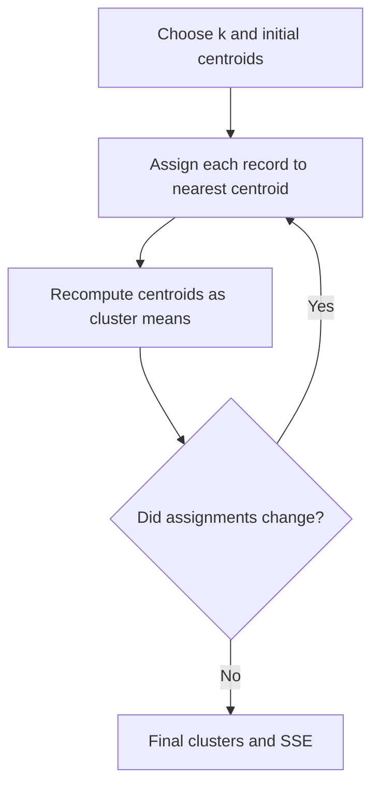
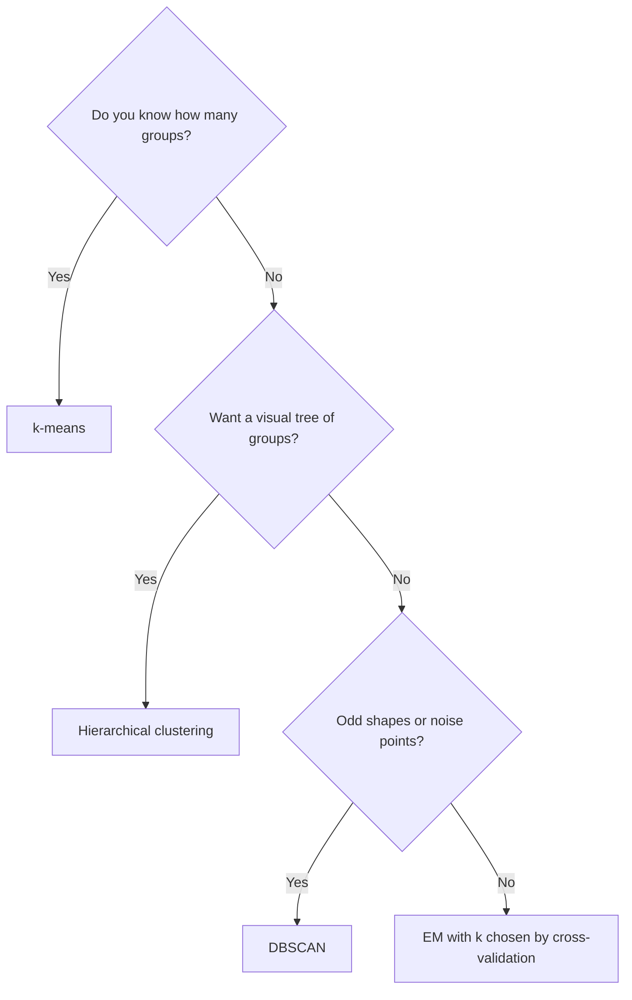
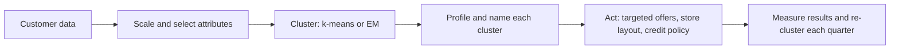

# Session 6 · Clustering Techniques

[](https://colab.research.google.com/github/Hamnakhan123/Diploma-in-Data-Science/blob/main/term-2/01-data-mining-with-weka/code/session-06-clustering-techniques.ipynb)

> 📍 [Diploma in Data Science](../../README.md) › [Term 2](../README.md) › [Data Mining with WEKA](README.md) › **Session 6**

| ⏱ Estimated time | 🧩 Prerequisites | 💻 Tools |
|---|---|---|
| 2 hours | Session 2 (normalisation), Session 5 (distance ideas from k-NN) | WEKA 3.8 (SimpleKMeans, EM, HierarchicalClusterer), Python 3 (scikit-learn) |

[⬅ Previous: Session 5 · Regression Techniques](session-05-regression-techniques.md) · [🏠 Module home](README.md) · [Next: Session 7 · Text Mining and Web Mining ➡](session-07-text-mining-and-web-mining.md)

---

## 🎯 Learning objectives

- Explain **clustering** as unsupervised learning and how it differs from classification.
- Describe **k-means**, **hierarchical (agglomerative)** clustering, **EM** and **density-based** clustering (DBSCAN).
- Run clusterers in WEKA and read centroids, cluster sizes and log-likelihood.
- Choose **k** using the **elbow method** and the **silhouette score**.
- Use **classes-to-clusters** evaluation when true labels exist.

## 📖 Concepts

### 1. What is clustering?

**Clustering** groups records so that records in the same group are **similar** and records in different groups are **dissimilar**. There is **no class label**: the algorithm discovers the groups itself, which makes it **unsupervised learning**.

Typical uses: customer segmentation for a retail chain, grouping students by performance pattern, finding unusual transactions (points that fit no cluster), organising documents by topic.

### 2. Distance and scaling

Most clusterers rely on a **distance measure**, usually **Euclidean distance** `d = √Σ(xᵢ − yᵢ)²`. If one attribute is in thousands (income) and another in single digits (visits per month), the large one dominates. WEKA's `SimpleKMeans` normalises numeric attributes internally by default; in Python you must scale yourself with `StandardScaler` or `MinMaxScaler`.

### 3. k-means

1. Choose **k** and place k initial **centroids** (WEKA uses random seeds or **k-means++**).
2. Assign each record to its nearest centroid.
3. Move each centroid to the mean of its assigned records.
4. Repeat steps 2 and 3 until assignments stop changing.

k-means minimises the **within-cluster sum of squared errors (SSE)**. It is fast, but needs k in advance, assumes roughly round clusters of similar size, and is sensitive to outliers and to the random start (so try several seeds).

### 4. Other clustering families

| Family | WEKA / Python | Idea | Strengths | Weaknesses |
|---|---|---|---|---|
| Partitioning | `SimpleKMeans`, `FarthestFirst` / `KMeans` | k centroids | Fast, simple | Needs k, round clusters |
| Hierarchical | `HierarchicalClusterer` / `AgglomerativeClustering` | Merge closest groups step by step, draw a **dendrogram** | No k needed up front, visual | Slow on big data |
| Probabilistic | `EM` / `GaussianMixture` | Each cluster is a probability distribution; soft membership | Gives probabilities, chooses k by cross-validation | Assumes distribution shape |
| Density-based | `DBSCAN` (WEKA package) / `DBSCAN` | Clusters are dense regions; sparse points are **noise** | Any shape, finds outliers | Sensitive to `eps` and `minPts` |
| Conceptual | `Cobweb` | Builds a concept tree incrementally | Nominal data | Order-dependent |

**Linkage** in hierarchical clustering decides the distance between two groups: **single** (closest pair), **complete** (farthest pair), **average**, or **Ward** (smallest increase in SSE).

### 5. Choosing k and judging quality

| Method | How | Read it as |
|---|---|---|
| **Elbow** | Plot SSE for k = 1, 2, 3, … | Pick the k where the curve bends and gains flatten |
| **Silhouette** | For each point, compare its own-cluster distance with the nearest other cluster, range −1 to 1 | Higher is better; above about 0.5 is a clear structure |
| **EM log-likelihood** | WEKA's EM with `-N -1` picks k by 10-fold cross-validation | Higher log-likelihood fits better |
| **Classes to clusters** | If labels exist, compare clusters with them | Percentage of incorrectly clustered instances |
| **Business sense** | Can you name and act on each cluster? | The real test for segmentation |

## 🧭 Diagrams





## 💻 Worked examples

### Example 1 · Mall-customer data

Eighteen shoppers at a Karachi mall: age, monthly income (in thousand rupees) and a spending score from 1 to 100 given by the loyalty programme.

📄 [`code/customers.arff`](code/customers.arff)

```text
@relation customers

@attribute age numeric
@attribute income_k numeric
@attribute spend_score numeric

@data
22,40,85
25,45,90
23,38,80
27,50,88
24,42,82
45,180,20
50,200,15
48,190,25
52,210,18
47,170,22
35,120,75
38,130,80
33,115,70
36,125,78
60,60,30
58,55,35
62,65,28
59,50,32
```

### Example 2 · k-means in WEKA

📄 [`code/session-06_kmeans.sh`](code/session-06_kmeans.sh)

```bash
weka weka.clusterers.SimpleKMeans -t customers.arff -N 4 -S 10 -init 1
```

**Output** (real WEKA 3.8.6 run)

```text
kMeans
======

Number of iterations: 2
Within cluster sum of squared errors: 0.12356534425515293

Initial starting points (k-means++):

Cluster 0: 47,170,22
Cluster 1: 24,42,82
Cluster 2: 33,115,70
Cluster 3: 62,65,28

Missing values globally replaced with mean/mode

Final cluster centroids:
                           Cluster#
Attribute      Full Data          0          1          2          3
                  (18.0)      (5.0)      (5.0)      (4.0)      (4.0)
====================================================================
age              41.3333       48.4       24.2       35.5      59.75
income_k        104.7222        190         43      122.5       57.5
spend_score      52.9444         20         85      75.75      31.25

=== Clustering stats for training data ===

Clustered Instances
0       5 ( 28%)
1       5 ( 28%)
2       4 ( 22%)
3       4 ( 22%)
```

Read the **Final cluster centroids** table column by column and give each cluster a business name: cluster 0 = **affluent careful spenders** (high income, low score), cluster 1 = **young high spenders**, cluster 2 = **mid-career high spenders**, cluster 3 = **retired budget shoppers**. The **within cluster sum of squared errors** is computed on normalised values, so compare it only between runs on the same data.

### Example 3 · Trying different k

📄 [`code/session-06_k_sweep.sh`](code/session-06_k_sweep.sh)

```bash
for k in 2 3 4 5 6; do
  printf "k=%s  " "$k"
  weka weka.clusterers.SimpleKMeans -t customers.arff -N $k -S 10 -init 1 | grep "Within cluster sum" | awk '{print "SSE =", $NF}'
done
```

**Output** (real WEKA 3.8.6 run)

```text
k=2  SSE = 2.3571346637154553
k=3  SSE = 1.6712351075656513
k=4  SSE = 0.12356534425515293
k=5  SSE = 0.08562121028884481
k=6  SSE = 0.06823793905113876
```

SSE always falls as k grows (with k = 18 it would be 0), so we look for the **elbow**: the big drop ends at k = 4 and after that each extra cluster buys very little.

### Example 4 · EM chooses k for you

📄 [`code/session-06_em.sh`](code/session-06_em.sh)

```bash
weka weka.clusterers.EM -t customers.arff -N -1 -S 100 | grep -E "Number of clusters selected|^Clustered Instances|^[0-9]+ +[0-9]+ \(|Log likelihood"
```

**Output** (real WEKA 3.8.6 run)

```text
Number of clusters selected by cross validation: 4
Clustered Instances
0       5 ( 28%)
1       5 ( 28%)
2       4 ( 22%)
3       4 ( 22%)
Log likelihood: -9.35854
```

With `-N -1`, EM tries increasing numbers of clusters and keeps the one with the best cross-validated log-likelihood. EM gives **soft** membership: each customer has a probability of belonging to every cluster.

### Example 5 · Hierarchical clustering

📄 [`code/session-06_hierarchical.sh`](code/session-06_hierarchical.sh)

```bash
weka weka.clusterers.HierarchicalClusterer -t customers.arff -N 4 -L WARD | grep -A6 "^Clustered Instances"
```

**Output** (real WEKA 3.8.6 run)

```text
Clustered Instances
0       5 ( 28%)
1       5 ( 28%)
2       4 ( 22%)
3       4 ( 22%)
```

Ward linkage merges the pair of groups that increases the total SSE the least, so it tends to agree with k-means on well-separated data like this.

### Example 6 · Elbow, silhouette and DBSCAN in scikit-learn

📄 [`code/session-06_sklearn_clustering.py`](code/session-06_sklearn_clustering.py)

```python
import pandas as pd
from sklearn.preprocessing import StandardScaler
from sklearn.cluster import KMeans, AgglomerativeClustering, DBSCAN
from sklearn.metrics import silhouette_score

df = pd.DataFrame([
 (22,40,85),(25,45,90),(23,38,80),(27,50,88),(24,42,82),(45,180,20),(50,200,15),(48,190,25),(52,210,18),
 (47,170,22),(35,120,75),(38,130,80),(33,115,70),(36,125,78),(60,60,30),(58,55,35),(62,65,28),(59,50,32)],
 columns=["age", "income_k", "spend_score"])
X = StandardScaler().fit_transform(df)

print(" k      SSE  silhouette")
for k in range(2, 7):
    km = KMeans(n_clusters=k, n_init=10, random_state=0).fit(X)
    print(f"{k:>2} {km.inertia_:>8.2f} {silhouette_score(X, km.labels_):>10.3f}")

km = KMeans(n_clusters=4, n_init=10, random_state=0).fit(X)
df["kmeans"] = km.labels_
print("\nCluster profiles (means in original units):")
print(df.groupby("kmeans")[["age", "income_k", "spend_score"]].mean().round(1).assign(size=df["kmeans"].value_counts().sort_index()))

agg = AgglomerativeClustering(n_clusters=4, linkage="ward").fit(X)
same = pd.crosstab(df["kmeans"], agg.labels_)
print("\nk-means vs Ward agreement (each row should have one non-zero cell):")
print(same)

db = DBSCAN(eps=0.6, min_samples=3).fit(X)
print("\nDBSCAN labels (-1 = noise):", [int(l) for l in db.labels_])
```

**Output**

```text
 k      SSE  silhouette
 2    18.95      0.584
 3     6.55      0.739
 4     0.98      0.827
 5     0.60      0.744
 6     0.46      0.658

Cluster profiles (means in original units):
         age  income_k  spend_score  size
kmeans
0       48.4     190.0         20.0     5
1       24.2      43.0         85.0     5
2       59.8      57.5         31.2     4
3       35.5     122.5         75.8     4

k-means vs Ward agreement (each row should have one non-zero cell):
col_0   0  1  2  3
kmeans
0       5  0  0  0
1       0  5  0  0
2       0  0  4  0
3       0  0  0  4

DBSCAN labels (-1 = noise): [0, 0, 0, 0, 0, 1, 1, 1, 1, 1, 2, 2, 2, 2, 3, 3, 3, 3]
```

The silhouette score peaks at the same k as the elbow, which is reassuring. DBSCAN found the same four groups without being told k, and labelled no customer as noise (−1). In real data, noise points are candidate outliers worth a closer look.

### Example 7 · Classes-to-clusters evaluation

When the data already has a label, WEKA can check how well clusters match it. Here we cluster the `weather` data (from Session 1) while ignoring `play`, then compare.

📄 [`code/session-06_classes_to_clusters.sh`](code/session-06_classes_to_clusters.sh)

```bash
weka weka.clusterers.SimpleKMeans -t weather.arff -N 2 -S 10 -c last | sed -n '/Classes to Clusters/,$p'
```

**Output** (real WEKA 3.8.6 run)

```text
Classes to Clusters:

 0 1  <-- assigned to cluster
 6 3 | yes
 4 1 | no

Cluster 0 <-- yes
Cluster 1 <-- no

Incorrectly clustered instances :	7.0	 50      %
```

A high percentage of **incorrectly clustered instances** is normal here: the natural groups in weather (sunny-hot versus rainy-cool) are not the same as the `play` decision. Clustering finds structure; it does not promise to find *your* labels.

## 📊 Putting clusters to work



## 🧪 Lab / practice tasks

### 🟢 Task 1 · Easy

Run `SimpleKMeans` on `customers.arff` with seeds 1, 10 and 42 and k = 4. Do the cluster sizes change?

<details><summary>💡 Hint</summary>

Random starts can land in different local minima; k-means++ (`-init 1`) makes this less likely.

</details>

### 🟢 Task 2 · Easy

In the WEKA Explorer Cluster tab, tick "Store clusters for visualization", right-click the result and plot `income_k` against `spend_score` coloured by cluster.

<details><summary>💡 Hint</summary>

The four groups should be visible as separate blobs.

</details>

### 🟡 Task 3 · Medium

Remove the normalisation by adding `-D` (don't normalise) to SimpleKMeans. How do the clusters change and why?

<details><summary>💡 Hint</summary>

Income has the largest range, so it will dominate the distance.

</details>

### 🟠 Task 4 · Hard

Use `HierarchicalClusterer` with `-L SINGLE` and `-L COMPLETE` and compare with Ward. Which linkage produces a long chain?

<details><summary>💡 Hint</summary>

Single linkage is prone to chaining through near neighbours.

</details>

### 🔴 Task 5 · Challenge

Write k-means from scratch in NumPy (assign, update, repeat) and check that your SSE matches scikit-learn's `inertia_` for the same starting centroids.

<details><summary>💡 Hint</summary>

Pass `init=your_centroids, n_init=1` to scikit-learn for a fair comparison.

</details>


## ✅ Quick quiz

**Q1.** Clustering is an example of…

- **A)** supervised learning
- **B)** unsupervised learning
- **C)** reinforcement learning
- **D)** regression

<details><summary>Show answer</summary>

**B** — No class label is given; the algorithm discovers the groups.

</details>

**Q2.** Why must you scale attributes before k-means in Python?

- **A)** k-means needs integers
- **B)** Attributes with large ranges would dominate the distance
- **C)** Scaling increases k
- **D)** It removes outliers

<details><summary>Show answer</summary>

**B** — Euclidean distance is dominated by attributes with large numeric ranges.

</details>

**Q3.** In the elbow method you choose k where…

- **A)** SSE is zero
- **B)** SSE starts to decrease sharply
- **C)** the drop in SSE levels off
- **D)** silhouette is negative

<details><summary>Show answer</summary>

**C** — After the elbow, extra clusters give little improvement.

</details>

**Q4.** Which algorithm labels sparse points as noise?

- **A)** k-means
- **B)** EM
- **C)** DBSCAN
- **D)** Ward linkage

<details><summary>Show answer</summary>

**C** — DBSCAN builds clusters from dense regions and marks the rest as noise.

</details>

**Q5.** A silhouette score close to −1 for a point means it is…

- **A)** perfectly clustered
- **B)** on the border of two clusters
- **C)** probably in the wrong cluster
- **D)** an exact centroid

<details><summary>Show answer</summary>

**C** — Negative values mean the point is closer to another cluster than its own.

</details>


## 📝 Summary

- **Clustering** groups similar records without labels; it is **unsupervised**.
- **k-means** is fast but needs k, scaled data and several starts; **hierarchical** clustering gives a dendrogram; **EM** gives soft memberships and can pick k; **DBSCAN** finds arbitrary shapes and noise.
- Choose k with the **elbow** and **silhouette**, then check that every cluster has a clear **business meaning**.
- **Classes-to-clusters** evaluation compares clusters with known labels, but a mismatch does not mean the clustering is wrong.

### 🎤 Interview / viva questions

1. How would you explain the difference between classification and clustering to a non-technical manager?
2. Why can two runs of k-means on the same data give different results, and how do you reduce this?
3. When would you choose EM over k-means?
4. What does the dendrogram in hierarchical clustering show, and how do you cut it into k clusters?
5. How would you use clustering to detect fraudulent transactions?

---

[⬅ Previous: Session 5 · Regression Techniques](session-05-regression-techniques.md) · [🏠 Module home](README.md) · [Next: Session 7 · Text Mining and Web Mining ➡](session-07-text-mining-and-web-mining.md)

<sub>Diploma in Data Science · Prepared by **Hamna Zahid Khan**, Junior Lecturer</sub>
