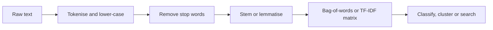
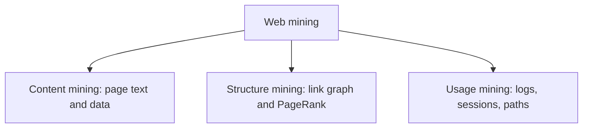
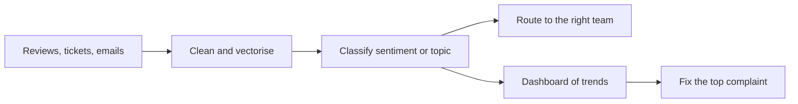

# Session 7 · Text Mining and Web Mining

[](https://colab.research.google.com/github/Hamnakhan123/Diploma-in-Data-Science/blob/main/term-2/01-data-mining-with-weka/code/session-07-text-mining-and-web-mining.ipynb)

> 📍 [Diploma in Data Science](../../README.md) › [Term 2](../README.md) › [Data Mining with WEKA](README.md) › **Session 7**

| ⏱ Estimated time | 🧩 Prerequisites | 💻 Tools |
|---|---|---|
| 2 hours | Session 4 (classification), Session 6 (clustering) | WEKA 3.8 (StringToWordVector, NaiveBayesMultinomial, FilteredClassifier), Python 3 (scikit-learn, pandas, NumPy) |

[⬅ Previous: Session 6 · Clustering Techniques](session-06-clustering-techniques.md) · [🏠 Module home](README.md) · [Next: Session 8 · Designing a Real-World Data Mining Project ➡](session-08-real-world-data-mining-project.md)

---

## 🎯 Learning objectives

- Explain why **text** and **web** data need special preparation before mining.
- Apply the **text-mining pipeline**: tokenise, lower-case, remove stop words, stem, and build a **bag-of-words** or **TF-IDF** matrix.
- Classify short texts in WEKA with `StringToWordVector` and `NaiveBayesMultinomial`.
- Measure document similarity with **cosine similarity**.
- Describe the three kinds of **web mining** (content, structure, usage) and compute **PageRank** and page-visit patterns.

## 📖 Concepts

### 1. Why text is different

Most business data is **unstructured text**: product reviews, complaints, emails, social-media posts, news. Algorithms need numbers, so text must be turned into a **feature vector** first. The main challenges are a huge vocabulary, spelling variation, synonyms ("cheap", "affordable") and context ("not good").

### 2. The text-mining pipeline

| Step | What it does | Example |
|---|---|---|
| **Tokenisation** | Split text into words (tokens) | "Delivery was late!" → `delivery`, `was`, `late` |
| **Lower-casing** | Treat "Late" and "late" as one word | `Late` → `late` |
| **Stop-word removal** | Drop very common words | remove `was`, `the`, `is` |
| **Stemming / lemmatisation** | Reduce words to a root | `delivered`, `delivering` → `deliv` |
| **Vectorising** | Count words per document | bag-of-words or TF-IDF matrix |
| **Mining** | Classify, cluster, extract topics | spam filter, complaint routing |

### 3. Bag-of-words and TF-IDF

A **bag-of-words** keeps word counts and ignores order. **TF-IDF** weights each word by how often it appears in this document (**term frequency**) and how rare it is across all documents (**inverse document frequency**):

`tfidf(t, d) = tf(t, d) × log(N / df(t))`

so a word that appears in every review ("product") gets a low weight while a distinctive word ("refund") gets a high one. **n-grams** (pairs like "not good") keep a little word order.

### 4. Common text-mining tasks

| Task | Technique | Example |
|---|---|---|
| Text classification | Naive Bayes, SVM, logistic regression | Positive / negative review, spam / ham |
| Sentiment analysis | Classification or word lexicons | Brand monitoring on social media |
| Document clustering | k-means on TF-IDF | Group support tickets by topic |
| Information extraction | Patterns, named-entity recognition | Pull order numbers and cities from emails |
| Similarity search | Cosine similarity | "Find complaints like this one" |

### 5. Web mining

| Type | Mines | Example output |
|---|---|---|
| **Web content mining** | Text, images and data on pages | Product prices scraped from shops, page topics |
| **Web structure mining** | The **hyperlink graph** between pages | **PageRank**, hubs and authorities |
| **Web usage mining** | Server logs and clickstreams | Popular paths, sessions, pages where users drop off |

**PageRank** says a page is important if important pages link to it. Each page shares its score equally among its outgoing links, and a **damping factor** (usually 0.85) models a visitor who sometimes jumps to a random page:

`PR(p) = (1 − d)/N + d × Σ PR(q) / out(q)` for every page q that links to p.

Responsible web mining respects a site's **robots.txt** and terms of use, avoids overloading servers, and protects personal data in logs.

## 🧭 Diagrams





## 💻 Worked examples

### Example 1 · Product-review data

Short customer reviews from an online store, labelled positive or negative. The text is a WEKA **string** attribute.

📄 [`code/reviews.arff`](code/reviews.arff)

```text
@relation reviews

@attribute text string
@attribute sentiment {pos,neg}

@data
'fast delivery and great quality',pos
'excellent product works perfectly',pos
'great price and fast shipping',pos
'very happy with the quality',pos
'excellent service will buy again',pos
'perfect size and great colour',pos
'happy customer fast response',pos
'quality is excellent and price is fair',pos
'great value highly recommended',pos
'works great very happy',pos
'late delivery and poor packaging',neg
'product broke after one week',neg
'poor quality waste of money',neg
'delivery was very late',neg
'item arrived damaged and broken',neg
'refund still not received',neg
'terrible service never again',neg
'poor customer support and late refund',neg
'damaged box and missing parts',neg
'waste of money do not buy',neg
```

### Example 2 · Text classification in WEKA

`FilteredClassifier` applies `StringToWordVector` inside each cross-validation fold, so the vocabulary is learned only from training data (no leakage).

📄 [`code/session-07_text_nb.sh`](code/session-07_text_nb.sh)

```bash
weka weka.classifiers.meta.FilteredClassifier -t reviews.arff -x 5 -o \
  -F "weka.filters.unsupervised.attribute.StringToWordVector -C -L -W 1000" \
  -W weka.classifiers.bayes.NaiveBayesMultinomial | sed -n '/Stratified cross-validation/,$p'
```

**Output** (real WEKA 3.8.6 run)

```text
=== Stratified cross-validation ===

Correctly Classified Instances          16               80      %
Incorrectly Classified Instances         4               20      %
Kappa statistic                          0.6
Mean absolute error                      0.2881
Root mean squared error                  0.3392
Relative absolute error                 57.6145 %
Root relative squared error             67.8422 %
Total Number of Instances               20

=== Detailed Accuracy By Class ===

                 TP Rate  FP Rate  Precision  Recall   F-Measure  MCC      ROC Area  PRC Area  Class
                 1.000    0.400    0.714      1.000    0.833      0.655    0.990     0.991     pos
                 0.600    0.000    1.000      0.600    0.750      0.655    0.990     0.991     neg
Weighted Avg.    0.800    0.200    0.857      0.800    0.792      0.655    0.990     0.991

=== Confusion Matrix ===

  a  b   <-- classified as
 10  0 |  a = pos
  4  6 |  b = neg
```

`-C` outputs word **counts** instead of 0/1, and `-L` lower-cases tokens. Multinomial Naive Bayes is the classic baseline for text: fast, works with little data, and easy to explain.

The confusion matrix shows every error is a negative review predicted as positive. With only 20 short reviews and no stop-word removal, shared words like "and", "very" and "delivery" blur the two classes. Example 4 adds stop-word removal, TF-IDF and bigrams and does noticeably better on the same data.

### Example 3 · Looking inside the word vectors

📄 [`code/session-07_word_vector.sh`](code/session-07_word_vector.sh)

```bash
weka weka.filters.unsupervised.attribute.StringToWordVector -i reviews.arff -C -L -T -I \
  -stopwords-handler weka.core.stopwords.Rainbow -W 1000 > vec.arff
echo "Attributes created: $(grep -c '^@attribute' vec.arff)"
grep '^@attribute' vec.arff | head -12
```

**Output** (real WEKA 3.8.6 run)

```text
Attributes created: 40
@attribute sentiment {pos,neg}
@attribute arrived numeric
@attribute box numeric
@attribute broke numeric
@attribute broken numeric
@attribute buy numeric
@attribute colour numeric
@attribute customer numeric
@attribute damaged numeric
@attribute delivery numeric
@attribute excellent numeric
@attribute fair numeric
```

`-T -I` turn counts into TF-IDF weights, and the **Rainbow** stop-word list removes words like "and", "is" and "the". Each remaining word becomes a numeric attribute, and each review becomes a sparse row.

### Example 4 · TF-IDF, classification and similarity in scikit-learn

📄 [`code/session-07_sklearn_text.py`](code/session-07_sklearn_text.py)

```python
import pandas as pd
from sklearn.feature_extraction.text import TfidfVectorizer
from sklearn.naive_bayes import MultinomialNB
from sklearn.pipeline import make_pipeline
from sklearn.model_selection import cross_val_score, StratifiedKFold
from sklearn.metrics.pairwise import cosine_similarity

pos = ["fast delivery and great quality", "excellent product works perfectly", "great price and fast shipping",
       "very happy with the quality", "excellent service will buy again", "perfect size and great colour",
       "happy customer fast response", "quality is excellent and price is fair", "great value highly recommended",
       "works great very happy"]
neg = ["late delivery and poor packaging", "product broke after one week", "poor quality waste of money",
       "delivery was very late", "item arrived damaged and broken", "refund still not received",
       "terrible service never again", "poor customer support and late refund", "damaged box and missing parts",
       "waste of money do not buy"]
texts, labels = pos + neg, ["pos"] * 10 + ["neg"] * 10

model = make_pipeline(TfidfVectorizer(stop_words="english", ngram_range=(1, 2)), MultinomialNB())
cv = StratifiedKFold(5, shuffle=True, random_state=0)
print("5-fold accuracy:", cross_val_score(model, texts, labels, cv=cv).mean().round(3))

model.fit(texts, labels)
new = ["great quality and fast delivery", "box arrived broken, want a refund", "not happy at all"]
for t, p in zip(new, model.predict(new)):
    print(f"  {p}  <- {t}")

vec, nb = model.named_steps["tfidfvectorizer"], model.named_steps["multinomialnb"]
words = vec.get_feature_names_out()
diff = pd.Series(nb.feature_log_prob_[1] - nb.feature_log_prob_[0], index=words)  # classes: neg, pos
print("\nMost positive terms:", ", ".join(diff.sort_values().index[-6:][::-1]))
print("Most negative terms:", ", ".join(diff.sort_values().index[:6]))

X = vec.transform(texts)
query = vec.transform(["the delivery came late"])
sim = cosine_similarity(query, X).ravel()
print("\nReviews most similar to 'the delivery came late':")
for i in sim.argsort()[::-1][:3]:
    print(f"  {sim[i]:.2f}  {texts[i]}")
```

**Output**

```text
5-fold accuracy: 0.95
  pos  <- great quality and fast delivery
  neg  <- box arrived broken, want a refund
  pos  <- not happy at all

Most positive terms: great, happy, excellent, fast, works, price
Most negative terms: late, poor, refund, waste money, money, waste

Reviews most similar to 'the delivery came late':
  0.75  delivery was very late
  0.46  late delivery and poor packaging
  0.25  fast delivery and great quality
```

Notice the third new review, "not happy at all". The word "happy" pulls it towards **pos** because a bag-of-words model ignores the negation. This is a classic limitation; bigrams such as "not happy" help only if they appear in the training data.

### Example 5 · Web structure mining: PageRank

A tiny university website with six pages and their links.

📄 [`code/session-07_pagerank.py`](code/session-07_pagerank.py)

```python
import numpy as np

links = {
    "Home":       ["Admissions", "Programs", "News"],
    "Admissions": ["Home", "Fees"],
    "Programs":   ["Home", "DataScience", "Admissions"],
    "DataScience": ["Programs", "Admissions"],
    "News":       ["Home", "Programs"],
    "Fees":       ["Admissions"],
}
pages = list(links)
n, d = len(pages), 0.85
idx = {p: i for i, p in enumerate(pages)}
M = np.zeros((n, n))
for src, outs in links.items():
    for dst in outs:
        M[idx[dst], idx[src]] = 1 / len(outs)

pr = np.full(n, 1 / n)
for it in range(100):
    new = (1 - d) / n + d * M @ pr
    if np.abs(new - pr).sum() < 1e-8:
        break
    pr = new
print(f"Converged after {it} iterations\n")
for p, s in sorted(zip(pages, pr), key=lambda x: -x[1]):
    print(f"{p:<12}{s:.3f}  {'#' * int(s * 100)}")
```

**Output**

```text
Converged after 54 iterations

Admissions  0.294  #############################
Home        0.234  #######################
Programs    0.160  ################
Fees        0.150  ##############
News        0.091  #########
DataScience 0.070  #######
```

**Admissions** wins even though Home links to almost everything: four pages link to Admissions, including the important Home and Programs pages, so it collects the most "votes".

### Example 6 · Web usage mining: sessions and paths

📄 [`code/session-07_usage_mining.py`](code/session-07_usage_mining.py)

```python
import pandas as pd

log = pd.DataFrame([
    ("u1", "09:00", "/home"), ("u1", "09:01", "/programs"), ("u1", "09:03", "/programs/data-science"), ("u1", "09:06", "/admissions"),
    ("u2", "09:02", "/home"), ("u2", "09:02", "/fees"),
    ("u3", "09:05", "/news"), ("u3", "09:06", "/home"), ("u3", "09:07", "/programs"), ("u3", "09:09", "/programs/data-science"), ("u3", "09:12", "/admissions"), ("u3", "09:15", "/admissions/apply"),
    ("u4", "09:10", "/home"), ("u4", "09:11", "/programs"),
    ("u5", "09:20", "/programs/data-science"), ("u5", "09:24", "/admissions"), ("u5", "09:27", "/admissions/apply"),
], columns=["user", "time", "page"])

print("Page views:")
print(log["page"].value_counts().to_string())

entry = log.groupby("user")["page"].first().value_counts()
exitp = log.groupby("user")["page"].last().value_counts()
print("\nEntry pages:", entry.to_dict())
print("Exit pages: ", exitp.to_dict())

log["next"] = log.groupby("user")["page"].shift(-1)
paths = log.dropna().groupby(["page", "next"]).size().sort_values(ascending=False)
print("\nMost common page-to-page moves:")
print(paths.head(4).to_string())

applied = log.groupby("user")["page"].apply(lambda s: "/admissions/apply" in set(s))
print(f"\nConversion to application: {applied.mean():.0%} of {len(applied)} visitors")
```

**Output**

```text
Page views:
page
/home                     4
/programs                 3
/programs/data-science    3
/admissions               3
/admissions/apply         2
/fees                     1
/news                     1

Entry pages: {'/home': 3, '/news': 1, '/programs/data-science': 1}
Exit pages:  {'/admissions/apply': 2, '/admissions': 1, '/fees': 1, '/programs': 1}

Most common page-to-page moves:
page                    next
/home                   /programs                 3
/programs/data-science  /admissions               3
/admissions             /admissions/apply         2
/programs               /programs/data-science    2

Conversion to application: 40% of 5 visitors
```

The move `/programs/data-science → /admissions` is the strongest path, so the programme page is a natural place for an **Apply now** button. Sessions that end on `/fees` or `/programs` show where visitors drop off.

## 📊 Text mining in a business workflow



## 🧪 Lab / practice tasks

### 🟢 Task 1 · Easy

In the WEKA Explorer, open `reviews.arff`, choose `FilteredClassifier` with `StringToWordVector` and `NaiveBayesMultinomial`, and run 5-fold cross-validation. Note the accuracy and the confusion matrix.

<details><summary>💡 Hint</summary>

Classify tab → meta → FilteredClassifier; set the filter and the classifier in its options.

</details>

### 🟢 Task 2 · Easy

Add five new reviews of your own (mix positive and negative) to `reviews.arff` and rerun. Does accuracy change?

<details><summary>💡 Hint</summary>

Keep the string in single quotes and the label after a comma.

</details>

### 🟡 Task 3 · Medium

Apply `StringToWordVector` with and without the Rainbow stop-word list and with `-stemmer weka.core.stemmers.LovinsStemmer`. How many attributes does each setting create?

<details><summary>💡 Hint</summary>

Fewer attributes usually means a simpler, more general model.

</details>

### 🟠 Task 4 · Hard

Cluster the 20 reviews with `SimpleKMeans` (k = 2) on TF-IDF vectors, then use classes-to-clusters evaluation against `sentiment`.

<details><summary>💡 Hint</summary>

Use `FilteredClusterer` with StringToWordVector, or filter the data first and set the class with `-c last`.

</details>

### 🔴 Task 5 · Challenge

Add one more page, "Scholarships", linked from Fees and DataScience and linking to Admissions. Recompute PageRank. Which page gains, and why?

<details><summary>💡 Hint</summary>

A new page that only links to Admissions passes all its score there.

</details>


## ✅ Quick quiz

**Q1.** Which step removes words such as "the", "is" and "and"?

- **A)** Stemming
- **B)** Stop-word removal
- **C)** Tokenisation
- **D)** TF-IDF

<details><summary>Show answer</summary>

**B** — Stop words are very common and carry little meaning.

</details>

**Q2.** A word that appears in every document gets a TF-IDF weight that is…

- **A)** very high
- **B)** close to zero
- **C)** negative
- **D)** equal to its count

<details><summary>Show answer</summary>

**B** — Its IDF is log(N/N) = 0.

</details>

**Q3.** Analysing server logs to find popular paths is…

- **A)** web content mining
- **B)** web structure mining
- **C)** web usage mining
- **D)** text classification

<details><summary>Show answer</summary>

**C** — Usage mining studies how visitors move through a site.

</details>

**Q4.** In PageRank, a page becomes important mainly when…

- **A)** it has many outgoing links
- **B)** important pages link to it
- **C)** it has long text
- **D)** it is visited at night

<details><summary>Show answer</summary>

**B** — Scores flow along incoming links from other important pages.

</details>

**Q5.** Why use FilteredClassifier with StringToWordVector in cross-validation?

- **A)** It is faster
- **B)** The vocabulary is built only from training folds, avoiding leakage
- **C)** It removes the class
- **D)** It increases the number of folds

<details><summary>Show answer</summary>

**B** — Building the vocabulary on all data would leak test information.

</details>


## 📝 Summary

- Text must be **tokenised, cleaned and vectorised** (bag-of-words or **TF-IDF**) before mining.
- In WEKA, use `StringToWordVector` inside `FilteredClassifier`; **Multinomial Naive Bayes** is a strong first model.
- **Cosine similarity** finds similar documents; bag-of-words models miss negation and word order.
- **Web mining** covers content, structure (**PageRank**) and usage (sessions, paths, conversions), and must respect robots.txt and privacy.

### 🎤 Interview / viva questions

1. Explain TF-IDF to a manager using an example from customer complaints.
2. Why might a sentiment model label "not bad at all" as negative, and how would you fix it?
3. What is the difference between stemming and lemmatisation?
4. How does PageRank differ from simply counting incoming links?
5. What ethical and legal points must you check before scraping a website?

---

[⬅ Previous: Session 6 · Clustering Techniques](session-06-clustering-techniques.md) · [🏠 Module home](README.md) · [Next: Session 8 · Designing a Real-World Data Mining Project ➡](session-08-real-world-data-mining-project.md)

<sub>Diploma in Data Science · Prepared by **Hamna Zahid Khan**, Junior Lecturer</sub>
