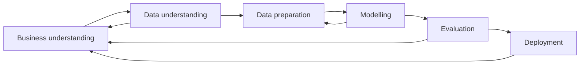
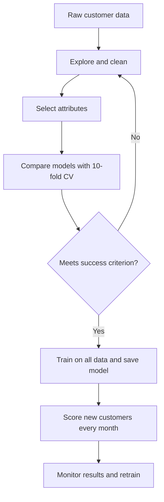

# Session 8 · Designing a Real-World Data Mining Project

[](https://colab.research.google.com/github/Hamnakhan123/Diploma-in-Data-Science/blob/main/term-2/01-data-mining-with-weka/code/session-08-real-world-data-mining-project.ipynb)

> 📍 [Diploma in Data Science](../../README.md) › [Term 2](../README.md) › [Data Mining with WEKA](README.md) › **Session 8**

| ⏱ Estimated time | 🧩 Prerequisites | 💻 Tools |
|---|---|---|
| 3 hours | Sessions 1 to 7 | WEKA 3.8 (Explorer, command line, attribute selection, saved models), Python 3 (pandas, scikit-learn) |

[⬅ Previous: Session 7 · Text Mining and Web Mining](session-07-text-mining-and-web-mining.md) · [🏠 Module home](README.md) · [Next: Practice test ➡](practice-test.md)

---

## 🎯 Learning objectives

- Plan a data mining project end to end with **CRISP-DM**, and relate it to **KDD** and **SEMMA**.
- Turn a business question into a **data mining goal** with a measurable success criterion.
- Run a complete project in WEKA: explore, select attributes, compare models, save the best model and score new records.
- Rebuild the same project as a reproducible **scikit-learn pipeline** with tuning and a business-value estimate.
- Write a short project report and deployment plan, including ethics and monitoring.

## 📖 Concepts

### 1. Process models

| Model | Phases | Notes |
|---|---|---|
| **CRISP-DM** | Business understanding → Data understanding → Data preparation → Modelling → Evaluation → Deployment | Industry standard; iterative; starts and ends with the business |
| **KDD** (Knowledge Discovery in Databases) | Selection → Pre-processing → Transformation → Data mining → Interpretation / evaluation | Academic view; data mining is one step of KDD |
| **SEMMA** | Sample → Explore → Modify → Model → Assess | Tool-oriented (SAS); no explicit business or deployment phase |

### 2. CRISP-DM in practice

| Phase | Key questions | Typical deliverable |
|---|---|---|
| **Business understanding** | What decision will this support? What does success look like in money or time? | Project charter, success criterion (e.g. "keep 30% of customers who would leave") |
| **Data understanding** | What data exists? Is it complete, recent, biased? | Data dictionary, summary statistics, quality report |
| **Data preparation** | Clean, join, derive features, handle missing values and imbalance | Analysis-ready dataset and the scripts that build it |
| **Modelling** | Which algorithms? Which settings? | Candidate models with cross-validated scores |
| **Evaluation** | Does the best model meet the business goal? Any leakage or bias? | Evaluation report, go / no-go decision |
| **Deployment** | How will predictions reach people? Who monitors them? | Scoring process, dashboard, monitoring and retraining plan |

### 3. Turning a business question into a mining task

| Business question | Mining task | Target | Metric that matters |
|---|---|---|---|
| Which customers are about to leave? | Classification | churn yes / no | Recall on "yes", profit of a retention campaign |
| What will next month's sales be? | Regression / forecasting | sales amount | MAE in rupees |
| What do customers buy together? | Association rules | none | Lift, confidence |
| What kinds of customers do we have? | Clustering | none | Silhouette and business meaning |
| What are customers complaining about? | Text mining | topic / sentiment | Accuracy on a labelled sample |

### 4. Pitfalls that sink real projects

- **Data leakage**: a feature that is only known after the outcome (e.g. "account closed date" when predicting churn).
- **Wrong metric**: 65% accuracy sounds fine until you see that predicting "no churn" for everyone also gives 65%.
- **Class imbalance**: the interesting class is rare; use recall, precision, ROC area, cost-sensitive learning or resampling.
- **Overfitting to the test set**: tuning again and again on the same test data. Keep a final hold-out set.
- **No deployment owner**: a model nobody uses has no value.
- **Ethics and privacy**: avoid sensitive attributes (gender, religion, ethnicity) and their proxies where they would cause unfair treatment; anonymise personal data; explain decisions.

## 🧭 Diagrams





## 💻 Worked project · Telecom churn

### Step 1 · Business understanding

A Karachi internet provider loses customers every month. The retention team can call **10 customers a week** and offer a discount. **Goal:** rank customers by churn risk so the calls go to people who would really leave. **Success criterion:** catch at least **70% of churners** (recall on "yes") while keeping precision above 60%, so most calls are useful.

### Step 2 · The data

Sixty past customers with tenure in months, contract type, monthly bill in rupees, complaint calls in the last quarter, connection type and whether they left.

📄 [`code/churn.arff`](code/churn.arff)

```text
@relation churn

@attribute tenure_months numeric
@attribute contract {monthly,yearly}
@attribute monthly_bill numeric
@attribute complaint_calls numeric
@attribute internet {fibre,dsl}
@attribute churn {no,yes}

@data
57,yearly,2800,1,fibre,no
55,yearly,800,2,fibre,no
60,monthly,2200,5,fibre,yes
7,monthly,900,2,dsl,yes
16,monthly,2300,0,fibre,yes
53,monthly,1400,0,dsl,no
33,yearly,1600,3,fibre,no
44,yearly,2400,1,fibre,no
36,monthly,1800,3,dsl,yes
33,monthly,2900,1,fibre,yes
25,monthly,3800,1,dsl,yes
32,yearly,1200,3,fibre,no
15,monthly,2500,3,fibre,yes
43,yearly,900,2,dsl,no
44,monthly,1900,0,dsl,no
44,monthly,2100,2,dsl,no
55,yearly,2400,1,dsl,no
35,yearly,3200,0,fibre,no
59,yearly,800,3,fibre,no
7,monthly,1300,2,fibre,yes
14,yearly,2200,3,dsl,no
57,monthly,3600,1,fibre,no
33,monthly,3800,5,fibre,yes
11,monthly,900,2,dsl,yes
11,yearly,2700,2,dsl,no
6,monthly,1300,3,fibre,yes
42,yearly,3300,2,fibre,no
16,monthly,1600,0,dsl,no
19,monthly,2600,1,fibre,yes
52,yearly,2500,2,dsl,no
15,yearly,3300,1,fibre,no
10,yearly,1100,2,dsl,no
50,yearly,3200,0,dsl,no
16,monthly,2700,4,dsl,yes
28,monthly,3600,0,dsl,yes
10,yearly,2600,1,fibre,no
36,monthly,1100,0,dsl,no
32,monthly,2000,1,fibre,no
52,monthly,2200,2,fibre,no
55,monthly,1200,0,fibre,no
44,monthly,1600,2,fibre,no
53,yearly,2000,0,dsl,no
33,yearly,3400,1,dsl,no
49,monthly,1400,3,fibre,no
28,yearly,2800,5,fibre,yes
36,yearly,3200,1,fibre,no
21,monthly,3500,1,dsl,yes
2,yearly,3400,1,dsl,no
8,yearly,1200,2,fibre,yes
7,monthly,1100,2,fibre,yes
46,yearly,1400,0,fibre,no
7,monthly,1800,2,dsl,yes
16,monthly,3700,1,fibre,yes
60,monthly,2400,0,dsl,no
57,yearly,1300,1,fibre,no
43,monthly,2800,3,fibre,no
33,yearly,3900,2,dsl,no
33,monthly,3700,1,fibre,yes
55,yearly,2200,5,dsl,no
20,yearly,1300,0,dsl,no
```

Three new customers to score after the model is built (the class is unknown, written as `?`):

📄 [`code/new_customers.arff`](code/new_customers.arff)

```text
@relation churn

@attribute tenure_months numeric
@attribute contract {monthly,yearly}
@attribute monthly_bill numeric
@attribute complaint_calls numeric
@attribute internet {fibre,dsl}
@attribute churn {no,yes}

@data
3,monthly,3500,4,fibre,?
48,yearly,1500,0,dsl,?
14,monthly,2200,2,dsl,?
```

### Step 3 · Data understanding in WEKA

📄 [`code/session-08_explore.sh`](code/session-08_explore.sh)

```bash
weka weka.core.Instances churn.arff | sed -n '/^Relation/,$p'
echo
echo "Churned (yes): $(grep -c ',yes$' churn.arff)   Stayed (no): $(grep -c ',no$' churn.arff)"
```

**Output** (real WEKA 3.8.6 run)

```text
Relation Name:  churn
Num Instances:  60
Num Attributes: 6

     Name                      Type  Nom  Int Real     Missing      Unique  Dist
1 tenure_months              Num   0% 100%   0%     0 /  0%    14 / 23%    30
2 contract                   Nom 100%   0%   0%     0 /  0%     0 /  0%     2
3 monthly_bill               Num   0% 100%   0%     0 /  0%     6 / 10%    27
4 complaint_calls            Num   0% 100%   0%     0 /  0%     1 /  2%     6
5 internet                   Nom 100%   0%   0%     0 /  0%     0 /  0%     2
6 churn                      Nom 100%   0%   0%     0 /  0%     0 /  0%     2

Churned (yes): 21   Stayed (no): 39
```

There are no missing values, and 21 of 60 customers (35%) churned. That 35% sets the **baseline**: a model that always says "no" is 65% accurate, so accuracy alone will not convince anyone.

### Step 4 · Which attributes matter?

📄 [`code/session-08_infogain.sh`](code/session-08_infogain.sh)

```bash
weka weka.attributeSelection.InfoGainAttributeEval -i churn.arff -s "weka.attributeSelection.Ranker" | sed -n '/Ranked attributes/,/Selected attributes/p'
```

**Output** (real WEKA 3.8.6 run)

```text
Ranked attributes:
 0.2411   1 tenure_months
 0.2411   2 contract
 0.00753  5 internet
 0        4 complaint_calls
 0        3 monthly_bill

Selected attributes: 1,2,5,4,3 : 5
```

Contract type and tenure carry the most information about churn, which matches what the retention team already suspects. A score of 0 for `complaint_calls` and `monthly_bill` does **not** prove they are useless: information gain judges one attribute at a time after cutting it into bins, and with 60 rows it found no clean cut. A multivariate model such as logistic regression can still use them, so we keep all five attributes and let cross-validation decide.

### Step 5 · Compare models with 10-fold cross-validation

📄 [`code/session-08_compare.sh`](code/session-08_compare.sh)

```bash
printf "%-22s %9s %11s %9s %8s\n" model accuracy recall_yes prec_yes roc
for c in rules.ZeroR trees.J48 bayes.NaiveBayes functions.Logistic trees.RandomForest; do
  weka weka.classifiers.$c -t churn.arff -x 10 -s 1 -o -v > out.txt
  acc=$(grep -m1 "Correctly Classified" out.txt | awk '{print $(NF-1) "%"}')
  grep -m1 -E " yes$" out.txt | awk -v m="$c" -v a="$acc" '{printf "%-22s %9s %11s %9s %8s\n", m, a, $1, $3, $7}'
done
```

**Output** (real WEKA 3.8.6 run)

```text
model                   accuracy  recall_yes  prec_yes      roc
rules.ZeroR                  65%       0.000         ?    0.467
trees.J48               83.3333%       0.714     0.789    0.804
bayes.NaiveBayes        86.6667%       0.762     0.842    0.924
functions.Logistic      88.3333%       0.857     0.818    0.932
trees.RandomForest           90%       0.810     0.895    0.896
```

Read the table against the success criterion, not just the accuracy column:

- **ZeroR** (always "no") gets 65% accuracy and catches **zero** churners: the baseline is useless for the business.
- **Logistic regression** has the best **recall on "yes"** (it finds about 86% of churners), precision above 0.8 and the best ROC area.
- **Random forest** has the top accuracy, but misses more churners and cannot be explained as easily.

Logistic regression meets both targets (recall ≥ 0.70, precision ≥ 0.60) and its coefficients can be explained to the retention team, so we choose it.

### Step 6 · Train the final model, save it and score new customers

📄 [`code/session-08_deploy.sh`](code/session-08_deploy.sh)

```bash
weka weka.classifiers.functions.Logistic -t churn.arff -no-cv -d churn_logistic.model | sed -n '/Odds Ratios/,/^$/p'
echo "--- predictions for new customers ---"
weka weka.classifiers.functions.Logistic -l churn_logistic.model -T new_customers.arff -classifications weka.classifiers.evaluation.output.prediction.PlainText | sed -n '/inst#/,$p'
```

**Output** (real WEKA 3.8.6 run)

```text
Odds Ratios...
                        Class
Variable                   no
=============================
tenure_months          1.3701
contract=yearly    16260.9033
monthly_bill           0.9984
complaint_calls        0.0906
internet=dsl           7.9547

--- predictions for new customers ---
    inst#     actual  predicted error prediction
        1        1:?      2:yes       1
        2        1:?       1:no       1
        3        1:?      2:yes       0.997
```

`-d` saves the trained model to a file and `-l` loads it again later, which is exactly how monthly scoring works: no retraining needed until the model is reviewed. WEKA reports **odds ratios for the first class, `no` (stays)**. Above 1 means "more likely to stay", below 1 means "more likely to leave":

- each extra month of tenure multiplies the odds of staying by about 1.37;
- each complaint call multiplies them by about 0.09, a strong warning sign;
- DSL customers and, above all, yearly-contract customers are far more likely to stay.

The enormous ratio for `contract=yearly` is a warning about the **small sample**: in these 60 rows almost no yearly customer left, so the unregularised model pushes that weight towards infinity. Adding a ridge penalty (for example `-R 1.0`) or collecting more data gives more believable numbers; the scikit-learn version below is regularised by default.

In the predictions, customers 1 and 3 are flagged as churners and customer 2 (long tenure, yearly contract, no complaints) is safe. Customer 1 (new, monthly contract, high bill, four complaints) goes to the top of this week's call list.

### Step 7 · The same project as a scikit-learn pipeline

A pipeline keeps preparation and model together, so exactly the same steps run in training, cross-validation and deployment.

📄 [`code/session-08_pipeline.py`](code/session-08_pipeline.py)

```python
import io
import pandas as pd
from sklearn.compose import ColumnTransformer
from sklearn.preprocessing import OneHotEncoder, StandardScaler
from sklearn.pipeline import Pipeline
from sklearn.linear_model import LogisticRegression
from sklearn.model_selection import GridSearchCV, StratifiedKFold, cross_val_predict
from sklearn.metrics import classification_report, confusion_matrix

rows = """57,yearly,2800,1,fibre,no
55,yearly,800,2,fibre,no
60,monthly,2200,5,fibre,yes
7,monthly,900,2,dsl,yes
16,monthly,2300,0,fibre,yes
53,monthly,1400,0,dsl,no
33,yearly,1600,3,fibre,no
44,yearly,2400,1,fibre,no
36,monthly,1800,3,dsl,yes
33,monthly,2900,1,fibre,yes
25,monthly,3800,1,dsl,yes
32,yearly,1200,3,fibre,no
15,monthly,2500,3,fibre,yes
43,yearly,900,2,dsl,no
44,monthly,1900,0,dsl,no
44,monthly,2100,2,dsl,no
55,yearly,2400,1,dsl,no
35,yearly,3200,0,fibre,no
59,yearly,800,3,fibre,no
7,monthly,1300,2,fibre,yes
14,yearly,2200,3,dsl,no
57,monthly,3600,1,fibre,no
33,monthly,3800,5,fibre,yes
11,monthly,900,2,dsl,yes
11,yearly,2700,2,dsl,no
6,monthly,1300,3,fibre,yes
42,yearly,3300,2,fibre,no
16,monthly,1600,0,dsl,no
19,monthly,2600,1,fibre,yes
52,yearly,2500,2,dsl,no
15,yearly,3300,1,fibre,no
10,yearly,1100,2,dsl,no
50,yearly,3200,0,dsl,no
16,monthly,2700,4,dsl,yes
28,monthly,3600,0,dsl,yes
10,yearly,2600,1,fibre,no
36,monthly,1100,0,dsl,no
32,monthly,2000,1,fibre,no
52,monthly,2200,2,fibre,no
55,monthly,1200,0,fibre,no
44,monthly,1600,2,fibre,no
53,yearly,2000,0,dsl,no
33,yearly,3400,1,dsl,no
49,monthly,1400,3,fibre,no
28,yearly,2800,5,fibre,yes
36,yearly,3200,1,fibre,no
21,monthly,3500,1,dsl,yes
2,yearly,3400,1,dsl,no
8,yearly,1200,2,fibre,yes
7,monthly,1100,2,fibre,yes
46,yearly,1400,0,fibre,no
7,monthly,1800,2,dsl,yes
16,monthly,3700,1,fibre,yes
60,monthly,2400,0,dsl,no
57,yearly,1300,1,fibre,no
43,monthly,2800,3,fibre,no
33,yearly,3900,2,dsl,no
33,monthly,3700,1,fibre,yes
55,yearly,2200,5,dsl,no
20,yearly,1300,0,dsl,no"""
cols = ["tenure_months", "contract", "monthly_bill", "complaint_calls", "internet", "churn"]
df = pd.read_csv(io.StringIO(rows), header=None, names=cols)
X, y = df.drop(columns="churn"), (df["churn"] == "yes").astype(int)

prep = ColumnTransformer([
    ("num", StandardScaler(), ["tenure_months", "monthly_bill", "complaint_calls"]),
    ("cat", OneHotEncoder(drop="first"), ["contract", "internet"]),
])
pipe = Pipeline([("prep", prep), ("model", LogisticRegression(max_iter=1000))])
cv = StratifiedKFold(5, shuffle=True, random_state=0)
grid = GridSearchCV(pipe, {"model__C": [0.1, 1, 10], "model__class_weight": [None, "balanced"]},
                    scoring="recall", cv=cv).fit(X, y)
print("Best settings:", grid.best_params_)

pred = cross_val_predict(grid.best_estimator_, X, y, cv=cv)
print(classification_report(y, pred, target_names=["stay", "churn"], digits=3))
tn, fp, fn, tp = confusion_matrix(y, pred).ravel()

# business value: each saved churner is worth Rs 30,000 of future revenue, each call costs Rs 500,
# and a call convinces about half of real churners to stay
value = tp * 0.5 * 30000 - (tp + fp) * 500
print(f"Calls made: {tp + fp}, churners reached: {tp}, missed: {fn}")
print(f"Estimated campaign value: Rs {value:,.0f}")

model = grid.best_estimator_.fit(X, y)
names = model.named_steps["prep"].get_feature_names_out()
coefs = pd.Series(model.named_steps["model"].coef_[0], index=names).sort_values()
print("\nCoefficients (positive = more likely to churn):")
print(coefs.round(2).to_string())

new = pd.DataFrame([[3, "monthly", 3500, 4, "fibre"], [48, "yearly", 1500, 0, "dsl"], [14, "monthly", 2200, 2, "dsl"]],
                   columns=cols[:-1])
print("\nChurn probability for new customers:", model.predict_proba(new)[:, 1].round(2).tolist())
```

**Output**

```text
Best settings: {'model__C': 0.1, 'model__class_weight': 'balanced'}
              precision    recall  f1-score   support

        stay      0.912     0.795     0.849        39
       churn      0.692     0.857     0.766        21

    accuracy                          0.817        60
   macro avg      0.802     0.826     0.808        60
weighted avg      0.835     0.817     0.820        60

Calls made: 26, churners reached: 18, missed: 3
Estimated campaign value: Rs 257,000

Coefficients (positive = more likely to churn):
num__tenure_months     -0.66
cat__contract_yearly   -0.59
cat__internet_fibre     0.11
num__monthly_bill       0.19
num__complaint_calls    0.36

Churn probability for new customers: [0.89, 0.15, 0.69]
```

The grid search optimises **recall**, because missing a churner costs far more than one extra phone call. The value estimate turns the confusion matrix into rupees, which is the number managers remember. With `class_weight="balanced"` the model finds 18 of 21 churners at the price of 8 wasted calls, and still meets both targets. In the coefficients, `complaint_calls` and `monthly_bill` are positive even though their information gain was 0, which confirms the decision in Step 4 to keep them. The regularised probabilities (0.89, 0.15, 0.69) are more moderate than WEKA's and rank the three new customers in the same order.

### Step 8 · Evaluation, deployment and monitoring

| Item | Decision |
|---|---|
| Model | Logistic regression on 5 attributes, chosen for recall and explainability |
| Scoring | Run on all active customers on the 1st of every month; top-risk list goes to the retention team |
| Explanation | Each flagged customer comes with the top reasons (short tenure, monthly contract, complaints) |
| Monitoring | Track recall of last month's list against actual churn; alert if it falls below 0.6 |
| Retraining | Every quarter, or sooner if the market changes (new competitor, price change) |
| Ethics | No personal identifiers or sensitive attributes in the model; customers are offered help, never penalised |

## 📊 Project report template

Use this outline for your own project write-up (4 to 6 pages):

1. **Business problem and success criterion**: one paragraph and one measurable target.
2. **Data**: source, size, attributes (data dictionary), quality issues and how you fixed them.
3. **Exploration**: two or three charts or tables that shaped your decisions.
4. **Modelling**: algorithms tried, evaluation method (cross-validation, hold-out), comparison table.
5. **Evaluation**: does the chosen model meet the target? Errors, limitations, possible leakage or bias.
6. **Deployment plan**: who uses the predictions, how often, how it is monitored and retrained.
7. **Appendix**: WEKA settings or Python code so someone else can reproduce your results.

## 🧪 Lab / practice tasks

### 🟢 Task 1 · Easy

In the WEKA Explorer, load `churn.arff` and reproduce the comparison table for J48, NaiveBayes, Logistic and RandomForest. Do you get the same numbers?

<details><summary>💡 Hint</summary>

Use 10-fold cross-validation and the default random seed of 1.

</details>

### 🟡 Task 2 · Medium

Use `CostSensitiveClassifier` around Logistic with a cost matrix that makes missing a churner 5 times worse than a wasted call. How do recall and precision change?

<details><summary>💡 Hint</summary>

In the cost matrix, put the larger cost in the cell for actual = yes, predicted = no.

</details>

### 🟡 Task 3 · Medium

Add a column you would only know after a customer leaves (for example `final_bill_paid`) and fill it so it matches churn. What happens to accuracy, and why is this model useless?

<details><summary>💡 Hint</summary>

This is data leakage; the feature would not exist at prediction time.

</details>

### 🟠 Task 4 · Hard

Draw an ROC curve for Logistic in WEKA (right-click the result → Visualize threshold curve → class yes) and choose a threshold that gives recall of at least 0.9. What precision do you get?

<details><summary>💡 Hint</summary>

Lower thresholds flag more customers: recall rises, precision falls.

</details>

### 🔴 Task 5 · Challenge

Choose a public dataset (for example student performance, bank marketing or heart disease from the UCI repository) and complete all six CRISP-DM phases using the report template above.

<details><summary>💡 Hint</summary>

Start from the business question and write the success criterion before touching any algorithm.

</details>


## ✅ Quick quiz

**Q1.** Which CRISP-DM phase defines the success criterion?

- **A)** Data preparation
- **B)** Modelling
- **C)** Business understanding
- **D)** Deployment

<details><summary>Show answer</summary>

**C** — The goal and how to measure success come from the business first.

</details>

**Q2.** A model with 65% accuracy on data with 65% "no" is…

- **A)** excellent
- **B)** no better than always predicting "no"
- **C)** overfitted
- **D)** leaking data

<details><summary>Show answer</summary>

**B** — It matches the ZeroR baseline.

</details>

**Q3.** A feature only known after the outcome happens causes…

- **A)** underfitting
- **B)** data leakage
- **C)** class imbalance
- **D)** multicollinearity

<details><summary>Show answer</summary>

**B** — The model looks good in testing but cannot work in real use.

</details>

**Q4.** In the churn project, why optimise recall on "yes"?

- **A)** It is always the best metric
- **B)** Missing a churner costs more than an extra call
- **C)** It increases accuracy
- **D)** WEKA requires it

<details><summary>Show answer</summary>

**B** — The business cost of a missed churner drives the metric choice.

</details>

**Q5.** In WEKA, what does the -d option do?

- **A)** Deletes the data
- **B)** Saves the trained model to a file
- **C)** Discretises attributes
- **D)** Sets the number of folds

<details><summary>Show answer</summary>

**B** — -d writes the model; -l loads it later to score new data.

</details>


## 📝 Summary

- **CRISP-DM** gives a repeatable, business-first structure: understand, prepare, model, evaluate, deploy, and loop back.
- Start with a **measurable success criterion** and a **baseline** (ZeroR); judge models on the metric that matches the business cost.
- In WEKA: explore, rank attributes, compare models with cross-validation, save with `-d`, score new data with `-l` and `-T`.
- In Python: a **Pipeline** with `ColumnTransformer` and `GridSearchCV` makes the whole process reproducible.
- Plan **deployment, monitoring, retraining and ethics** from the start; a model nobody uses has no value.

### 🎤 Interview / viva questions

1. Walk me through the six CRISP-DM phases using a project you would like to do.
2. How is KDD different from CRISP-DM?
3. Your model has 95% accuracy on fraud data where only 2% of cases are fraud. Are you happy? Why or why not?
4. How would you explain a churn prediction to the customer-service agent who has to make the call?
5. What would you monitor after deploying a model, and what would trigger retraining?

---

[⬅ Previous: Session 7 · Text Mining and Web Mining](session-07-text-mining-and-web-mining.md) · [🏠 Module home](README.md) · [Next: Practice test ➡](practice-test.md)

<sub>Diploma in Data Science · Prepared by **Hamna Zahid Khan**, Junior Lecturer</sub>
