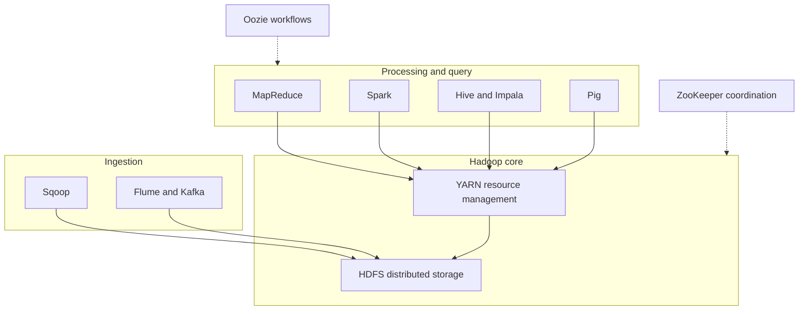
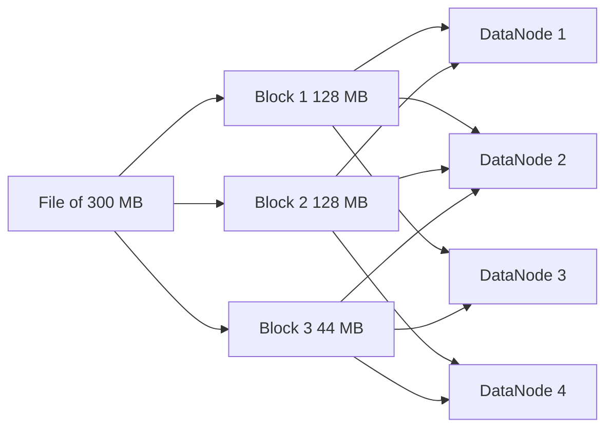

# Session 1 · Introduction to Big Data and the Hadoop Ecosystem

[](https://colab.research.google.com/github/Hamnakhan123/Diploma-in-Data-Science/blob/main/term-2/02-big-data-systems-with-hadoop/code/session-01-big-data-and-hadoop-ecosystem.ipynb)

> 📍 [Diploma in Data Science](../../README.md) › [Term 2](../README.md) › [Foundations of Big Data Systems with Hadoop](README.md) › **Session 1**

| ⏱ Estimated time | 🧩 Prerequisites | 💻 Tools |
|---|---|---|
| 2.5 hours | Basic Python, Term 1 data handling | Python 3 (simulations), Hadoop 3.x (reference) |

[⬅ Previous: Module overview](README.md) · [🏠 Module home](README.md) · [Next: Session 2 · Configuring Hadoop and Setting Up a Cluster ➡](session-02-configuring-hadoop-cluster.md)

---

## 🎯 Learning objectives

- Define **Big Data** and explain its characteristics using the **5 Vs**.
- Explain why a single computer cannot handle Big Data and how **scale-out** clusters solve it.
- Name the main **Hadoop ecosystem** components and say what each one is for.
- Describe how **HDFS** stores a file as replicated blocks across machines.
- Explain the job of **YARN** as the cluster's resource manager.

## 📖 Concepts

### 1. What is Big Data?

**Big Data** is data that is too large, too fast or too varied to be stored and processed with traditional tools such as a single database server or a spreadsheet. The point is not a fixed size; it is the moment your usual tools stop coping.

Everyday sources in Pakistan and worldwide: mobile network call records (Jazz, Zong, Telenor), digital payments (Raast, JazzCash, Easypaisa), e-commerce clickstreams (Daraz), CCTV and Safe City cameras, social media posts, IoT sensors on factory machines and smart meters.

### 2. The 5 Vs

| V | Meaning | Example |
|---|---|---|
| **Volume** | The amount of data | A telecom operator storing billions of call records per month |
| **Velocity** | The speed data arrives and must be processed | Card payments checked for fraud within milliseconds |
| **Variety** | Different formats | Tables, JSON logs, images, voice notes, PDFs |
| **Veracity** | How trustworthy and clean the data is | Duplicate sensor readings, fake reviews, typos in names |
| **Value** | The business benefit we can extract | Reducing customer churn by 2% with better offers |

Data comes in three shapes: **structured** (rows and columns in a database), **semi-structured** (JSON, XML, log lines with some structure) and **unstructured** (text, audio, images, video). Most new data is semi-structured or unstructured.

### 3. Scale up vs scale out

| | Scale **up** (vertical) | Scale **out** (horizontal) |
|---|---|---|
| How | Buy a bigger server | Add more ordinary servers |
| Cost | Grows very fast; high-end hardware is expensive | Grows roughly linearly with commodity hardware |
| Limit | One machine has a ceiling | Add nodes almost without limit |
| Failure | One box fails, everything stops | Designed to survive node failures |

The real bottleneck is often **disk read speed**, not disk size. Reading 10 TB from one disk at ~150 MB/s takes most of a day; spreading it across 100 disks reading in parallel takes minutes (Example 1). Hadoop's core idea is: **split the data, store the pieces on many machines, and send the computation to where the data already is** (*data locality*).

### 4. A short history of Hadoop

- 2003–2004: Google publishes papers on the **Google File System** and **MapReduce**.
- 2006: Doug Cutting and Mike Cafarella build **Hadoop** (named after a toy elephant) as an open-source version; Yahoo! adopts it.
- 2008: Hadoop becomes a top-level **Apache** project.
- 2013: **Hadoop 2** introduces **YARN**, separating resource management from MapReduce.
- 2017 onwards: **Hadoop 3** adds erasure coding, multiple standby NameNodes and better container support.

### 5. The Hadoop ecosystem

Core Hadoop has four modules: **Hadoop Common** (shared libraries), **HDFS** (storage), **YARN** (resource management) and **MapReduce** (batch processing). Around it sits a large ecosystem:

| Layer | Component | Purpose |
|---|---|---|
| Storage | **HDFS** | Distributed, replicated file system |
| Storage | **HBase** | NoSQL column-family database on top of HDFS, for fast random reads and writes |
| Resource management | **YARN** | Shares CPU and memory of the cluster between applications |
| Processing | **MapReduce** | Batch processing with map and reduce functions |
| Processing | **Spark** | Fast in-memory processing: SQL, streaming, machine learning |
| Querying | **Hive** | SQL-like queries (HiveQL) over files in HDFS |
| Querying | **Impala** | Low-latency, interactive SQL on HDFS and HBase |
| Scripting | **Pig** | Data-flow scripting language (Pig Latin) |
| Ingestion | **Sqoop** | Bulk transfer between relational databases and HDFS |
| Ingestion | **Flume / Kafka** | Collecting and streaming log and event data |
| Coordination | **ZooKeeper** | Configuration, leader election, distributed locks |
| Workflow | **Oozie** | Scheduling chains of Hadoop jobs |
| Management | **Ambari** | Installing, configuring and monitoring clusters |

### 6. HDFS in one paragraph

The **Hadoop Distributed File System** splits every file into large **blocks** (128 MB by default in Hadoop 2 and 3) and stores each block on several **DataNodes** (3 copies by default, the **replication factor**). A single **NameNode** keeps the metadata: the directory tree, which blocks belong to which file, and where each block lives. If a DataNode dies, the NameNode notices the missing heartbeats and copies its blocks from the surviving replicas to other nodes. HDFS is built for **write once, read many** workloads and for streaming through large files, not for millions of tiny files or frequent in-place edits. Session 3 covers it in depth.

### 7. YARN in one paragraph

**YARN (Yet Another Resource Negotiator)** is the cluster's operating system for compute. The **ResourceManager** (one per cluster) knows how much memory and CPU every machine has; a **NodeManager** on each worker launches **containers** (slices of memory and CPU); each application gets an **ApplicationMaster** that asks for containers and tracks its tasks. Because YARN is generic, MapReduce, Spark, Hive on Tez and others can share the same cluster. Session 4 covers it in depth.

## 🧭 Diagrams





## 💻 Worked examples

> Hadoop itself needs a cluster (or a Linux VM), so in this module we run **Python simulations** that reproduce exactly what Hadoop does, and real **PySpark** code from Session 5 onwards. Commands for a real cluster are shown and marked *illustrative*.

### Example 1 · Why scale out? Reading 10 TB

📄 [`code/session-01_scale.py`](code/session-01_scale.py)

```python
data_tb = 10
disk_mb_per_s = 150            # typical sequential read speed of one hard disk
data_mb = data_tb * 1024 * 1024

print(f"{'machines':>8} | {'read time':>12}")
for machines in [1, 10, 50, 100, 500]:
    seconds = data_mb / (disk_mb_per_s * machines)
    h, rem = divmod(seconds, 3600)
    m = rem / 60
    print(f"{machines:>8} | {int(h):>3} h {m:5.1f} min")
```

**Output**

```text
machines |    read time
       1 |  19 h  25.1 min
      10 |   1 h  56.5 min
      50 |   0 h  23.3 min
     100 |   0 h  11.7 min
     500 |   0 h   2.3 min
```

With one disk the job takes almost a day; with 100 machines reading their own share in parallel it takes about 12 minutes. This is the entire reason Hadoop exists.

### Example 2 · How HDFS splits a file into blocks

📄 [`code/session-01_blocks.py`](code/session-01_blocks.py)

```python
import math, random
random.seed(7)

BLOCK_MB, REPLICATION = 128, 3
datanodes = ["dn1", "dn2", "dn3", "dn4", "dn5"]

def split_file(name, size_mb):
    n = math.ceil(size_mb / BLOCK_MB)
    blocks = []
    for i in range(n):
        size = min(BLOCK_MB, size_mb - i * BLOCK_MB)
        replicas = random.sample(datanodes, REPLICATION)
        blocks.append((f"{name}#blk_{i+1}", size, replicas))
    return blocks

for fname, size in [("calls_jan.csv", 300), ("logo.png", 2), ("cctv_day1.mp4", 1000)]:
    blocks = split_file(fname, size)
    print(f"{fname}: {size} MB -> {len(blocks)} block(s), raw storage used = {size*REPLICATION} MB")
    for b, s, reps in blocks:
        print(f"   {b:<22} {s:>4} MB  on {', '.join(reps)}")
```

**Output**

```text
calls_jan.csv: 300 MB -> 3 block(s), raw storage used = 900 MB
   calls_jan.csv#blk_1     128 MB  on dn3, dn2, dn4
   calls_jan.csv#blk_2     128 MB  on dn1, dn5, dn3
   calls_jan.csv#blk_3      44 MB  on dn1, dn3, dn4
logo.png: 2 MB -> 1 block(s), raw storage used = 6 MB
   logo.png#blk_1            2 MB  on dn1, dn2, dn5
cctv_day1.mp4: 1000 MB -> 8 block(s), raw storage used = 3000 MB
   cctv_day1.mp4#blk_1     128 MB  on dn1, dn4, dn2
   cctv_day1.mp4#blk_2     128 MB  on dn1, dn2, dn5
   cctv_day1.mp4#blk_3     128 MB  on dn5, dn4, dn1
   cctv_day1.mp4#blk_4     128 MB  on dn5, dn1, dn4
   cctv_day1.mp4#blk_5     128 MB  on dn5, dn1, dn3
   cctv_day1.mp4#blk_6     128 MB  on dn5, dn4, dn1
   cctv_day1.mp4#blk_7     128 MB  on dn2, dn1, dn3
   cctv_day1.mp4#blk_8     104 MB  on dn2, dn3, dn5
```

Notice that the 2 MB `logo.png` uses only 2 MB per replica, not a full 128 MB block. A block is a *maximum* size. But every file and block still costs memory on the NameNode, which is why millions of tiny files are a problem.

### Example 3 · The MapReduce idea in plain Python

Word count is the "hello world" of Big Data. Each **mapper** reads one split and emits `(word, 1)`; the framework **shuffles** pairs so the same word reaches the same **reducer**; each reducer sums the counts.

📄 [`code/session-01_wordcount_mr.py`](code/session-01_wordcount_mr.py)

```python
from collections import defaultdict

splits = [                                   # imagine each line is a block on a different node
    "big data needs big clusters",
    "hadoop stores big data in hdfs",
    "yarn shares the cluster",
]

def mapper(line):
    for word in line.split():
        yield word, 1

def reducer(word, counts):
    return word, sum(counts)

# map phase (runs in parallel on the nodes that hold each split)
mapped = [pair for line in splits for pair in mapper(line)]
print("map output (first 6):", mapped[:6])

# shuffle and sort: group all values by key
groups = defaultdict(list)
for k, v in mapped:
    groups[k].append(v)

# reduce phase
result = [reducer(k, v) for k, v in sorted(groups.items())]
print("reduce output:")
for word, n in sorted(result, key=lambda x: (-x[1], x[0])):
    print(f"  {word:<9}{n}")
```

**Output**

```text
map output (first 6): [('big', 1), ('data', 1), ('needs', 1), ('big', 1), ('clusters', 1), ('hadoop', 1)]
reduce output:
  big      3
  data     2
  cluster  1
  clusters 1
  hadoop   1
  hdfs     1
  in       1
  needs    1
  shares   1
  stores   1
  the      1
  yarn     1
```

### Example 4 · The same idea on a real Hadoop cluster (illustrative)

On a cluster, the same job runs with Hadoop's bundled examples JAR. These commands are **illustrative**: they need a running Hadoop installation.

```bash
hdfs dfs -mkdir -p /user/hamna/input
hdfs dfs -put books/*.txt /user/hamna/input
hadoop jar $HADOOP_HOME/share/hadoop/mapreduce/hadoop-mapreduce-examples-3.3.6.jar \
       wordcount /user/hamna/input /user/hamna/output
hdfs dfs -cat /user/hamna/output/part-r-00000 | head
```

## 🧪 Lab / practice tasks

### 🟢 Task 1 · Easy

List three Big Data sources from your own city or university and classify each as structured, semi-structured or unstructured. Name the V that is most challenging for each.

<details><summary>💡 Hint</summary>

A university LMS produces login logs (semi-structured), marks (structured) and lecture videos (unstructured).

</details>

### 🟢 Task 2 · Easy

Change Example 1 to a 1 PB dataset and a disk speed of 200 MB/s. How many machines are needed to finish in under one hour?

<details><summary>💡 Hint</summary>

1 PB = 1024 × 1024 × 1024 MB. Solve machines = data ÷ (speed × 3600).

</details>

### 🟡 Task 3 · Medium

In Example 2 set `BLOCK_MB = 256` and `REPLICATION = 2`. How do the number of blocks and the raw storage change for the 1000 MB video?

<details><summary>💡 Hint</summary>

Blocks = ceil(size ÷ block size); raw storage = size × replication.

</details>

### 🟡 Task 4 · Medium

Extend Example 3 so the mapper lower-cases words and removes punctuation, then count words in a paragraph of your choice.

<details><summary>💡 Hint</summary>

Use `re.findall(r"[a-z]+", line.lower())`.

</details>

### 🔴 Task 5 · Challenge

Match each ecosystem component to a step of this pipeline: import MySQL sales tables nightly, collect website logs, run SQL reports, train a churn model, schedule everything at 2 am.

<details><summary>💡 Hint</summary>

Sqoop, Flume or Kafka, Hive or Impala, Spark MLlib, Oozie.

</details>


## ✅ Quick quiz

**Q1.** Which V describes how fast data arrives?

- **A)** Volume
- **B)** Velocity
- **C)** Variety
- **D)** Veracity

<details><summary>Show answer</summary>

**B** — Velocity is the speed of data generation and processing.

</details>

**Q2.** JSON log files are an example of…

- **A)** structured data
- **B)** semi-structured data
- **C)** unstructured data
- **D)** metadata only

<details><summary>Show answer</summary>

**B** — They have keys and nesting but no fixed table schema.

</details>

**Q3.** Hadoop's main approach to large data is to…

- **A)** buy one very large server
- **B)** split data across many commodity machines and process it where it lives
- **C)** compress everything into one file
- **D)** store data only in memory

<details><summary>Show answer</summary>

**B** — Scale out and data locality are Hadoop's core ideas.

</details>

**Q4.** The default HDFS block size in Hadoop 3 is…

- **A)** 4 KB
- **B)** 64 MB
- **C)** 128 MB
- **D)** 1 GB

<details><summary>Show answer</summary>

**C** — 128 MB (Hadoop 1 used 64 MB).

</details>

**Q5.** Which component moves data between MySQL and HDFS?

- **A)** Flume
- **B)** Sqoop
- **C)** Oozie
- **D)** ZooKeeper

<details><summary>Show answer</summary>

**B** — Sqoop = "SQL to Hadoop" bulk import and export.

</details>


## 📝 Summary

- Big Data is defined by the **5 Vs**: volume, velocity, variety, veracity and value.
- **Scaling out** on commodity machines beats scaling up because disk throughput adds up and failures are tolerated.
- Hadoop core = **Common + HDFS + YARN + MapReduce**; the ecosystem adds Hive, Pig, Spark, HBase, Sqoop, Flume, ZooKeeper and Oozie.
- **HDFS** stores files as replicated 128 MB blocks; the **NameNode** keeps metadata, **DataNodes** keep data.
- **YARN** shares cluster CPU and memory between applications through containers.

### 🎤 Interview / viva questions

1. Is 1 TB of data "Big Data"? Defend your answer using the 5 Vs.
2. Why does Hadoop move computation to the data instead of moving data to the computation?
3. What is the difference between HDFS and HBase?
4. Why was YARN introduced in Hadoop 2?
5. Why are many small files bad for HDFS?

---

[⬅ Previous: Module overview](README.md) · [🏠 Module home](README.md) · [Next: Session 2 · Configuring Hadoop and Setting Up a Cluster ➡](session-02-configuring-hadoop-cluster.md)

<sub>Diploma in Data Science · Prepared by **Hamna Zahid Khan**, Junior Lecturer</sub>
