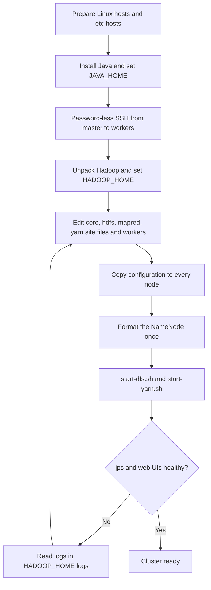
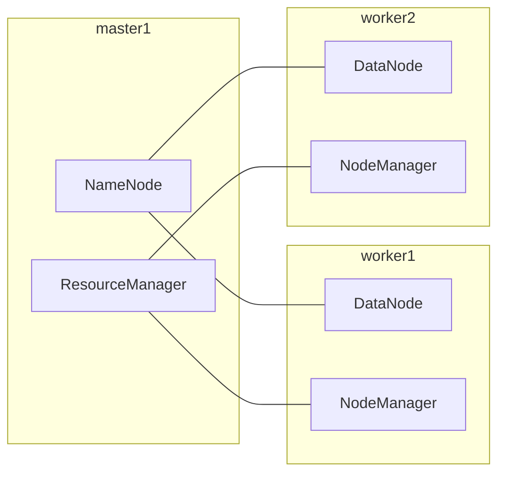

# Session 2 · Configuring Hadoop and Setting Up a Cluster

[](https://colab.research.google.com/github/Hamnakhan123/Diploma-in-Data-Science/blob/main/term-2/02-big-data-systems-with-hadoop/code/session-02-configuring-hadoop-cluster.ipynb)

> 📍 [Diploma in Data Science](../../README.md) › [Term 2](../README.md) › [Foundations of Big Data Systems with Hadoop](README.md) › **Session 2**

| ⏱ Estimated time | 🧩 Prerequisites | 💻 Tools |
|---|---|---|
| 2.5 hours | Session 1, basic Linux commands | Python 3 (config and sizing tools), Hadoop 3.x on Linux (reference) |

[⬅ Previous: Session 1 · Introduction to Big Data and the Hadoop Ecosystem](session-01-big-data-and-hadoop-ecosystem.md) · [🏠 Module home](README.md) · [Next: Session 3 · Understanding HDFS and Its Goals ➡](session-03-hdfs-and-its-goals.md)

---

## 🎯 Learning objectives

- Explain the three **Hadoop run modes**: standalone, pseudo-distributed and fully distributed.
- Identify the main **configuration files** and the key property in each.
- List the steps to install Hadoop and set up a small **multi-node cluster**.
- Configure **HDFS**: replication, block size, NameNode and DataNode directories.
- Size a cluster for a given amount of data.

## 📖 Concepts

### 1. Run modes

| Mode | Where daemons run | HDFS? | Used for |
|---|---|---|---|
| **Standalone (local)** | No daemons; one Java process | No, uses the local file system | Debugging MapReduce code |
| **Pseudo-distributed** | All daemons on one machine, each in its own JVM | Yes, replication 1 | Learning and testing |
| **Fully distributed** | Masters and workers on separate machines | Yes, replication 3 | Production |

### 2. Prerequisites

- **Linux** (Ubuntu or similar); on Windows use WSL2 or a VM.
- **Java** 8 or 11 (Hadoop 3.3), with `JAVA_HOME` set.
- **SSH** with password-less keys, because the start scripts log in to every worker.
- The same Hadoop version and the same configuration files on every node.
- Each node can resolve every other node by host name (`/etc/hosts` or DNS).

### 3. The configuration files

All files live in `$HADOOP_HOME/etc/hadoop/`. Each XML file is a list of `<property>` elements with a `<name>` and a `<value>`. Anything you do not set falls back to the defaults in `core-default.xml`, `hdfs-default.xml` and so on.

| File | Controls | Key properties |
|---|---|---|
| `hadoop-env.sh` | Environment for the daemons | `JAVA_HOME`, heap sizes |
| `core-site.xml` | Settings shared by everything | `fs.defaultFS` (where HDFS lives), `hadoop.tmp.dir` |
| `hdfs-site.xml` | HDFS daemons | `dfs.replication`, `dfs.blocksize`, `dfs.namenode.name.dir`, `dfs.datanode.data.dir` |
| `mapred-site.xml` | MapReduce | `mapreduce.framework.name = yarn` |
| `yarn-site.xml` | YARN daemons | `yarn.resourcemanager.hostname`, `yarn.nodemanager.aux-services`, memory limits |
| `workers` | List of worker host names | one host per line (called `slaves` in Hadoop 2) |

### 4. Configuring HDFS

- **`dfs.replication`**: copies of each block. 1 on a single machine, 3 in production.
- **`dfs.blocksize`**: 134217728 bytes (128 MB) by default; 256 MB suits very large files.
- **`dfs.namenode.name.dir`**: where the NameNode stores its metadata (`fsimage` and `edits`). Put it on reliable disks, ideally two directories on different disks.
- **`dfs.datanode.data.dir`**: comma-separated list of directories, one per physical disk, where DataNodes store blocks.
- **`dfs.namenode.http-address`**: the NameNode web UI, port **9870** in Hadoop 3 (50070 in Hadoop 2).
- **Formatting**: `hdfs namenode -format` creates an empty file system. Run it **once**, on a new cluster only; reformatting wipes the metadata.

### 5. Setting up a cluster step by step

1. Prepare machines: same OS, a `hadoop` user, fixed IP addresses, host names in `/etc/hosts`.
2. Install Java and set `JAVA_HOME` in `hadoop-env.sh`.
3. Create an SSH key on the master and copy it to every worker (`ssh-copy-id`).
4. Download and unpack Hadoop; set `HADOOP_HOME` and add `bin` and `sbin` to `PATH`.
5. Edit the four XML files and `workers`, then copy `etc/hadoop/` to every node.
6. Format the NameNode once.
7. Start HDFS with `start-dfs.sh` and YARN with `start-yarn.sh`.
8. Check with `jps`, `hdfs dfsadmin -report` and the web UIs (9870 for HDFS, 8088 for YARN).

### 6. Typical daemon layout

| Node | Daemons |
|---|---|
| master1 | NameNode, ResourceManager |
| master2 | Secondary NameNode (or Standby NameNode), JobHistory Server |
| worker1 … workerN | DataNode, NodeManager |

## 🧭 Diagrams





## 💻 Worked examples

### Example 1 · The configuration files for a pseudo-distributed cluster

These are the real files you would place in `etc/hadoop/` on a single machine.

📄 [`code/core-site.xml`](code/core-site.xml)

```xml
<?xml version="1.0"?>
<configuration>
  <property>
    <name>fs.defaultFS</name>
    <value>hdfs://localhost:9000</value>
  </property>
  <property>
    <name>hadoop.tmp.dir</name>
    <value>/home/hadoop/hdata/tmp</value>
  </property>
</configuration>
```

📄 [`code/hdfs-site.xml`](code/hdfs-site.xml)

```xml
<?xml version="1.0"?>
<configuration>
  <property>
    <name>dfs.replication</name>
    <value>1</value>
  </property>
  <property>
    <name>dfs.namenode.name.dir</name>
    <value>file:///home/hadoop/hdata/namenode</value>
  </property>
  <property>
    <name>dfs.datanode.data.dir</name>
    <value>file:///home/hadoop/hdata/datanode</value>
  </property>
  <property>
    <name>dfs.blocksize</name>
    <value>134217728</value>
  </property>
</configuration>
```

📄 [`code/mapred-site.xml`](code/mapred-site.xml)

```xml
<?xml version="1.0"?>
<configuration>
  <property>
    <name>mapreduce.framework.name</name>
    <value>yarn</value>
  </property>
</configuration>
```

📄 [`code/yarn-site.xml`](code/yarn-site.xml)

```xml
<?xml version="1.0"?>
<configuration>
  <property>
    <name>yarn.nodemanager.aux-services</name>
    <value>mapreduce_shuffle</value>
  </property>
  <property>
    <name>yarn.resourcemanager.hostname</name>
    <value>localhost</value>
  </property>
  <property>
    <name>yarn.nodemanager.resource.memory-mb</name>
    <value>4096</value>
  </property>
</configuration>
```

### Example 2 · Install and start commands (illustrative)

Run on Ubuntu as the `hadoop` user. These commands are **illustrative** and need a Linux machine with internet access.

```bash
sudo apt install -y openjdk-11-jdk ssh
ssh-keygen -t rsa -P "" -f ~/.ssh/id_rsa && cat ~/.ssh/id_rsa.pub >> ~/.ssh/authorized_keys
wget https://downloads.apache.org/hadoop/common/hadoop-3.3.6/hadoop-3.3.6.tar.gz
tar -xzf hadoop-3.3.6.tar.gz && mv hadoop-3.3.6 ~/hadoop
echo 'export HADOOP_HOME=~/hadoop; export PATH=$PATH:$HADOOP_HOME/bin:$HADOOP_HOME/sbin' >> ~/.bashrc
echo 'export JAVA_HOME=/usr/lib/jvm/java-11-openjdk-amd64' >> ~/hadoop/etc/hadoop/hadoop-env.sh
hdfs namenode -format          # once only!
start-dfs.sh && start-yarn.sh
jps                            # expect NameNode, DataNode, SecondaryNameNode, ResourceManager, NodeManager
```

### Example 3 · Reading configuration like Hadoop does

Hadoop merges defaults with your `*-site.xml` overrides. This script parses the same XML and shows the effective values.

📄 [`code/session-02_read_config.py`](code/session-02_read_config.py)

```python
import xml.etree.ElementTree as ET

defaults = {"fs.defaultFS": "file:///", "dfs.replication": "3", "dfs.blocksize": "134217728",
            "mapreduce.framework.name": "local", "yarn.nodemanager.resource.memory-mb": "8192"}

site_xml = {
 "core-site.xml": """<configuration><property><name>fs.defaultFS</name>
     <value>hdfs://localhost:9000</value></property></configuration>""",
 "hdfs-site.xml": """<configuration><property><name>dfs.replication</name><value>1</value></property>
     </configuration>""",
 "mapred-site.xml": """<configuration><property><name>mapreduce.framework.name</name>
     <value>yarn</value></property></configuration>""",
}

effective = dict(defaults)
source = {k: "default" for k in defaults}
for fname, text in site_xml.items():
    for prop in ET.fromstring(text).findall("property"):
        name, value = prop.findtext("name").strip(), prop.findtext("value").strip()
        effective[name], source[name] = value, fname

for k in effective:
    print(f"{k:<38} = {effective[k]:<24} ({source[k]})")
print("\nblock size in MB:", int(effective["dfs.blocksize"]) // (1024 * 1024))
```

**Output**

```text
fs.defaultFS                           = hdfs://localhost:9000    (core-site.xml)
dfs.replication                        = 1                        (hdfs-site.xml)
dfs.blocksize                          = 134217728                (default)
mapreduce.framework.name               = yarn                     (mapred-site.xml)
yarn.nodemanager.resource.memory-mb    = 8192                     (default)

block size in MB: 128
```

### Example 4 · Sizing a cluster

A company keeps 50 TB of data today, adds 1.5 TB per month and wants capacity for 2 years. Raw storage must also cover replication, temporary and intermediate data (about 25%) and free headroom (keep disks under 80% full).

📄 [`code/session-02_sizing.py`](code/session-02_sizing.py)

```python
import math
today_tb, growth_tb_month, months = 50, 1.5, 24
replication, temp_overhead, max_fill = 3, 0.25, 0.80
disks_per_node, disk_tb = 12, 8

data = today_tb + growth_tb_month * months
raw = data * replication * (1 + temp_overhead) / max_fill
node_tb = disks_per_node * disk_tb
nodes = math.ceil(raw / node_tb)

print(f"data after {months} months     : {data:.1f} TB")
print(f"raw capacity needed       : {raw:.1f} TB")
print(f"capacity per worker node  : {node_tb} TB ({disks_per_node} x {disk_tb} TB)")
print(f"worker nodes needed       : {nodes}")
print(f"tolerating 2 failed nodes : {nodes + 2}")
```

**Output**

```text
data after 24 months     : 86.0 TB
raw capacity needed       : 403.1 TB
capacity per worker node  : 96 TB (12 x 8 TB)
worker nodes needed       : 5
tolerating 2 failed nodes : 7
```

## 🧪 Lab / practice tasks

### 🟢 Task 1 · Easy

For each file in Example 1, write one sentence explaining what would break if it were missing.

<details><summary>💡 Hint</summary>

Without `mapred-site.xml`, MapReduce runs in local mode instead of on YARN.

</details>

### 🟡 Task 2 · Medium

Change Example 3 so `hdfs-site.xml` also sets `dfs.blocksize` to 256 MB. Re-run and confirm the effective value and its source.

<details><summary>💡 Hint</summary>

256 × 1024 × 1024 = 268435456.

</details>

### 🟡 Task 3 · Medium

Re-run Example 4 with replication 2 and 16 TB disks. How many fewer nodes are needed, and what risk does replication 2 add?

<details><summary>💡 Hint</summary>

With two copies, losing two nodes holding the same block loses data.

</details>

### 🟠 Task 4 · Hard

On a Linux VM or WSL2, follow Example 2 to start a pseudo-distributed cluster. Screenshot `jps` and the NameNode web UI on port 9870.

<details><summary>💡 Hint</summary>

If DataNode does not start, check for a clusterID mismatch in its log after reformatting.

</details>

### 🔴 Task 5 · Challenge

Design the daemon layout and the `workers` file for a 6-machine cluster with 2 masters. Justify where you put the Secondary NameNode.

<details><summary>💡 Hint</summary>

Never put the Secondary NameNode on the same machine as the NameNode.

</details>


## ✅ Quick quiz

**Q1.** Which property tells clients where HDFS is?

- **A)** dfs.replication
- **B)** fs.defaultFS
- **C)** yarn.resourcemanager.hostname
- **D)** hadoop.tmp.dir

<details><summary>Show answer</summary>

**B** — fs.defaultFS in core-site.xml, for example hdfs://master:9000.

</details>

**Q2.** In pseudo-distributed mode the usual replication factor is…

- **A)** 0
- **B)** 1
- **C)** 3
- **D)** 5

<details><summary>Show answer</summary>

**B** — There is only one DataNode, so more copies are impossible.

</details>

**Q3.** `hdfs namenode -format` should be run…

- **A)** before every start
- **B)** once, on a new cluster
- **C)** after every job
- **D)** on every DataNode

<details><summary>Show answer</summary>

**B** — Reformatting erases the file system metadata.

</details>

**Q4.** Which file lists the worker host names?

- **A)** masters
- **B)** workers
- **C)** core-site.xml
- **D)** yarn-env.sh

<details><summary>Show answer</summary>

**B** — Hadoop 3 uses `workers` (Hadoop 2 used `slaves`).

</details>

**Q5.** The Hadoop 3 NameNode web UI listens on port…

- **A)** 8088
- **B)** 9870
- **C)** 50070
- **D)** 22

<details><summary>Show answer</summary>

**B** — 9870 for HDFS; 8088 is the YARN ResourceManager UI.

</details>


## 📝 Summary

- Three modes: **standalone**, **pseudo-distributed** (learning) and **fully distributed** (production).
- Key files: `core-site.xml` (fs.defaultFS), `hdfs-site.xml` (replication, block size, directories), `mapred-site.xml` (framework = yarn), `yarn-site.xml` (ResourceManager, shuffle service), `workers`.
- Setup: Java → SSH keys → unpack → configure → copy → **format once** → start-dfs/start-yarn → verify with `jps` and the web UIs.
- Size clusters for future data × replication × overhead, keeping disks below about 80% full.

### 🎤 Interview / viva questions

1. Why does Hadoop need password-less SSH?
2. What is stored in `dfs.namenode.name.dir`, and why should it be on two disks?
3. What happens if you reformat the NameNode on a running cluster?
4. Why does `yarn.nodemanager.aux-services` need `mapreduce_shuffle`?
5. How would you add a new worker node to a running cluster?

---

[⬅ Previous: Session 1 · Introduction to Big Data and the Hadoop Ecosystem](session-01-big-data-and-hadoop-ecosystem.md) · [🏠 Module home](README.md) · [Next: Session 3 · Understanding HDFS and Its Goals ➡](session-03-hdfs-and-its-goals.md)

<sub>Diploma in Data Science · Prepared by **Hamna Zahid Khan**, Junior Lecturer</sub>
