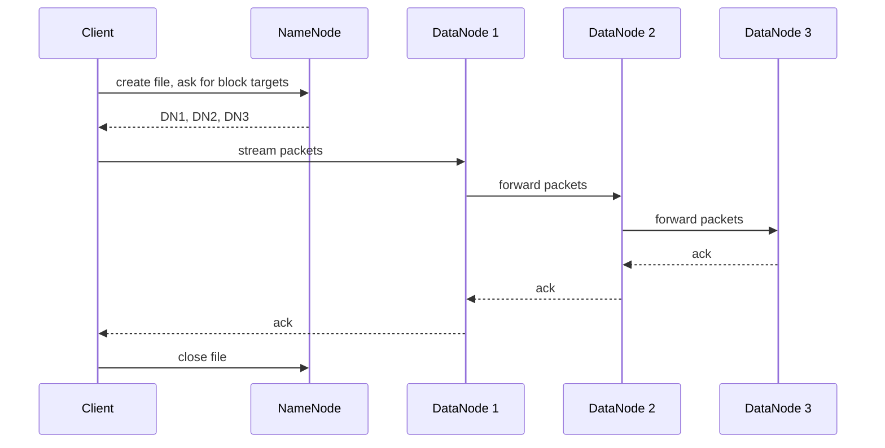
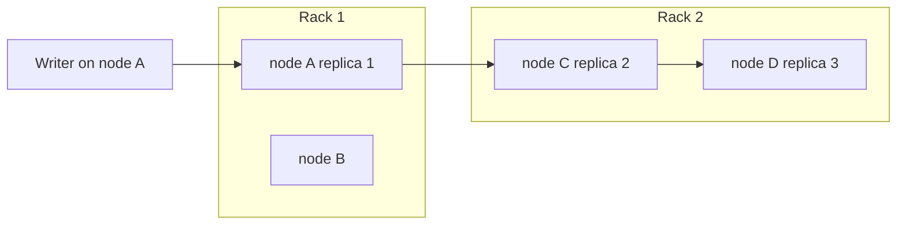

# Session 3 · Understanding HDFS and Its Goals

[](https://colab.research.google.com/github/Hamnakhan123/Diploma-in-Data-Science/blob/main/term-2/02-big-data-systems-with-hadoop/code/session-03-hdfs-and-its-goals.ipynb)

> 📍 [Diploma in Data Science](../../README.md) › [Term 2](../README.md) › [Foundations of Big Data Systems with Hadoop](README.md) › **Session 3**

| ⏱ Estimated time | 🧩 Prerequisites | 💻 Tools |
|---|---|---|
| 2.5 hours | Sessions 1–2 | Python 3 (HDFS simulation), Hadoop 3.x `hdfs` CLI (reference) |

[⬅ Previous: Session 2 · Configuring Hadoop and Setting Up a Cluster](session-02-configuring-hadoop-cluster.md) · [🏠 Module home](README.md) · [Next: Session 4 · Exploring YARN and Classic MapReduce ➡](session-04-yarn-and-classic-mapreduce.md)

---

## 🎯 Learning objectives

- State the **design goals** of HDFS and the workloads it does and does not suit.
- Explain the roles of the **NameNode**, **DataNodes** and **Secondary NameNode**, and how `fsimage` and `edits` work.
- Describe **rack-aware replica placement**, heartbeats and re-replication after a failure.
- Explain the classic **JobTracker** and **TaskTracker** model of Hadoop 1.
- Use the **HDFS shell** and the **HDFS web interface** to inspect files and cluster health.

## 📖 Concepts

### 1. Goals of HDFS

| Goal | What it means |
|---|---|
| **Hardware failure is normal** | With thousands of disks, something is always broken; detect and recover automatically |
| **Streaming data access** | High throughput when reading whole files, rather than low latency for single records |
| **Large data sets** | Files of gigabytes to terabytes; millions of files per cluster |
| **Simple coherency** | Write once, read many; files can be appended but not edited in the middle |
| **Move computation, not data** | Schedule tasks on the nodes that hold the blocks |
| **Portability** | Runs on commodity hardware and different operating systems (Java) |

HDFS is a **poor fit** for low-latency lookups (use HBase), many small files, and multiple writers editing the same file.

### 2. NameNode and DataNodes

- **NameNode** (master): holds the **namespace** (directories, files, permissions) and the **block map** in RAM. It never stores file data.
- **DataNodes** (workers): store blocks as ordinary files on local disks, serve reads and writes, and send a **heartbeat** every 3 seconds and a **block report** periodically.
- If no heartbeat arrives for about **10 minutes**, the NameNode marks the DataNode dead and schedules **re-replication** of its blocks.

### 3. fsimage, edits and the Secondary NameNode

The NameNode persists metadata in two files:

- **`fsimage`**: a snapshot of the whole namespace.
- **`edits`** (edit log): every change since the last snapshot.

On restart the NameNode loads `fsimage` and replays `edits`. If `edits` grows huge, restarts take hours. The **Secondary NameNode** periodically downloads both, merges them into a fresh `fsimage` (a **checkpoint**) and uploads it back. Despite its name it is **not a hot backup**; true failover needs an HA **Standby NameNode** (Session 7).

### 4. Replica placement and rack awareness

With replication 3, the default policy is:

1. First replica on the writer's node (or a random node if the client is outside the cluster).
2. Second replica on a node in a **different rack**.
3. Third replica on a **different node in the same rack as the second**.

This survives the loss of an entire rack while keeping cross-rack network traffic low.

### 5. Reading and writing

- **Write**: the client asks the NameNode for target DataNodes; it streams packets to the first, which forwards to the second, which forwards to the third (a **pipeline**); acknowledgements flow back.
- **Read**: the client asks the NameNode for block locations, then reads each block directly from the **closest** DataNode. Data never passes through the NameNode.

### 6. JobTracker and TaskTracker (Hadoop 1)

In classic MapReduce (MRv1):

- The **JobTracker** (one per cluster, on the master) accepted jobs, split them into map and reduce tasks, scheduled each task on a TaskTracker, preferring one that held the input block, monitored progress and restarted failed tasks.
- A **TaskTracker** on each worker ran tasks in fixed **map slots** and **reduce slots**, and sent heartbeats to the JobTracker.

The JobTracker did both resource management and job monitoring for every job, so it became a bottleneck at around 4,000 nodes and was a single point of failure. YARN (Session 4) replaced it.

### 7. The HDFS web interface

Open `http://<namenode>:9870` (Hadoop 3).

| Tab | Shows |
|---|---|
| **Overview** | Version, cluster ID, capacity used and remaining, live and dead nodes, under-replicated blocks |
| **Datanodes** | Each DataNode, its capacity, last heartbeat and block count |
| **Snapshot / Startup progress** | Snapshots and how far fsimage and edits loading has gone |
| **Utilities → Browse the file system** | Navigate directories, see replication, block size and block locations; upload and download |
| **Utilities → Logs** | Daemon logs |

## 🧭 Diagrams





## 💻 Worked examples

### Example 1 · The HDFS shell (illustrative)

These commands need a running cluster; they are **illustrative**. `hdfs dfs` works like the Linux shell with a `-` before each command.

```bash
hdfs dfs -mkdir -p /data/sales
hdfs dfs -put sales_2026.csv /data/sales/            # upload
hdfs dfs -ls -h /data/sales                           # list with human sizes
hdfs dfs -cat /data/sales/sales_2026.csv | head -5    # read
hdfs dfs -setrep -w 2 /data/sales/sales_2026.csv      # change replication
hdfs dfs -get /data/sales/sales_2026.csv ./copy.csv   # download
hdfs dfs -du -s -h /data                               # space used
hdfs fsck /data/sales -files -blocks -locations       # blocks and where they live
hdfs dfsadmin -report                                  # capacity and live/dead DataNodes
```

### Example 2 · A mini NameNode with rack-aware placement

📄 [`code/session-03_namenode_sim.py`](code/session-03_namenode_sim.py)

```python
import math, random
random.seed(3)

racks = {"rack1": ["dn1", "dn2", "dn3"], "rack2": ["dn4", "dn5", "dn6"]}
rack_of = {dn: r for r, dns in racks.items() for dn in dns}
BLOCK = 128

def place(writer):
    first = writer
    other_rack = [r for r in racks if r != rack_of[first]][0]
    second = random.choice(racks[other_rack])
    third = random.choice([d for d in racks[other_rack] if d != second])
    return [first, second, third]

namespace = {}          # file -> list of block ids
block_map = {}          # block id -> list of DataNodes
next_id = 1000
for fname, size, writer in [("/data/calls.csv", 400, "dn1"), ("/data/tx.parquet", 200, "dn5")]:
    namespace[fname] = []
    for _ in range(math.ceil(size / BLOCK)):
        block_map[next_id] = place(writer)
        namespace[fname].append(next_id)
        next_id += 1

for f, blocks in namespace.items():
    print(f)
    for b in blocks:
        reps = block_map[b]
        print(f"   blk_{b}: {reps}  racks={sorted({rack_of[d] for d in reps})}")
```

**Output**

```text
/data/calls.csv
   blk_1000: ['dn1', 'dn4', 'dn5']  racks=['rack1', 'rack2']
   blk_1001: ['dn1', 'dn5', 'dn6']  racks=['rack1', 'rack2']
   blk_1002: ['dn1', 'dn6', 'dn4']  racks=['rack1', 'rack2']
   blk_1003: ['dn1', 'dn6', 'dn4']  racks=['rack1', 'rack2']
/data/tx.parquet
   blk_1004: ['dn5', 'dn2', 'dn3']  racks=['rack1', 'rack2']
   blk_1005: ['dn5', 'dn3', 'dn1']  racks=['rack1', 'rack2']
```

Every block lives on **two racks**, so losing a whole rack never loses data.

### Example 3 · DataNode failure and re-replication

📄 [`code/session-03_failure_sim.py`](code/session-03_failure_sim.py)

```python
import random
random.seed(11)
nodes = [f"dn{i}" for i in range(1, 7)]
block_map = {f"blk_{i}": random.sample(nodes, 3) for i in range(1, 11)}

def report(title):
    under = {b: r for b, r in block_map.items() if len(r) < 3}
    print(f"{title}: {len(block_map)} blocks, under-replicated = {len(under)}")
    return under

report("healthy cluster")
dead = "dn2"
print(f"\n*** no heartbeat from {dead} for 10 minutes -> marked dead ***")
for reps in block_map.values():
    if dead in reps:
        reps.remove(dead)
under = report("after failure")
for b, reps in sorted(under.items()):
    target = random.choice([n for n in nodes if n != dead and n not in reps])
    print(f"   copy {b} from {reps[0]} to {target}")
    reps.append(target)
report("\nafter re-replication")
```

**Output**

```text
healthy cluster: 10 blocks, under-replicated = 0

*** no heartbeat from dn2 for 10 minutes -> marked dead ***
after failure: 10 blocks, under-replicated = 6
   copy blk_10 from dn1 to dn3
   copy blk_2 from dn4 to dn6
   copy blk_3 from dn5 to dn1
   copy blk_4 from dn6 to dn3
   copy blk_6 from dn1 to dn4
   copy blk_8 from dn6 to dn3

after re-replication: 10 blocks, under-replicated = 0
```

### Example 4 · JobTracker scheduling with data locality

The JobTracker gave each free map slot a task whose input block was on that node if possible (**node-local**), otherwise anywhere (**remote**, which must copy the block over the network).

📄 [`code/session-03_jobtracker_sim.py`](code/session-03_jobtracker_sim.py)

```python
import random
random.seed(5)
nodes = ["tt1", "tt2", "tt3", "tt4"]
blocks = {f"split{i}": random.sample(nodes, 3) for i in range(1, 11)}
slots = {n: 2 for n in nodes}          # 2 map slots per TaskTracker
pending = list(blocks)
assign = []
while pending and any(slots.values()):
    for tt in nodes:
        if not slots[tt] or not pending:
            continue
        local = [s for s in pending if tt in blocks[s]]
        task = local[0] if local else pending[0]
        assign.append((tt, task, "node-local" if local else "remote"))
        pending.remove(task); slots[tt] -= 1

for tt, task, kind in assign:
    print(f"{tt} runs map({task})  [{kind}]")
print(f"\nlocal tasks: {sum(k == 'node-local' for *_, k in assign)}/{len(assign)}, waiting: {pending}")
```

**Output**

```text
tt1 runs map(split2)  [node-local]
tt2 runs map(split1)  [node-local]
tt3 runs map(split3)  [node-local]
tt4 runs map(split5)  [node-local]
tt1 runs map(split4)  [node-local]
tt2 runs map(split6)  [node-local]
tt3 runs map(split8)  [node-local]
tt4 runs map(split7)  [node-local]

local tasks: 8/8, waiting: ['split9', 'split10']
```

With 3 replicas on 4 nodes every task in this first wave is node-local; the two splits still waiting run in the next wave when slots free up.

## 🧪 Lab / practice tasks

### 🟢 Task 1 · Easy

Explain in your own words why the Secondary NameNode is not a backup NameNode.

<details><summary>💡 Hint</summary>

Think about what happens to clients if the NameNode crashes while only a Secondary is running.

</details>

### 🟡 Task 2 · Medium

Add a third rack to Example 2 and confirm that each block still spans exactly two racks under the default policy.

<details><summary>💡 Hint</summary>

The policy chooses one remote rack for replicas 2 and 3.

</details>

### 🟡 Task 3 · Medium

In Example 3 kill two DataNodes at once. Is any block lost? Run with several seeds.

<details><summary>💡 Hint</summary>

A block is lost only if all three replicas were on dead nodes.

</details>

### 🟠 Task 4 · Hard

In Example 4 give each TaskTracker 1 slot and add 20 splits. Print the number of waves needed.

<details><summary>💡 Hint</summary>

Waves = ceil(tasks ÷ total slots).

</details>

### 🔴 Task 5 · Challenge

On a pseudo-distributed cluster upload a 300 MB file with a 64 MB block size (`hdfs dfs -D dfs.blocksize=67108864 -put ...`) and find its blocks in the web UI.

<details><summary>💡 Hint</summary>

Utilities → Browse the file system → click the file → block information.

</details>


## ✅ Quick quiz

**Q1.** Where is file data stored in HDFS?

- **A)** NameNode
- **B)** DataNodes
- **C)** Secondary NameNode
- **D)** ResourceManager

<details><summary>Show answer</summary>

**B** — The NameNode holds only metadata.

</details>

**Q2.** The Secondary NameNode's job is to…

- **A)** serve clients when the NameNode fails
- **B)** merge fsimage and edits into a checkpoint
- **C)** store a fourth replica
- **D)** schedule map tasks

<details><summary>Show answer</summary>

**B** — It performs checkpoints; it is not a hot standby.

</details>

**Q3.** With rack awareness and replication 3, the replicas span…

- **A)** one rack
- **B)** two racks
- **C)** three racks
- **D)** every rack

<details><summary>Show answer</summary>

**B** — One replica on the local rack and two on a single remote rack.

</details>

**Q4.** In Hadoop 1, which daemon scheduled tasks on workers?

- **A)** NameNode
- **B)** TaskTracker
- **C)** JobTracker
- **D)** NodeManager

<details><summary>Show answer</summary>

**C** — The JobTracker did scheduling and monitoring for all jobs.

</details>

**Q5.** HDFS is a poor choice for…

- **A)** streaming large log files
- **B)** many small files with random updates
- **C)** write-once archives
- **D)** batch analytics

<details><summary>Show answer</summary>

**B** — Small files exhaust NameNode memory and HDFS does not support in-place edits.

</details>


## 📝 Summary

- HDFS goals: tolerate failure, stream large files, write once read many, move computation to data.
- **NameNode** = metadata in RAM plus `fsimage` and `edits`; **DataNodes** = blocks, heartbeats and block reports.
- **Secondary NameNode** = checkpointing only.
- Default placement: local node, then two nodes on one remote rack; dead nodes trigger re-replication.
- MRv1 used a **JobTracker** and **TaskTrackers** with fixed slots; it did not scale and was replaced by YARN.
- Inspect HDFS with `hdfs dfs`, `hdfs fsck`, `hdfs dfsadmin -report` and the web UI on port 9870.

### 🎤 Interview / viva questions

1. Walk through what happens when a client writes a 300 MB file to HDFS.
2. Why is the NameNode's RAM the limit on the number of files?
3. What is a block report and why is it needed?
4. Why does the read path not pass through the NameNode?
5. What were the two main weaknesses of the JobTracker?

---

[⬅ Previous: Session 2 · Configuring Hadoop and Setting Up a Cluster](session-02-configuring-hadoop-cluster.md) · [🏠 Module home](README.md) · [Next: Session 4 · Exploring YARN and Classic MapReduce ➡](session-04-yarn-and-classic-mapreduce.md)

<sub>Diploma in Data Science · Prepared by **Hamna Zahid Khan**, Junior Lecturer</sub>
