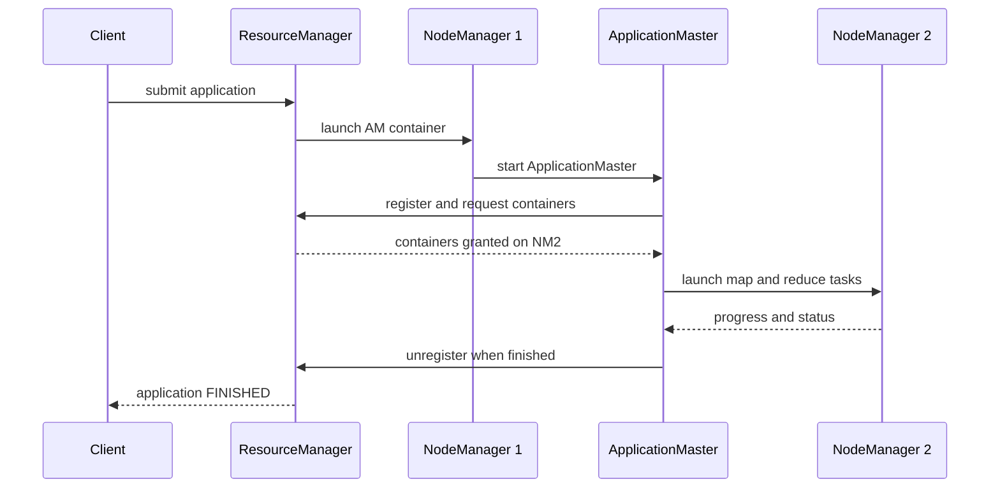
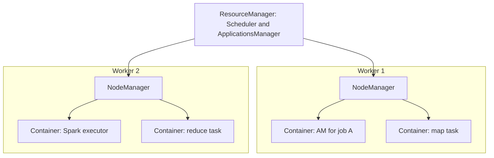

# Session 4 · Exploring YARN and Classic MapReduce

[](https://colab.research.google.com/github/Hamnakhan123/Diploma-in-Data-Science/blob/main/term-2/02-big-data-systems-with-hadoop/code/session-04-yarn-and-classic-mapreduce.ipynb)

> 📍 [Diploma in Data Science](../../README.md) › [Term 2](../README.md) › [Foundations of Big Data Systems with Hadoop](README.md) › **Session 4**

| ⏱ Estimated time | 🧩 Prerequisites | 💻 Tools |
|---|---|---|
| 2.5 hours | Sessions 1–3 | Python 3 (scheduler simulations), Hadoop 3.x `yarn` CLI (reference) |

[⬅ Previous: Session 3 · Understanding HDFS and Its Goals](session-03-hdfs-and-its-goals.md) · [🏠 Module home](README.md) · [Next: Session 5 · Demonstrating MapReduce Algorithms ➡](session-05-mapreduce-algorithms.md)

---

## 🎯 Learning objectives

- Explain the differences between **classic MapReduce (MRv1)** and **YARN (MRv2)**.
- Describe the YARN architecture: **ResourceManager**, **NodeManager**, **ApplicationMaster** and **containers**.
- Trace the steps of **submitting an application** to YARN.
- Compare the **FIFO**, **Capacity** and **Fair** schedulers and choose one for a scenario.
- Use the `yarn` CLI and the ResourceManager web UI to monitor applications.

## 📖 Concepts

### 1. Why YARN?

| | Classic MapReduce (Hadoop 1) | YARN (Hadoop 2 and 3) |
|---|---|---|
| Master daemon | **JobTracker**: resources *and* job monitoring | **ResourceManager**: resources only |
| Per-job management | Inside the JobTracker | A separate **ApplicationMaster** per application |
| Worker daemon | **TaskTracker** with fixed map and reduce slots | **NodeManager** with flexible **containers** |
| Scalability | About 4,000 nodes, 40,000 tasks | 10,000+ nodes |
| Frameworks | MapReduce only | MapReduce, Spark, Tez, Flink and more |
| Utilisation | Idle reduce slots cannot run maps | Any container can run any task |
| Availability | JobTracker is a single point of failure | ResourceManager HA with ZooKeeper |

### 2. YARN components

- **ResourceManager (RM)**: one per cluster. Its **Scheduler** decides who gets resources; its **ApplicationsManager** accepts submissions and starts each ApplicationMaster.
- **NodeManager (NM)**: one per worker. Reports available memory and vcores, launches and monitors containers, and kills containers that exceed their limits.
- **ApplicationMaster (AM)**: one per application, running in its own container. Negotiates containers from the RM, asks NMs to launch tasks, tracks progress, retries failures.
- **Container**: a bundle of resources (for example 2 GB and 1 vcore) on one node in which a task runs.

### 3. Submitting an application

1. The client asks the RM for a new application ID and uploads the JAR and configuration to HDFS.
2. The client submits the application.
3. The RM finds a container and asks an NM to start the **ApplicationMaster** in it.
4. The AM registers with the RM and calculates how many tasks it needs (one map per input split).
5. The AM requests containers, giving preferred nodes for data locality.
6. The RM grants containers as resources free up, according to the scheduler.
7. The AM asks the NMs to launch the tasks; tasks report progress to the AM.
8. When all tasks finish, the AM unregisters and its container is released. History goes to the **JobHistory Server**.

### 4. Schedulers

| Scheduler | How it shares | Good for | Weakness |
|---|---|---|---|
| **FIFO** | First come, first served, one queue | A single user or testing | A long job blocks everyone behind it |
| **Capacity** (default in Apache Hadoop) | Several queues, each guaranteed a % of the cluster; idle capacity can be borrowed | Organisations with departments that each "own" a share | Needs careful queue planning |
| **Fair** | Running apps get an equal share over time; queues have weights | Mixed interactive and batch workloads | Large jobs finish later than under FIFO |

Key Capacity Scheduler settings live in `capacity-scheduler.xml`: `yarn.scheduler.capacity.root.queues`, `...<queue>.capacity`, `...<queue>.maximum-capacity`. Submit to a queue with `-Dmapreduce.job.queuename=analytics` (MapReduce) or `--queue analytics` (Spark).

## 🧭 Diagrams





## 💻 Worked examples

### Example 1 · Slots vs containers

A TaskTracker with 4 map slots and 2 reduce slots wastes capacity whenever the job mix does not match. A NodeManager just has memory to hand out.

📄 [`code/session-04_slots_vs_containers.py`](code/session-04_slots_vs_containers.py)

```python
node_memory_gb = 12
phases = [("map-heavy phase", 10, 0), ("mixed phase", 4, 4), ("reduce-heavy phase", 0, 8)]

print(f"{'phase':<20}{'MRv1 busy slots':>16}{'YARN busy containers':>22}")
for name, maps, reduces in phases:
    mrv1 = min(maps, 4) + min(reduces, 2)           # fixed 4 map + 2 reduce slots
    yarn = min(maps + reduces, node_memory_gb // 2)  # any task fits a 2 GB container
    print(f"{name:<20}{mrv1:>10} of 6{yarn:>16} of 6")
```

**Output**

```text
phase                MRv1 busy slots  YARN busy containers
map-heavy phase              4 of 6               6 of 6
mixed phase                  6 of 6               6 of 6
reduce-heavy phase           2 of 6               6 of 6
```

### Example 2 · FIFO vs Fair scheduling

A cluster has 10 containers. A big batch job (100 tasks) arrives at time 0; a small interactive query (5 tasks) arrives at time 1. Each task takes one time unit.

📄 [`code/session-04_scheduler_sim.py`](code/session-04_scheduler_sim.py)

```python
def simulate(policy, capacity=10):
    jobs = {"big_batch": {"arrive": 0, "left": 100, "done": None},
            "small_query": {"arrive": 1, "left": 5, "done": None}}
    t = 0
    while any(j["left"] for j in jobs.values()):
        active = [n for n, j in jobs.items() if j["arrive"] <= t and j["left"]]
        share = {n: 0 for n in active}
        free = capacity
        if policy == "FIFO":
            for n in sorted(active, key=lambda n: jobs[n]["arrive"]):
                share[n] = min(free, jobs[n]["left"]); free -= share[n]
        else:  # Fair: split equally, give leftovers to whoever still needs them
            while free and any(share[n] < jobs[n]["left"] for n in active):
                for n in active:
                    if free and share[n] < jobs[n]["left"]:
                        share[n] += 1; free -= 1
        t += 1
        for n, s in share.items():
            jobs[n]["left"] -= s
            if jobs[n]["left"] == 0 and jobs[n]["done"] is None:
                jobs[n]["done"] = t
    return {n: j["done"] - j["arrive"] for n, j in jobs.items()}

for policy in ["FIFO", "Fair"]:
    r = simulate(policy)
    print(f"{policy:<5} turnaround  big_batch={r['big_batch']:>3}  small_query={r['small_query']:>3}")
```

**Output**

```text
FIFO  turnaround  big_batch= 10  small_query= 10
Fair  turnaround  big_batch= 11  small_query=  1
```

Under FIFO the 5-task query waits behind the batch job for 10 time units. Under Fair it finishes in 1 unit while the batch job is delayed by only one unit.

### Example 3 · Capacity Scheduler queues

📄 [`code/capacity-scheduler.xml`](code/capacity-scheduler.xml)

```xml
<?xml version="1.0"?>
<configuration>
  <property><name>yarn.scheduler.capacity.root.queues</name><value>etl,analytics,adhoc</value></property>
  <property><name>yarn.scheduler.capacity.root.etl.capacity</name><value>50</value></property>
  <property><name>yarn.scheduler.capacity.root.analytics.capacity</name><value>30</value></property>
  <property><name>yarn.scheduler.capacity.root.adhoc.capacity</name><value>20</value></property>
  <property><name>yarn.scheduler.capacity.root.adhoc.maximum-capacity</name><value>40</value></property>
</configuration>
```

📄 [`code/session-04_capacity_sim.py`](code/session-04_capacity_sim.py)

```python
cluster_containers = 200
queues = {"etl": (50, 100), "analytics": (30, 100), "adhoc": (20, 40)}  # (capacity %, max %)
demand = {"etl": 40, "analytics": 150, "adhoc": 120}

alloc = {q: min(demand[q], cluster_containers * c // 100) for q, (c, _) in queues.items()}
free = cluster_containers - sum(alloc.values())
print("guaranteed:", alloc, "| idle:", free)
for q, (c, mx) in sorted(queues.items(), key=lambda x: -demand[x[0]]):   # lend idle capacity (elasticity)
    extra = min(free, demand[q] - alloc[q], cluster_containers * mx // 100 - alloc[q])
    if extra > 0:
        alloc[q] += extra; free -= extra
print("after elasticity:", alloc, "| idle:", free)
```

**Output**

```text
guaranteed: {'etl': 40, 'analytics': 60, 'adhoc': 40} | idle: 60
after elasticity: {'etl': 40, 'analytics': 120, 'adhoc': 40} | idle: 0
```

`etl` needs only 40 of its 100 guaranteed containers, so `analytics` borrows the idle ones; `adhoc` is capped at its 40% maximum.

### Example 4 · Monitoring with the yarn CLI (illustrative)

```bash
yarn node -list                                   # NodeManagers and running containers
yarn application -list -appStates RUNNING         # running applications
yarn application -status application_1729760000000_0007
yarn logs -applicationId application_1729760000000_0007 | less
yarn application -kill application_1729760000000_0007
yarn queue -status analytics
```

The ResourceManager web UI at `http://<rm>:8088` shows the same: cluster metrics, scheduler queues, and each application's attempts and containers.

## 🧪 Lab / practice tasks

### 🟢 Task 1 · Easy

Draw the YARN architecture for a 3-worker cluster running one MapReduce job and one Spark job. Label every container.

<details><summary>💡 Hint</summary>

Each application has exactly one ApplicationMaster container.

</details>

### 🟡 Task 2 · Medium

In Example 2 make the small query arrive at time 20 and have 20 tasks. Compare FIFO and Fair turnaround again.

<details><summary>💡 Hint</summary>

Change the `arrive` and `left` values.

</details>

### 🟡 Task 3 · Medium

In Example 3 change demand to etl = 120, analytics = 60, adhoc = 20. Who borrows capacity now?

<details><summary>💡 Hint</summary>

Guarantees are met first; idle capacity goes to queues with unmet demand.

</details>

### 🟠 Task 4 · Hard

Write the steps a Spark job goes through on YARN from `spark-submit --master yarn` until it finishes, naming each YARN component.

<details><summary>💡 Hint</summary>

The Spark driver runs inside the ApplicationMaster in cluster mode.

</details>

### 🔴 Task 5 · Challenge

Add a third policy, "shortest job first", to Example 2 and compare average turnaround with FIFO and Fair. What is the risk of this policy?

<details><summary>💡 Hint</summary>

Long jobs may starve if short ones keep arriving.

</details>


## ✅ Quick quiz

**Q1.** In YARN, who monitors the tasks of one job?

- **A)** ResourceManager
- **B)** ApplicationMaster
- **C)** NodeManager
- **D)** JobHistory Server

<details><summary>Show answer</summary>

**B** — Each application has its own ApplicationMaster.

</details>

**Q2.** A YARN container is…

- **A)** a Docker image
- **B)** a bundle of memory and CPU on one node
- **C)** an HDFS block
- **D)** a queue

<details><summary>Show answer</summary>

**B** — Containers are resource allocations granted by the RM.

</details>

**Q3.** Which scheduler gives departments guaranteed shares of the cluster?

- **A)** FIFO
- **B)** Capacity
- **C)** Fair
- **D)** Round robin

<details><summary>Show answer</summary>

**B** — The Capacity Scheduler uses queues with guaranteed percentages.

</details>

**Q4.** Which is a weakness of MRv1 that YARN fixed?

- **A)** No replication
- **B)** Fixed map and reduce slots
- **C)** No web UI
- **D)** No Java support

<details><summary>Show answer</summary>

**B** — Fixed slots wasted resources; containers are flexible.

</details>

**Q5.** The ResourceManager web UI listens on port…

- **A)** 9870
- **B)** 8088
- **C)** 9000
- **D)** 19888

<details><summary>Show answer</summary>

**B** — 8088 (19888 is the JobHistory Server).

</details>


## 📝 Summary

- YARN split the JobTracker's work: the **ResourceManager** manages resources; a per-app **ApplicationMaster** manages the job.
- **NodeManagers** run flexible **containers** instead of fixed slots, so utilisation and scalability improve and many frameworks share one cluster.
- Submission: client → RM → AM container → container requests → tasks on NMs → AM unregisters.
- Schedulers: **FIFO** (simple), **Capacity** (guaranteed queue shares, elastic), **Fair** (equal shares over time).

### 🎤 Interview / viva questions

1. Why is YARN called a "data operating system"?
2. What happens if an ApplicationMaster crashes?
3. How does YARN achieve data locality when granting containers?
4. When would you choose the Fair Scheduler over the Capacity Scheduler?
5. What is the role of the JobHistory Server?

---

[⬅ Previous: Session 3 · Understanding HDFS and Its Goals](session-03-hdfs-and-its-goals.md) · [🏠 Module home](README.md) · [Next: Session 5 · Demonstrating MapReduce Algorithms ➡](session-05-mapreduce-algorithms.md)

<sub>Diploma in Data Science · Prepared by **Hamna Zahid Khan**, Junior Lecturer</sub>
