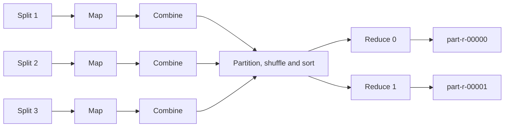
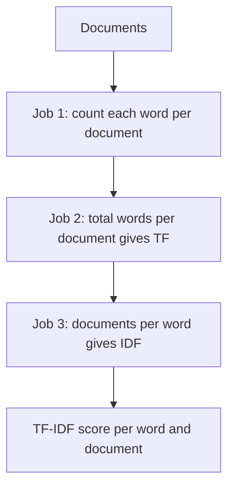

# Session 5 · Demonstrating MapReduce Algorithms

[](https://colab.research.google.com/github/Hamnakhan123/Diploma-in-Data-Science/blob/main/term-2/02-big-data-systems-with-hadoop/code/session-05-mapreduce-algorithms.ipynb)

> 📍 [Diploma in Data Science](../../README.md) › [Term 2](../README.md) › [Foundations of Big Data Systems with Hadoop](README.md) › **Session 5**

| ⏱ Estimated time | 🧩 Prerequisites | 💻 Tools |
|---|---|---|
| 3 hours | Sessions 1–4, Python functions and dictionaries | Python 3 (MapReduce simulator), PySpark 4 |

[⬅ Previous: Session 4 · Exploring YARN and Classic MapReduce](session-04-yarn-and-classic-mapreduce.md) · [🏠 Module home](README.md) · [Next: Session 6 · Understanding Sqoop and Joins in MapReduce ➡](session-06-sqoop-and-mapreduce-joins.md)

---

## 🎯 Learning objectives

- Describe the full MapReduce data flow: **input splits → map → combine → partition → shuffle and sort → reduce**.
- Implement **distributed search (grep)** with MapReduce.
- Explain how MapReduce **sorts** data, including total-order sorting with a range partitioner.
- Build an **inverted index**, the data structure behind every search engine.
- Compute **TF-IDF** as a chain of MapReduce jobs and with Spark RDDs.

## 📖 Concepts

### 1. The MapReduce contract

You write two functions; the framework does everything else (splitting, scheduling, moving data, retrying failures).

| Phase | Input → output | Who writes it |
|---|---|---|
| **Map** | one record → zero or more `(key, value)` pairs | You |
| **Combine** (optional) | local `(key, [values])` → partial result, on the mapper's node | You (often the reducer) |
| **Partition** | key → reducer number, default `hash(key) mod R` | Framework (customisable) |
| **Shuffle and sort** | moves pairs to their reducer and sorts them by key | Framework |
| **Reduce** | `(key, [all values])` → output records | You |

A **combiner** cuts network traffic: instead of sending a million `("the", 1)` pairs, each mapper sends `("the", 48213)`. It is only safe when the operation is **associative and commutative** (sum, max, count), not for an average computed directly.

### 2. Search (distributed grep)

Search needs only a **map** phase: each mapper scans its split and emits matching lines with their location. With zero reducers (`job.setNumReduceTasks(0)`) the map output is written straight to HDFS. Because every node scans its own blocks in parallel, searching 10 TB takes about as long as searching one node's share.

### 3. Sorting

Sorting is free in MapReduce: the shuffle **always sorts keys** before the reducer sees them.

- With **one reducer**, the output is globally sorted but everything funnels through one machine.
- With **R reducers** and the default hash partitioner, each output file is sorted but the files are not in order relative to each other.
- **Total-order sort**: a **range partitioner** (`TotalOrderPartitioner`) sends keys A–F to reducer 0, G–M to reducer 1 and so on, using split points sampled from the data. Concatenating the outputs gives one sorted result. This is how the famous **TeraSort** benchmark works.
- **Secondary sort**: sort the values for each key by making a composite key `(key, value)` and grouping on the first part only.

### 4. Indexing: the inverted index

A forward index maps document → words. An **inverted index** maps word → list of documents (a **posting list**), so a search for "hadoop" finds matching documents instantly.

- **Map**: for each word in a document emit `(word, doc_id)`.
- **Reduce**: collect the sorted, de-duplicated list of doc IDs for each word.

Adding positions or counts to the posting list supports phrase search and ranking.

### 5. TF-IDF with MapReduce

**TF-IDF** scores how important a word is to one document within a collection:

- **TF**(t, d) = count of t in d ÷ total words in d
- **IDF**(t) = log(N ÷ number of documents containing t)
- **TF-IDF** = TF × IDF. Words common everywhere ("the") score near 0; words frequent in one document but rare elsewhere score high.

As MapReduce it is a chain of three jobs:

| Job | Map emits | Reduce produces |
|---|---|---|
| 1 Word count per document | `((word, doc), 1)` | `((word, doc), n)` |
| 2 Words per document | `(doc, (word, n))` | `((word, doc), (n, N_doc))` |
| 3 Documents per word | `(word, (doc, n, N_doc))` | `((word, doc), tfidf)` using the size of the value list as df |

## 🧭 Diagrams





## 💻 Worked examples

### Example 1 · A reusable MapReduce simulator with a combiner

📄 [`code/session-05_mr_engine.py`](code/session-05_mr_engine.py)

```python
from collections import defaultdict

def run_mapreduce(splits, mapper, reducer, combiner=None, n_reducers=2, partitioner=None):
    partitioner = partitioner or (lambda k, r: sum(map(ord, str(k))) % r)
    shuffled = [defaultdict(list) for _ in range(n_reducers)]
    sent = 0
    for split in splits:                                   # one mapper per split
        local = defaultdict(list)
        for record in split:
            for k, v in mapper(record):
                local[k].append(v)
        if combiner:
            local = {k: [combiner(k, vs)] for k, vs in local.items()}
        for k, vs in local.items():
            sent += len(vs)
            shuffled[partitioner(k, n_reducers)][k].extend(vs)
    outputs = [[reducer(k, vs) for k, vs in sorted(part.items())] for part in shuffled]
    return outputs, sent

splits = [["the cat sat on the mat", "the dog sat"], ["the cat ran", "a dog and the cat"]]
mapper = lambda line: ((w, 1) for w in line.split())
reducer = lambda k, vs: (k, sum(vs))

for comb in [None, reducer]:
    out, sent = run_mapreduce(splits, mapper, reducer, combiner=(lambda k, vs: sum(vs)) if comb else None)
    print(f"combiner={'yes' if comb else 'no ':<3}  pairs sent over network = {sent}")
for i, part in enumerate(out):
    print(f"part-r-0000{i}: {part}")
```

**Output**

```text
combiner=no   pairs sent over network = 17
combiner=yes  pairs sent over network = 12
part-r-00000: [('cat', 3), ('dog', 2), ('mat', 1), ('sat', 2)]
part-r-00001: [('a', 1), ('and', 1), ('on', 1), ('ran', 1), ('the', 5)]
```

The combiner reduces network traffic from 17 pairs to 12 even on this toy input; on real text the saving is often over 90%. Each reducer's file is sorted, but the two files are not in order with each other.

### Example 2 · Search: distributed grep (map-only)

📄 [`code/session-05_mr_grep.py`](code/session-05_mr_grep.py)

```python
import re
logs = {
    "node1/blk_1": ["2026-10-01 10:02 INFO login user=ali", "2026-10-01 10:05 ERROR db timeout"],
    "node2/blk_2": ["2026-10-01 11:00 WARN slow query", "2026-10-01 11:07 ERROR disk full on dn4"],
    "node3/blk_3": ["2026-10-02 09:15 INFO login user=sara", "2026-10-02 09:20 ERROR db timeout"],
}
pattern = re.compile(r"ERROR (.*)")

def grep_mapper(location, offset, line):
    m = pattern.search(line)
    if m:
        yield f"{location}:{offset}", m.group(1)

for loc, lines in logs.items():                   # each block scanned by its own mapper
    for off, line in enumerate(lines):
        for key, value in grep_mapper(loc, off, line):
            print(f"{key:<14} {value}")
```

**Output**

```text
node1/blk_1:1  db timeout
node2/blk_2:1  disk full on dn4
node3/blk_3:1  db timeout
```

### Example 3 · Total-order sort with a range partitioner

📄 [`code/session-05_mr_sort.py`](code/session-05_mr_sort.py)

```python
import random
random.seed(1)
records = [(random.randint(1, 999), f"student{i:02d}") for i in range(18)]   # (score, name)

sample = sorted(k for k, _ in random.sample(records, 6))     # sample keys to pick split points
cuts = [sample[2], sample[4]]                                # 3 reducers -> 2 split points
def range_partition(key):
    return 0 if key < cuts[0] else 1 if key < cuts[1] else 2

parts = {0: [], 1: [], 2: []}
for k, v in records:
    parts[range_partition(k)].append((k, v))
print("split points:", cuts)
for r in parts:
    parts[r].sort()                                          # the shuffle sorts each reducer's input
    print(f"part-r-0000{r}: {[k for k, _ in parts[r]]}")
merged = [k for r in parts for k, _ in parts[r]]
print("concatenated output is globally sorted:", merged == sorted(merged))
```

**Output**

```text
split points: [215, 668]
part-r-00000: [65, 97, 121, 138]
part-r-00001: [215, 262, 389, 461, 484, 500, 508, 583]
part-r-00002: [668, 780, 783, 808, 822, 868]
concatenated output is globally sorted: True
```

### Example 4 · Building an inverted index

📄 [`code/session-05_mr_index.py`](code/session-05_mr_index.py)

```python
from collections import defaultdict
docs = {
    "d1": "hadoop stores big data",
    "d2": "spark processes big data in memory",
    "d3": "hive runs sql on hadoop",
}
# map
pairs = [(w, d) for d, text in docs.items() for w in set(text.split())]
# shuffle + reduce
index = defaultdict(set)
for w, d in pairs:
    index[w].add(d)
for w in sorted(index):
    print(f"{w:<10} -> {sorted(index[w])}")

query = ["big", "hadoop"]
hits = set.intersection(*(index[w] for w in query))
print(f"\nquery {query} -> {sorted(hits)}")
```

**Output**

```text
big        -> ['d1', 'd2']
data       -> ['d1', 'd2']
hadoop     -> ['d1', 'd3']
hive       -> ['d3']
in         -> ['d2']
memory     -> ['d2']
on         -> ['d3']
processes  -> ['d2']
runs       -> ['d3']
spark      -> ['d2']
sql        -> ['d3']
stores     -> ['d1']

query ['big', 'hadoop'] -> ['d1']
```

### Example 5 · TF-IDF as three chained MapReduce jobs

📄 [`code/session-05_mr_tfidf.py`](code/session-05_mr_tfidf.py)

```python
import math
from collections import defaultdict
docs = {"d1": "big data big clusters", "d2": "big data in hdfs", "d3": "spark streams data fast"}
N = len(docs)

# Job 1: ((word, doc), n)
j1 = defaultdict(int)
for d, text in docs.items():
    for w in text.split():
        j1[(w, d)] += 1
# Job 2: key by doc to get total words per doc
per_doc = defaultdict(list)
for (w, d), n in j1.items():
    per_doc[d].append((w, n))
j2 = {(w, d): (n, sum(c for _, c in wl)) for d, wl in per_doc.items() for w, n in wl}
# Job 3: key by word; the number of values = document frequency
per_word = defaultdict(list)
for (w, d), (n, total) in j2.items():
    per_word[w].append((d, n, total))
scores = {(w, d): (n / total) * math.log(N / len(vals))
          for w, vals in per_word.items() for d, n, total in vals}
for (w, d), s in sorted(scores.items(), key=lambda x: (x[0][1], -x[1])):
    print(f"{d}  {w:<9} {s:.3f}")
```

**Output**

```text
d1  clusters  0.275
d1  big       0.203
d1  data      0.000
d2  in        0.275
d2  hdfs      0.275
d2  big       0.101
d2  data      0.000
d3  spark     0.275
d3  streams   0.275
d3  fast      0.275
d3  data      0.000
```

"data" appears in all three documents, so its IDF is log(3/3) = 0 and its score is 0 everywhere. "big" in d1 scores highest.

### Example 6 · The same TF-IDF in Spark (real PySpark)

📄 [`code/session-05_spark_tfidf.py`](code/session-05_spark_tfidf.py)

```python
import math
from pyspark.sql import SparkSession
spark = (SparkSession.builder.master("local[2]").appName("tfidf")
         .config("spark.ui.showConsoleProgress", "false").getOrCreate())
spark.sparkContext.setLogLevel("ERROR")
sc = spark.sparkContext

docs = sc.parallelize([("d1", "big data big clusters"), ("d2", "big data in hdfs"),
                       ("d3", "spark streams data fast")])
N = docs.count()
tf = (docs.flatMap(lambda d: [((w, d[0]), 1) for w in d[1].split()])
          .reduceByKey(lambda a, b: a + b)                                   # job 1
          .map(lambda x: (x[0][1], (x[0][0], x[1]))))
doc_len = docs.map(lambda d: (d[0], len(d[1].split())))
tf = tf.join(doc_len).map(lambda x: (x[1][0][0], (x[0], x[1][0][1] / x[1][1])))  # job 2
df = tf.map(lambda x: (x[0], 1)).reduceByKey(lambda a, b: a + b)
tfidf = tf.join(df).map(lambda x: (x[1][0][0], x[0], round(x[1][0][1] * math.log(N / x[1][1]), 3)))  # job 3
for d, w, s in sorted(tfidf.collect(), key=lambda r: (r[0], -r[2], r[1])):
    print(d, f"{w:<9}", s)
```

**Output**

```text
d1 clusters  0.275
d1 big       0.203
d1 data      0.0
d2 hdfs      0.275
d2 in        0.275
d2 big       0.101
d2 data      0.0
d3 fast      0.275
d3 spark     0.275
d3 streams   0.275
d3 data      0.0
```

Spark keeps intermediate results in memory between the three "jobs", which is why iterative and multi-step pipelines run much faster than chained MapReduce jobs that write to HDFS after each step.

## 🧪 Lab / practice tasks

### 🟢 Task 1 · Easy

Using the simulator in Example 1, count the total characters per first letter of each word (for example all words starting with "c").

<details><summary>💡 Hint</summary>

Mapper emits `(word[0], len(word))`; the reducer sums.

</details>

### 🟡 Task 2 · Medium

Explain why a combiner cannot directly compute an average, then fix it by emitting `(sum, count)` pairs.

<details><summary>💡 Hint</summary>

The reducer divides total sum by total count at the end.

</details>

### 🟡 Task 3 · Medium

Change Example 2 so it also counts errors per day (a map plus a reduce).

<details><summary>💡 Hint</summary>

Key = the date part of the line.

</details>

### 🟠 Task 4 · Hard

Extend Example 4 so posting lists store word positions and support the phrase query "big data".

<details><summary>💡 Hint</summary>

Emit `(word, (doc, position))` and check consecutive positions.

</details>

### 🔴 Task 5 · Challenge

Run the Hadoop Streaming version of word count on a pseudo-distributed cluster using `mapper.py` and `reducer.py` that read stdin and write tab-separated pairs.

<details><summary>💡 Hint</summary>

`hadoop jar hadoop-streaming.jar -input in -output out -mapper mapper.py -reducer reducer.py -file mapper.py -file reducer.py`

</details>


## ✅ Quick quiz

**Q1.** Which phase always sorts keys?

- **A)** Map
- **B)** Combine
- **C)** Shuffle and sort
- **D)** Output

<details><summary>Show answer</summary>

**C** — The framework sorts keys before they reach reducers.

</details>

**Q2.** Distributed grep usually needs…

- **A)** only a map phase
- **B)** only a reduce phase
- **C)** two chained jobs
- **D)** a combiner

<details><summary>Show answer</summary>

**A** — Matching lines are emitted by mappers; no aggregation is needed.

</details>

**Q3.** A combiner is safe for…

- **A)** averages
- **B)** sums and counts
- **C)** medians
- **D)** any function

<details><summary>Show answer</summary>

**B** — It must be associative and commutative.

</details>

**Q4.** In an inverted index, the key is…

- **A)** the document ID
- **B)** the word
- **C)** the line number
- **D)** the file size

<details><summary>Show answer</summary>

**B** — Word → list of documents.

</details>

**Q5.** A word that appears in every document has IDF of…

- **A)** 1
- **B)** 0
- **C)** infinity
- **D)** N

<details><summary>Show answer</summary>

**B** — log(N ÷ N) = log 1 = 0.

</details>


## 📝 Summary

- MapReduce = **map → (combine) → partition → shuffle and sort → reduce**; you write map and reduce.
- **Search** = map-only filtering; **sorting** comes from the shuffle, with a range partitioner for total order.
- **Inverted index** = word → posting list; the basis of search engines.
- **TF-IDF** needs three chained MapReduce jobs; Spark runs the same logic in memory with fewer lines.

### 🎤 Interview / viva questions

1. How does TeraSort produce one globally sorted output with many reducers?
2. Why might you set the number of reducers to zero?
3. What is data skew in the reduce phase and how can it be reduced?
4. Why is Spark faster than MapReduce for multi-step jobs?
5. How would you add document ranking to the inverted index?

---

[⬅ Previous: Session 4 · Exploring YARN and Classic MapReduce](session-04-yarn-and-classic-mapreduce.md) · [🏠 Module home](README.md) · [Next: Session 6 · Understanding Sqoop and Joins in MapReduce ➡](session-06-sqoop-and-mapreduce-joins.md)

<sub>Diploma in Data Science · Prepared by **Hamna Zahid Khan**, Junior Lecturer</sub>
