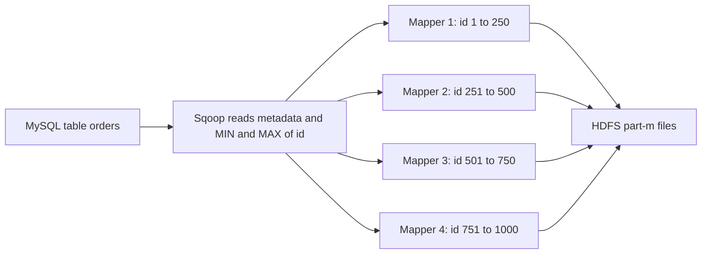
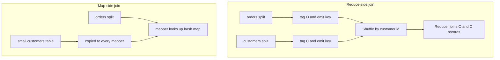

# Session 6 · Understanding Sqoop and Joins in MapReduce

[](https://colab.research.google.com/github/Hamnakhan123/Diploma-in-Data-Science/blob/main/term-2/02-big-data-systems-with-hadoop/code/session-06-sqoop-and-mapreduce-joins.ipynb)

> 📍 [Diploma in Data Science](../../README.md) › [Term 2](../README.md) › [Foundations of Big Data Systems with Hadoop](README.md) › **Session 6**

| ⏱ Estimated time | 🧩 Prerequisites | 💻 Tools |
|---|---|---|
| 3 hours | Session 5, SQL joins | Python 3 (sqlite3 Sqoop simulation), PySpark 4, Sqoop 1.4 (reference) |

[⬅ Previous: Session 5 · Demonstrating MapReduce Algorithms](session-05-mapreduce-algorithms.md) · [🏠 Module home](README.md) · [Next: Session 7 · Exploring Hadoop Architecture and Components ➡](session-07-hadoop-architecture-and-components.md)

---

## 🎯 Learning objectives

- Explain what **Apache Sqoop** does and how it uses map tasks to import and export data in parallel.
- Write Sqoop **import**, **incremental import**, **Hive import** and **export** commands.
- Implement a **reduce-side join** with MapReduce and explain its cost.
- Implement a **map-side (replicated or broadcast) join** and say when it is possible.
- Perform the same joins in **Spark** and read the physical plan.

## 📖 Concepts

### 1. What is Sqoop?

**Sqoop** ("SQL to Hadoop") transfers bulk data between relational databases (MySQL, PostgreSQL, Oracle, SQL Server) and Hadoop (HDFS, Hive, HBase) through JDBC. Under the hood a Sqoop command becomes a **map-only MapReduce job**:

1. Sqoop reads the table's metadata and generates a Java record class.
2. It finds the minimum and maximum of the **split column** (the primary key by default): `SELECT MIN(id), MAX(id) FROM orders`.
3. It divides that range into `-m` slices (4 by default), one per mapper.
4. Each mapper runs `SELECT ... WHERE id >= lo AND id < hi` and writes one file `part-m-0000N`.

> Apache Sqoop was moved to the Apache Attic in 2021, so it receives no new releases, but it is still found on many clusters and in certification syllabi. Modern alternatives are Spark's JDBC reader, Apache NiFi and Kafka Connect.

### 2. Key Sqoop commands

| Task | Command (illustrative) |
|---|---|
| List tables | `sqoop list-tables --connect jdbc:mysql://db/shop --username hamna -P` |
| Import a table | `sqoop import --connect jdbc:mysql://db/shop --table orders --target-dir /data/orders -m 4` |
| Choose split column | `... --split-by customer_id` |
| Filter rows / columns | `... --where "status='PAID'" --columns "id,amount,ts"` |
| Free-form query | `... --query 'SELECT ... WHERE $CONDITIONS' --split-by id` |
| Incremental (new rows) | `... --incremental append --check-column id --last-value 5000` |
| Incremental (changed rows) | `... --incremental lastmodified --check-column updated_at --last-value "2026-10-01"` |
| Straight into Hive | `... --hive-import --hive-table shop.orders` |
| File format | `... --as-parquetfile` or `--as-avrodatafile` |
| Export HDFS → DB | `sqoop export --connect ... --table daily_sales --export-dir /out/daily_sales` |
| Saved job | `sqoop job --create nightly_orders -- import ...` then `sqoop job --exec nightly_orders` |

### 3. Joins in MapReduce

| | Reduce-side join | Map-side (replicated) join |
|---|---|---|
| How | Mappers tag each record with its source and emit `(join_key, tagged_record)`; the shuffle brings matching keys together; the reducer combines them | The small table is copied to every mapper (Distributed Cache) and loaded into a hash map; each mapper joins its split of the big table locally |
| Shuffle | Both tables cross the network | None |
| Works when | Any size of both tables | One table fits in each mapper's memory |
| Speed | Slower | Much faster |
| Spark equivalent | **Sort-merge join** | **Broadcast hash join** |

A third option, the **sorted-bucketed map-side join**, works when both inputs are already sorted and partitioned identically on the join key.

## 🧭 Diagrams





## 💻 Worked examples

### Example 1 · How Sqoop splits an import (simulated with SQLite)

📄 [`code/session-06_sqoop_sim.py`](code/session-06_sqoop_sim.py)

```python
import sqlite3, random, os, tempfile
random.seed(2)
con = sqlite3.connect(":memory:")
con.execute("CREATE TABLE orders(id INTEGER PRIMARY KEY, customer_id INT, amount REAL, city TEXT)")
cities = ["Karachi", "Lahore", "Islamabad", "Peshawar", "Quetta"]
con.executemany("INSERT INTO orders VALUES (?,?,?,?)",
                [(i, random.randint(1, 50), round(random.uniform(500, 20000), 2), random.choice(cities))
                 for i in range(1, 1001)])

def sqoop_import(table, split_by, m, target):
    lo, hi = con.execute(f"SELECT MIN({split_by}), MAX({split_by}) FROM {table}").fetchone()
    print(f"BoundingValsQuery: MIN={lo}, MAX={hi}, mappers={m}")
    os.makedirs(target, exist_ok=True)
    step = (hi - lo + 1) / m
    for i in range(m):
        a, b = int(lo + i * step), int(lo + (i + 1) * step)
        where = f"{split_by} >= {a} AND {split_by} < {b}"
        rows = con.execute(f"SELECT * FROM {table} WHERE {where}").fetchall()
        with open(f"{target}/part-m-{i:05d}", "w") as f:
            f.writelines(",".join(map(str, r)) + "\n" for r in rows)
        print(f"  mapper {i}: WHERE {where:<22} -> {len(rows)} rows -> part-m-{i:05d}")

target = os.path.join(tempfile.mkdtemp(), "orders")      # stands in for --target-dir /data/orders
sqoop_import("orders", "id", 4, target)
print(sorted(os.listdir(target)))
print("first line of part-m-00000:", open(f"{target}/part-m-00000").readline().strip())
```

**Output**

```text
BoundingValsQuery: MIN=1, MAX=1000, mappers=4
  mapper 0: WHERE id >= 1 AND id < 251   -> 250 rows -> part-m-00000
  mapper 1: WHERE id >= 251 AND id < 501 -> 250 rows -> part-m-00001
  mapper 2: WHERE id >= 501 AND id < 751 -> 250 rows -> part-m-00002
  mapper 3: WHERE id >= 751 AND id < 1001 -> 250 rows -> part-m-00003
['part-m-00000', 'part-m-00001', 'part-m-00002', 'part-m-00003']
first line of part-m-00000: 1,4,2285.9,Islamabad
```

### Example 2 · Incremental append import

📄 [`code/session-06_sqoop_incremental.py`](code/session-06_sqoop_incremental.py)

```python
import sqlite3
con = sqlite3.connect(":memory:")
con.execute("CREATE TABLE orders(id INTEGER PRIMARY KEY, amount REAL)")
con.executemany("INSERT INTO orders VALUES (?,?)", [(i, i * 10.0) for i in range(1, 101)])
last_value = 0

def incremental_import():
    global last_value
    rows = con.execute("SELECT * FROM orders WHERE id > ? ORDER BY id", (last_value,)).fetchall()
    if rows:
        last_value = rows[-1][0]
    print(f"imported {len(rows):>3} new rows; saved --last-value = {last_value}")

incremental_import()                                   # night 1: full load
con.executemany("INSERT INTO orders VALUES (?,?)", [(i, i * 10.0) for i in range(101, 131)])
incremental_import()                                   # night 2: only the 30 new rows
incremental_import()                                   # night 3: nothing new
```

**Output**

```text
imported 100 new rows; saved --last-value = 100
imported  30 new rows; saved --last-value = 130
imported   0 new rows; saved --last-value = 130
```

A saved `sqoop job` stores `last-value` in its metastore automatically, exactly as this script does with a variable.

### Example 3 · Reduce-side join

📄 [`code/session-06_reduce_join.py`](code/session-06_reduce_join.py)

```python
from collections import defaultdict
customers = [(1, "Ayesha", "Karachi"), (2, "Bilal", "Lahore"), (3, "Sana", "Multan")]
orders = [(101, 1, 2500), (102, 2, 900), (103, 1, 4100), (104, 4, 700)]

def map_customers(r):  yield r[0], ("C", r[1], r[2])
def map_orders(r):     yield r[1], ("O", r[0], r[2])

shuffle = defaultdict(list)
for r in customers:
    for k, v in map_customers(r): shuffle[k].append(v)
for r in orders:
    for k, v in map_orders(r): shuffle[k].append(v)

print("inner join (cust_id, name, city, order_id, amount):")
for key in sorted(shuffle):
    cs = [v for v in shuffle[key] if v[0] == "C"]
    os_ = [v for v in shuffle[key] if v[0] == "O"]
    for c in cs:
        for o in os_:
            print(" ", (key, c[1], c[2], o[1], o[2]))
print("records shuffled over the network:", sum(len(v) for v in shuffle.values()))
```

**Output**

```text
inner join (cust_id, name, city, order_id, amount):
  (1, 'Ayesha', 'Karachi', 101, 2500)
  (1, 'Ayesha', 'Karachi', 103, 4100)
  (2, 'Bilal', 'Lahore', 102, 900)
records shuffled over the network: 7
```

Sana (no orders) and order 104 (unknown customer 4) disappear in an inner join; a left or full outer join would keep them.

### Example 4 · Map-side (replicated) join

📄 [`code/session-06_map_join.py`](code/session-06_map_join.py)

```python
customers = {1: ("Ayesha", "Karachi"), 2: ("Bilal", "Lahore"), 3: ("Sana", "Multan")}  # small: cached on every node
order_splits = [[(101, 1, 2500), (102, 2, 900)], [(103, 1, 4100), (104, 4, 700)]]

for i, split in enumerate(order_splits):
    for oid, cid, amt in split:            # each mapper joins locally, no shuffle at all
        if cid in customers:
            name, city = customers[cid]
            print(f"mapper {i}: {(cid, name, city, oid, amt)}")
print("records shuffled over the network: 0")
```

**Output**

```text
mapper 0: (1, 'Ayesha', 'Karachi', 101, 2500)
mapper 0: (2, 'Bilal', 'Lahore', 102, 900)
mapper 1: (1, 'Ayesha', 'Karachi', 103, 4100)
records shuffled over the network: 0
```

### Example 5 · Joins in Spark: broadcast vs sort-merge (real PySpark)

📄 [`code/session-06_spark_joins.py`](code/session-06_spark_joins.py)

```python
from pyspark.sql import SparkSession, functions as F
spark = (SparkSession.builder.master("local[2]").appName("joins")
         .config("spark.ui.showConsoleProgress", "false").getOrCreate())
spark.sparkContext.setLogLevel("ERROR")

customers = spark.createDataFrame([(1, "Ayesha", "Karachi"), (2, "Bilal", "Lahore"), (3, "Sana", "Multan")],
                                  ["cust_id", "name", "city"])
orders = spark.createDataFrame([(101, 1, 2500), (102, 2, 900), (103, 1, 4100), (104, 4, 700)],
                               ["order_id", "cust_id", "amount"])

orders.join(customers, "cust_id", "inner").orderBy("order_id").show()
orders.join(customers, "cust_id", "left").orderBy("order_id").show()

def join_strategy(df):
    plan = df._jdf.queryExecution().executedPlan().toString()
    return "BroadcastHashJoin" if "BroadcastHashJoin" in plan else "SortMergeJoin" if "SortMergeJoin" in plan else plan[:60]

spark.conf.set("spark.sql.autoBroadcastJoinThreshold", -1)       # disable automatic broadcast
print("default plan     :", join_strategy(orders.join(customers, "cust_id")))
print("with broadcast() :", join_strategy(orders.join(F.broadcast(customers), "cust_id")))
```

**Output**

```text
+-------+--------+------+------+-------+
|cust_id|order_id|amount|  name|   city|
+-------+--------+------+------+-------+
|      1|     101|  2500|Ayesha|Karachi|
|      2|     102|   900| Bilal| Lahore|
|      1|     103|  4100|Ayesha|Karachi|
+-------+--------+------+------+-------+

+-------+--------+------+------+-------+
|cust_id|order_id|amount|  name|   city|
+-------+--------+------+------+-------+
|      1|     101|  2500|Ayesha|Karachi|
|      2|     102|   900| Bilal| Lahore|
|      1|     103|  4100|Ayesha|Karachi|
|      4|     104|   700|  NULL|   NULL|
+-------+--------+------+------+-------+

default plan     : SortMergeJoin
with broadcast() : BroadcastHashJoin
```

`F.broadcast()` is Spark's map-side join: the small table is shipped once to every executor and the big table is never shuffled.

## 🧪 Lab / practice tasks

### 🟢 Task 1 · Easy

Write the Sqoop command to import only Karachi orders from `shop.orders` into `/data/karachi_orders` as Parquet with 2 mappers.

<details><summary>💡 Hint</summary>

Use `--where "city='Karachi'"`, `--as-parquetfile` and `-m 2`.

</details>

### 🟡 Task 2 · Medium

In Example 1 change `split_by` to `customer_id`. Are the mappers' row counts still balanced? Why does this matter?

<details><summary>💡 Hint</summary>

Skewed split columns give some mappers far more work.

</details>

### 🟡 Task 3 · Medium

Change Example 3 into a left outer join so Sana appears with empty order fields.

<details><summary>💡 Hint</summary>

Emit the customer even when the list of O records is empty.

</details>

### 🟠 Task 4 · Hard

Extend Example 4 to join orders with both customers and a small `cities` table (city → province) in one map-only pass.

<details><summary>💡 Hint</summary>

Cache both small tables as dictionaries.

</details>

### 🔴 Task 5 · Challenge

In Spark, create 1 million orders with `spark.range` and join to a 1,000-row customer table with and without `broadcast()`. Compare `.explain()` and wall-clock time.

<details><summary>💡 Hint</summary>

Use `time.time()` around `.count()` after the join.

</details>


## ✅ Quick quiz

**Q1.** A Sqoop import runs as…

- **A)** a reduce-only job
- **B)** a map-only MapReduce job
- **C)** a Hive query
- **D)** a Spark streaming job

<details><summary>Show answer</summary>

**B** — Each mapper imports one slice of the split column's range.

</details>

**Q2.** `--incremental append --check-column id --last-value 500` imports…

- **A)** all rows
- **B)** rows with id greater than 500
- **C)** rows changed after 500 seconds
- **D)** the first 500 rows

<details><summary>Show answer</summary>

**B** — Append mode imports rows whose check column exceeds the last value.

</details>

**Q3.** Which join avoids the shuffle?

- **A)** Reduce-side join
- **B)** Map-side replicated join
- **C)** Full outer join
- **D)** Cartesian join

<details><summary>Show answer</summary>

**B** — The small table is cached on every mapper.

</details>

**Q4.** A map-side join requires…

- **A)** both tables to be huge
- **B)** one table small enough to fit in memory (or both pre-sorted and bucketed)
- **C)** a combiner
- **D)** Sqoop

<details><summary>Show answer</summary>

**B** — The small side is loaded into a hash map.

</details>

**Q5.** Spark's equivalent of a reduce-side join is…

- **A)** BroadcastHashJoin
- **B)** SortMergeJoin
- **C)** CartesianProduct
- **D)** Union

<details><summary>Show answer</summary>

**B** — Both sides are shuffled and sorted by key, then merged.

</details>


## 📝 Summary

- **Sqoop** = parallel JDBC import and export via map tasks; `--split-by`, `-m`, `--incremental`, `--hive-import`, `export`.
- **Reduce-side join**: tag, shuffle by key, combine in the reducer; works for any size but shuffles everything.
- **Map-side join**: cache the small table on every mapper; no shuffle. In Spark use `broadcast()`.
- Choose the split column and join strategy to avoid **skew** and unnecessary network traffic.

### 🎤 Interview / viva questions

1. What does `$CONDITIONS` do in a free-form Sqoop query?
2. How does Sqoop decide the boundaries for each mapper?
3. What is the difference between `append` and `lastmodified` incremental modes?
4. When would a broadcast join fail or be a bad idea?
5. How would you join two very large tables that are both skewed on the same key?

---

[⬅ Previous: Session 5 · Demonstrating MapReduce Algorithms](session-05-mapreduce-algorithms.md) · [🏠 Module home](README.md) · [Next: Session 7 · Exploring Hadoop Architecture and Components ➡](session-07-hadoop-architecture-and-components.md)

<sub>Diploma in Data Science · Prepared by **Hamna Zahid Khan**, Junior Lecturer</sub>
