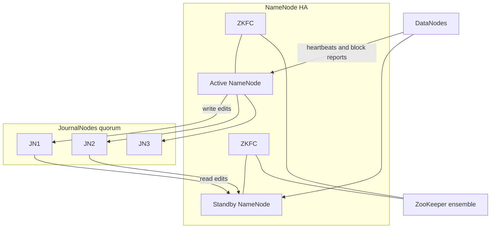
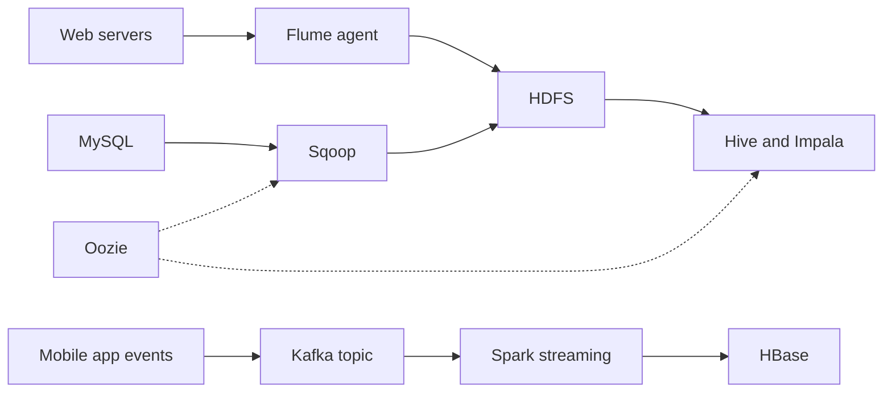

# Session 7 · Exploring Hadoop Architecture and Components

[](https://colab.research.google.com/github/Hamnakhan123/Diploma-in-Data-Science/blob/main/term-2/02-big-data-systems-with-hadoop/code/session-07-hadoop-architecture-and-components.ipynb)

> 📍 [Diploma in Data Science](../../README.md) › [Term 2](../README.md) › [Foundations of Big Data Systems with Hadoop](README.md) › **Session 7**

| ⏱ Estimated time | 🧩 Prerequisites | 💻 Tools |
|---|---|---|
| 2.5 hours | Sessions 1–6 | Python 3 (architecture simulations), Hadoop 3.x (reference) |

[⬅ Previous: Session 6 · Understanding Sqoop and Joins in MapReduce](session-06-sqoop-and-mapreduce-joins.md) · [🏠 Module home](README.md) · [Next: Session 8 · Working with Hive and Impala ➡](session-08-hive-and-impala.md)

---

## 🎯 Learning objectives

- Describe the **layered architecture** of Hadoop: storage, resource management, processing and access.
- Explain **NameNode High Availability** with JournalNodes and ZooKeeper, and **HDFS Federation**.
- Compare **replication** with Hadoop 3 **erasure coding**.
- Describe the role of **HBase**, **ZooKeeper**, **Flume**, **Kafka**, **Oozie** and **Ambari**.
- Choose the right ecosystem components for a given business problem.

## 📖 Concepts

### 1. Layers of a Hadoop platform

| Layer | Components | Question it answers |
|---|---|---|
| Ingestion | Sqoop, Flume, Kafka, NiFi | How does data get in? |
| Storage | HDFS, HBase, (cloud object stores such as S3 and ADLS) | Where does it live? |
| Resource management | YARN | Who gets CPU and memory? |
| Processing | MapReduce, Tez, Spark, Flink | How is it computed? |
| Access | Hive, Impala, Pig, Spark SQL, HBase API | How do people query it? |
| Coordination and operations | ZooKeeper, Oozie, Ambari, Ranger, Atlas | How is it kept running, secure and governed? |

### 2. Master–worker design

Hadoop uses a **master–worker** (master–slave) design twice: the **NameNode** masters the DataNodes for storage, and the **ResourceManager** masters the NodeManagers for compute. Masters hold metadata and make decisions; workers hold data and do the work. Because every worker runs both a DataNode and a NodeManager, YARN can schedule tasks next to their data.

### 3. NameNode High Availability (HA)

In Hadoop 1 the NameNode was a **single point of failure**. Hadoop 2 HA adds:

- An **Active** NameNode serving clients and one or more **Standby** NameNodes (Hadoop 3 allows several standbys).
- **JournalNodes** (usually 3 or 5): the active NameNode writes every edit to a majority (**quorum**) of them; standbys read the edits continuously, so their namespace is always up to date.
- DataNodes send block reports to **all** NameNodes.
- **ZooKeeper Failover Controllers (ZKFC)** monitor each NameNode and hold a lock in **ZooKeeper**; if the active dies, the lock expires and a standby becomes active within seconds.
- **Fencing** makes sure the old active cannot keep writing (avoiding a "split brain").

### 4. HDFS Federation

One NameNode's RAM limits the number of files (roughly 150 bytes per file or block object). **Federation** runs several independent NameNodes, each owning a **namespace volume** (for example `/user` and `/data`), while sharing the same DataNodes. It scales the namespace; HA protects availability. Large clusters use both.

### 5. Erasure coding (Hadoop 3)

Replication 3 stores **200% extra** data. **Erasure coding (EC)** splits data into *k* data cells plus *m* parity cells (for example **RS-6-3**: 6 data, 3 parity). Any 6 of the 9 cells rebuild the data, so it survives 3 failures with only **50% overhead**. The cost is CPU for encoding and slower recovery, so EC suits **cold** data, while hot data keeps replication.

### 6. Other ecosystem components

| Component | What it is | Typical use |
|---|---|---|
| **HBase** | Column-family NoSQL store on HDFS (modelled on Google Bigtable); rows sorted by row key; regions served by RegionServers | Millisecond reads of single rows: user profiles, message inboxes, IoT time series |
| **ZooKeeper** | Small, replicated, strongly consistent key-value tree (znodes) | Leader election, configuration, locks for HDFS HA, HBase and Kafka |
| **Flume** | Agent with **source → channel → sink** | Streaming web server logs into HDFS |
| **Kafka** | Distributed, replicated commit log of **topics** split into **partitions** | Real-time event pipelines, decoupling producers and consumers |
| **Oozie** | Workflow (DAG of actions) and coordinator (time or data triggers) scheduler | Nightly Sqoop → Hive → Spark chains |
| **Ambari / Cloudera Manager** | Cluster installation, configuration and monitoring | Operations teams |
| **Ranger / Atlas** | Security policies, auditing; metadata and lineage | Governance |

## 🧭 Diagrams





## 💻 Worked examples

### Example 1 · Replication vs erasure coding

📄 [`code/session-07_ec_vs_replication.py`](code/session-07_ec_vs_replication.py)

```python
schemes = {
    "replication x3": dict(data=1, parity=2, tolerates=2),
    "replication x2": dict(data=1, parity=1, tolerates=1),
    "EC RS-3-2":      dict(data=3, parity=2, tolerates=2),
    "EC RS-6-3":      dict(data=6, parity=3, tolerates=3),
    "EC RS-10-4":     dict(data=10, parity=4, tolerates=4),
}
logical_tb = 500
print(f"{'scheme':<16}{'overhead':>9}{'raw TB for 500 TB':>19}{'failures survived':>19}")
for name, s in schemes.items():
    overhead = s["parity"] / s["data"]
    print(f"{name:<16}{overhead:>8.0%}{logical_tb * (1 + overhead):>19.0f}{s['tolerates']:>19}")
```

**Output**

```text
scheme           overhead  raw TB for 500 TB  failures survived
replication x3      200%               1500                  2
replication x2      100%               1000                  1
EC RS-3-2            67%                833                  2
EC RS-6-3            50%                750                  3
EC RS-10-4           40%                700                  4
```

RS-6-3 survives more failures than triple replication while using half the raw disk.

### Example 2 · Parity in action (the idea behind erasure coding)

Real HDFS uses Reed–Solomon codes; XOR parity is the simplest case (*k* data cells + 1 parity cell) and shows the idea.

📄 [`code/session-07_xor_parity.py`](code/session-07_xor_parity.py)

```python
cells = [b"HADO", b"OP-3", b"-EC!"]                       # 3 data cells on 3 DataNodes
parity = bytes(a ^ b ^ c for a, b, c in zip(*cells))      # 1 parity cell on a 4th DataNode
print("data cells :", cells)
print("parity cell:", parity.hex())

lost = 1
print(f"\nDataNode holding cell {lost} fails!")
survivors = [c for i, c in enumerate(cells) if i != lost] + [parity]
rebuilt = bytes(x ^ y ^ z for x, y, z in zip(*survivors))
print("rebuilt cell:", rebuilt, "| correct:", rebuilt == cells[lost])
print(f"storage overhead: {1/len(cells):.0%} (vs 200% for 3 replicas)")
```

**Output**

```text
data cells : [b'HADO', b'OP-3', b'-EC!']
parity cell: 2a542a5d

DataNode holding cell 1 fails!
rebuilt cell: b'OP-3' | correct: True
storage overhead: 33% (vs 200% for 3 replicas)
```

### Example 3 · NameNode failover with a journal quorum

📄 [`code/session-07_ha_failover.py`](code/session-07_ha_failover.py)

```python
journal = {"jn1": [], "jn2": [], "jn3": []}
state = {"nn1": "active", "nn2": "standby"}
standby_ns = []

def write_edit(op):
    acks = 0
    for jn, log in journal.items():
        if jn != "jn3" or len(log) < 2:        # jn3 goes offline after 2 edits
            log.append(op); acks += 1
    ok = acks >= 2                              # majority of 3
    print(f"edit {op:<22} acks={acks}/3 -> {'committed' if ok else 'FAILED'}")

def standby_tail():
    longest = max(journal.values(), key=len)
    standby_ns.extend(longest[len(standby_ns):])

for op in ["mkdir /data", "create /data/a.csv", "create /data/b.csv", "delete /data/a.csv"]:
    write_edit(op)
    standby_tail()

print("\n*** ZKFC on nn1: health check failed, ZooKeeper lock released ***")
state["nn1"] = "fenced"
state["nn2"] = "active"
print("NameNode states:", state)
print("nn2 namespace edits:", standby_ns)
```

**Output**

```text
edit mkdir /data            acks=3/3 -> committed
edit create /data/a.csv     acks=3/3 -> committed
edit create /data/b.csv     acks=2/3 -> committed
edit delete /data/a.csv     acks=2/3 -> committed

*** ZKFC on nn1: health check failed, ZooKeeper lock released ***
NameNode states: {'nn1': 'fenced', 'nn2': 'active'}
nn2 namespace edits: ['mkdir /data', 'create /data/a.csv', 'create /data/b.csv', 'delete /data/a.csv']
```

The cluster kept committing edits after one JournalNode failed (2 of 3 is still a majority), and the standby took over with an up-to-date namespace.

### Example 4 · HBase-style row keys

HBase sorts rows by key, so the key design decides which queries are fast. A common pattern for time series is `deviceId#reversedTimestamp`, so the newest readings for a device come first.

📄 [`code/session-07_hbase_rowkeys.py`](code/session-07_hbase_rowkeys.py)

```python
MAX_TS = 9_999_999_999
readings = [("meter042", 1729760000, 3.1), ("meter007", 1729760300, 1.2),
            ("meter042", 1729760600, 3.4), ("meter042", 1729760900, 2.9),
            ("meter007", 1729761200, 1.5)]

table = {f"{dev}#{MAX_TS - ts}": {"cf:kwh": kwh, "cf:ts": ts} for dev, ts, kwh in readings}
print("rows as HBase stores them (sorted by row key):")
for key in sorted(table):
    print(f"  {key}  {table[key]}")

prefix = "meter042#"                                # a prefix scan = all readings for one meter
latest = [table[k] for k in sorted(table) if k.startswith(prefix)][:2]
print("\nlatest 2 readings for meter042:", [(r['cf:ts'], r['cf:kwh']) for r in latest])
```

**Output**

```text
rows as HBase stores them (sorted by row key):
  meter007#8270238799  {'cf:kwh': 1.5, 'cf:ts': 1729761200}
  meter007#8270239699  {'cf:kwh': 1.2, 'cf:ts': 1729760300}
  meter042#8270239099  {'cf:kwh': 2.9, 'cf:ts': 1729760900}
  meter042#8270239399  {'cf:kwh': 3.4, 'cf:ts': 1729760600}
  meter042#8270239999  {'cf:kwh': 3.1, 'cf:ts': 1729760000}

latest 2 readings for meter042: [(1729760900, 2.9), (1729760600, 3.4)]
```

### Example 5 · Useful admin commands (illustrative)

```bash
hdfs haadmin -getServiceState nn1                 # active or standby
hdfs haadmin -failover nn1 nn2                    # manual failover
hdfs ec -listPolicies
hdfs ec -setPolicy -path /archive -policy RS-6-3-1024k
hbase shell <<< "create 'meters','cf'; put 'meters','meter042#8270239400','cf:kwh','3.1'; scan 'meters'"
zkCli.sh -server zk1:2181 ls /hadoop-ha
kafka-topics.sh --create --topic clicks --partitions 6 --replication-factor 3 --bootstrap-server kafka1:9092
```

## 🧪 Lab / practice tasks

### 🟢 Task 1 · Easy

Fill in a table: for each of HDFS, HBase, Hive, Kafka and ZooKeeper, say whether it stores data, processes data or coordinates, and give one use case.

<details><summary>💡 Hint</summary>

ZooKeeper stores only tiny coordination data, not business data.

</details>

### 🟡 Task 2 · Medium

In Example 2 change the code to lose cell 0 and then the parity cell. Can you recover in each case? What if two cells are lost?

<details><summary>💡 Hint</summary>

One XOR parity cell tolerates exactly one loss.

</details>

### 🟡 Task 3 · Medium

Modify Example 3 so two JournalNodes fail. What happens to writes, and why is this the safe behaviour?

<details><summary>💡 Hint</summary>

Without a majority, the active NameNode must stop to avoid divergent histories.

</details>

### 🟠 Task 4 · Hard

Design HBase row keys for a mobile wallet so you can fetch a customer's last 20 transactions fast. Explain why a key starting with the timestamp is a bad idea.

<details><summary>💡 Hint</summary>

Timestamp-first keys send all new writes to one region (hotspotting).

</details>

### 🔴 Task 5 · Challenge

Propose an architecture (ingestion, storage, processing, serving, scheduling) for a Safe City project that stores 2,000 camera feeds' metadata and alerts in near real time. Justify each component.

<details><summary>💡 Hint</summary>

Kafka for events, Spark Structured Streaming, HBase for lookups, HDFS with EC for archives, Oozie or Airflow for batch.

</details>


## ✅ Quick quiz

**Q1.** In NameNode HA, edits are shared through…

- **A)** the Secondary NameNode
- **B)** JournalNodes
- **C)** DataNodes
- **D)** Oozie

<details><summary>Show answer</summary>

**B** — The active writes to a quorum of JournalNodes; standbys read from them.

</details>

**Q2.** HDFS Federation mainly solves…

- **A)** rack failures
- **B)** NameNode namespace scalability
- **C)** slow MapReduce
- **D)** security

<details><summary>Show answer</summary>

**B** — Several NameNodes each manage part of the namespace.

</details>

**Q3.** RS-6-3 erasure coding has a storage overhead of…

- **A)** 33%
- **B)** 50%
- **C)** 100%
- **D)** 200%

<details><summary>Show answer</summary>

**B** — 3 parity cells for 6 data cells = 50%.

</details>

**Q4.** Which component gives millisecond random reads by key on top of HDFS?

- **A)** Hive
- **B)** HBase
- **C)** Pig
- **D)** Sqoop

<details><summary>Show answer</summary>

**B** — HBase is a column-family NoSQL store.

</details>

**Q5.** ZooKeeper is mainly used for…

- **A)** storing large files
- **B)** coordination such as leader election and locks
- **C)** SQL queries
- **D)** data ingestion

<details><summary>Show answer</summary>

**B** — It is a coordination service.

</details>


## 📝 Summary

- Hadoop is layered: ingestion, storage, resource management, processing, access, operations.
- **HA**: active and standby NameNodes, JournalNode quorum, ZKFC and ZooKeeper, fencing.
- **Federation** scales the namespace with several NameNodes over shared DataNodes.
- **Erasure coding** cuts overhead from 200% to about 50% for cold data.
- **HBase** (random access), **ZooKeeper** (coordination), **Flume/Kafka** (streams), **Oozie** (workflows), **Ambari** (operations) complete the platform.

### 🎤 Interview / viva questions

1. What is "split brain" and how does fencing prevent it?
2. Why must the number of JournalNodes be odd?
3. When would you not use erasure coding?
4. How does HBase differ from a relational database?
5. Compare Flume and Kafka for collecting logs.

---

[⬅ Previous: Session 6 · Understanding Sqoop and Joins in MapReduce](session-06-sqoop-and-mapreduce-joins.md) · [🏠 Module home](README.md) · [Next: Session 8 · Working with Hive and Impala ➡](session-08-hive-and-impala.md)

<sub>Diploma in Data Science · Prepared by **Hamna Zahid Khan**, Junior Lecturer</sub>
