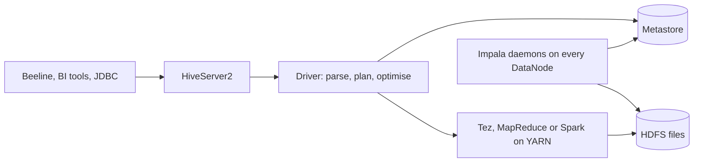
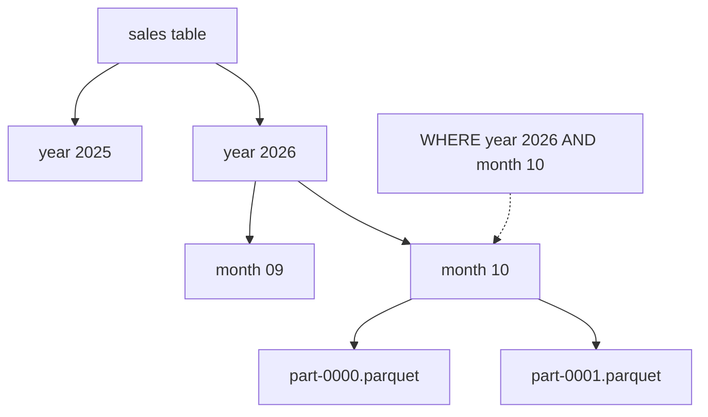

# Session 8 · Working with Hive and Impala

[](https://colab.research.google.com/github/Hamnakhan123/Diploma-in-Data-Science/blob/main/term-2/02-big-data-systems-with-hadoop/code/session-08-hive-and-impala.ipynb)

> 📍 [Diploma in Data Science](../../README.md) › [Term 2](../README.md) › [Foundations of Big Data Systems with Hadoop](README.md) › **Session 8**

| ⏱ Estimated time | 🧩 Prerequisites | 💻 Tools |
|---|---|---|
| 3 hours | Session 7, SQL (SELECT, GROUP BY, JOIN) | PySpark 4 (Spark SQL, HiveQL-compatible), Hive and Impala (reference) |

[⬅ Previous: Session 7 · Exploring Hadoop Architecture and Components](session-07-hadoop-architecture-and-components.md) · [🏠 Module home](README.md) · [Next: Session 9 · Introduction to Apache Pig ➡](session-09-introduction-to-apache-pig.md)

---

## 🎯 Learning objectives

- Describe **Hive** and **Impala**, their architectures and when to use each.
- Create **managed** and **external** tables and explain what happens when each is dropped.
- Use advanced Hive features: **partitioning**, **bucketing**, file formats, `explode` and window functions.
- Explain how **partition pruning** speeds up queries.
- Run HiveQL-style queries for real with **Spark SQL**.

## 📖 Concepts

### 1. Hive

**Apache Hive** (from Facebook, 2008) lets analysts query files in HDFS with **HiveQL**, a SQL dialect. It applies **schema on read**: the table definition is a lens over files, checked when you query, not when you load.

- **Metastore**: a relational database (MySQL or PostgreSQL) holding table definitions, columns, partitions and file locations. Spark, Impala and Presto/Trino all reuse it.
- **HiveServer2**: accepts JDBC/ODBC connections (Beeline, BI tools).
- **Driver and compiler**: parses HiveQL, builds a plan and runs it on **MapReduce**, **Tez** (default in Hive 2+) or **Spark**.
- Best for **batch ETL** and large scans where minutes of latency are acceptable.

### 2. Impala

**Apache Impala** (from Cloudera) is a **massively parallel processing (MPP)** SQL engine. Long-running `impalad` daemons on every DataNode execute queries in memory without launching MapReduce or YARN jobs, giving **seconds or sub-second** latency. It shares the Hive metastore, so the same tables are visible to both.

| | Hive | Impala |
|---|---|---|
| Execution | Compiles to Tez, MapReduce or Spark jobs | Native MPP daemons, in memory |
| Latency | Seconds to hours | Sub-second to seconds |
| Fault tolerance | A failed task is retried | A failed node usually fails the query |
| Best for | Heavy nightly ETL, very large joins | Interactive BI dashboards, ad-hoc exploration |
| UDFs | Java, rich ecosystem | C++ and Java |

### 3. Managed vs external tables

| | Managed (internal) | External |
|---|---|---|
| Who owns the files | Hive, under the warehouse directory | You, at a `LOCATION` you choose |
| `DROP TABLE` | Deletes metadata **and data** | Deletes metadata only; files stay |
| Use when | Hive is the only user of the data | Data is shared with other tools or loaded by other pipelines |

### 4. Partitioning

A **partitioned** table stores each value of the partition column in its own sub-directory, for example `/sales/year=2026/month=10/`. A query with `WHERE year = 2026 AND month = 10` reads only that folder: **partition pruning**. Choose low-to-medium cardinality columns that appear in filters (date, country). Partitioning by a high-cardinality column (customer ID) creates millions of tiny files.

- **Static partition**: `INSERT INTO sales PARTITION (year=2026) SELECT ...`
- **Dynamic partition**: `SET hive.exec.dynamic.partition.mode=nonstrict; INSERT INTO sales PARTITION (year) SELECT ..., year FROM staging`

### 5. Bucketing

**Bucketing** (`CLUSTERED BY (customer_id) INTO 8 BUCKETS`) hashes rows into a fixed number of files. It helps **joins** (bucket map joins, no shuffle when both tables share bucketing) and **sampling** (`TABLESAMPLE(BUCKET 1 OUT OF 8)`). Use it for high-cardinality join keys where partitioning would explode.

### 6. File formats

| Format | Type | Notes |
|---|---|---|
| TEXTFILE / CSV | Row | Human readable, slow, no types |
| SequenceFile / Avro | Row, binary | Avro carries its schema; good for ingestion |
| **ORC** | Columnar | Hive's favourite; built-in indexes, ACID tables |
| **Parquet** | Columnar | Default for Spark and Impala; reads only needed columns |

### 7. Other advanced features

Complex types (`ARRAY`, `MAP`, `STRUCT`) with `LATERAL VIEW explode()`, window functions (`RANK() OVER (PARTITION BY ...)`), views, user-defined functions, and **ACID transactional tables** (ORC) that support `UPDATE`, `DELETE` and `MERGE`.

## 🧭 Diagrams





## 💻 Worked examples

> Spark SQL understands HiveQL syntax and uses the same metastore concepts, so these examples run for real on your laptop. The HiveQL and Impala commands for a cluster are shown at the end.

### Example 1 · Managed vs external tables

📄 [`code/session-08_managed_external.py`](code/session-08_managed_external.py)

```python
import os, tempfile
from pyspark.sql import SparkSession
base = tempfile.mkdtemp()
spark = (SparkSession.builder.master("local[2]").appName("hive-tables")
         .config("spark.sql.warehouse.dir", os.path.join(base, "warehouse"))
         .config("spark.ui.showConsoleProgress", "false").getOrCreate())
spark.sparkContext.setLogLevel("ERROR")

ext_dir = os.path.join(base, "landing", "cities")
spark.createDataFrame([("Karachi", "Sindh"), ("Lahore", "Punjab"), ("Quetta", "Balochistan")],
                      ["city", "province"]).write.mode("overwrite").parquet(ext_dir)

wh = spark.conf.get("spark.sql.warehouse.dir").replace("file:", "")
spark.sql("DROP TABLE IF EXISTS cities_managed"); spark.sql("DROP TABLE IF EXISTS cities_external")
spark.sql("CREATE TABLE cities_managed (city STRING, province STRING) USING parquet")
spark.sql("INSERT INTO cities_managed SELECT * FROM parquet.`%s`" % ext_dir)
spark.sql(f"CREATE TABLE cities_external USING parquet LOCATION '{ext_dir}'")
spark.sql("SELECT * FROM cities_external ORDER BY city").show()

for t in ["cities_managed", "cities_external"]:
    kind = spark.sql(f"DESCRIBE TABLE EXTENDED {t}").filter("col_name = 'Type'").first()["data_type"]
    print(f"{t:<16} type = {kind}")

managed_dir = os.path.join(wh, "cities_managed")
spark.sql("DROP TABLE cities_managed"); spark.sql("DROP TABLE cities_external")
print("\nafter DROP TABLE:")
print("  managed files still exist? ", os.path.exists(managed_dir))
print("  external files still exist?", os.path.exists(ext_dir))
```

**Output**

```text
+-------+-----------+
|   city|   province|
+-------+-----------+
|Karachi|      Sindh|
| Lahore|     Punjab|
| Quetta|Balochistan|
+-------+-----------+

cities_managed   type = MANAGED
cities_external  type = EXTERNAL

after DROP TABLE:
  managed files still exist?  False
  external files still exist? True
```

### Example 2 · Partitioning and partition pruning

📄 [`code/session-08_partitioning.py`](code/session-08_partitioning.py)

```python
import os, tempfile
from pyspark.sql import SparkSession, functions as F
base = tempfile.mkdtemp()
spark = (SparkSession.builder.master("local[2]").appName("partitions")
         .config("spark.sql.warehouse.dir", os.path.join(base, "warehouse"))
         .config("spark.sql.shuffle.partitions", "4")
         .config("spark.ui.showConsoleProgress", "false").getOrCreate())
spark.sparkContext.setLogLevel("ERROR")

sales = (spark.range(0, 6000)
         .withColumn("year", F.when(F.col("id") % 2 == 0, 2025).otherwise(2026))
         .withColumn("month", (F.floor(F.col("id") / 2) % 12 + 1).cast("int"))
         .withColumn("city", F.element_at(F.array(*[F.lit(c) for c in ["Karachi", "Lahore", "Islamabad"]]),
                                          (F.floor(F.col("id") / 24) % 3 + 1).cast("int")))
         .withColumn("amount", (F.col("id") * 37 % 5000 + 100).cast("double")))

sales.write.partitionBy("year", "month").mode("overwrite").saveAsTable("sales")
spark.sql("SHOW PARTITIONS sales").show(5)
tdir = os.path.join(spark.conf.get("spark.sql.warehouse.dir").replace("file:", ""), "sales")
print("year folders:", sorted(d for d in os.listdir(tdir) if d.startswith("year")))
print("month folders in year=2026:", len(os.listdir(os.path.join(tdir, "year=2026"))))

q = spark.sql("SELECT city, SUM(amount) AS total FROM sales WHERE year = 2026 AND month = 10 GROUP BY city ORDER BY city")
q.show()
plan = q._jdf.queryExecution().executedPlan().toString()
import re
print(re.sub(r"#\d+", "", re.search(r"PartitionFilters: \[[^\]]*\]", plan).group(0)))
print("total partitions:", spark.sql("SHOW PARTITIONS sales").count(), "| folders scanned: year=2026/month=10 only")
```

**Output**

```text
+------------------+
|         partition|
+------------------+
| year=2025/month=1|
|year=2025/month=10|
|year=2025/month=11|
|year=2025/month=12|
| year=2025/month=2|
+------------------+
only showing top 5 rows
year folders: ['year=2025', 'year=2026']
month folders in year=2026: 12
+---------+--------+
|     city|   total|
+---------+--------+
|Islamabad|209649.0|
|  Karachi|219156.0|
|   Lahore|215945.0|
+---------+--------+

PartitionFilters: [isnotnull(year), isnotnull(month), (year = 2026), (month = 10)]
total partitions: 24 | folders scanned: year=2026/month=10 only
```

### Example 3 · Bucketing and table sampling

📄 [`code/session-08_bucketing.py`](code/session-08_bucketing.py)

```python
import os, tempfile
from pyspark.sql import SparkSession, functions as F
base = tempfile.mkdtemp()
spark = (SparkSession.builder.master("local[2]").appName("buckets")
         .config("spark.sql.warehouse.dir", os.path.join(base, "warehouse"))
         .config("spark.sql.autoBroadcastJoinThreshold", "-1")
         .config("spark.ui.showConsoleProgress", "false").getOrCreate())
spark.sparkContext.setLogLevel("ERROR")

spark.conf.set("spark.sql.autoBroadcastJoinThreshold", "-1")   # force a real join so bucketing matters
orders = spark.range(0, 20000).select((F.col("id") % 500).alias("customer_id"), (F.col("id") % 977).alias("amount"))
custs = spark.range(0, 500).select(F.col("id").alias("customer_id"), (F.col("id") % 5).alias("segment"))
orders.write.bucketBy(8, "customer_id").sortBy("customer_id").mode("overwrite").saveAsTable("orders_b")
custs.write.bucketBy(8, "customer_id").sortBy("customer_id").mode("overwrite").saveAsTable("customers_b")

wh = spark.conf.get("spark.sql.warehouse.dir").replace("file:", "")
files = [f for f in os.listdir(os.path.join(wh, "orders_b")) if f.endswith(".parquet")]
print("orders_b data files:", len(files))
j = spark.table("orders_b").join(spark.table("customers_b"), "customer_id")
plan = j._jdf.queryExecution().executedPlan().toString()
print("shuffle needed for join:", "Exchange hashpartitioning" in plan)
print("rows joined:", j.count())
spark.sql("SELECT segment, COUNT(*) AS orders, SUM(amount) AS revenue FROM orders_b JOIN customers_b USING (customer_id) GROUP BY segment ORDER BY segment").show()
```

**Output**

```text
orders_b data files: 16
shuffle needed for join: False
rows joined: 20000
+-------+------+-------+
|segment|orders|revenue|
+-------+------+-------+
|      0|  4000|1928034|
|      1|  4000|1928126|
|      2|  4000|1928218|
|      3|  4000|1928310|
|      4|  4000|1928402|
+-------+------+-------+
```

The 16 files are 8 buckets written by each of the 2 local tasks; on a cluster you would see one set per writer task too. Both tables are bucketed the same way on `customer_id`, so Spark joins bucket 1 with bucket 1, bucket 2 with bucket 2 and so on, without an `Exchange` (shuffle) step.

### Example 4 · Complex types, explode and window functions

📄 [`code/session-08_hive_advanced.py`](code/session-08_hive_advanced.py)

```python
from pyspark.sql import SparkSession
spark = (SparkSession.builder.master("local[2]").appName("hiveql")
         .config("spark.ui.showConsoleProgress", "false").getOrCreate())
spark.sparkContext.setLogLevel("ERROR")

spark.createDataFrame(
    [("Ali", "Karachi", ["hadoop", "spark"], 82), ("Sara", "Lahore", ["hive"], 91),
     ("Omar", "Karachi", ["spark", "hive", "pig"], 77), ("Hina", "Lahore", ["hadoop"], 88),
     ("Zain", "Karachi", ["pig"], 95)],
    "name string, city string, skills array<string>, score int").createOrReplaceTempView("students")

spark.sql("""
  SELECT skill, COUNT(*) AS students
  FROM students LATERAL VIEW explode(skills) s AS skill
  GROUP BY skill ORDER BY students DESC, skill
""").show()

spark.sql("""
  SELECT city, name, score,
         RANK() OVER (PARTITION BY city ORDER BY score DESC) AS rank_in_city,
         ROUND(AVG(score) OVER (PARTITION BY city), 1)     AS city_avg
  FROM students ORDER BY city, rank_in_city
""").show()
```

**Output**

```text
+------+--------+
| skill|students|
+------+--------+
|hadoop|       2|
|  hive|       2|
|   pig|       2|
| spark|       2|
+------+--------+

+-------+----+-----+------------+--------+
|   city|name|score|rank_in_city|city_avg|
+-------+----+-----+------------+--------+
|Karachi|Zain|   95|           1|    84.7|
|Karachi| Ali|   82|           2|    84.7|
|Karachi|Omar|   77|           3|    84.7|
| Lahore|Sara|   91|           1|    89.5|
| Lahore|Hina|   88|           2|    89.5|
+-------+----+-----+------------+--------+
```

### Example 5 · The same in Hive and Impala on a cluster (illustrative)

```sql
-- Hive (Beeline: beeline -u jdbc:hive2://hive-server:10000)
CREATE EXTERNAL TABLE raw_sales (id BIGINT, city STRING, amount DOUBLE, sale_date DATE)
  ROW FORMAT DELIMITED FIELDS TERMINATED BY ',' LOCATION '/landing/sales';

CREATE TABLE sales (id BIGINT, city STRING, amount DOUBLE)
  PARTITIONED BY (year INT, month INT)
  CLUSTERED BY (id) INTO 16 BUCKETS STORED AS ORC;

SET hive.exec.dynamic.partition.mode=nonstrict;
INSERT OVERWRITE TABLE sales PARTITION (year, month)
  SELECT id, city, amount, year(sale_date), month(sale_date) FROM raw_sales;

-- Impala (impala-shell -i impalad-host)
INVALIDATE METADATA sales;        -- pick up a table created in Hive
COMPUTE STATS sales;              -- statistics for the planner
SELECT city, SUM(amount) FROM sales WHERE year = 2026 AND month = 10 GROUP BY city;
```

## 🧪 Lab / practice tasks

### 🟢 Task 1 · Easy

Explain to a manager in three sentences when to use Hive and when to use Impala.

<details><summary>💡 Hint</summary>

Batch ETL vs interactive dashboards.

</details>

### 🟡 Task 2 · Medium

In Example 2 run the query without the `month` filter. How many partitions are read now?

<details><summary>💡 Hint</summary>

Count partitions where year = 2026.

</details>

### 🟡 Task 3 · Medium

Create an external table in Example 1, drop it, then recreate it at the same LOCATION. Is the data back?

<details><summary>💡 Hint</summary>

External data survives DROP TABLE.

</details>

### 🟠 Task 4 · Hard

Write HiveQL that returns each city's top-2 sales per month using a window function.

<details><summary>💡 Hint</summary>

`ROW_NUMBER() OVER (PARTITION BY city, month ORDER BY amount DESC)` in a sub-query, then filter ≤ 2.

</details>

### 🔴 Task 5 · Challenge

Compare the size on disk of 1 million rows saved as CSV and as Parquet in Spark, and time a query that reads one column from each.

<details><summary>💡 Hint</summary>

Use `du -sh` on the output folders, or sum file sizes with `os.walk`.

</details>


## ✅ Quick quiz

**Q1.** Dropping a managed Hive table…

- **A)** keeps the data files
- **B)** deletes metadata and data
- **C)** deletes only data
- **D)** is not allowed

<details><summary>Show answer</summary>

**B** — Hive owns managed data, so it removes the files too.

</details>

**Q2.** Partition pruning means…

- **A)** deleting old partitions
- **B)** reading only the folders that match the WHERE filter
- **C)** splitting files into buckets
- **D)** compressing partitions

<details><summary>Show answer</summary>

**B** — Filters on partition columns skip whole directories.

</details>

**Q3.** The best partition column is usually…

- **A)** customer ID
- **B)** a date or region used in filters
- **C)** a free-text comment
- **D)** a unique row ID

<details><summary>Show answer</summary>

**B** — Low-to-medium cardinality columns that queries filter on.

</details>

**Q4.** Impala is faster than Hive for interactive queries because…

- **A)** it uses MapReduce
- **B)** long-running MPP daemons execute in memory
- **C)** it has no metastore
- **D)** it only reads CSV

<details><summary>Show answer</summary>

**B** — No job start-up; in-memory parallel execution.

</details>

**Q5.** Which is a columnar file format?

- **A)** CSV
- **B)** Avro
- **C)** Parquet
- **D)** SequenceFile

<details><summary>Show answer</summary>

**C** — Parquet (and ORC) store data by column.

</details>


## 📝 Summary

- **Hive** = SQL over HDFS for batch; **Impala** = MPP SQL for interactive speed; both share the **metastore**.
- **Managed** tables own their data; **external** tables only point to it.
- **Partitioning** creates folders and enables **partition pruning**; **bucketing** hashes into a fixed number of files for joins and sampling.
- Prefer **ORC/Parquet**; use `explode`, window functions and ACID tables for advanced work.

### 🎤 Interview / viva questions

1. What is schema on read, and what are its risks?
2. Why can too many partitions hurt performance?
3. When would you choose bucketing over partitioning?
4. Why must you run `INVALIDATE METADATA` in Impala after creating a table in Hive?
5. How does a columnar format speed up `SELECT AVG(amount)` on a 100-column table?

---

[⬅ Previous: Session 7 · Exploring Hadoop Architecture and Components](session-07-hadoop-architecture-and-components.md) · [🏠 Module home](README.md) · [Next: Session 9 · Introduction to Apache Pig ➡](session-09-introduction-to-apache-pig.md)

<sub>Diploma in Data Science · Prepared by **Hamna Zahid Khan**, Junior Lecturer</sub>
