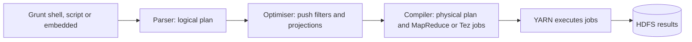
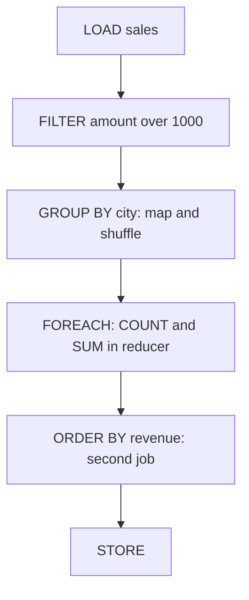

# Session 9 · Introduction to Apache Pig

[](https://colab.research.google.com/github/Hamnakhan123/Diploma-in-Data-Science/blob/main/term-2/02-big-data-systems-with-hadoop/code/session-09-introduction-to-apache-pig.ipynb)

> 📍 [Diploma in Data Science](../../README.md) › [Term 2](../README.md) › [Foundations of Big Data Systems with Hadoop](README.md) › **Session 9**

| ⏱ Estimated time | 🧩 Prerequisites | 💻 Tools |
|---|---|---|
| 2.5 hours | Sessions 5 and 8 | Apache Pig 0.17 (reference), Python 3 and PySpark 4 (runnable equivalents) |

[⬅ Previous: Session 8 · Working with Hive and Impala](session-08-hive-and-impala.md) · [🏠 Module home](README.md) · [Next: Session 10 · Pig Latin Data Model and Operators ➡](session-10-pig-latin-data-model-and-operators.md)

---

## 🎯 Learning objectives

- Explain what **Apache Pig** is and why Yahoo! created it.
- Compare **Pig**, **MapReduce**, **SQL** and **Hive** and pick the right one for a task.
- Describe Pig's **architecture**: parser, optimiser, compiler and execution engines.
- Run Pig in **local** and **MapReduce/Tez** modes using Grunt, scripts and embedded programs.
- Write and trace a first **Pig Latin** data-flow script.

## 📖 Concepts

### 1. What is Pig?

**Apache Pig** is a high-level platform for analysing large data sets. You write a **data flow** in **Pig Latin**: a sequence of steps, each producing a named relation (like a variable). Pig compiles the script into a chain of MapReduce (or Tez) jobs. Yahoo! built it in 2006 because most of its analysts' jobs were joins, filters and groupings that took hundreds of lines of Java each. A Pig script for the same job is often 5% of the length.

The name: "Pigs eat anything" (any data, with or without a schema), "pigs live anywhere" (not tied to one engine) and "pigs are domestic animals" (easy to use and extend with UDFs).

### 2. Pig vs MapReduce vs SQL vs Hive

| | MapReduce (Java) | Pig Latin | SQL (RDBMS) | HiveQL |
|---|---|---|---|---|
| Style | Low-level, imperative | **Procedural data flow**, step by step | Declarative: say *what*, not *how* | Declarative, SQL-like |
| Schema | None | Optional, on read | Required, on write | Required, on read (metastore) |
| Lines for a join + group | 100+ | ~5 | ~5 | ~5 |
| Nested data | Manual | Native bags, tuples, maps | Limited | ARRAY, MAP, STRUCT |
| Typical users | Java engineers | Data engineers, researchers | Analysts | Analysts, BI tools |
| Best for | Custom algorithms, full control | ETL pipelines, messy semi-structured data | Transactions, small-medium data | Reporting and warehousing on HDFS |
| Debugging | Hard | `DESCRIBE`, `ILLUSTRATE`, `EXPLAIN` | `EXPLAIN` | `EXPLAIN` |

Rule of thumb: **Hive** when the data already has a table structure and the users think in SQL; **Pig** when you are building a multi-step ETL pipeline over raw or nested data; **raw MapReduce** only when neither can express the logic. Today **Spark** often replaces both for new projects, but many clusters still run Pig pipelines, and Pig's data-flow style maps directly to Spark DataFrame code.

### 3. Architecture

1. **Grunt shell / script / embedded program** submits Pig Latin.
2. **Parser**: checks syntax and types and builds a **logical plan** (a DAG).
3. **Optimiser**: applies rules such as pushing filters and projections early, and merging steps.
4. **Compiler**: turns the logical plan into a **physical plan** and then a series of MapReduce or Tez jobs.
5. **Execution engine**: submits the jobs to YARN; results go to HDFS or the screen.

Pig is **lazy**: nothing runs until a `DUMP` or `STORE` asks for output, so the optimiser sees the whole flow first.

### 4. Execution modes

| Mode | Command | Data from | Use |
|---|---|---|---|
| **Local** | `pig -x local` | Local file system, one JVM | Learning, testing small samples |
| **MapReduce** | `pig` or `pig -x mapreduce` | HDFS, jobs on YARN | Production on Hadoop |
| **Tez** | `pig -x tez` | HDFS, Tez DAG on YARN | Faster production runs |
| **Spark** | `pig -x spark` | HDFS, Spark | Pig 0.17+ |

Ways to run: the interactive **Grunt** shell, a **script** file (`pig etl.pig`), or **embedded** in Python/Java (`PigServer`).

### 5. Your first Pig Latin script

```pig
-- top_cities.pig : total sales per city, highest first
sales   = LOAD '/data/sales.csv' USING PigStorage(',')
          AS (order_id:int, city:chararray, amount:double);
big     = FILTER sales BY amount > 1000;
by_city = GROUP big BY city;
totals  = FOREACH by_city GENERATE group AS city, COUNT(big) AS orders, SUM(big.amount) AS revenue;
ranked  = ORDER totals BY revenue DESC;
STORE ranked INTO '/out/top_cities' USING PigStorage(',');
```

Every line names a new relation. `GROUP` produces one row per city holding a **bag** of that city's rows; `FOREACH ... GENERATE` then aggregates the bag.

## 🧭 Diagrams





## 💻 Worked examples

> Pig needs a Hadoop installation, so the Pig Latin is shown as **illustrative** code. Each step is reproduced in Python or PySpark so you can see the real intermediate results.

### Example 1 · Tracing the script step by step (Pig semantics in Python)

📄 [`code/session-09_pig_trace.py`](code/session-09_pig_trace.py)

```python
from collections import defaultdict
sales = [(1, "Karachi", 2500.0), (2, "Lahore", 800.0), (3, "Karachi", 1200.0),
         (4, "Islamabad", 3100.0), (5, "Lahore", 1500.0), (6, "Karachi", 400.0), (7, "Lahore", 2600.0)]
print("sales   :", len(sales), "tuples")

big = [t for t in sales if t[2] > 1000]                      # FILTER
print("big     :", big)

by_city = defaultdict(list)                                   # GROUP big BY city
for t in big:
    by_city[t[1]].append(t)
print("by_city :")
for city, bag in by_city.items():
    print(f"   ({city}, {{{', '.join('(' + ','.join(map(str, t)) + ')' for t in bag)}}})")

totals = [(c, len(bag), sum(t[2] for t in bag)) for c, bag in by_city.items()]   # FOREACH GENERATE
ranked = sorted(totals, key=lambda r: -r[2])                                      # ORDER BY DESC
print("ranked  :", ranked)
```

**Output**

```text
sales   : 7 tuples
big     : [(1, 'Karachi', 2500.0), (3, 'Karachi', 1200.0), (4, 'Islamabad', 3100.0), (5, 'Lahore', 1500.0), (7, 'Lahore', 2600.0)]
by_city :
   (Karachi, {(1,Karachi,2500.0), (3,Karachi,1200.0)})
   (Islamabad, {(4,Islamabad,3100.0)})
   (Lahore, {(5,Lahore,1500.0), (7,Lahore,2600.0)})
ranked  : [('Lahore', 2, 4100.0), ('Karachi', 2, 3700.0), ('Islamabad', 1, 3100.0)]
```

The `by_city` output is exactly how Pig's `DUMP by_city` prints a grouped relation: a group key followed by a bag `{...}` of tuples.

### Example 2 · The same data flow in PySpark

📄 [`code/session-09_pig_in_spark.py`](code/session-09_pig_in_spark.py)

```python
from pyspark.sql import SparkSession, functions as F
spark = (SparkSession.builder.master("local[2]").appName("pig-style")
         .config("spark.ui.showConsoleProgress", "false").getOrCreate())
spark.sparkContext.setLogLevel("ERROR")

sales = spark.createDataFrame(
    [(1, "Karachi", 2500.0), (2, "Lahore", 800.0), (3, "Karachi", 1200.0), (4, "Islamabad", 3100.0),
     (5, "Lahore", 1500.0), (6, "Karachi", 400.0), (7, "Lahore", 2600.0)],
    "order_id int, city string, amount double")                         # LOAD ... AS (...)
big = sales.filter(F.col("amount") > 1000)                               # FILTER
by_city = big.groupBy("city")                                            # GROUP
totals = by_city.agg(F.count("*").alias("orders"), F.sum("amount").alias("revenue"))  # FOREACH GENERATE
ranked = totals.orderBy(F.desc("revenue"))                               # ORDER
ranked.show()                                                            # DUMP
ranked.explain()                                                         # EXPLAIN
```

**Output**

```text
+---------+------+-------+
|     city|orders|revenue|
+---------+------+-------+
|   Lahore|     2| 4100.0|
|  Karachi|     2| 3700.0|
|Islamabad|     1| 3100.0|
+---------+------+-------+

== Physical Plan ==
AdaptiveSparkPlan isFinalPlan=false
+- Sort [revenue#4 DESC NULLS LAST], true, 0
   +- Exchange rangepartitioning(revenue#4 DESC NULLS LAST, 200), ENSURE_REQUIREMENTS, [plan_id=87]
      +- HashAggregate(keys=[city#1], functions=[count(1), sum(amount#2)])
         +- Exchange hashpartitioning(city#1, 200), ENSURE_REQUIREMENTS, [plan_id=84]
            +- HashAggregate(keys=[city#1], functions=[partial_count(1), partial_sum(amount#2)])
               +- Project [city#1, amount#2]
                  +- Filter (isnotnull(amount#2) AND (amount#2 > 1000.0))
                     +- Scan ExistingRDD[order_id#0,city#1,amount#2]
```

Like Pig, Spark is lazy: `explain()` shows the optimised plan, with the filter applied as early as possible, before anything runs.

### Example 3 · Same question, four languages

How many orders over 1,000 per city?

```text
MapReduce (Java, abridged): a Mapper that parses lines, filters amount > 1000 and emits (city, 1);
a Reducer that sums; a Driver that configures input/output formats, key/value classes and submits.
About 60 lines in three classes.

Pig Latin:
  s = LOAD 'sales' USING PigStorage(',') AS (id:int, city:chararray, amount:double);
  f = FILTER s BY amount > 1000;
  g = GROUP f BY city;
  r = FOREACH g GENERATE group, COUNT(f);

SQL / HiveQL:
  SELECT city, COUNT(*) FROM sales WHERE amount > 1000 GROUP BY city;
```

📄 [`code/session-09_line_counts.py`](code/session-09_line_counts.py)

```python
versions = {"MapReduce (Java)": 60, "Pig Latin": 4, "HiveQL / SQL": 1, "PySpark DataFrame": 1}
for lang, lines in versions.items():
    print(f"{lang:<18} {'#' * lines if lines < 40 else '#' * 40 + ' ...'} {lines}")
```

**Output**

```text
MapReduce (Java)   ######################################## ... 60
Pig Latin          #### 4
HiveQL / SQL       # 1
PySpark DataFrame  # 1
```

### Example 4 · Running Pig (illustrative)

```bash
pig -x local                                   # Grunt shell on local files
pig -x local -f top_cities.pig                 # run a script locally
pig -param INPUT=/data/sales.csv -param OUT=/out/top -f top_cities.pig   # parameter substitution
pig -x tez -f top_cities.pig                   # on the cluster with Tez
```

Inside Grunt: `DESCRIBE big;` shows a schema, `ILLUSTRATE ranked;` runs the flow on a tiny sample and shows every step, `EXPLAIN ranked;` prints the logical, physical and MapReduce plans.

## 🧪 Lab / practice tasks

### 🟢 Task 1 · Easy

For each task, choose Pig, Hive, MapReduce or Spark and justify: monthly sales report for managers; cleaning nested JSON clickstream logs; a custom graph algorithm; an ML model on 1 TB.

<details><summary>💡 Hint</summary>

Think about who writes it and how structured the data is.

</details>

### 🟡 Task 2 · Medium

Modify Example 1 to also output the average order value per city.

<details><summary>💡 Hint</summary>

Average = SUM ÷ COUNT inside the same FOREACH.

</details>

### 🟡 Task 3 · Medium

Write the Pig Latin for: load students (name, dept, cgpa), keep CGPA ≥ 3.0, count students per department, store the result.

<details><summary>💡 Hint</summary>

LOAD → FILTER → GROUP → FOREACH GENERATE group, COUNT(...) → STORE.

</details>

### 🟠 Task 4 · Hard

Run `ranked.explain(True)` in Example 2 and identify the parsed, analysed, optimised and physical plans. Where does the filter move?

<details><summary>💡 Hint</summary>

Compare with Pig's logical → physical → MapReduce plans.

</details>

### 🔴 Task 5 · Challenge

Install Pig 0.17 in local mode (needs Java and Hadoop jars), run the script in Concept 5 on a CSV you create, and compare its output with Example 2.

<details><summary>💡 Hint</summary>

Download from the Apache archive; set `PIG_HOME` and run `pig -x local`.

</details>


## ✅ Quick quiz

**Q1.** Pig Latin is best described as…

- **A)** a declarative query language
- **B)** a procedural data-flow language
- **C)** a Java library
- **D)** a file format

<details><summary>Show answer</summary>

**B** — A script is a sequence of transformation steps.

</details>

**Q2.** Nothing executes in Pig until…

- **A)** LOAD
- **B)** FILTER
- **C)** DUMP or STORE
- **D)** GROUP

<details><summary>Show answer</summary>

**C** — Pig is lazy; output commands trigger execution.

</details>

**Q3.** `pig -x local` runs…

- **A)** on YARN
- **B)** in one JVM on the local file system
- **C)** on Tez
- **D)** on Impala

<details><summary>Show answer</summary>

**B** — Local mode is for testing.

</details>

**Q4.** Which command shows a step-by-step example of a data flow on sample data?

- **A)** DESCRIBE
- **B)** ILLUSTRATE
- **C)** EXPLAIN
- **D)** DUMP

<details><summary>Show answer</summary>

**B** — ILLUSTRATE shows sample tuples at each step.

</details>

**Q5.** Compared with Hive, Pig is stronger at…

- **A)** BI tool connectivity
- **B)** multi-step ETL over semi-structured data
- **C)** ACID transactions
- **D)** sub-second queries

<details><summary>Show answer</summary>

**B** — Its data-flow style and nested types suit ETL pipelines.

</details>


## 📝 Summary

- **Pig** turns short **Pig Latin** data-flow scripts into MapReduce or Tez jobs.
- Pig is **procedural** (Hive and SQL are declarative), handles optional schemas and **nested data**.
- Architecture: parser → logical plan → optimiser → compiler → jobs on YARN; **lazy** until DUMP/STORE.
- Modes: **local**, **mapreduce**, **tez**, **spark**; run via Grunt, scripts or embedded code.
- Debug with **DESCRIBE**, **ILLUSTRATE** and **EXPLAIN**.

### 🎤 Interview / viva questions

1. Why did Yahoo! build Pig when Hive already existed at Facebook?
2. What does it mean that Pig is "lazy", and why does that help the optimiser?
3. When would you still write raw MapReduce instead of Pig?
4. How would you pass the input path to a Pig script at run time?
5. How does a Pig `GROUP` differ from SQL `GROUP BY`?

---

[⬅ Previous: Session 8 · Working with Hive and Impala](session-08-hive-and-impala.md) · [🏠 Module home](README.md) · [Next: Session 10 · Pig Latin Data Model and Operators ➡](session-10-pig-latin-data-model-and-operators.md)

<sub>Diploma in Data Science · Prepared by **Hamna Zahid Khan**, Junior Lecturer</sub>
