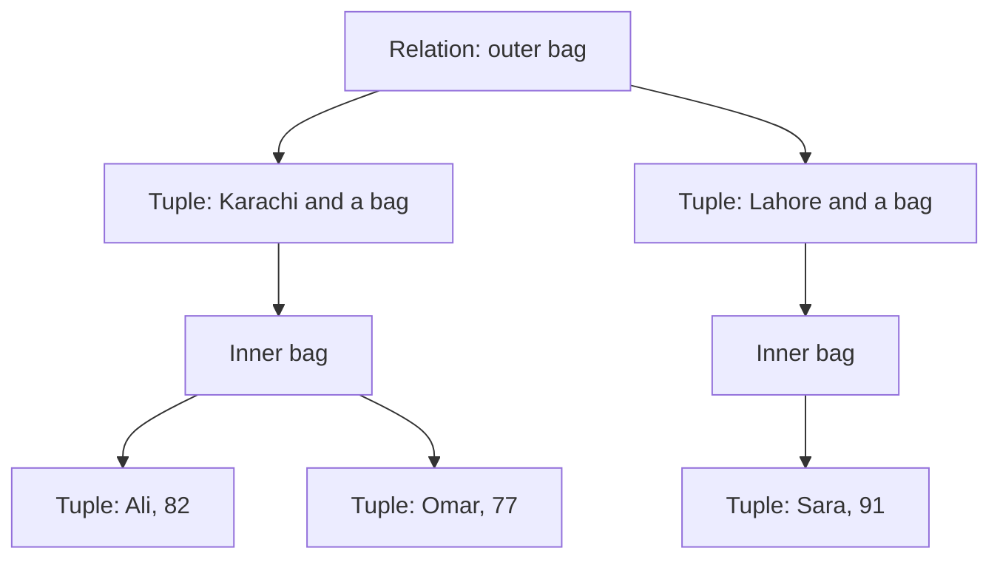
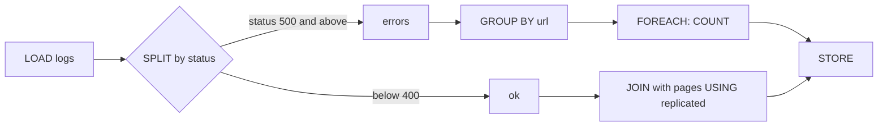

# Session 10 · Pig Latin Data Model and Operators

[](https://colab.research.google.com/github/Hamnakhan123/Diploma-in-Data-Science/blob/main/term-2/02-big-data-systems-with-hadoop/code/session-10-pig-latin-data-model-and-operators.ipynb)

> 📍 [Diploma in Data Science](../../README.md) › [Term 2](../README.md) › [Foundations of Big Data Systems with Hadoop](README.md) › **Session 10**

| ⏱ Estimated time | 🧩 Prerequisites | 💻 Tools |
|---|---|---|
| 3 hours | Session 9 | Apache Pig 0.17 (reference), Python 3 and PySpark 4 (runnable equivalents) |

[⬅ Previous: Session 9 · Introduction to Apache Pig](session-09-introduction-to-apache-pig.md) · [🏠 Module home](README.md) · [Next: Session 11 · Introduction to Apache Spark ➡](session-11-introduction-to-apache-spark.md)

---

## 🎯 Learning objectives

- Describe Pig's **data model**: atom (field), tuple, bag, relation and map.
- Use Pig's **data types**, schemas and casting rules, including how **nulls** behave.
- Apply the main **relational operators**: LOAD, STORE, DUMP, FILTER, FOREACH, GROUP, COGROUP, JOIN, ORDER, DISTINCT, LIMIT, UNION, SPLIT, FLATTEN and nested FOREACH.
- Use **built-in functions** (COUNT, SUM, AVG, MAX, TOKENIZE, SIZE) and know when a **UDF** is needed.
- Analyse a log data set end to end with Pig Latin and reproduce it in PySpark.

## 📖 Concepts

### 1. The data model

| Term | Definition | Example |
|---|---|---|
| **Atom / field** | A single value | `'Karachi'`, `42`, `3.5` |
| **Tuple** | An ordered set of fields, written `( )` | `(Ali, Karachi, 82)` |
| **Bag** | An unordered collection of tuples, written `{ }`; may contain duplicates | `{(Ali,82), (Sara,91)}` |
| **Relation** | An outer bag; what every Pig statement produces | `students` |
| **Map** | Key–value pairs, written `[ ]`, keys are chararray | `[city#Karachi, zip#75500]` |

Bags can be **nested** inside tuples, which is what `GROUP` produces: `(Karachi, {(Ali,82), (Omar,77)})`. This nesting is Pig's big difference from flat SQL tables.

### 2. Data types

| Simple | Complex |
|---|---|
| `int`, `long`, `float`, `double`, `chararray` (string), `bytearray` (default, untyped), `boolean`, `datetime`, `biginteger`, `bigdecimal` | `tuple`, `bag`, `map` |

- Without a schema every field is a `bytearray`, referenced by position: `$0`, `$1`.
- With a schema (`AS (name:chararray, score:int)`) fields have names and types.
- Pig casts implicitly where safe (int → long → float → double) and explicitly with `(int)$2`.
- **Nulls**: `null` means unknown. Comparisons with null give null, so `FILTER x BY score > 50` drops null scores. Aggregates such as `COUNT` skip nulls in the first field (`COUNT_STAR` does not). Use `IS NULL` / `IS NOT NULL`.

### 3. Operators

| Category | Operator | What it does |
|---|---|---|
| Load and store | `LOAD`, `STORE`, `DUMP` | Read data, write data, print to screen |
| Filtering | `FILTER`, `DISTINCT`, `LIMIT`, `SAMPLE` | Keep matching rows, remove duplicates, first N, random sample |
| Transforming | `FOREACH ... GENERATE`, `FLATTEN` | Project and compute columns; un-nest bags or tuples |
| Grouping | `GROUP`, `COGROUP` | One tuple per key with a bag (or one bag per input) |
| Joining | `JOIN` (inner, `LEFT/RIGHT/FULL OUTER`, `USING 'replicated'`, `'skewed'`, `'merge'`) | Combine relations by key |
| Combining and splitting | `UNION`, `SPLIT ... INTO ... IF` | Stack relations; route rows into several relations |
| Sorting | `ORDER ... BY ... [ASC/DESC]`, `RANK` | Total ordering |
| Diagnostics | `DESCRIBE`, `EXPLAIN`, `ILLUSTRATE` | Schema, plan, sample trace |

**Nested FOREACH** lets you run operators inside each group's bag:

```pig
top2 = FOREACH by_city {
          sorted = ORDER students BY score DESC;
          best   = LIMIT sorted 2;
          GENERATE group AS city, FLATTEN(best.name);
       };
```

### 4. Built-in functions and UDFs

- **Eval**: `COUNT`, `COUNT_STAR`, `SUM`, `AVG`, `MIN`, `MAX`, `SIZE`, `CONCAT`, `TOKENIZE`, `UPPER`, `TRIM`, `SUBSTRING`, `REGEX_EXTRACT`, `ToDate`.
- **Load/store**: `PigStorage(',')` (delimited text), `TextLoader`, `JsonLoader`, `BinStorage`, `AvroStorage`, `OrcStorage`.
- **UDFs** in Java, Python (Jython) or JavaScript: `REGISTER 'udfs.py' USING jython AS my; ... my.clean(text)`.

## 🧭 Diagrams





## 💻 Worked examples

### Example 1 · Tuples, bags, GROUP, COGROUP and FLATTEN in Python

📄 [`code/session-10_pig_data_model.py`](code/session-10_pig_data_model.py)

```python
from collections import defaultdict
students = [("Ali", "Karachi", 82), ("Sara", "Lahore", 91), ("Omar", "Karachi", 77),
            ("Hina", "Lahore", None), ("Zain", "Karachi", 95)]
fees = [("Karachi", 45000), ("Lahore", 42000), ("Quetta", 30000)]

def fmt_bag(bag):
    return "{" + ", ".join("(" + ",".join("" if v is None else str(v) for v in t) + ")" for t in bag) + "}"

group = defaultdict(list)                                         # GROUP students BY city
for t in students:
    group[t[1]].append(t)
print("GROUP students BY city:")
for k, bag in group.items():
    print(f"  ({k}, {fmt_bag(bag)})")

print("\nFOREACH g GENERATE group, COUNT(students.score), AVG(students.score):")
for k, bag in group.items():
    scores = [t[2] for t in bag if t[2] is not None]             # nulls are skipped
    print(f"  ({k}, {len(scores)}, {sum(scores)/len(scores):.1f})")

print("\nCOGROUP students BY city, fees BY city:")
keys = sorted({t[1] for t in students} | {f[0] for f in fees})
for k in keys:
    print(f"  ({k}, {fmt_bag([t for t in students if t[1] == k])}, {fmt_bag([f for f in fees if f[0] == k])})")

print("\nFLATTEN back to flat tuples:")
for k, bag in group.items():
    for t in bag:
        print(f"  ({k},{t[0]})")
```

**Output**

```text
GROUP students BY city:
  (Karachi, {(Ali,Karachi,82), (Omar,Karachi,77), (Zain,Karachi,95)})
  (Lahore, {(Sara,Lahore,91), (Hina,Lahore,)})

FOREACH g GENERATE group, COUNT(students.score), AVG(students.score):
  (Karachi, 3, 84.7)
  (Lahore, 1, 91.0)

COGROUP students BY city, fees BY city:
  (Karachi, {(Ali,Karachi,82), (Omar,Karachi,77), (Zain,Karachi,95)}, {(Karachi,45000)})
  (Lahore, {(Sara,Lahore,91), (Hina,Lahore,)}, {(Lahore,42000)})
  (Quetta, {}, {(Quetta,30000)})

FLATTEN back to flat tuples:
  (Karachi,Ali)
  (Karachi,Omar)
  (Karachi,Zain)
  (Lahore,Sara)
  (Lahore,Hina)
```

`COGROUP` keeps one bag per input, even when one side is empty (Quetta), which makes outer joins and set comparisons easy.

### Example 2 · Web log analysis in Pig Latin (illustrative)

```pig
logs   = LOAD '/data/access_log.csv' USING PigStorage(',')
         AS (ip:chararray, ts:chararray, url:chararray, status:int, bytes:long);
pages  = LOAD '/data/pages.csv' USING PigStorage(',') AS (url:chararray, section:chararray);

SPLIT logs INTO errors IF status >= 500, ok IF status < 400;

err_by_url = FOREACH (GROUP errors BY url) GENERATE group AS url, COUNT(errors) AS n;
ok_pages   = JOIN ok BY url, pages BY url USING 'replicated';
traffic    = FOREACH (GROUP ok_pages BY pages::section)
             GENERATE group AS section, COUNT(ok_pages) AS hits,
                      SUM(ok_pages.ok::bytes) / 1024.0 AS kb;
top_ips    = LIMIT (ORDER (FOREACH (GROUP logs BY ip) GENERATE group AS ip, COUNT(logs) AS n) BY n DESC) 3;

STORE err_by_url INTO '/out/errors';
STORE traffic    INTO '/out/traffic';
DUMP top_ips;
```

### Example 3 · The same analysis, run for real in PySpark

📄 [`code/session-10_pig_logs_spark.py`](code/session-10_pig_logs_spark.py)

```python
from pyspark.sql import SparkSession, functions as F
spark = (SparkSession.builder.master("local[2]").appName("pig-logs")
         .config("spark.sql.shuffle.partitions", "4")
         .config("spark.ui.showConsoleProgress", "false").getOrCreate())
spark.sparkContext.setLogLevel("ERROR")

logs = spark.createDataFrame([
    ("10.0.0.1", "10:01", "/home", 200, 5120), ("10.0.0.2", "10:02", "/admissions", 200, 8192),
    ("10.0.0.1", "10:03", "/results", 500, 0), ("10.0.0.3", "10:04", "/home", 200, 5120),
    ("10.0.0.1", "10:05", "/results", 500, 0), ("10.0.0.4", "10:06", "/fees", 404, 0),
    ("10.0.0.2", "10:07", "/fees", 200, 3072), ("10.0.0.1", "10:08", "/admissions", 503, 0),
    ("10.0.0.3", "10:09", "/results", 200, 9216), ("10.0.0.2", "10:10", "/home", 200, 5120)],
    "ip string, ts string, url string, status int, bytes long")
pages = spark.createDataFrame([("/home", "main"), ("/admissions", "students"), ("/results", "students"),
                               ("/fees", "finance")], "url string, section string")

errors = logs.filter("status >= 500")                     # SPLIT ... errors IF status >= 500
ok = logs.filter("status < 400")                          #           ok     IF status < 400
print("errors by url:")
errors.groupBy("url").agg(F.count("*").alias("n")).orderBy(F.desc("n")).show()

print("traffic by section (replicated join = broadcast):")
(ok.join(F.broadcast(pages), "url")
   .groupBy("section").agg(F.count("*").alias("hits"), F.round(F.sum("bytes") / 1024.0, 1).alias("kb"))
   .orderBy(F.desc("hits"), "section").show())

print("top 3 IPs:")
logs.groupBy("ip").agg(F.count("*").alias("n")).orderBy(F.desc("n"), "ip").limit(3).show()

print("Pig-style bag per IP (collect_list = bag):")
logs.groupBy("ip").agg(F.collect_list(F.struct("url", "status")).alias("bag")).orderBy("ip").show(truncate=False)
```

**Output**

```text
errors by url:
+-----------+---+
|        url|  n|
+-----------+---+
|   /results|  2|
|/admissions|  1|
+-----------+---+

traffic by section (replicated join = broadcast):
+--------+----+----+
| section|hits|  kb|
+--------+----+----+
|    main|   3|15.0|
|students|   2|17.0|
| finance|   1| 3.0|
+--------+----+----+

top 3 IPs:
+--------+---+
|      ip|  n|
+--------+---+
|10.0.0.1|  4|
|10.0.0.2|  3|
|10.0.0.3|  2|
+--------+---+

Pig-style bag per IP (collect_list = bag):
+--------+--------------------------------------------------------------------+
|ip      |bag                                                                 |
+--------+--------------------------------------------------------------------+
|10.0.0.1|[{/home, 200}, {/results, 500}, {/results, 500}, {/admissions, 503}]|
|10.0.0.2|[{/admissions, 200}, {/fees, 200}, {/home, 200}]                    |
|10.0.0.3|[{/home, 200}, {/results, 200}]                                     |
|10.0.0.4|[{/fees, 404}]                                                      |
+--------+--------------------------------------------------------------------+
```

### Example 4 · Nested FOREACH: top 2 per group

📄 [`code/session-10_nested_foreach.py`](code/session-10_nested_foreach.py)

```python
from pyspark.sql import SparkSession, functions as F, Window
spark = (SparkSession.builder.master("local[2]").appName("nested")
         .config("spark.ui.showConsoleProgress", "false").getOrCreate())
spark.sparkContext.setLogLevel("ERROR")
students = spark.createDataFrame([("Ali", "Karachi", 82), ("Sara", "Lahore", 91), ("Omar", "Karachi", 77),
                                  ("Hina", "Lahore", 88), ("Zain", "Karachi", 95), ("Iqra", "Lahore", 73)],
                                 "name string, city string, score int")
w = Window.partitionBy("city").orderBy(F.desc("score"))
(students.withColumn("pos", F.row_number().over(w)).filter("pos <= 2")    # ORDER + LIMIT inside each bag
         .groupBy("city").agg(F.collect_list("name").alias("top2")).orderBy("city").show())
```

**Output**

```text
+-------+------------+
|   city|        top2|
+-------+------------+
|Karachi| [Zain, Ali]|
| Lahore|[Sara, Hina]|
+-------+------------+
```

### Example 5 · Nulls, casting and DISTINCT

📄 [`code/session-10_pig_nulls.py`](code/session-10_pig_nulls.py)

```python
rows = [("Ali", "82"), ("Sara", "91"), ("Omar", ""), ("Hina", "abc"), ("Sara", "91")]

def to_int(b):                       # Pig: (int)$1 gives null when the bytearray is not a number
    try:
        return int(b)
    except ValueError:
        return None

typed = [(n, to_int(s)) for n, s in rows]
print("after cast       :", typed)
print("FILTER score > 80:", [t for t in typed if t[1] is not None and t[1] > 80])
print("COUNT(score)     :", sum(t[1] is not None for t in typed), "| COUNT_STAR:", len(typed))
print("DISTINCT         :", sorted(set(typed), key=str))
```

**Output**

```text
after cast       : [('Ali', 82), ('Sara', 91), ('Omar', None), ('Hina', None), ('Sara', 91)]
FILTER score > 80: [('Ali', 82), ('Sara', 91), ('Sara', 91)]
COUNT(score)     : 3 | COUNT_STAR: 5
DISTINCT         : [('Ali', 82), ('Hina', None), ('Omar', None), ('Sara', 91)]
```

## 🧪 Lab / practice tasks

### 🟢 Task 1 · Easy

Write the Pig data model notation (tuples, bags, maps) for: a student with name, city and a map of subject marks; and all students grouped by city.

<details><summary>💡 Hint</summary>

`(Ali, Karachi, [math#82, cs#90])`.

</details>

### 🟡 Task 2 · Medium

Using Example 1's data, write Pig Latin with `SPLIT` that routes students into `distinction` (≥ 90), `pass` (50–89) and `missing` (null score).

<details><summary>💡 Hint</summary>

`SPLIT students INTO d IF score >= 90, p IF score >= 50 AND score < 90, m IF score IS NULL;`

</details>

### 🟡 Task 3 · Medium

In Example 3 add the number of distinct IPs per section.

<details><summary>💡 Hint</summary>

`F.countDistinct("ip")`.

</details>

### 🟠 Task 4 · Hard

Explain when to use `JOIN ... USING 'skewed'` and `USING 'merge'`, and write one example of each.

<details><summary>💡 Hint</summary>

Skewed: a few keys have huge numbers of rows. Merge: both inputs already sorted on the key.

</details>

### 🔴 Task 5 · Challenge

Write a Python (Jython) UDF that normalises URLs (lower-case, strip query strings) and show how to REGISTER and call it in Pig; then implement the same as a PySpark UDF and test it.

<details><summary>💡 Hint</summary>

`@outputSchema("url:chararray")` decorates Jython UDFs.

</details>


## ✅ Quick quiz

**Q1.** In Pig, a bag is…

- **A)** an ordered set of fields
- **B)** an unordered collection of tuples
- **C)** a key-value pair
- **D)** a single value

<details><summary>Show answer</summary>

**B** — Bags hold tuples and may contain duplicates.

</details>

**Q2.** After `GROUP students BY city`, each output tuple contains…

- **A)** one student
- **B)** the group key and a bag of matching tuples
- **C)** only counts
- **D)** a map

<details><summary>Show answer</summary>

**B** — That is why FOREACH then aggregates the bag.

</details>

**Q3.** Without a schema, the third field is referenced as…

- **A)** $3
- **B)** $2
- **C)** field3
- **D)** [2]

<details><summary>Show answer</summary>

**B** — Positions start at $0.

</details>

**Q4.** `COUNT` differs from `COUNT_STAR` because COUNT…

- **A)** counts nulls
- **B)** ignores tuples whose first field is null
- **C)** counts bags
- **D)** is slower

<details><summary>Show answer</summary>

**B** — COUNT_STAR includes nulls.

</details>

**Q5.** `JOIN a BY k, b BY k USING 'replicated'` is…

- **A)** a reduce-side join
- **B)** a map-side join with the last relation held in memory
- **C)** a full outer join
- **D)** invalid

<details><summary>Show answer</summary>

**B** — The small relation (listed last) is replicated to each mapper.

</details>


## 📝 Summary

- Data model: **atom → tuple ( ) → bag { } → relation**, plus **map [ ]**; bags can nest inside tuples.
- Types: simple (int … chararray, bytearray) and complex (tuple, bag, map); untyped fields are `bytearray` referenced as `$n`.
- Operators: LOAD/STORE/DUMP, FILTER, FOREACH…GENERATE, GROUP/COGROUP, JOIN (replicated, skewed, merge), ORDER, DISTINCT, LIMIT, UNION, SPLIT, FLATTEN, nested FOREACH.
- Nulls propagate in comparisons; aggregates skip them.
- Every Pig operator has a direct Spark DataFrame equivalent (`groupBy` + `collect_list` = bag).

### 🎤 Interview / viva questions

1. What is the difference between GROUP and COGROUP?
2. Why does FLATTEN of an empty bag remove the row, and how do you keep it?
3. How does Pig handle a field that cannot be cast to int?
4. When would a nested FOREACH be needed?
5. Map each Pig operator in Example 2 to its Spark DataFrame method.

---

[⬅ Previous: Session 9 · Introduction to Apache Pig](session-09-introduction-to-apache-pig.md) · [🏠 Module home](README.md) · [Next: Session 11 · Introduction to Apache Spark ➡](session-11-introduction-to-apache-spark.md)

<sub>Diploma in Data Science · Prepared by **Hamna Zahid Khan**, Junior Lecturer</sub>
