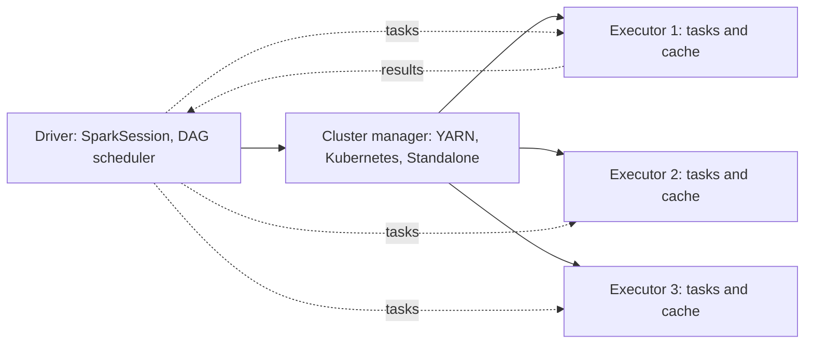
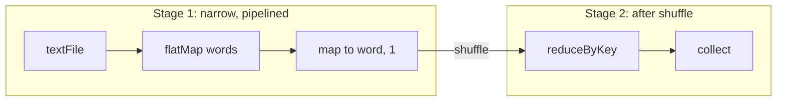

# Session 11 · Introduction to Apache Spark

[](https://colab.research.google.com/github/Hamnakhan123/Diploma-in-Data-Science/blob/main/term-2/02-big-data-systems-with-hadoop/code/session-11-introduction-to-apache-spark.ipynb)

> 📍 [Diploma in Data Science](../../README.md) › [Term 2](../README.md) › [Foundations of Big Data Systems with Hadoop](README.md) › **Session 11**

| ⏱ Estimated time | 🧩 Prerequisites | 💻 Tools |
|---|---|---|
| 3 hours | Sessions 4–5, Python | PySpark 4 (local mode), Spark on YARN (reference) |

[⬅ Previous: Session 10 · Pig Latin Data Model and Operators](session-10-pig-latin-data-model-and-operators.md) · [🏠 Module home](README.md) · [Next: Session 12 · Spark Statistics for Interactive Dashboards ➡](session-12-spark-statistics-and-dashboards.md)

---

## 🎯 Learning objectives

- Explain what **Apache Spark** is and why it is faster than MapReduce for many workloads.
- Describe Spark's **components**: Core, SQL, Structured Streaming, MLlib and GraphX.
- Describe Spark's **architecture**: driver, executors, cluster manager, jobs, stages and tasks.
- Work with **RDDs** and **DataFrames**, distinguishing **transformations** from **actions**.
- Explain **lazy evaluation**, **lineage**, **narrow vs wide** dependencies and **caching**.

## 📖 Concepts

### 1. What is Spark?

**Apache Spark** (UC Berkeley AMPLab, 2009; Apache top-level project 2014) is a unified engine for large-scale data processing. Its key idea is the **Resilient Distributed Dataset (RDD)**: a partitioned collection that can be kept **in memory** across steps and rebuilt from its **lineage** if a partition is lost.

| | Hadoop MapReduce | Spark |
|---|---|---|
| Intermediate data | Written to HDFS / disk between jobs | Kept in memory where possible |
| Programming model | Map and reduce only | 80+ high-level operators, SQL, DataFrames |
| Languages | Java (plus Streaming for others) | Scala, Java, Python, R, SQL |
| Iterative ML and graph algorithms | Slow (one job per iteration) | Fast (data cached across iterations) |
| Streaming | No | Structured Streaming |
| Runs on | YARN | Local, Standalone, YARN, Kubernetes |

Spark does **not** replace HDFS or YARN: on a Hadoop cluster it reads from HDFS and Hive tables and runs inside YARN containers.

### 2. Components

| Component | Purpose |
|---|---|
| **Spark Core** | RDDs, task scheduling, memory management, fault recovery |
| **Spark SQL / DataFrames** | Structured data with SQL and the **Catalyst** optimiser and **Tungsten** execution engine |
| **Structured Streaming** | Treats a live stream as an unbounded table; same DataFrame API |
| **MLlib** | Distributed machine learning: classification, regression, clustering, pipelines |
| **GraphX / GraphFrames** | Graph processing such as PageRank and connected components |

### 3. Architecture

- **Driver**: runs your `main` program and the **SparkSession**, builds the DAG, splits it into stages and tasks, schedules tasks, collects results.
- **Cluster manager**: allocates resources: **local**, **Standalone**, **YARN** or **Kubernetes**.
- **Executors**: JVM processes on worker nodes that run tasks and cache data. On YARN each executor is a container.
- **Job** = triggered by an action. A job is split into **stages** at every **shuffle** boundary; each stage has one **task** per partition.

Deploy modes on YARN: **client** (driver on your machine, good for notebooks) and **cluster** (driver inside the ApplicationMaster, good for production).

### 4. Transformations and actions

| Transformations (lazy, return a new RDD/DataFrame) | Actions (trigger a job, return a result) |
|---|---|
| `map`, `filter`, `flatMap`, `select`, `withColumn`, `groupBy`, `join`, `distinct`, `union`, `repartition` | `count`, `collect`, `take`, `show`, `first`, `reduce`, `write`, `saveAsTextFile` |

**Narrow** transformations (map, filter) keep each output partition dependent on one input partition, so they pipeline inside one stage. **Wide** transformations (groupByKey, reduceByKey, join, distinct) need a **shuffle** and start a new stage.

### 5. Caching and persistence

`df.cache()` (or `persist(StorageLevel.MEMORY_AND_DISK)`) keeps a dataset after the first action, so later actions reuse it instead of recomputing the lineage. Cache data you reuse (ML training loops, several reports on the same cleaned table); `unpersist()` when done.

### 6. RDD vs DataFrame

Use **DataFrames** by default: they have a schema, Catalyst optimises them, and Python DataFrame code runs as fast as Scala because the work happens in the JVM. Use **RDDs** for unstructured data or fine-grained control.

## 🧭 Diagrams





## 💻 Worked examples

### Example 1 · Word count with RDDs

📄 [`code/session-11_rdd_wordcount.py`](code/session-11_rdd_wordcount.py)

```python
from pyspark.sql import SparkSession
spark = (SparkSession.builder.master("local[2]").appName("rdd")
         .config("spark.ui.showConsoleProgress", "false").getOrCreate())
spark.sparkContext.setLogLevel("ERROR")
sc = spark.sparkContext

lines = sc.parallelize([
    "spark keeps data in memory", "hadoop writes data to disk",
    "spark runs on yarn", "yarn manages the hadoop cluster"], numSlices=2)
counts = (lines.flatMap(lambda l: l.split())       # narrow
               .map(lambda w: (w, 1))              # narrow
               .reduceByKey(lambda a, b: a + b))   # wide -> shuffle
print("partitions:", lines.getNumPartitions())
print("top words :", counts.sortBy(lambda x: (-x[1], x[0])).take(5))
import re
print("\nlineage:")
print(re.sub(r" at \S+:\d+ \[\]", "", counts.toDebugString().decode()))
```

**Output**

```text
partitions: 2
top words : [('data', 2), ('hadoop', 2), ('spark', 2), ('yarn', 2), ('cluster', 1)]

lineage:
(2) PythonRDD[12] at RDD
 |  MapPartitionsRDD[4] at mapPartitions
 |  ShuffledRDD[3] at partitionBy
 +-(2) PairwiseRDD[2] at reduceByKey
    |  PythonRDD[1] at reduceByKey
    |  ParallelCollectionRDD[0] at readRDDFromFile
```

The indentation in the lineage marks the shuffle: everything above `ShuffledRDD` is one stage, everything below it is another.

### Example 2 · Lazy evaluation

📄 [`code/session-11_lazy.py`](code/session-11_lazy.py)

```python
import time
from pyspark.sql import SparkSession
spark = (SparkSession.builder.master("local[2]").appName("lazy")
         .config("spark.ui.showConsoleProgress", "false").getOrCreate())
spark.sparkContext.setLogLevel("ERROR")
sc = spark.sparkContext

t0 = time.time()
rdd = sc.parallelize(range(1, 2_000_001), 4)
squares = rdd.map(lambda x: x * x).filter(lambda x: x % 3 == 0)    # transformations only
print(f"after transformations : {time.time() - t0:.3f} s (nothing has run yet)")
print("count =", squares.count())                                   # action -> job runs now
print("the action triggered a job: map + filter ran over all 4 partitions")
print("first 5 =", squares.take(5))
```

**Output**

```text
after transformations : 0.059 s (nothing has run yet)
count = 666666
the action triggered a job: map + filter ran over all 4 partitions
first 5 = [9, 36, 81, 144, 225]
```

### Example 3 · DataFrames, SQL and the Catalyst plan

📄 [`code/session-11_dataframes.py`](code/session-11_dataframes.py)

```python
from pyspark.sql import SparkSession, functions as F
spark = (SparkSession.builder.master("local[2]").appName("df")
         .config("spark.sql.shuffle.partitions", "4")
         .config("spark.ui.showConsoleProgress", "false").getOrCreate())
spark.sparkContext.setLogLevel("ERROR")

df = spark.createDataFrame([
    ("Ali", "CS", 3.4, 2023), ("Sara", "DS", 3.9, 2022), ("Omar", "CS", 2.8, 2023),
    ("Hina", "DS", 3.6, 2023), ("Zain", "SE", 3.1, 2022), ("Iqra", "CS", 3.7, 2022)],
    "name string, dept string, cgpa double, batch int")
df.printSchema()

result = (df.filter(F.col("cgpa") >= 3.0)
            .groupBy("dept").agg(F.count("*").alias("students"), F.round(F.avg("cgpa"), 2).alias("avg_cgpa"))
            .orderBy("dept"))
result.show()

df.createOrReplaceTempView("students")
spark.sql("SELECT batch, MAX(cgpa) AS best FROM students GROUP BY batch ORDER BY batch").show()
result.explain()
```

**Output**

```text
root
 |-- name: string (nullable = true)
 |-- dept: string (nullable = true)
 |-- cgpa: double (nullable = true)
 |-- batch: integer (nullable = true)

+----+--------+--------+
|dept|students|avg_cgpa|
+----+--------+--------+
|  CS|       2|    3.55|
|  DS|       2|    3.75|
|  SE|       1|     3.1|
+----+--------+--------+

+-----+----+
|batch|best|
+-----+----+
| 2022| 3.9|
| 2023| 3.6|
+-----+----+

== Physical Plan ==
AdaptiveSparkPlan isFinalPlan=false
+- Sort [dept#1 ASC NULLS FIRST], true, 0
   +- Exchange rangepartitioning(dept#1 ASC NULLS FIRST, 4), ENSURE_REQUIREMENTS, [plan_id=145]
      +- HashAggregate(keys=[dept#1], functions=[count(1), avg(cgpa#2)])
         +- Exchange hashpartitioning(dept#1, 4), ENSURE_REQUIREMENTS, [plan_id=142]
            +- HashAggregate(keys=[dept#1], functions=[partial_count(1), partial_avg(cgpa#2)])
               +- Project [dept#1, cgpa#2]
                  +- Filter (isnotnull(cgpa#2) AND (cgpa#2 >= 3.0))
                     +- Scan ExistingRDD[name#0,dept#1,cgpa#2,batch#3]
```

### Example 4 · Jobs, stages and caching

📄 [`code/session-11_cache_stages.py`](code/session-11_cache_stages.py)

```python
import time
from pyspark.sql import SparkSession, functions as F
spark = (SparkSession.builder.master("local[2]").appName("cache")
         .config("spark.sql.shuffle.partitions", "4")
         .config("spark.ui.showConsoleProgress", "false").getOrCreate())
spark.sparkContext.setLogLevel("ERROR")

big = (spark.range(0, 3_000_000)
       .withColumn("city", (F.col("id") % 5).cast("string"))
       .withColumn("amount", F.sqrt(F.col("id")) * 3))
clean = big.filter(F.col("amount") > 100).withColumn("tax", F.col("amount") * 0.17)

def timed(label, fn):
    t0 = time.time(); out = fn(); print(f"{label:<28} {time.time() - t0:6.2f} s  -> {out}")

timed("count, not cached", lambda: clean.count())
clean.cache()
timed("count, first (fills cache)", lambda: clean.count())
timed("count, from cache", lambda: clean.count())
timed("group by city, from cache", lambda: clean.groupBy("city").count().count())
print("storage level:", clean.storageLevel)
clean.unpersist()
```

**Output**

```text
count, not cached              1.79 s  -> 2998888
count, first (fills cache)     1.83 s  -> 2998888
count, from cache              0.13 s  -> 2998888
group by city, from cache      0.84 s  -> 5
storage level: Disk Memory Deserialized 1x Replicated
```

Exact times depend on your machine, but the cached runs avoid recomputing the `range → filter → withColumn` lineage.

### Example 5 · Submitting to a cluster (illustrative)

```bash
spark-submit --master yarn --deploy-mode cluster \
  --num-executors 10 --executor-cores 4 --executor-memory 8g --driver-memory 4g \
  --conf spark.sql.shuffle.partitions=200 --queue analytics \
  sales_report.py hdfs:///data/sales/2026/10
pyspark --master yarn --deploy-mode client      # interactive shell on the cluster
```

The Spark UI (port **4040** while an application runs, or the Spark History Server on **18080**) shows each job's DAG, stages, tasks, shuffle sizes and cached storage.

## 🧪 Lab / practice tasks

### 🟢 Task 1 · Easy

Classify each as a transformation or action and as narrow or wide: `map`, `filter`, `count`, `groupByKey`, `join`, `take`, `union`, `distinct`.

<details><summary>💡 Hint</summary>

Actions return values to the driver; wide ones need a shuffle.

</details>

### 🟡 Task 2 · Medium

Change Example 1 to remove stop words ("the", "to", "in", "on") and return the top 3 words.

<details><summary>💡 Hint</summary>

Add a `filter` after `flatMap`.

</details>

### 🟡 Task 3 · Medium

In Example 3 add a column `grade` that is "A" when CGPA ≥ 3.5, "B" when ≥ 3.0 and "C" otherwise, then count students per grade.

<details><summary>💡 Hint</summary>

`F.when(...).when(...).otherwise(...)`.

</details>

### 🟠 Task 4 · Hard

Run Example 4 with `spark.range(0, 10_000_000)` and compare times with and without `cache()`. Open `http://localhost:4040` while it runs and find the stages.

<details><summary>💡 Hint</summary>

Add `input()` at the end of the script to keep the UI alive.

</details>

### 🔴 Task 5 · Challenge

Implement PageRank for a 6-page link graph with RDDs (10 iterations) and explain why caching the links RDD matters.

<details><summary>💡 Hint</summary>

`links.cache()`; each iteration joins ranks with links and reduces contributions by key.

</details>


## ✅ Quick quiz

**Q1.** Spark is faster than MapReduce for iterative algorithms mainly because…

- **A)** it uses more disks
- **B)** it keeps intermediate data in memory
- **C)** it does not use partitions
- **D)** it skips the shuffle completely

<details><summary>Show answer</summary>

**B** — In-memory reuse avoids writing to HDFS between steps.

</details>

**Q2.** Which is an action?

- **A)** map
- **B)** filter
- **C)** count
- **D)** select

<details><summary>Show answer</summary>

**C** — count triggers a job and returns a value.

</details>

**Q3.** A new stage starts at…

- **A)** every map
- **B)** every shuffle (wide dependency)
- **C)** every action only
- **D)** every file

<details><summary>Show answer</summary>

**B** — Stage boundaries are shuffles.

</details>

**Q4.** Who builds the DAG and schedules tasks?

- **A)** Executor
- **B)** Driver
- **C)** NameNode
- **D)** NodeManager

<details><summary>Show answer</summary>

**B** — The driver plans and schedules.

</details>

**Q5.** Which component handles machine learning?

- **A)** GraphX
- **B)** MLlib
- **C)** Spark SQL
- **D)** Catalyst

<details><summary>Show answer</summary>

**B** — MLlib is Spark's ML library.

</details>


## 📝 Summary

- Spark = fast, general engine with **in-memory** RDDs, rich APIs and one engine for SQL, streaming, ML and graphs.
- Architecture: **driver** + **cluster manager** + **executors**; jobs → stages (split at shuffles) → tasks (one per partition).
- **Transformations are lazy**; **actions** trigger jobs. **Narrow** pipelines, **wide** shuffles.
- **Lineage** gives fault tolerance; **cache** reused data.
- Prefer **DataFrames** (Catalyst + Tungsten) over RDDs for structured data.

### 🎤 Interview / viva questions

1. What makes an RDD "resilient"?
2. Why is `reduceByKey` preferred over `groupByKey` for aggregation?
3. What is the difference between client and cluster deploy mode?
4. When can caching make a job slower?
5. How does Catalyst optimise a DataFrame query?

---

[⬅ Previous: Session 10 · Pig Latin Data Model and Operators](session-10-pig-latin-data-model-and-operators.md) · [🏠 Module home](README.md) · [Next: Session 12 · Spark Statistics for Interactive Dashboards ➡](session-12-spark-statistics-and-dashboards.md)

<sub>Diploma in Data Science · Prepared by **Hamna Zahid Khan**, Junior Lecturer</sub>
