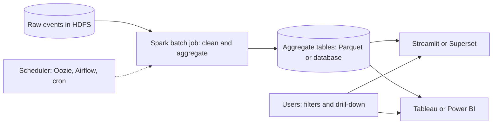
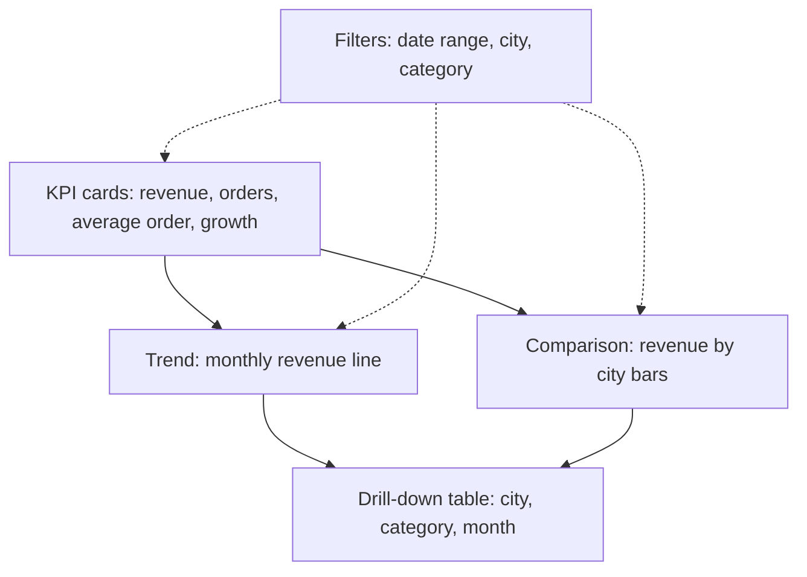
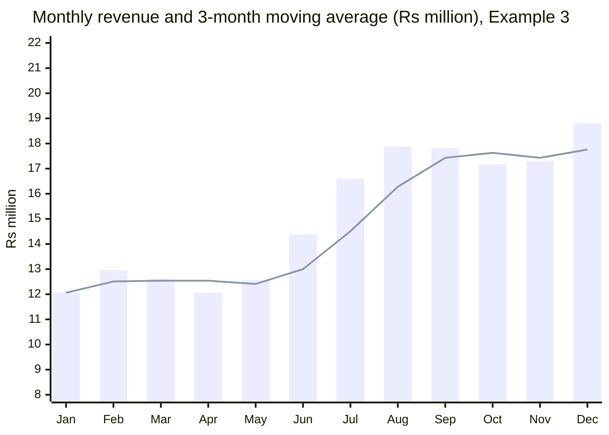

# Session 12 · Spark Statistics for Interactive Dashboards

[](https://colab.research.google.com/github/Hamnakhan123/Diploma-in-Data-Science/blob/main/term-2/02-big-data-systems-with-hadoop/code/session-12-spark-statistics-and-dashboards.ipynb)

> 📍 [Diploma in Data Science](../../README.md) › [Term 2](../README.md) › [Foundations of Big Data Systems with Hadoop](README.md) › **Session 12**

| ⏱ Estimated time | 🧩 Prerequisites | 💻 Tools |
|---|---|---|
| 3 hours | Session 11, Term 1 statistics | PySpark 4, Python 3 (Streamlit/Plotly for dashboards) |

[⬅ Previous: Session 11 · Introduction to Apache Spark](session-11-introduction-to-apache-spark.md) · [🏠 Module home](README.md) · [Next: Session 13 · Data Analysis with Spark: Clustering and Forecasting ➡](session-13-spark-clustering-and-forecasting.md)

---

## 🎯 Learning objectives

- Compute **descriptive statistics** at scale with Spark: `describe`, `summary`, approximate quantiles, correlation and crosstabs.
- Build **aggregated KPI tables** with `groupBy`, `rollup`, `cube`, pivot and window functions.
- Explain why dashboards should read **pre-aggregated** data rather than raw Big Data.
- Design an **interactive dashboard**: KPIs, filters, drill-down and refresh strategy.
- Connect Spark output to dashboard tools (Streamlit, Superset, Tableau, Power BI).

## 📖 Concepts

### 1. Statistics in Spark

| Need | Spark API |
|---|---|
| Count, mean, std, min, max | `df.describe()` |
| Plus quartiles | `df.summary()` or `df.summary("count", "mean", "25%", "50%", "75%")` |
| Fast approximate percentiles on billions of rows | `df.approxQuantile("col", [0.5, 0.9], relativeError)` or `percentile_approx` |
| Correlation | `df.stat.corr("x", "y")`, or `pyspark.ml.stat.Correlation` for a matrix |
| Frequency tables | `df.stat.crosstab("a", "b")`, `df.stat.freqItems` |
| Distinct counts at scale | `approx_count_distinct` (HyperLogLog) |
| Distribution shape | `skewness`, `kurtosis` |

Exact medians need a full sort; **approximate** algorithms (Greenwald–Khanna, HyperLogLog) give answers within a stated error using a single pass, which is what you want on Big Data.

### 2. Aggregations for dashboards

- **groupBy + agg**: KPIs by dimension (revenue by city).
- **rollup(a, b)**: subtotals for a, then a grand total; **cube(a, b)**: every combination of subtotals.
- **pivot**: turn a dimension's values into columns (months across the top).
- **Window functions**: running totals, moving averages, rank within group, month-over-month change with `lag`.

### 3. From Big Data to a dashboard

A dashboard must respond in about a second. Querying billions of raw rows each time a user clicks is too slow and expensive. The usual pattern:

1. **Spark batch job** (hourly or nightly) cleans the raw data and writes **aggregate tables** (daily revenue by city and category) in Parquet or into a database.
2. The **serving layer** (Hive/Impala table, PostgreSQL, or an extract) holds small, fast tables.
3. The **dashboard** (Streamlit, Apache Superset, Tableau, Power BI, Grafana) queries only the aggregates and applies filters.

### 4. Dashboard design checklist

| Principle | Practice |
|---|---|
| Audience first | One dashboard per decision-maker and question |
| KPIs at the top | 3–5 big numbers with comparison (vs last month, vs target) |
| Filters | Date range, region, category; apply to all charts |
| Drill-down | Summary → by city → by store |
| Right chart | Line for trends, bar for comparison, map for geography, table for detail |
| Freshness | Show "data as of" time; match the refresh schedule to the decision speed |
| Performance | Pre-aggregate, partition by date, cache extracts |

## 🧭 Diagrams





## 💻 Worked examples

All examples use the same synthetic e-commerce data set of 50,000 orders, generated reproducibly inside Spark.

### Example 1 · Descriptive statistics at scale

📄 [`code/session-12_spark_stats.py`](code/session-12_spark_stats.py)

```python
from pyspark.sql import SparkSession, functions as F
spark = (SparkSession.builder.master("local[2]").appName("stats")
         .config("spark.sql.shuffle.partitions", "4")
         .config("spark.ui.showConsoleProgress", "false").getOrCreate())
spark.sparkContext.setLogLevel("ERROR")

cities = F.array(*[F.lit(c) for c in ["Karachi", "Lahore", "Islamabad", "Faisalabad"]])
cats = F.array(*[F.lit(c) for c in ["Electronics", "Fashion", "Grocery"]])
orders = (spark.range(50000)
    .withColumn("city", F.element_at(cities, (F.abs(F.hash("id")) % 4 + 1).cast("int")))
    .withColumn("category", F.element_at(cats, (F.abs(F.hash(F.col("id") * 7)) % 3 + 1).cast("int")))
    .withColumn("items", (F.rand(seed=1) * 5 + 1).cast("int"))
    .withColumn("amount", F.round(F.exp(F.randn(seed=2) * 0.6 + 7.5) * F.col("items") / 2, 0))
    .withColumn("month", (F.col("id") % 12 + 1).cast("int")))

orders.select("items", "amount").summary("count", "mean", "stddev", "min", "25%", "50%", "75%", "max").show()
q = orders.approxQuantile("amount", [0.5, 0.9, 0.99], 0.001)
print("approx median, p90, p99 of amount:", q)
print("corr(items, amount) =", round(orders.stat.corr("items", "amount"), 3))
orders.agg(F.round(F.skewness("amount"), 2).alias("skewness"),
           F.approx_count_distinct("city").alias("distinct_cities")).show()
orders.stat.crosstab("city", "category").orderBy("city_category").show()
```

**Output**

```text
+-------+------------------+------------------+
|summary|             items|            amount|
+-------+------------------+------------------+
|  count|             50000|             50000|
|   mean|           2.99394|        3231.27496|
| stddev|1.4136701332577224|2811.6610773486323|
|    min|                 1|              81.0|
|    25%|                 2|            1342.0|
|    50%|                 3|            2439.0|
|    75%|                 4|            4212.0|
|    max|                 5|           42868.0|
+-------+------------------+------------------+

approx median, p90, p99 of amount: [2438.0, 6561.0, 13353.0]
corr(items, amount) = 0.541
+--------+---------------+
|skewness|distinct_cities|
+--------+---------------+
|    2.55|              4|
+--------+---------------+

+-------------+-----------+-------+-------+
|city_category|Electronics|Fashion|Grocery|
+-------------+-----------+-------+-------+
|   Faisalabad|       4203|   4166|   4147|
|    Islamabad|       4105|   4238|   4106|
|      Karachi|       4155|   4074|   4235|
|       Lahore|       4107|   4266|   4198|
+-------------+-----------+-------+-------+
```

Amounts are **right-skewed** (skewness well above 0, mean above median), typical of sales data, so the median is a better "typical order" KPI than the mean.

### Example 2 · KPI tables with groupBy, rollup and pivot

📄 [`code/session-12_spark_kpis.py`](code/session-12_spark_kpis.py)

```python
from pyspark.sql import SparkSession, functions as F
spark = (SparkSession.builder.master("local[2]").appName("kpis")
         .config("spark.sql.shuffle.partitions", "4")
         .config("spark.ui.showConsoleProgress", "false").getOrCreate())
spark.sparkContext.setLogLevel("ERROR")
cities = F.array(*[F.lit(c) for c in ["Karachi", "Lahore", "Islamabad", "Faisalabad"]])
cats = F.array(*[F.lit(c) for c in ["Electronics", "Fashion", "Grocery"]])
orders = (spark.range(50000)
    .withColumn("city", F.element_at(cities, (F.abs(F.hash("id")) % 4 + 1).cast("int")))
    .withColumn("category", F.element_at(cats, (F.abs(F.hash(F.col("id") * 7)) % 3 + 1).cast("int")))
    .withColumn("items", (F.rand(seed=1) * 5 + 1).cast("int"))
    .withColumn("amount", F.round(F.exp(F.randn(seed=2) * 0.6 + 7.5) * F.col("items") / 2, 0))
    .withColumn("month", (F.col("id") % 12 + 1).cast("int")))

kpi = orders.agg(F.count("*").alias("orders"), F.sum("amount").alias("revenue"),
                 F.round(F.avg("amount"), 0).alias("avg_order")).first()
print(f"KPI cards -> orders: {kpi['orders']:,} | revenue: Rs {kpi['revenue']:,.0f} | avg order: Rs {kpi['avg_order']:,.0f}\n")

print("rollup: revenue by city with grand total (in Rs million)")
(orders.rollup("city").agg(F.round(F.sum("amount") / 1e6, 2).alias("revenue_m"))
       .orderBy(F.col("city").isNull(), "city").show())

print("pivot: revenue (Rs million) by category and quarter")
(orders.withColumn("quarter", F.concat(F.lit("Q"), F.ceil(F.col("month") / 3).cast("string")))
       .groupBy("category").pivot("quarter").agg(F.round(F.sum("amount") / 1e6, 2))
       .orderBy("category").show())
```

**Output**

```text
KPI cards -> orders: 50,000 | revenue: Rs 161,563,748 | avg order: Rs 3,231

rollup: revenue by city with grand total (in Rs million)
+----------+---------+
|      city|revenue_m|
+----------+---------+
|Faisalabad|    40.76|
| Islamabad|    39.91|
|   Karachi|    40.17|
|    Lahore|    40.73|
|      NULL|   161.56|
+----------+---------+

pivot: revenue (Rs million) by category and quarter
+-----------+-----+-----+-----+-----+
|   category|   Q1|   Q2|   Q3|   Q4|
+-----------+-----+-----+-----+-----+
|Electronics|13.43|13.63|13.38|13.49|
|    Fashion|13.45|13.41|13.61| 13.2|
|    Grocery| 13.6|13.19|13.55|13.63|
+-----------+-----+-----+-----+-----+
```

### Example 3 · Trends with window functions

📄 [`code/session-12_spark_windows.py`](code/session-12_spark_windows.py)

```python
from pyspark.sql import SparkSession, functions as F, Window
spark = (SparkSession.builder.master("local[2]").appName("windows")
         .config("spark.sql.shuffle.partitions", "4")
         .config("spark.ui.showConsoleProgress", "false").getOrCreate())
spark.sparkContext.setLogLevel("ERROR")

monthly = (spark.range(1, 13).withColumnRenamed("id", "month")
           .withColumn("revenue", F.round(10 + F.col("month") * 0.8 + F.sin(F.col("month")) * 1.5, 2)))  # Rs million
w = Window.orderBy("month")
trend = (monthly
    .withColumn("prev", F.lag("revenue").over(w))
    .withColumn("mom_growth_%", F.round((F.col("revenue") / F.col("prev") - 1) * 100, 1))
    .withColumn("moving_avg_3", F.round(F.avg("revenue").over(w.rowsBetween(-2, 0)), 2))
    .withColumn("running_total", F.round(F.sum("revenue").over(w.rowsBetween(Window.unboundedPreceding, 0)), 2))
    .drop("prev"))
trend.show()
```

**Output**

```text
+-----+-------+------------+------------+-------------+
|month|revenue|mom_growth_%|moving_avg_3|running_total|
+-----+-------+------------+------------+-------------+
|    1|  12.06|        NULL|       12.06|        12.06|
|    2|  12.96|         7.5|       12.51|        25.02|
|    3|  12.61|        -2.7|       12.54|        37.63|
|    4|  12.06|        -4.4|       12.54|        49.69|
|    5|  12.56|         4.1|       12.41|        62.25|
|    6|  14.38|        14.5|        13.0|        76.63|
|    7|  16.59|        15.4|       14.51|        93.22|
|    8|  17.88|         7.8|       16.28|        111.1|
|    9|  17.82|        -0.3|       17.43|       128.92|
|   10|  17.18|        -3.6|       17.63|        146.1|
|   11|   17.3|         0.7|       17.43|        163.4|
|   12|   18.8|         8.7|       17.76|        182.2|
+-----+-------+------------+------------+-------------+
```



### Example 4 · Writing the dashboard's aggregate table

📄 [`code/session-12_spark_agg_table.py`](code/session-12_spark_agg_table.py)

```python
import os, tempfile
from pyspark.sql import SparkSession, functions as F
spark = (SparkSession.builder.master("local[2]").appName("agg-table")
         .config("spark.sql.shuffle.partitions", "4")
         .config("spark.ui.showConsoleProgress", "false").getOrCreate())
spark.sparkContext.setLogLevel("ERROR")
cities = F.array(*[F.lit(c) for c in ["Karachi", "Lahore", "Islamabad", "Faisalabad"]])
cats = F.array(*[F.lit(c) for c in ["Electronics", "Fashion", "Grocery"]])
orders = (spark.range(50000)
    .withColumn("city", F.element_at(cities, (F.abs(F.hash("id")) % 4 + 1).cast("int")))
    .withColumn("category", F.element_at(cats, (F.abs(F.hash(F.col("id") * 7)) % 3 + 1).cast("int")))
    .withColumn("amount", F.round(F.exp(F.randn(seed=2) * 0.6 + 7.5), 0))
    .withColumn("month", (F.col("id") % 12 + 1).cast("int")))

agg = (orders.groupBy("month", "city", "category")
       .agg(F.count("*").alias("orders"), F.sum("amount").alias("revenue")))
out = os.path.join(tempfile.mkdtemp(), "sales_agg")    # use out = "sales_agg" to keep it for the dashboard app
agg.write.mode("overwrite").partitionBy("month").parquet(out)

raw_rows, agg_rows = orders.count(), agg.count()
print(f"raw rows: {raw_rows:,} -> dashboard rows: {agg_rows:,} ({raw_rows // agg_rows}x smaller)")
print("month partitions written:", len([d for d in os.listdir(out) if d.startswith("month=")]))
pdf = spark.read.parquet(out).toPandas()            # small enough for pandas / a dashboard
print(pdf.groupby("city")["revenue"].sum().sort_values(ascending=False).round(0).to_string())
```

**Output**

```text
raw rows: 50,000 -> dashboard rows: 144 (347x smaller)
month partitions written: 12
city
Lahore        27122087.0
Faisalabad    27088796.0
Islamabad     26884790.0
Karachi       26870679.0
```

### Example 5 · An interactive dashboard app (Streamlit)

This app reads the aggregate table from Example 4. Run it with `pip install streamlit plotly pyarrow` and `streamlit run dashboard_app.py`.

📄 [`code/dashboard_app.py`](code/dashboard_app.py)

```python
import pandas as pd
import plotly.express as px
import streamlit as st

st.set_page_config(page_title="Sales dashboard", layout="wide")
df = pd.read_parquet("sales_agg")                       # folder written by Spark (Example 4)

st.sidebar.header("Filters")
cities = st.sidebar.multiselect("City", sorted(df.city.unique()), default=sorted(df.city.unique()))
cats = st.sidebar.multiselect("Category", sorted(df.category.unique()), default=sorted(df.category.unique()))
months = st.sidebar.slider("Months", 1, 12, (1, 12))
f = df[df.city.isin(cities) & df.category.isin(cats) & df.month.between(*months)]

c1, c2, c3 = st.columns(3)
c1.metric("Revenue (Rs)", f"{f.revenue.sum():,.0f}")
c2.metric("Orders", f"{f.orders.sum():,}")
c3.metric("Average order (Rs)", f"{f.revenue.sum() / max(f.orders.sum(), 1):,.0f}")

left, right = st.columns(2)
left.plotly_chart(px.line(f.groupby("month", as_index=False).revenue.sum(), x="month", y="revenue",
                          title="Monthly revenue"), use_container_width=True)
right.plotly_chart(px.bar(f.groupby("city", as_index=False).revenue.sum(), x="city", y="revenue",
                          title="Revenue by city"), use_container_width=True)
st.subheader("Drill-down")
st.dataframe(f.groupby(["city", "category"], as_index=False)[["orders", "revenue"]].sum())
```

## 🧪 Lab / practice tasks

### 🟢 Task 1 · Easy

From Example 1's output, explain the difference between the mean and the median amount and which one you would put on a KPI card.

<details><summary>💡 Hint</summary>

Skewed data pulls the mean up.

</details>

### 🟡 Task 2 · Medium

In Example 2 replace `rollup("city")` with `cube("city", "category")` and explain the extra rows.

<details><summary>💡 Hint</summary>

Nulls in a column mean "all values" (a subtotal).

</details>

### 🟡 Task 3 · Medium

Add a "rank of city by revenue within each category" column using a window function.

<details><summary>💡 Hint</summary>

`Window.partitionBy("category").orderBy(F.desc("revenue"))`.

</details>

### 🟠 Task 4 · Hard

Run Example 4 with `out = "sales_agg"` in the same folder as `dashboard_app.py` and launch the Streamlit dashboard. Add a filter-aware "top category" KPI.

<details><summary>💡 Hint</summary>

`f.groupby("category").revenue.sum().idxmax()`.

</details>

### 🔴 Task 5 · Challenge

Sketch (on paper or in a tool) a dashboard for a university admissions office using applications data: 4 KPIs, 3 charts, 3 filters. Write the Spark aggregation that would feed it.

<details><summary>💡 Hint</summary>

Applications by programme, city and week; acceptance rate; average test score.

</details>


## ✅ Quick quiz

**Q1.** Which Spark method gives count, mean, stddev, min, quartiles and max?

- **A)** describe
- **B)** summary
- **C)** crosstab
- **D)** corr

<details><summary>Show answer</summary>

**B** — summary adds percentiles to describe's output.

</details>

**Q2.** Why use approxQuantile on Big Data?

- **A)** It is more accurate
- **B)** It needs one pass and bounded memory instead of a full sort
- **C)** It works only on strings
- **D)** It avoids nulls

<details><summary>Show answer</summary>

**B** — Approximate quantiles trade a small error for speed.

</details>

**Q3.** `rollup("city")` adds…

- **A)** a column per city
- **B)** a grand-total row
- **C)** a running total
- **D)** a rank

<details><summary>Show answer</summary>

**B** — Rollup produces subtotals and a grand total (null city).

</details>

**Q4.** Dashboards on Big Data should usually query…

- **A)** raw event tables
- **B)** pre-aggregated tables
- **C)** HDFS block files directly
- **D)** the NameNode

<details><summary>Show answer</summary>

**B** — Aggregates are small and fast.

</details>

**Q5.** A 3-month moving average is best computed with…

- **A)** a broadcast join
- **B)** a window function with rowsBetween(-2, 0)
- **C)** crosstab
- **D)** approx_count_distinct

<details><summary>Show answer</summary>

**B** — Windows compute values over neighbouring rows.

</details>


## 📝 Summary

- Spark statistics: `describe`, `summary`, `approxQuantile`, `corr`, `crosstab`, `skewness`, `approx_count_distinct`.
- KPI tables: `groupBy`, `rollup`, `cube`, `pivot`; trends with **window functions** (`lag`, moving averages, running totals).
- Dashboards read **small aggregate tables** written by scheduled Spark jobs, not raw Big Data.
- Good dashboards: KPIs first, shared filters, drill-down, right chart types and a visible "data as of" time.

### 🎤 Interview / viva questions

1. Why is the median often preferred over the mean for sales and income data?
2. What is HyperLogLog and why is it used for distinct counts?
3. How would you keep a dashboard fresh every hour without slowing it down?
4. When would you use `cube` instead of `rollup`?
5. What makes a dashboard "interactive" rather than a static report?

---

[⬅ Previous: Session 11 · Introduction to Apache Spark](session-11-introduction-to-apache-spark.md) · [🏠 Module home](README.md) · [Next: Session 13 · Data Analysis with Spark: Clustering and Forecasting ➡](session-13-spark-clustering-and-forecasting.md)

<sub>Diploma in Data Science · Prepared by **Hamna Zahid Khan**, Junior Lecturer</sub>
