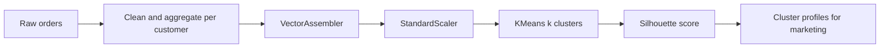
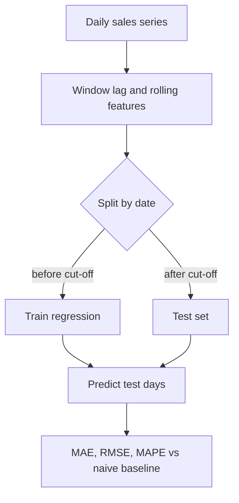

# Session 13 · Data Analysis with Spark: Clustering and Forecasting

[](https://colab.research.google.com/github/Hamnakhan123/Diploma-in-Data-Science/blob/main/term-2/02-big-data-systems-with-hadoop/code/session-13-spark-clustering-and-forecasting.ipynb)

> 📍 [Diploma in Data Science](../../README.md) › [Term 2](../README.md) › [Foundations of Big Data Systems with Hadoop](README.md) › **Session 13**

| ⏱ Estimated time | 🧩 Prerequisites | 💻 Tools |
|---|---|---|
| 3 hours | Sessions 11–12, Term 1 machine learning basics | PySpark 4 (Spark SQL, MLlib) |

[⬅ Previous: Session 12 · Spark Statistics for Interactive Dashboards](session-12-spark-statistics-and-dashboards.md) · [🏠 Module home](README.md) · [Next: Session 14 · Special Field Types, Generated Fields and Parameters in Spark ➡](session-14-spark-field-types-and-parameters.md)

---

## 🎯 Learning objectives

- Run an end-to-end **data analysis** in Spark: load, clean, explore, engineer features.
- Build **MLlib Pipelines** with `VectorAssembler`, `StandardScaler` and estimators.
- Cluster customers with **K-means** and choose *k* with the **silhouette score**.
- Forecast a time series with Spark using **lag features**, a **time-ordered split** and regression models.
- Evaluate forecasts with **RMSE**, **MAE** and **MAPE**, and compare against a naive baseline.

## 📖 Concepts

### 1. Data analysis workflow in Spark

1. **Load** from HDFS, Hive or files (`spark.read.parquet/csv/json`, `spark.table`).
2. **Clean**: drop duplicates, handle nulls (`na.fill`, `na.drop`), fix types, remove impossible values.
3. **Explore**: `summary`, group-bys, correlations (Session 12).
4. **Engineer features**: ratios, dates, aggregates per customer, lags.
5. **Model** with MLlib; **evaluate**; **write** results back for dashboards.

### 2. MLlib basics

- MLlib (the `pyspark.ml` package) works on DataFrames. Models need one **vector column** of features, built with **`VectorAssembler`**.
- **Transformers** (`transform()`) change a DataFrame: `VectorAssembler`, `StandardScaler` model, a fitted model.
- **Estimators** (`fit()`) learn from data and return a transformer: `StandardScaler`, `KMeans`, `LinearRegression`.
- A **Pipeline** chains stages so the same steps run on training and new data, avoiding leakage.

### 3. Clustering with K-means

K-means places *k* centroids and repeats: assign each point to its nearest centroid, then move each centroid to the mean of its points. In Spark it is distributed: each executor assigns its partition's points, then partial sums are combined (MapReduce style) to update centroids. Spark uses **k-means||** initialisation, a parallel version of k-means++.

- **Scale features first**: K-means uses distance, so income in rupees would swamp visits per month.
- **Choosing k**: the **silhouette score** (−1 to 1, higher is better) measures how close each point is to its own cluster compared with the next one; the **elbow** of the within-cluster cost is another guide.
- Other MLlib clustering: **Bisecting K-means**, **Gaussian Mixture**, **LDA** (topics), **Power Iteration Clustering**.

### 4. Forecasting with Spark

Spark has no dedicated time-series model like ARIMA, but forecasting can be framed as **regression on lag features**:

| Feature | Meaning |
|---|---|
| `lag_1`, `lag_7` | value yesterday and one week ago |
| `rolling_mean_7` | average of the last 7 days |
| `day_of_week`, `month`, `is_holiday` | calendar effects |
| `trend` | day number |

Rules:

- **Split by time**, never randomly: train on the past, test on the most recent period.
- Build lag features with **window functions** that look only backwards.
- Always compare against a **naive baseline** (tomorrow = same day last week). A model that cannot beat it is not useful.
- Metrics: **MAE** (average error in units), **RMSE** (punishes large errors), **MAPE** (percentage; avoid when values can be near zero).
- For thousands of separate series (one per store), Spark parallelises many small models with `groupBy().applyInPandas()` running Prophet or statsmodels per group.

## 🧭 Diagrams





## 💻 Worked examples

### Example 1 · Data preparation: customer features

📄 [`code/session-13_customer_features.py`](code/session-13_customer_features.py)

```python
from pyspark.sql import SparkSession, functions as F
spark = (SparkSession.builder.master("local[2]").appName("prep")
         .config("spark.sql.shuffle.partitions", "4")
         .config("spark.ui.showConsoleProgress", "false").getOrCreate())
spark.sparkContext.setLogLevel("ERROR")

# 3 hidden customer types: bargain hunters, regulars, premium buyers
seg = F.when(F.col("customer_id") % 10 < 5, 0).when(F.col("customer_id") % 10 < 8, 1).otherwise(2)
orders = (spark.range(60000)
    .withColumn("customer_id", (F.col("id") % 1500).cast("int"))
    .withColumn("seg", seg)
    .withColumn("amount", F.round(F.when(F.col("seg") == 0, 800).when(F.col("seg") == 1, 2500).otherwise(9000)
                                  * F.exp(F.randn(seed=4) * 0.3), 0))
    .filter((F.col("seg") != 0) | (F.rand(seed=5) < 0.6))        # bargain hunters order less often
    .withColumn("amount", F.when(F.rand(seed=6) < 0.01, None).otherwise(F.col("amount"))))  # 1% missing

print("rows:", orders.count(), "| null amounts:", orders.filter(F.col("amount").isNull()).count())
clean = orders.na.drop(subset=["amount"]).dropDuplicates(["id"])
cust = (clean.groupBy("customer_id").agg(
            F.count("*").alias("orders"),
            F.round(F.avg("amount"), 0).alias("avg_order"),
            F.round(F.sum("amount"), 0).alias("total_spend")))
cust.summary("count", "mean", "min", "max").show()
cust.orderBy("customer_id").show(5)
```

**Output**

```text
rows: 48048 | null amounts: 465
+-------+-----------+------+-----------------+-----------+
|summary|customer_id|orders|        avg_order|total_spend|
+-------+-----------+------+-----------------+-----------+
|  count|       1500|  1500|             1500|       1500|
|   mean|      749.5|31.722|3087.730666666667| 115714.156|
|    min|          0|    13|            673.0|    11114.0|
|    max|       1499|    40|          10903.0|   436111.0|
+-------+-----------+------+-----------------+-----------+

+-----------+------+---------+-----------+
|customer_id|orders|avg_order|total_spend|
+-----------+------+---------+-----------+
|          0|    24|    822.0|    19723.0|
|          1|    25|    872.0|    21799.0|
|          2|    19|    869.0|    16508.0|
|          3|    22|    813.0|    17879.0|
|          4|    29|    842.0|    24426.0|
+-----------+------+---------+-----------+
only showing top 5 rows
```

### Example 2 · K-means segmentation with a Pipeline and silhouette

📄 [`code/session-13_kmeans.py`](code/session-13_kmeans.py)

```python
from pyspark.sql import SparkSession, functions as F
from pyspark.ml import Pipeline
from pyspark.ml.feature import VectorAssembler, StandardScaler
from pyspark.ml.clustering import KMeans
from pyspark.ml.evaluation import ClusteringEvaluator
spark = (SparkSession.builder.master("local[2]").appName("kmeans")
         .config("spark.sql.shuffle.partitions", "4")
         .config("spark.ui.showConsoleProgress", "false").getOrCreate())
spark.sparkContext.setLogLevel("ERROR")

seg = F.when(F.col("customer_id") % 10 < 5, 0).when(F.col("customer_id") % 10 < 8, 1).otherwise(2)
orders = (spark.range(60000)
    .withColumn("customer_id", (F.col("id") % 1500).cast("int")).withColumn("seg", seg)
    .withColumn("amount", F.round(F.when(F.col("seg") == 0, 800).when(F.col("seg") == 1, 2500).otherwise(9000)
                                  * F.exp(F.randn(seed=4) * 0.3), 0))
    .filter((F.col("seg") != 0) | (F.rand(seed=5) < 0.6)))
cust = orders.groupBy("customer_id").agg(F.count("*").alias("orders"),
                                         F.avg("amount").alias("avg_order")).cache()

assembler = VectorAssembler(inputCols=["orders", "avg_order"], outputCol="raw")
scaler = StandardScaler(inputCol="raw", outputCol="features", withMean=True, withStd=True)
evaluator = ClusteringEvaluator(featuresCol="features", metricName="silhouette")

print(" k  silhouette")
for k in [2, 3, 4, 5, 6]:
    model = Pipeline(stages=[assembler, scaler, KMeans(k=k, seed=42, featuresCol="features")]).fit(cust)
    print(f"{k:>2}  {evaluator.evaluate(model.transform(cust)):.3f}")

best = Pipeline(stages=[assembler, scaler, KMeans(k=3, seed=42, featuresCol="features")]).fit(cust)
profiles = (best.transform(cust).groupBy("prediction")
            .agg(F.count("*").alias("customers"), F.round(F.avg("orders"), 1).alias("avg_orders"),
                 F.round(F.avg("avg_order"), 0).alias("avg_order_value"))
            .orderBy("avg_order_value"))
profiles.show()
```

**Output**

```text
 k  silhouette
 2  0.741
 3  0.960
 4  0.849
 5  0.792
 6  0.797
+----------+---------+----------+---------------+
|prediction|customers|avg_orders|avg_order_value|
+----------+---------+----------+---------------+
|         0|      749|      24.1|          838.0|
|         1|      451|      40.0|         2613.0|
|         2|      300|      40.0|         9415.0|
+----------+---------+----------+---------------+
```

The silhouette peaks at **k = 3**, matching the three customer types hidden in the data. The profiles become business segments: low-value occasional buyers, regulars and premium buyers.

### Example 3 · Forecasting daily sales with lag features

📄 [`code/session-13_forecast.py`](code/session-13_forecast.py)

```python
import math
from pyspark.sql import SparkSession, functions as F, Window
from pyspark.ml.feature import VectorAssembler
from pyspark.ml.regression import LinearRegression, RandomForestRegressor
from pyspark.ml.evaluation import RegressionEvaluator
spark = (SparkSession.builder.master("local[2]").appName("forecast")
         .config("spark.sql.shuffle.partitions", "4")
         .config("spark.ui.showConsoleProgress", "false").getOrCreate())
spark.sparkContext.setLogLevel("ERROR")

# 2 years of daily sales: trend + weekly pattern (Friday and weekend peaks) + noise
days = (spark.range(730).withColumnRenamed("id", "t")
        .withColumn("date", F.date_add(F.lit("2024-11-01").cast("date"), F.col("t").cast("int")))
        .withColumn("dow", F.dayofweek("date"))
        .withColumn("sales", F.round(200 + 0.15 * F.col("t")
                     + F.when(F.col("dow").isin(6, 7, 1), 60).otherwise(0)
                     + 20 * F.sin(2 * math.pi * F.col("t") / 365) + F.randn(seed=7) * 12, 1)))

w = Window.orderBy("t")
feat = (days.withColumn("lag_1", F.lag("sales", 1).over(w))
            .withColumn("lag_7", F.lag("sales", 7).over(w))
            .withColumn("roll_7", F.avg("sales").over(w.rowsBetween(-7, -1)))
            .withColumn("weekend", F.col("dow").isin(6, 7, 1).cast("int"))
            .na.drop())
cut = "2026-08-01"
train, test = feat.filter(F.col("date") < cut), feat.filter(F.col("date") >= cut)
print(f"train days: {train.count()}, test days: {test.count()} (test starts {cut})")

va = VectorAssembler(inputCols=["t", "lag_1", "lag_7", "roll_7", "weekend"], outputCol="features")
tr, te = va.transform(train), va.transform(test)
models = {"Linear regression": LinearRegression(labelCol="sales"),
          "Random forest": RandomForestRegressor(labelCol="sales", numTrees=50, seed=1)}

def metrics(df, pred):
    r = {m: RegressionEvaluator(labelCol="sales", predictionCol=pred, metricName=m).evaluate(df) for m in ["mae", "rmse"]}
    r["mape"] = df.select(F.avg(F.abs((F.col("sales") - F.col(pred)) / F.col("sales"))) * 100).first()[0]
    return r

print(f"\n{'model':<26}{'MAE':>7}{'RMSE':>7}{'MAPE %':>8}")
base = te.withColumn("naive", F.col("lag_7"))
r = metrics(base, "naive"); print(f"{'Naive (same day last wk)':<26}{r['mae']:>7.1f}{r['rmse']:>7.1f}{r['mape']:>8.1f}")
for name, m in models.items():
    p = m.fit(tr).transform(te)
    r = metrics(p, "prediction"); print(f"{name:<26}{r['mae']:>7.1f}{r['rmse']:>7.1f}{r['mape']:>8.1f}")

lr = models["Linear regression"].fit(tr)
print("\nlast 5 test days:")
lr.transform(te).select("date", "sales", F.round("prediction", 1).alias("forecast")).orderBy(F.desc("date")).limit(5).orderBy("date").show()
```

**Output**

```text
train days: 631, test days: 92 (test starts 2026-08-01)

model                         MAE   RMSE  MAPE %
Naive (same day last wk)     13.5   17.2     4.3
Linear regression            10.2   12.6     3.2
Random forest                14.1   17.5     4.3

last 5 test days:
+----------+-----+--------+
|      date|sales|forecast|
+----------+-----+--------+
|2026-10-27|315.1|   305.7|
|2026-10-28|319.7|   306.8|
|2026-10-29|309.6|   308.7|
|2026-10-30|376.9|   368.8|
|2026-10-31|350.7|   373.6|
+----------+-----+--------+
```

The random forest cannot predict values above anything it saw in training, so on a series with an upward trend it falls behind; the linear model with a trend term extrapolates. Always test more than one model against the baseline.

### Example 4 · Many forecasts in parallel (pattern)

When you need one model per store or product, let Spark distribute small pandas models:

```python
def fit_store(pdf):                         # runs on an executor for one store's rows
    import numpy as np, pandas as pd
    X = np.column_stack([np.ones(len(pdf)), pdf.t])
    beta = np.linalg.lstsq(X, pdf.sales, rcond=None)[0]
    next_t = pdf.t.max() + 1
    return pd.DataFrame({"store": [pdf.store.iloc[0]], "forecast": [beta[0] + beta[1] * next_t]})

forecasts = sales.groupBy("store").applyInPandas(fit_store, schema="store string, forecast double")
```

## 🧪 Lab / practice tasks

### 🟢 Task 1 · Easy

In Example 1, why must nulls be handled before `VectorAssembler`? What does `handleInvalid="skip"` do?

<details><summary>💡 Hint</summary>

VectorAssembler raises an error on nulls unless told to skip or keep them.

</details>

### 🟡 Task 2 · Medium

Remove the `StandardScaler` from Example 2 and re-run. How do the silhouette scores and clusters change, and why?

<details><summary>💡 Hint</summary>

Without scaling, avg_order (thousands) dominates orders (tens).

</details>

### 🟡 Task 3 · Medium

Add `total_spend` as a third clustering feature and compare the profiles.

<details><summary>💡 Hint</summary>

Update `inputCols` in the assembler.

</details>

### 🟠 Task 4 · Hard

In Example 3 add a `month` feature and a `lag_14` feature. Does the test RMSE improve?

<details><summary>💡 Hint</summary>

Use `F.month("date")` and `F.lag("sales", 14)`.

</details>

### 🔴 Task 5 · Challenge

Make the forecast **recursive**: predict 14 days ahead where each day's lag features use earlier predictions, not real values. Compare the error to one-step-ahead forecasting.

<details><summary>💡 Hint</summary>

Loop in the driver over a small pandas frame, or use the fitted coefficients directly.

</details>


## ✅ Quick quiz

**Q1.** MLlib models expect features in…

- **A)** separate numeric columns
- **B)** one vector column
- **C)** a JSON string
- **D)** an RDD of lists

<details><summary>Show answer</summary>

**B** — VectorAssembler combines columns into a single vector.

</details>

**Q2.** Why scale features before K-means?

- **A)** It is required by Spark
- **B)** Distance is dominated by large-range features otherwise
- **C)** It removes outliers
- **D)** It sets k automatically

<details><summary>Show answer</summary>

**B** — K-means uses Euclidean distance.

</details>

**Q3.** A higher silhouette score means…

- **A)** worse clusters
- **B)** better separated, more cohesive clusters
- **C)** more clusters
- **D)** faster training

<details><summary>Show answer</summary>

**B** — Range −1 to 1, higher is better.

</details>

**Q4.** For forecasting, the train/test split should be…

- **A)** random
- **B)** by time, with the test set after the training period
- **C)** by customer
- **D)** stratified by class

<details><summary>Show answer</summary>

**B** — Random splits leak the future into training.

</details>

**Q5.** A forecast model is useful only if it…

- **A)** has many features
- **B)** beats a naive baseline
- **C)** uses random forest
- **D)** has zero training error

<details><summary>Show answer</summary>

**B** — Baselines such as "same day last week" are the bar to clear.

</details>


## 📝 Summary

- Analysis in Spark: load → clean (`na`, `dropDuplicates`) → aggregate features → model → write back.
- MLlib: **VectorAssembler**, **StandardScaler**, estimators and **Pipelines**.
- **K-means** (k-means|| init) on scaled features; choose *k* with the **silhouette** score; profile clusters for business meaning.
- **Forecasting** = regression on **lag and calendar features**, **time-based split**, compared with a **naive baseline** using MAE, RMSE and MAPE.
- Tree models cannot extrapolate trends; many-series problems use `applyInPandas`.

### 🎤 Interview / viva questions

1. How is K-means parallelised across executors?
2. What is data leakage in a forecasting pipeline, and how do window functions help avoid it?
3. Why might a random forest forecast fall behind on a trending series?
4. When would you choose Gaussian Mixture over K-means?
5. How would you forecast sales for 5,000 stores with Spark?

---

[⬅ Previous: Session 12 · Spark Statistics for Interactive Dashboards](session-12-spark-statistics-and-dashboards.md) · [🏠 Module home](README.md) · [Next: Session 14 · Special Field Types, Generated Fields and Parameters in Spark ➡](session-14-spark-field-types-and-parameters.md)

<sub>Diploma in Data Science · Prepared by **Hamna Zahid Khan**, Junior Lecturer</sub>
