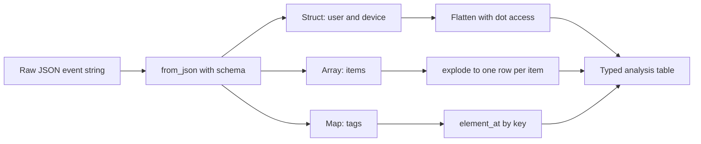
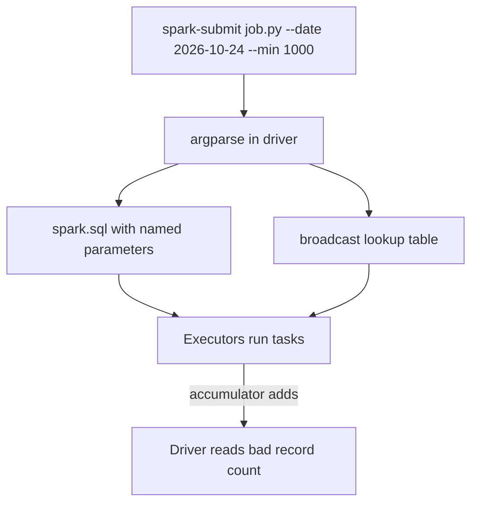

# Session 14 · Special Field Types, Generated Fields and Parameters in Spark

[](https://colab.research.google.com/github/Hamnakhan123/Diploma-in-Data-Science/blob/main/term-2/02-big-data-systems-with-hadoop/code/session-14-spark-field-types-and-parameters.ipynb)

> 📍 [Diploma in Data Science](../../README.md) › [Term 2](../README.md) › [Foundations of Big Data Systems with Hadoop](README.md) › **Session 14**

| ⏱ Estimated time | 🧩 Prerequisites | 💻 Tools |
|---|---|---|
| 3 hours | Sessions 11–13 | PySpark 4 (Spark SQL types, functions, parameterised SQL) |

[⬅ Previous: Session 13 · Data Analysis with Spark: Clustering and Forecasting](session-13-spark-clustering-and-forecasting.md) · [🏠 Module home](README.md) · [Next: Session 15 · Final Project and Next Steps ➡](session-15-final-project-and-next-steps.md)

---

## 🎯 Learning objectives

- Work with Spark's **special field types**: dates and timestamps, decimals, arrays, maps, structs and nested JSON.
- Create **generated fields**: derived columns, conditional fields, IDs, window-based fields, UDFs and generated columns in tables.
- Use **parameters** safely: named and positional parameters in Spark SQL, `IDENTIFIER()`, SQL variables, job arguments and configuration.
- Explain **broadcast variables** and **accumulators** as shared parameters across executors.
- Choose the right type and technique to avoid silent data errors.

## 📖 Concepts

### 1. Spark's type system

| Group | Types | Notes |
|---|---|---|
| Numeric | `ByteType`, `ShortType`, `IntegerType`, `LongType`, `FloatType`, `DoubleType`, **`DecimalType(p, s)`** | Use **Decimal** for money: doubles cannot store 0.1 exactly |
| String and binary | `StringType`, `BinaryType`, `VarcharType(n)` | |
| Boolean | `BooleanType` | |
| Date and time | **`DateType`**, **`TimestampType`** (with session time zone), `TimestampNTZType` (no zone), `DayTimeIntervalType` | Set `spark.sql.session.timeZone` explicitly, for example `Asia/Karachi` |
| Complex | **`ArrayType`**, **`MapType`**, **`StructType`** | Nested data from JSON, Avro and Parquet |
| Semi-structured | **`VariantType`** (Spark 4) | Stores arbitrary JSON efficiently; query with `variant_get` |

Always declare a **schema** for production reads (`spark.read.schema(...)`) instead of `inferSchema`: inference is slow, can guess wrong (a phone number becomes a number and loses its leading 0) and changes when the data changes.

### 2. Working with special types

- **Dates**: `to_date`, `to_timestamp(col, "dd/MM/yyyy HH:mm")`, `date_format`, `datediff`, `months_between`, `date_trunc`, `from_utc_timestamp`.
- **Arrays**: `size`, `array_contains`, `explode`, `posexplode`, `transform`, `filter`, `aggregate`, `array_distinct`, `sort_array`.
- **Maps**: `map_keys`, `map_values`, `element_at(map, key)`, `explode` (gives key and value).
- **Structs**: dot access `address.city`, `col("address.*")`, `struct()` to build one.
- **JSON strings**: `from_json(col, schema)`, `to_json`, `get_json_object(col, "$.path")`, `schema_of_json`.

### 3. Generated fields

| Kind | How |
|---|---|
| Derived column | `withColumn("tax", col("amount") * 0.17)` or `selectExpr` |
| Conditional | `when(...).when(...).otherwise(...)` or SQL `CASE WHEN` |
| Surrogate ID | `monotonically_increasing_id()` (unique, not consecutive), `row_number()` over a window (consecutive), `uuid()` |
| Window-based | rank, running totals, lag, share of total |
| Hash / key | `sha2(concat_ws("|", cols...), 256)` for de-identification or change detection |
| Metadata | `input_file_name()`, `current_timestamp()` as load time |
| UDF | Python function with `@udf` or vectorised `@pandas_udf`; use only when no built-in exists, as UDFs block optimisation |
| Table generated column | Delta Lake: `GENERATED ALWAYS AS (CAST(ts AS DATE))` |

### 4. Parameters

Hard-coding values (dates, thresholds, table names) into code makes jobs inflexible and, if values are pasted into SQL strings, **unsafe** (SQL injection). Spark offers:

| Technique | Example |
|---|---|
| **Named parameter markers** (Spark 3.4+) | `spark.sql("SELECT * FROM t WHERE city = :city", args={"city": "Karachi"})` |
| **Positional markers** (Spark 3.5+) | `spark.sql("... WHERE amount > ?", args=[1000])` |
| **IDENTIFIER()** for table or column names | `spark.sql("SELECT * FROM IDENTIFIER(:tbl)", args={"tbl": "sales"})` |
| **SQL session variables** (Spark 4) | `DECLARE VARIABLE min_amt INT DEFAULT 1000; SET VAR min_amt = 2000;` |
| **Job arguments** | `spark-submit job.py --date 2026-10-24` read with `argparse` |
| **Configuration** | `--conf spark.myapp.region=south`, read with `spark.conf.get` |
| **Broadcast variable** | A read-only lookup (tax rates, mappings) shipped once to every executor |
| **Accumulator** | A counter executors add to and the driver reads (bad records seen) |

## 🧭 Diagrams





## 💻 Worked examples

### Example 1 · Dates, timestamps, time zones and decimals

📄 [`code/session-14_special_types.py`](code/session-14_special_types.py)

```python
from decimal import Decimal
from pyspark.sql import SparkSession, functions as F
from pyspark.sql.types import StructType, StructField, StringType, DecimalType
spark = (SparkSession.builder.master("local[2]").appName("types")
         .config("spark.sql.session.timeZone", "Asia/Karachi")
         .config("spark.ui.showConsoleProgress", "false").getOrCreate())
spark.sparkContext.setLogLevel("ERROR")
spark.conf.set("spark.sql.session.timeZone", "Asia/Karachi")

schema = StructType([StructField("order_id", StringType()), StructField("placed", StringType()),
                     StructField("price", DecimalType(10, 2)), StructField("phone", StringType())])
df = spark.createDataFrame([("A1", "24/10/2026 21:15", Decimal("0.10"), "03001234567"),
                            ("A2", "01/11/2026 09:05", Decimal("0.20"), "03217654321")], schema)
typed = (df.withColumn("placed_ts", F.to_timestamp("placed", "dd/MM/yyyy HH:mm"))
           .withColumn("placed_date", F.to_date("placed_ts"))
           .withColumn("weekday", F.date_format("placed_ts", "EEEE"))
           .withColumn("utc", F.to_utc_timestamp("placed_ts", "Asia/Karachi"))
           .withColumn("days_to_eom", F.datediff(F.last_day("placed_date"), F.col("placed_date"))))
typed.select("order_id", "placed_ts", "utc", "weekday", "days_to_eom", "phone").show(truncate=False)
typed.printSchema()

print("decimal sum :", df.agg(F.sum("price")).first()[0])
print("double sum  :", 0.1 + 0.2)
```

**Output**

```text
+--------+-------------------+-------------------+--------+-----------+-----------+
|order_id|placed_ts          |utc                |weekday |days_to_eom|phone      |
+--------+-------------------+-------------------+--------+-----------+-----------+
|A1      |2026-10-24 21:15:00|2026-10-24 16:15:00|Saturday|7          |03001234567|
|A2      |2026-11-01 09:05:00|2026-11-01 04:05:00|Sunday  |29         |03217654321|
+--------+-------------------+-------------------+--------+-----------+-----------+

root
 |-- order_id: string (nullable = true)
 |-- placed: string (nullable = true)
 |-- price: decimal(10,2) (nullable = true)
 |-- phone: string (nullable = true)
 |-- placed_ts: timestamp (nullable = true)
 |-- placed_date: date (nullable = true)
 |-- weekday: string (nullable = true)
 |-- utc: timestamp (nullable = true)
 |-- days_to_eom: integer (nullable = true)

decimal sum : 0.30
double sum  : 0.30000000000000004
```

The phone numbers keep their leading 0 because the schema says `StringType`; schema inference would have turned them into numbers. Decimals add 0.10 + 0.20 to exactly 0.30, while doubles give 0.30000000000000004.

### Example 2 · Nested JSON: structs, arrays and maps

📄 [`code/session-14_nested_json.py`](code/session-14_nested_json.py)

```python
from pyspark.sql import SparkSession, functions as F
spark = (SparkSession.builder.master("local[2]").appName("json")
         .config("spark.ui.showConsoleProgress", "false").getOrCreate())
spark.sparkContext.setLogLevel("ERROR")

events = spark.createDataFrame([
  ('{"user":{"id":7,"city":"Karachi"},"items":[{"sku":"BK-1","qty":2,"price":450.0},{"sku":"PN-9","qty":1,"price":120.0}],"tags":{"channel":"app","promo":"SALE1111"}}',),
  ('{"user":{"id":9,"city":"Lahore"},"items":[{"sku":"BK-1","qty":1,"price":450.0}],"tags":{"channel":"web"}}',)], ["raw"])

schema = ("user STRUCT<id: INT, city: STRING>, "
          "items ARRAY<STRUCT<sku: STRING, qty: INT, price: DOUBLE>>, tags MAP<STRING, STRING>")
parsed = events.select(F.from_json("raw", schema).alias("e")).select("e.*")
parsed.printSchema()

parsed.select(F.col("user.id").alias("user_id"), "user.city",
              F.size("items").alias("n_items"),
              F.aggregate("items", F.lit(0.0), lambda acc, x: acc + x.qty * x.price).alias("basket_value"),
              F.element_at("tags", "channel").alias("channel"),
              F.coalesce(F.element_at("tags", "promo"), F.lit("none")).alias("promo")).show()

parsed.select(F.col("user.id").alias("user_id"), F.explode("items").alias("item")) \
      .select("user_id", "item.sku", "item.qty", "item.price").show()
```

**Output**

```text
root
 |-- user: struct (nullable = true)
 |    |-- id: integer (nullable = true)
 |    |-- city: string (nullable = true)
 |-- items: array (nullable = true)
 |    |-- element: struct (containsNull = true)
 |    |    |-- sku: string (nullable = true)
 |    |    |-- qty: integer (nullable = true)
 |    |    |-- price: double (nullable = true)
 |-- tags: map (nullable = true)
 |    |-- key: string
 |    |-- value: string (valueContainsNull = true)

+-------+-------+-------+------------+-------+--------+
|user_id|   city|n_items|basket_value|channel|   promo|
+-------+-------+-------+------------+-------+--------+
|      7|Karachi|      2|      1020.0|    app|SALE1111|
|      9| Lahore|      1|       450.0|    web|    none|
+-------+-------+-------+------------+-------+--------+

+-------+----+---+-----+
|user_id| sku|qty|price|
+-------+----+---+-----+
|      7|BK-1|  2|450.0|
|      7|PN-9|  1|120.0|
|      9|BK-1|  1|450.0|
+-------+----+---+-----+
```

`aggregate` computes the basket value inside each row's array without exploding; `explode` turns the array into one row per item for SKU-level analysis.

### Example 3 · Generated fields

📄 [`code/session-14_generated_fields.py`](code/session-14_generated_fields.py)

```python
from pyspark.sql import SparkSession, functions as F, Window
from pyspark.sql.functions import pandas_udf
import pandas as pd
spark = (SparkSession.builder.master("local[2]").appName("generated")
         .config("spark.sql.shuffle.partitions", "2")
         .config("spark.ui.showConsoleProgress", "false").getOrCreate())
spark.sparkContext.setLogLevel("ERROR")

sales = spark.createDataFrame([("Karachi", "Ayesha", 5200.0), ("Lahore", "Bilal", 900.0),
                               ("Karachi", "Omar", 15500.0), ("Lahore", "Sana", 7300.0),
                               ("Karachi", "Hina", 2100.0)], "city string, customer string, amount double")

@pandas_udf("string")
def initials(names: pd.Series) -> pd.Series:          # vectorised UDF: runs on whole batches
    return names.str[0] + "."

w_city = Window.partitionBy("city")
gen = (sales
   .withColumn("row_id", F.row_number().over(Window.orderBy("customer")))
   .withColumn("tier", F.when(F.col("amount") >= 10000, "Gold").when(F.col("amount") >= 5000, "Silver").otherwise("Bronze"))
   .withColumn("gst", F.round(F.col("amount") * 0.18, 2))
   .withColumn("share_of_city_%", F.round(F.col("amount") / F.sum("amount").over(w_city) * 100, 1))
   .withColumn("rank_in_city", F.rank().over(w_city.orderBy(F.desc("amount"))))
   .withColumn("cust_key", F.substring(F.sha2(F.col("customer"), 256), 1, 10))
   .withColumn("anon", initials("customer")))
gen.orderBy("row_id").show()
```

**Output**

```text
+-------+--------+-------+------+------+------+---------------+------------+----------+----+
|   city|customer| amount|row_id|  tier|   gst|share_of_city_%|rank_in_city|  cust_key|anon|
+-------+--------+-------+------+------+------+---------------+------------+----------+----+
|Karachi|  Ayesha| 5200.0|     1|Silver| 936.0|           22.8|           2|8d3cf93037|  A.|
| Lahore|   Bilal|  900.0|     2|Bronze| 162.0|           11.0|           2|dd5f1c0842|  B.|
|Karachi|    Hina| 2100.0|     3|Bronze| 378.0|            9.2|           3|14305a77ce|  H.|
|Karachi|    Omar|15500.0|     4|  Gold|2790.0|           68.0|           1|2dd1283eb2|  O.|
| Lahore|    Sana| 7300.0|     5|Silver|1314.0|           89.0|           1|1b1902423d|  S.|
+-------+--------+-------+------+------+------+---------------+------------+----------+----+
```

### Example 4 · Parameterised SQL, broadcast variables and accumulators

📄 [`code/session-14_parameters.py`](code/session-14_parameters.py)

```python
import argparse
from pyspark.sql import SparkSession, functions as F
spark = (SparkSession.builder.master("local[2]").appName("params")
         .config("spark.ui.showConsoleProgress", "false").getOrCreate())
spark.sparkContext.setLogLevel("ERROR")
sc = spark.sparkContext

# 1) job arguments (in production: spark-submit job.py --city Karachi --min-amount 3000)
parser = argparse.ArgumentParser()
parser.add_argument("--city", default="Karachi")
parser.add_argument("--min-amount", type=float, default=3000)
args = parser.parse_args([])                                   # [] so it also runs in a notebook

spark.createDataFrame([(1, "Karachi", 5200.0), (2, "Lahore", 900.0), (3, "Karachi", 15500.0),
                       (4, "Lahore", 7300.0), (5, "Karachi", 2100.0)],
                      "id int, city string, amount double").createOrReplaceTempView("sales")

# 2) named parameter markers: values are bound, never pasted into the SQL text
q = "SELECT id, city, amount FROM sales WHERE city = :city AND amount >= :min_amt ORDER BY id"
spark.sql(q, args={"city": args.city, "min_amt": args.min_amount}).show()

# 3) IDENTIFIER() for a table name chosen at run time
print("rows:", spark.sql("SELECT COUNT(*) AS n FROM IDENTIFIER(:tbl)", args={"tbl": "sales"}).first()["n"])

# 4) a malicious value is treated as data, not SQL
evil = "Karachi' OR '1'='1"
print("injection attempt rows:", spark.sql("SELECT * FROM sales WHERE city = :city", args={"city": evil}).count())

# 5) broadcast variable + accumulator on an RDD
tax = sc.broadcast({"Karachi": 0.13, "Lahore": 0.16})          # shipped once per executor
bad = sc.accumulator(0)
def add_tax(r):
    rate = tax.value.get(r[1])
    if rate is None:
        bad.add(1); return None
    return (r[0], r[1], round(r[2] * (1 + rate), 1))
rows = sc.parallelize([(1, "Karachi", 1000.0), (2, "Lahore", 1000.0), (3, "Quetta", 1000.0)])
print("with tax:", rows.map(add_tax).filter(lambda x: x).collect(), "| unknown cities:", bad.value)
```

**Output**

```text
+---+-------+-------+
| id|   city| amount|
+---+-------+-------+
|  1|Karachi| 5200.0|
|  3|Karachi|15500.0|
+---+-------+-------+

rows: 5
injection attempt rows: 0
with tax: [(1, 'Karachi', 1130.0), (2, 'Lahore', 1160.0)] | unknown cities: 1
```

Binding with `args=` means a value such as `Karachi' OR '1'='1` is compared as a plain string and matches nothing. Building SQL with f-strings would have returned every row.

## 🧪 Lab / practice tasks

### 🟢 Task 1 · Easy

Explain why money columns should use `DecimalType(12, 2)` and not `DoubleType`, using Example 1's output as evidence.

<details><summary>💡 Hint</summary>

Binary floating point cannot represent 0.1 exactly.

</details>

### 🟡 Task 2 · Medium

In Example 2 add a column `has_promo` (true/false) and the most expensive SKU in each basket without exploding.

<details><summary>💡 Hint</summary>

`F.map_contains_key` or `isNotNull` on the element; use `F.array_max` on transformed prices, or `F.sort_array` of structs.

</details>

### 🟡 Task 3 · Medium

In Example 3 add a `running_total` per city ordered by amount, and a `load_time` column with `current_timestamp()`.

<details><summary>💡 Hint</summary>

`F.sum("amount").over(w_city.orderBy("amount").rowsBetween(Window.unboundedPreceding, 0))`.

</details>

### 🟠 Task 4 · Hard

Turn Example 4 into a real script that takes `--city` and `--min-amount` from the command line and run it with `spark-submit` twice with different values.

<details><summary>💡 Hint</summary>

Replace `parse_args([])` with `parse_args()`.

</details>

### 🔴 Task 5 · Challenge

Parse a JSON column whose structure differs between rows (some have `tags`, some have `coupon` as a number or string) using `schema_of_json` and, on Spark 4, `parse_json` with `variant_get`. Compare the two approaches.

<details><summary>💡 Hint</summary>

Variant keeps the original structure; a fixed schema turns mismatches into nulls.

</details>


## ✅ Quick quiz

**Q1.** Which type should store money amounts?

- **A)** DoubleType
- **B)** FloatType
- **C)** DecimalType
- **D)** StringType

<details><summary>Show answer</summary>

**C** — Decimal is exact for base-10 values.

</details>

**Q2.** `F.explode` on an array column…

- **A)** sums the array
- **B)** creates one output row per element
- **C)** removes duplicates
- **D)** converts it to a map

<details><summary>Show answer</summary>

**B** — Explode un-nests arrays (and maps).

</details>

**Q3.** `monotonically_increasing_id()` guarantees IDs that are…

- **A)** consecutive
- **B)** unique but not consecutive
- **C)** random
- **D)** the same across runs

<details><summary>Show answer</summary>

**B** — IDs encode the partition, so there are gaps.

</details>

**Q4.** Why use named parameter markers (`:city`) instead of f-strings in SQL?

- **A)** They are shorter
- **B)** Values are bound safely, preventing SQL injection
- **C)** They run on the GPU
- **D)** They cache results

<details><summary>Show answer</summary>

**B** — Bound values are never parsed as SQL.

</details>

**Q5.** A broadcast variable is…

- **A)** a counter that executors add to
- **B)** a read-only value shipped once to each executor
- **C)** a streaming source
- **D)** a Hive partition

<details><summary>Show answer</summary>

**B** — Accumulators are the counters.

</details>


## 📝 Summary

- Choose types deliberately: **Decimal** for money, **String** for codes and phone numbers, **Date/Timestamp** with an explicit session time zone, complex types for nested data.
- Parse JSON with **from_json** and a schema; navigate **structs** with dots, **arrays** with explode/transform/aggregate, **maps** with element_at.
- **Generated fields**: derived, conditional, IDs, window-based, hashes, metadata, and UDFs only when needed (prefer `pandas_udf`).
- **Parameters**: named/positional markers, `IDENTIFIER()`, SQL variables, argparse and config; **broadcast** variables share lookups, **accumulators** count events.

### 🎤 Interview / viva questions

1. Why can `inferSchema` be dangerous in production pipelines?
2. What is the difference between `TimestampType` and `TimestampNTZType`?
3. Why are Python UDFs slower than built-in functions, and how do pandas UDFs help?
4. How would you generate a stable surrogate key that is the same every time the job runs?
5. When could an accumulator give a wrong count?

---

[⬅ Previous: Session 13 · Data Analysis with Spark: Clustering and Forecasting](session-13-spark-clustering-and-forecasting.md) · [🏠 Module home](README.md) · [Next: Session 15 · Final Project and Next Steps ➡](session-15-final-project-and-next-steps.md)

<sub>Diploma in Data Science · Prepared by **Hamna Zahid Khan**, Junior Lecturer</sub>
