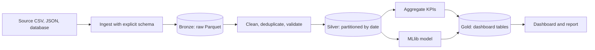
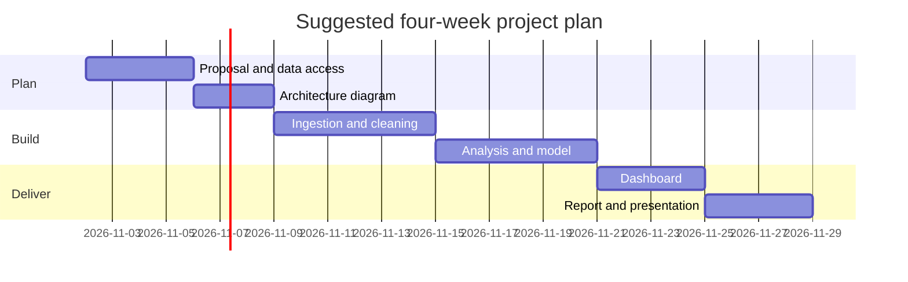

# Session 15 · Final Project and Next Steps

[](https://colab.research.google.com/github/Hamnakhan123/Diploma-in-Data-Science/blob/main/term-2/02-big-data-systems-with-hadoop/code/session-15-final-project-and-next-steps.ipynb)

> 📍 [Diploma in Data Science](../../README.md) › [Term 2](../README.md) › [Foundations of Big Data Systems with Hadoop](README.md) › **Session 15**

| ⏱ Estimated time | 🧩 Prerequisites | 💻 Tools |
|---|---|---|
| 3 hours (plus project work) | Sessions 1–14 | PySpark 4, Python 3, Git and GitHub |

[⬅ Previous: Session 14 · Special Field Types, Generated Fields and Parameters in Spark](session-14-spark-field-types-and-parameters.md) · [🏠 Module home](README.md) · [Next: Practice test ➡](practice-test.md)

---

## 🎯 Learning objectives

- Plan a **Big Data final project**: problem, data, architecture, deliverables and timeline.
- Apply the **marking rubric** to your own plan before you start.
- Build a complete, reproducible **reference pipeline**: ingest → clean → store partitioned → analyse → model → publish.
- Recap the module and connect each tool to the problem it solves.
- Map the **next steps**: cloud platforms, lakehouse formats, streaming and certifications.

## 📖 Concepts

### 1. Project guidelines

Work alone or in pairs. Choose a problem where data size, speed or variety genuinely needs distributed tools.

| Deliverable | Contents |
|---|---|
| **1. Proposal (1 page)** | Problem and stakeholder, data source and size, questions to answer, success measure |
| **2. Architecture diagram** | Ingestion, storage (formats and partitioning), processing, serving, scheduling |
| **3. Code repository** | Spark jobs or notebooks, README with run instructions, `requirements.txt`, sample data |
| **4. Analysis and model** | Cleaning log, EDA statistics, at least one MLlib model with evaluation vs a baseline |
| **5. Dashboard or report** | KPIs and charts built from aggregate tables |
| **6. Presentation (10 min)** | Problem → approach → results → limitations → next steps, plus a live demo |

**Project ideas** (all with public data):

- **Ride-hailing demand**: NYC Taxi trip records (hundreds of millions of rows); forecast hourly demand per zone.
- **E-commerce behaviour**: a public multi-category store clickstream (tens of millions of events); funnel analysis and customer segments.
- **Air quality**: OpenAQ sensor readings for South Asian cities; trends, pollution episodes, forecasting.
- **Logs**: NASA HTTP web server logs; error analysis, traffic peaks, top resources.
- **Open government data**: Pakistan Bureau of Statistics or World Bank indicators joined with your own scraped data.

### 2. Marking rubric (100 marks)

| Criterion | Marks | Excellent looks like |
|---|---|---|
| Problem and data understanding | 15 | Clear stakeholder question; data volume, quality issues and limitations stated |
| Architecture and design | 15 | Justified choice of storage formats, partitioning, tools; diagram matches code |
| Data engineering | 20 | Explicit schemas, cleaning rules, partitioned Parquet, idempotent re-runs |
| Analysis and modelling | 20 | Correct statistics, time-aware validation, model beats a baseline, results explained |
| Dashboard and communication | 15 | Answers the question in under a minute; honest about uncertainty |
| Code quality and reproducibility | 15 | Runs from a clean clone with one command; parameters not hard-coded; Git history |

### 3. Common pitfalls

- Using `collect()` or `toPandas()` on the full data set (crashes the driver).
- Random train/test splits on time series.
- Partitioning by a high-cardinality column (millions of tiny files).
- Hard-coded paths and dates; no way to rerun a single day.
- A dashboard that queries raw data.
- No baseline, so nobody knows if the model is good.

### 4. Module recap

| Session | Key idea | Tool |
|---|---|---|
| 1–2 | Scale out; configure and size a cluster | Hadoop core, XML configs |
| 3 | Replicated blocks, NameNode metadata, rack awareness | HDFS |
| 4 | Resource management with containers and schedulers | YARN |
| 5 | Map → shuffle → reduce for search, sort, index, TF-IDF | MapReduce |
| 6 | Bulk RDBMS transfer; reduce-side vs map-side joins | Sqoop |
| 7 | HA, federation, erasure coding, the ecosystem | ZooKeeper, HBase, Kafka, Oozie |
| 8 | SQL on HDFS; partitions and buckets | Hive, Impala |
| 9–10 | Data-flow scripting; bags and tuples | Pig |
| 11 | In-memory DAG engine; lazy evaluation | Spark |
| 12 | Statistics and aggregates for dashboards | Spark SQL |
| 13 | Clustering and forecasting at scale | MLlib |
| 14 | Types, generated fields, parameters | Spark SQL |

### 5. Next steps

| Direction | What to learn |
|---|---|
| **Cloud data platforms** | AWS EMR + S3, Google Dataproc + BigQuery, Azure HDInsight / Synapse, **Databricks** |
| **Lakehouse table formats** | **Delta Lake**, **Apache Iceberg**, Apache Hudi: ACID tables, time travel, schema evolution on object storage |
| **Streaming** | Apache Kafka, Spark Structured Streaming, Apache Flink |
| **Orchestration** | Apache Airflow, Dagster (the modern replacements for Oozie) |
| **Query engines** | Trino / Presto, DuckDB for single-machine analytics |
| **Certifications** | Databricks Certified Data Engineer Associate, Google Professional Data Engineer, AWS Data Engineer Associate |
| **In this diploma** | Module 6 · Introduction to Data Lakes builds directly on this module |

## 🧭 Diagrams





## 💻 Worked examples

### Example 1 · Reference pipeline: bronze → silver → gold

A complete, parameterised mini-project on synthetic ride-hailing data for Karachi. Replace the generator with `spark.read` of a real data set and the rest works unchanged.

📄 [`code/session-15_pipeline.py`](code/session-15_pipeline.py)

```python
import os, tempfile
from pyspark.sql import SparkSession, functions as F
spark = (SparkSession.builder.master("local[2]").appName("final-project")
         .config("spark.sql.shuffle.partitions", "4")
         .config("spark.sql.session.timeZone", "Asia/Karachi")
         .config("spark.ui.showConsoleProgress", "false").getOrCreate())
spark.sparkContext.setLogLevel("ERROR")
spark.conf.set("spark.sql.session.timeZone", "Asia/Karachi")
PARAMS = {"base": tempfile.mkdtemp(), "start": "2026-09-01", "days": 30, "fare_per_km": 55.0}

# ---------- BRONZE: ingest raw data as-is ----------
zones = F.array(*[F.lit(z) for z in ["Clifton", "Saddar", "Gulshan", "DHA", "Korangi", "North Nazimabad"]])
raw = (spark.range(120000)
    .withColumn("pickup_ts", (F.unix_timestamp(F.lit(PARAMS["start"]).cast("timestamp"))
                              + (F.rand(seed=1) * PARAMS["days"] * 86400)).cast("timestamp"))
    .withColumn("zone", F.element_at(zones, (F.abs(F.hash("id")) % 6 + 1).cast("int")))
    .withColumn("km", F.round(F.exp(F.randn(seed=2) * 0.5 + 1.8), 1))
    .withColumn("fare", F.round(F.col("km") * PARAMS["fare_per_km"] + 120 + F.randn(seed=3) * 30, 0))
    .withColumn("km", F.when(F.rand(seed=4) < 0.005, -1.0).otherwise(F.col("km"))))     # bad records
raw = raw.unionByName(raw.limit(300))                                                     # duplicates
bronze = os.path.join(PARAMS["base"], "bronze", "trips")
raw.write.mode("overwrite").parquet(bronze)

# ---------- SILVER: clean, validate, partition ----------
b = spark.read.parquet(bronze)
silver_df = (b.dropDuplicates(["id"]).filter((F.col("km") > 0) & (F.col("fare") > 0))
              .withColumn("trip_date", F.to_date("pickup_ts"))
              .withColumn("hour", F.hour("pickup_ts")))
silver = os.path.join(PARAMS["base"], "silver", "trips")
silver_df.write.mode("overwrite").partitionBy("trip_date").parquet(silver)
n_b, n_s = b.count(), spark.read.parquet(silver).count()
print(f"bronze rows {n_b:,} -> silver rows {n_s:,} (removed {n_b - n_s:,} duplicates and invalid trips)")
print("silver date partitions:", len([d for d in os.listdir(silver) if d.startswith("trip_date=")]))

# ---------- GOLD: KPI tables for the dashboard ----------
s = spark.read.parquet(silver)
gold_zone = (s.groupBy("zone").agg(F.count("*").alias("trips"), F.round(F.avg("km"), 2).alias("avg_km"),
                                   F.round(F.sum("fare") / 1e6, 2).alias("revenue_m"))
              .orderBy(F.desc("trips")))
gold_zone.write.mode("overwrite").parquet(os.path.join(PARAMS["base"], "gold", "zone_kpis"))
gold_zone.show()
s.groupBy("hour").count().orderBy(F.desc("count")).limit(3).show()
```

**Output**

```text
bronze rows 120,300 -> silver rows 119,366 (removed 934 duplicates and invalid trips)
silver date partitions: 30
+---------------+-----+------+---------+
|           zone|trips|avg_km|revenue_m|
+---------------+-----+------+---------+
|North Nazimabad|20100|  6.86|     10.0|
|         Saddar|19948|  6.82|     9.89|
|        Gulshan|19911|  6.85|     9.89|
|            DHA|19861|   6.8|     9.81|
|        Korangi|19837|  6.85|     9.85|
|        Clifton|19709|  6.87|     9.81|
+---------------+-----+------+---------+

+----+-----+
|hour|count|
+----+-----+
|  23| 5182|
|   8| 5109|
|   4| 5058|
+----+-----+
```

### Example 2 · Model and data-quality checks on the silver table

📄 [`code/session-15_project_model.py`](code/session-15_project_model.py)

```python
import os, tempfile
from pyspark.sql import SparkSession, functions as F
from pyspark.ml import Pipeline
from pyspark.ml.feature import VectorAssembler, OneHotEncoder, StringIndexer
from pyspark.ml.regression import LinearRegression
from pyspark.ml.evaluation import RegressionEvaluator
spark = (SparkSession.builder.master("local[2]").appName("final-model")
         .config("spark.sql.shuffle.partitions", "4")
         .config("spark.ui.showConsoleProgress", "false").getOrCreate())
spark.sparkContext.setLogLevel("ERROR")

zones = F.array(*[F.lit(z) for z in ["Clifton", "Saddar", "Gulshan", "DHA", "Korangi", "North Nazimabad"]])
trips = (spark.range(60000)
    .withColumn("zone", F.element_at(zones, (F.abs(F.hash("id")) % 6 + 1).cast("int")))
    .withColumn("hour", (F.abs(F.hash(F.col("id") * 3)) % 24).cast("int"))
    .withColumn("km", F.round(F.exp(F.randn(seed=2) * 0.5 + 1.8), 1))
    .withColumn("fare", F.round(F.col("km") * 55 + 120 + F.when(F.col("hour").between(17, 20), 80).otherwise(0)
                                + F.randn(seed=3) * 30, 0)))

checks = trips.agg(F.sum(F.col("km").isNull().cast("int")).alias("null_km"),
                   F.sum((F.col("fare") <= 0).cast("int")).alias("non_positive_fares"),
                   F.min("km").alias("min_km"), F.max("km").alias("max_km"))
print("data-quality checks:", checks.first().asDict())

train, test = trips.randomSplit([0.8, 0.2], seed=42)       # not a time series, so a random split is fine
pipe = Pipeline(stages=[
    StringIndexer(inputCol="zone", outputCol="zone_idx"),
    OneHotEncoder(inputCols=["zone_idx"], outputCols=["zone_vec"]),
    VectorAssembler(inputCols=["km", "zone_vec"], outputCol="features"),
    LinearRegression(labelCol="fare")])
peak = F.col("hour").between(17, 20).cast("int")
model_plain = pipe.fit(train)
pipe_peak = Pipeline(stages=pipe.getStages()[:2] + [
    VectorAssembler(inputCols=["km", "zone_vec", "peak"], outputCol="features"), LinearRegression(labelCol="fare")])
model_peak = pipe_peak.fit(train.withColumn("peak", peak))

ev = RegressionEvaluator(labelCol="fare", metricName="rmse")
mean_fare = train.agg(F.avg("fare")).first()[0]
print(f"baseline RMSE (always predict mean fare): {ev.evaluate(test.withColumn('prediction', F.lit(mean_fare))):.1f}")
print(f"model RMSE (km + zone)                  : {ev.evaluate(model_plain.transform(test)):.1f}")
print(f"model RMSE (km + zone + peak hour)      : {ev.evaluate(model_peak.transform(test.withColumn('peak', peak))):.1f}")
lr = model_peak.stages[-1]
print(f"fare ~ {lr.intercept:.0f} + {lr.coefficients[0]:.1f} x km ... + {lr.coefficients[-1]:.0f} at peak hours")
```

**Output**

```text
data-quality checks: {'null_km': 0, 'non_positive_fares': 0, 'min_km': 0.6, 'max_km': 47.5}
baseline RMSE (always predict mean fare): 204.4
model RMSE (km + zone)                  : 42.6
model RMSE (km + zone + peak hour)      : 29.9
fare ~ 119 + 55.1 x km ... + 80 at peak hours
```

The peak-hour feature captures the evening surge and cuts the error further; the coefficient on `km` recovers the fare per kilometre used to generate the data (about Rs 55).

### Example 3 · Project repository layout

```text
karachi-rides/
├── README.md               # problem, data source, how to run, results summary
├── requirements.txt        # pyspark, pandas, streamlit, plotly
├── conf/params.yaml        # paths, dates, thresholds (no hard-coding)
├── data/sample/            # small sample so anyone can run the pipeline
├── jobs/
│   ├── 01_ingest.py        # source -> bronze
│   ├── 02_clean.py         # bronze -> silver (partitioned)
│   ├── 03_aggregate.py     # silver -> gold KPI tables
│   └── 04_model.py         # MLlib training and evaluation
├── dashboard/app.py        # reads gold tables only
├── notebooks/eda.ipynb
└── docs/architecture.png
```

Run on a cluster with `spark-submit --master yarn jobs/02_clean.py --date 2026-10-24`, scheduled nightly by Oozie or Airflow.

## 🧪 Lab / practice tasks

### 🟢 Task 1 · Easy

Write your one-page proposal using the table in Concept 1. Include the data size in rows and GB.

<details><summary>💡 Hint</summary>

If the data is under 1 GB, explain which V still justifies Spark, or pick larger data.

</details>

### 🟡 Task 2 · Medium

Score your proposal against the rubric yourself. Which criterion is weakest, and what will you change?

<details><summary>💡 Hint</summary>

Most first drafts are weak on baseline and reproducibility.

</details>

### 🟡 Task 3 · Medium

In Example 1 add a data-quality report to the silver step: counts of duplicates, negative distances and null fares, written to its own table.

<details><summary>💡 Hint</summary>

Compute counts before and after each filter.

</details>

### 🟠 Task 4 · Hard

Make Example 1 incremental: process one `trip_date` at a time given as a parameter, overwriting only that partition.

<details><summary>💡 Hint</summary>

`spark.conf.set("spark.sql.sources.partitionOverwriteMode", "dynamic")`.

</details>

### 🔴 Task 5 · Challenge

Rebuild Example 1 on Delta Lake (`pip install delta-spark`) and use time travel to compare today's gold table with yesterday's.

<details><summary>💡 Hint</summary>

`spark.read.format("delta").option("versionAsOf", 0).load(path)`.

</details>


## ✅ Quick quiz

**Q1.** Which layer of a medallion architecture feeds dashboards?

- **A)** Bronze
- **B)** Silver
- **C)** Gold
- **D)** Raw

<details><summary>Show answer</summary>

**C** — Gold holds business-level aggregates.

</details>

**Q2.** A good project model is judged mainly against…

- **A)** the number of features
- **B)** a simple baseline
- **C)** training accuracy
- **D)** the cluster size

<details><summary>Show answer</summary>

**B** — Beating a baseline shows real value.

</details>

**Q3.** Which is a common Big Data project mistake?

- **A)** Explicit schemas
- **B)** `toPandas()` on the full data set
- **C)** Partitioning by date
- **D)** Using Parquet

<details><summary>Show answer</summary>

**B** — It pulls all data onto the driver.

</details>

**Q4.** Dynamic partition overwrite lets a job…

- **A)** delete the whole table
- **B)** rewrite only the partitions present in the new data
- **C)** skip validation
- **D)** avoid shuffles

<details><summary>Show answer</summary>

**B** — Useful for daily incremental runs.

</details>

**Q5.** Which is a modern replacement for Oozie?

- **A)** Airflow
- **B)** Sqoop
- **C)** Pig
- **D)** HBase

<details><summary>Show answer</summary>

**A** — Airflow (and Dagster) orchestrate data pipelines today.

</details>


## 📝 Summary

- A strong project has a real question, data that justifies distributed tools, a clear architecture, reproducible code, a model that beats a baseline and an honest dashboard.
- Use the **bronze → silver → gold** pattern with explicit schemas, partitioned Parquet and parameters.
- Avoid the classic pitfalls: `collect()` on big data, random splits for time series, tiny files, hard-coding.
- Next: cloud platforms, Delta/Iceberg lakehouses, streaming with Kafka, orchestration with Airflow, and the Data Lakes module.

### 🎤 Interview / viva questions

1. Walk through your project architecture and justify each component.
2. How did you make your pipeline idempotent?
3. Which data-quality checks did you automate, and what happens when one fails?
4. How would your design change if the data grew 100 times?
5. What would you build next if you had another month?

---

[⬅ Previous: Session 14 · Special Field Types, Generated Fields and Parameters in Spark](session-14-spark-field-types-and-parameters.md) · [🏠 Module home](README.md) · [Next: Practice test ➡](practice-test.md)

<sub>Diploma in Data Science · Prepared by **Hamna Zahid Khan**, Junior Lecturer</sub>
