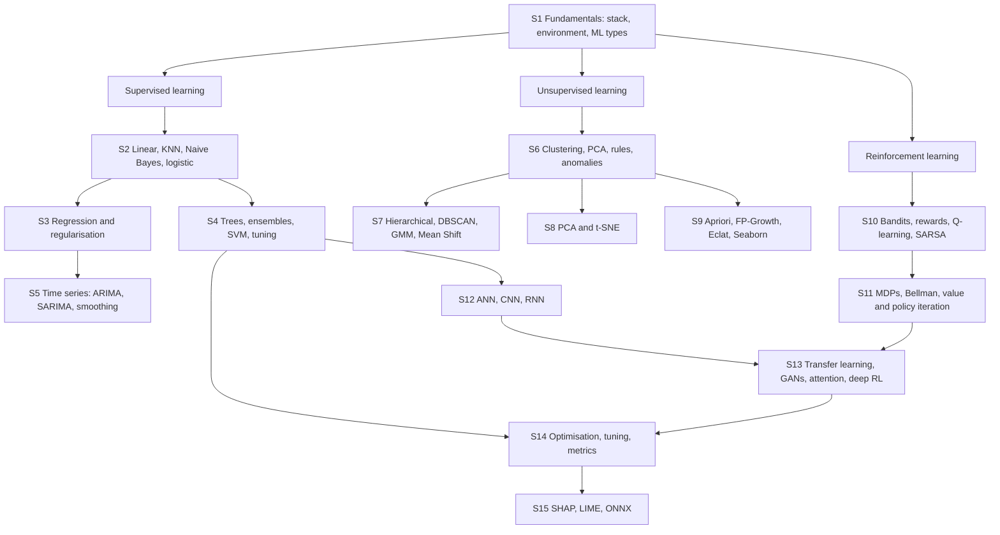

# Module 3 · Advanced Data Science with Python

> 📍 [Diploma in Data Science](../../README.md) › [Term 2](../README.md) › **Advanced Data Science with Python**

⏱ **36 hours** · 15 sessions · Prepared by **Hamna Zahid Khan**, Junior Lecturer

[⬅ Foundations of Big Data Systems with Hadoop](../02-big-data-systems-with-hadoop/README.md) · [▶ Start Session 1](session-01-fundamentals-of-advanced-data-science.md) · [Term 2 overview ➡](../README.md)

---

## 🎯 About this module

This module takes you from solid Python data skills to the **advanced machine-learning toolkit** used in industry. You will build supervised models (regularised regression, tree ensembles, SVMs, time-series forecasters), discover structure without labels (clustering, dimensionality reduction, pattern mining), teach agents by reward (reinforcement learning), train deep networks (ANNs, CNNs, RNNs, transfer learning, GANs, attention) and finish with the skills that make models trustworthy: **rigorous evaluation, tuning, interpretability and portability**.

Every session contains concept explanations with everyday analogies, Mermaid diagrams, five worked examples from basic to advanced, a **real-life data problem** with a full solution, common mistakes, best practices, a graded lab with hints and solutions, a quiz, a summary and viva questions. Every example is a complete Python file in [`code/`](code/) whose real output (and charts) are shown in the notes, plus an executed notebook per session that opens in **Google Colab**.

**By the end you will be able to:**

- set up an efficient data-science environment and use NumPy, pandas, Matplotlib, Seaborn and scikit-learn fluently;
- build, regularise and tune regression and classification models, including ensembles and SVMs with kernels;
- forecast time series with ARIMA, SARIMA and exponential smoothing, evaluated honestly over time;
- cluster data with K-means, hierarchical clustering, DBSCAN, Gaussian mixtures and Mean Shift, and evaluate the results;
- reduce dimensions with PCA and t-SNE, and mine frequent patterns with Apriori, FP-Growth and Eclat;
- formulate problems as MDPs and solve them with value iteration, policy iteration and Q-learning;
- train neural networks in PyTorch, reuse pre-trained models, and explain GANs, attention and deep RL;
- choose metrics and validation schemes that fit the business problem, explain predictions with SHAP and LIME, and export models with ONNX.

## 🗺️ Concept map



## 📚 Sessions

| # | Session |
|---|---|
| 1 | [Fundamentals of Advanced Data Science](session-01-fundamentals-of-advanced-data-science.md) |
| 2 | [Supervised Learning](session-02-supervised-learning.md) |
| 3 | [Advanced Supervised Learning: Regression Techniques](session-03-advanced-regression-techniques.md) |
| 4 | [Advanced Supervised Learning: Classification Techniques](session-04-advanced-classification-techniques.md) |
| 5 | [Advanced Supervised Learning: Time Series Analysis](session-05-time-series-analysis.md) |
| 6 | [Unsupervised Learning](session-06-unsupervised-learning.md) |
| 7 | [Advanced Unsupervised Learning: Clustering Algorithms](session-07-advanced-clustering-algorithms.md) |
| 8 | [Advanced Unsupervised Learning: Dimensionality Reduction](session-08-dimensionality-reduction.md) |
| 9 | [Pattern Mining and Visualization with Seaborn](session-09-pattern-mining-and-seaborn.md) |
| 10 | [Reinforcement Learning Basics](session-10-reinforcement-learning-basics.md) |
| 11 | [Reinforcement Learning Principles](session-11-reinforcement-learning-principles.md) |
| 12 | [Deep Learning Models](session-12-deep-learning-models.md) |
| 13 | [Advanced Deep Learning Techniques](session-13-advanced-deep-learning.md) |
| 14 | [Model Performance Evaluation](session-14-model-performance-evaluation.md) |
| 15 | [Model Interpretability and Interoperability](session-15-model-interpretability.md) |
| 📝 | [Module practice test](practice-test.md) |

## 🛠️ Setup

1. **Python 3.10+**. Check with `python --version`.
2. Install the libraries:
   ```bash
   pip install numpy pandas matplotlib seaborn scikit-learn scipy statsmodels mlxtend shap lime skl2onnx onnxruntime
   pip install torch --index-url https://download.pytorch.org/whl/cpu   # Sessions 12-13 (CPU is enough)
   ```
3. Run any script from inside [`code/`](code/): `python session-02_knn.py`. Charts are saved as PNG files next to the scripts.
4. Or click the **Open in Colab** badge at the top of a session to run its notebook in the browser (Colab already has most libraries; `!pip install mlxtend shap lime skl2onnx onnxruntime` if a cell asks).

All data is generated inside the code with fixed seeds or comes from scikit-learn's built-in data sets, so every number in the notes can be reproduced exactly.

## 📋 Cheat sheet

### Which algorithm when?

| Problem | Start with | Then try |
|---|---|---|
| Predict a number (tabular) | `LinearRegression` / `RidgeCV` | `HistGradientBoostingRegressor`, random forest |
| Predict a class (tabular) | `LogisticRegression` | random forest, gradient boosting, SVM (small data) |
| Text classification | TF-IDF + logistic regression / `MultinomialNB` | GRU/LSTM, fine-tuned BERT |
| Images | small CNN | transfer learning (ResNet) |
| Forecast a series | seasonal naive baseline | Holt-Winters, SARIMA(X), boosting with lag features |
| Customer segments | K-means on scaled RFM | GMM, hierarchical |
| Spatial hotspots / odd shapes | DBSCAN (haversine) | HDBSCAN |
| Visualise high-dimensional data | PCA | t-SNE / UMAP |
| Items bought together | FP-Growth + lift | Apriori, Eclat |
| Unusual records | IQR / Isolation Forest | LOF, One-Class SVM |
| Choose among options with feedback | Thompson sampling bandit | contextual bandit |
| Sequential decisions, known model | value / policy iteration | — |
| Sequential decisions, unknown model | Q-learning | DQN, PPO |

### Key formulas

| Item | Formula |
|---|---|
| Gradient descent | `w ← w − η ∂L/∂w` |
| Sigmoid · Softmax | `1 / (1 + e^−z)` · `e^zᵢ / Σ e^zⱼ` |
| Ridge · Lasso | `MSE + α Σ w²` · `MSE + α Σ |w|` |
| Gini · Entropy | `1 − Σ pᵢ²` · `−Σ pᵢ log₂ pᵢ` |
| Support · Confidence · Lift | `P(A∩B)` · `P(B|A)` · `conf / P(B)` |
| Precision · Recall · F1 | `TP/(TP+FP)` · `TP/(TP+FN)` · `2PR/(P+R)` |
| MAE · RMSE · R² | `mean|e|` · `√mean(e²)` · `1 − SS_res/SS_tot` |
| Discounted return | `G = r₁ + γ r₂ + γ² r₃ + …` |
| Bellman optimality | `Q*(s,a) = Σ P(s'|s,a)[R + γ max Q*(s',a')]` |
| Q-learning update | `Q ← Q + α[r + γ max Q(s',·) − Q]` |
| Attention | `softmax(QKᵀ/√d) V` |
| SHAP additivity | `prediction = base value + Σ φᵢ` |

### scikit-learn patterns

| Task | Code |
|---|---|
| Leak-free pipeline | `make_pipeline(StandardScaler(), LogisticRegression())` |
| Mixed columns | `ColumnTransformer([("num", StandardScaler(), nums), ("cat", OneHotEncoder(handle_unknown="ignore"), cats)])` |
| Cross-validation | `cross_val_score(model, X, y, cv=StratifiedKFold(5, shuffle=True, random_state=0))` |
| Tuning | `RandomizedSearchCV(pipe, params, n_iter=20, cv=5, scoring="roc_auc")` |
| Log target | `TransformedTargetRegressor(reg, func=np.log, inverse_func=np.exp)` |
| Time-series CV | `TimeSeriesSplit(n_splits=5, test_size=30)` |
| Grouped CV | `cross_val_score(m, X, y, cv=GroupKFold(5), groups=ids)` |
| Calibration | `CalibratedClassifierCV(model, method="isotonic", cv=5)` |
| Explain | `permutation_importance(m, X_te, y_te)` · `shap.TreeExplainer(m)(X_te)` |
| Save / export | `joblib.dump(pipe, "m.joblib")` · `skl2onnx.to_onnx(pipe, X[:1])` |

### PyTorch training loop

```python
model.train()
for xb, yb in loader:
    optimizer.zero_grad()            # 1. clear old gradients
    loss = loss_fn(model(xb), yb)    # 2. forward pass + loss (logits into CrossEntropy/BCEWithLogits)
    loss.backward()                  # 3. backpropagation
    optimizer.step()                 # 4. update weights
model.eval()
with torch.no_grad():                # evaluation: no dropout, no gradients
    preds = model(X_val).argmax(1)
```

### Key hyperparameters to tune first

| Model | Hyperparameters |
|---|---|
| Ridge / Lasso / logistic | `alpha` / `C` on a log grid |
| Random forest | `min_samples_leaf`, `max_features`, `n_estimators` |
| Gradient boosting | `learning_rate`, `max_depth`/`max_leaf_nodes`, number of trees (early stopping) |
| SVM (RBF) | `C` and `gamma` together, log grids |
| KNN | `k`, distance, scaling |
| K-means / GMM | `k` (silhouette / BIC) |
| DBSCAN | `eps` (k-distance plot), `min_samples` |
| t-SNE | `perplexity` (5–50), seed |
| Q-learning | `α`, `γ`, exploration schedule |
| Neural nets | learning rate, width/depth, dropout, batch size, epochs (early stopping) |

## 📝 Assessment

Finish with the [module practice test](practice-test.md): 20 multiple-choice questions and 3 scenario questions with model answers (60 minutes, 50 marks).

---

<sub>Diploma in Data Science · Prepared by **Hamna Zahid Khan**, Junior Lecturer</sub>
