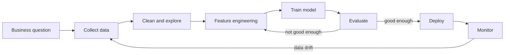
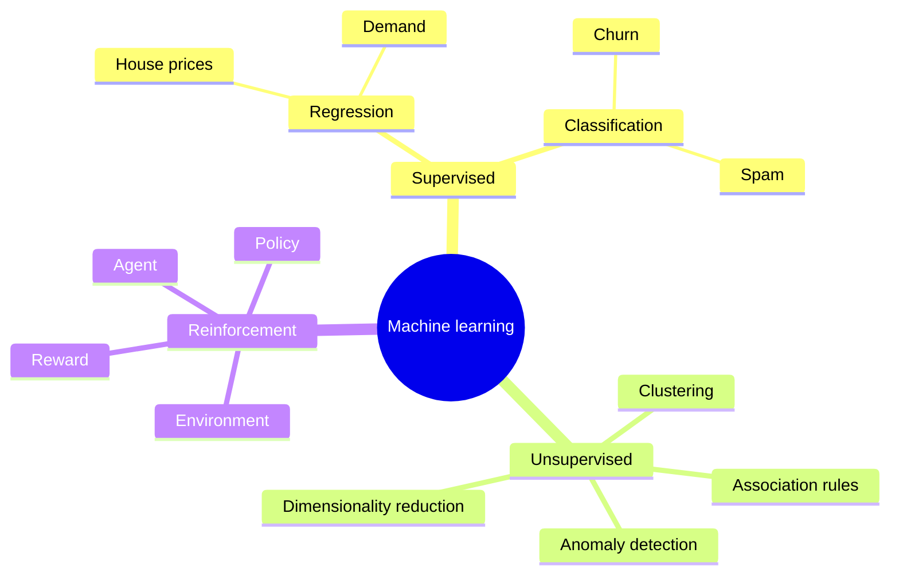
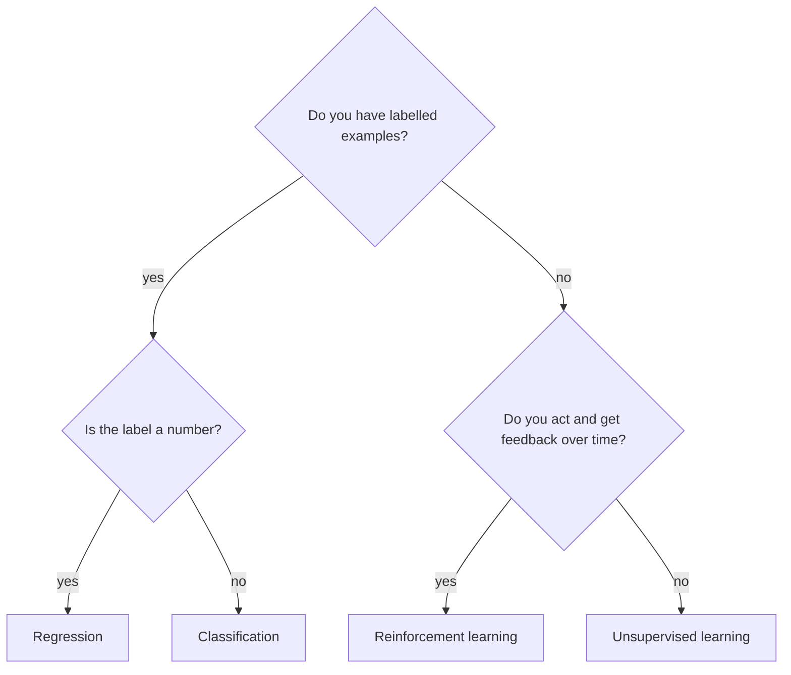
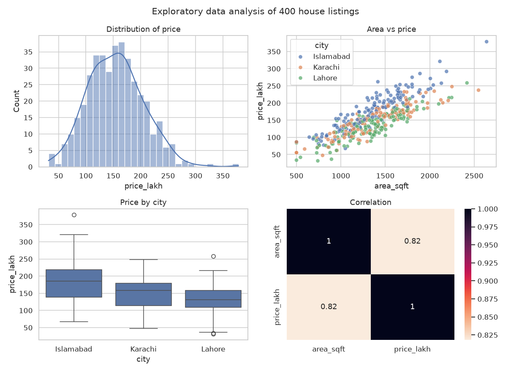
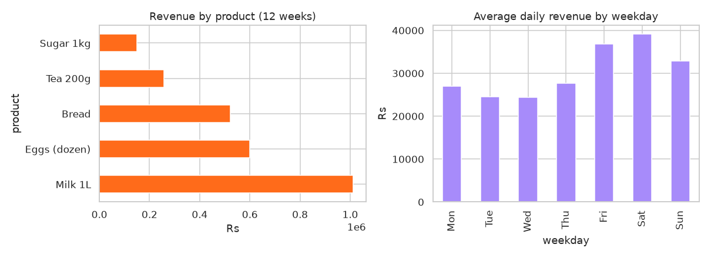
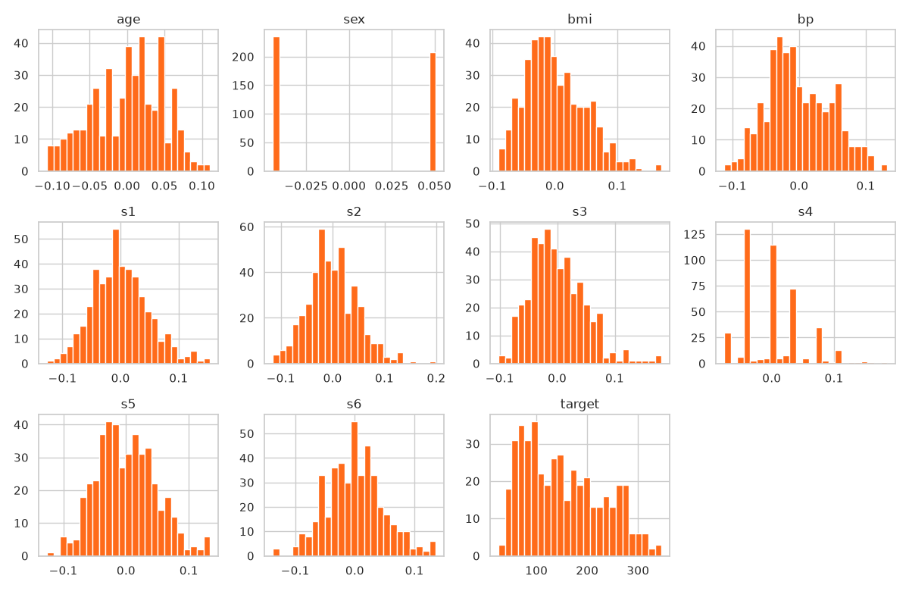

# Session 1 · Fundamentals of Advanced Data Science

[](https://colab.research.google.com/github/Hamnakhan123/Diploma-in-Data-Science/blob/main/term-2/03-advanced-data-science-with-python/code/session-01-fundamentals-of-advanced-data-science.ipynb)

> 📍 [Diploma in Data Science](../../README.md) › [Term 2](../README.md) › [Advanced Data Science with Python](README.md) › **Session 1**

| ⏱ Estimated time | 🧩 Prerequisites | 💻 Tools |
|---|---|---|
| 3 hours | Term 1 Python, basic statistics | Python 3.10+, NumPy, pandas, Matplotlib, Seaborn, scikit-learn, Jupyter or Google Colab |

[⬅ Previous: Module overview](README.md) · [🏠 Module home](README.md) · [Next: Session 2 · Supervised Learning ➡](session-02-supervised-learning.md)

---

## 🎯 Learning objectives

By the end of this session you will be able to:

- Name the main **applications of data science** and match each to a type of problem (prediction, grouping, decision making).
- Use the **advanced features** of NumPy (vectorisation, broadcasting, boolean masks), pandas (`groupby`, `merge`, `pivot_table`, method chaining), Matplotlib/Seaborn (multi-panel figures) and scikit-learn (the estimator API, pipelines).
- Set up and **optimise a working environment**: virtual environments, Jupyter, Google Colab, reproducible seeds.
- Explain the three **types of machine learning**: supervised, unsupervised and reinforcement learning, and pick the right one for a problem.

## 📖 Concepts

### 1. What data science does in the real world

Data science turns raw records into **decisions**. Think of it like a doctor: the data are the symptoms and test results, the analysis is the diagnosis, and the model is the prescription that tells you what to do next.

| Sector | Typical question | Kind of problem |
|---|---|---|
| Banking | Will this loan applicant repay? Is this card payment fraud? | Classification, anomaly detection |
| Retail and e-commerce | How many units of each product will sell next week? Which items are bought together? | Time-series forecasting, association rules |
| Telecom | Which customers are about to leave (churn)? | Classification |
| Healthcare | Does this X-ray show pneumonia? | Deep learning (image classification) |
| Transport and ride-hailing | What fare and arrival time should we show? Which driver gets this trip? | Regression, reinforcement learning |
| Energy | What will electricity demand be tomorrow at 7 pm? | Forecasting |
| Marketing | Which groups of customers behave alike? | Clustering |

Every project, whatever the sector, follows roughly the same **life cycle**: define the question → collect data → clean and explore → build features → train a model → evaluate → deploy → monitor. Most of the effort (often 60–80%) goes into the first four steps, not the model.

### 2. The Python data science stack

Think of the stack as a kitchen. **NumPy** is the knife set (fast low-level cutting of numbers), **pandas** is the chopping board where you organise ingredients into tables, **Matplotlib/Seaborn** is plating and presentation, and **scikit-learn** is the oven: standard recipes that turn prepared ingredients into a finished model.

| Library | What it gives you | Advanced features you will use in this module |
|---|---|---|
| **NumPy** | n-dimensional arrays, fast maths | vectorisation, **broadcasting**, boolean masks, `np.random.default_rng(seed)`, linear algebra (`@`, `np.linalg`) |
| **pandas** | labelled tables (`DataFrame`) | `groupby().agg()`, `merge`, `pivot_table`, `pd.cut`, `.assign()` method chains, time-series indexes, `.pipe()` |
| **Matplotlib** | any chart, full control | figure/axes objects, subplots grids, saving high-DPI PNGs |
| **Seaborn** | statistical charts in one line | `histplot`, `boxplot`, `heatmap`, `pairplot`, `hue=` for groups |
| **scikit-learn** | ML algorithms with one consistent API | `fit / predict / transform`, `Pipeline`, `ColumnTransformer`, `cross_val_score`, `GridSearchCV` |

#### Vectorisation and broadcasting

A Python `for` loop handles one number at a time; NumPy hands the whole array to optimised C code. **Broadcasting** lets arrays of different shapes work together: subtracting a row of column means (shape `(3,)`) from a matrix of shape `(1000, 3)` automatically applies it to every row. This is how you standardise features in one line: `(X - X.mean(axis=0)) / X.std(axis=0)`.

#### The scikit-learn estimator API

Every scikit-learn object follows the same contract, which is why you can swap algorithms with one line:

| Method | Who has it | What it does |
|---|---|---|
| `fit(X, y)` | all estimators | learn from training data |
| `predict(X)` | models | output predictions |
| `predict_proba(X)` | most classifiers | output class probabilities |
| `transform(X)` | scalers, encoders, PCA | change the data |
| `fit_transform(X)` | transformers | fit then transform in one step |
| `score(X, y)` | models | accuracy (classifiers) or R² (regressors) |

`X` is always a 2-D table (rows = samples, columns = features) and `y` is a 1-D target.

### 3. Setting up and optimising your environment

| Option | Best for | Notes |
|---|---|---|
| **Local Python + venv** | full control, offline work | `python -m venv .venv`, activate, then `pip install -r requirements.txt` |
| **Jupyter Notebook / JupyterLab** | exploration, teaching, reports | `pip install jupyterlab`, then `jupyter lab`; one kernel per project venv |
| **Google Colab** | free GPU, zero setup | most libraries pre-installed; files vanish when the runtime resets, so mount Google Drive or download outputs |
| **VS Code** | larger projects | runs notebooks and scripts side by side, Git built in |

**Optimisation checklist**

1. One **virtual environment per project** and a pinned `requirements.txt` (`pip freeze > requirements.txt`).
2. Set **random seeds** (`np.random.default_rng(42)`, `random_state=42`) so results repeat.
3. Use **vectorised** NumPy/pandas instead of Python loops; use `category` dtype for repeated strings and `float32` to halve memory.
4. In Jupyter: restart the kernel and **Run All** before sharing, so hidden state does not fool you. Use `%timeit` to measure speed.
5. In Colab: *Runtime → Change runtime type → GPU* only for deep learning; it does not speed up pandas.

### 4. Types of machine learning

An analogy with learning to cook:

- **Supervised learning** is cooking with a teacher who tastes every dish and tells you the right answer. The data has **labels** (`y`). Two flavours: **regression** (predict a number: house price) and **classification** (predict a category: spam or not).
- **Unsupervised learning** is sorting a pile of spices with no labels: you group them by smell and colour. There is no `y`; the algorithm finds **structure**: clusters, lower-dimensional summaries, frequent patterns, anomalies.
- **Reinforcement learning** is learning to cook by trial and error with customers' tips as feedback. An **agent** takes **actions** in an **environment** and receives **rewards**; it learns a **policy** that maximises total reward over time.

| | Supervised | Unsupervised | Reinforcement |
|---|---|---|---|
| Data | features + labels | features only | interaction: state, action, reward |
| Goal | predict the label | find hidden structure | maximise long-term reward |
| Feedback | correct answer for every example | none | delayed reward signal |
| Examples | price prediction, churn, diagnosis | customer segments, PCA, market baskets | game playing, robot control, dynamic pricing |
| Sessions in this module | 2–5, 12–13 | 6–9 | 10–11 |

## 🧭 Diagrams







## 💻 Worked examples

### Example 1 · Basic: vectorisation vs loops, and broadcasting

We standardise 200,000 rows of three features twice: once with Python loops and once with NumPy broadcasting.

📄 [`code/session-01_vectorisation.py`](code/session-01_vectorisation.py)

```python
"""Compare a Python loop with NumPy vectorisation and show broadcasting."""
import time
import numpy as np

rng = np.random.default_rng(42)                     # reproducible random numbers
X = rng.normal(loc=[50, 1000, 3], scale=[10, 200, 1], size=(200_000, 3))
print("shape of X:", X.shape)

# --- 1. Pure Python loop (slow) ---------------------------------------
t0 = time.perf_counter()
means = [sum(X[:, j]) / len(X) for j in range(3)]
stds = [(sum((x - means[j]) ** 2 for x in X[:, j]) / len(X)) ** 0.5 for j in range(3)]
Z_loop = [[(X[i, j] - means[j]) / stds[j] for j in range(3)] for i in range(len(X))]
t_loop = time.perf_counter() - t0

# --- 2. NumPy broadcasting (fast) -------------------------------------
t0 = time.perf_counter()
Z = (X - X.mean(axis=0)) / X.std(axis=0)            # (200000,3) - (3,) -> broadcast
t_vec = time.perf_counter() - t0

print(f"loop time       : {t_loop:.2f} s")
print(f"vectorised time : {t_vec:.4f} s")
print(f"speed-up        : about {t_loop / t_vec:,.0f}x")
print("same answer?    :", np.allclose(Z, np.array(Z_loop)))
print("means after     :", Z.mean(axis=0).round(6))
print("stds after      :", Z.std(axis=0).round(6))

# Boolean masks: select rows without a loop
mask = (X[:, 0] > 60) & (X[:, 2] < 2)
print("rows with feature0 > 60 and feature2 < 2:", mask.sum())
```

**Output**

```text
shape of X: (200000, 3)
loop time       : 0.35 s
vectorised time : 0.0107 s
speed-up        : about 33x
same answer?    : True
means after     : [ 0.  0. -0.]
stds after      : [1. 1. 1.]
rows with feature0 > 60 and feature2 < 2: 5077
```

The exact timings depend on your computer, but the vectorised version is always tens to hundreds of times faster (the gap grows with data size), and gives the same answer.

### Example 2 · Intermediate: pandas method chaining, groupby, merge and pivot

A small sales table for a chain of shops in three cities.

📄 [`code/session-01_pandas_power.py`](code/session-01_pandas_power.py)

```python
"""Advanced pandas: method chaining, groupby-agg, merge, pivot_table and pd.cut."""
import numpy as np
import pandas as pd

rng = np.random.default_rng(7)
n = 1200
sales = pd.DataFrame({
    "date": pd.date_range("2026-01-01", periods=n, freq="7h"),
    "shop_id": rng.integers(1, 7, n),
    "product": rng.choice(["Tea", "Biscuits", "Rice", "Cooking oil"], n, p=[.35, .3, .2, .15]),
    "qty": rng.integers(1, 6, n),
})
shops = pd.DataFrame({"shop_id": range(1, 7),
                      "city": ["Karachi", "Karachi", "Lahore", "Lahore", "Islamabad", "Karachi"]})
price = {"Tea": 450, "Biscuits": 120, "Rice": 380, "Cooking oil": 650}

report = (sales
          .merge(shops, on="shop_id", how="left")                 # add the city column
          .assign(revenue=lambda d: d["qty"] * d["product"].map(price),
                  month=lambda d: d["date"].dt.month_name().str[:3])
          .groupby(["city", "product"], as_index=False)
          .agg(orders=("qty", "size"), units=("qty", "sum"), revenue=("revenue", "sum"))
          .sort_values(["city", "revenue"], ascending=[True, False]))
print(report.to_string(index=False))

# Pivot: cities as rows, products as columns
pivot = (sales.merge(shops, on="shop_id")
         .assign(revenue=lambda d: d["qty"] * d["product"].map(price))
         .pivot_table(index="city", columns="product", values="revenue", aggfunc="sum", margins=True))
print("\nRevenue pivot (Rs):\n", pivot.round(0).astype(int))

# Binning a numeric column into categories
sales["basket"] = pd.cut(sales["qty"], bins=[0, 2, 4, 5], labels=["small", "medium", "large"])
print("\nBasket sizes:\n", sales["basket"].value_counts().sort_index())
print("\nMemory before/after category dtype:",
      sales["product"].memory_usage(deep=True), "->", sales["product"].astype("category").memory_usage(deep=True), "bytes")
```

**Output**

```text
     city     product  orders  units  revenue
Islamabad         Tea      77    229   103050
Islamabad Cooking oil      41    128    83200
Islamabad        Rice      37    101    38380
Islamabad    Biscuits      58    152    18240
  Karachi         Tea     220    657   295650
  Karachi Cooking oil      99    311   202150
  Karachi        Rice     116    341   129580
  Karachi    Biscuits     161    482    57840
   Lahore         Tea     152    440   198000
   Lahore        Rice      75    248    94240
   Lahore Cooking oil      42    141    91650
   Lahore    Biscuits     122    384    46080

Revenue pivot (Rs):
 product    Biscuits  Cooking oil    Rice     Tea      All
city
Islamabad     18240        83200   38380  103050   242870
Karachi       57840       202150  129580  295650   685220
Lahore        46080        91650   94240  198000   429970
All          122160       377000  262200  596700  1358060

Basket sizes:
 basket
small     485
medium    476
large     239
Name: count, dtype: int64

Memory before/after category dtype: 65921 -> 1554 bytes
```

### Example 3 · Intermediate: a multi-panel Matplotlib + Seaborn figure

📄 [`code/session-01_eda_figure.py`](code/session-01_eda_figure.py)

```python
"""Build a 2x2 exploratory figure with Matplotlib and Seaborn and save it as a PNG."""
import numpy as np
import pandas as pd
import matplotlib.pyplot as plt
import seaborn as sns

rng = np.random.default_rng(1)
n = 400
df = pd.DataFrame({
    "area_sqft": rng.normal(1400, 400, n).clip(500, 3000).round(),
    "city": rng.choice(["Karachi", "Lahore", "Islamabad"], n),
})
city_premium = df["city"].map({"Karachi": 1.0, "Lahore": 0.9, "Islamabad": 1.2})
df["price_lakh"] = (0.11 * df["area_sqft"] * city_premium + rng.normal(0, 20, n)).round(1)

sns.set_theme(style="whitegrid")
fig, axes = plt.subplots(2, 2, figsize=(11, 8))
sns.histplot(df, x="price_lakh", bins=30, kde=True, ax=axes[0, 0]).set_title("Distribution of price")
sns.scatterplot(df, x="area_sqft", y="price_lakh", hue="city", alpha=.7, ax=axes[0, 1]).set_title("Area vs price")
sns.boxplot(df, x="city", y="price_lakh", ax=axes[1, 0]).set_title("Price by city")
sns.heatmap(df[["area_sqft", "price_lakh"]].corr(), annot=True, cmap="rocket_r", ax=axes[1, 1]).set_title("Correlation")
fig.suptitle("Exploratory data analysis of 400 house listings", fontsize=14)
fig.tight_layout()
fig.savefig("session-01_eda_dashboard.png", dpi=110)
plt.show()

print(df.groupby("city")["price_lakh"].describe()[["count", "mean", "50%", "max"]].round(1))
```

**Output**

```text
           count   mean    50%    max
city
Islamabad  136.0  181.1  185.4  378.7
Karachi    127.0  150.1  158.2  247.8
Lahore     137.0  131.9  131.7  258.5
```

**Chart produced by this code** (saved as [`code/session-01_eda_dashboard.png`](code/session-01_eda_dashboard.png)):



### Example 4 · Advanced: the scikit-learn API and a Pipeline

The same `fit`/`predict` contract works for every model. A `Pipeline` glues preprocessing and a model together, so scaling is learned **only from the training data**.

📄 [`code/session-01_sklearn_api.py`](code/session-01_sklearn_api.py)

```python
"""The scikit-learn estimator API: transformers, models, pipelines, cross-validation."""
from sklearn.datasets import load_wine
from sklearn.model_selection import train_test_split, cross_val_score
from sklearn.preprocessing import StandardScaler
from sklearn.pipeline import make_pipeline
from sklearn.linear_model import LogisticRegression
from sklearn.neighbors import KNeighborsClassifier
from sklearn.tree import DecisionTreeClassifier

X, y = load_wine(return_X_y=True)            # 178 wines, 13 chemical features, 3 cultivars
print("X shape:", X.shape, "| classes:", sorted(set(y.tolist())))
X_tr, X_te, y_tr, y_te = train_test_split(X, y, test_size=0.25, random_state=42, stratify=y)

# A transformer learns (fit) then changes data (transform)
scaler = StandardScaler().fit(X_tr)
print("first 3 learned means:", scaler.mean_[:3].round(2))

# Swap models with one line: same fit / score calls
models = {
    "Logistic regression": make_pipeline(StandardScaler(), LogisticRegression(max_iter=1000)),
    "KNN (k=5)": make_pipeline(StandardScaler(), KNeighborsClassifier(5)),
    "KNN without scaling": KNeighborsClassifier(5),
    "Decision tree": DecisionTreeClassifier(random_state=0),
}
print(f"\n{'model':<22}{'test acc':>9}{'5-fold CV':>12}")
for name, model in models.items():
    model.fit(X_tr, y_tr)
    cv = cross_val_score(model, X, y, cv=5)
    print(f"{name:<22}{model.score(X_te, y_te):>9.3f}{cv.mean():>8.3f} ± {cv.std():.3f}")

pipe = models["Logistic regression"]
print("\nprobabilities for first test wine:", pipe.predict_proba(X_te[:1]).round(3))
```

**Output**

```text
X shape: (178, 13) | classes: [0, 1, 2]
first 3 learned means: [12.97  2.33  2.37]

model                  test acc   5-fold CV
Logistic regression       1.000   0.983 ± 0.014
KNN (k=5)                 0.933   0.949 ± 0.038
KNN without scaling       0.778   0.691 ± 0.049
Decision tree             0.956   0.888 ± 0.040

probabilities for first test wine: [[0.926 0.072 0.002]]
```

Notice **KNN without scaling** is much worse: one feature (proline) has values in the hundreds and dominates the distance. This is why scaling lives inside the pipeline.

### Example 5 · Advanced: one data set, three kinds of learning

📄 [`code/session-01_three_types.py`](code/session-01_three_types.py)

```python
"""Supervised, unsupervised and reinforcement learning side by side on tiny problems."""
import numpy as np
from sklearn.datasets import load_iris
from sklearn.linear_model import LogisticRegression
from sklearn.cluster import KMeans
from sklearn.metrics import adjusted_rand_score

X, y = load_iris(return_X_y=True)

# 1) Supervised: labels are given, we learn to predict them
clf = LogisticRegression(max_iter=500).fit(X, y)
print("SUPERVISED   training accuracy:", round(clf.score(X, y), 3))

# 2) Unsupervised: labels hidden, K-means finds 3 groups on its own
km = KMeans(n_clusters=3, n_init=10, random_state=0).fit(X)
print("UNSUPERVISED agreement of clusters with true species (ARI):", round(adjusted_rand_score(y, km.labels_), 3))

# 3) Reinforcement: a 3-armed bandit; the agent only sees rewards
rng = np.random.default_rng(0)
true_win_rate = np.array([0.2, 0.5, 0.8])          # unknown to the agent
Q, N, total = np.zeros(3), np.zeros(3), 0
for t in range(1000):
    a = rng.integers(3) if rng.random() < 0.1 else int(np.argmax(Q))   # epsilon-greedy
    r = float(rng.random() < true_win_rate[a])
    N[a] += 1; Q[a] += (r - Q[a]) / N[a]; total += r
print("REINFORCEMENT estimated win rates:", Q.round(2), "| times each arm pulled:", N.astype(int))
print("              average reward:", total / 1000)
```

**Output**

```text
SUPERVISED   training accuracy: 0.973
UNSUPERVISED agreement of clusters with true species (ARI): 0.73
REINFORCEMENT estimated win rates: [0.19 0.41 0.8 ] | times each arm pulled: [ 42  32 926]
              average reward: 0.765
```

The supervised model was told the answers; K-means found species-like groups without them; the bandit agent discovered by trial and error that arm 3 pays best.

## 🏙️ Real-life data problem: a corner shop's stock decisions

**Problem.** A grocery store in Karachi records every sale. The owner asks: *Which products bring the most revenue, on which weekdays is the shop busiest, and how much stock of each product should I keep for a normal week?*

**Plan.** (1) generate a realistic 12-week sales log, (2) clean it (duplicates, impossible quantities), (3) aggregate with pandas, (4) chart the weekly pattern, (5) turn the numbers into a stock rule: average weekly units + a safety buffer of 1.65 standard deviations (covers about 95% of weeks).

📄 [`code/session-01_shop_problem.py`](code/session-01_shop_problem.py)

```python
"""Real-life problem: clean a shop's sales log and turn it into a weekly stock plan."""
import numpy as np
import pandas as pd
import matplotlib.pyplot as plt

rng = np.random.default_rng(2026)
products = {"Milk 1L": 280, "Bread": 180, "Eggs (dozen)": 420, "Tea 200g": 450, "Sugar 1kg": 160}
base = {"Milk 1L": 40, "Bread": 30, "Eggs (dozen)": 15, "Tea 200g": 6, "Sugar 1kg": 10}
weekday_boost = np.array([1.0, 0.9, 0.9, 1.0, 1.3, 1.5, 1.2])        # Mon..Sun, weekends busier
rows = []
for day in pd.date_range("2026-07-06", periods=84):
    for p, mu in base.items():
        rows.append((day, p, rng.poisson(mu * weekday_boost[day.dayofweek])))
log = pd.DataFrame(rows, columns=["date", "product", "qty"])
# inject real-world dirt: duplicated rows and a typo quantity
log = pd.concat([log, log.sample(15, random_state=1)]).reset_index(drop=True)
log.loc[10, "qty"] = 999

# 1. Clean
before = len(log)
log = log.drop_duplicates()
log = log[log["qty"].between(0, 200)]
print(f"rows: {before} -> {len(log)} after removing duplicates and impossible quantities")

# 2. Revenue by product
log["revenue"] = log["qty"] * log["product"].map(products)
by_product = log.groupby("product")["revenue"].sum().sort_values(ascending=False)
print("\nRevenue over 12 weeks (Rs):\n", by_product.to_string())

# 3. Busiest weekdays
log["weekday"] = log["date"].dt.day_name().str[:3]
order = ["Mon", "Tue", "Wed", "Thu", "Fri", "Sat", "Sun"]
by_day = log.groupby("weekday")["revenue"].mean().reindex(order) * len(products)
print("\nAverage daily revenue by weekday (Rs):\n", by_day.round(0).to_string())

# 4. Weekly stock plan = mean + 1.65 * std of weekly units
weekly = log.groupby([pd.Grouper(key="date", freq="W-SUN"), "product"])["qty"].sum().unstack()
plan = pd.DataFrame({"avg_week": weekly.mean().round(0), "std": weekly.std().round(1)})
plan["stock_to_keep"] = np.ceil(plan["avg_week"] + 1.65 * plan["std"]).astype(int)
print("\nWeekly stock plan:\n", plan.to_string())

fig, ax = plt.subplots(1, 2, figsize=(11, 4))
by_product.plot.barh(ax=ax[0], color="#FF6B1A"); ax[0].set_title("Revenue by product (12 weeks)"); ax[0].set_xlabel("Rs")
by_day.plot.bar(ax=ax[1], color="#A78BFA"); ax[1].set_title("Average daily revenue by weekday"); ax[1].set_ylabel("Rs")
fig.tight_layout(); fig.savefig("session-01_shop_insights.png", dpi=110); plt.show()
```

**Output**

```text
rows: 435 -> 419 after removing duplicates and impossible quantities

Revenue over 12 weeks (Rs):
 product
Milk 1L         1012200
Eggs (dozen)     600180
Bread            523260
Tea 200g         258300
Sugar 1kg        149280

Average daily revenue by weekday (Rs):
 weekday
Mon    26971.0
Tue    24507.0
Wed    24363.0
Thu    27698.0
Fri    36780.0
Sat    39208.0
Sun    32815.0

Weekly stock plan:
               avg_week   std  stock_to_keep
product
Bread            242.0  13.8            265
Eggs (dozen)     119.0  10.6            137
Milk 1L          301.0  17.4            330
Sugar 1kg         78.0  11.4             97
Tea 200g          48.0   6.4             59
```

**Chart produced by this code** (saved as [`code/session-01_shop_insights.png`](code/session-01_shop_insights.png)):



**Answer for the owner.** Milk and eggs bring the most money; Friday–Saturday are the busiest days (about 1.5–1.6× a Tuesday), so staff and deliveries should be planned for the weekend; and the last table is a ready stock list that will run out in only about one week in twenty.

## ⚠️ Common mistakes

| Mistake | Why it hurts | Fix |
|---|---|---|
| Looping over DataFrame rows with `iterrows()` | 100–1000× slower | use vectorised columns, `.map`, `np.where` |
| `df[df.a > 0]["b"] = 1` (chained assignment) | silently edits a copy | `df.loc[df.a > 0, "b"] = 1` |
| Scaling the whole data set before the split | test information leaks into training | put the scaler inside a `Pipeline` |
| No random seed | results change every run, impossible to debug | `random_state=42`, `default_rng(42)` |
| Out-of-order notebook cells | works for you, breaks for everyone else | *Restart & Run All* before sharing |
| Choosing the algorithm before understanding the question | wrong ML type | answer the decision-tree diagram above first |

## ✅ Best practices

- Start every project with the **question and the success metric**, written in one sentence.
- Keep raw data **read-only**; write cleaned data to a new file.
- Explore before modelling: shape, types, missing values, distributions, correlations.
- Use `Pipeline` objects so preprocessing is identical in training and production.
- Save figures with `savefig(dpi=110+)` and label every axis with units.
- Pin library versions in `requirements.txt` and record them in your report.

## 🧪 Lab / practice tasks

### 🟢 Task 1 · Easy

Create a NumPy array of 1,000,000 random exam marks (normal, mean 65, sd 12), clip them to 0–100, and count how many students scored an A (≥ 85) **without a loop**.

<details><summary>💡 Hint</summary>

`np.clip` and a boolean mask; `mask.sum()` counts `True` values.

</details>

<details><summary>✅ Solution</summary>

```python
import numpy as np
rng = np.random.default_rng(0)
marks = np.clip(rng.normal(65, 12, 1_000_000), 0, 100)
print((marks >= 85).sum())        # about 48,000 (4.8%)
```

</details>


### 🟡 Task 2 · Medium

Using the sales table from Example 2, find for each city the **best-selling product by units** and its share of that city's units.

<details><summary>💡 Hint</summary>

Group by city and product, then use `groupby("city")["units"].transform("sum")` for the share and `idxmax` to pick the top row.

</details>

<details><summary>✅ Solution</summary>

```python
t = report.copy()
t["share"] = t["units"] / t.groupby("city")["units"].transform("sum")
top = t.loc[t.groupby("city")["units"].idxmax(), ["city", "product", "units", "share"]]
print(top.round(3))
```

</details>


### 🟡 Task 3 · Medium

Repeat Example 4 with `load_breast_cancer`. Which model wins? Does scaling matter for the decision tree?

<details><summary>💡 Hint</summary>

Trees split one feature at a time on thresholds, so they do not care about scale.

</details>

<details><summary>✅ Solution</summary>

Logistic regression with scaling usually scores about 0.97–0.98. The decision tree gives the same score with or without scaling (≈ 0.92–0.94) because a threshold split is unaffected by multiplying a feature by a constant.

</details>


### 🟠 Task 4 · Hard

Set up a reproducible project: create a venv, install the packages from this session, save `requirements.txt`, and write a `README` with the exact commands. Then open the session notebook in Colab and compare library versions with `pip list`.

<details><summary>💡 Hint</summary>

`python -m venv .venv`, `source .venv/bin/activate` (Windows: `.venv\Scripts\activate`), `pip freeze > requirements.txt`.

</details>

<details><summary>✅ Solution</summary>

Your README should contain: Python version, the four commands above, `jupyter lab` to start, and a note that results use `random_state=42`. Differences in Colab versions are normal; pin versions in `requirements.txt` if exact results matter.

</details>


### 🔴 Task 5 · Challenge

Extend the real-life problem: forecast next week's units per product as the **average of the same weekday over the last 4 weeks**, and compare that with the flat stock plan. Which products need daily rather than weekly restocking?

<details><summary>💡 Hint</summary>

Pivot to a date × product table, add a weekday column, then `groupby("weekday").tail(4).groupby("weekday").mean()`.

</details>

<details><summary>✅ Solution</summary>

```python
daily = log.pivot_table(index="date", columns="product", values="qty", aggfunc="sum")
daily["weekday"] = daily.index.dayofweek
next_week = daily.groupby("weekday").tail(4).groupby("weekday").mean().round(0)
print(next_week)
```
Perishables with high volume and strong weekend peaks (milk, bread) need daily restocking; tea and sugar can be weekly.

</details>


## 🧩 Mini project: data science readiness report

Write one script that loads a data set, profiles it automatically (shape, types, missing values, numeric summary, top categories), draws a histogram for every numeric column and recommends which type of ML fits. Below is a complete solution using the built-in diabetes data set.

📄 [`code/session-01_mini_project.py`](code/session-01_mini_project.py)

```python
"""Mini project: automatic data profile and ML-type recommendation for any DataFrame."""
import numpy as np
import pandas as pd
import matplotlib.pyplot as plt
from sklearn.datasets import load_diabetes

def profile(df: pd.DataFrame, target: str | None = None) -> None:
    print(f"Rows: {len(df)}  Columns: {df.shape[1]}")
    info = pd.DataFrame({"dtype": df.dtypes.astype(str), "missing": df.isna().sum(),
                         "unique": df.nunique()})
    print(info.to_string())
    print("\nNumeric summary:\n", df.describe().T[["mean", "std", "min", "max"]].round(3).to_string())
    if target is None:
        print("\nRecommendation: no target column -> unsupervised learning (clustering, PCA).")
    elif df[target].nunique() <= 10:
        print(f"\nRecommendation: target '{target}' has {df[target].nunique()} classes -> classification.")
    else:
        print(f"\nRecommendation: target '{target}' is numeric with many values -> regression.")

def histograms(df: pd.DataFrame, path: str) -> None:
    num = df.select_dtypes("number").columns
    cols = 4; rows = int(np.ceil(len(num) / cols))
    fig, axes = plt.subplots(rows, cols, figsize=(12, 2.6 * rows))
    for ax, c in zip(axes.ravel(), num):
        ax.hist(df[c], bins=25, color="#FF6B1A", edgecolor="white"); ax.set_title(c)
    for ax in axes.ravel()[len(num):]:
        ax.axis("off")
    fig.tight_layout(); fig.savefig(path, dpi=100); plt.show()

data = load_diabetes(as_frame=True).frame        # 442 patients, 10 features, disease progression target
profile(data, target="target")
histograms(data, "session-01_mini_project_profile.png")
```

**Output**

```text
Rows: 442  Columns: 11
          dtype  missing  unique
age     float64        0      58
sex     float64        0       2
bmi     float64        0     163
bp      float64        0     100
s1      float64        0     141
s2      float64        0     302
s3      float64        0      63
s4      float64        0      66
s5      float64        0     184
s6      float64        0      56
target  float64        0     214

Numeric summary:
            mean     std     min      max
age      -0.000   0.048  -0.107    0.111
sex       0.000   0.048  -0.045    0.051
bmi      -0.000   0.048  -0.090    0.171
bp       -0.000   0.048  -0.112    0.132
s1       -0.000   0.048  -0.127    0.154
s2        0.000   0.048  -0.116    0.199
s3       -0.000   0.048  -0.102    0.181
s4       -0.000   0.048  -0.076    0.185
s5        0.000   0.048  -0.126    0.134
s6        0.000   0.048  -0.138    0.136
target  152.133  77.093  25.000  346.000

Recommendation: target 'target' is numeric with many values -> regression.
```

**Chart produced by this code** (saved as [`code/session-01_mini_project_profile.png`](code/session-01_mini_project_profile.png)):



## ✅ Quick quiz

**Q1.** Which library provides the `fit / predict / transform` API?

- **A)** NumPy
- **B)** pandas
- **C)** scikit-learn
- **D)** Seaborn

<details><summary>Show answer</summary>

**C** — Every scikit-learn estimator shares this contract.

</details>

**Q2.** Subtracting an array of shape (3,) from one of shape (1000, 3) works because of…

- **A)** vectorisation
- **B)** broadcasting
- **C)** indexing
- **D)** casting

<details><summary>Show answer</summary>

**B** — NumPy stretches the smaller array across every row.

</details>

**Q3.** A model that learns from rewards after taking actions is…

- **A)** supervised
- **B)** unsupervised
- **C)** reinforcement learning
- **D)** regression

<details><summary>Show answer</summary>

**C** — RL agents learn from interaction and rewards.

</details>

**Q4.** Grouping customers when no labels exist is a job for…

- **A)** classification
- **B)** clustering
- **C)** regression
- **D)** Q-learning

<details><summary>Show answer</summary>

**B** — Clustering is unsupervised.

</details>

**Q5.** Why put `StandardScaler` inside a `Pipeline`?

- **A)** It makes code shorter only
- **B)** So scaling is learned from training data only, avoiding leakage
- **C)** Scaling is required for trees
- **D)** Pipelines run on GPUs

<details><summary>Show answer</summary>

**B** — Fitting the scaler on all data leaks test information.

</details>


## 📝 Summary

- Data science turns data into decisions across banking, retail, health, transport and more, following a repeatable life cycle.
- **NumPy** = fast arrays and broadcasting; **pandas** = labelled tables, groupby, merge, pivot; **Matplotlib/Seaborn** = charts; **scikit-learn** = one API for all models.
- Work in a **venv** or **Colab**, set **seeds**, vectorise, and *Restart & Run All* before sharing.
- **Supervised** = labels (regression, classification); **unsupervised** = structure without labels; **reinforcement** = rewards from interaction.

### 🎤 Interview / viva questions

1. What is broadcasting? Give an example where it saves a loop.
2. Explain the difference between `fit`, `transform` and `fit_transform`.
3. Why is scaling the whole data set before splitting a mistake?
4. Give one real application each of supervised, unsupervised and reinforcement learning.
5. When would you choose Google Colab over a local Jupyter installation, and what are its limits?
6. How do you make a notebook reproducible for a colleague?

---

[⬅ Previous: Module overview](README.md) · [🏠 Module home](README.md) · [Next: Session 2 · Supervised Learning ➡](session-02-supervised-learning.md)

<sub>Diploma in Data Science · Prepared by **Hamna Zahid Khan**, Junior Lecturer</sub>
