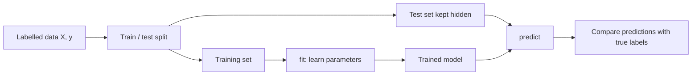
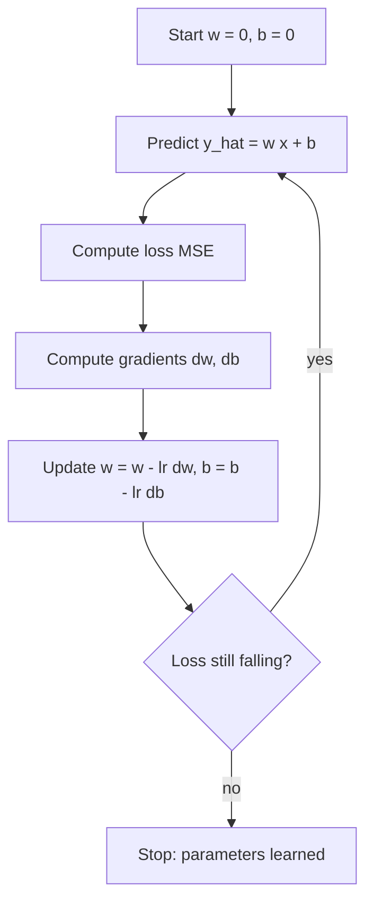
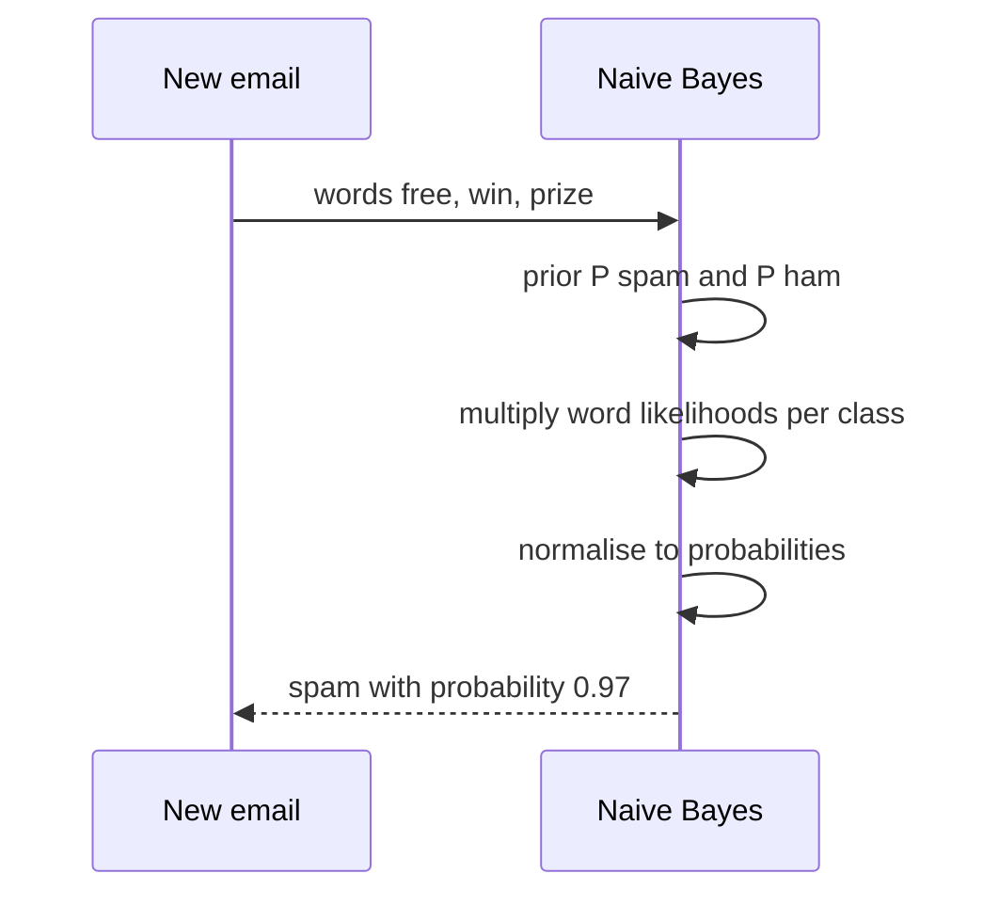
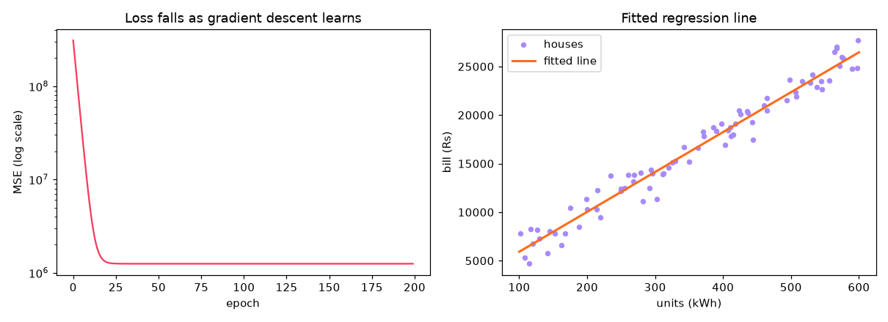
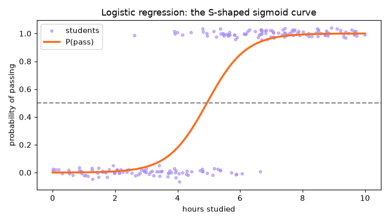

# Session 2 · Supervised Learning

[](https://colab.research.google.com/github/Hamnakhan123/Diploma-in-Data-Science/blob/main/term-2/03-advanced-data-science-with-python/code/session-02-supervised-learning.ipynb)

> 📍 [Diploma in Data Science](../../README.md) › [Term 2](../README.md) › [Advanced Data Science with Python](README.md) › **Session 2**

| ⏱ Estimated time | 🧩 Prerequisites | 💻 Tools |
|---|---|---|
| 3 hours | Session 1, basic algebra (lines, slopes), probability basics | Python 3.10+, NumPy, pandas, Matplotlib, scikit-learn |

[⬅ Previous: Session 1 · Fundamentals of Advanced Data Science](session-01-fundamentals-of-advanced-data-science.md) · [🏠 Module home](README.md) · [Next: Session 3 · Advanced Supervised Learning: Regression Techniques ➡](session-03-advanced-regression-techniques.md)

---

## 🎯 Learning objectives

- Explain **supervised learning**: features, labels, training and test sets, generalisation.
- Derive and implement **linear regression with gradient descent** from scratch, and compare it with scikit-learn.
- Explain and implement **K-Nearest Neighbours (KNN)**, including the effect of *k* and of scaling.
- Explain **Naive Bayes** using Bayes' theorem and apply it to text (spam) classification.
- Explain **logistic regression**, the sigmoid, log-loss and decision thresholds for binary problems.

## 📖 Concepts

### 1. What supervised learning is

Supervised learning is **learning from worked examples**. A student who studies 500 past exam questions *with answers* learns the pattern well enough to answer a new question. In ML, each past example has **features** `X` (the question) and a **label** `y` (the answer). The model learns a function `f(X) ≈ y`.

| Term | Meaning | Example (loan approval) |
|---|---|---|
| Feature | an input column | income, age, existing loans |
| Label / target | what we predict | repaid (1) or defaulted (0) |
| Training set | examples the model learns from | 80% of past loans |
| Test set | examples kept hidden to measure real performance | the other 20% |
| Generalisation | doing well on data never seen before | approving new applicants correctly |
| Overfitting | memorising training data, failing on new data | a student who memorised answers but cannot solve a new question |
| Underfitting | model too simple to capture the pattern | predicting the average for everyone |

Two families: **regression** (label is a number) and **classification** (label is a category).

### 2. Linear regression and gradient descent

Linear regression draws the **best straight line** through the data: `ŷ = w·x + b` (with many features, `ŷ = w₁x₁ + … + wₙxₙ + b`). "Best" means the line with the smallest **Mean Squared Error**:

`MSE = (1/n) Σ (yᵢ − ŷᵢ)²`

**Gradient descent** finds `w` and `b` like a hiker coming down a foggy hill: you cannot see the valley, but you can feel which way the ground slopes under your feet, so you take a small step downhill and repeat.

1. Start with `w = 0, b = 0`.
2. Compute the slope (gradient) of the MSE: `∂MSE/∂w = −(2/n) Σ xᵢ(yᵢ − ŷᵢ)`, `∂MSE/∂b = −(2/n) Σ (yᵢ − ŷᵢ)`.
3. Step downhill: `w ← w − α·∂MSE/∂w`, `b ← b − α·∂MSE/∂b`. The **learning rate α** is the step size.
4. Repeat until the loss stops falling.

| Learning rate | What happens |
|---|---|
| too small (0.0001) | very slow, may stop before reaching the bottom |
| about right (0.01–0.1 on scaled data) | smooth, fast convergence |
| too large (1.5) | overshoots the valley, loss explodes |

Scaling features first (mean 0, sd 1) makes the "valley" round instead of a long narrow ditch, so gradient descent converges much faster. Variants: **batch** GD (all rows per step), **stochastic** GD (one row), **mini-batch** (e.g. 32 rows; used in deep learning).

### 3. K-Nearest Neighbours (KNN)

KNN is "**you are the company you keep**". To classify a new point, find the *k* closest training points and take a **majority vote** (for regression, average their values). There is no training phase: the model *is* the stored data (a **lazy learner**).

- **Distance**: usually Euclidean `√Σ(aᵢ − bᵢ)²`; Manhattan `Σ|aᵢ − bᵢ|` is an alternative.
- **Scaling is essential**: a feature measured in thousands swamps one measured in units.
- **Choosing k**: small k (1) → jagged boundary, overfits noise; large k → over-smoothed, underfits. Pick k by cross-validation; odd k avoids ties in binary problems.
- **Cost**: prediction compares against every stored point, so it is slow for millions of rows and suffers in very high dimensions (the **curse of dimensionality**).

### 4. Naive Bayes

Naive Bayes is a **probability detective**. **Bayes' theorem** updates a belief with evidence:

`P(class | evidence) = P(evidence | class) · P(class) / P(evidence)`

The "naive" part assumes features are **independent given the class**, so the evidence probability is just a product: `P(w₁, w₂, … | spam) = P(w₁|spam)·P(w₂|spam)·…`. The assumption is rarely true, but the classifier still ranks classes well and is extremely fast.

| Variant | Feature type | Typical use |
|---|---|---|
| `GaussianNB` | continuous, roughly bell-shaped | sensor readings, measurements |
| `MultinomialNB` | counts | word counts in documents (spam, news topics) |
| `BernoulliNB` | yes/no | word present or absent |

**Laplace smoothing** (`alpha=1`) adds 1 to every count so a word never seen in spam does not make `P(spam) = 0`.

### 5. Logistic regression

Despite the name, logistic regression is a **classifier**. It computes a linear score `z = w·x + b` and squashes it into a probability with the **sigmoid** `σ(z) = 1 / (1 + e^(−z))`. Picture a dimmer switch: very negative z → light off (≈ 0), very positive → fully on (≈ 1), z = 0 → exactly half (0.5).

- **Decision rule**: predict 1 if `p ≥ threshold` (default 0.5). Lower the threshold to catch more positives (e.g. disease screening) at the cost of more false alarms.
- **Loss**: **log-loss / binary cross-entropy** `−[y log p + (1−y) log(1−p)]`, which punishes confident wrong answers heavily. It is minimised by gradient descent.
- **Interpretation**: each coefficient is a change in **log-odds**; `e^w` is the **odds ratio** per unit increase of that feature.
- **Regularisation**: scikit-learn applies L2 by default; `C` is the inverse strength (small C = stronger regularisation).

### Algorithm comparison

| | Linear regression | KNN | Naive Bayes | Logistic regression |
|---|---|---|---|---|
| Task | regression | both | classification | classification |
| Training cost | low | none (stores data) | very low | low |
| Prediction cost | very low | high | very low | very low |
| Needs scaling | for gradient descent | yes | no | recommended |
| Interpretable | yes (coefficients) | partly (neighbours) | yes (probabilities) | yes (odds ratios) |
| Main weakness | only straight-line patterns | slow, high-dimensional data | independence assumption | linear boundary |

## 🧭 Diagrams







## 💻 Worked examples

### Example 1 · Basic: linear regression by gradient descent from scratch

Predicting the monthly electricity bill (Rs) of a house from units consumed (kWh).

📄 [`code/session-02_gd_scratch.py`](code/session-02_gd_scratch.py)

```python
"""Linear regression with batch gradient descent, written from scratch with NumPy."""
import numpy as np
import matplotlib.pyplot as plt

rng = np.random.default_rng(0)
units = rng.uniform(100, 600, 80)                     # kWh used in a month
bill = 1500 + 42 * units + rng.normal(0, 1200, 80)    # true rule: Rs 1500 fixed + Rs 42 per unit

# Scale x so gradient descent behaves (mean 0, sd 1)
mu, sd = units.mean(), units.std()
x = (units - mu) / sd

w, b, lr = 0.0, 0.0, 0.1
history = []
for epoch in range(200):
    y_hat = w * x + b
    err = bill - y_hat
    loss = np.mean(err ** 2)
    dw = -2 * np.mean(x * err)
    db = -2 * np.mean(err)
    w, b = w - lr * dw, b - lr * db
    history.append(loss)
    if epoch in (0, 1, 5, 20, 50, 199):
        print(f"epoch {epoch:>3}: MSE = {loss:>14,.0f}  w = {w:8.1f}  b = {b:8.1f}")

# Convert back to the original units: bill = b0 + slope * units
slope = w / sd
b0 = b - slope * mu
print(f"\nlearned rule: bill = {b0:.0f} + {slope:.2f} x units   (true: 1500 + 42 x units)")
print(f"predicted bill for 350 units: Rs {b0 + slope * 350:,.0f}")

fig, ax = plt.subplots(1, 2, figsize=(11, 4))
ax[0].plot(history, color="#F43F5E"); ax[0].set_yscale("log")
ax[0].set_title("Loss falls as gradient descent learns"); ax[0].set_xlabel("epoch"); ax[0].set_ylabel("MSE (log scale)")
ax[1].scatter(units, bill, s=15, color="#A78BFA", label="houses")
grid = np.linspace(100, 600, 50)
ax[1].plot(grid, b0 + slope * grid, color="#FF6B1A", lw=2, label="fitted line")
ax[1].set_title("Fitted regression line"); ax[1].set_xlabel("units (kWh)"); ax[1].set_ylabel("bill (Rs)"); ax[1].legend()
fig.tight_layout(); fig.savefig("session-02_gradient_descent.png", dpi=110); plt.show()
```

**Output**

```text
epoch   0: MSE =    309,105,228  w =   1211.1  b =   3293.6
epoch   1: MSE =    198,276,947  w =   2180.0  b =   5928.4
epoch   5: MSE =     34,304,713  w =   4468.0  b =  12150.9
epoch  20: MSE =      1,289,812  w =   5999.6  b =  16315.9
epoch  50: MSE =      1,248,891  w =   6055.4  b =  16467.6
epoch 199: MSE =      1,248,891  w =   6055.4  b =  16467.8

learned rule: bill = 1810 + 41.09 x units   (true: 1500 + 42 x units)
predicted bill for 350 units: Rs 16,191
```

**Chart produced by this code** (saved as [`code/session-02_gradient_descent.png`](code/session-02_gradient_descent.png)):



### Example 2 · Intermediate: the learning rate and scikit-learn

📄 [`code/session-02_learning_rate.py`](code/session-02_learning_rate.py)

```python
"""Effect of the learning rate, and the same model in scikit-learn (closed form and SGD)."""
import numpy as np
from sklearn.linear_model import LinearRegression, SGDRegressor
from sklearn.preprocessing import StandardScaler
from sklearn.pipeline import make_pipeline

rng = np.random.default_rng(0)
units = rng.uniform(100, 600, 80)
bill = 1500 + 42 * units + rng.normal(0, 1200, 80)
x = (units - units.mean()) / units.std()

def train(lr, epochs=50):
    w = b = 0.0
    for _ in range(epochs):
        err = bill - (w * x + b)
        w += lr * 2 * np.mean(x * err); b += lr * 2 * np.mean(err)
    return np.mean((bill - (w * x + b)) ** 2)

for lr in [0.001, 0.01, 0.1, 0.5, 1.05]:
    print(f"learning rate {lr:<6} -> MSE after 50 epochs: {train(lr):,.0f}")

X = units.reshape(-1, 1)                         # scikit-learn wants a 2-D X
ols = LinearRegression().fit(X, bill)
sgd = make_pipeline(StandardScaler(), SGDRegressor(max_iter=1000, random_state=0)).fit(X, bill)
print(f"\nLinearRegression (exact least squares): bill = {ols.intercept_:.0f} + {ols.coef_[0]:.2f} x units")
print(f"SGDRegressor prediction for 350 units: Rs {sgd.predict([[350]])[0]:,.0f}")
print(f"LinearRegression prediction for 350  : Rs {ols.predict([[350]])[0]:,.0f}")
```

**Output**

```text
learning rate 0.001  -> MSE after 50 epochs: 253,249,869
learning rate 0.01   -> MSE after 50 epochs: 42,076,661
learning rate 0.1    -> MSE after 50 epochs: 1,248,891
learning rate 0.5    -> MSE after 50 epochs: 1,248,891
learning rate 1.05   -> MSE after 50 epochs: 4,242,450,092,888

LinearRegression (exact least squares): bill = 1810 + 41.09 x units
SGDRegressor prediction for 350 units: Rs 16,192
LinearRegression prediction for 350  : Rs 16,191
```

At 1.05 the steps overshoot and the loss grows instead of shrinking. `LinearRegression` solves the problem exactly with linear algebra; gradient descent matters when data is huge or the model has no exact formula (logistic regression, neural networks).

### Example 3 · Intermediate: KNN from scratch, then choosing k

📄 [`code/session-02_knn.py`](code/session-02_knn.py)

```python
"""KNN: a from-scratch classifier, then scikit-learn with scaling and a search for the best k."""
import numpy as np
from collections import Counter
from sklearn.datasets import load_breast_cancer
from sklearn.model_selection import train_test_split, cross_val_score
from sklearn.neighbors import KNeighborsClassifier
from sklearn.preprocessing import StandardScaler
from sklearn.pipeline import make_pipeline

def knn_predict(X_train, y_train, x, k=3):
    """Return the majority label among the k nearest training points."""
    dist = np.sqrt(((X_train - x) ** 2).sum(axis=1))     # Euclidean distance to every point
    nearest = np.argsort(dist)[:k]
    return Counter(y_train[nearest]).most_common(1)[0][0]

# Tiny fruit example: [weight g, sweetness 1-10] -> 0 = lemon, 1 = orange
X_fruit = np.array([[120, 2], [130, 3], [110, 2], [150, 7], [170, 8], [160, 6]])
y_fruit = np.array([0, 0, 0, 1, 1, 1])
for fruit in ([125, 3], [165, 7], [140, 5]):
    label = knn_predict(X_fruit, y_fruit, np.array(fruit), k=3)
    print(f"fruit {fruit} -> {'orange' if label else 'lemon'}")

# Real data: breast tumour diagnosis, 30 features
X, y = load_breast_cancer(return_X_y=True)
X_tr, X_te, y_tr, y_te = train_test_split(X, y, test_size=0.25, random_state=1, stratify=y)
raw = KNeighborsClassifier(5).fit(X_tr, y_tr).score(X_te, y_te)
scaled = make_pipeline(StandardScaler(), KNeighborsClassifier(5)).fit(X_tr, y_tr).score(X_te, y_te)
print(f"\nKNN k=5 accuracy without scaling: {raw:.3f}   with scaling: {scaled:.3f}")

print("\n k   5-fold CV accuracy")
for k in [1, 3, 5, 9, 15, 31, 75]:
    cv = cross_val_score(make_pipeline(StandardScaler(), KNeighborsClassifier(k)), X_tr, y_tr, cv=5).mean()
    print(f"{k:>2}   {cv:.3f}")
```

**Output**

```text
fruit [125, 3] -> lemon
fruit [165, 7] -> orange
fruit [140, 5] -> orange

KNN k=5 accuracy without scaling: 0.930   with scaling: 0.965

 k   5-fold CV accuracy
 1   0.955
 3   0.974
 5   0.972
 9   0.972
15   0.951
31   0.944
75   0.927
```

### Example 4 · Intermediate: Naive Bayes spam filter

📄 [`code/session-02_naive_bayes.py`](code/session-02_naive_bayes.py)

```python
"""Naive Bayes: a hand calculation with Bayes' theorem, then a MultinomialNB spam filter."""
from sklearn.feature_extraction.text import CountVectorizer
from sklearn.naive_bayes import MultinomialNB

# --- Hand calculation: P(spam | message contains 'free') ---
p_spam, p_free_given_spam, p_free_given_ham = 0.30, 0.40, 0.02
p_free = p_free_given_spam * p_spam + p_free_given_ham * (1 - p_spam)
print(f"P(spam | 'free') = {p_free_given_spam * p_spam / p_free:.3f}")

# --- A small labelled SMS data set ---
texts = ["win a free prize now", "free entry claim your reward", "urgent you won cash call now",
         "claim free gift card today", "limited offer win money", "cheap loans approved click now",
         "are we meeting for lunch", "please send the lecture notes", "call me when you reach home",
         "the assignment is due tomorrow", "see you at the cricket match", "can you pick up milk today",
         "meeting moved to 3 pm", "happy birthday have a great day"]
labels = [1] * 6 + [0] * 8                                 # 1 = spam, 0 = ham

vec = CountVectorizer()
X = vec.fit_transform(texts)
nb = MultinomialNB(alpha=1.0).fit(X, labels)               # alpha=1 -> Laplace smoothing

new = ["free cash prize claim now", "notes for tomorrow's lecture", "call now to win", "lunch today?"]
for msg, p in zip(new, nb.predict_proba(vec.transform(new))[:, 1]):
    print(f"{msg:<32} P(spam) = {p:.3f} -> {'SPAM' if p >= 0.5 else 'ham'}")

# Most 'spammy' words: largest log P(word|spam) - log P(word|ham)
import numpy as np
diff = nb.feature_log_prob_[1] - nb.feature_log_prob_[0]
words = np.array(vec.get_feature_names_out())
print("\nmost spam-indicative words:", list(words[np.argsort(diff)[-6:][::-1]]))
```

**Output**

```text
P(spam | 'free') = 0.896
free cash prize claim now        P(spam) = 0.997 -> SPAM
notes for tomorrow's lecture     P(spam) = 0.076 -> ham
call now to win                  P(spam) = 0.888 -> SPAM
lunch today?                     P(spam) = 0.332 -> ham

most spam-indicative words: ['free', 'now', 'win', 'claim', 'your', 'prize']
```

### Example 5 · Advanced: logistic regression, the sigmoid and thresholds

📄 [`code/session-02_logistic.py`](code/session-02_logistic.py)

```python
"""Logistic regression: sigmoid, from-scratch gradient descent, scikit-learn, odds ratios, thresholds."""
import numpy as np
import matplotlib.pyplot as plt
from sklearn.linear_model import LogisticRegression
from sklearn.metrics import confusion_matrix

rng = np.random.default_rng(3)
# Students: hours studied -> passed (1) or failed (0)
hours = rng.uniform(0, 10, 200)
p_true = 1 / (1 + np.exp(-(1.2 * hours - 6)))
passed = (rng.random(200) < p_true).astype(int)

sigmoid = lambda z: 1 / (1 + np.exp(-z))

# From scratch: gradient descent on log-loss
w = b = 0.0
for _ in range(40000):                              # many small steps: hours are not scaled
    p = sigmoid(w * hours + b)
    w -= 0.1 * np.mean((p - passed) * hours)
    b -= 0.1 * np.mean(p - passed)
loss = -np.mean(passed * np.log(p) + (1 - passed) * np.log(1 - p))
print(f"from scratch : w = {w:.2f}, b = {b:.2f}, log-loss = {loss:.3f}")

clf = LogisticRegression(C=1e6).fit(hours.reshape(-1, 1), passed)      # huge C = almost no regularisation
print(f"scikit-learn : w = {clf.coef_[0][0]:.2f}, b = {clf.intercept_[0]:.2f}")
print(f"odds ratio per extra hour: {np.exp(clf.coef_[0][0]):.2f}x")
print(f"50% pass point: {-clf.intercept_[0] / clf.coef_[0][0]:.1f} hours")
for h in [2, 5, 8]:
    print(f"P(pass | {h} h) = {clf.predict_proba([[h]])[0, 1]:.3f}")

probs = clf.predict_proba(hours.reshape(-1, 1))[:, 1]
print("\nthreshold  TN  FP  FN  TP")
for t in [0.3, 0.5, 0.7]:
    tn, fp, fn, tp = confusion_matrix(passed, (probs >= t).astype(int)).ravel()
    print(f"   {t:.1f}    {tn:>3} {fp:>3} {fn:>3} {tp:>3}")

grid = np.linspace(0, 10, 200)
plt.figure(figsize=(7, 4))
plt.scatter(hours, passed + rng.normal(0, .02, 200), s=12, alpha=.6, color="#A78BFA", label="students")
plt.plot(grid, clf.predict_proba(grid.reshape(-1, 1))[:, 1], color="#FF6B1A", lw=2.5, label="P(pass)")
plt.axhline(0.5, ls="--", color="grey"); plt.xlabel("hours studied"); plt.ylabel("probability of passing")
plt.title("Logistic regression: the S-shaped sigmoid curve"); plt.legend()
plt.tight_layout(); plt.savefig("session-02_logistic_sigmoid.png", dpi=110); plt.show()
```

**Output**

```text
from scratch : w = 1.62, b = -7.98, log-loss = 0.224
scikit-learn : w = 1.62, b = -7.98
odds ratio per extra hour: 5.03x
50% pass point: 4.9 hours
P(pass | 2 h) = 0.009
P(pass | 5 h) = 0.525
P(pass | 8 h) = 0.993

threshold  TN  FP  FN  TP
   0.3     79  16   5 100
   0.5     84  11   9  96
   0.7     90   5  15  90
```

**Chart produced by this code** (saved as [`code/session-02_logistic_sigmoid.png`](code/session-02_logistic_sigmoid.png)):



## 🏙️ Real-life data problem: predicting loan default

**Problem.** A microfinance lender wants to flag applicants likely to **default** so a loan officer reviews them. Missing a defaulter costs about Rs 80,000; wrongly reviewing a good applicant costs about Rs 2,000 of staff time.

**Plan.** Build features, compare KNN, Naive Bayes and logistic regression on the same split, then **choose the threshold that minimises cost** rather than blindly using 0.5.

📄 [`code/session-02_loan_problem.py`](code/session-02_loan_problem.py)

```python
"""Real-life problem: compare three classifiers for loan default and pick a cost-optimal threshold."""
import numpy as np
import pandas as pd
from sklearn.model_selection import train_test_split
from sklearn.preprocessing import StandardScaler
from sklearn.pipeline import make_pipeline
from sklearn.neighbors import KNeighborsClassifier
from sklearn.naive_bayes import GaussianNB
from sklearn.linear_model import LogisticRegression
from sklearn.metrics import accuracy_score, roc_auc_score, confusion_matrix

rng = np.random.default_rng(11)
n = 3000
df = pd.DataFrame({
    "monthly_income_k": rng.lognormal(4.0, 0.45, n).round(1),      # thousand Rs
    "loan_amount_k": rng.uniform(20, 300, n).round(0),
    "existing_loans": rng.poisson(1.0, n),
    "years_employed": rng.exponential(4, n).round(1),
    "late_payments_12m": rng.poisson(0.6, n),
})
z = (-2.2 + 0.012 * df.loan_amount_k - 0.025 * df.monthly_income_k + 0.45 * df.existing_loans
     - 0.15 * df.years_employed + 0.7 * df.late_payments_12m)
df["default"] = (rng.random(n) < 1 / (1 + np.exp(-z))).astype(int)
print("default rate:", round(df["default"].mean(), 3))

X, y = df.drop(columns="default"), df["default"]
X_tr, X_te, y_tr, y_te = train_test_split(X, y, test_size=0.3, random_state=0, stratify=y)
models = {"KNN (k=25)": make_pipeline(StandardScaler(), KNeighborsClassifier(25)),
          "Gaussian NB": GaussianNB(),
          "Logistic regression": make_pipeline(StandardScaler(), LogisticRegression())}
print(f"\n{'model':<22}{'accuracy':>9}{'ROC AUC':>9}")
for name, m in models.items():
    m.fit(X_tr, y_tr)
    p = m.predict_proba(X_te)[:, 1]
    print(f"{name:<22}{accuracy_score(y_te, p >= .5):>9.3f}{roc_auc_score(y_te, p):>9.3f}")

# Pick the threshold with the lowest business cost
lr = models["Logistic regression"]; p = lr.predict_proba(X_te)[:, 1]
COST_FN, COST_FP = 80_000, 2_000
print("\nthreshold  missed defaulters  extra reviews   total cost (Rs)")
best = None
for t in [0.5, 0.4, 0.3, 0.2, 0.1, 0.05, 0.03, 0.02, 0.01]:
    tn, fp, fn, tp = confusion_matrix(y_te, p >= t).ravel()
    cost = fn * COST_FN + fp * COST_FP
    best = min(best or (cost, t), (cost, t))
    print(f"   {t:<5}        {fn:>4}             {fp:>4}       {cost:>12,}")
print(f"\nbest threshold: {best[1]}  (cost Rs {best[0]:,})")
print(f"theory: flag when p > C_FP / (C_FP + C_FN) = {COST_FP / (COST_FP + COST_FN):.3f}")

coefs = pd.Series(lr[-1].coef_[0], index=X.columns).sort_values()
print("\nstandardised coefficients (positive = raises default risk):\n", coefs.round(2).to_string())
```

**Output**

```text
default rate: 0.239

model                  accuracy  ROC AUC
KNN (k=25)                0.780    0.761
Gaussian NB               0.786    0.769
Logistic regression       0.798    0.795

threshold  missed defaulters  extra reviews   total cost (Rs)
   0.5           141               41         11,362,000
   0.4           110               80          8,960,000
   0.3            79              142          6,604,000
   0.2            40              237          3,674,000
   0.1            19              398          2,316,000
   0.05            7              544          1,648,000
   0.03            4              616          1,552,000
   0.02            3              642          1,524,000
   0.01            1              668          1,416,000

best threshold: 0.01  (cost Rs 1,416,000)
theory: flag when p > C_FP / (C_FP + C_FN) = 0.024

standardised coefficients (positive = raises default risk):
 monthly_income_k    -0.78
years_employed      -0.46
existing_loans       0.46
late_payments_12m    0.48
loan_amount_k        0.93
```

**Answer.** Logistic regression ranks applicants best (highest ROC AUC) and is easy to explain to a loan officer. Because a missed defaulter costs 40 times more than a review, the best threshold is far below 0.5. Decision theory gives the same answer: flag an applicant when `p > C_FP / (C_FP + C_FN) ≈ 0.024`, i.e. when the expected loss from approving (p × 80,000) exceeds the cost of a review (2,000). In practice the lender would also cap how many reviews staff can handle per day. Late payments and loan size raise risk; income and years employed lower it.

## ⚠️ Common mistakes

| Mistake | Fix |
|---|---|
| Evaluating on the training data | always keep a test set or use cross-validation |
| Gradient descent on unscaled features with a big learning rate | standardise first; start with α = 0.01–0.1 and plot the loss |
| KNN without scaling | `make_pipeline(StandardScaler(), KNeighborsClassifier())` |
| Using `GaussianNB` on word counts | use `MultinomialNB` for counts, `BernoulliNB` for yes/no |
| Treating logistic regression output as a hard label only | use `predict_proba` and choose the threshold from costs |
| Reporting accuracy on imbalanced data (5% fraud) | report precision, recall, ROC AUC (Session 14) |

## ✅ Best practices

- Always compare against a **baseline** (mean for regression, majority class for classification).
- Use `stratify=y` in `train_test_split` for classification so class balance is preserved.
- Plot the **loss curve** whenever you train with gradient descent.
- Choose `k`, `C` and thresholds with **cross-validation on training data**, never the test set.
- Explain coefficients in business language (odds ratios, rupees per unit).

## 🧪 Lab / practice tasks

### 🟢 Task 1 · Easy

Change Example 1 to use `lr = 0.01` and `lr = 0.5`. How many epochs does each need before the MSE stops improving?

<details><summary>💡 Hint</summary>

Print the loss every 10 epochs or look at the loss curve.

</details>

<details><summary>✅ Solution</summary>

With 0.01 the loss falls slowly and needs roughly 300 epochs to settle. With 0.5 it settles almost immediately: for one standardised feature the step `w ← w − 0.5·dw` lands exactly on the minimum. On standardised data with this loss any α below 1.0 converges; above 1.0 every step overshoots further and the loss explodes.

</details>


### 🟡 Task 2 · Medium

Extend the gradient descent code to **two features**: units and number of air conditioners. Use vectors `w` and the matrix form `ŷ = Xw + b`.

<details><summary>💡 Hint</summary>

Gradient: `dw = -2/n * X.T @ (y - y_hat)`; scale each column.

</details>

<details><summary>✅ Solution</summary>

```python
acs = rng.integers(0, 4, 80); bill2 = 1500 + 42*units + 2500*acs + rng.normal(0, 1200, 80)
X = np.c_[units, acs]; Xs = (X - X.mean(0)) / X.std(0)
w, b = np.zeros(2), 0.0
for _ in range(500):
    err = bill2 - (Xs @ w + b)
    w += 0.1 * 2 * Xs.T @ err / len(err); b += 0.1 * 2 * err.mean()
print(w / X.std(0))      # close to [42, 2500]
```

</details>


### 🟡 Task 3 · Medium

Add five new messages of your own to the spam filter and find one that it misclassifies. Why does it fail?

<details><summary>💡 Hint</summary>

Try a ham message that uses spam words ("I won the free cricket tickets for us").

</details>

<details><summary>✅ Solution</summary>

Messages sharing many spam words get high spam probability because Naive Bayes sees only word counts, not meaning or word order. More training data and bigram features (`CountVectorizer(ngram_range=(1,2))`) help.

</details>


### 🟠 Task 4 · Hard

In Example 3, plot training accuracy and CV accuracy against k (1 to 75). Mark where overfitting and underfitting occur.

<details><summary>💡 Hint</summary>

Training accuracy with k=1 is always 1.0.

</details>

<details><summary>✅ Solution</summary>

Training accuracy starts at 1.0 and falls as k grows; CV accuracy rises, peaks around k = 5–15, then slowly falls. Left of the peak = overfitting (big gap), far right = underfitting (both falling).

</details>


### 🔴 Task 5 · Challenge

Implement logistic regression for the loan data **from scratch** (vectorised gradient descent on all five standardised features) and check that its coefficients match scikit-learn's with `C=1e6`.

<details><summary>💡 Hint</summary>

`p = sigmoid(X @ w + b)`, `dw = X.T @ (p - y) / n`.

</details>

<details><summary>✅ Solution</summary>

```python
Xs = StandardScaler().fit_transform(X_tr); yv = y_tr.values
w, b = np.zeros(Xs.shape[1]), 0.0
for _ in range(3000):
    p = 1 / (1 + np.exp(-(Xs @ w + b)))
    w -= 0.5 * Xs.T @ (p - yv) / len(yv); b -= 0.5 * (p - yv).mean()
print(w.round(2))
print(LogisticRegression(C=1e6).fit(Xs, yv).coef_.round(2))   # nearly identical
```

</details>


## 🧩 Mini project: student pass predictor

Build a complete command-line style tool: generate a student data set, train logistic regression and KNN, choose the better model by cross-validation and predict for three new students with explanations.

📄 [`code/session-02_mini_project.py`](code/session-02_mini_project.py)

```python
"""Mini project: predict whether students pass, choose a model by CV, explain predictions."""
import numpy as np
import pandas as pd
from sklearn.model_selection import train_test_split, cross_val_score
from sklearn.pipeline import make_pipeline
from sklearn.preprocessing import StandardScaler
from sklearn.linear_model import LogisticRegression
from sklearn.neighbors import KNeighborsClassifier
from sklearn.metrics import classification_report

rng = np.random.default_rng(5)
n = 600
students = pd.DataFrame({"study_hours": rng.uniform(0, 15, n), "attendance": rng.uniform(40, 100, n),
                         "assignments_done": rng.integers(0, 11, n), "past_gpa": rng.uniform(1.5, 4.0, n)})
z = -9 + 0.35 * students.study_hours + 0.05 * students.attendance + 0.25 * students.assignments_done + 0.9 * students.past_gpa
students["passed"] = (rng.random(n) < 1 / (1 + np.exp(-z))).astype(int)

X, y = students.drop(columns="passed"), students["passed"]
X_tr, X_te, y_tr, y_te = train_test_split(X, y, test_size=0.25, random_state=0, stratify=y)
candidates = {"logistic": make_pipeline(StandardScaler(), LogisticRegression()),
              "knn": make_pipeline(StandardScaler(), KNeighborsClassifier(15))}
scores = {k: cross_val_score(m, X_tr, y_tr, cv=5).mean() for k, m in candidates.items()}
print("CV accuracy:", {k: round(float(v), 3) for k, v in scores.items()})
best_name = max(scores, key=scores.get)
model = candidates[best_name].fit(X_tr, y_tr)
print(f"chosen model: {best_name}\n")
print(classification_report(y_te, model.predict(X_te), target_names=["fail", "pass"]))

new = pd.DataFrame({"study_hours": [2, 8, 12], "attendance": [55, 80, 95],
                    "assignments_done": [3, 7, 10], "past_gpa": [2.0, 2.9, 3.6]})
coef = model[-1].coef_[0] if best_name == "logistic" else None
for i, row in new.iterrows():
    p = model.predict_proba(row.to_frame().T)[0, 1]
    msg = f"student {i + 1}: P(pass) = {p:.2f}"
    if coef is not None:
        contrib = model[0].transform(row.to_frame().T)[0] * coef
        msg += f" | biggest factor: {X.columns[np.argmax(np.abs(contrib))]}"
    print(msg)
```

**Output**

```text
CV accuracy: {'logistic': 0.773, 'knn': 0.773}
chosen model: logistic

              precision    recall  f1-score   support

        fail       0.85      0.69      0.77        59
        pass       0.82      0.92      0.87        91

    accuracy                           0.83       150
   macro avg       0.84      0.81      0.82       150
weighted avg       0.84      0.83      0.83       150

student 1: P(pass) = 0.06 | biggest factor: study_hours
student 2: P(pass) = 0.88 | biggest factor: attendance
student 3: P(pass) = 0.99 | biggest factor: study_hours
```

## ✅ Quick quiz

**Q1.** In gradient descent the learning rate controls…

- **A)** the number of features
- **B)** the size of each step downhill
- **C)** the test-set size
- **D)** the number of classes

<details><summary>Show answer</summary>

**B** — Too large overshoots, too small is slow.

</details>

**Q2.** KNN with k = 1 tends to…

- **A)** underfit
- **B)** overfit
- **C)** ignore the training data
- **D)** need no distance metric

<details><summary>Show answer</summary>

**B** — It copies the single nearest point, including noise.

</details>

**Q3.** The "naive" assumption in Naive Bayes is that features are…

- **A)** normally distributed
- **B)** independent given the class
- **C)** all binary
- **D)** scaled

<details><summary>Show answer</summary>

**B** — That lets the likelihood be a simple product.

</details>

**Q4.** The sigmoid function maps any number to…

- **A)** 0 or 1 exactly
- **B)** the range 0 to 1
- **C)** −1 to 1
- **D)** 0 to infinity

<details><summary>Show answer</summary>

**B** — It turns a score into a probability.

</details>

**Q5.** Lowering the threshold of a logistic classifier from 0.5 to 0.2 usually…

- **A)** reduces false positives
- **B)** catches more positives but adds false alarms
- **C)** changes the coefficients
- **D)** increases accuracy always

<details><summary>Show answer</summary>

**B** — Recall rises, precision usually falls.

</details>


## 📝 Summary

- Supervised learning learns `f(X) ≈ y` from labelled examples and is judged on **unseen test data**.
- **Linear regression** minimises MSE; **gradient descent** reaches the minimum by repeated small steps controlled by the learning rate.
- **KNN** votes among the k nearest points: scale features and tune k.
- **Naive Bayes** applies Bayes' theorem with an independence assumption: fast and strong for text.
- **Logistic regression** = linear score + sigmoid + log-loss; choose the threshold from business costs.

### 🎤 Interview / viva questions

1. Derive the gradient of MSE with respect to `w` for simple linear regression.
2. What happens if the learning rate is too large? How would you detect it?
3. Why is KNN called a lazy learner, and what is its main cost?
4. Explain Laplace smoothing with an example.
5. Why is logistic regression a classifier even though it has "regression" in its name?
6. How would you choose a classification threshold for a cancer screening test?

---

[⬅ Previous: Session 1 · Fundamentals of Advanced Data Science](session-01-fundamentals-of-advanced-data-science.md) · [🏠 Module home](README.md) · [Next: Session 3 · Advanced Supervised Learning: Regression Techniques ➡](session-03-advanced-regression-techniques.md)

<sub>Diploma in Data Science · Prepared by **Hamna Zahid Khan**, Junior Lecturer</sub>
