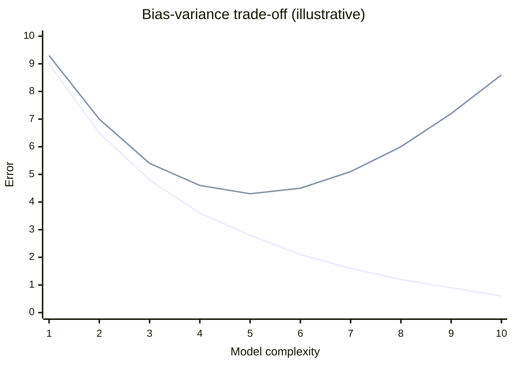
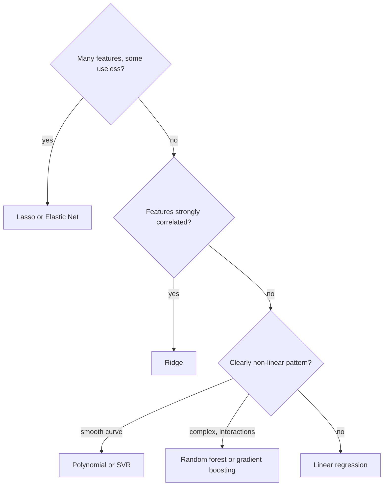
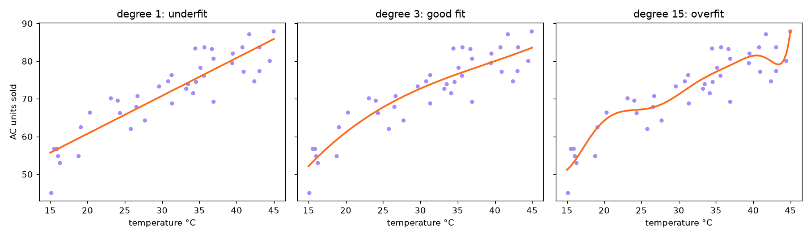
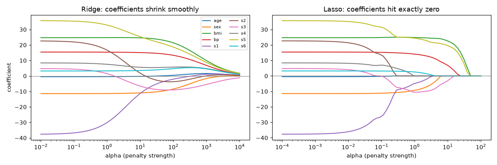
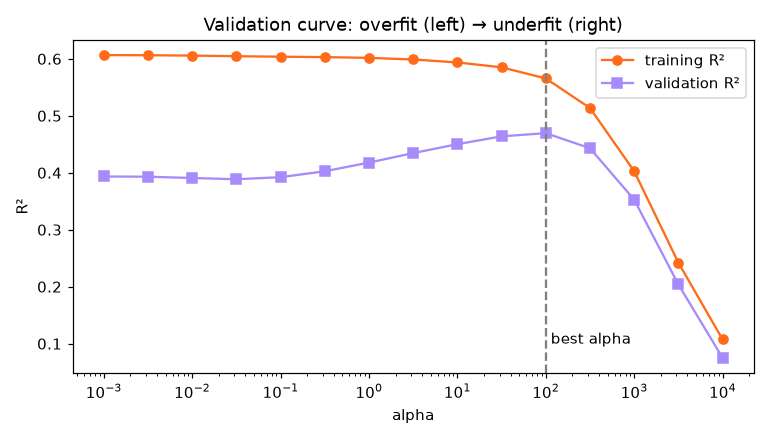
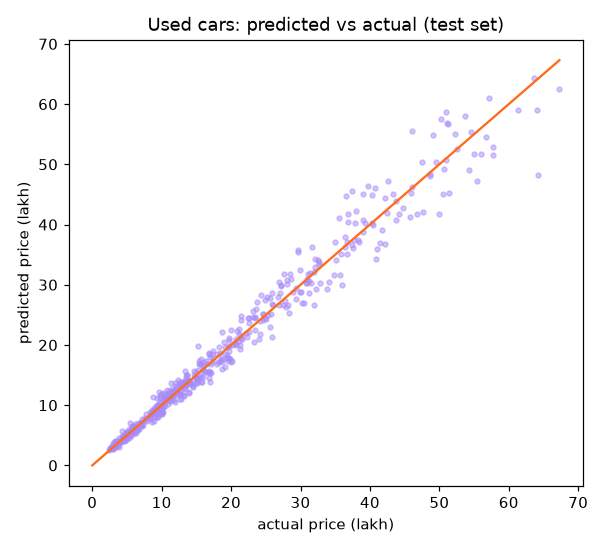

# Session 3 · Advanced Supervised Learning: Regression Techniques

[](https://colab.research.google.com/github/Hamnakhan123/Diploma-in-Data-Science/blob/main/term-2/03-advanced-data-science-with-python/code/session-03-advanced-regression-techniques.ipynb)

> 📍 [Diploma in Data Science](../../README.md) › [Term 2](../README.md) › [Advanced Data Science with Python](README.md) › **Session 3**

| ⏱ Estimated time | 🧩 Prerequisites | 💻 Tools |
|---|---|---|
| 3 hours | Session 2 (linear regression, gradient descent) | Python 3.10+, NumPy, pandas, Matplotlib, scikit-learn |

[⬅ Previous: Session 2 · Supervised Learning](session-02-supervised-learning.md) · [🏠 Module home](README.md) · [Next: Session 4 · Advanced Supervised Learning: Classification Techniques ➡](session-04-advanced-classification-techniques.md)

---

## 🎯 Learning objectives

- Describe the main **types of regression**: multiple linear, polynomial, Ridge, Lasso, Elastic Net, tree-based, ensemble and support vector regression.
- Follow a **step-by-step process** to solve a real-world regression problem, from data cleaning to a validated model.
- Explain **bias and variance**, overfitting and underfitting, and read a learning/validation curve.
- Explain how **L1 and L2 regularisation** change coefficients and model performance, and tune the strength `alpha`.
- Evaluate regressors with **MAE, RMSE and R²** and compare them against a baseline.

## 📖 Concepts

### 1. The regression family

Regression predicts a **number**. Choosing a regressor is like choosing a vehicle: a bicycle (linear regression) is simple and reliable on flat roads; a 4×4 (gradient boosting) handles rough terrain but needs more skill and fuel.

| Type | Idea | When to use | scikit-learn |
|---|---|---|---|
| Multiple linear | straight-line relationship with many features | baseline, interpretable effects | `LinearRegression` |
| Polynomial | add x², x³, x·z terms, then fit linearly | smooth curves | `PolynomialFeatures` + `LinearRegression` |
| **Ridge (L2)** | linear + penalty on squared coefficients | many correlated features | `Ridge(alpha=)` |
| **Lasso (L1)** | linear + penalty on absolute coefficients, sets some to exactly 0 | feature selection | `Lasso(alpha=)` |
| **Elastic Net** | mix of L1 and L2 | many correlated features + selection | `ElasticNet(alpha=, l1_ratio=)` |
| Decision tree | if-then splits, constant value per leaf | non-linear, interactions, no scaling | `DecisionTreeRegressor` |
| Random forest | average of many trees on bootstrap samples | strong default for tabular data | `RandomForestRegressor` |
| Gradient boosting | trees added one by one to fix previous errors | top accuracy on tabular data | `GradientBoostingRegressor`, `HistGradientBoostingRegressor` |
| Support vector regression | fit a tube of width ε around the data, kernels for curves | small/medium data, smooth patterns | `SVR(kernel="rbf")` |
| KNN regression | average of nearest neighbours' targets | local patterns, low dimensions | `KNeighborsRegressor` |

### 2. Bias, variance and the sweet spot

Imagine throwing darts. **Bias** is how far the centre of your throws is from the bullseye (systematic error: model too simple). **Variance** is how scattered your throws are (sensitivity to the particular training sample: model too flexible).

| | Training error | Test error | Diagnosis | Cure |
|---|---|---|---|---|
| Underfitting (high bias) | high | high | model too simple | more features, polynomial terms, more flexible model |
| Good fit | low | low, close to training | — | — |
| Overfitting (high variance) | very low | high | memorising noise | regularisation, more data, simpler model, cross-validation |

Total expected error ≈ **bias² + variance + irreducible noise**. Increasing model complexity lowers bias but raises variance; the best model sits at the bottom of the U-shaped test-error curve.

### 3. Regularisation: a leash on the coefficients

Ordinary least squares minimises only the error. Regularised regression minimises **error + penalty**:

| Model | Objective | Effect on coefficients |
|---|---|---|
| Ridge | `MSE + α Σ wⱼ²` | shrinks all coefficients smoothly towards 0, never exactly 0 |
| Lasso | `MSE + α Σ |wⱼ|` | shrinks and sets weak ones to **exactly 0** (automatic feature selection) |
| Elastic Net | `MSE + α[r Σ|wⱼ| + (1−r)/2 Σ wⱼ²]` | mixture; keeps groups of correlated features together |

Analogy: a dog on a leash. With no leash (α = 0) it runs anywhere chasing every smell (noise). A short leash (big α) keeps it at your feet: it cannot follow anything, not even the real path (underfit). The right length lets it explore the real trail.

**Rules**

- Always **scale features** before Ridge/Lasso; otherwise the penalty treats a feature measured in rupees differently from one in lakhs.
- Choose α by **cross-validation** (`RidgeCV`, `LassoCV`, `GridSearchCV`) over a log-spaced grid, e.g. `np.logspace(-3, 3, 13)`.
- The intercept is not penalised.

### 4. Evaluating regressors

| Metric | Formula | Reads as | Notes |
|---|---|---|---|
| MAE | mean \|y − ŷ\| | average error in the target's units | robust to outliers |
| RMSE | √mean(y − ŷ)² | typical error, punishing big misses | same units as y |
| R² | 1 − SS_res / SS_tot | share of variance explained (1 = perfect, 0 = as good as predicting the mean) | can be negative on test data |
| MAPE | mean \|(y − ŷ)/y\| × 100 | percentage error | breaks when y is near 0 |

Always compare with a **baseline** such as `DummyRegressor(strategy="mean")`.

### 5. A real-world regression process

1. **Frame**: what is predicted, for whom, how accurate must it be, what metric?
2. **Collect and inspect**: types, missing values, outliers, target distribution (skewed targets such as prices often work better as `log(price)`).
3. **Split** before anything else (train/test, or time-based for dated data).
4. **Preprocess** inside a `Pipeline` / `ColumnTransformer`: impute, scale numbers, one-hot encode categories.
5. **Baseline → simple model → complex models**, comparing by cross-validation.
6. **Tune** hyperparameters (α, tree depth, number of trees).
7. **Test once** on the hidden test set; analyse residuals and errors by segment.
8. **Explain and deploy**: coefficients or feature importances, save the pipeline with `joblib`.

## 🧭 Diagrams






## 💻 Worked examples

### Example 1 · Basic: polynomial regression and overfitting

📄 [`code/session-03_polynomial.py`](code/session-03_polynomial.py)

```python
"""Fit polynomials of increasing degree and watch underfitting turn into overfitting."""
import numpy as np
import matplotlib.pyplot as plt
from sklearn.preprocessing import PolynomialFeatures, StandardScaler
from sklearn.linear_model import LinearRegression
from sklearn.pipeline import make_pipeline
from sklearn.metrics import mean_squared_error

rng = np.random.default_rng(0)
# Air-conditioner sales vs temperature: rises then flattens (a curve, not a line)
temp = np.sort(rng.uniform(15, 45, 40))
sales = 50 + 30 * np.sin((temp - 15) / 18) + rng.normal(0, 4, 40)
temp_test = rng.uniform(15, 45, 200)
sales_test = 50 + 30 * np.sin((temp_test - 15) / 18) + rng.normal(0, 4, 200)

grid = np.linspace(15, 45, 300).reshape(-1, 1)
fig, ax = plt.subplots(1, 3, figsize=(13, 3.8), sharey=True)
print("degree  train RMSE  test RMSE")
for i, d in enumerate([1, 3, 15]):
    model = make_pipeline(PolynomialFeatures(d), StandardScaler(), LinearRegression())
    model.fit(temp.reshape(-1, 1), sales)
    tr = mean_squared_error(sales, model.predict(temp.reshape(-1, 1))) ** .5
    te = mean_squared_error(sales_test, model.predict(temp_test.reshape(-1, 1))) ** .5
    print(f"{d:>5}   {tr:>9.2f}  {te:>9.2f}")
    ax[i].scatter(temp, sales, s=14, color="#A78BFA")
    ax[i].plot(grid, np.clip(model.predict(grid), 0, 120), color="#FF6B1A", lw=2)
    ax[i].set_title(f"degree {d}: " + ["underfit", "good fit", "overfit"][i]); ax[i].set_xlabel("temperature °C")
ax[0].set_ylabel("AC units sold")
fig.tight_layout(); fig.savefig("session-03_polynomial_fits.png", dpi=110); plt.show()
```

**Output**

```text
degree  train RMSE  test RMSE
    1        4.48       4.83
    3        4.15       4.33
   15        3.88       4.61
```

**Chart produced by this code** (saved as [`code/session-03_polynomial_fits.png`](code/session-03_polynomial_fits.png)):



Degree 15 has the lowest **training** error but a higher **test** error: it bends to chase noise.

### Example 2 · Intermediate: Ridge and Lasso coefficient paths

📄 [`code/session-03_reg_paths.py`](code/session-03_reg_paths.py)

```python
"""How Ridge and Lasso coefficients shrink as alpha grows (diabetes data, 10 features)."""
import numpy as np
import matplotlib.pyplot as plt
from sklearn.datasets import load_diabetes
from sklearn.linear_model import Ridge, Lasso, LinearRegression
from sklearn.preprocessing import StandardScaler

data = load_diabetes()
X = StandardScaler().fit_transform(data.data); y = data.target
names = data.feature_names
alphas = np.logspace(-2, 4, 60)
ridge = np.array([Ridge(alpha=a).fit(X, y).coef_ for a in alphas])
lasso = np.array([Lasso(alpha=a / 100, max_iter=20000).fit(X, y).coef_ for a in alphas])

ols = LinearRegression().fit(X, y).coef_
print("feature   OLS     Ridge(a=100)  Lasso(a=5)")
r100 = Ridge(alpha=100).fit(X, y).coef_; l5 = Lasso(alpha=5).fit(X, y).coef_
for n, a, b, c in zip(names, ols, r100, l5):
    print(f"{n:<6}{a:>8.1f}{b:>12.1f}{c:>12.1f}")
print("Lasso(alpha=5) keeps", int((l5 != 0).sum()), "of 10 features:", [n for n, c in zip(names, l5) if c != 0])

fig, ax = plt.subplots(1, 2, figsize=(12, 4))
for j in range(X.shape[1]):
    ax[0].plot(alphas, ridge[:, j], label=names[j]); ax[1].plot(alphas / 100, lasso[:, j])
ax[0].set_xscale("log"); ax[1].set_xscale("log")
ax[0].set_title("Ridge: coefficients shrink smoothly"); ax[1].set_title("Lasso: coefficients hit exactly zero")
for a in ax: a.set_xlabel("alpha (penalty strength)"); a.axhline(0, color="grey", lw=.8)
ax[0].set_ylabel("coefficient"); ax[0].legend(fontsize=7, ncol=2)
fig.tight_layout(); fig.savefig("session-03_regularisation_paths.png", dpi=110); plt.show()
```

**Output**

```text
feature   OLS     Ridge(a=100)  Lasso(a=5)
age       -0.5         0.4         0.0
sex      -11.4        -8.4        -2.2
bmi       24.7        21.4        24.2
bp        15.4        13.3        10.3
s1       -37.7        -2.1        -0.0
s2        22.7        -3.7        -0.0
s3         4.8        -9.0        -7.0
s4         8.4         5.7         0.0
s5        35.7        18.7        21.2
s6         3.2         4.7         0.0
Lasso(alpha=5) keeps 5 of 10 features: ['sex', 'bmi', 'bp', 's3', 's5']
```

**Chart produced by this code** (saved as [`code/session-03_regularisation_paths.png`](code/session-03_regularisation_paths.png)):



### Example 3 · Intermediate: regularisation rescues an overfit model

Few rows, many noisy features: the classic situation where plain least squares overfits.

📄 [`code/session-03_reg_rescue.py`](code/session-03_reg_rescue.py)

```python
"""40 rows and 60 features (only 5 useful): compare OLS, Ridge, Lasso and ElasticNet with CV-chosen alpha."""
import numpy as np
from sklearn.linear_model import LinearRegression, RidgeCV, LassoCV, ElasticNetCV
from sklearn.model_selection import train_test_split
from sklearn.preprocessing import StandardScaler
from sklearn.pipeline import make_pipeline
from sklearn.metrics import mean_squared_error, r2_score

rng = np.random.default_rng(42)
n, p = 120, 60
X = rng.normal(size=(n, p))
true_w = np.zeros(p); true_w[:5] = [8, -6, 5, 4, -3]          # only the first 5 matter
y = X @ true_w + rng.normal(0, 4, n)
X_tr, X_te, y_tr, y_te = train_test_split(X, y, train_size=40, random_state=0)

alphas = np.logspace(-3, 3, 30)
models = {
    "OLS (no penalty)": LinearRegression(),
    "RidgeCV": RidgeCV(alphas=alphas),
    "LassoCV": LassoCV(alphas=alphas, cv=5, max_iter=50000, random_state=0),
    "ElasticNetCV": ElasticNetCV(alphas=alphas, l1_ratio=[.2, .5, .8], cv=5, max_iter=50000, random_state=0),
}
print(f"{'model':<18}{'train R2':>9}{'test R2':>9}{'test RMSE':>11}  non-zero coefs  alpha")
for name, m in models.items():
    pipe = make_pipeline(StandardScaler(), m).fit(X_tr, y_tr)
    est = pipe[-1]
    nz = int((np.abs(est.coef_) > 1e-6).sum())
    a = getattr(est, "alpha_", "-")
    print(f"{name:<18}{r2_score(y_tr, pipe.predict(X_tr)):>9.2f}{r2_score(y_te, pipe.predict(X_te)):>9.2f}"
          f"{mean_squared_error(y_te, pipe.predict(X_te)) ** .5:>11.2f}  {nz:>14}  {a if a == '-' else round(a, 3)}")
lasso = make_pipeline(StandardScaler(), models["LassoCV"]).fit(X_tr, y_tr)[-1]
print("\nLasso's largest coefficients at positions:", np.argsort(-np.abs(lasso.coef_))[:5])
```

**Output**

```text
model              train R2  test R2  test RMSE  non-zero coefs  alpha
OLS (no penalty)       1.00     0.40      10.43              60  -
RidgeCV                0.99     0.46       9.96              60  3.29
LassoCV                0.98     0.91       4.11              20  0.304
ElasticNetCV           0.99     0.85       5.20              37  0.117

Lasso's largest coefficients at positions: [0 1 2 3 4]
```

OLS memorises the 40 training rows (train R² = 1.0) and fails on new data; Lasso finds the five true features.

### Example 4 · Advanced: trees, forests, boosting and SVR on a non-linear problem

📄 [`code/session-03_nonlinear_models.py`](code/session-03_nonlinear_models.py)

```python
"""Compare linear and non-linear regressors with 5-fold cross-validation on a curved, interacting target."""
import numpy as np
from sklearn.model_selection import cross_validate, KFold
from sklearn.pipeline import make_pipeline
from sklearn.preprocessing import StandardScaler
from sklearn.dummy import DummyRegressor
from sklearn.linear_model import LinearRegression, Ridge
from sklearn.tree import DecisionTreeRegressor
from sklearn.ensemble import RandomForestRegressor, GradientBoostingRegressor
from sklearn.svm import SVR
from sklearn.neighbors import KNeighborsRegressor

rng = np.random.default_rng(1)
n = 800
X = rng.uniform(0, 10, size=(n, 4))
# delivery time (min): grows with distance, worse in rush hour, interaction rain x distance
y = 10 + 3 * X[:, 0] + 8 * np.sin(X[:, 1]) + 0.8 * X[:, 0] * (X[:, 2] > 7) + rng.normal(0, 2, n)

models = {
    "Baseline (mean)": DummyRegressor(),
    "Linear regression": LinearRegression(),
    "Ridge": make_pipeline(StandardScaler(), Ridge(1.0)),
    "KNN (k=10)": make_pipeline(StandardScaler(), KNeighborsRegressor(10)),
    "Decision tree (depth 6)": DecisionTreeRegressor(max_depth=6, random_state=0),
    "Random forest": RandomForestRegressor(n_estimators=200, random_state=0, n_jobs=-1),
    "Gradient boosting": GradientBoostingRegressor(random_state=0),
    "SVR (RBF)": make_pipeline(StandardScaler(), SVR(C=30, epsilon=0.5)),
}
cv = KFold(5, shuffle=True, random_state=0)
print(f"{'model':<25}{'MAE':>7}{'RMSE':>7}{'R2':>7}")
for name, m in models.items():
    r = cross_validate(m, X, y, cv=cv, scoring=("neg_mean_absolute_error", "neg_root_mean_squared_error", "r2"))
    print(f"{name:<25}{-r['test_neg_mean_absolute_error'].mean():>7.2f}"
          f"{-r['test_neg_root_mean_squared_error'].mean():>7.2f}{r['test_r2'].mean():>7.3f}")
```

**Output**

```text
model                        MAE   RMSE     R2
Baseline (mean)             9.14  11.17 -0.006
Linear regression           4.93   5.92  0.716
Ridge                       4.93   5.92  0.716
KNN (k=10)                  3.57   4.44  0.840
Decision tree (depth 6)     3.18   4.07  0.865
Random forest               2.24   2.87  0.933
Gradient boosting           1.87   2.42  0.952
SVR (RBF)                   3.02   3.78  0.884
```

### Example 5 · Advanced: validation curve for choosing alpha

📄 [`code/session-03_validation_curve.py`](code/session-03_validation_curve.py)

```python
"""Use a validation curve to see underfitting and overfitting as Ridge alpha changes."""
import numpy as np
import matplotlib.pyplot as plt
from sklearn.model_selection import validation_curve
from sklearn.pipeline import make_pipeline
from sklearn.preprocessing import PolynomialFeatures, StandardScaler
from sklearn.linear_model import Ridge
from sklearn.datasets import load_diabetes

X, y = load_diabetes(return_X_y=True)
pipe = make_pipeline(PolynomialFeatures(2), StandardScaler(), Ridge())   # 65 features incl. interactions
alphas = np.logspace(-3, 4, 15)
tr, va = validation_curve(pipe, X, y, param_name="ridge__alpha", param_range=alphas, cv=5, scoring="r2")
best = alphas[va.mean(1).argmax()]
for a, t, v in zip(alphas[::2], tr.mean(1)[::2], va.mean(1)[::2]):
    print(f"alpha {a:>10.3f}   train R2 {t:.3f}   validation R2 {v:.3f}")
print(f"best alpha = {best:.2f} with validation R2 = {va.mean(1).max():.3f}")

plt.figure(figsize=(7, 4))
plt.semilogx(alphas, tr.mean(1), "o-", color="#FF6B1A", label="training R²")
plt.semilogx(alphas, va.mean(1), "s-", color="#A78BFA", label="validation R²")
plt.axvline(best, ls="--", color="grey"); plt.text(best, .1, " best alpha")
plt.xlabel("alpha"); plt.ylabel("R²"); plt.title("Validation curve: overfit (left) → underfit (right)"); plt.legend()
plt.tight_layout(); plt.savefig("session-03_validation_curve.png", dpi=110); plt.show()
```

**Output**

```text
alpha      0.001   train R2 0.607   validation R2 0.393
alpha      0.010   train R2 0.606   validation R2 0.391
alpha      0.100   train R2 0.604   validation R2 0.392
alpha      1.000   train R2 0.602   validation R2 0.418
alpha     10.000   train R2 0.594   validation R2 0.450
alpha    100.000   train R2 0.566   validation R2 0.470
alpha   1000.000   train R2 0.403   validation R2 0.353
alpha  10000.000   train R2 0.107   validation R2 0.075
best alpha = 100.00 with validation R2 = 0.470
```

**Chart produced by this code** (saved as [`code/session-03_validation_curve.png`](code/session-03_validation_curve.png)):



## 🏙️ Real-life data problem: pricing used cars

**Problem.** An online car marketplace wants to show sellers a **suggested price** for a used car. A typical error under Rs 2 lakh would be useful. Data: make, year, mileage, engine size, transmission, city, plus some messy values.

**Full solution.** Clean → split → `ColumnTransformer` (impute + scale numbers, one-hot categories) → compare baseline, Ridge, Lasso and gradient boosting → predict `log(price)` because prices are skewed → test and inspect errors.

📄 [`code/session-03_car_problem.py`](code/session-03_car_problem.py)

```python
"""Real-life problem: used-car price prediction with a full preprocessing pipeline and model comparison."""
import numpy as np
import pandas as pd
import matplotlib.pyplot as plt
from sklearn.model_selection import train_test_split, cross_val_score, KFold
from sklearn.compose import ColumnTransformer, TransformedTargetRegressor
from sklearn.pipeline import Pipeline
from sklearn.impute import SimpleImputer
from sklearn.preprocessing import OneHotEncoder, StandardScaler
from sklearn.dummy import DummyRegressor
from sklearn.linear_model import RidgeCV, LassoCV
from sklearn.ensemble import HistGradientBoostingRegressor
from sklearn.metrics import mean_absolute_error, r2_score

rng = np.random.default_rng(7)
n = 2500
make = rng.choice(["Suzuki", "Toyota", "Honda", "Kia", "Hyundai"], n, p=[.35, .25, .2, .1, .1])
base = pd.Series(make).map({"Suzuki": 22, "Toyota": 48, "Honda": 45, "Kia": 52, "Hyundai": 50}).values
year = rng.integers(2008, 2026, n)
engine = np.where(make == "Suzuki", rng.choice([660, 1000, 1300], n), rng.choice([1300, 1500, 1800, 2000], n))
mileage = ((2026 - year) * rng.normal(14000, 4000, n)).clip(1000)
auto = rng.random(n) < 0.55
city = rng.choice(["Karachi", "Lahore", "Islamabad", "Peshawar"], n)
price = base * (0.92 ** (2026 - year)) * (engine / 1300) ** .6 * (1 + .08 * auto) * np.exp(-mileage / 900000) \
        * np.where(city == "Islamabad", 1.04, 1.0) * np.exp(rng.normal(0, .08, n))      # lakh Rs
cars = pd.DataFrame({"make": make, "year": year, "engine_cc": engine, "mileage_km": mileage.round(-2),
                     "transmission": np.where(auto, "Automatic", "Manual"), "city": city, "price_lakh": price.round(2)})
cars.loc[rng.choice(n, 80, replace=False), "mileage_km"] = np.nan       # missing values
cars.loc[rng.choice(n, 5, replace=False), "price_lakh"] = 0.01          # data-entry errors

cars = cars[cars["price_lakh"] > 1]                                      # 1. remove impossible prices
print("rows after cleaning:", len(cars), "| missing mileage:", cars["mileage_km"].isna().sum())
X, y = cars.drop(columns="price_lakh"), cars["price_lakh"]
X_tr, X_te, y_tr, y_te = train_test_split(X, y, test_size=0.2, random_state=0)

num, cat = ["year", "engine_cc", "mileage_km"], ["make", "transmission", "city"]
prep = ColumnTransformer([
    ("num", Pipeline([("impute", SimpleImputer(strategy="median")), ("scale", StandardScaler())]), num),
    ("cat", OneHotEncoder(handle_unknown="ignore"), cat)])

def model(reg):            # predict log(price), report in lakh: handles skew and multiplicative effects
    return TransformedTargetRegressor(Pipeline([("prep", prep), ("reg", reg)]), func=np.log, inverse_func=np.exp)

candidates = {"Baseline (mean)": DummyRegressor(),
              "Ridge": model(RidgeCV(alphas=np.logspace(-3, 3, 13))),
              "Lasso": model(LassoCV(cv=5, random_state=0)),
              "Gradient boosting": model(HistGradientBoostingRegressor(random_state=0))}
cv = KFold(5, shuffle=True, random_state=1)
for name, m in candidates.items():
    s = -cross_val_score(m, X_tr, y_tr, cv=cv, scoring="neg_mean_absolute_error").mean()
    print(f"{name:<18} CV MAE = {s:6.2f} lakh")

best = candidates["Gradient boosting"].fit(X_tr, y_tr)
pred = best.predict(X_te)
print(f"\nTEST: MAE = {mean_absolute_error(y_te, pred):.2f} lakh, R2 = {r2_score(y_te, pred):.3f}")
err = pd.DataFrame({"make": X_te["make"], "abs_err": np.abs(y_te - pred)})
print("MAE by make (lakh):\n", err.groupby("make")["abs_err"].mean().round(2).to_string())
sample = pd.DataFrame({"make": ["Toyota"], "year": [2019], "engine_cc": [1300], "mileage_km": [85000],
                       "transmission": ["Automatic"], "city": ["Karachi"]})
print(f"\nSuggested price for a 2019 Toyota 1300cc automatic, 85,000 km: Rs {best.predict(sample)[0]:.1f} lakh")

plt.figure(figsize=(5.5, 5))
plt.scatter(y_te, pred, s=10, alpha=.5, color="#A78BFA"); m_ = y_te.max()
plt.plot([0, m_], [0, m_], color="#FF6B1A"); plt.xlabel("actual price (lakh)"); plt.ylabel("predicted price (lakh)")
plt.title("Used cars: predicted vs actual (test set)"); plt.tight_layout()
plt.savefig("session-03_car_predictions.png", dpi=110); plt.show()
```

**Output**

```text
rows after cleaning: 2495 | missing mileage: 80
Baseline (mean)    CV MAE =  11.06 lakh
Ridge              CV MAE =   1.36 lakh
Lasso              CV MAE =   1.36 lakh
Gradient boosting  CV MAE =   1.34 lakh

TEST: MAE = 1.39 lakh, R2 = 0.975
MAE by make (lakh):
 make
Honda      1.62
Hyundai    2.90
Kia        1.69
Suzuki     0.55
Toyota     1.91

Suggested price for a 2019 Toyota 1300cc automatic, 85,000 km: Rs 27.5 lakh
```

**Chart produced by this code** (saved as [`code/session-03_car_predictions.png`](code/session-03_car_predictions.png)):



**Answer.** All three real models cut the baseline error by about 88%: an average miss of roughly Rs 1.4 lakh, inside the Rs 2 lakh target. Gradient boosting is only slightly better than Ridge/Lasso on log-price, because the price rules here are mostly multiplicative, which a linear model on `log(price)` captures well. In that case the marketplace could prefer Ridge: it is easier to explain ("each extra year of age lowers the price by about 8%"). Errors in lakh are larger for the pricier makes (Hyundai, Toyota) and smallest for Suzuki, but as a percentage of price they are similar, so the next step is to report the error as a percentage band to sellers.

## ⚠️ Common mistakes

| Mistake | Fix |
|---|---|
| Ridge/Lasso on unscaled features | scale inside the pipeline |
| Choosing α (or degree) by test-set score | use `RidgeCV`, `LassoCV` or `GridSearchCV` on training data |
| Judging a model by training R² | report CV or test metrics |
| Predicting a heavily skewed target directly | model `log(y)` with `TransformedTargetRegressor` |
| One-hot encoding before splitting | do encoding inside a `ColumnTransformer` |
| Reading Lasso's dropped features as "useless in reality" | with correlated features Lasso picks one arbitrarily; check stability |

## ✅ Best practices

- Start with a **baseline** and a **linear model**; only add complexity if CV error falls clearly.
- Look at **residual plots**: patterns mean the model is missing structure.
- Use **log-spaced** α grids.
- Keep preprocessing and model in **one pipeline** and save it with `joblib.dump(pipe, "model.joblib")`.
- Report MAE in business units ("Rs 1.2 lakh on average"), not just R².

## 🧪 Lab / practice tasks

### 🟢 Task 1 · Easy

In Example 1 try degrees 2, 5 and 9. Which degree gives the lowest test RMSE?

<details><summary>💡 Hint</summary>

Loop over `range(1, 16)` and keep the degree with the smallest test RMSE.

</details>

<details><summary>✅ Solution</summary>

Degrees around 3–5 give the lowest test RMSE (close to the noise level of 4). Beyond about 9 the test error rises again as the curve wiggles between points.

</details>


### 🟡 Task 2 · Medium

Use `LassoCV` on the diabetes data (scaled) and list the features it keeps. Compare with the Ridge coefficients.

<details><summary>💡 Hint</summary>

`LassoCV(cv=5).fit(X, y).coef_`; non-zero entries are kept.

</details>

<details><summary>✅ Solution</summary>

```python
from sklearn.linear_model import LassoCV
l = LassoCV(cv=5, random_state=0).fit(X, y)
print(l.alpha_, [n for n, c in zip(names, l.coef_) if c != 0])
```
Typically bmi, bp, s5 and sex survive with the largest weights; correlated serum features (s1, s2, s4) are often reduced or dropped.

</details>


### 🟡 Task 3 · Medium

In Example 3 change the training size from 40 to 100 rows. How does the gap between OLS and Lasso change? Explain.

<details><summary>💡 Hint</summary>

With more rows than features the OLS solution is no longer forced to memorise.

</details>

<details><summary>✅ Solution</summary>

With 100 rows (more than 60 features) OLS stops achieving a perfect training fit and its test R² improves sharply, though Lasso still wins. Regularisation matters most when data is small relative to the number of features.

</details>


### 🟠 Task 4 · Hard

Add a `GridSearchCV` to the car problem that tunes `max_depth` and `learning_rate` of the gradient boosting model. Report the best parameters and test MAE.

<details><summary>💡 Hint</summary>

Parameter names go through the wrapper: `regressor__reg__learning_rate`.

</details>

<details><summary>✅ Solution</summary>

```python
from sklearn.model_selection import GridSearchCV
gs = GridSearchCV(model(HistGradientBoostingRegressor(random_state=0)),
                  {"regressor__reg__learning_rate": [0.05, 0.1, 0.2], "regressor__reg__max_depth": [None, 4, 8]},
                  cv=3, scoring="neg_mean_absolute_error").fit(X_tr, y_tr)
print(gs.best_params_, mean_absolute_error(y_te, gs.predict(X_te)))
```

</details>


### 🔴 Task 5 · Challenge

Plot the residuals (`actual − predicted`) of the car model against `year`. Is there a pattern? Then try an `ElasticNetCV` with polynomial interaction terms between `year` and `mileage_km` and compare MAE.

<details><summary>💡 Hint</summary>

A U-shape or slope in residuals indicates missing non-linearity.

</details>

<details><summary>✅ Solution</summary>

Linear models show curved residuals over year because depreciation is multiplicative; log-target plus interactions removes most of the pattern. Boosting already captures it, so its residuals look like flat noise around zero.

</details>


## 🧩 Mini project: house rent estimator

A complete script that builds a rent data set for apartments, compares four regressors with CV, tunes the winner and saves the pipeline for reuse.

📄 [`code/session-03_mini_project.py`](code/session-03_mini_project.py)

```python
"""Mini project: apartment rent estimator with model comparison, tuning and a saved pipeline."""
import numpy as np
import pandas as pd
import joblib
from sklearn.model_selection import train_test_split, cross_val_score, GridSearchCV
from sklearn.compose import ColumnTransformer
from sklearn.pipeline import Pipeline
from sklearn.preprocessing import OneHotEncoder, StandardScaler
from sklearn.linear_model import RidgeCV
from sklearn.ensemble import RandomForestRegressor, GradientBoostingRegressor
from sklearn.metrics import mean_absolute_error

rng = np.random.default_rng(3)
n = 1500
area = rng.choice(["DHA", "Gulshan", "Clifton", "North Nazimabad", "Saddar"], n)
size = rng.normal(1200, 350, n).clip(400, 3000)
beds = np.clip((size / 450).round() + rng.integers(-1, 2, n), 1, 6)
floor = rng.integers(0, 15, n)
lift = (floor > 3) | (rng.random(n) < .3)
area_mult = pd.Series(area).map({"DHA": 1.6, "Clifton": 1.5, "Gulshan": 1.0, "North Nazimabad": .9, "Saddar": .8}).values
rent = (30 * size * area_mult + 6000 * beds + 3000 * lift - 800 * floor * (~lift) + rng.normal(0, 5000, n)) / 1000
df = pd.DataFrame({"area": area, "size_sqft": size.round(), "bedrooms": beds, "floor": floor,
                   "lift": lift.astype(int), "rent_k": rent.round(1)})

X, y = df.drop(columns="rent_k"), df["rent_k"]
X_tr, X_te, y_tr, y_te = train_test_split(X, y, test_size=.2, random_state=0)
prep = ColumnTransformer([("num", StandardScaler(), ["size_sqft", "bedrooms", "floor", "lift"]),
                          ("cat", OneHotEncoder(handle_unknown="ignore"), ["area"])])
models = {"ridge": RidgeCV(), "forest": RandomForestRegressor(200, random_state=0, n_jobs=-1),
          "boosting": GradientBoostingRegressor(random_state=0)}
for name, reg in models.items():
    mae = -cross_val_score(Pipeline([("prep", prep), ("reg", reg)]), X_tr, y_tr, cv=5,
                           scoring="neg_mean_absolute_error").mean()
    print(f"{name:<9} CV MAE: Rs {mae:.1f}k")

search = GridSearchCV(Pipeline([("prep", prep), ("reg", GradientBoostingRegressor(random_state=0))]),
                      {"reg__n_estimators": [100, 300], "reg__max_depth": [2, 3, 4]},
                      cv=5, scoring="neg_mean_absolute_error").fit(X_tr, y_tr)
print("best params:", search.best_params_)
print(f"test MAE: Rs {mean_absolute_error(y_te, search.predict(X_te)):.1f}k per month")
joblib.dump(search.best_estimator_, "rent_model.joblib")
loaded = joblib.load("rent_model.joblib")
flat = pd.DataFrame([{"area": "Gulshan", "size_sqft": 1100, "bedrooms": 3, "floor": 2, "lift": 0}])
print(f"estimated rent for a 1100 sqft 3-bed in Gulshan: Rs {loaded.predict(flat)[0]:.0f}k per month")
```

**Output**

```text
ridge     CV MAE: Rs 5.0k
forest    CV MAE: Rs 4.8k
boosting  CV MAE: Rs 4.4k
best params: {'reg__max_depth': 3, 'reg__n_estimators': 100}
test MAE: Rs 4.6k per month
estimated rent for a 1100 sqft 3-bed in Gulshan: Rs 48k per month
```

## ✅ Quick quiz

**Q1.** Which model can set coefficients to exactly zero?

- **A)** Ridge
- **B)** Lasso
- **C)** Linear regression
- **D)** SVR

<details><summary>Show answer</summary>

**B** — The L1 penalty produces sparse solutions.

</details>

**Q2.** A model with very low training error and high test error is…

- **A)** underfitting
- **B)** overfitting
- **C)** well fitted
- **D)** biased

<details><summary>Show answer</summary>

**B** — High variance: it memorised the training data.

</details>

**Q3.** Increasing Ridge alpha generally…

- **A)** increases variance
- **B)** shrinks coefficients towards zero
- **C)** adds polynomial terms
- **D)** removes the intercept

<details><summary>Show answer</summary>

**B** — Stronger penalty, smaller coefficients.

</details>

**Q4.** Which metric is in the same units as the target and punishes large errors more?

- **A)** R²
- **B)** MAE
- **C)** RMSE
- **D)** MAPE

<details><summary>Show answer</summary>

**C** — RMSE squares errors before averaging.

</details>

**Q5.** Why scale features before Lasso?

- **A)** Lasso cannot run otherwise
- **B)** So the penalty treats all features fairly
- **C)** To make the target normal
- **D)** To remove outliers

<details><summary>Show answer</summary>

**B** — Coefficient size depends on feature units.

</details>


## 📝 Summary

- Regression types range from linear and polynomial to regularised linear models, trees, ensembles and SVR.
- **Bias–variance**: too simple underfits, too flexible overfits; validation curves find the sweet spot.
- **Ridge** shrinks, **Lasso** shrinks and selects, **Elastic Net** mixes both; scale first and pick α by CV.
- Follow a disciplined process: frame → split → pipeline → baseline → compare → tune → test once → explain.

### 🎤 Interview / viva questions

1. Explain the bias–variance trade-off with an example.
2. What is the difference between L1 and L2 regularisation, mathematically and in effect?
3. When would you choose Elastic Net over Lasso?
4. Why might you predict `log(price)` instead of `price`?
5. How do you choose the regularisation strength without touching the test set?
6. Your model has R² = 0.98 on training and 0.55 on test. What do you do next?

---

[⬅ Previous: Session 2 · Supervised Learning](session-02-supervised-learning.md) · [🏠 Module home](README.md) · [Next: Session 4 · Advanced Supervised Learning: Classification Techniques ➡](session-04-advanced-classification-techniques.md)

<sub>Diploma in Data Science · Prepared by **Hamna Zahid Khan**, Junior Lecturer</sub>
