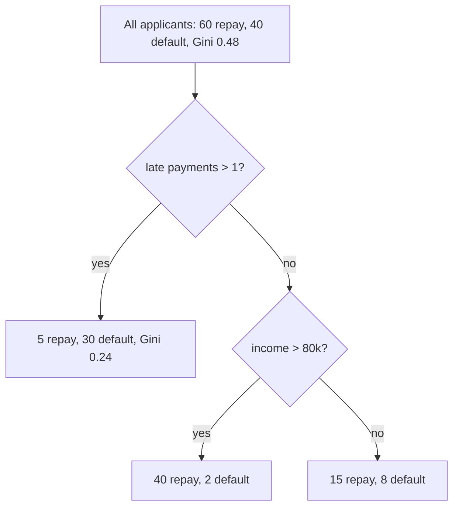
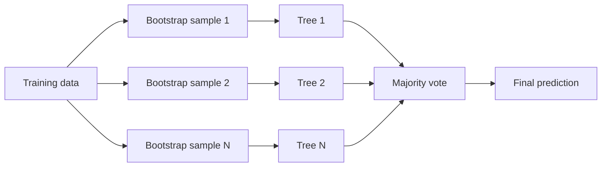
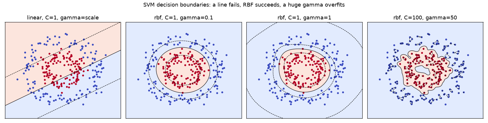
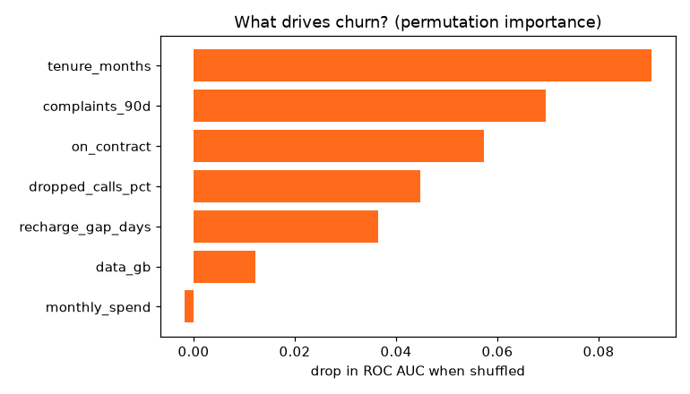

# Session 4 · Advanced Supervised Learning: Classification Techniques

[](https://colab.research.google.com/github/Hamnakhan123/Diploma-in-Data-Science/blob/main/term-2/03-advanced-data-science-with-python/code/session-04-advanced-classification-techniques.ipynb)

> 📍 [Diploma in Data Science](../../README.md) › [Term 2](../README.md) › [Advanced Data Science with Python](README.md) › **Session 4**

| ⏱ Estimated time | 🧩 Prerequisites | 💻 Tools |
|---|---|---|
| 3 hours | Sessions 2–3 | Python 3.10+, NumPy, pandas, Matplotlib, scikit-learn |

[⬅ Previous: Session 3 · Advanced Supervised Learning: Regression Techniques](session-03-advanced-regression-techniques.md) · [🏠 Module home](README.md) · [Next: Session 5 · Advanced Supervised Learning: Time Series Analysis ➡](session-05-time-series-analysis.md)

---

## 🎯 Learning objectives

- Explain how **decision trees** split data using **Gini impurity** and **entropy / information gain**, and control their depth.
- Describe and implement **ensemble methods**: bagging, random forests, boosting (AdaBoost, gradient boosting), voting and stacking.
- Explain **Support Vector Machines**: margins, support vectors, soft margins and the `C` parameter.
- Explain the **kernel trick** (linear, polynomial, RBF) and the role of `gamma`.
- Apply **hyperparameter tuning** strategies: grid search, random search, successive halving, and nested cross-validation.

## 📖 Concepts

### 1. Decision trees

A decision tree is the game of **20 Questions**: each question ("Is income above Rs 80k?") splits the data into purer groups until each leaf mostly holds one class.

**How a split is chosen.** For every feature and every threshold, the tree measures how *mixed* the resulting groups are and picks the split that makes them purest.

| Impurity measure | Formula (class shares pᵢ) | Pure node | 50/50 node (2 classes) |
|---|---|---|---|
| **Gini** | `1 − Σ pᵢ²` | 0 | 0.5 |
| **Entropy** | `−Σ pᵢ log₂ pᵢ` | 0 | 1.0 |

**Information gain** = impurity of parent − weighted impurity of children. The split with the biggest gain wins.

**Controlling overfitting.** A fully grown tree memorises the training data. Limit it with `max_depth`, `min_samples_leaf`, `min_samples_split`, `max_leaf_nodes`, or prune with `ccp_alpha` (cost-complexity pruning).

| Strengths | Weaknesses |
|---|---|
| easy to read and explain | unstable: small data changes → different tree |
| no scaling needed, handles mixed types | overfits if not limited |
| captures interactions automatically | axis-parallel, step-shaped boundaries |

### 2. Ensemble methods: the wisdom of crowds

One doctor may misdiagnose; a panel of doctors voting is far more reliable, **as long as they make different mistakes**. Ensembles combine many models.

| Method | How it works | Reduces | scikit-learn |
|---|---|---|---|
| **Bagging** | train the same model on different bootstrap samples (rows drawn with replacement), average/vote | variance | `BaggingClassifier` |
| **Random forest** | bagging of trees + each split considers only a random subset of features (`max_features`) to de-correlate the trees | variance | `RandomForestClassifier` |
| **AdaBoost** | train weak learners in sequence, increasing the weight of misclassified rows | bias | `AdaBoostClassifier` |
| **Gradient boosting** | each new tree fits the residual errors (gradients of the loss) of the ensemble so far; `learning_rate` shrinks each step | bias (and variance with shrinkage) | `GradientBoostingClassifier`, `HistGradientBoostingClassifier` (also XGBoost, LightGBM, CatBoost) |
| **Voting** | combine different model types by majority (hard) or averaged probabilities (soft) | variance | `VotingClassifier` |
| **Stacking** | a meta-model learns how to combine base models' predictions | both | `StackingClassifier` |

**Out-of-bag (OOB) score**: each bootstrap sample leaves out about 37% of rows; a random forest can test each tree on its left-out rows, giving a free validation score (`oob_score=True`).

### 3. Support Vector Machines

An SVM draws the **widest possible road** between two classes. The centre line is the decision boundary; the road edges touch the closest points, called **support vectors**. Only these points define the model.

- **Hard margin**: no point may sit on the road; impossible when classes overlap.
- **Soft margin**: points may violate the road at a cost. **`C`** sets that cost: large C = narrow road, few violations (risk of overfitting); small C = wide road, more violations (smoother, more bias).
- SVMs need **scaled features** and are best for small-to-medium data (training time grows roughly with n² to n³).

### 4. The kernel trick

When classes cannot be separated by a straight line (a ring of points inside another ring), we can lift the data into a higher dimension where a flat plane separates them. Picture marbles on a table, red in the middle and blue around: hit the table from below so the red marbles fly up, and now a flat sheet slides between them.

A **kernel** computes similarity as if the data were in that higher space, **without ever building the new features**.

| Kernel | Formula | Use |
|---|---|---|
| Linear | `x·z` | many features (text), linearly separable data |
| Polynomial | `(γ x·z + r)^d` | interactions of degree d |
| **RBF (Gaussian)** | `exp(−γ‖x − z‖²)` | default for non-linear problems |

**`gamma`** (RBF) is the reach of each training point: small γ → each point influences far away → smooth boundary; large γ → influence is tiny and local → wiggly boundary that overfits. Tune `C` and `gamma` together on a log grid.

### 5. Hyperparameter tuning

**Parameters** are learned from data (tree split thresholds, SVM weights). **Hyperparameters** are set before training (`max_depth`, `C`, `gamma`, `n_estimators`). Tuning finds good hyperparameters using **cross-validation on the training set only**.

| Strategy | Idea | When |
|---|---|---|
| Grid search | try every combination | few hyperparameters, small grids |
| Random search | sample N random combinations from distributions | many hyperparameters; usually finds good values with far fewer fits |
| Successive halving | start many candidates on little data, keep the best half, give them more | large search spaces (`HalvingGridSearchCV`, `HalvingRandomSearchCV`) |
| Bayesian optimisation | build a model of score vs hyperparameters and try the most promising next | expensive models (Optuna, scikit-optimize) |
| Nested CV | outer CV estimates performance, inner CV tunes | honest performance estimate of the whole tuning process |

**Strategy tips**: tune the most influential hyperparameters first (learning rate and number of trees for boosting; C and gamma for SVM; max_depth/min_samples_leaf for trees), search on a **log scale**, then refine around the best value.

## 🧭 Diagrams






## 💻 Worked examples

### Example 1 · Basic: Gini and information gain by hand

📄 [`code/session-04_gini.py`](code/session-04_gini.py)

```python
"""Compute Gini impurity, entropy and the information gain of candidate splits by hand."""
import numpy as np

def gini(labels):
    _, counts = np.unique(labels, return_counts=True)
    p = counts / counts.sum()
    return 1 - np.sum(p ** 2)

def entropy(labels):
    _, counts = np.unique(labels, return_counts=True)
    p = counts / counts.sum()
    return -np.sum(p * np.log2(p))

def gain(parent, left, right, measure=gini):
    n = len(parent)
    return measure(parent) - (len(left) / n * measure(left) + len(right) / n * measure(right))

# 10 customers: did they buy the premium plan? (1 = yes)
age     = np.array([22, 25, 28, 35, 38, 42, 47, 51, 55, 60])
salary  = np.array([30, 45, 32, 80, 95, 40, 120, 85, 38, 110])   # thousand Rs
bought  = np.array([0, 0, 0, 1, 1, 0, 1, 1, 0, 1])

print(f"parent: Gini = {gini(bought):.3f}, entropy = {entropy(bought):.3f}")
for name, col in [("age", age), ("salary", salary)]:
    best = max(((gain(bought, bought[col <= t], bought[col > t]), t) for t in np.unique(col)[:-1]))
    print(f"best split on {name:<6}: <= {best[1]:>3}  gain (Gini) = {best[0]:.3f}")
t = 45
print(f"\nsalary <= {t}: left {bought[salary <= t]}, right {bought[salary > t]}")
print(f"info gain (entropy) = {gain(bought, bought[salary <= t], bought[salary > t], entropy):.3f}")
```

**Output**

```text
parent: Gini = 0.500, entropy = 1.000
best split on age   : <=  28  gain (Gini) = 0.214
best split on salary: <=  45  gain (Gini) = 0.500

salary <= 45: left [0 0 0 0 0], right [1 1 1 1 1]
info gain (entropy) = 1.000
```

Splitting on salary at Rs 45k makes both children perfectly pure (gain = the full parent impurity), so it is chosen first.

### Example 2 · Intermediate: tree depth, pruning and the readable tree

📄 [`code/session-04_tree_depth.py`](code/session-04_tree_depth.py)

```python
"""Effect of max_depth on a decision tree, cost-complexity pruning, and printing the rules."""
from sklearn.datasets import load_breast_cancer
from sklearn.model_selection import train_test_split
from sklearn.tree import DecisionTreeClassifier, export_text

data = load_breast_cancer()
X_tr, X_te, y_tr, y_te = train_test_split(data.data, data.target, test_size=.3, random_state=0, stratify=data.target)

print("depth  leaves  train acc  test acc")
for d in [1, 2, 3, 5, 8, None]:
    t = DecisionTreeClassifier(max_depth=d, random_state=0).fit(X_tr, y_tr)
    print(f"{str(d):>5}  {t.get_n_leaves():>6}  {t.score(X_tr, y_tr):>9.3f}  {t.score(X_te, y_te):>8.3f}")

path = DecisionTreeClassifier(random_state=0).cost_complexity_pruning_path(X_tr, y_tr)
print("\nccp_alpha  leaves  test acc")
for a in path.ccp_alphas[::4]:
    t = DecisionTreeClassifier(ccp_alpha=a, random_state=0).fit(X_tr, y_tr)
    print(f"{a:9.4f}  {t.get_n_leaves():>6}  {t.score(X_te, y_te):.3f}")

small = DecisionTreeClassifier(max_depth=2, random_state=0).fit(X_tr, y_tr)
print("\n" + export_text(small, feature_names=list(data.feature_names)))
```

**Output**

```text
depth  leaves  train acc  test acc
    1       2      0.932     0.889
    2       4      0.942     0.906
    3       8      0.980     0.901
    5      15      0.997     0.912
    8      16      1.000     0.906
 None      16      1.000     0.906

ccp_alpha  leaves  test acc
   0.0000      16  0.906
   0.0049      10  0.912
   0.0196       4  0.901

|--- worst perimeter <= 106.10
|   |--- worst concave points <= 0.16
|   |   |--- class: 1
|   |--- worst concave points >  0.16
|   |   |--- class: 0
|--- worst perimeter >  106.10
|   |--- worst concave points <= 0.14
|   |   |--- class: 0
|   |--- worst concave points >  0.14
|   |   |--- class: 0
```

### Example 3 · Intermediate: ensembles head to head

📄 [`code/session-04_ensembles.py`](code/session-04_ensembles.py)

```python
"""Single tree vs bagging, random forest, AdaBoost, gradient boosting, voting and stacking."""
import numpy as np
from sklearn.datasets import make_classification
from sklearn.model_selection import cross_val_score, StratifiedKFold
from sklearn.tree import DecisionTreeClassifier
from sklearn.ensemble import (BaggingClassifier, RandomForestClassifier, AdaBoostClassifier,
                              HistGradientBoostingClassifier, VotingClassifier, StackingClassifier)
from sklearn.linear_model import LogisticRegression
from sklearn.svm import SVC
from sklearn.pipeline import make_pipeline
from sklearn.preprocessing import StandardScaler

X, y = make_classification(n_samples=1500, n_features=20, n_informative=8, n_redundant=4,
                           flip_y=0.05, class_sep=0.8, random_state=0)
cv = StratifiedKFold(5, shuffle=True, random_state=0)
svm = make_pipeline(StandardScaler(), SVC(probability=True, random_state=0))
lr = make_pipeline(StandardScaler(), LogisticRegression(max_iter=1000))
rf = RandomForestClassifier(300, random_state=0, n_jobs=-1)
models = {
    "Single decision tree": DecisionTreeClassifier(random_state=0),
    "Bagging (100 trees)": BaggingClassifier(DecisionTreeClassifier(), n_estimators=100, random_state=0, n_jobs=-1),
    "Random forest": rf,
    "AdaBoost": AdaBoostClassifier(n_estimators=200, random_state=0),
    "Gradient boosting (hist)": HistGradientBoostingClassifier(random_state=0),
    "Soft voting (LR+SVM+RF)": VotingClassifier([("lr", lr), ("svm", svm), ("rf", rf)], voting="soft", n_jobs=-1),
    "Stacking (meta = LR)": StackingClassifier([("svm", svm), ("rf", rf)], final_estimator=LogisticRegression(), n_jobs=-1),
}
print(f"{'model':<26}{'CV accuracy':>12}")
for name, m in models.items():
    s = cross_val_score(m, X, y, cv=cv)
    print(f"{name:<26}{s.mean():>8.3f} ± {s.std():.3f}")

oob = RandomForestClassifier(300, oob_score=True, random_state=0, n_jobs=-1).fit(X, y)
print(f"\nrandom forest out-of-bag score: {oob.oob_score_:.3f} (free validation, no extra split)")
```

**Output**

```text
model                      CV accuracy
Single decision tree         0.789 ± 0.016
Bagging (100 trees)          0.880 ± 0.017
Random forest                0.892 ± 0.016
AdaBoost                     0.820 ± 0.012
Gradient boosting (hist)     0.880 ± 0.013
Soft voting (LR+SVM+RF)      0.877 ± 0.016
Stacking (meta = LR)         0.894 ± 0.015

random forest out-of-bag score: 0.898 (free validation, no extra split)
```

### Example 4 · Advanced: SVM margins, C and the kernel trick

📄 [`code/session-04_svm_kernels.py`](code/session-04_svm_kernels.py)

```python
"""Linear vs RBF SVM on ring-shaped data; the effect of C and gamma; a decision-boundary figure."""
import numpy as np
import matplotlib.pyplot as plt
from sklearn.datasets import make_circles
from sklearn.svm import SVC
from sklearn.model_selection import train_test_split
from sklearn.preprocessing import StandardScaler
from sklearn.pipeline import make_pipeline

X, y = make_circles(n_samples=400, noise=0.12, factor=0.45, random_state=0)
X_tr, X_te, y_tr, y_te = train_test_split(X, y, test_size=.3, random_state=0)

print("kernel   C      gamma  support vectors  train acc  test acc")
configs = [("linear", 1, "scale"), ("poly", 1, "scale"), ("rbf", 1, 0.1), ("rbf", 1, 1), ("rbf", 100, 50)]
fig, axes = plt.subplots(1, 4, figsize=(15, 3.8))
xx, yy = np.meshgrid(np.linspace(-1.6, 1.6, 300), np.linspace(-1.6, 1.6, 300))
for i, (k, C, g) in enumerate(configs):
    m = make_pipeline(StandardScaler(), SVC(kernel=k, C=C, gamma=g, degree=2)).fit(X_tr, y_tr)
    nsv = m[-1].n_support_.sum()
    print(f"{k:<7}{C:>4}  {str(g):>7}  {nsv:>15}  {m.score(X_tr, y_tr):>9.3f}  {m.score(X_te, y_te):>8.3f}")
    if i in (0, 2, 3, 4):
        ax = axes[[0, 2, 3, 4].index(i)]
        Z = m.decision_function(np.c_[xx.ravel(), yy.ravel()]).reshape(xx.shape)
        ax.contourf(xx, yy, Z > 0, alpha=.25, cmap="coolwarm"); ax.contour(xx, yy, Z, levels=[-1, 0, 1], linestyles=["--", "-", "--"], colors="k", linewidths=.8)
        ax.scatter(X_tr[:, 0], X_tr[:, 1], c=y_tr, cmap="coolwarm", s=10)
        ax.set_title(f"{k}, C={C}, gamma={g}"); ax.set_xticks([]); ax.set_yticks([])
fig.suptitle("SVM decision boundaries: a line fails, RBF succeeds, a huge gamma overfits")
fig.tight_layout(); fig.savefig("session-04_svm_kernels.png", dpi=110); plt.show()

# Why the kernel works: add the feature r^2 = x1^2 + x2^2 and the rings become linearly separable
r2 = (X ** 2).sum(axis=1).reshape(-1, 1)
lin = SVC(kernel="linear").fit(np.c_[X, r2][:280], y[:280])
print(f"\nlinear SVM after adding x1^2 + x2^2 as a 3rd feature: test acc = {lin.score(np.c_[X, r2][280:], y[280:]):.3f}")
```

**Output**

```text
kernel   C      gamma  support vectors  train acc  test acc
linear    1    scale              273      0.582     0.500
poly      1    scale               35      0.993     1.000
rbf       1      0.1              109      0.996     1.000
rbf       1        1               51      0.993     1.000
rbf     100       50              239      1.000     0.983

linear SVM after adding x1^2 + x2^2 as a 3rd feature: test acc = 1.000
```

**Chart produced by this code** (saved as [`code/session-04_svm_kernels.png`](code/session-04_svm_kernels.png)):



### Example 5 · Advanced: grid search, random search, halving and nested CV

📄 [`code/session-04_tuning.py`](code/session-04_tuning.py)

```python
"""Hyperparameter tuning strategies compared on the same SVM: grid, random, halving, nested CV."""
import time
import numpy as np
from scipy.stats import loguniform
from sklearn.datasets import load_breast_cancer
from sklearn.experimental import enable_halving_search_cv  # noqa: F401  (activates Halving*)
from sklearn.model_selection import (GridSearchCV, RandomizedSearchCV, HalvingGridSearchCV,
                                     cross_val_score, train_test_split, StratifiedKFold)
from sklearn.pipeline import make_pipeline
from sklearn.preprocessing import StandardScaler
from sklearn.svm import SVC

X, y = load_breast_cancer(return_X_y=True)
X_tr, X_te, y_tr, y_te = train_test_split(X, y, test_size=.25, random_state=0, stratify=y)
pipe = make_pipeline(StandardScaler(), SVC())
grid = {"svc__C": np.logspace(-2, 3, 6), "svc__gamma": np.logspace(-4, 1, 6)}
cv = StratifiedKFold(5, shuffle=True, random_state=0)

searches = {
    "Grid search (36 combos)": GridSearchCV(pipe, grid, cv=cv),
    "Random search (12 draws)": RandomizedSearchCV(pipe, {"svc__C": loguniform(1e-2, 1e3), "svc__gamma": loguniform(1e-4, 10)},
                                                   n_iter=12, cv=cv, random_state=0),
    "Successive halving": HalvingGridSearchCV(pipe, grid, cv=cv, factor=3, random_state=0),
}
print(f"{'strategy':<26}{'fits':>6}{'time s':>8}{'best CV':>9}{'test':>7}  best params")
for name, s in searches.items():
    t0 = time.perf_counter(); s.fit(X_tr, y_tr); dt = time.perf_counter() - t0
    fits = len(s.cv_results_["params"]) * cv.get_n_splits()
    bp = {k.split("__")[1]: round(float(v), 4) for k, v in s.best_params_.items()}
    print(f"{name:<26}{fits:>6}{dt:>8.2f}{s.best_score_:>9.3f}{s.score(X_te, y_te):>7.3f}  {bp}")

# Nested CV: an honest estimate of 'grid search + SVM' as a whole procedure
outer = StratifiedKFold(5, shuffle=True, random_state=1)
nested = cross_val_score(GridSearchCV(pipe, grid, cv=3), X, y, cv=outer)
print(f"\nnested CV accuracy: {nested.mean():.3f} ± {nested.std():.3f}")
```

**Output**

```text
strategy                    fits  time s  best CV   test  best params
Grid search (36 combos)      180    1.36    0.986  0.958  {'C': 100.0, 'gamma': 0.001}
Random search (12 draws)      60    0.51    0.981  0.937  {'C': 658.1332, 'gamma': 0.0083}
Successive halving           260    0.71    0.989  0.972  {'C': 10.0, 'gamma': 0.01}

nested CV accuracy: 0.975 ± 0.012
```

## 🏙️ Real-life data problem: predicting telecom churn

**Problem.** A mobile operator loses about a quarter of its prepaid customers each year. Marketing can call 1,000 customers per month with a retention offer. **Which customers should they call?**

**Full solution.** Engineer features, compare a tuned tree, random forest and gradient boosting, and judge them by how many real churners appear in the **top 10% of risk scores** (what marketing actually uses), plus ROC AUC.

📄 [`code/session-04_churn_problem.py`](code/session-04_churn_problem.py)

```python
"""Real-life problem: telecom churn with tuned tree ensembles, lift in the top decile and feature importance."""
import numpy as np
import pandas as pd
import matplotlib.pyplot as plt
from sklearn.model_selection import train_test_split, RandomizedSearchCV, StratifiedKFold
from sklearn.tree import DecisionTreeClassifier
from sklearn.ensemble import RandomForestClassifier, HistGradientBoostingClassifier
from sklearn.inspection import permutation_importance
from sklearn.metrics import roc_auc_score

rng = np.random.default_rng(21)
n = 6000
df = pd.DataFrame({
    "tenure_months": rng.integers(1, 72, n),
    "monthly_spend": rng.gamma(3, 300, n).round(),
    "data_gb": rng.gamma(2, 4, n).round(1),
    "complaints_90d": rng.poisson(0.4, n),
    "dropped_calls_pct": rng.beta(2, 30, n).round(3) * 100,
    "on_contract": (rng.random(n) < .35).astype(int),
    "recharge_gap_days": rng.exponential(6, n).round(),
})
z = (-1.1 - 0.035 * df.tenure_months + 0.9 * df.complaints_90d + 0.12 * df.dropped_calls_pct
     - 1.4 * df.on_contract + 0.09 * df.recharge_gap_days - 0.04 * df.data_gb
     + 0.8 * ((df.monthly_spend > 1200) & (df.data_gb < 3)))                # paying a lot, using little
df["churn"] = (rng.random(n) < 1 / (1 + np.exp(-z))).astype(int)
print("churn rate:", round(df.churn.mean(), 3))

X, y = df.drop(columns="churn"), df["churn"]
X_tr, X_te, y_tr, y_te = train_test_split(X, y, test_size=.3, random_state=0, stratify=y)
cv = StratifiedKFold(5, shuffle=True, random_state=0)
searches = {
    "Decision tree": RandomizedSearchCV(DecisionTreeClassifier(random_state=0),
        {"max_depth": [3, 4, 5, 6, 8, 10], "min_samples_leaf": [5, 10, 20, 50, 100]}, n_iter=15, cv=cv, scoring="roc_auc", random_state=0),
    "Random forest": RandomizedSearchCV(RandomForestClassifier(random_state=0, n_jobs=-1),
        {"n_estimators": [200, 400], "max_depth": [None, 8, 12], "min_samples_leaf": [1, 5, 10], "max_features": ["sqrt", 0.5]},
        n_iter=8, cv=cv, scoring="roc_auc", random_state=0),
    "Gradient boosting": RandomizedSearchCV(HistGradientBoostingClassifier(random_state=0),
        {"learning_rate": [0.03, 0.06, 0.1], "max_depth": [3, 5, None], "max_iter": [200, 400], "l2_regularization": [0, 1]},
        n_iter=8, cv=cv, scoring="roc_auc", random_state=0),
}
base_rate = y_te.mean()
print(f"\n{'model':<18}{'CV AUC':>7}{'test AUC':>9}{'churners in top 10%':>21}{'lift':>6}")
for name, s in searches.items():
    s.fit(X_tr, y_tr)
    p = s.predict_proba(X_te)[:, 1]
    top = np.argsort(-p)[: len(p) // 10]
    hit = y_te.values[top].mean()
    print(f"{name:<18}{s.best_score_:>7.3f}{roc_auc_score(y_te, p):>9.3f}{hit:>20.1%}{hit / base_rate:>6.1f}")

best = searches["Gradient boosting"].best_estimator_
imp = permutation_importance(best, X_te, y_te, scoring="roc_auc", n_repeats=5, random_state=0)
order = imp.importances_mean.argsort()
plt.figure(figsize=(7, 4))
plt.barh(X.columns[order], imp.importances_mean[order], color="#FF6B1A")
plt.xlabel("drop in ROC AUC when shuffled"); plt.title("What drives churn? (permutation importance)")
plt.tight_layout(); plt.savefig("session-04_churn_importance.png", dpi=110); plt.show()
print("\ntop drivers:", list(X.columns[order[::-1][:3]]))
```

**Output**

```text
churn rate: 0.25

model              CV AUC test AUC  churners in top 10%  lift
Decision tree       0.767    0.775               63.9%   2.6
Random forest       0.803    0.806               68.9%   2.8
Gradient boosting   0.800    0.800               70.0%   2.8

top drivers: ['tenure_months', 'complaints_90d', 'on_contract']
```

**Chart produced by this code** (saved as [`code/session-04_churn_importance.png`](code/session-04_churn_importance.png)):



**Answer.** Calling customers at random would reach churners at the base rate; calling the model's top 10% reaches churners around 2.5–3 times as often (the **lift**). Gradient boosting and the random forest beat the single tree. The importance chart tells marketing *why*: short tenure, complaints and no contract (followed by long recharge gaps and dropped calls), so the offer can address the cause (a network fix call for complaints, a contract discount for no-contract customers).

## ⚠️ Common mistakes

| Mistake | Fix |
|---|---|
| Letting a single tree grow to full depth | set `max_depth`/`min_samples_leaf` or prune with `ccp_alpha` |
| Expecting a random forest to need scaling | trees ignore scale; SVM and KNN need it |
| SVM on 1 million rows | use `LinearSVC`, `SGDClassifier` or gradient boosting |
| Tuning `gamma` on a linear grid | use log grids (`np.logspace`) |
| Reporting the best CV score of a big search as final performance | use a held-out test set or nested CV |
| Trusting impurity-based `feature_importances_` blindly | they favour high-cardinality features; check permutation importance |

## ✅ Best practices

- Try a **random forest** early: strong, robust and little tuning needed.
- For best tabular accuracy, tune **gradient boosting** (learning rate, depth, number of trees, early stopping).
- Use **random search first**, then a small grid around the best region.
- Keep scaling inside the pipeline so tuning is leak-free.
- Evaluate with metrics that match the business decision (top-k lift, cost), not only accuracy.

## 🧪 Lab / practice tasks

### 🟢 Task 1 · Easy

Using the function in Example 1, compute the Gini gain for splitting on `age <= 30`. Is it better or worse than `salary <= 40`?

<details><summary>💡 Hint</summary>

Call `gain(bought, bought[age <= 30], bought[age > 30])`.

</details>

<details><summary>✅ Solution</summary>

`age <= 30` puts three non-buyers on the left (pure) and leaves a mixed right side (5 yes, 2 no), so the gain (≈ 0.21, the same as `age <= 28` because no customer is aged 29–30) is far lower than the perfect salary split (0.50).

</details>


### 🟡 Task 2 · Medium

Train a `RandomForestClassifier` on the breast-cancer data with `n_estimators` in [1, 5, 25, 100, 400] and record the OOB score. When do extra trees stop helping?

<details><summary>💡 Hint</summary>

`oob_score=True` needs `bootstrap=True` (the default). Tiny forests give warnings: ignore them.

</details>

<details><summary>✅ Solution</summary>

The OOB score climbs quickly up to about 25–100 trees and then flattens near 0.96. More trees never cause overfitting in a random forest; they only cost time.

</details>


### 🟡 Task 3 · Medium

In Example 4 try `gamma` values 0.01, 0.1, 1, 10, 100 with C = 1. Plot test accuracy against gamma.

<details><summary>💡 Hint</summary>

Use a log-scale x-axis.

</details>

<details><summary>✅ Solution</summary>

Accuracy is low at gamma = 0.01 (boundary too smooth, close to linear), best around 0.5–5, and falls again at 100 where each point becomes an island (overfitting).

</details>


### 🟠 Task 4 · Hard

Replace the grid in Example 5 with `RandomizedSearchCV` on a `HistGradientBoostingClassifier` (learning_rate, max_depth, max_iter, l2_regularization). Does it beat the SVM on the test set?

<details><summary>💡 Hint</summary>

Use `loguniform(0.01, 0.3)` for the learning rate.

</details>

<details><summary>✅ Solution</summary>

```python
from sklearn.ensemble import HistGradientBoostingClassifier
rs = RandomizedSearchCV(HistGradientBoostingClassifier(random_state=0),
    {"learning_rate": loguniform(0.01, 0.3), "max_depth": [3, 5, None], "max_iter": [100, 300], "l2_regularization": [0, 1, 5]},
    n_iter=20, cv=cv, random_state=0).fit(X_tr, y_tr)
print(rs.best_score_, rs.score(X_te, y_te))
```
On this small, clean data set the tuned SVM is usually as good or slightly better (≈ 0.97–0.98); boosting shines on larger, messier tabular data.

</details>


### 🔴 Task 5 · Challenge

Build a cost-aware churn campaign: each call costs Rs 150 and a saved churner is worth Rs 6,000; assume the offer saves 30% of churners called. Find how many customers (top-k) maximise profit.

<details><summary>💡 Hint</summary>

For each k, profit = 0.30 × 6000 × churners_in_top_k − 150 × k.

</details>

<details><summary>✅ Solution</summary>

```python
p = best.predict_proba(X_te)[:, 1]; order = np.argsort(-p); yy = y_te.values[order]
profit = [0.30 * 6000 * yy[:k].sum() - 150 * k for k in range(1, len(yy) + 1)]
k = int(np.argmax(profit)) + 1; print(k, max(profit))
```
Profit rises while the next customer's churn probability × 1,800 exceeds Rs 150, i.e. until predicted churn risk drops below about 8%.

</details>


## 🧩 Mini project: loan approval classifier with tuned ensembles

📄 [`code/session-04_mini_project.py`](code/session-04_mini_project.py)

```python
"""Mini project: tune three classifiers for loan approval, compare on a test set, export decision rules."""
import numpy as np
import pandas as pd
from sklearn.model_selection import train_test_split, GridSearchCV, StratifiedKFold
from sklearn.pipeline import make_pipeline
from sklearn.preprocessing import StandardScaler
from sklearn.tree import DecisionTreeClassifier, export_text
from sklearn.ensemble import RandomForestClassifier
from sklearn.svm import SVC
from sklearn.metrics import classification_report

rng = np.random.default_rng(8)
n = 2000
X = pd.DataFrame({"income_k": rng.lognormal(4.2, .4, n), "credit_score": rng.normal(650, 70, n).clip(300, 850),
                  "debt_ratio": rng.beta(2, 5, n), "years_job": rng.exponential(5, n)})
z = -2.4 + 0.04 * X.income_k + 0.024 * (X.credit_score - 600) - 10 * X.debt_ratio + 0.2 * X.years_job
y = (rng.random(n) < 1 / (1 + np.exp(-z))).astype(int)                # 1 = approve (about half)
print("approval rate:", round(y.mean(), 3))
X_tr, X_te, y_tr, y_te = train_test_split(X, y, test_size=.25, random_state=0, stratify=y)
cv = StratifiedKFold(5, shuffle=True, random_state=0)

tuned = {
    "tree": GridSearchCV(DecisionTreeClassifier(random_state=0), {"max_depth": [2, 3, 4, 6], "min_samples_leaf": [10, 30]}, cv=cv),
    "forest": GridSearchCV(RandomForestClassifier(random_state=0, n_jobs=-1), {"n_estimators": [200], "min_samples_leaf": [1, 5, 15]}, cv=cv),
    "svm": GridSearchCV(make_pipeline(StandardScaler(), SVC()), {"svc__C": [0.3, 1, 3, 10], "svc__gamma": ["scale", 0.05]}, cv=cv),
}
for name, g in tuned.items():
    g.fit(X_tr, y_tr)
    print(f"{name:<7} best CV acc {g.best_score_:.3f} | test acc {g.score(X_te, y_te):.3f} | {g.best_params_}")
winner = max(tuned, key=lambda k: tuned[k].best_score_)
print(f"\nwinner by CV: {winner}\n")
print(classification_report(y_te, tuned[winner].predict(X_te), target_names=["decline", "approve"]))
# The tuned tree is deep; for a policy document fit a short depth-2 tree and accept a little less accuracy
policy = DecisionTreeClassifier(max_depth=2, min_samples_leaf=30, random_state=0).fit(X_tr, y_tr)
print(f"Readable depth-2 policy tree (test acc {policy.score(X_te, y_te):.3f}):")
print(export_text(policy, feature_names=list(X.columns), decimals=2))
```

**Output**

```text
approval rate: 0.488
tree    best CV acc 0.781 | test acc 0.770 | {'max_depth': 6, 'min_samples_leaf': 30}
forest  best CV acc 0.817 | test acc 0.794 | {'min_samples_leaf': 1, 'n_estimators': 200}
svm     best CV acc 0.841 | test acc 0.796 | {'svc__C': 0.3, 'svc__gamma': 'scale'}

winner by CV: svm

              precision    recall  f1-score   support

     decline       0.79      0.82      0.81       256
     approve       0.81      0.77      0.79       244

    accuracy                           0.80       500
   macro avg       0.80      0.80      0.80       500
weighted avg       0.80      0.80      0.80       500

Readable depth-2 policy tree (test acc 0.682):
|--- credit_score <= 652.87
|   |--- debt_ratio <= 0.24
|   |   |--- class: 0
|   |--- debt_ratio >  0.24
|   |   |--- class: 0
|--- credit_score >  652.87
|   |--- debt_ratio <= 0.34
|   |   |--- class: 1
|   |--- debt_ratio >  0.34
|   |   |--- class: 0
```

The short policy tree is about 12 points less accurate than the tuned SVM: the classic **accuracy versus interpretability** trade-off. Many lenders use the accurate model to score applicants and a short tree (or reason codes, Session 15) to explain decisions.

## ✅ Quick quiz

**Q1.** A node with 50% of each of two classes has Gini impurity…

- **A)** 0
- **B)** 0.25
- **C)** 0.5
- **D)** 1

<details><summary>Show answer</summary>

**C** — 1 − (0.5² + 0.5²) = 0.5.

</details>

**Q2.** Random forests de-correlate their trees by…

- **A)** using one feature only
- **B)** bootstrap samples plus random feature subsets at each split
- **C)** boosting misclassified rows
- **D)** pruning every tree

<details><summary>Show answer</summary>

**B** — Different rows and features per tree.

</details>

**Q3.** Gradient boosting builds each new tree to…

- **A)** vote independently
- **B)** fit the remaining errors of the current ensemble
- **C)** maximise the margin
- **D)** reduce the number of features

<details><summary>Show answer</summary>

**B** — Trees are added sequentially to correct mistakes.

</details>

**Q4.** In an RBF SVM, a very large gamma tends to…

- **A)** underfit
- **B)** overfit with a wiggly boundary
- **C)** remove support vectors
- **D)** make the kernel linear

<details><summary>Show answer</summary>

**B** — Each point's influence becomes very local.

</details>

**Q5.** Which search is usually most efficient with many hyperparameters?

- **A)** grid search
- **B)** random search
- **C)** manual search
- **D)** no search

<details><summary>Show answer</summary>

**B** — It samples the space without trying every combination.

</details>


## 📝 Summary

- Trees split on the feature and threshold that most reduce **Gini** or **entropy**; limit depth or prune.
- **Bagging/random forests** reduce variance; **boosting** reduces bias; **voting/stacking** combine different models.
- **SVMs** maximise the margin; `C` controls tolerance of violations; the **kernel trick** handles non-linear boundaries; tune `C` and `gamma` on log grids.
- Tune with **cross-validation**: random search, then refine; nested CV for honest estimates.

### 🎤 Interview / viva questions

1. How does a decision tree decide where to split? Compute the Gini of a 30/70 node.
2. Why does a random forest usually beat a single tree?
3. Compare bagging and boosting in terms of bias and variance.
4. What are support vectors, and why does the SVM depend only on them?
5. Explain the kernel trick to a non-technical manager.
6. Why is nested cross-validation needed when you report the performance of a tuned model?

---

[⬅ Previous: Session 3 · Advanced Supervised Learning: Regression Techniques](session-03-advanced-regression-techniques.md) · [🏠 Module home](README.md) · [Next: Session 5 · Advanced Supervised Learning: Time Series Analysis ➡](session-05-time-series-analysis.md)

<sub>Diploma in Data Science · Prepared by **Hamna Zahid Khan**, Junior Lecturer</sub>
