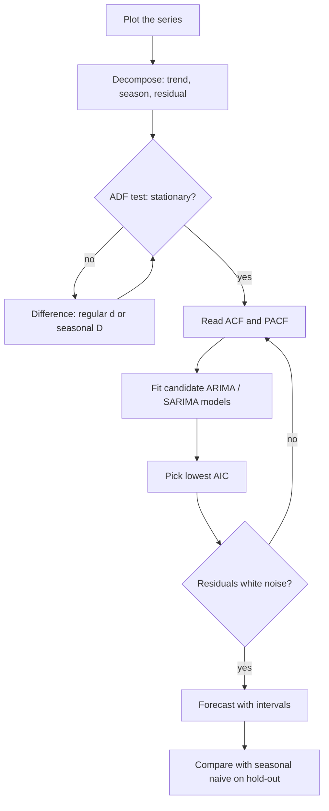
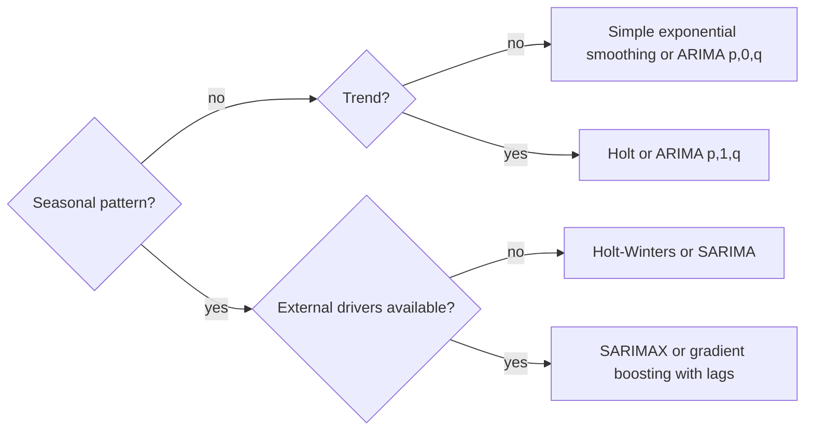
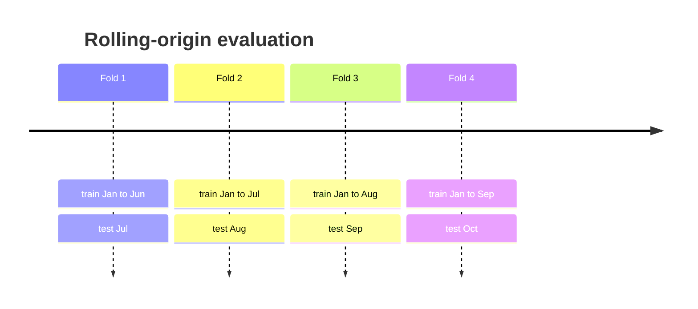
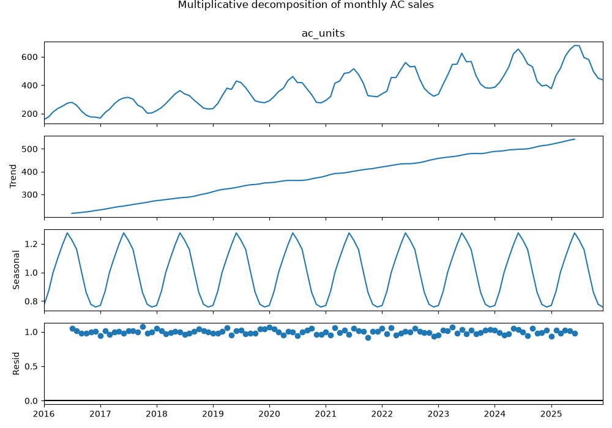
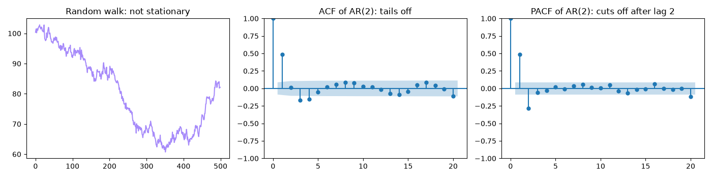
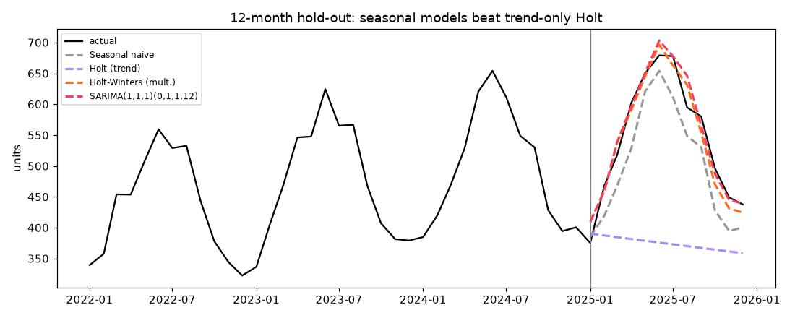
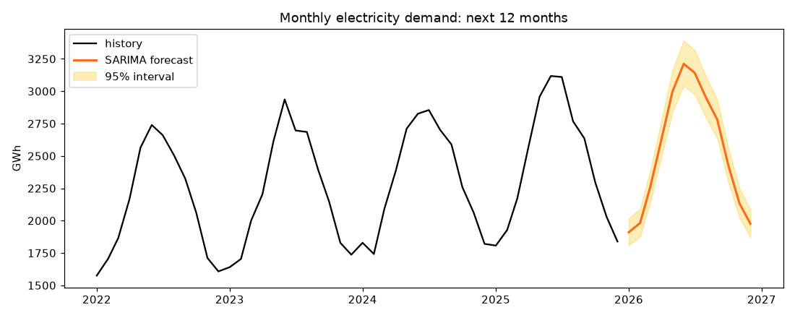

# Session 5 · Advanced Supervised Learning: Time Series Analysis

[](https://colab.research.google.com/github/Hamnakhan123/Diploma-in-Data-Science/blob/main/term-2/03-advanced-data-science-with-python/code/session-05-time-series-analysis.ipynb)

> 📍 [Diploma in Data Science](../../README.md) › [Term 2](../README.md) › [Advanced Data Science with Python](README.md) › **Session 5**

| ⏱ Estimated time | 🧩 Prerequisites | 💻 Tools |
|---|---|---|
| 3 hours | Sessions 2–3 (regression, evaluation metrics) | Python 3.10+, pandas, NumPy, Matplotlib, statsmodels, scikit-learn |

[⬅ Previous: Session 4 · Advanced Supervised Learning: Classification Techniques](session-04-advanced-classification-techniques.md) · [🏠 Module home](README.md) · [Next: Session 6 · Unsupervised Learning ➡](session-06-unsupervised-learning.md)

---

## 🎯 Learning objectives

- Define the fundamentals of **time-series analysis**: trend, seasonality, cycles, noise, **stationarity** and **autocorrelation**.
- List the **types of time-series data** (univariate, multivariate, regular, irregular, panel) and which forecasting models suit each.
- Explain and fit **ARIMA(p, d, q)** models, choosing orders with ACF/PACF plots, the ADF test and AIC.
- Describe and fit **SARIMA(p, d, q)(P, D, Q, s)** for seasonal data.
- Apply **exponential smoothing** (simple, Holt, Holt-Winters) and compare all models with a **time-ordered** evaluation.

## 📖 Concepts

### 1. What makes time series different

A time series is a sequence of values recorded **in time order**: daily sales, hourly electricity load, monthly rainfall. The order carries information, so the usual assumption of independent rows is broken: **today's value is related to yesterday's**. Think of reading a novel: you cannot shuffle the pages and still follow the story.

| Component | Meaning | Example |
|---|---|---|
| **Trend** | long-term rise or fall | a growing city's electricity demand |
| **Seasonality** | pattern that repeats with a fixed period | higher ice-cream sales every summer, peaks every Friday |
| **Cycle** | rises and falls without a fixed period | business cycles of several years |
| **Noise (residual)** | random variation left over | a one-off rainy day |

**Decomposition** separates these: *additive* `y = trend + seasonal + residual` when the seasonal swing has constant size, *multiplicative* `y = trend × seasonal × residual` when it grows with the level (take logs to turn it additive).

### 2. Stationarity and autocorrelation

A series is **stationary** when its mean, variance and autocorrelation do not change over time. A calm lake is stationary; a river flowing downhill (trend) or a tide (seasonality) is not. ARIMA-type models need a stationary series, which we get by **differencing**: `y'ₜ = yₜ − yₜ₋₁` removes a trend; seasonal differencing `yₜ − yₜ₋ₛ` removes a seasonal pattern of period s.

- **ADF test** (Augmented Dickey–Fuller): null hypothesis = *non-stationary*. p < 0.05 → treat as stationary.
- **ACF** (autocorrelation function): correlation of the series with its own lags 1, 2, 3, …
- **PACF** (partial autocorrelation): correlation with lag k after removing the effect of shorter lags.

### 3. Types of time-series data

| Type | Description | Typical models |
|---|---|---|
| Univariate | one variable over time | naive, exponential smoothing, ARIMA/SARIMA |
| Multivariate | several related series, or a target plus drivers (price, temperature) | SARIMAX (exogenous variables), VAR, gradient boosting with lag features |
| Regular | fixed interval (hourly, daily) | all classical models |
| Irregular | events at uneven times (transactions) | resample to a regular grid first, or event models |
| Panel / hierarchical | many series (each store × product) | one global ML model with lags, or one model per series |
| Seasonal vs non-seasonal | repeating pattern or not | Holt-Winters, SARIMA vs Holt, ARIMA |

### 4. ARIMA(p, d, q)

ARIMA combines three ideas:

| Part | Meaning | Analogy |
|---|---|---|
| **AR(p)** AutoRegressive | today depends on the last p values: `yₜ = c + φ₁yₜ₋₁ + … + φₚyₜ₋ₚ + εₜ` | your mood today depends on the last few days' moods |
| **I(d)** Integrated | difference d times to make it stationary | look at daily *changes* instead of levels |
| **MA(q)** Moving Average | today depends on the last q forecast errors: `+ θ₁εₜ₋₁ + … + θ_qεₜ₋q` | yesterday's surprise still echoes today |

**Choosing orders (Box–Jenkins)**: (1) plot; (2) difference until the ADF test passes → d; (3) PACF cuts off after lag p → AR(p); ACF cuts off after lag q → MA(q); (4) fit candidates and pick the lowest **AIC**; (5) check residuals look like white noise (Ljung–Box test p > 0.05).

| Pattern | ACF | PACF | Suggests |
|---|---|---|---|
| AR(p) | tails off slowly | cuts off after lag p | p from PACF |
| MA(q) | cuts off after lag q | tails off | q from ACF |
| ARMA | tails off | tails off | try small p and q, compare AIC |

### 5. SARIMA(p, d, q)(P, D, Q, s)

SARIMA adds a seasonal copy of each part at lag s (s = 12 for monthly data with a yearly pattern, s = 7 for daily data with a weekly pattern). `(P, D, Q, s)` are the seasonal AR order, seasonal differencing and seasonal MA order. The classic "airline model" is SARIMA(0,1,1)(0,1,1,12). **SARIMAX** additionally accepts exogenous regressors (holidays, temperature, price).

### 6. Exponential smoothing

Exponential smoothing forecasts with a **weighted average where recent observations count more**, weights fading by a factor `(1 − α)` each step back. Like remembering last week's weather clearly and last year's only vaguely.

| Method | Captures | Parameters |
|---|---|---|
| Simple (SES) | level only | α (level) |
| Holt (double) | level + trend | α, β (trend); optional damped trend |
| Holt-Winters (triple) | level + trend + seasonality | α, β, γ (season), additive or multiplicative season |

ETS (Error–Trend–Season) models are the statistical framework behind these and give prediction intervals.

### 7. Evaluating forecasts honestly

- **Never shuffle.** Train on the past, test on the most recent block (a **hold-out horizon**), or use **rolling-origin** (expanding-window) evaluation: `TimeSeriesSplit` in scikit-learn.
- Always compare with a **naive** forecast (last value) or a **seasonal naive** forecast (same period last season). A model that cannot beat seasonal naive is not worth deploying.
- Metrics: MAE, RMSE, MAPE (Session 3) and **MASE** (error relative to the naive forecast; < 1 means better than naive).

## 🧭 Diagrams







## 💻 Worked examples

### Example 1 · Basic: building and decomposing a seasonal series

📄 [`code/session-05_decompose.py`](code/session-05_decompose.py)

```python
"""Create a monthly sales series with trend + yearly seasonality + noise and decompose it."""
import numpy as np
import pandas as pd
import matplotlib.pyplot as plt
from statsmodels.tsa.seasonal import seasonal_decompose

rng = np.random.default_rng(0)
idx = pd.date_range("2016-01-01", periods=120, freq="MS")           # 10 years, month starts
t = np.arange(120)
season = 1 + 0.25 * np.sin(2 * np.pi * (t - 2) / 12)                  # summer peak
sales = (200 + 3 * t) * season * np.exp(rng.normal(0, 0.04, 120))     # multiplicative
y = pd.Series(sales.round(1), index=idx, name="ac_units")
print(y.head(14).to_string())

res = seasonal_decompose(y, model="multiplicative", period=12)
print("\nseasonal index by month (1.00 = average):")
print(res.seasonal[:12].round(3).set_axis([d.strftime("%b") for d in idx[:12]]).to_string())

fig = res.plot(); fig.set_size_inches(10, 7)
fig.suptitle("Multiplicative decomposition of monthly AC sales", y=1.0)
fig.tight_layout(); fig.savefig("session-05_decomposition.png", dpi=100); plt.show()
```

**Output**

```text
2016-01-01    157.5
2016-02-01    176.7
2016-03-01    211.3
2016-04-01    236.1
2016-05-01    252.4
2016-06-01    272.7
2016-07-01    279.4
2016-08-01    258.2
2016-09-01    217.8
2016-10-01    188.8
2016-11-01    175.8
2016-12-01    175.0
2017-01-01    168.5
2017-02-01    207.3
Freq: MS

seasonal index by month (1.00 = average):
Jan    0.770
Feb    0.869
Mar    1.000
Apr    1.102
May    1.194
Jun    1.276
Jul    1.226
Aug    1.160
Sep    1.005
Oct    0.861
Nov    0.777
Dec    0.759
```

**Chart produced by this code** (saved as [`code/session-05_decomposition.png`](code/session-05_decomposition.png)):



### Example 2 · Intermediate: stationarity, differencing and ACF/PACF

📄 [`code/session-05_stationarity.py`](code/session-05_stationarity.py)

```python
"""ADF test before and after differencing, and ACF/PACF plots of an AR(2) process."""
import numpy as np
import pandas as pd
import matplotlib.pyplot as plt
from statsmodels.tsa.stattools import adfuller, acf, pacf
from statsmodels.graphics.tsaplots import plot_acf, plot_pacf

rng = np.random.default_rng(1)
# A random walk (non-stationary): a share price
walk = pd.Series(100 + np.cumsum(rng.normal(0, 1, 500)))
def adf(s, name):
    stat, p = adfuller(s.dropna())[:2]
    print(f"{name:<28} ADF stat {stat:7.2f}  p-value {p:.4f}  -> {'stationary' if p < .05 else 'NOT stationary'}")
adf(walk, "random walk (price)")
adf(walk.diff(), "first difference (returns)")

# An AR(2) process: y_t = 0.6 y_{t-1} - 0.3 y_{t-2} + e_t
e = rng.normal(0, 1, 600); ar = np.zeros(600)
for i in range(2, 600):
    ar[i] = 0.6 * ar[i - 1] - 0.3 * ar[i - 2] + e[i]
ar = pd.Series(ar[100:])
adf(ar, "AR(2) process")
print("ACF  lags 1-5:", acf(ar, nlags=5)[1:].round(2))
print("PACF lags 1-5:", pacf(ar, nlags=5)[1:].round(2), " <- cuts off after lag 2")

fig, ax = plt.subplots(1, 3, figsize=(14, 3.5))
ax[0].plot(walk, color="#A78BFA"); ax[0].set_title("Random walk: not stationary")
plot_acf(ar, lags=20, ax=ax[1], title="ACF of AR(2): tails off")
plot_pacf(ar, lags=20, ax=ax[2], title="PACF of AR(2): cuts off after lag 2", method="ywm")
fig.tight_layout(); fig.savefig("session-05_acf_pacf.png", dpi=100); plt.show()
```

**Output**

```text
random walk (price)          ADF stat   -1.72  p-value 0.4226  -> NOT stationary
first difference (returns)   ADF stat  -18.01  p-value 0.0000  -> stationary
AR(2) process                ADF stat  -15.21  p-value 0.0000  -> stationary
ACF  lags 1-5: [ 0.48  0.01 -0.17 -0.15 -0.05]
PACF lags 1-5: [ 0.48 -0.29 -0.06 -0.03  0.02]  <- cuts off after lag 2
```

**Chart produced by this code** (saved as [`code/session-05_acf_pacf.png`](code/session-05_acf_pacf.png)):



### Example 3 · Intermediate: fitting ARIMA and choosing orders by AIC

📄 [`code/session-05_arima.py`](code/session-05_arima.py)

```python
"""Grid-search ARIMA orders by AIC, check residuals with Ljung-Box, forecast with intervals."""
import itertools
import warnings
import numpy as np
import pandas as pd
from statsmodels.tsa.arima.model import ARIMA
from statsmodels.stats.diagnostic import acorr_ljungbox
warnings.filterwarnings("ignore")

rng = np.random.default_rng(2)
# Weekly demand with a gentle trend and AR(1) behaviour
n = 156
e = rng.normal(0, 8, n); y = np.zeros(n)
for i in range(1, n):
    y[i] = 0.7 * y[i - 1] + e[i]
y = pd.Series(500 + 1.5 * np.arange(n) + y, index=pd.date_range("2023-01-01", periods=n, freq="W"))
train, test = y[:-12], y[-12:]

results = []
for p, d, q in itertools.product(range(3), range(2), range(3)):
    try:
        m = ARIMA(train, order=(p, d, q), trend="t" if d == 1 else "ct").fit()
        results.append(((p, d, q), m.aic))
    except Exception:
        pass
results.sort(key=lambda r: r[1])
print("best 5 orders by AIC:")
for order, aic in results[:5]:
    print(f"  ARIMA{order}  AIC = {aic:.1f}")

best_order = results[0][0]
model = ARIMA(train, order=best_order, trend="t" if best_order[1] == 1 else "ct").fit()
lb = acorr_ljungbox(model.resid, lags=[10])
print(f"\nLjung-Box p-value on residuals: {lb['lb_pvalue'].iloc[0]:.3f}  (> 0.05 = residuals look like white noise)")
fc = model.get_forecast(12)
out = pd.DataFrame({"actual": test.round(0), "forecast": fc.predicted_mean.round(0)})
out[["low95", "high95"]] = fc.conf_int().round(0).values
print(out.head(6).to_string())
mae = (out.actual - out.forecast).abs().mean(); naive = (test - train.iloc[-1]).abs().mean()
print(f"\nMAE ARIMA = {mae:.1f}   MAE naive (last value) = {naive:.1f}")
```

**Output**

```text
best 5 orders by AIC:
  ARIMA(2, 0, 1)  AIC = 994.3
  ARIMA(2, 0, 2)  AIC = 996.5
  ARIMA(1, 1, 1)  AIC = 996.9
  ARIMA(2, 1, 1)  AIC = 998.5
  ARIMA(1, 1, 2)  AIC = 998.6

Ljung-Box p-value on residuals: 0.988  (> 0.05 = residuals look like white noise)
            actual  forecast  low95  high95
2025-10-05   703.0     714.0  700.0   728.0
2025-10-12   714.0     715.0  699.0   731.0
2025-10-19   709.0     716.0  699.0   733.0
2025-10-26   727.0     718.0  701.0   734.0
2025-11-02   725.0     719.0  702.0   736.0
2025-11-09   734.0     721.0  704.0   738.0

MAE ARIMA = 6.1   MAE naive (last value) = 9.9
```

### Example 4 · Advanced: SARIMA vs Holt-Winters vs seasonal naive

📄 [`code/session-05_seasonal_models.py`](code/session-05_seasonal_models.py)

```python
"""Compare seasonal naive, Holt, Holt-Winters and SARIMA on a 12-month hold-out; plot the forecasts."""
import warnings
import numpy as np
import pandas as pd
import matplotlib.pyplot as plt
from statsmodels.tsa.holtwinters import ExponentialSmoothing, SimpleExpSmoothing
from statsmodels.tsa.statespace.sarimax import SARIMAX
warnings.filterwarnings("ignore")

rng = np.random.default_rng(0)
idx = pd.date_range("2016-01-01", periods=120, freq="MS"); t = np.arange(120)
y = pd.Series((200 + 3 * t) * (1 + 0.25 * np.sin(2 * np.pi * (t - 2) / 12)) * np.exp(rng.normal(0, .04, 120)), index=idx)
train, test = y[:-12], y[-12:]

fc = {
    "Seasonal naive": pd.Series(train[-12:].values, index=test.index),
    "Simple exp. smoothing": SimpleExpSmoothing(train, initialization_method="estimated").fit().forecast(12),
    "Holt (trend)": ExponentialSmoothing(initialization_method="estimated", endog=train, trend="add").fit().forecast(12),
    "Holt-Winters (mult.)": ExponentialSmoothing(initialization_method="estimated", endog=train, trend="add", seasonal="mul", seasonal_periods=12).fit().forecast(12),
    "SARIMA(1,1,1)(0,1,1,12)": SARIMAX(np.log(train), order=(1, 1, 1), seasonal_order=(0, 1, 1, 12)).fit(disp=False)
                               .forecast(12).pipe(np.exp),
}
naive_mae = (test - fc["Seasonal naive"]).abs().mean()
print(f"{'model':<26}{'MAE':>7}{'RMSE':>7}{'MAPE %':>8}{'MASE':>6}")
for name, f in fc.items():
    err = test - f
    print(f"{name:<26}{err.abs().mean():>7.1f}{np.sqrt((err ** 2).mean()):>7.1f}"
          f"{(err.abs() / test).mean() * 100:>8.1f}{err.abs().mean() / naive_mae:>6.2f}")

hw = ExponentialSmoothing(initialization_method="estimated", endog=train, trend="add", seasonal="mul", seasonal_periods=12).fit()
# Parameters near 0 mean the pattern is so regular that the model barely updates its initial level, trend and season
print(f"\nHolt-Winters smoothing parameters: alpha={hw.params['smoothing_level']:.2f}, "
      f"beta={hw.params['smoothing_trend']:.2f}, gamma={hw.params['smoothing_seasonal']:.2f}")

plt.figure(figsize=(10, 4))
plt.plot(y[-48:], color="black", label="actual")
for name, c in [("Seasonal naive", "#999999"), ("Holt (trend)", "#A78BFA"), ("Holt-Winters (mult.)", "#FF6B1A"), ("SARIMA(1,1,1)(0,1,1,12)", "#F43F5E")]:
    plt.plot(fc[name], ls="--", lw=2, color=c, label=name)
plt.axvline(test.index[0], color="grey", lw=.8); plt.legend(fontsize=8); plt.ylabel("units")
plt.title("12-month hold-out: seasonal models beat trend-only Holt")
plt.tight_layout(); plt.savefig("session-05_forecast_comparison.png", dpi=110); plt.show()
```

**Output**

```text
model                         MAE   RMSE  MAPE %  MASE
Seasonal naive               46.5   49.9     8.6  1.00
Simple exp. smoothing       147.7  173.0    25.0  3.17
Holt (trend)                172.1  195.6    29.5  3.70
Holt-Winters (mult.)         19.6   21.8     3.8  0.42
SARIMA(1,1,1)(0,1,1,12)      14.5   20.9     2.8  0.31

Holt-Winters smoothing parameters: alpha=0.00, beta=0.00, gamma=0.00
```

**Chart produced by this code** (saved as [`code/session-05_forecast_comparison.png`](code/session-05_forecast_comparison.png)):



### Example 5 · Advanced: rolling-origin evaluation and ML with lag features

📄 [`code/session-05_rolling_ml.py`](code/session-05_rolling_ml.py)

```python
"""Rolling-origin CV with TimeSeriesSplit: Holt-Winters vs gradient boosting on lag features."""
import warnings
import numpy as np
import pandas as pd
from sklearn.model_selection import TimeSeriesSplit
from sklearn.ensemble import HistGradientBoostingRegressor
from statsmodels.tsa.holtwinters import ExponentialSmoothing
warnings.filterwarnings("ignore")

rng = np.random.default_rng(5)
idx = pd.date_range("2024-01-01", periods=730, freq="D"); t = np.arange(730)
temp = 28 + 7 * np.sin(2 * np.pi * (t - 100) / 365) + rng.normal(0, 1.5, 730)        # exogenous driver
load = 900 + 0.3 * t + 25 * (temp - 28) + np.where(idx.dayofweek == 6, -120, 0) + rng.normal(0, 25, 730)
df = pd.DataFrame({"load": load, "temp": temp}, index=idx)
for L in [1, 7, 14]:
    df[f"lag_{L}"] = df["load"].shift(L)
df["dow"] = df.index.dayofweek
df["roll7"] = df["load"].shift(1).rolling(7).mean()
df = df.dropna()
features = ["temp", "lag_1", "lag_7", "lag_14", "dow", "roll7"]

tscv = TimeSeriesSplit(n_splits=4, test_size=30)
print("fold  train days  HW MAE  GBM MAE  seasonal-naive MAE")
for k, (tr, te) in enumerate(tscv.split(df), 1):
    train, test = df.iloc[tr], df.iloc[te]
    hw = ExponentialSmoothing(initialization_method="estimated", endog=train["load"], trend="add", seasonal="add", seasonal_periods=7).fit().forecast(len(test))
    gbm = HistGradientBoostingRegressor(random_state=0).fit(train[features], train["load"])
    p = gbm.predict(test[features])            # one-step-ahead: lags are known each morning
    sn = test["lag_7"]
    print(f"{k:>4}  {len(train):>10}  {np.mean(np.abs(test.load - hw.values)):>6.1f}  "
          f"{np.mean(np.abs(test.load - p)):>7.1f}  {np.mean(np.abs(test.load - sn)):>18.1f}")
```

**Output**

```text
fold  train days  HW MAE  GBM MAE  seasonal-naive MAE
   1         596    36.5     39.1                54.1
   2         626    58.9     40.8                49.6
   3         656    48.3     59.7                47.9
   4         686    53.5     55.6                64.7
```

Neither model wins every fold: gradient boosting (with temperature and yesterday's load) wins fold 2 by a wide margin, Holt-Winters wins the other three, and in fold 3 even seasonal naive is competitive. This is exactly why we use **rolling-origin evaluation**: a single split could have crowned either model. Note also a fairness caveat: the boosting model forecasts one day ahead each morning (its lags are known), while Holt-Winters forecasts all 30 days from the fold start, so the comparison flatters boosting slightly.

## 🏙️ Real-life data problem: monthly electricity demand for a distribution company

**Problem.** A power distribution company must plan generation purchases for the next 12 months. Demand has a strong summer peak (air-conditioning) and grows each year. Managers want monthly forecasts with an upper bound to plan for a hot year.

**Full solution.** Inspect → log-transform (multiplicative seasonality) → pick SARIMA orders by AIC on the training years → validate on the last 12 months against Holt-Winters and seasonal naive → refit on all data and forecast the next 12 months with 95% intervals.

📄 [`code/session-05_power_problem.py`](code/session-05_power_problem.py)

```python
"""Real-life problem: 12-month electricity demand forecast with SARIMA order search, validation and intervals."""
import itertools
import warnings
import numpy as np
import pandas as pd
import matplotlib.pyplot as plt
from statsmodels.tsa.statespace.sarimax import SARIMAX
from statsmodels.tsa.holtwinters import ExponentialSmoothing
warnings.filterwarnings("ignore")

rng = np.random.default_rng(42)
idx = pd.date_range("2015-01-01", periods=132, freq="MS"); t = np.arange(132)
summer = np.array([0.80, 0.82, 0.92, 1.05, 1.22, 1.30, 1.25, 1.20, 1.12, 0.98, 0.85, 0.79])
gwh = pd.Series((1500 * 1.045 ** (t / 12)) * summer[idx.month - 1] * np.exp(rng.normal(0, .03, 132)), index=idx)
gwh.iloc[63] *= 1.12                                              # one heat-wave month
train, test = gwh[:-12], gwh[-12:]
print(f"data: {gwh.index[0]:%b %Y} to {gwh.index[-1]:%b %Y}, {len(gwh)} months; average {gwh.mean():.0f} GWh")

# Search small SARIMA orders on log data by AIC
cands = []
for p, q, P, Q in itertools.product([0, 1, 2], [0, 1], [0, 1], [0, 1]):
    try:
        m = SARIMAX(np.log(train), order=(p, 1, q), seasonal_order=(P, 1, Q, 12)).fit(disp=False)
        cands.append((m.aic, (p, 1, q), (P, 1, Q, 12)))
    except Exception:
        pass
cands.sort()
aic, order, sorder = cands[0]
print(f"best SARIMA{order}{sorder} with AIC {aic:.1f}  (searched {len(cands)} models)")

sar = SARIMAX(np.log(train), order=order, seasonal_order=sorder).fit(disp=False)
f_sar = np.exp(sar.forecast(12))
f_hw = ExponentialSmoothing(initialization_method="estimated", endog=train, trend="add", seasonal="mul", seasonal_periods=12).fit().forecast(12)
f_sn = pd.Series(train[-12:].values * (train[-12:].sum() / train[-24:-12].sum()), index=test.index)  # naive + growth
for name, f in [("SARIMA", f_sar), ("Holt-Winters", f_hw), ("Seasonal naive + growth", f_sn)]:
    print(f"{name:<24} validation MAPE = {(np.abs(test - f) / test).mean() * 100:.2f}%")

final = SARIMAX(np.log(gwh), order=order, seasonal_order=sorder).fit(disp=False)
fc = final.get_forecast(12)
plan = pd.DataFrame({"forecast_GWh": np.exp(fc.predicted_mean), "upper95_GWh": np.exp(fc.conf_int().iloc[:, 1])}).round(0)
plan.index = plan.index.strftime("%b %Y")
print("\nPurchase plan for the next 12 months:\n", plan.to_string())
print(f"\nannual total: {plan.forecast_GWh.sum():,.0f} GWh (plan for up to {plan.upper95_GWh.sum():,.0f} GWh)")

ci = np.exp(fc.conf_int())
plt.figure(figsize=(10, 4))
plt.plot(gwh[-48:], color="black", label="history")
plt.plot(np.exp(fc.predicted_mean), color="#FF6B1A", lw=2, label="SARIMA forecast")
plt.fill_between(ci.index, ci.iloc[:, 0], ci.iloc[:, 1], color="#FCD34D", alpha=.4, label="95% interval")
plt.ylabel("GWh"); plt.title("Monthly electricity demand: next 12 months"); plt.legend()
plt.tight_layout(); plt.savefig("session-05_power_forecast.png", dpi=110); plt.show()
```

**Output**

```text
data: Jan 2015 to Dec 2025, 132 months; average 1974 GWh
best SARIMA(0, 1, 1)(1, 1, 1, 12) with AIC -433.8  (searched 24 models)
SARIMA                   validation MAPE = 2.45%
Holt-Winters             validation MAPE = 2.25%
Seasonal naive + growth  validation MAPE = 3.90%

Purchase plan for the next 12 months:
           forecast_GWh  upper95_GWh
Jan 2026        1911.0       2017.0
Feb 2026        1981.0       2092.0
Mar 2026        2260.0       2386.0
Apr 2026        2632.0       2779.0
May 2026        2998.0       3165.0
Jun 2026        3212.0       3391.0
Jul 2026        3143.0       3318.0
Aug 2026        2951.0       3116.0
Sep 2026        2781.0       2936.0
Oct 2026        2431.0       2567.0
Nov 2026        2133.0       2252.0
Dec 2026        1976.0       2086.0

annual total: 30,409 GWh (plan for up to 32,105 GWh)
```

**Chart produced by this code** (saved as [`code/session-05_power_forecast.png`](code/session-05_power_forecast.png)):



**Answer.** On the validation year SARIMA and Holt-Winters are both within about 2.5% (Holt-Winters slightly ahead; a 0.2-point difference is within noise), and both clearly beat the naive benchmark. We keep SARIMA for the final plan because it gives statistically grounded 95% intervals on the log scale. Purchasing contracts should cover the expected value, with options up to the upper bound for the May–September peak.

## ⚠️ Common mistakes

| Mistake | Fix |
|---|---|
| Random `train_test_split` on time series | split by time; `TimeSeriesSplit` for CV |
| Building features that peek into the future (centred rolling mean, future lags) | features at time t may use only data up to t − 1 |
| Fitting ARIMA to a trending series with d = 0 | difference (d = 1) or add a trend term; check with ADF |
| Ignoring multiplicative seasonality | log-transform or use multiplicative Holt-Winters |
| Not comparing with seasonal naive | always report a naive benchmark (MASE) |
| Forecasting far ahead and trusting the point forecast | show prediction intervals; they widen with horizon |

## ✅ Best practices

- Plot first: line plot, seasonal plot, decomposition.
- Use a regular frequency (`asfreq`, `resample`) and handle missing dates explicitly.
- Keep a final hold-out equal to the forecast horizon you need.
- Prefer simple models that beat naive; add complexity (SARIMAX, ML with lags) only if validation improves.
- Refit on all data before producing the real forecast; monitor errors monthly and retrain.

## 🧪 Lab / practice tasks

### 🟢 Task 1 · Easy

Resample the daily load series from Example 5 to weekly totals and monthly means. Plot both.

<details><summary>💡 Hint</summary>

`df["load"].resample("W").sum()` and `.resample("MS").mean()`.

</details>

<details><summary>✅ Solution</summary>

```python
weekly = df["load"].resample("W").sum(); monthly = df["load"].resample("MS").mean()
weekly.plot(title="weekly total"); plt.show(); monthly.plot(title="monthly mean"); plt.show()
```
The weekly totals remove the Sunday dip; the monthly means show the temperature-driven yearly wave and the upward trend.

</details>


### 🟡 Task 2 · Medium

Simulate an MA(1) process `y_t = e_t + 0.8 e_{t-1}` and confirm that the ACF cuts off after lag 1 while the PACF tails off.

<details><summary>💡 Hint</summary>

Generate `e` then `y = e[1:] + 0.8 * e[:-1]`.

</details>

<details><summary>✅ Solution</summary>

```python
e = rng.normal(size=1001); y = e[1:] + 0.8 * e[:-1]
print(acf(y, nlags=4).round(2))   # ~[1, 0.49, 0.0, 0.0, 0.0]
print(pacf(y, nlags=4).round(2))  # alternating, slowly shrinking
```
Theory: lag-1 autocorrelation = θ / (1 + θ²) = 0.8 / 1.64 ≈ 0.49.

</details>


### 🟡 Task 3 · Medium

In Example 4 replace multiplicative with additive seasonality in Holt-Winters. Which is better here, and why?

<details><summary>💡 Hint</summary>

Compare MAPE; look at whether the seasonal swing grows over the years.

</details>

<details><summary>✅ Solution</summary>

Multiplicative is better because the data was generated with a seasonal swing proportional to the level; additive underestimates recent peaks and overestimates troughs.

</details>


### 🟠 Task 4 · Hard

Add `temp` as an exogenous regressor to a SARIMAX model for the daily load in Example 5 (weekly seasonality, s = 7) and compare its 30-day MAE with Holt-Winters.

<details><summary>💡 Hint</summary>

`SARIMAX(train.load, exog=train[["temp"]], order=(1,0,1), seasonal_order=(1,1,1,7))`; pass `exog=test[["temp"]]` to `forecast`.

</details>

<details><summary>✅ Solution</summary>

With known temperatures SARIMAX cuts the 30-day error substantially versus Holt-Winters because most day-to-day variation is temperature-driven. In production you would feed a weather forecast, so the real gain depends on its accuracy.

</details>


### 🔴 Task 5 · Challenge

Write a function `rolling_backtest(series, model_fn, horizon=12, folds=4)` that returns the average MAPE of any forecasting function, and use it to compare Holt-Winters and SARIMA on the electricity data.

<details><summary>💡 Hint</summary>

For fold k, train on `series[: -horizon*(folds-k+1)]` … loop and collect errors.

</details>

<details><summary>✅ Solution</summary>

```python
def rolling_backtest(s, model_fn, horizon=12, folds=4):
    errs = []
    for k in range(folds, 0, -1):
        end = len(s) - horizon * (k - 1)
        tr, te = s[: end - horizon], s[end - horizon: end]
        f = model_fn(tr, horizon)
        errs.append((np.abs(te.values - np.asarray(f)) / te.values).mean() * 100)
    return np.mean(errs)
hw = lambda tr, h: ExponentialSmoothing(initialization_method="estimated", endog=tr, trend="add", seasonal="mul", seasonal_periods=12).fit().forecast(h)
sa = lambda tr, h: np.exp(SARIMAX(np.log(tr), order=(0,1,1), seasonal_order=(0,1,1,12)).fit(disp=False).forecast(h))
print(rolling_backtest(gwh, hw), rolling_backtest(gwh, sa))
```

</details>


## 🧩 Mini project: restaurant daily covers forecaster

Forecast how many customers (covers) a restaurant will serve each day for the next two weeks, with weekly seasonality and a holiday effect, comparing three methods and writing a staffing plan.

📄 [`code/session-05_mini_project.py`](code/session-05_mini_project.py)

```python
"""Mini project: 14-day restaurant demand forecast and staffing plan (Holt-Winters vs SARIMAX vs naive)."""
import warnings
import numpy as np
import pandas as pd
from statsmodels.tsa.holtwinters import ExponentialSmoothing
from statsmodels.tsa.statespace.sarimax import SARIMAX
warnings.filterwarnings("ignore")

rng = np.random.default_rng(9)
idx = pd.date_range("2025-09-01", periods=420, freq="D")
dow_effect = np.array([0.8, 0.75, 0.8, 0.9, 1.25, 1.45, 1.3])        # Mon..Sun
holiday = pd.Series(0, index=idx); holiday[idx[::45]] = 1               # a public holiday roughly every 45 days
covers = (120 + 0.05 * np.arange(420)) * dow_effect[idx.dayofweek] * (1 + 0.35 * holiday.values) \
         * np.exp(rng.normal(0, .07, 420))
y = pd.Series(covers.round(), index=idx)
train, test = y[:-14], y[-14:]
hol_tr, hol_te = holiday[:-14].to_frame("hol"), holiday[-14:].to_frame("hol")

f_naive = pd.Series(train[-7:].tolist() * 2, index=test.index)
f_hw = ExponentialSmoothing(initialization_method="estimated", endog=train, trend="add", seasonal="mul", seasonal_periods=7).fit().forecast(14)
sx = SARIMAX(np.log(train), exog=hol_tr, order=(1, 0, 1), seasonal_order=(1, 1, 1, 7), trend="c").fit(disp=False)
f_sx = np.exp(sx.forecast(14, exog=hol_te))
for name, f in [("Seasonal naive", f_naive), ("Holt-Winters", f_hw), ("SARIMAX + holiday", f_sx)]:
    print(f"{name:<18} MAE = {np.abs(test - f).mean():5.1f} covers/day")

# Refit SARIMAX on all data (near-tied with Holt-Winters, and it can use the holiday flag) and plan 14 days (no holidays ahead)
future_idx = pd.date_range(y.index[-1] + pd.Timedelta(days=1), periods=14, freq="D")
final = SARIMAX(np.log(y), exog=holiday.to_frame("hol"), order=(1, 0, 1), seasonal_order=(1, 1, 1, 7), trend="c").fit(disp=False)
fc = np.exp(final.forecast(14, exog=pd.DataFrame({"hol": 0}, index=future_idx)))
plan = pd.DataFrame({"day": future_idx.strftime("%a %d %b"), "covers": fc.round().astype(int).values})
plan["waiters_needed"] = np.ceil(plan["covers"] / 25).astype(int)     # one waiter per 25 covers
print("\n" + plan.to_string(index=False))
```

**Output**

```text
Seasonal naive     MAE =  12.8 covers/day
Holt-Winters       MAE =  10.3 covers/day
SARIMAX + holiday  MAE =  10.6 covers/day

       day  covers  waiters_needed
Mon 26 Oct     115               5
Tue 27 Oct     107               5
Wed 28 Oct     113               5
Thu 29 Oct     128               6
Fri 30 Oct     176               8
Sat 31 Oct     208               9
Sun 01 Nov     184               8
Mon 02 Nov     116               5
Tue 03 Nov     108               5
Wed 04 Nov     114               5
Thu 05 Nov     128               6
Fri 06 Nov     176               8
Sat 07 Nov     208               9
Sun 08 Nov     184               8
```

## ✅ Quick quiz

**Q1.** A pattern that repeats every 7 days in daily sales is…

- **A)** trend
- **B)** seasonality
- **C)** noise
- **D)** a cycle

<details><summary>Show answer</summary>

**B** — It has a fixed period.

</details>

**Q2.** The null hypothesis of the ADF test is that the series is…

- **A)** stationary
- **B)** non-stationary
- **C)** seasonal
- **D)** normally distributed

<details><summary>Show answer</summary>

**B** — p < 0.05 rejects it, suggesting stationarity.

</details>

**Q3.** In ARIMA(2,1,0), the "1" means…

- **A)** one MA term
- **B)** the series is differenced once
- **C)** one seasonal lag
- **D)** one exogenous variable

<details><summary>Show answer</summary>

**B** — d = number of differences.

</details>

**Q4.** A PACF that cuts off sharply after lag 3 suggests…

- **A)** MA(3)
- **B)** AR(3)
- **C)** seasonal differencing
- **D)** white noise

<details><summary>Show answer</summary>

**B** — AR order is read from the PACF.

</details>

**Q5.** Holt-Winters adds which component to Holt's method?

- **A)** level
- **B)** trend
- **C)** seasonality
- **D)** exogenous variables

<details><summary>Show answer</summary>

**C** — Triple exponential smoothing = level + trend + season.

</details>


## 📝 Summary

- Time series have **trend, seasonality, cycles and noise**; order matters, so split and validate by time.
- **Stationarity** (check with ADF) is needed for ARIMA; difference to get it; read **ACF/PACF** for q and p.
- **ARIMA(p,d,q)** = autoregression + differencing + moving-average errors; **SARIMA** adds seasonal terms; **SARIMAX** adds drivers.
- **Exponential smoothing**: SES (level), Holt (trend), Holt-Winters (season).
- Always beat **seasonal naive**, report intervals and use rolling-origin evaluation.

### 🎤 Interview / viva questions

1. What is stationarity and why does ARIMA need it?
2. How do you choose p, d and q?
3. Explain the difference between additive and multiplicative seasonality with examples.
4. When would you use SARIMAX instead of SARIMA?
5. Why is a random train/test split wrong for time series?
6. What is MASE and why is it useful?

---

[⬅ Previous: Session 4 · Advanced Supervised Learning: Classification Techniques](session-04-advanced-classification-techniques.md) · [🏠 Module home](README.md) · [Next: Session 6 · Unsupervised Learning ➡](session-06-unsupervised-learning.md)

<sub>Diploma in Data Science · Prepared by **Hamna Zahid Khan**, Junior Lecturer</sub>
