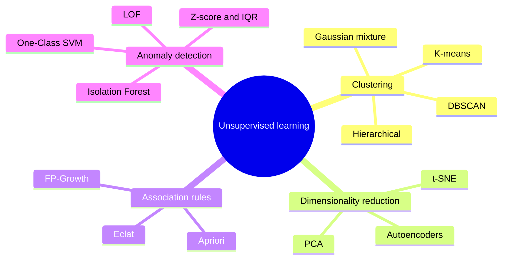
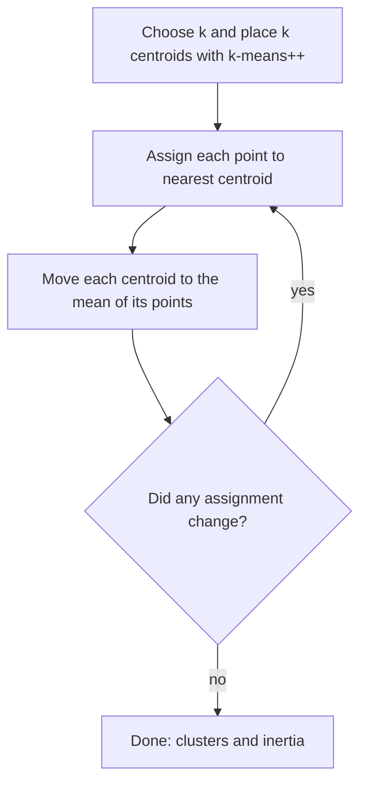
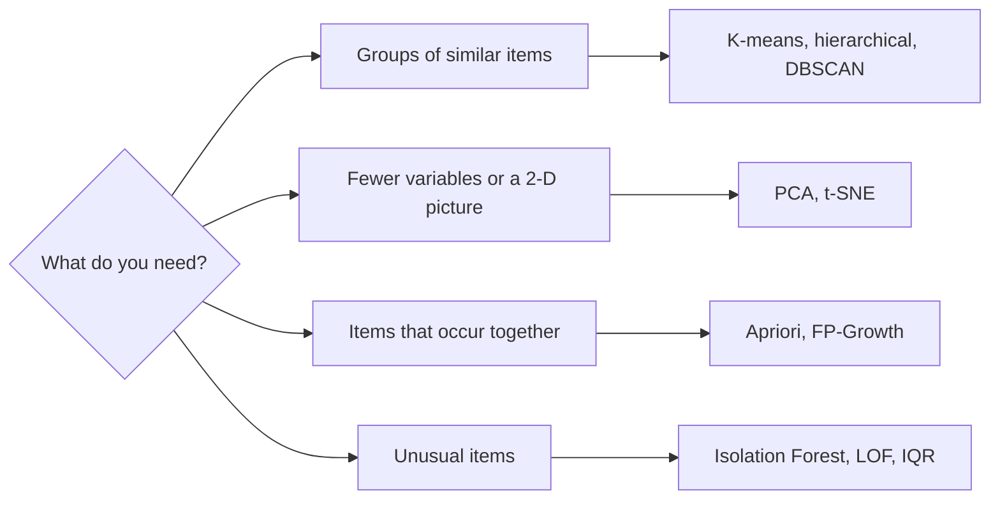
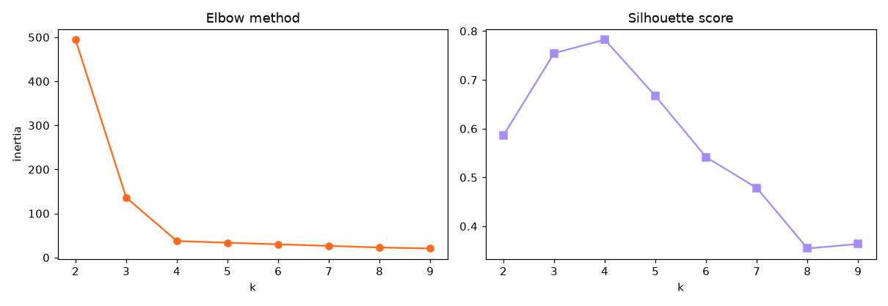
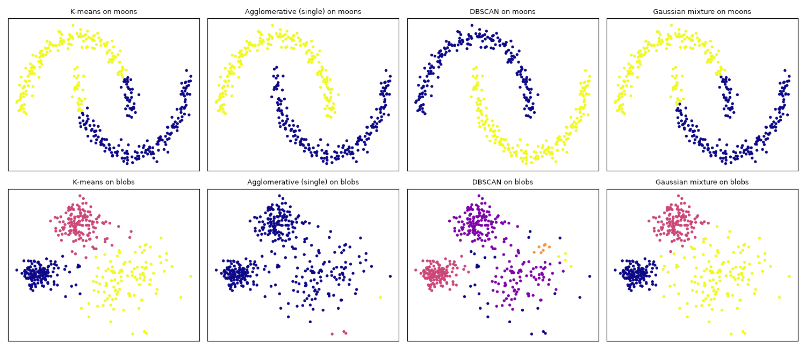
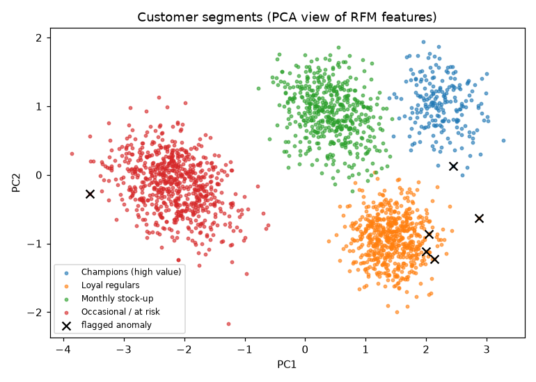

# Session 6 · Unsupervised Learning

[](https://colab.research.google.com/github/Hamnakhan123/Diploma-in-Data-Science/blob/main/term-2/03-advanced-data-science-with-python/code/session-06-unsupervised-learning.ipynb)

> 📍 [Diploma in Data Science](../../README.md) › [Term 2](../README.md) › [Advanced Data Science with Python](README.md) › **Session 6**

| ⏱ Estimated time | 🧩 Prerequisites | 💻 Tools |
|---|---|---|
| 3 hours | Session 1 (types of ML), basic statistics (mean, standard deviation) | Python 3.10+, NumPy, pandas, Matplotlib, scikit-learn, mlxtend |

[⬅ Previous: Session 5 · Advanced Supervised Learning: Time Series Analysis](session-05-time-series-analysis.md) · [🏠 Module home](README.md) · [Next: Session 7 · Advanced Unsupervised Learning: Clustering Algorithms ➡](session-07-advanced-clustering-algorithms.md)

---

## 🎯 Learning objectives

- Explain what **unsupervised learning** is and name its key algorithm families.
- Describe the main **clustering techniques** (partitioning, hierarchical, density-based, model-based) and run K-means correctly, choosing *k* with the elbow and silhouette methods.
- Explain the idea of **dimensionality reduction** and use PCA to compress and visualise data.
- Describe **association rule learning** with support, confidence and lift.
- Use statistical and ML techniques for **anomaly detection**: z-score, IQR, Isolation Forest, Local Outlier Factor and One-Class SVM.

## 📖 Concepts

### 1. Learning without an answer key

In supervised learning a teacher marks every answer. In **unsupervised learning** there is no `y`: the algorithm must discover structure on its own. Imagine being handed a box of 5,000 old family photos with no captions: you would naturally sort them by people, places and decades, notice that most are ordinary and spot the odd one out. Those three instincts are clustering, dimensionality reduction/pattern finding, and anomaly detection.

| Family | Question it answers | Key algorithms | Business example |
|---|---|---|---|
| **Clustering** | which items are similar? | K-means, hierarchical, DBSCAN, GMM, Mean Shift | customer segments |
| **Dimensionality reduction** | can we describe the data with fewer variables? | PCA, t-SNE, UMAP, autoencoders | compress 300 survey questions into 5 attitudes |
| **Association rules** | which things occur together? | Apriori, FP-Growth, Eclat | "customers who buy tea also buy rusks" |
| **Anomaly detection** | which items are unusual? | z-score/IQR, Isolation Forest, LOF, One-Class SVM | card fraud, faulty sensors |

**Why it matters**: labels are expensive (a doctor must label every scan), while unlabelled data is plentiful. Unsupervised methods also feed supervised ones: cluster IDs and PCA components become features.

**The catch**: with no answer key, evaluation is harder. We use internal measures (silhouette), stability checks and, above all, **whether the result is useful and makes sense to a domain expert**.

### 2. Clustering techniques

| Approach | Idea | Algorithm | Shape of clusters | Need k? |
|---|---|---|---|---|
| Partitioning | assign each point to the nearest centre | **K-means**, K-medoids | round, similar size | yes |
| Hierarchical | merge (or split) groups step by step into a tree (dendrogram) | Agglomerative (Ward, average, complete) | depends on linkage | cut the tree |
| Density-based | clusters are dense regions separated by sparse space | **DBSCAN**, HDBSCAN | any shape, finds noise | no |
| Model-based | data comes from a mix of probability distributions | **Gaussian Mixture** | elliptical, soft membership | yes |

**K-means in four steps** (like placing k ice-cream carts on a beach so every sunbather walks the shortest distance):

1. Place k centroids (scikit-learn uses smart **k-means++** starts).
2. **Assign** every point to its nearest centroid.
3. **Update** each centroid to the mean of its points.
4. Repeat 2–3 until assignments stop changing. It minimises **inertia** (within-cluster sum of squared distances).

**Choosing k**: the **elbow method** plots inertia against k and looks for the bend; the **silhouette score** (from −1 to 1) compares each point's distance to its own cluster with the nearest other cluster; higher is better. Always **scale features first**, because K-means uses distances.

### 3. Dimensionality reduction (preview of Session 8)

Many columns are redundant: height in cm and height in inches carry the same information. **PCA (Principal Component Analysis)** finds new axes (**principal components**) that capture the most variance, ordered from most to least important. Like photographing a 3-D object from the angle that shows the most detail: a flat photo, little lost. Uses: visualising high-dimensional data in 2-D, removing noise, speeding up models, fighting the curse of dimensionality.

### 4. Association rule learning (more in Session 9)

Rules have the form **{antecedent} → {consequent}**, e.g. {bread, eggs} → {milk}.

| Measure | Formula | Meaning |
|---|---|---|
| **Support** | P(A and B) | how often the items appear together |
| **Confidence** | P(B \| A) = support(A,B) / support(A) | how often the rule is right when A is bought |
| **Lift** | confidence / support(B) | > 1: A makes B more likely; = 1: independent; < 1: A makes B less likely |

**Apriori** prunes the search with one fact: *if an itemset is rare, every bigger set containing it is rare too*.

### 5. Anomaly detection

An anomaly (outlier) is a point that does not fit the pattern of the rest: the one shopper paying Rs 900,000 at 3 am.

| Technique | How it flags anomalies | Good for |
|---|---|---|
| **Z-score** | \|x − mean\| / sd > 3 | one roughly normal variable |
| **IQR rule** | below Q1 − 1.5·IQR or above Q3 + 1.5·IQR | one skewed variable; robust |
| **Isolation Forest** | random splits isolate odd points in very few cuts | many features, large data |
| **Local Outlier Factor (LOF)** | point's local density much lower than its neighbours' | clusters of different density |
| **One-Class SVM** | learns a boundary around normal data | small/medium data, smooth boundary |
| DBSCAN | points in no dense region are labelled noise (−1) | spatial data |

Key setting: **`contamination`**, the expected share of anomalies. Anomalies are rare, so evaluation uses precision/recall on any labelled cases you have, and human review.

## 🧭 Diagrams







## 💻 Worked examples

### Example 1 · Basic: K-means from scratch on 2-D data

📄 [`code/session-06_kmeans_scratch.py`](code/session-06_kmeans_scratch.py)

```python
"""K-means written from scratch with NumPy: assign, update, repeat, and track inertia."""
import numpy as np

rng = np.random.default_rng(0)
# Three neighbourhoods of delivery addresses (km east, km north)
X = np.vstack([rng.normal([2, 2], .6, (50, 2)), rng.normal([8, 3], .8, (50, 2)), rng.normal([5, 8], .7, (50, 2))])

def kmeans(X, k, iters=20, seed=1):
    r = np.random.default_rng(seed)
    centres = X[r.choice(len(X), k, replace=False)]           # random initial centres
    for it in range(iters):
        d = np.linalg.norm(X[:, None, :] - centres[None, :, :], axis=2)   # distance to each centre
        labels = d.argmin(axis=1)                                         # assign
        new = np.array([X[labels == j].mean(axis=0) for j in range(k)])   # update
        inertia = ((X - new[labels]) ** 2).sum()
        print(f"iteration {it + 1}: inertia = {inertia:8.2f}")
        if np.allclose(new, centres):
            break
        centres = new
    return labels, centres

labels, centres = kmeans(X, 3)
print("\nfinal centres (km):\n", centres.round(2))
print("points per cluster:", np.bincount(labels))
```

**Output**

```text
iteration 1: inertia =   520.38
iteration 2: inertia =   149.83
iteration 3: inertia =   149.83

final centres (km):
 [[1.99 2.11]
 [7.9  3.02]
 [4.75 8.05]]
points per cluster: [50 50 50]
```

The three centres land at the three neighbourhoods; these could be the locations of three delivery hubs.

### Example 2 · Intermediate: choosing k with elbow and silhouette

📄 [`code/session-06_choose_k.py`](code/session-06_choose_k.py)

```python
"""Elbow (inertia) and silhouette analysis to choose k for K-means; saves a two-panel chart."""
import numpy as np
import matplotlib.pyplot as plt
from sklearn.datasets import make_blobs
from sklearn.cluster import KMeans
from sklearn.metrics import silhouette_score
from sklearn.preprocessing import StandardScaler

X, _ = make_blobs(n_samples=600, centers=4, cluster_std=1.1, random_state=7)
X = StandardScaler().fit_transform(X)
ks = range(2, 10)
inertia, sil = [], []
for k in ks:
    km = KMeans(n_clusters=k, n_init=10, random_state=0).fit(X)
    inertia.append(km.inertia_); sil.append(silhouette_score(X, km.labels_))
    print(f"k={k}: inertia={km.inertia_:7.1f}  silhouette={sil[-1]:.3f}")
print("best k by silhouette:", list(ks)[int(np.argmax(sil))])

fig, ax = plt.subplots(1, 2, figsize=(11, 3.8))
ax[0].plot(list(ks), inertia, "o-", color="#FF6B1A"); ax[0].set_title("Elbow method"); ax[0].set_xlabel("k"); ax[0].set_ylabel("inertia")
ax[1].plot(list(ks), sil, "s-", color="#A78BFA"); ax[1].set_title("Silhouette score"); ax[1].set_xlabel("k")
fig.tight_layout(); fig.savefig("session-06_choose_k.png", dpi=110); plt.show()
```

**Output**

```text
k=2: inertia=  494.4  silhouette=0.586
k=3: inertia=  135.9  silhouette=0.755
k=4: inertia=   37.4  silhouette=0.782
k=5: inertia=   33.6  silhouette=0.667
k=6: inertia=   30.0  silhouette=0.542
k=7: inertia=   26.4  silhouette=0.478
k=8: inertia=   22.8  silhouette=0.354
k=9: inertia=   20.6  silhouette=0.364
best k by silhouette: 4
```

**Chart produced by this code** (saved as [`code/session-06_choose_k.png`](code/session-06_choose_k.png)):



### Example 3 · Intermediate: four clustering families on tricky shapes

📄 [`code/session-06_cluster_families.py`](code/session-06_cluster_families.py)

```python
"""K-means, agglomerative, DBSCAN and Gaussian mixture on moons and blobs: who copes with which shape?"""
import numpy as np
import matplotlib.pyplot as plt
from sklearn.datasets import make_moons, make_blobs
from sklearn.preprocessing import StandardScaler
from sklearn.cluster import KMeans, AgglomerativeClustering, DBSCAN
from sklearn.mixture import GaussianMixture
from sklearn.metrics import adjusted_rand_score

moons, ym = make_moons(400, noise=.06, random_state=0)
blobs, yb = make_blobs(400, centers=[[0, 0], [4, 0], [2, 3]], cluster_std=[.4, 1.2, .6], random_state=0)
datasets = {"moons": (StandardScaler().fit_transform(moons), ym), "blobs": (StandardScaler().fit_transform(blobs), yb)}
algos = {
    "K-means": lambda k: KMeans(k, n_init=10, random_state=0),
    "Agglomerative (single)": lambda k: AgglomerativeClustering(k, linkage="single"),
    "DBSCAN": lambda k: DBSCAN(eps=0.3, min_samples=5),
    "Gaussian mixture": lambda k: GaussianMixture(k, random_state=0),
}
fig, axes = plt.subplots(2, 4, figsize=(15, 6.5))
print(f"{'algorithm':<24}{'moons ARI':>10}{'blobs ARI':>10}")
scores = {a: [] for a in algos}
for r, (dname, (X, y)) in enumerate(datasets.items()):
    k = len(set(y))
    for c, (aname, make) in enumerate(algos.items()):
        labels = make(k).fit_predict(X)
        scores[aname].append(adjusted_rand_score(y, labels))
        axes[r, c].scatter(X[:, 0], X[:, 1], c=labels, cmap="plasma", s=8)
        axes[r, c].set_title(f"{aname} on {dname}", fontsize=9); axes[r, c].set_xticks([]); axes[r, c].set_yticks([])
for a, s in scores.items():
    print(f"{a:<24}{s[0]:>10.2f}{s[1]:>10.2f}")
fig.tight_layout(); fig.savefig("session-06_cluster_families.png", dpi=100); plt.show()
```

**Output**

```text
algorithm                moons ARI blobs ARI
K-means                       0.47      0.84
Agglomerative (single)        1.00      0.00
DBSCAN                        1.00      0.55
Gaussian mixture              0.50      0.94
```

**Chart produced by this code** (saved as [`code/session-06_cluster_families.png`](code/session-06_cluster_families.png)):



ARI (adjusted Rand index) compares clusters with the true groups: 1 = perfect, 0 = random. Density and single-linkage methods follow the curved moons; K-means and GMM prefer round/elliptical blobs. Single linkage fails completely on the blobs: it chains the overlapping groups together. No algorithm wins everywhere.

### Example 4 · Intermediate: PCA and association rules in a few lines

📄 [`code/session-06_pca_rules.py`](code/session-06_pca_rules.py)

```python
"""PCA on the 64-pixel digits data, then Apriori association rules with mlxtend."""
import pandas as pd
from sklearn.datasets import load_digits
from sklearn.decomposition import PCA
from mlxtend.preprocessing import TransactionEncoder
from mlxtend.frequent_patterns import apriori, association_rules

X, y = load_digits(return_X_y=True)                    # 1797 images, 8x8 = 64 features
pca = PCA().fit(X)
cum = pca.explained_variance_ratio_.cumsum()
for n in [2, 10, 20, 30]:
    print(f"{n:>2} components keep {cum[n - 1]:.1%} of the variance")
print("components needed for 90%:", int((cum < .90).sum()) + 1, "of 64")

baskets = [["tea", "sugar", "rusk"], ["tea", "sugar"], ["tea", "milk", "rusk"], ["bread", "eggs", "milk"],
           ["bread", "eggs"], ["tea", "sugar", "milk"], ["bread", "milk", "eggs", "tea"], ["tea", "rusk"],
           ["sugar", "tea", "rusk"], ["eggs", "bread", "butter"]]
te = TransactionEncoder()
onehot = pd.DataFrame(te.fit(baskets).transform(baskets), columns=te.columns_)
freq = apriori(onehot, min_support=0.3, use_colnames=True)
rules = association_rules(freq, metric="lift", min_threshold=1.2)
rules["rule"] = rules["antecedents"].apply(lambda s: ", ".join(sorted(s))) + " -> " + rules["consequents"].apply(lambda s: ", ".join(sorted(s)))
print("\n", rules[["rule", "support", "confidence", "lift"]].round(2).sort_values("lift", ascending=False).to_string(index=False))
```

**Output**

```text
 2 components keep 28.5% of the variance
10 components keep 73.8% of the variance
20 components keep 89.4% of the variance
30 components keep 95.9% of the variance
components needed for 90%: 21 of 64

          rule  support  confidence  lift
eggs -> bread      0.4        1.00  2.50
bread -> eggs      0.4        1.00  2.50
  rusk -> tea      0.4        1.00  1.43
  tea -> rusk      0.4        0.57  1.43
 tea -> sugar      0.4        0.57  1.43
 sugar -> tea      0.4        1.00  1.43
```

### Example 5 · Advanced: anomaly detection, five ways

📄 [`code/session-06_anomalies.py`](code/session-06_anomalies.py)

```python
"""Detect injected anomalies in sensor data with z-score, IQR, Isolation Forest, LOF and One-Class SVM."""
import numpy as np
from sklearn.ensemble import IsolationForest
from sklearn.neighbors import LocalOutlierFactor
from sklearn.svm import OneClassSVM
from sklearn.preprocessing import StandardScaler
from sklearn.metrics import precision_score, recall_score

rng = np.random.default_rng(3)
# Factory motor: temperature (°C) and vibration (mm/s) are correlated in normal operation
temp = rng.normal(70, 4, 980)
vib = 2 + 0.05 * (temp - 70) + rng.normal(0, .15, 980)
normal = np.c_[temp, vib]
# 20 anomalies: normal temperature but unusual vibration for that temperature (a bearing fault)
t_bad = rng.normal(70, 4, 20)
bad = np.c_[t_bad, 2 + 0.05 * (t_bad - 70) + rng.choice([-1, 1], 20) * rng.uniform(.6, 1.0, 20)]
X = np.vstack([normal, bad]); y = np.r_[np.zeros(980), np.ones(20)].astype(int)
Xs = StandardScaler().fit_transform(X)

def report(name, flags):
    print(f"{name:<22} flagged {flags.sum():>3}  precision {precision_score(y, flags):.2f}  recall {recall_score(y, flags):.2f}")

z = np.abs(Xs).max(axis=1); report("z-score > 3 (per col)", (z > 3).astype(int))
q1, q3 = np.percentile(X, [25, 75], axis=0); iqr = q3 - q1
report("IQR rule (per col)", ((X < q1 - 1.5 * iqr) | (X > q3 + 1.5 * iqr)).any(axis=1).astype(int))
report("Isolation Forest", (IsolationForest(contamination=.02, random_state=0).fit_predict(Xs) == -1).astype(int))
report("Local Outlier Factor", (LocalOutlierFactor(n_neighbors=30, contamination=.02).fit_predict(Xs) == -1).astype(int))
report("One-Class SVM", (OneClassSVM(nu=.02, gamma=.5).fit(Xs).predict(Xs) == -1).astype(int))
```

**Output**

```text
z-score > 3 (per col)  flagged  15  precision 0.73  recall 0.55
IQR rule (per col)     flagged  22  precision 0.55  recall 0.60
Isolation Forest       flagged  20  precision 0.40  recall 0.40
Local Outlier Factor   flagged  20  precision 1.00  recall 1.00
One-Class SVM          flagged  43  precision 0.23  recall 0.50
```

The faults hide **inside the normal temperature range**: what is wrong is the *combination* of temperature and vibration. **LOF** finds all 20 with no false alarms because it compares each point's density with its neighbours'. The one-column rules catch only the most extreme half. Isolation Forest and One-Class SVM with default-style settings do poorly here, which is a lesson in itself: **anomaly detectors need tuning and validation** on whatever labelled incidents you have (try `gamma` values for the One-Class SVM in the lab).

## 🏙️ Real-life data problem: segmenting supermarket customers

**Problem.** A supermarket chain has a year of loyalty-card data and wants 3–5 customer segments to design targeted offers. There are no labels.

**Full solution.** Build **RFM** features (Recency, Frequency, Monetary) plus basket size, log-transform skewed columns, scale, choose k by silhouette, profile segments in business terms, flag anomalous customers for review, and visualise with PCA.

📄 [`code/session-06_rfm_problem.py`](code/session-06_rfm_problem.py)

```python
"""Real-life problem: RFM customer segmentation with K-means, profiling, PCA view and anomaly flags."""
import numpy as np
import pandas as pd
import matplotlib.pyplot as plt
from sklearn.preprocessing import StandardScaler
from sklearn.cluster import KMeans
from sklearn.metrics import silhouette_score
from sklearn.decomposition import PCA
from sklearn.ensemble import IsolationForest

rng = np.random.default_rng(12)
groups = [  # (count, recency days, visits/year, avg basket Rs)
    (600, 10, 60, 1800),    # loyal regulars
    (500, 40, 12, 4500),    # monthly big-basket shoppers
    (700, 120, 4, 900),     # occasional
    (200, 15, 35, 9000),    # high-value families
]
rows = []
for n, r, f, m in groups:
    rows.append(pd.DataFrame({"recency_days": rng.gamma(2, r / 2, n).round() + 1,
                              "frequency": rng.poisson(f, n) + 1,
                              "avg_basket": rng.lognormal(np.log(m), .25, n).round()}))
cust = pd.concat(rows, ignore_index=True)
cust["monetary"] = cust["frequency"] * cust["avg_basket"]
cust.loc[rng.choice(len(cust), 6, replace=False), "monetary"] *= 15     # a few suspicious accounts

features = ["recency_days", "frequency", "avg_basket", "monetary"]
X = StandardScaler().fit_transform(np.log1p(cust[features]))           # log first: RFM is very skewed
for k in range(2, 8):
    lab = KMeans(k, n_init=10, random_state=0).fit_predict(X)
    print(f"k={k}: silhouette = {silhouette_score(X, lab):.3f}")
km = KMeans(4, n_init=10, random_state=0).fit(X)
cust["segment"] = km.labels_

profile = cust.groupby("segment")[features].median().round(0)
profile["customers"] = cust["segment"].value_counts().sort_index()
profile = profile.sort_values("monetary", ascending=False)
names = ["Champions (high value)", "Loyal regulars", "Monthly stock-up", "Occasional / at risk"]
profile["name"] = names
print("\nSegment profiles (medians):\n", profile.to_string())

# Consistency check: total spend should equal visits x average basket; a big gap is suspicious
cust["spend_gap"] = np.log(cust["monetary"] / (cust["frequency"] * cust["avg_basket"]))
X_anom = np.c_[X, StandardScaler().fit_transform(cust[["spend_gap"]])]
cust["anomaly"] = IsolationForest(contamination=0.003, random_state=0).fit_predict(X_anom) == -1
print(f"\naccounts flagged for review: {cust['anomaly'].sum()}")
print(cust[cust["anomaly"]][features + ["spend_gap"]].round(1).to_string())

name_of = dict(zip(profile.index, names))
P = PCA(2).fit_transform(X)
plt.figure(figsize=(7, 5))
for s in profile.index:
    m = cust["segment"] == s
    plt.scatter(P[m, 0], P[m, 1], s=8, alpha=.6, label=name_of[s])
plt.scatter(P[cust.anomaly, 0], P[cust.anomaly, 1], marker="x", s=60, color="black", label="flagged anomaly")
plt.xlabel("PC1"); plt.ylabel("PC2"); plt.title("Customer segments (PCA view of RFM features)"); plt.legend(fontsize=8)
plt.tight_layout(); plt.savefig("session-06_customer_segments.png", dpi=110); plt.show()
```

**Output**

```text
k=2: silhouette = 0.569
k=3: silhouette = 0.561
k=4: silhouette = 0.585
k=5: silhouette = 0.487
k=6: silhouette = 0.455
k=7: silhouette = 0.377

Segment profiles (medians):
          recency_days  frequency  avg_basket  monetary  customers                    name
segment
3                14.0       37.0      9064.0  330444.0        207  Champions (high value)
2                10.0       60.0      1783.0  109964.0        599          Loyal regulars
0                35.0       13.0      4480.0   56895.0        494        Monthly stock-up
1               101.0        5.0       912.0    4398.0        700    Occasional / at risk

accounts flagged for review: 6
      recency_days  frequency  avg_basket   monetary  spend_gap
220            7.0         43      1543.0   995235.0        2.7
315           11.0         81      1118.0  1358370.0        2.7
393            5.0         64      2384.0  2288640.0        2.7
519           20.0         56      3028.0  2543520.0        2.7
548            9.0         58      1215.0  1057050.0        2.7
1381          99.0          1       604.0      604.0        0.0
```

**Chart produced by this code** (saved as [`code/session-06_customer_segments.png`](code/session-06_customer_segments.png)):



**Answer.** Four segments with clear business meaning. Suggested actions: **Champions** get early access and premium-brand offers; **loyal regulars** get points multipliers; **monthly stock-up** shoppers get bulk discounts timed with salary week; **occasional** shoppers get a win-back voucher. Five of the six flagged accounts, whose total spend is about 15 times what their visits and basket size explain (`spend_gap` ≈ log 15 ≈ 2.7), go to the fraud team: a typical sign of shared or abused loyalty cards. The sixth is just an extreme one-visit customer and can be cleared quickly by a reviewer.

## ⚠️ Common mistakes

| Mistake | Fix |
|---|---|
| K-means on unscaled or very skewed features | log-transform skewed money/count columns, then standardise |
| Picking k only because a manager asked for "5 segments" | check silhouette/elbow, then agree on a k that is both valid and usable |
| Using K-means for non-round shapes | try DBSCAN, single/average linkage or GMM |
| Judging clusters with no domain sense-check | profile every cluster in business terms |
| Mining rules with very low support | thousands of meaningless rules; raise `min_support`, filter by lift |
| Single-column outlier rules on multivariate data | use Isolation Forest, LOF or One-Class SVM |

## ✅ Best practices

- Start with clear goals: what decision will the clusters, components or anomalies support?
- Run K-means with several starts (`n_init=10`) and a fixed `random_state`.
- Check **cluster stability**: re-run on bootstrap samples; good segments barely change.
- Combine methods: PCA for a picture, clustering for groups, Isolation Forest for oddities.
- Document feature transforms so new customers can be assigned with `km.predict()`.

## 🧪 Lab / practice tasks

### 🟢 Task 1 · Easy

Run the from-scratch K-means in Example 1 with `k = 2` and `k = 5`. What happens to the inertia and the centres?

<details><summary>💡 Hint</summary>

Inertia always falls as k grows; look at whether centres still match real neighbourhoods.

</details>

<details><summary>✅ Solution</summary>

With k = 2 two neighbourhoods are merged (high inertia). With k = 5 one or two real neighbourhoods are split in half; inertia is lower but the extra hubs are not meaningful. This is why "lowest inertia" cannot choose k.

</details>


### 🟡 Task 2 · Medium

Compute support, confidence and lift **by hand** for the rule {tea} → {sugar} using the ten baskets in Example 4, then check against mlxtend.

<details><summary>💡 Hint</summary>

Count baskets with tea, with sugar, and with both.

</details>

<details><summary>✅ Solution</summary>

Tea is in 7 baskets, sugar in 4, both in 4. Support = 4/10 = 0.4; confidence = 4/7 = 0.57; lift = 0.57 / 0.4 = 1.43. mlxtend reports the same values.

</details>


### 🟡 Task 3 · Medium

In Example 5 change `contamination` of Isolation Forest to 0.01, 0.05 and 0.10. Plot precision and recall.

<details><summary>💡 Hint</summary>

Higher contamination flags more points.

</details>

<details><summary>✅ Solution</summary>

Recall rises as contamination grows (more of the 20 faults caught) while precision falls (more false alarms). The best setting is near the true anomaly rate (2%), which in practice you estimate from past incidents.

</details>


### 🟠 Task 4 · Hard

Cluster the wine data (`load_wine`) with K-means (k = 3) on raw features and on standardised features. Compare ARI with the true cultivars.

<details><summary>💡 Hint</summary>

`adjusted_rand_score(y, labels)`.

</details>

<details><summary>✅ Solution</summary>

```python
from sklearn.datasets import load_wine
from sklearn.metrics import adjusted_rand_score
X, y = load_wine(return_X_y=True)
raw = KMeans(3, n_init=10, random_state=0).fit_predict(X)
std = KMeans(3, n_init=10, random_state=0).fit_predict(StandardScaler().fit_transform(X))
print(adjusted_rand_score(y, raw), adjusted_rand_score(y, std))   # about 0.37 vs 0.90
```
Proline (values in the hundreds) dominates the raw distances; scaling lets all 13 chemicals count.

</details>


### 🔴 Task 5 · Challenge

Turn the RFM segmentation into a reusable function `assign_segment(new_customers_df)` that applies the same log + scaling + K-means model to new customers and returns the segment name.

<details><summary>💡 Hint</summary>

Fit the `StandardScaler` and `KMeans` once, keep them, and reuse `transform`/`predict`.

</details>

<details><summary>✅ Solution</summary>

```python
scaler = StandardScaler().fit(np.log1p(cust[features]))
km = KMeans(4, n_init=10, random_state=0).fit(scaler.transform(np.log1p(cust[features])))
def assign_segment(df):
    lab = km.predict(scaler.transform(np.log1p(df[features])))
    return [name_of.get(l, str(l)) for l in lab]
```
(Rebuild `name_of` from this `km` because cluster numbers can change between fits.)

</details>


## 🧩 Mini project: unsupervised toolkit report for a city's air-quality sensors

📄 [`code/session-06_mini_project.py`](code/session-06_mini_project.py)

```python
"""Mini project: cluster air-quality stations, reduce dimensions with PCA and flag faulty readings."""
import numpy as np
import pandas as pd
from sklearn.preprocessing import StandardScaler
from sklearn.cluster import KMeans
from sklearn.metrics import silhouette_score
from sklearn.decomposition import PCA
from sklearn.ensemble import IsolationForest

rng = np.random.default_rng(4)
profiles = {"industrial": [180, 90, 60, 45], "traffic": [140, 110, 35, 30], "residential": [80, 45, 20, 15], "coastal": [55, 25, 12, 10]}
rows = []
for zone, (pm25, no2, so2, co) in profiles.items():
    for s in range(12):
        for day in range(30):
            rows.append([f"{zone[:3].upper()}-{s:02d}", zone, *(np.array([pm25, no2, so2, co]) * rng.lognormal(0, .15, 4))])
df = pd.DataFrame(rows, columns=["station", "zone", "pm25", "no2", "so2", "co"])
df.loc[rng.choice(len(df), 15, replace=False), ["pm25", "co"]] = [[900, 2]]      # sensor glitches

pollutants = ["pm25", "no2", "so2", "co"]
X = StandardScaler().fit_transform(np.log(df[pollutants]))
df["faulty"] = IsolationForest(contamination=0.01, random_state=0).fit_predict(X) == -1
print("readings flagged as faulty:", int(df.faulty.sum()))

stations = df[~df.faulty].groupby("station")[pollutants].mean()
S = StandardScaler().fit_transform(np.log(stations))
best_k = max(range(2, 7), key=lambda k: silhouette_score(S, KMeans(k, n_init=10, random_state=0).fit_predict(S)))
stations["cluster"] = KMeans(best_k, n_init=10, random_state=0).fit_predict(S)
print("best number of station groups:", best_k)
print(stations.groupby("cluster")[pollutants].mean().round(1).assign(stations=stations.cluster.value_counts().sort_index()).to_string())

pca = PCA(2).fit(S)
print("\nPCA: 2 components explain", f"{pca.explained_variance_ratio_.sum():.1%}", "of station-level variation")
print("PC1 loadings:", {p: round(float(v), 2) for p, v in zip(pollutants, pca.components_[0])})
```

**Output**

```text
readings flagged as faulty: 15
best number of station groups: 4
          pm25    no2   so2    co  stations
cluster
0         82.2   45.5  20.4  15.0        12
1        142.5  110.8  35.3  30.4        12
2         55.9   25.4  12.3  10.1        12
3        182.0   91.2  60.4  45.7        12

PCA: 2 components explain 99.8% of station-level variation
PC1 loadings: {'pm25': 0.51, 'no2': 0.49, 'so2': 0.5, 'co': 0.5}
```

## ✅ Quick quiz

**Q1.** Which task is unsupervised?

- **A)** predicting house prices
- **B)** grouping customers by behaviour
- **C)** classifying spam
- **D)** forecasting sales with labels

<details><summary>Show answer</summary>

**B** — No labels are used.

</details>

**Q2.** K-means minimises…

- **A)** the silhouette score
- **B)** the within-cluster sum of squared distances (inertia)
- **C)** the number of clusters
- **D)** the lift

<details><summary>Show answer</summary>

**B** — It moves centroids to reduce inertia.

</details>

**Q3.** Which algorithm can find clusters of any shape and label noise?

- **A)** K-means
- **B)** DBSCAN
- **C)** PCA
- **D)** Apriori

<details><summary>Show answer</summary>

**B** — DBSCAN is density-based.

</details>

**Q4.** A rule with lift = 1 means…

- **A)** the items always occur together
- **B)** the items are independent
- **C)** the rule is always right
- **D)** the support is 1

<details><summary>Show answer</summary>

**B** — Lift = 1: buying A does not change the chance of B.

</details>

**Q5.** Isolation Forest flags points that…

- **A)** are near a centroid
- **B)** are isolated in very few random splits
- **C)** have high support
- **D)** have the largest PCA loading

<details><summary>Show answer</summary>

**B** — Odd points are easy to separate.

</details>


## 📝 Summary

- Unsupervised learning finds structure without labels: **clustering, dimensionality reduction, association rules, anomaly detection**.
- **K-means**: assign/update loop minimising inertia; scale features; choose k with elbow and silhouette; other families handle other shapes.
- **PCA** compresses correlated features; **Apriori** finds rules measured by support, confidence and lift.
- **Anomaly detection**: z-score/IQR for single columns, Isolation Forest, LOF and One-Class SVM for multivariate data.
- Evaluate by usefulness and stability, not only by a score.

### 🎤 Interview / viva questions

1. How would you evaluate a clustering when there are no labels?
2. Walk through the K-means algorithm. What are its weaknesses?
3. Explain support, confidence and lift with a shopping example.
4. Why might a z-score rule miss anomalies that LOF finds?
5. What is RFM and why log-transform it before clustering?
6. Give one example each where you would use clustering, PCA and anomaly detection together.

---

[⬅ Previous: Session 5 · Advanced Supervised Learning: Time Series Analysis](session-05-time-series-analysis.md) · [🏠 Module home](README.md) · [Next: Session 7 · Advanced Unsupervised Learning: Clustering Algorithms ➡](session-07-advanced-clustering-algorithms.md)

<sub>Diploma in Data Science · Prepared by **Hamna Zahid Khan**, Junior Lecturer</sub>
