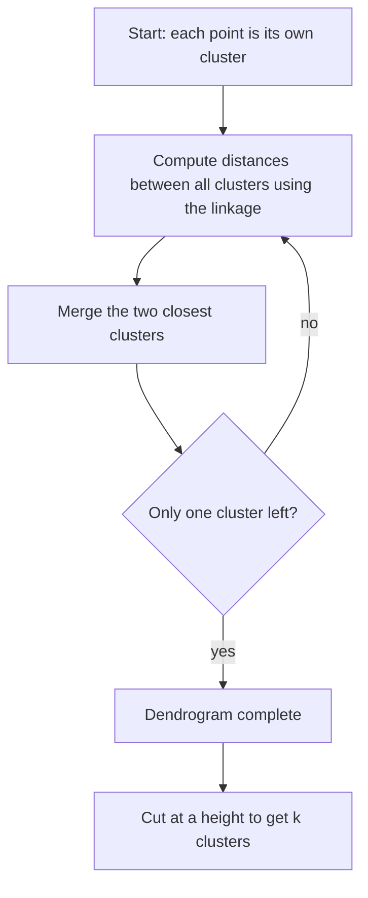
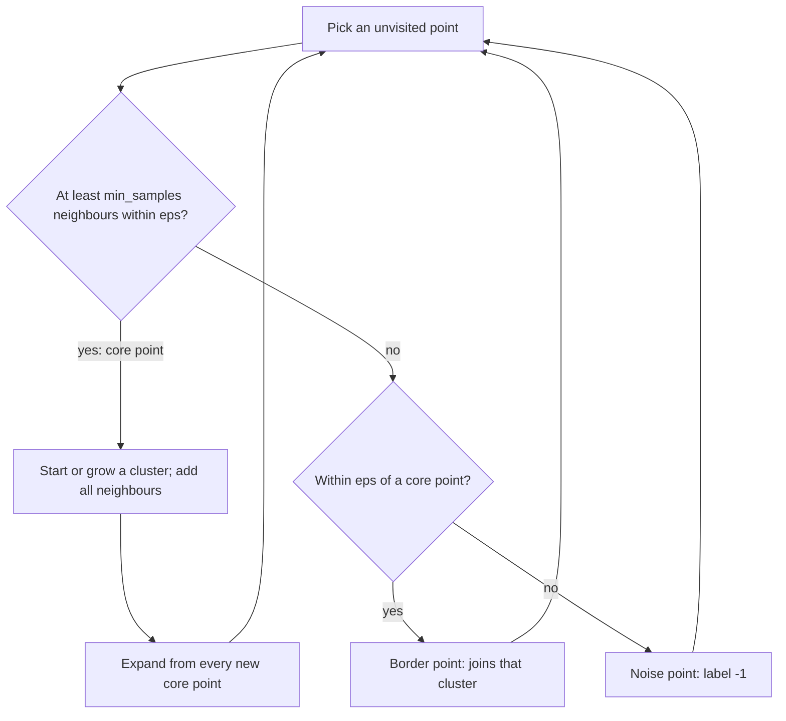
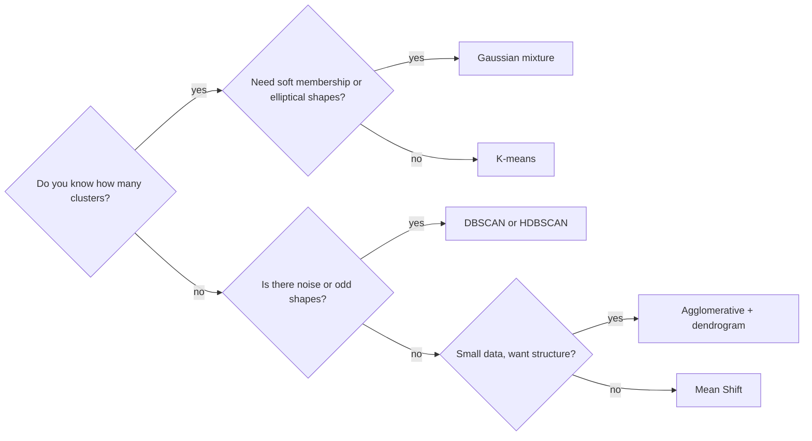
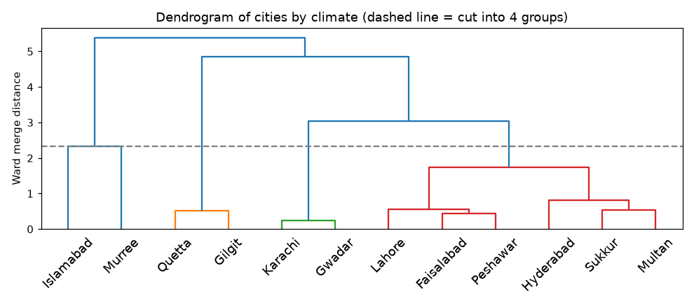
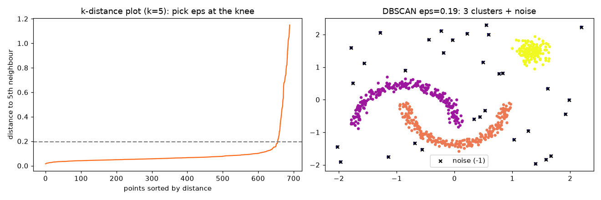
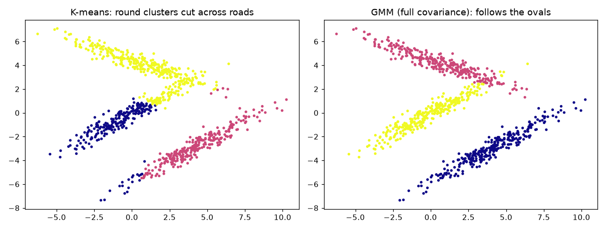
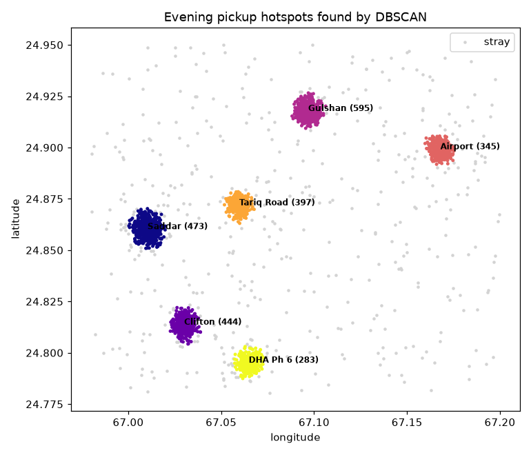
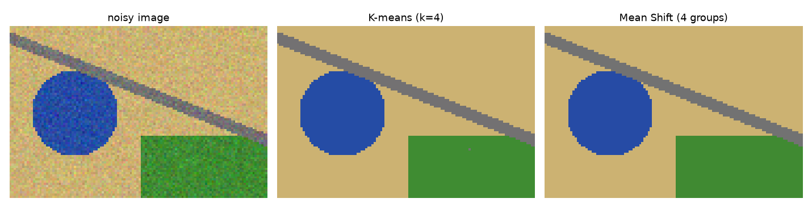

# Session 7 · Advanced Unsupervised Learning: Clustering Algorithms

[](https://colab.research.google.com/github/Hamnakhan123/Diploma-in-Data-Science/blob/main/term-2/03-advanced-data-science-with-python/code/session-07-advanced-clustering-algorithms.ipynb)

> 📍 [Diploma in Data Science](../../README.md) › [Term 2](../README.md) › [Advanced Data Science with Python](README.md) › **Session 7**

| ⏱ Estimated time | 🧩 Prerequisites | 💻 Tools |
|---|---|---|
| 3 hours | Session 6 (K-means, scaling, silhouette) | Python 3.10+, NumPy, pandas, Matplotlib, SciPy, scikit-learn |

[⬅ Previous: Session 6 · Unsupervised Learning](session-06-unsupervised-learning.md) · [🏠 Module home](README.md) · [Next: Session 8 · Advanced Unsupervised Learning: Dimensionality Reduction ➡](session-08-dimensionality-reduction.md)

---

## 🎯 Learning objectives

- Define **hierarchical clustering** (agglomerative and divisive), the four main **linkage** methods, and read a **dendrogram**.
- Explain the **DBSCAN** algorithm: `eps`, `min_samples`, core, border and noise points, and how to choose `eps` with a k-distance plot.
- Compare **Gaussian Mixture Models (GMM)** with K-means: soft vs hard assignment, cluster shapes, BIC for choosing k.
- **Evaluate** clustering models with internal (silhouette, Davies–Bouldin, Calinski–Harabasz) and external (ARI, NMI) measures.
- Compare **Mean Shift, K-means and DBSCAN**, and choose a suitable approach for a given clustering scenario.

## 📖 Concepts

### 1. Hierarchical clustering

Hierarchical clustering builds a **family tree** of the data. **Agglomerative** (bottom-up) starts with every point as its own cluster and repeatedly merges the two closest clusters until one remains. **Divisive** (top-down) starts with one cluster and splits it. The result is a **dendrogram**: the height of each merge shows how far apart the merged groups were. Cut the tree with a horizontal line to get any number of clusters, so you do not have to fix k in advance.

**Linkage** defines the distance between two *groups*:

| Linkage | Distance between clusters A and B | Behaviour |
|---|---|---|
| **Single** | closest pair of points | follows chains and curved shapes; sensitive to noise ("chaining") |
| **Complete** | farthest pair of points | compact clusters of similar diameter |
| **Average** | mean of all pairwise distances | a compromise |
| **Ward** | increase in total within-cluster variance after merging | compact, similar-size clusters (like K-means); needs Euclidean distance |

Cost: standard agglomerative clustering needs all pairwise distances, about O(n²) memory, so it suits up to tens of thousands of points.

### 2. DBSCAN: density-based clustering

DBSCAN (Density-Based Spatial Clustering of Applications with Noise) defines clusters as **crowded regions** separated by empty space. Picture a night-time satellite photo: cities are dense patches of lights, highways connect some of them, and isolated farmhouse lights are noise.

| Term | Meaning |
|---|---|
| `eps` (ε) | radius of the neighbourhood around a point |
| `min_samples` | points needed within ε (including itself) to count as dense |
| **Core point** | has at least `min_samples` neighbours within ε |
| **Border point** | within ε of a core point but not dense itself |
| **Noise point** | neither: labelled **−1** |

Algorithm: pick an unvisited core point, start a cluster, and keep adding every point **density-reachable** from it (neighbours of core points, then their neighbours…). Repeat until all points are visited.

**Choosing parameters**: set `min_samples` ≈ 2 × number of features (at least 4–5); then draw the **k-distance plot** (sorted distance of every point to its k-th nearest neighbour, k = `min_samples`) and pick `eps` at the "knee" where distances shoot up. Scale features first.

| Strengths | Weaknesses |
|---|---|
| any cluster shape, no k needed | one global `eps`: struggles when clusters have very different densities (HDBSCAN fixes this) |
| finds noise/outliers automatically | sensitive to `eps`; weak in high dimensions |

### 3. Gaussian Mixture Models vs K-means

A GMM assumes the data was generated by a mix of k **Gaussian (bell-shaped) distributions**, each with its own mean, **covariance** (shape and orientation) and weight. It is fitted with the **Expectation–Maximisation (EM)** algorithm: E-step computes each point's probability of belonging to each component; M-step updates means, covariances and weights from those probabilities.

| | K-means | GMM |
|---|---|---|
| Assignment | **hard**: each point in exactly one cluster | **soft**: probabilities per cluster (`predict_proba`) |
| Cluster shape | spherical, similar size | elliptical, any orientation, different sizes (`covariance_type="full"`) |
| Objective | minimise inertia | maximise likelihood |
| Choosing k | elbow, silhouette | **BIC / AIC** (lower is better) |
| Speed | very fast | slower; can overfit with full covariances |
| Bonus | — | density estimate: low likelihood = anomaly; generates new samples |

Analogy: K-means draws a circle around each neighbourhood; a GMM draws an oval that can stretch along a main road, and says "this house is 70% neighbourhood A, 30% neighbourhood B".

### 4. Evaluating clustering

| Measure | Needs true labels? | Range / better | What it rewards |
|---|---|---|---|
| **Silhouette** | no | −1…1, higher | tight clusters far from each other |
| **Davies–Bouldin** | no | ≥ 0, **lower** | small ratio of within-cluster spread to between-cluster distance |
| **Calinski–Harabasz** | no | ≥ 0, higher | between-cluster vs within-cluster variance |
| **ARI** (adjusted Rand index) | yes | about 0 (random)…1 | agreement of pairs with the truth, corrected for chance |
| **NMI** (normalised mutual information) | yes | 0…1, higher | shared information with the truth |
| BIC/AIC | no | lower | likelihood with a penalty for complexity (GMM) |

Caution: silhouette, Davies–Bouldin and Calinski–Harabasz favour convex, blob-shaped clusters, so they can rank K-means above DBSCAN even on curved data where DBSCAN is clearly right. Use them to compare settings of the *same* algorithm, and always add **domain sense** and **stability** checks.

### 5. Mean Shift, K-means and DBSCAN compared

**Mean Shift** places a window (bandwidth) on each point and repeatedly shifts it towards the densest nearby area (the mean of points inside), like a hiker always walking uphill towards the peak of the density. Points whose windows reach the same peak form a cluster. The number of clusters comes from the data.

| | K-means | DBSCAN | Mean Shift |
|---|---|---|---|
| Need number of clusters? | yes (k) | no | no |
| Key parameter | k | eps, min_samples | bandwidth |
| Cluster shape | spherical | arbitrary | blob-like around density peaks |
| Handles noise | no (every point assigned) | yes (label −1) | partly |
| Scales to large n | excellent | good with spatial index | slow (O(n²) per iteration) |
| Typical use | segmentation with known k | spatial data, outliers, odd shapes | image segmentation, finding modes |

### 6. Which approach for which scenario?

| Scenario | Suggested approach |
|---|---|
| Millions of customers, want 5 segments for marketing | K-means / MiniBatchKMeans on scaled RFM |
| GPS points of rides; find hotspots and ignore stray points | DBSCAN or HDBSCAN (haversine distance) |
| Need probabilities of membership, elliptical groups | Gaussian mixture |
| Small data, want to see the whole grouping structure | Agglomerative with dendrogram (Ward or average) |
| Number of groups unknown, find the modes (colour segmentation) | Mean Shift |
| Very different densities | HDBSCAN or OPTICS |

## 🧭 Diagrams







## 💻 Worked examples

### Example 1 · Basic: agglomerative clustering and a dendrogram

📄 [`code/session-07_dendrogram.py`](code/session-07_dendrogram.py)

```python
"""Hierarchical clustering of 12 cities by climate with SciPy: linkage matrix, dendrogram, cutting the tree."""
import numpy as np
import pandas as pd
import matplotlib.pyplot as plt
from scipy.cluster.hierarchy import linkage, dendrogram, fcluster
from sklearn.preprocessing import StandardScaler

cities = pd.DataFrame({
    "city": ["Karachi", "Hyderabad", "Sukkur", "Lahore", "Faisalabad", "Multan",
             "Islamabad", "Peshawar", "Murree", "Quetta", "Gilgit", "Gwadar"],
    "avg_temp_c": [26.5, 27.5, 27.0, 24.5, 24.5, 26.0, 21.5, 23.0, 13.5, 15.5, 16.0, 26.5],
    "rain_mm":    [175, 160, 95, 630, 380, 190, 1140, 460, 1700, 250, 140, 100],
    "humidity":   [70, 55, 45, 55, 55, 50, 58, 52, 70, 35, 40, 72],
})
X = StandardScaler().fit_transform(cities[["avg_temp_c", "rain_mm", "humidity"]])
Z = linkage(X, method="ward")                       # each row: cluster a, cluster b, distance, size
print("first 4 merges (a, b, distance, size):\n", np.round(Z[:4], 2))
cities["group"] = fcluster(Z, t=4, criterion="maxclust")
for g, names in cities.groupby("group")["city"]:
    print(f"group {g}: {', '.join(names)}")

plt.figure(figsize=(9, 4))
dendrogram(Z, labels=cities["city"].tolist(), leaf_rotation=45, color_threshold=Z[-4, 2])
plt.axhline(Z[-4, 2], ls="--", color="grey"); plt.ylabel("Ward merge distance")
plt.title("Dendrogram of cities by climate (dashed line = cut into 4 groups)")
plt.tight_layout(); plt.savefig("session-07_dendrogram.png", dpi=110); plt.show()
```

**Output**

```text
first 4 merges (a, b, distance, size):
 [[ 0.   11.    0.24  2.  ]
 [ 4.    7.    0.45  2.  ]
 [ 9.   10.    0.51  2.  ]
 [ 2.    5.    0.53  2.  ]]
group 1: Islamabad, Murree
group 2: Quetta, Gilgit
group 3: Karachi, Gwadar
group 4: Hyderabad, Sukkur, Lahore, Faisalabad, Multan, Peshawar
```

**Chart produced by this code** (saved as [`code/session-07_dendrogram.png`](code/session-07_dendrogram.png)):



### Example 2 · Intermediate: comparing linkage methods

📄 [`code/session-07_linkages.py`](code/session-07_linkages.py)

```python
"""Ward, complete, average and single linkage on three data shapes, scored with ARI."""
import numpy as np
from sklearn.datasets import make_blobs, make_moons, make_circles
from sklearn.preprocessing import StandardScaler
from sklearn.cluster import AgglomerativeClustering
from sklearn.metrics import adjusted_rand_score

shapes = {
    "blobs": make_blobs(500, centers=3, cluster_std=1.0, random_state=1),
    "moons": make_moons(500, noise=.05, random_state=1),
    "circles": make_circles(500, noise=.04, factor=.5, random_state=1),
}
print(f"{'linkage':<10}" + "".join(f"{s:>10}" for s in shapes))
for link in ["ward", "complete", "average", "single"]:
    row = f"{link:<10}"
    for name, (X, y) in shapes.items():
        lab = AgglomerativeClustering(n_clusters=len(set(y)), linkage=link).fit_predict(StandardScaler().fit_transform(X))
        row += f"{adjusted_rand_score(y, lab):>10.2f}"
    print(row)
```

**Output**

```text
linkage        blobs     moons   circles
ward            0.95      0.14      0.00
complete        0.95      0.56      0.01
average         0.98      0.49      0.02
single          0.57      1.00      1.00
```

Ward, complete and average linkage all do well on blobs (single linkage chains overlapping blobs together); single linkage is the only one that follows moons and rings, because it joins clusters through their closest points.

### Example 3 · Intermediate: DBSCAN, the k-distance plot and parameter effects

📄 [`code/session-07_dbscan.py`](code/session-07_dbscan.py)

```python
"""Choose eps for DBSCAN with a k-distance plot, then see how eps changes clusters and noise."""
import numpy as np
import matplotlib.pyplot as plt
from sklearn.datasets import make_moons, make_blobs
from sklearn.preprocessing import StandardScaler
from sklearn.neighbors import NearestNeighbors
from sklearn.cluster import DBSCAN

rng = np.random.default_rng(0)
moons, _ = make_moons(500, noise=.06, random_state=0)
blob, _ = make_blobs(150, centers=[[2.5, 1.8]], cluster_std=.15, random_state=0)
noise = rng.uniform([-1.5, -1], [3.5, 2.5], (40, 2))
X = StandardScaler().fit_transform(np.vstack([moons, blob, noise]))

k = 5
dist, _ = NearestNeighbors(n_neighbors=k).fit(X).kneighbors(X)
kdist = np.sort(dist[:, -1])
knee = kdist[int(len(kdist) * .95)]
print(f"95th percentile of {k}-NN distance (near the knee): {knee:.3f}")

print("\n  eps  clusters  noise points  core points")
for eps in [0.08, 0.15, knee, 0.4, 0.8]:
    db = DBSCAN(eps=eps, min_samples=k).fit(X)
    n_cl = len(set(db.labels_)) - (1 if -1 in db.labels_ else 0)
    print(f"{eps:5.2f}  {n_cl:>8}  {(db.labels_ == -1).sum():>12}  {len(db.core_sample_indices_):>11}")

db = DBSCAN(eps=knee, min_samples=k).fit(X)
fig, ax = plt.subplots(1, 2, figsize=(12, 4))
ax[0].plot(kdist, color="#FF6B1A"); ax[0].axhline(knee, ls="--", color="grey")
ax[0].set_title(f"k-distance plot (k={k}): pick eps at the knee"); ax[0].set_xlabel("points sorted by distance"); ax[0].set_ylabel(f"distance to {k}th neighbour")
ax[1].scatter(X[:, 0], X[:, 1], c=db.labels_, cmap="plasma", s=10)
ax[1].scatter(X[db.labels_ == -1, 0], X[db.labels_ == -1, 1], c="black", marker="x", s=20, label="noise (-1)")
ax[1].set_title(f"DBSCAN eps={knee:.2f}: 3 clusters + noise"); ax[1].legend()
fig.tight_layout(); fig.savefig("session-07_dbscan.png", dpi=110); plt.show()
```

**Output**

```text
95th percentile of 5-NN distance (near the knee): 0.194

  eps  clusters  noise points  core points
 0.08        11            93          506
 0.15         3            35          644
 0.19         3            32          656
 0.40         2            23          666
 0.80         1             5          680
```

**Chart produced by this code** (saved as [`code/session-07_dbscan.png`](code/session-07_dbscan.png)):



### Example 4 · Advanced: GMM vs K-means, soft membership and BIC

📄 [`code/session-07_gmm.py`](code/session-07_gmm.py)

```python
"""Elongated clusters: K-means vs Gaussian mixture, choosing components by BIC, soft probabilities."""
import numpy as np
import matplotlib.pyplot as plt
from sklearn.cluster import KMeans
from sklearn.mixture import GaussianMixture
from sklearn.metrics import adjusted_rand_score

rng = np.random.default_rng(2)
# Three stretched, tilted groups (e.g. commuter trips along three roads)
def stretched(center, angle, n):
    pts = rng.normal(size=(n, 2)) * [2.5, .35]
    R = np.array([[np.cos(angle), -np.sin(angle)], [np.sin(angle), np.cos(angle)]])
    return pts @ R.T + center
X = np.vstack([stretched([0, 0], .6, 300), stretched([4, -3], .6, 300), stretched([1, 4], -.4, 300)])
y = np.repeat([0, 1, 2], 300)

km = KMeans(3, n_init=10, random_state=0).fit(X)
print(f"K-means ARI: {adjusted_rand_score(y, km.labels_):.3f}")
print("\ncomponents  BIC (full covariance)")
bics = {}
for k in range(1, 7):
    bics[k] = GaussianMixture(k, covariance_type="full", random_state=0).fit(X).bic(X)
    print(f"{k:>10}  {bics[k]:10.1f}")
best = min(bics, key=bics.get)
gmm = GaussianMixture(best, covariance_type="full", random_state=0).fit(X)
print(f"best by BIC: {best} components | GMM ARI: {adjusted_rand_score(y, gmm.predict(X)):.3f}")

for ctype in ["spherical", "diag", "tied", "full"]:
    g = GaussianMixture(3, covariance_type=ctype, random_state=0).fit(X)
    print(f"covariance_type={ctype:<9}  ARI {adjusted_rand_score(y, g.predict(X)):.3f}  BIC {g.bic(X):8.1f}")

probs = gmm.predict_proba(X)
unsure = (probs.max(axis=1) < .8).sum()
print(f"\npoints with less than 80% membership in any component: {unsure}")
print("example soft membership:", probs[np.argmin(probs.max(axis=1))].round(2))

fig, ax = plt.subplots(1, 2, figsize=(11, 4.2))
ax[0].scatter(X[:, 0], X[:, 1], c=km.labels_, cmap="plasma", s=6); ax[0].set_title("K-means: round clusters cut across roads")
ax[1].scatter(X[:, 0], X[:, 1], c=gmm.predict(X), cmap="plasma", s=6); ax[1].set_title("GMM (full covariance): follows the ovals")
fig.tight_layout(); fig.savefig("session-07_gmm_vs_kmeans.png", dpi=110); plt.show()
```

**Output**

```text
K-means ARI: 0.693

components  BIC (full covariance)
         1      9042.9
         2      8268.6
         3      6917.3
         4      6953.0
         5      6996.9
         6      7025.2
best by BIC: 3 components | GMM ARI: 0.942
covariance_type=spherical  ARI 0.574  BIC   8890.5
covariance_type=diag       ARI 0.662  BIC   8853.9
covariance_type=tied       ARI 0.678  BIC   8874.2
covariance_type=full       ARI 0.942  BIC   6917.3

points with less than 80% membership in any component: 35
example soft membership: [0.   0.54 0.46]
```

**Chart produced by this code** (saved as [`code/session-07_gmm_vs_kmeans.png`](code/session-07_gmm_vs_kmeans.png)):



### Example 5 · Advanced: evaluation metrics and Mean Shift vs K-means vs DBSCAN

📄 [`code/session-07_evaluate_compare.py`](code/session-07_evaluate_compare.py)

```python
"""Internal and external clustering metrics for K-means, DBSCAN and Mean Shift on blobs and moons."""
import numpy as np
from sklearn.datasets import make_blobs, make_moons
from sklearn.preprocessing import StandardScaler
from sklearn.cluster import KMeans, DBSCAN, MeanShift, estimate_bandwidth
from sklearn.metrics import (silhouette_score, davies_bouldin_score, calinski_harabasz_score,
                             adjusted_rand_score, normalized_mutual_info_score)

data = {"blobs": make_blobs(600, centers=4, cluster_std=.9, random_state=3),
        "moons": make_moons(600, noise=.06, random_state=3)}
print(f"{'data':<6}{'algorithm':<11}{'k found':>8}{'silh':>7}{'DB':>7}{'CH':>8}{'ARI':>7}{'NMI':>7}")
for dname, (X, y) in data.items():
    X = StandardScaler().fit_transform(X)
    bw = estimate_bandwidth(X, quantile=.2, random_state=0)
    algos = {"K-means": KMeans(len(set(y)), n_init=10, random_state=0),
             "DBSCAN": DBSCAN(eps=.25, min_samples=5),
             "MeanShift": MeanShift(bandwidth=bw)}
    for aname, algo in algos.items():
        lab = algo.fit_predict(X)
        mask = lab != -1                                       # internal metrics ignore DBSCAN noise
        k = len(set(lab[mask]))
        sil = silhouette_score(X[mask], lab[mask]) if k > 1 else float("nan")
        dbi = davies_bouldin_score(X[mask], lab[mask]) if k > 1 else float("nan")
        ch = calinski_harabasz_score(X[mask], lab[mask]) if k > 1 else float("nan")
        print(f"{dname:<6}{aname:<11}{k:>8}{sil:>7.2f}{dbi:>7.2f}{ch:>8.0f}"
              f"{adjusted_rand_score(y, lab):>7.2f}{normalized_mutual_info_score(y, lab):>7.2f}")
```

**Output**

```text
data  algorithm   k found   silh     DB      CH    ARI    NMI
blobs K-means           4   0.76   0.34    7185   1.00   1.00
blobs DBSCAN            4   0.76   0.34    7261   0.99   0.99
blobs MeanShift         4   0.76   0.34    7185   1.00   1.00
moons K-means           2   0.49   0.81     833   0.48   0.39
moons DBSCAN            2   0.39   1.02     522   1.00   1.00
moons MeanShift         3   0.36   1.17     536   0.47   0.48
```

On the moons, K-means gets a **better silhouette** than DBSCAN even though DBSCAN matches the truth perfectly (ARI = 1). Internal metrics reward round clusters; that is the caution from Concept 4 in action.

## 🏙️ Real-life data problem: finding ride-hailing pickup hotspots

**Problem.** A ride-hailing company wants to know where to position idle drivers in the evening. It has GPS coordinates of 3,000 pickups. Some are scattered randomly across the city. They want the hotspots, their size and centre, and to ignore stray pickups.

**Full solution.** K-means would force every stray point into a cluster, so use **DBSCAN with the haversine distance** (real distance on Earth). Choose `eps` in metres, report hotspot centres and sizes, and compare with K-means and a GMM.

📄 [`code/session-07_hotspot_problem.py`](code/session-07_hotspot_problem.py)

```python
"""Real-life problem: GPS pickup hotspots with DBSCAN (haversine metres), compared with K-means and GMM."""
import numpy as np
import pandas as pd
import matplotlib.pyplot as plt
from sklearn.cluster import DBSCAN, KMeans
from sklearn.mixture import GaussianMixture

rng = np.random.default_rng(10)
EARTH_R = 6_371_000                                   # metres
hotspots = {"Saddar": (24.8607, 67.0104, 500), "Clifton": (24.8138, 67.0300, 450), "Gulshan": (24.9180, 67.0971, 600),
            "Airport": (24.8990, 67.1680, 350), "Tariq Road": (24.8720, 67.0600, 400), "DHA Ph 6": (24.7950, 67.0650, 300)}
rows = []
for name, (lat, lon, n) in hotspots.items():
    spread = rng.uniform(.0025, .0045)                # roughly 250-500 m
    rows.append(np.c_[rng.normal(lat, spread, n), rng.normal(lon, spread, n)])
stray = np.c_[rng.uniform(24.78, 24.95, 400), rng.uniform(66.98, 67.20, 400)]
pts = np.vstack(rows + [stray])
print("pickups:", len(pts))

# DBSCAN with haversine: inputs in radians, eps = metres / Earth radius
eps_m = 300
db = DBSCAN(eps=eps_m / EARTH_R, min_samples=25, metric="haversine", algorithm="ball_tree").fit(np.radians(pts))
lab = db.labels_
summary = (pd.DataFrame({"lat": pts[:, 0], "lon": pts[:, 1], "cluster": lab})
           .query("cluster != -1").groupby("cluster")
           .agg(pickups=("lat", "size"), centre_lat=("lat", "mean"), centre_lon=("lon", "mean"))
           .sort_values("pickups", ascending=False))
def nearest(lat, lon):
    return min(hotspots, key=lambda h: (hotspots[h][0] - lat) ** 2 + (hotspots[h][1] - lon) ** 2)
summary["area"] = [nearest(a, b) for a, b in zip(summary.centre_lat, summary.centre_lon)]
print(f"\nDBSCAN (eps={eps_m} m): {len(summary)} hotspots, {(lab == -1).sum()} pickups treated as stray")
print(summary.round(4).to_string())

km = KMeans(6, n_init=10, random_state=0).fit(pts)
gmm = GaussianMixture(6, random_state=0).fit(pts)
stray_mask = np.arange(len(pts)) >= len(pts) - 400
print(f"\nstray pickups absorbed into a 'hotspot' -> K-means: {stray_mask.sum()} of 400 (every point is assigned)")
print(f"stray pickups correctly left out by DBSCAN: {(lab[stray_mask] == -1).sum()} of 400")
print(f"GMM: stray pickups with low likelihood (bottom 15%): "
      f"{(gmm.score_samples(pts)[stray_mask] < np.percentile(gmm.score_samples(pts), 15)).sum()} of 400")

plt.figure(figsize=(7, 6))
plt.scatter(pts[lab == -1, 1], pts[lab == -1, 0], s=4, color="lightgrey", label="stray")
plt.scatter(pts[lab != -1, 1], pts[lab != -1, 0], c=lab[lab != -1], cmap="plasma", s=5)
for _, r in summary.iterrows():
    plt.annotate(f"{r.area} ({r.pickups})", (r.centre_lon, r.centre_lat), fontsize=8, weight="bold")
plt.xlabel("longitude"); plt.ylabel("latitude"); plt.title("Evening pickup hotspots found by DBSCAN"); plt.legend()
plt.tight_layout(); plt.savefig("session-07_hotspots.png", dpi=110); plt.show()
```

**Output**

```text
pickups: 3000

DBSCAN (eps=300 m): 6 hotspots, 463 pickups treated as stray
         pickups  centre_lat  centre_lon        area
cluster
2            595     24.9178     67.0968     Gulshan
0            473     24.8602     67.0104      Saddar
1            444     24.8137     67.0301     Clifton
4            397     24.8718     67.0597  Tariq Road
3            345     24.8991     67.1679     Airport
5            283     24.7952     67.0648    DHA Ph 6

stray pickups absorbed into a 'hotspot' -> K-means: 400 of 400 (every point is assigned)
stray pickups correctly left out by DBSCAN: 381 of 400
GMM: stray pickups with low likelihood (bottom 15%): 330 of 400
```

**Chart produced by this code** (saved as [`code/session-07_hotspots.png`](code/session-07_hotspots.png)):



**Answer.** DBSCAN finds the six hotspots with their exact centres and sizes and leaves most stray pickups out, which K-means cannot do. Operations can position idle drivers at the listed centres in proportion to pickups. The GMM's likelihood offers a softer alternative ("how typical is this pickup location?").

## ⚠️ Common mistakes

| Mistake | Fix |
|---|---|
| Using Euclidean distance on latitude/longitude | haversine metric with radians, or project to metres |
| Guessing DBSCAN `eps` | use a k-distance plot; scale features first |
| Ward linkage with non-Euclidean distances | Ward needs Euclidean; use average/complete for other metrics |
| Comparing DBSCAN and K-means by silhouette alone | add external labels if any, visual checks and domain review |
| GMM with full covariance on tiny data | too many parameters: use `diag` or `tied`, compare BIC |
| Hierarchical clustering on 500,000 points | O(n²) memory; sample, or use K-means/BIRCH first |

## ✅ Best practices

- Visualise (PCA/t-SNE) before and after clustering.
- Try at least two algorithm families and compare with several metrics plus a human sense-check.
- For DBSCAN report how many points are noise; for GMM report how many are uncertain.
- Store the scaler and model so new data is clustered the same way.
- Prefer HDBSCAN (`sklearn.cluster.HDBSCAN`) when densities vary.

## 🧪 Lab / practice tasks

### 🟢 Task 1 · Easy

In Example 1 cut the dendrogram into 3 and into 5 groups. Which cities move between groups?

<details><summary>💡 Hint</summary>

Change `t` in `fcluster(Z, t=..., criterion="maxclust")`.

</details>

<details><summary>✅ Solution</summary>

With 3 groups the wet northern cities (Islamabad, Murree) join with Lahore/Peshawar or stay together depending on distances, and the dry hot south stays one group. With 5 groups Murree (cold and very wet) usually separates on its own. Read the merge heights in the dendrogram to explain each move.

</details>


### 🟡 Task 2 · Medium

Run DBSCAN in Example 3 with `min_samples` = 3, 10 and 20 (recompute the knee each time). How do the number of clusters and noise points change?

<details><summary>💡 Hint</summary>

Larger `min_samples` = stricter definition of dense.

</details>

<details><summary>✅ Solution</summary>

Small `min_samples` creates extra tiny clusters from noise; large values label more border points as noise and can break thin moons. Values of 5–10 work best here (about 2 × dimensions plus margin).

</details>


### 🟡 Task 3 · Medium

Use `GaussianMixture` on the hotspot data with 3 to 10 components and choose the number by BIC. Does BIC recover 6?

<details><summary>💡 Hint</summary>

Compute `bic(pts)` for each k; stray points may tempt BIC to add extra broad components.

</details>

<details><summary>✅ Solution</summary>

BIC often picks more than 6, because extra broad components help it model the uniformly scattered stray pickups. Look at the fitted covariances: a component with a huge spread is a "noise" component, which is a useful way to see how GMM handles background points.

</details>


### 🟠 Task 4 · Hard

Cluster the digits data (`load_digits`) after PCA to 20 components with K-means, Agglomerative (Ward) and GMM (k = 10). Compare ARI and NMI.

<details><summary>💡 Hint</summary>

Scale isn't needed for pixel data; use PCA first to speed things up.

</details>

<details><summary>✅ Solution</summary>

```python
from sklearn.datasets import load_digits
from sklearn.decomposition import PCA
from sklearn.cluster import AgglomerativeClustering
X, y = load_digits(return_X_y=True); Xp = PCA(20, random_state=0).fit_transform(X)
for name, m in [("kmeans", KMeans(10, n_init=10, random_state=0)), ("ward", AgglomerativeClustering(10)),
                ("gmm", GaussianMixture(10, random_state=0))]:
    lab = m.fit_predict(Xp); print(name, round(adjusted_rand_score(y, lab), 3), round(normalized_mutual_info_score(y, lab), 3))
```
Expect ARI roughly in the 0.5–0.8 range; Ward often edges out K-means and GMM on digits. Run it and record the exact numbers in your notebook.

</details>


### 🔴 Task 5 · Challenge

Replace DBSCAN with `sklearn.cluster.HDBSCAN` in the hotspot problem (use `min_cluster_size=50`, haversine metric). Does it need an `eps`? Compare results when one hotspot is made twice as spread out.

<details><summary>💡 Hint</summary>

HDBSCAN builds a hierarchy over many density levels and keeps the most stable clusters.

</details>

<details><summary>✅ Solution</summary>

HDBSCAN needs no `eps`; with one hotspot made wider, DBSCAN at 300 m starts splitting it or calling its edges noise, while HDBSCAN still recovers it as one cluster because it adapts to local density.

</details>


## 🧩 Mini project: segmenting an image's colours with K-means and Mean Shift

Clustering also works on pixels: each pixel is a point in RGB space. Here we build a synthetic "satellite image" and segment it into land-cover types.

📄 [`code/session-07_mini_project.py`](code/session-07_mini_project.py)

```python
"""Mini project: colour segmentation of a synthetic satellite image with K-means and Mean Shift."""
import numpy as np
import matplotlib.pyplot as plt
from sklearn.cluster import KMeans, MeanShift, estimate_bandwidth

rng = np.random.default_rng(1)
H, W = 80, 120
yy, xx = np.mgrid[0:H, 0:W]
img = np.zeros((H, W, 3))
img[:] = [0.80, 0.70, 0.45]                                            # desert / bare soil
img[(xx - 30) ** 2 + (yy - 40) ** 2 < 400] = [0.15, 0.30, 0.65]       # lake
img[(yy > 50) & (xx > 60)] = [0.25, 0.55, 0.20]                       # farmland
img[(np.abs(yy - 0.4 * xx - 5) < 3)] = [0.45, 0.45, 0.45]             # road
img = np.clip(img + rng.normal(0, .05, img.shape), 0, 1)

pixels = img.reshape(-1, 3)
km = KMeans(4, n_init=10, random_state=0).fit(pixels)
seg_km = km.cluster_centers_[km.labels_].reshape(img.shape)
sample = pixels[rng.choice(len(pixels), 2000, replace=False)]
bw = estimate_bandwidth(sample, quantile=.1, random_state=0)
ms = MeanShift(bandwidth=bw, bin_seeding=True).fit(sample)
ms_labels = ms.predict(pixels)
seg_ms = ms.cluster_centers_[ms_labels].reshape(img.shape)

names = {0: "?", 1: "?", 2: "?", 3: "?"}
for j, c in enumerate(km.cluster_centers_):
    names[j] = "water" if c[2] > .5 else "vegetation" if c[1] > c[0] else "road" if abs(c[0] - c[1]) < .05 else "soil"
share = np.bincount(km.labels_) / len(pixels)
print("K-means land cover:", {names[j]: f"{share[j]:.1%}" for j in range(4)})
print(f"Mean Shift found {len(ms.cluster_centers_)} colour groups by itself (bandwidth {bw:.3f})")

fig, ax = plt.subplots(1, 3, figsize=(13, 3.6))
for a, im, t in zip(ax, [img, seg_km, seg_ms], ["noisy image", "K-means (k=4)", f"Mean Shift ({len(ms.cluster_centers_)} groups)"]):
    a.imshow(im); a.set_title(t); a.axis("off")
fig.tight_layout(); fig.savefig("session-07_mini_project_segmentation.png", dpi=110); plt.show()
```

**Output**

```text
K-means land cover: {'soil': '62.4%', 'vegetation': '17.5%', 'water': '12.8%', 'road': '7.3%'}
Mean Shift found 4 colour groups by itself (bandwidth 0.103)
```

**Chart produced by this code** (saved as [`code/session-07_mini_project_segmentation.png`](code/session-07_mini_project_segmentation.png)):



## ✅ Quick quiz

**Q1.** Which linkage merges clusters based on their closest pair of points?

- **A)** Ward
- **B)** complete
- **C)** single
- **D)** average

<details><summary>Show answer</summary>

**C** — Single linkage can follow chains and curves.

</details>

**Q2.** In DBSCAN a point with fewer than min_samples neighbours but within eps of a core point is…

- **A)** a core point
- **B)** a border point
- **C)** noise
- **D)** a centroid

<details><summary>Show answer</summary>

**B** — It joins the core point's cluster.

</details>

**Q3.** A key advantage of GMM over K-means is…

- **A)** it is always faster
- **B)** soft membership and elliptical clusters
- **C)** no parameters
- **D)** it finds noise automatically

<details><summary>Show answer</summary>

**B** — GMM gives probabilities and covariance shapes.

</details>

**Q4.** Which metric is better when lower?

- **A)** silhouette
- **B)** Calinski–Harabasz
- **C)** Davies–Bouldin
- **D)** ARI

<details><summary>Show answer</summary>

**C** — Davies–Bouldin measures similarity between clusters.

</details>

**Q5.** Which algorithm finds the number of clusters by climbing to density peaks?

- **A)** K-means
- **B)** Mean Shift
- **C)** Ward
- **D)** Apriori

<details><summary>Show answer</summary>

**B** — Windows shift towards the local mean until they converge on modes.

</details>


## 📝 Summary

- **Hierarchical clustering** builds a dendrogram; linkage (single, complete, average, Ward) shapes the result; cut the tree for k.
- **DBSCAN** finds dense regions of any shape and labels noise; choose `eps` with a k-distance plot.
- **GMM** gives soft, elliptical clusters fitted by EM; choose components by **BIC**.
- Evaluate with internal metrics (silhouette, DB, CH) and external ones (ARI, NMI), knowing internal metrics favour round clusters.
- K-means for speed and known k, DBSCAN for shapes and noise, Mean Shift for unknown numbers of modes.

### 🎤 Interview / viva questions

1. Explain how agglomerative clustering works and how you would choose where to cut the dendrogram.
2. What are core, border and noise points in DBSCAN? How do you choose `eps`?
3. Compare K-means and GMM. When would you prefer each?
4. Why can silhouette score mislead you when comparing DBSCAN and K-means?
5. Which clustering method would you use for GPS data with noise, and why?
6. What does BIC trade off?

---

[⬅ Previous: Session 6 · Unsupervised Learning](session-06-unsupervised-learning.md) · [🏠 Module home](README.md) · [Next: Session 8 · Advanced Unsupervised Learning: Dimensionality Reduction ➡](session-08-dimensionality-reduction.md)

<sub>Diploma in Data Science · Prepared by **Hamna Zahid Khan**, Junior Lecturer</sub>
