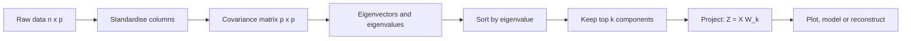
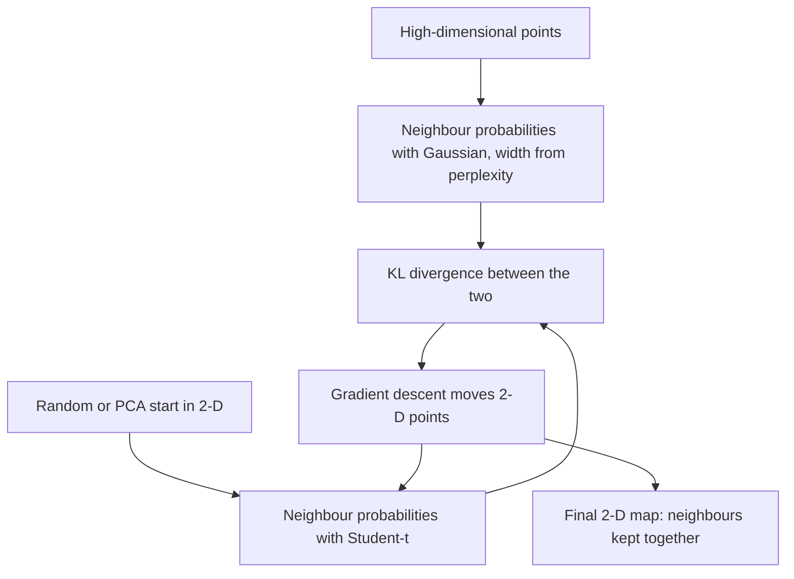
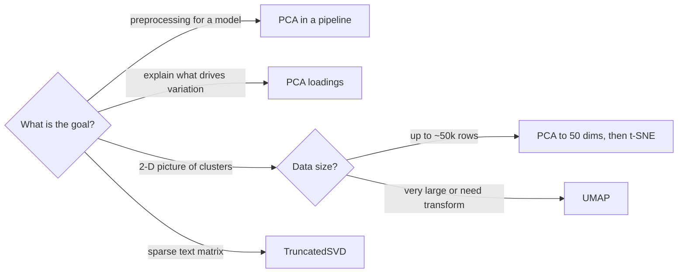
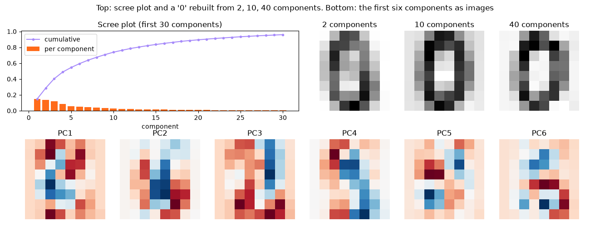
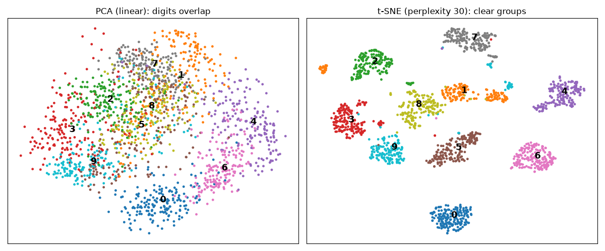
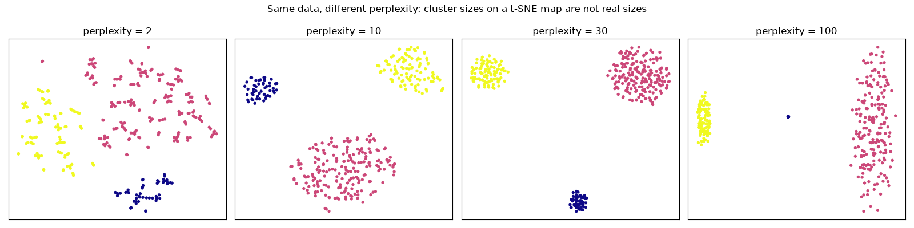
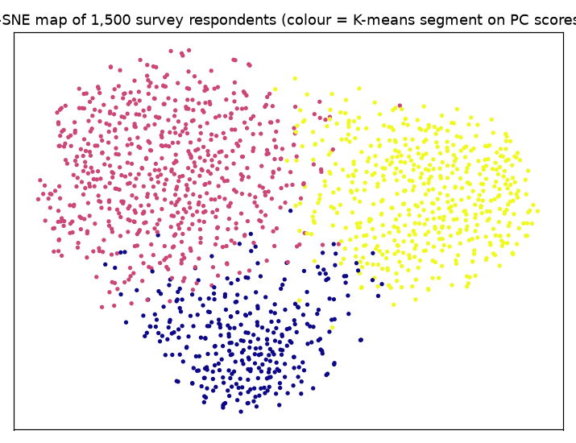
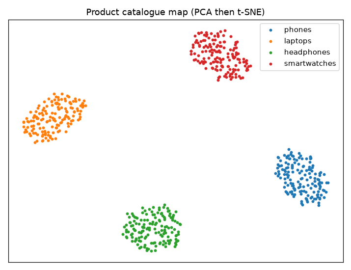

# Session 8 · Advanced Unsupervised Learning: Dimensionality Reduction

[](https://colab.research.google.com/github/Hamnakhan123/Diploma-in-Data-Science/blob/main/term-2/03-advanced-data-science-with-python/code/session-08-dimensionality-reduction.ipynb)

> 📍 [Diploma in Data Science](../../README.md) › [Term 2](../README.md) › [Advanced Data Science with Python](README.md) › **Session 8**

| ⏱ Estimated time | 🧩 Prerequisites | 💻 Tools |
|---|---|---|
| 3 hours | Sessions 6–7, basic linear algebra (vectors, variance) | Python 3.10+, NumPy, pandas, Matplotlib, scikit-learn |

[⬅ Previous: Session 7 · Advanced Unsupervised Learning: Clustering Algorithms](session-07-advanced-clustering-algorithms.md) · [🏠 Module home](README.md) · [Next: Session 9 · Pattern Mining and Visualization with Seaborn ➡](session-09-pattern-mining-and-seaborn.md)

---

## 🎯 Learning objectives

- Explain the **curse of dimensionality** and why reducing dimensions helps models and people.
- Explain how **Principal Component Analysis (PCA)** works: centring, covariance, eigenvectors, explained variance, loadings and reconstruction.
- Use PCA to **choose the number of components**, compress data, remove noise and speed up a model inside a pipeline.
- Describe **t-SNE** (t-distributed Stochastic Neighbour Embedding) and how it differs from PCA.
- Identify the impact of t-SNE parameters (**perplexity**, learning rate, iterations, initialisation, random seed) on the quality of visualisations, and read t-SNE plots correctly.

## 📖 Concepts

### 1. Why reduce dimensions?

Modern data sets are wide: a customer survey with 120 questions, a gene panel with 20,000 genes, an image with 784 pixels. Many columns repeat the same information (height in cm and in inches) or are mostly noise.

The **curse of dimensionality**: as the number of features grows, the space becomes so large that points are all far apart and nearly equally distant. Distance-based methods (KNN, K-means) lose their meaning, models need far more data to avoid overfitting, and humans cannot see beyond three dimensions.

| Goal | Example |
|---|---|
| Visualise | plot 64-pixel digit images as dots on a 2-D map |
| Compress | store 50 components instead of 784 pixels |
| Denoise | keep strong components, drop weak noisy ones |
| Speed up models | train on 30 features instead of 300 |
| Remove multicollinearity | components are uncorrelated by construction |

Two families: **feature selection** (keep a subset of original columns, e.g. Lasso) and **feature extraction** (build new combined features, e.g. PCA, t-SNE, autoencoders).

### 2. PCA: finding the best camera angle

Imagine photographing a long, flat object such as a cricket bat. From the end you see a small circle; from the side you see its full length. PCA finds the **side view**: the direction in which the data is most spread out (has most variance), then the next best direction **at right angles** to it, and so on.

**Steps**

1. **Standardise** the features (mean 0, sd 1), so that a column in rupees does not dominate one in years.
2. Compute the **covariance matrix** (how every pair of features varies together).
3. Find its **eigenvectors** (the principal directions, or **components**) and **eigenvalues** (the variance along each).
4. Sort components by eigenvalue. The **explained variance ratio** of a component = its eigenvalue ÷ sum of all eigenvalues.
5. **Project** the data onto the first k components: `Z = X_centred @ W_k`.
6. Optionally **reconstruct**: `X̂ = Z @ W_kᵀ + mean`. The reconstruction error shows what was lost.

| Term | Meaning |
|---|---|
| Principal component (PC) | a new axis, a weighted combination of the original features |
| Loading | the weight of an original feature in a component; tells you what the PC "means" |
| Explained variance ratio | share of the total variance captured by a PC |
| Scree plot | bar chart of explained variance per component; look for the elbow |
| Cumulative explained variance | choose the smallest k reaching e.g. 90–95% |

**Choosing k**: (a) cumulative variance threshold (90–95%), (b) elbow of the scree plot, (c) the k that maximises downstream model performance in cross-validation, (d) k = 2 or 3 for plots.

**Limits**: PCA is **linear** (it cannot unroll a curved "Swiss roll"), it is sensitive to scaling and outliers, and components can be hard to name. Variants: `KernelPCA` (non-linear), `IncrementalPCA` (big data in batches), `TruncatedSVD` (sparse text matrices), `SparsePCA` (easier to interpret).

### 3. t-SNE: a map of neighbourhoods

t-SNE is built for **visualisation**. It tries to keep **neighbours together**: points that are close in the original high-dimensional space should be close on the 2-D map. Think of arranging guests at a wedding: you care that friends sit together at the same table, not about the exact distance between tables.

**How it works (intuition)**

1. For each point, turn distances to other points into **probabilities of being neighbours** using a Gaussian centred on the point. The width of each Gaussian is set so each point has roughly `perplexity` effective neighbours.
2. Place points randomly (or with PCA) in 2-D, and define neighbour probabilities there with a heavy-tailed **Student-t distribution**. The heavy tails let dissimilar points sit far apart, preventing the "crowding problem".
3. Move the 2-D points by gradient descent to make the two sets of probabilities match (minimise the **KL divergence**).

| | PCA | t-SNE |
|---|---|---|
| Type | linear projection | non-linear embedding |
| Preserves | global structure, large variances | local neighbourhoods |
| Deterministic | yes | no (depends on random seed) |
| New data | `transform()` works | no `transform`: must re-run |
| Speed | very fast | slow on large data (run PCA to 50 dims first) |
| Use | preprocessing, compression, interpretation | 2-D/3-D visual exploration only |

**UMAP** is a newer alternative that is faster, keeps somewhat more global structure and can transform new data.

### 4. t-SNE parameters and how to read the plot

| Parameter | What it controls | Typical | Too low | Too high |
|---|---|---|---|---|
| **perplexity** | effective number of neighbours each point considers | 5–50 (default 30); must be < n | many tiny, fragmented clumps | clusters merge, structure blurs into a ball |
| **learning_rate** | step size of the optimisation | `"auto"` (≈ n / 12) | points stuck in a dense ball | scattered "dust" |
| **max_iter** | optimisation steps | ≥ 1000 | not converged, shapes still changing | — (just slower) |
| **init** | starting layout | `"pca"` (more stable, better global layout) | — | — |
| **early_exaggeration** | how strongly clusters are pulled apart early | 12 | — | — |
| **random_state** | random start | fix it for reproducibility | — | — |

**Reading rules (very important)**

- Cluster **sizes** on a t-SNE map mean nothing: t-SNE expands dense clusters and shrinks sparse ones.
- **Distances between clusters** are not reliable: two far-apart islands are not necessarily more different than two close ones.
- Always try **several perplexities and seeds**: real structure appears consistently, artefacts do not.
- Never feed t-SNE coordinates into a model as features or compute statistics on them.

## 🧭 Diagrams







## 💻 Worked examples

### Example 1 · Basic: PCA from scratch with NumPy

📄 [`code/session-08_pca_scratch.py`](code/session-08_pca_scratch.py)

```python
"""PCA from scratch: standardise, covariance, eigen-decomposition, projection; compare with scikit-learn."""
import numpy as np
from sklearn.decomposition import PCA

rng = np.random.default_rng(0)
# 200 students: maths, physics and computing marks are correlated; art is independent
ability = rng.normal(0, 1, 200)
X = np.c_[70 + 10 * ability + rng.normal(0, 4, 200),
          68 + 9 * ability + rng.normal(0, 4, 200),
          72 + 8 * ability + rng.normal(0, 5, 200),
          65 + rng.normal(0, 10, 200)]
cols = ["maths", "physics", "computing", "art"]

Xs = (X - X.mean(0)) / X.std(0)                      # 1. standardise
C = np.cov(Xs, rowvar=False)                          # 2. covariance matrix (4 x 4)
eigval, eigvec = np.linalg.eigh(C)                    # 3. eigen-decomposition (ascending)
order = eigval.argsort()[::-1]
eigval, eigvec = eigval[order], eigvec[:, order]      # 4. sort largest first
ratio = eigval / eigval.sum()
print("explained variance ratio:", ratio.round(3))
print("cumulative:              ", ratio.cumsum().round(3))
print("\nloadings (columns = PC1, PC2):")
for name, row in zip(cols, eigvec[:, :2]):
    print(f"  {name:<10}{row[0]:7.2f}{row[1]:7.2f}")
Z = Xs @ eigvec[:, :2]                                # 5. project onto 2 components
print("\nfirst 3 students in PC space:\n", Z[:3].round(2))

sk = PCA(2).fit(Xs)
print("\nscikit-learn ratio:", sk.explained_variance_ratio_.round(3), "(same values; signs of PCs may flip)")
```

**Output**

```text
explained variance ratio: [0.652 0.249 0.062 0.037]
cumulative:               [0.652 0.901 0.963 1.   ]

loadings (columns = PC1, PC2):
  maths       -0.59  -0.00
  physics     -0.58  -0.03
  computing   -0.56  -0.06
  art         -0.06   1.00

first 3 students in PC space:
 [[ 0.42 -0.65]
 [ 0.57  0.93]
 [-0.25  0.09]]

scikit-learn ratio: [0.652 0.249] (same values; signs of PCs may flip)
```

PC1 loads almost equally on maths, physics and computing: it is a "science ability" score. PC2 is almost entirely art. Four marks reduce to two meaningful scores that keep about 90% of the information.

### Example 2 · Intermediate: scree plot, choosing k and reconstruction

📄 [`code/session-08_pca_digits.py`](code/session-08_pca_digits.py)

```python
"""PCA on 8x8 digit images: scree plot, components for 95% variance, and image reconstruction quality."""
import numpy as np
import matplotlib.pyplot as plt
from sklearn.datasets import load_digits
from sklearn.decomposition import PCA

X, y = load_digits(return_X_y=True)
pca = PCA().fit(X)
cum = pca.explained_variance_ratio_.cumsum()
for thr in [.5, .8, .9, .95, .99]:
    print(f"{thr:.0%} of variance needs {np.argmax(cum >= thr) + 1:>2} of 64 components")

fig, ax = plt.subplots(2, 6, figsize=(13, 5))
ax0 = plt.subplot2grid((2, 6), (0, 0), colspan=3)
ax0.bar(range(1, 31), pca.explained_variance_ratio_[:30], color="#FF6B1A", label="per component")
ax0.plot(range(1, 31), cum[:30], color="#A78BFA", marker="o", ms=3, label="cumulative")
ax0.set_title("Scree plot (first 30 components)"); ax0.set_xlabel("component"); ax0.legend()
for a in ax[0, :3].ravel(): a.remove()
for j, k in enumerate([2, 10, 40]):
    p = PCA(k).fit(X)
    rec = p.inverse_transform(p.transform(X[:1]))
    err = np.mean((X - p.inverse_transform(p.transform(X))) ** 2)
    print(f"k={k:>2}: mean squared reconstruction error = {err:6.2f}")
    ax[0, 3 + j].imshow(rec.reshape(8, 8), cmap="gray_r"); ax[0, 3 + j].set_title(f"{k} components"); ax[0, 3 + j].axis("off")
for j in range(6):
    ax[1, j].imshow(pca.components_[j].reshape(8, 8), cmap="RdBu"); ax[1, j].set_title(f"PC{j + 1}"); ax[1, j].axis("off")
fig.suptitle("Top: scree plot and a '0' rebuilt from 2, 10, 40 components. Bottom: the first six components as images")
fig.tight_layout(); fig.savefig("session-08_pca_digits.png", dpi=100); plt.show()
```

**Output**

```text
50% of variance needs  5 of 64 components
80% of variance needs 13 of 64 components
90% of variance needs 21 of 64 components
95% of variance needs 29 of 64 components
99% of variance needs 41 of 64 components
k= 2: mean squared reconstruction error =  13.42
k=10: mean squared reconstruction error =   4.91
k=40: mean squared reconstruction error =   0.22
```

**Chart produced by this code** (saved as [`code/session-08_pca_digits.png`](code/session-08_pca_digits.png)):



### Example 3 · Intermediate: PCA inside a model pipeline

📄 [`code/session-08_pca_pipeline.py`](code/session-08_pca_pipeline.py)

```python
"""PCA as preprocessing: accuracy and training time vs number of components; tune n_components with CV."""
import time
import numpy as np
from sklearn.datasets import load_digits
from sklearn.model_selection import cross_val_score, GridSearchCV
from sklearn.pipeline import make_pipeline, Pipeline
from sklearn.preprocessing import StandardScaler
from sklearn.decomposition import PCA
from sklearn.svm import SVC
from sklearn.linear_model import LogisticRegression

X, y = load_digits(return_X_y=True)
print("components  CV accuracy  time (s)")
for k in [5, 10, 20, 30, 64]:
    pipe = make_pipeline(StandardScaler(), PCA(k, random_state=0), LogisticRegression(max_iter=3000))
    t0 = time.perf_counter(); acc = cross_val_score(pipe, X, y, cv=5).mean(); dt = time.perf_counter() - t0
    print(f"{k:>10}  {acc:>11.3f}  {dt:>8.2f}")

pipe = Pipeline([("scale", StandardScaler()), ("pca", PCA(random_state=0)), ("svm", SVC())])
gs = GridSearchCV(pipe, {"pca__n_components": [10, 20, 30, 0.95], "svm__C": [1, 10]}, cv=5).fit(X, y)
print(f"\nbest: {gs.best_params_}  CV accuracy {gs.best_score_:.3f}")
print("note: n_components=0.95 means 'keep enough components for 95% of variance' ->",
      gs.best_estimator_.named_steps["pca"].n_components_ if gs.best_params_["pca__n_components"] == 0.95 else "not chosen")
```

**Output**

```text
components  CV accuracy  time (s)
         5        0.771      0.68
        10        0.840      0.96
        20        0.899      0.64
        30        0.907      0.90
        64        0.920      3.25

best: {'pca__n_components': 0.95, 'svm__C': 10}  CV accuracy 0.949
note: n_components=0.95 means 'keep enough components for 95% of variance' -> 40
```

### Example 4 · Advanced: PCA vs t-SNE on the same data

📄 [`code/session-08_pca_vs_tsne.py`](code/session-08_pca_vs_tsne.py)

```python
"""Compare a 2-D PCA projection with a t-SNE embedding of the digits and measure neighbourhood preservation."""
import numpy as np
import matplotlib.pyplot as plt
from sklearn.datasets import load_digits
from sklearn.decomposition import PCA
from sklearn.manifold import TSNE, trustworthiness
from sklearn.neighbors import KNeighborsClassifier
from sklearn.model_selection import cross_val_score

X, y = load_digits(return_X_y=True)
Z_pca = PCA(2, random_state=0).fit_transform(X)
X50 = PCA(30, random_state=0).fit_transform(X)                 # speed-up trick: PCA first
Z_tsne = TSNE(2, perplexity=30, init="pca", learning_rate="auto", random_state=0).fit_transform(X50)

for name, Z in [("PCA", Z_pca), ("t-SNE", Z_tsne)]:
    tw = trustworthiness(X, Z, n_neighbors=10)
    knn = cross_val_score(KNeighborsClassifier(5), Z, y, cv=5).mean()
    print(f"{name:<6} trustworthiness@10 = {tw:.3f}   5-NN accuracy on the 2-D map = {knn:.3f}")

fig, ax = plt.subplots(1, 2, figsize=(12, 5))
for a, Z, t in [(ax[0], Z_pca, "PCA (linear): digits overlap"), (ax[1], Z_tsne, "t-SNE (perplexity 30): clear groups")]:
    sc = a.scatter(Z[:, 0], Z[:, 1], c=y, cmap="tab10", s=6)
    for d in range(10):
        cx, cy = np.median(Z[y == d], axis=0); a.text(cx, cy, str(d), fontsize=13, weight="bold")
    a.set_title(t); a.set_xticks([]); a.set_yticks([])
fig.tight_layout(); fig.savefig("session-08_pca_vs_tsne.png", dpi=100); plt.show()
```

**Output**

```text
PCA    trustworthiness@10 = 0.830   5-NN accuracy on the 2-D map = 0.603
t-SNE  trustworthiness@10 = 0.993   5-NN accuracy on the 2-D map = 0.977
```

**Chart produced by this code** (saved as [`code/session-08_pca_vs_tsne.png`](code/session-08_pca_vs_tsne.png)):



**Trustworthiness** (0–1) measures how many of each point's 2-D neighbours were real neighbours in the original space. Remember: the KNN score here only shows how separated the map looks, not that you should model on t-SNE coordinates.

### Example 5 · Advanced: the effect of perplexity (and seeds)

📄 [`code/session-08_perplexity.py`](code/session-08_perplexity.py)

```python
"""t-SNE with perplexity 2, 10, 30 and 100 on three clusters of very different sizes and spreads."""
import numpy as np
import matplotlib.pyplot as plt
from sklearn.manifold import TSNE

rng = np.random.default_rng(0)
# 10-D data: one tight cluster (50), one wide cluster (200), and one mid cluster (100)
A = rng.normal(0, .3, (50, 10)); B = rng.normal(5, 2.0, (200, 10)); C = rng.normal(-5, 1.0, (100, 10))
X = np.vstack([A, B, C]); y = np.repeat([0, 1, 2], [50, 200, 100])
print("true spread (mean distance to own centre):",
      [round(float(np.linalg.norm(g - g.mean(0), axis=1).mean()), 2) for g in (A, B, C)])

fig, ax = plt.subplots(1, 4, figsize=(16, 4))
for a, perp in zip(ax, [2, 10, 30, 100]):
    Z = TSNE(2, perplexity=perp, init="pca", learning_rate="auto", random_state=1).fit_transform(X)
    spread = [round(float(np.linalg.norm(Z[y == k] - Z[y == k].mean(0), axis=1).mean()), 1) for k in range(3)]
    print(f"perplexity {perp:>3}: spread on the map (tight, wide, mid) = {spread}")
    a.scatter(Z[:, 0], Z[:, 1], c=y, cmap="plasma", s=8); a.set_title(f"perplexity = {perp}"); a.set_xticks([]); a.set_yticks([])
fig.suptitle("Same data, different perplexity: cluster sizes on a t-SNE map are not real sizes")
fig.tight_layout(); fig.savefig("session-08_perplexity.png", dpi=100); plt.show()

Z1 = TSNE(2, perplexity=30, random_state=1, init="random").fit_transform(X)
Z2 = TSNE(2, perplexity=30, random_state=7, init="random").fit_transform(X)
print("\ntwo random seeds give different coordinates:", Z1[0].round(1), "vs", Z2[0].round(1),
      "(the grouping is the same, the layout is not)")
```

**Output**

```text
true spread (mean distance to own centre): [0.93, 6.13, 3.11]
perplexity   2: spread on the map (tight, wide, mid) = [12.8, 32.8, 22.7]
perplexity  10: spread on the map (tight, wide, mid) = [4.9, 12.7, 8.2]
perplexity  30: spread on the map (tight, wide, mid) = [1.6, 4.7, 2.8]
perplexity 100: spread on the map (tight, wide, mid) = [0.0, 1.2, 0.4]

two random seeds give different coordinates: [-32.7   0.3] vs [-4.2 29.9] (the grouping is the same, the layout is not)
```

**Chart produced by this code** (saved as [`code/session-08_perplexity.png`](code/session-08_perplexity.png)):



In reality the wide cluster is about 6.6 times as spread out as the tight one; on the perplexity-30 map the ratio is only about 3 to 1, because t-SNE partly **equalises density**. Also notice that the absolute map coordinates change scale completely with perplexity, so numbers on t-SNE axes mean nothing. Very low perplexity shatters clusters into fragments; very high perplexity (100 on 350 points) squeezes clusters until the small one collapses to almost a single spot.

## 🏙️ Real-life data problem: understanding a 30-question customer survey

**Problem.** A bank surveyed 1,500 customers with 30 questions (1–5 agreement scale) about its mobile app, branches, fees and staff. Management cannot act on 30 separate averages. They want the few **underlying attitudes** behind the answers, a score per customer, and a picture of customer groups.

**Full solution.** Standardise → PCA → choose components from the scree plot → **name components from loadings** → compute scores per customer → cluster on scores → t-SNE for the visual map.

📄 [`code/session-08_survey_problem.py`](code/session-08_survey_problem.py)

```python
"""Real-life problem: reduce a 30-question survey to a few attitude scores with PCA, then map with t-SNE."""
import numpy as np
import pandas as pd
import matplotlib.pyplot as plt
from sklearn.preprocessing import StandardScaler
from sklearn.decomposition import PCA
from sklearn.cluster import KMeans
from sklearn.manifold import TSNE

rng = np.random.default_rng(5)
n = 1500
themes = {"digital": 8, "branch": 8, "fees": 7, "staff": 7}             # questions per hidden attitude
groups = rng.choice(3, n, p=[.45, .35, .20])                            # young digital, traditional, unhappy
means = {0: {"digital": 1.0, "branch": -0.6, "fees": 0.2, "staff": 0.1},
         1: {"digital": -0.8, "branch": 0.9, "fees": 0.1, "staff": 0.8},
         2: {"digital": -0.3, "branch": -0.5, "fees": -1.2, "staff": -0.9}}
cols, data = [], []
for theme, q in themes.items():
    latent = np.array([means[g][theme] for g in groups]) + rng.normal(0, .6, n)
    for i in range(q):
        ans = np.clip(np.round(3 + 0.9 * latent + rng.normal(0, .7, n)), 1, 5)
        data.append(ans); cols.append(f"{theme}_q{i + 1}")
survey = pd.DataFrame(np.array(data).T, columns=cols)
print("survey shape:", survey.shape)

Xs = StandardScaler().fit_transform(survey)
pca = PCA().fit(Xs)
print("explained variance of first 6 PCs:", pca.explained_variance_ratio_[:6].round(3))
k = int((pca.explained_variance_ > 1).sum())                           # Kaiser rule: eigenvalue > 1
print(f"components with eigenvalue > 1 (Kaiser rule): {k}, together {pca.explained_variance_ratio_[:k].sum():.1%}")

pca_k = PCA(k, random_state=0).fit(Xs)
load = pd.DataFrame(pca_k.components_.T, index=cols, columns=[f"PC{i + 1}" for i in range(k)])
theme_load = load.groupby(lambda c: c.split("_")[0]).mean().round(2)
print("\naverage loading of each question theme on each component:\n", theme_load.to_string())

scores = pd.DataFrame(pca_k.transform(Xs), columns=load.columns)
scores["segment"] = KMeans(3, n_init=10, random_state=0).fit_predict(scores)
print("\nmean component score per segment:\n", scores.groupby("segment").mean().round(2).to_string())

Z = TSNE(2, perplexity=40, init="pca", learning_rate="auto", random_state=0).fit_transform(Xs)
plt.figure(figsize=(6.5, 5))
plt.scatter(Z[:, 0], Z[:, 1], c=scores["segment"], cmap="plasma", s=6)
plt.title("t-SNE map of 1,500 survey respondents (colour = K-means segment on PC scores)")
plt.xticks([]); plt.yticks([]); plt.tight_layout(); plt.savefig("session-08_survey_map.png", dpi=110); plt.show()
```

**Output**

```text
survey shape: (1500, 30)
explained variance of first 6 PCs: [0.266 0.186 0.076 0.072 0.02  0.02 ]
components with eigenvalue > 1 (Kaiser rule): 4, together 60.0%

average loading of each question theme on each component:
           PC1   PC2   PC3   PC4
branch   0.24  0.01  0.26 -0.05
digital -0.22  0.17  0.21  0.07
fees     0.04  0.26 -0.09 -0.25
staff    0.15  0.20 -0.09  0.27

mean component score per segment:
           PC1   PC2   PC3   PC4
segment
0       -1.29 -3.39 -0.03  0.05
1       -1.99  1.51  0.07 -0.03
2        3.34  0.25 -0.07  0.00
```

**Chart produced by this code** (saved as [`code/session-08_survey_map.png`](code/session-08_survey_map.png)):



**Answer.** Two strong components explain about 45% of the variance (the Kaiser rule keeps 4, but PC3 and PC4 are weak). Notice that the components do **not** line up one-to-one with the four question themes: PCA finds directions of maximum variance, which here are *contrasts*. **PC1** has positive loadings on branch and staff questions and negative loadings on digital ones: a "traditional versus digital" axis. **PC2** loads on fees and staff: an "overall satisfaction with cost and service" axis. The segments then read like personas: segment 2 (high PC1) is branch-loyal and traditional, segment 1 (low PC1, positive PC2) is digital-first and satisfied, and segment 0 (very low PC2) is unhappy about fees and staff. If you need one component per theme, use **factor analysis with a varimax rotation** (`FactorAnalysis(rotation="varimax")`), which rotates the axes to make loadings cleaner. The t-SNE map confirms three groups visually.

## ⚠️ Common mistakes

| Mistake | Fix |
|---|---|
| PCA without standardising mixed-unit features | `StandardScaler` first (unless all features share units, like pixels) |
| Fitting PCA on all data before the train/test split | put PCA inside the pipeline |
| Reading t-SNE cluster sizes or gaps as real | they are artefacts; check with other methods |
| Using a single perplexity and seed | try several (5, 30, 50) and two seeds |
| Using t-SNE output as model features | use PCA (or UMAP with `transform`) instead |
| Keeping components until 99.9% variance "to be safe" | you keep the noise too; tune k with CV |

## ✅ Best practices

- Plot the **scree** and **cumulative variance** before choosing k.
- Interpret components through **loadings**; give them business names.
- For large data: PCA to ~50 dimensions, then t-SNE; or use UMAP.
- Fix `random_state`, use `init="pca"` and `learning_rate="auto"` in t-SNE.
- Report how much variance your reduced data keeps.

## 🧪 Lab / practice tasks

### 🟢 Task 1 · Easy

In Example 1 add a fifth subject, "chemistry", generated from the same `ability`. How does the explained variance of PC1 change?

<details><summary>💡 Hint</summary>

Add a column `66 + 9 * ability + noise`.

</details>

<details><summary>✅ Solution</summary>

PC1's share rises (roughly to the low 70s per cent), because one more column now shares the same underlying factor; PC2 (art) shrinks to about a fifth of the variance.

</details>


### 🟡 Task 2 · Medium

Use `PCA(n_components=0.90)` on the breast-cancer data (standardised). How many components are kept? Train logistic regression on them and compare CV accuracy with all 30 features.

<details><summary>💡 Hint</summary>

Put scaler, PCA and the model in one pipeline.

</details>

<details><summary>✅ Solution</summary>

About 7 components keep 90% of the variance; accuracy stays about the same (≈ 0.97) as with all 30 features, with a much smaller model.

</details>


### 🟡 Task 3 · Medium

Run t-SNE on the wine data with perplexity 5, 30 and 60, using two seeds each. Which structures are stable?

<details><summary>💡 Hint</summary>

Standardise first; wine has 178 rows, so perplexity must stay well below 178.

</details>

<details><summary>✅ Solution</summary>

The three cultivars appear as three groups at every setting; their relative positions and sizes change with seed and perplexity. Stable = real, changing = artefact.

</details>


### 🟠 Task 4 · Hard

Denoise digits: add Gaussian noise (sd = 4) to the images, fit PCA on noisy data with 0.5 of variance, and reconstruct. Compare the mean squared error to the clean images before and after.

<details><summary>💡 Hint</summary>

`p = PCA(0.5).fit(noisy)`, `clean_hat = p.inverse_transform(p.transform(noisy))`.

</details>

<details><summary>✅ Solution</summary>

```python
noisy = X + rng.normal(0, 4, X.shape)
p = PCA(0.5).fit(noisy); den = p.inverse_transform(p.transform(noisy))
print(np.mean((noisy - X) ** 2), np.mean((den - X) ** 2))   # error drops roughly by half
```
Noise spreads over all components; signal concentrates in the first few, so dropping weak components removes mostly noise.

</details>


### 🔴 Task 5 · Challenge

Compare `PCA`, `KernelPCA(kernel="rbf")` and `TSNE` on `make_swiss_roll` (colour by position along the roll). Which unrolls it best? Measure trustworthiness.

<details><summary>💡 Hint</summary>

`from sklearn.datasets import make_swiss_roll`; try several `gamma` values for KernelPCA.

</details>

<details><summary>✅ Solution</summary>

Linear PCA squashes the roll (layers overlap); KernelPCA does better with a tuned gamma; t-SNE keeps local neighbourhoods best (highest trustworthiness) but may tear the roll into pieces. Manifold learners such as `Isomap` unroll it most faithfully.

</details>


## 🧩 Mini project: compressing and visualising a product catalogue

📄 [`code/session-08_mini_project.py`](code/session-08_mini_project.py)

```python
"""Mini project: compress a 40-feature product catalogue with PCA, find similar products, map it with t-SNE."""
import numpy as np
import pandas as pd
import matplotlib.pyplot as plt
from sklearn.preprocessing import StandardScaler
from sklearn.decomposition import PCA
from sklearn.manifold import TSNE
from sklearn.neighbors import NearestNeighbors

rng = np.random.default_rng(8)
categories = ["phones", "laptops", "headphones", "smartwatches"]
singular = ["phone", "laptop", "headphone", "smartwatch"]
n_per = 150
centres = rng.normal(0, 3, (4, 6))                       # 6 hidden product properties per category
latent = np.vstack([c + rng.normal(0, 1, (n_per, 6)) for c in centres])
mixing = rng.normal(0, 1, (6, 40))                       # 40 measured attributes mix the hidden ones
X = latent @ mixing + rng.normal(0, 1.5, (len(latent), 40))
cat = np.repeat(categories, n_per)
names = [f"{c}-{i:03d}" for c in singular for i in range(n_per)]

Xs = StandardScaler().fit_transform(X)
pca = PCA(0.90, random_state=0).fit(Xs)
Z = pca.transform(Xs)
print(f"40 attributes -> {pca.n_components_} components keep {pca.explained_variance_ratio_.sum():.1%} of variance")
print(f"storage: {X.size:,} numbers -> {Z.size:,} numbers ({Z.size / X.size:.0%})")

nn = NearestNeighbors(n_neighbors=4).fit(Z)
for q in [0, 160, 470]:
    idx = nn.kneighbors(Z[q:q + 1], return_distance=False)[0][1:]
    print(f"customers who viewed {names[q]} may like: {[names[i] for i in idx]}")

emb = TSNE(2, perplexity=30, init="pca", learning_rate="auto", random_state=0).fit_transform(Z)
plt.figure(figsize=(6.5, 5))
for c in categories:
    m = cat == c; plt.scatter(emb[m, 0], emb[m, 1], s=8, label=c)
plt.legend(); plt.xticks([]); plt.yticks([]); plt.title("Product catalogue map (PCA then t-SNE)")
plt.tight_layout(); plt.savefig("session-08_mini_project_catalogue.png", dpi=110); plt.show()
```

**Output**

```text
40 attributes -> 5 components keep 92.0% of variance
storage: 24,000 numbers -> 3,000 numbers (12%)
customers who viewed phone-000 may like: ['phone-044', 'phone-073', 'phone-040']
customers who viewed laptop-010 may like: ['laptop-078', 'laptop-025', 'laptop-061']
customers who viewed smartwatch-020 may like: ['smartwatch-093', 'smartwatch-129', 'smartwatch-032']
```

**Chart produced by this code** (saved as [`code/session-08_mini_project_catalogue.png`](code/session-08_mini_project_catalogue.png)):



## ✅ Quick quiz

**Q1.** The first principal component is the direction of…

- **A)** least variance
- **B)** most variance
- **C)** the target
- **D)** the largest feature

<details><summary>Show answer</summary>

**B** — PCs are ordered by variance captured.

</details>

**Q2.** Why standardise before PCA?

- **A)** PCA needs integers
- **B)** so features measured in large units do not dominate
- **C)** to make data normal
- **D)** to remove outliers

<details><summary>Show answer</summary>

**B** — PCA is driven by variance, which depends on units.

</details>

**Q3.** Which statement about t-SNE is true?

- **A)** it preserves global distances
- **B)** cluster sizes on the map are meaningful
- **C)** it preserves local neighbourhoods
- **D)** it has a transform method for new data

<details><summary>Show answer</summary>

**C** — It focuses on keeping neighbours together.

</details>

**Q4.** A very low perplexity typically produces…

- **A)** one blurry ball
- **B)** many small fragmented clumps
- **C)** a straight line
- **D)** identical results for every seed

<details><summary>Show answer</summary>

**B** — Each point considers too few neighbours.

</details>

**Q5.** To speed up t-SNE on wide data you should first…

- **A)** apply PCA to about 30–50 dimensions
- **B)** one-hot encode
- **C)** sort the rows
- **D)** remove the target

<details><summary>Show answer</summary>

**A** — PCA removes noise and makes t-SNE faster.

</details>


## 📝 Summary

- High dimensions hurt distances, models and human understanding (the **curse of dimensionality**).
- **PCA** finds orthogonal directions of maximum variance via eigenvectors of the covariance matrix; choose k from scree/cumulative variance or CV; interpret with loadings; reconstruct to measure loss.
- **t-SNE** builds a 2-D map that keeps neighbours together; it is for visualisation only.
- **Perplexity** (5–50), learning rate, iterations, initialisation and seed all change the map; trust only patterns that persist.

### 🎤 Interview / viva questions

1. Explain PCA to a non-technical manager.
2. What are eigenvalues and eigenvectors in the context of PCA?
3. How do you decide how many principal components to keep?
4. Why can't you use t-SNE coordinates as features in a production model?
5. What happens when perplexity is too low or too high?
6. When would you choose UMAP over t-SNE?

---

[⬅ Previous: Session 7 · Advanced Unsupervised Learning: Clustering Algorithms](session-07-advanced-clustering-algorithms.md) · [🏠 Module home](README.md) · [Next: Session 9 · Pattern Mining and Visualization with Seaborn ➡](session-09-pattern-mining-and-seaborn.md)

<sub>Diploma in Data Science · Prepared by **Hamna Zahid Khan**, Junior Lecturer</sub>
