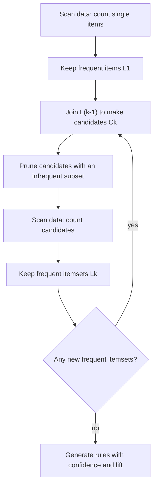
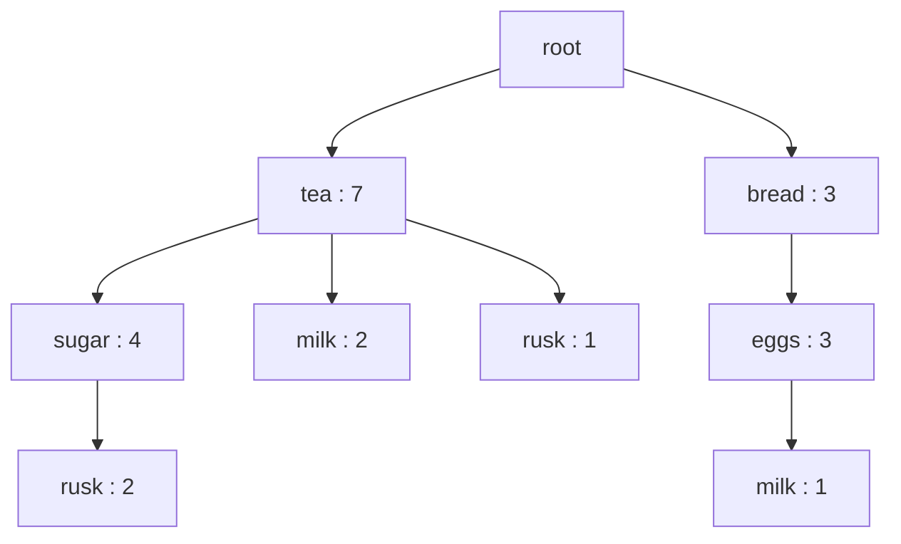
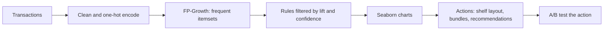
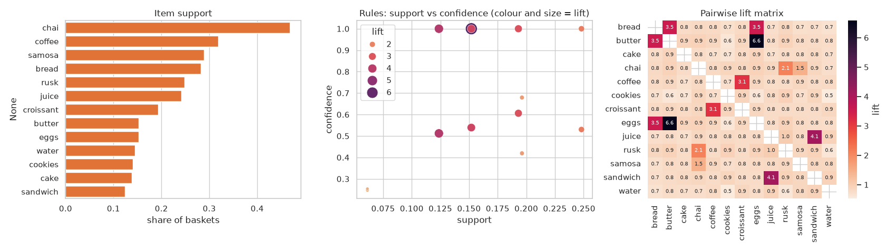
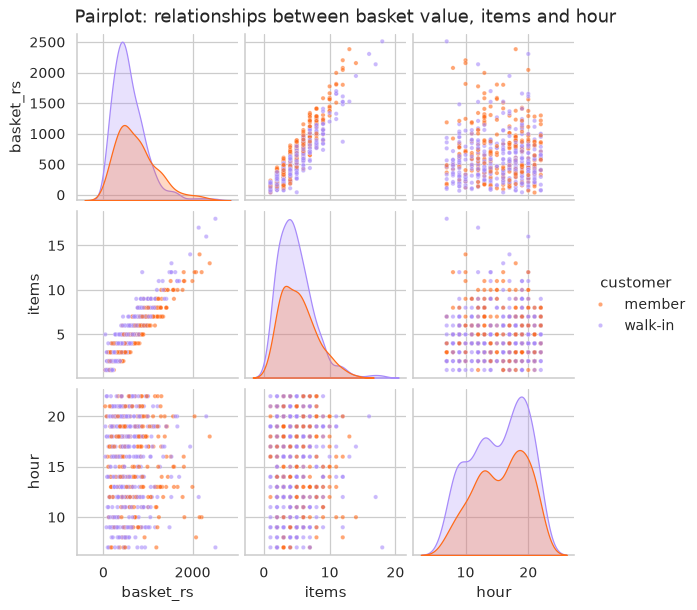
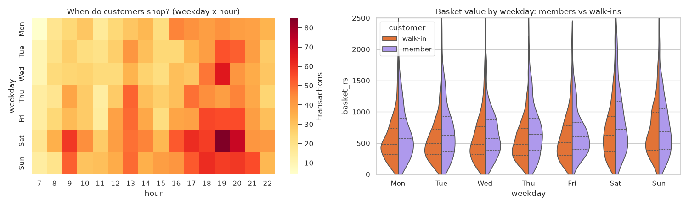
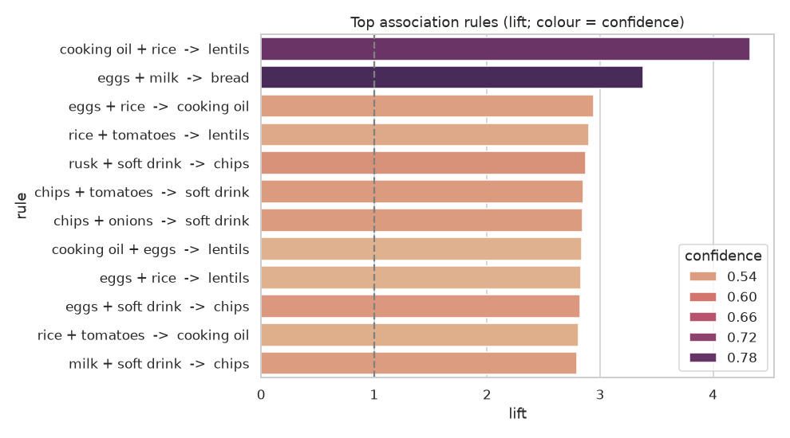

# Session 9 · Pattern Mining and Visualization with Seaborn

[](https://colab.research.google.com/github/Hamnakhan123/Diploma-in-Data-Science/blob/main/term-2/03-advanced-data-science-with-python/code/session-09-pattern-mining-and-seaborn.ipynb)

> 📍 [Diploma in Data Science](../../README.md) › [Term 2](../README.md) › [Advanced Data Science with Python](README.md) › **Session 9**

| ⏱ Estimated time | 🧩 Prerequisites | 💻 Tools |
|---|---|---|
| 3 hours | Session 6 (support, confidence, lift), pandas groupby | Python 3.10+, pandas, NumPy, Seaborn, Matplotlib, mlxtend |

[⬅ Previous: Session 8 · Advanced Unsupervised Learning: Dimensionality Reduction](session-08-dimensionality-reduction.md) · [🏠 Module home](README.md) · [Next: Session 10 · Reinforcement Learning Basics ➡](session-10-reinforcement-learning-basics.md)

---

## 🎯 Learning objectives

- Describe the key concepts used to **identify patterns** in data: itemsets, transactions, frequent patterns, support, confidence, lift, leverage and conviction.
- Explain the step-by-step process of the **Apriori** algorithm and implement it.
- Describe how **FP-Growth** mines frequent patterns using an **FP-Tree** without generating candidates.
- Define the **Eclat** algorithm and its vertical (tid-list) data format.
- Explain and carry out a complete **Market Basket Analysis (MBA)**, and visualise the patterns with **Seaborn**.

## 📖 Concepts

### 1. Pattern mining vocabulary

Pattern mining looks for **things that happen together**. A shopkeeper notices that people who buy *chai patti* often also buy *rusk*; a streaming service notices that viewers of one drama watch a certain other drama next; a hospital notices that two symptoms often appear together.

| Term | Meaning | Example |
|---|---|---|
| **Item** | one product/event | milk |
| **Transaction** | one set of items occurring together | one till receipt |
| **Itemset** | any set of items; a *k-itemset* has k items | {bread, eggs} is a 2-itemset |
| **Support** | share of transactions containing the itemset | {bread, eggs} in 120 of 1,000 receipts → 0.12 |
| **Frequent itemset** | support ≥ `min_support` | |
| **Rule** A → B | "if A is bought, B is also bought" | {bread} → {eggs} |
| **Confidence** | P(B \| A) = supp(A ∪ B) / supp(A) | of bread buyers, 60% also buy eggs |
| **Lift** | confidence / supp(B) | 1 = independent, > 1 positive association |
| **Leverage** | supp(A ∪ B) − supp(A)·supp(B) | extra co-occurrence beyond chance |
| **Conviction** | (1 − supp(B)) / (1 − confidence) | how much more often the rule would be wrong if A and B were independent; ∞ for perfect rules |

**Why lift matters**: milk is in 60% of baskets, so almost *any* rule "X → milk" has high confidence. Lift corrects for how popular the consequent already is.

### 2. Apriori: grow only from frequent seeds

Apriori rests on the **Apriori property** (downward closure): *every subset of a frequent itemset is frequent*; equivalently, *if an itemset is infrequent, all of its supersets are infrequent*. Think of a club with a rule "you can only join a group of three friends if every pair among them is already a group": you never need to check trios containing an unpopular pair.

**Steps**

1. Count single items; keep those with support ≥ min_support → **L1**.
2. **Join**: combine frequent (k−1)-itemsets to form candidate k-itemsets **Ck**.
3. **Prune**: drop any candidate that has an infrequent (k−1)-subset.
4. **Scan** the data to count the remaining candidates; keep the frequent ones → **Lk**.
5. Repeat until no new frequent itemsets appear.
6. **Generate rules** from each frequent itemset: split it into A → B and keep rules with confidence (or lift) above a threshold.

Weakness: many database scans and a huge number of candidates when items are many and min_support is low.

### 3. FP-Growth and the FP-Tree

FP-Growth (Frequent Pattern Growth) avoids candidate generation. It compresses the whole database into a **prefix tree** (FP-Tree), like a family tree where receipts that start the same way share a branch.

1. Scan once: count items, drop infrequent ones, sort the remaining items in each transaction by **descending frequency**.
2. Scan again: insert each sorted transaction into the tree. Shared prefixes share nodes; each node stores a **count**. A **header table** links all nodes of the same item.
3. Mine the tree bottom-up: for each item, collect its **conditional pattern base** (the prefix paths that lead to it), build a small **conditional FP-Tree**, and recurse.

Only **two scans** of the data are needed; it is usually much faster than Apriori on dense data.

### 4. Eclat: thinking in columns

Eclat (Equivalence Class Clustering and bottom-up Lattice Traversal) flips the data to a **vertical format**: for each item, keep the set of transaction IDs (its **tid-list**) that contain it.

| Item | tid-list |
|---|---|
| bread | {1, 2, 4, 7} |
| eggs | {2, 4, 7, 9} |

The support of {bread, eggs} is simply the size of the **intersection** {2, 4, 7} → 3 transactions. Eclat explores itemsets depth-first, intersecting tid-lists as it goes. Fast and memory-friendly when tid-lists are short; it finds frequent itemsets only (rules are generated afterwards as usual).

| | Apriori | FP-Growth | Eclat |
|---|---|---|---|
| Data layout | horizontal (rows of items) | compressed prefix tree | vertical (item → tid-list) |
| Search | breadth-first, level by level | divide and conquer on tree | depth-first intersections |
| Candidate generation | yes | no | yes (by intersection) |
| Data scans | one per level | two | one (to build tid-lists) |
| Best for | teaching, small data | large, dense data | medium data, fast set operations |

### 5. Market Basket Analysis (MBA)

MBA applies these algorithms to retail transactions to answer: **which products are bought together, and how can we use it?**

| Step | Work |
|---|---|
| 1. Prepare | one row per transaction (invoice), remove returns/cancellations, decide the item level (SKU vs category) |
| 2. Encode | one-hot basket matrix (transactions × items, True/False) |
| 3. Mine | FP-Growth/Apriori with a sensible `min_support` (start where the top ~100 itemsets appear) |
| 4. Rules | filter by lift > 1 (often > 1.5), confidence and a minimum support so rules are actionable |
| 5. Interpret | remove trivial rules (e.g. a product and its own accessory sold as a bundle) |
| 6. Act | shelf placement, bundles, cross-sell recommendations, promotions, menu design |
| 7. Test | A/B test the action; association is **not** causation |

### 6. Seaborn for pattern visualisation

Seaborn draws statistical charts from DataFrames in one line, with sensible defaults.

| Goal | Seaborn function |
|---|---|
| frequency of items | `barplot`, `countplot` |
| co-occurrence or lift matrix | `heatmap` |
| rules: support vs confidence, coloured by lift | `scatterplot(hue=, size=)` |
| distribution of a measure | `histplot`, `kdeplot`, `boxplot`, `violinplot` |
| relationships among several numbers | `pairplot`, `jointplot` |
| small multiples by group | `relplot`/`catplot` with `col=` |
| clustered heatmap | `clustermap` |

## 🧭 Diagrams







## 💻 Worked examples

### Example 1 · Basic: Apriori from scratch

📄 [`code/session-09_apriori_scratch.py`](code/session-09_apriori_scratch.py)

```python
"""A small, readable Apriori implementation: join, prune, count, and rule generation."""
from itertools import combinations

baskets = [{"tea", "sugar", "rusk"}, {"tea", "sugar"}, {"tea", "milk", "rusk"}, {"bread", "eggs", "milk"},
           {"bread", "eggs"}, {"tea", "sugar", "milk"}, {"bread", "milk", "eggs", "tea"}, {"tea", "rusk"},
           {"sugar", "tea", "rusk"}, {"eggs", "bread", "butter"}]
N, MIN_SUP, MIN_CONF = len(baskets), 0.3, 0.6

def support(itemset):
    return sum(itemset <= b for b in baskets) / N          # <= means 'is a subset of'

items = sorted({i for b in baskets for i in b})
L = [{frozenset([i]) for i in items if support({i}) >= MIN_SUP}]
print("L1:", sorted("".join(sorted(s)) for s in L[0]))
k = 2
while L[-1]:
    prev = L[-1]
    candidates = {a | b for a in prev for b in prev if len(a | b) == k}                         # join
    candidates = {c for c in candidates if all(frozenset(s) in prev for s in combinations(c, k - 1))}  # prune
    Lk = {c for c in candidates if support(c) >= MIN_SUP}                                       # count
    print(f"C{k}: {len(candidates)} candidates -> L{k}: {[sorted(c) for c in Lk]}")
    L.append(Lk); k += 1

print("\nRules (confidence >= 0.6):")
for level in L[1:]:
    for itemset in level:
        for r in range(1, len(itemset)):
            for A in map(frozenset, combinations(itemset, r)):
                B = itemset - A
                conf = support(itemset) / support(A)
                if conf >= MIN_CONF:
                    lift = conf / support(B)
                    print(f"  {sorted(A)} -> {sorted(B)}  support={support(itemset):.2f}  confidence={conf:.2f}  lift={lift:.2f}")
```

**Output**

```text
L1: ['bread', 'eggs', 'milk', 'rusk', 'sugar', 'tea']
C2: 15 candidates -> L2: [['milk', 'tea'], ['bread', 'eggs'], ['rusk', 'tea'], ['sugar', 'tea']]
C3: 0 candidates -> L3: []

Rules (confidence >= 0.6):
  ['milk'] -> ['tea']  support=0.30  confidence=0.75  lift=1.07
  ['eggs'] -> ['bread']  support=0.40  confidence=1.00  lift=2.50
  ['bread'] -> ['eggs']  support=0.40  confidence=1.00  lift=2.50
  ['rusk'] -> ['tea']  support=0.40  confidence=1.00  lift=1.43
  ['sugar'] -> ['tea']  support=0.40  confidence=1.00  lift=1.43
```

### Example 2 · Intermediate: Eclat with tid-lists

📄 [`code/session-09_eclat.py`](code/session-09_eclat.py)

```python
"""Eclat: vertical tid-lists and depth-first intersection to find frequent itemsets."""
baskets = [{"tea", "sugar", "rusk"}, {"tea", "sugar"}, {"tea", "milk", "rusk"}, {"bread", "eggs", "milk"},
           {"bread", "eggs"}, {"tea", "sugar", "milk"}, {"bread", "milk", "eggs", "tea"}, {"tea", "rusk"},
           {"sugar", "tea", "rusk"}, {"eggs", "bread", "butter"}]
MIN_COUNT = 3                                      # = support 0.3 with 10 transactions

tid = {}
for t, b in enumerate(baskets, 1):
    for item in b:
        tid.setdefault(item, set()).add(t)
print("vertical format (tid-lists):")
for item in sorted(tid):
    print(f"  {item:<7} {sorted(tid[item])}")

results = []
def eclat(prefix, candidates):
    """candidates: list of (item, tidset) that can extend prefix, sorted."""
    for i, (item, tids) in enumerate(candidates):
        if len(tids) < MIN_COUNT:
            continue
        itemset = prefix + [item]
        results.append((itemset, len(tids)))
        # extend with later items by intersecting tid-lists
        ext = [(other, tids & otids) for other, otids in candidates[i + 1:]]
        eclat(itemset, ext)

eclat([], sorted(tid.items()))
print("\nfrequent itemsets (count >= 3):")
for itemset, c in sorted(results, key=lambda r: (len(r[0]), -r[1])):
    print(f"  {', '.join(itemset):<22} count={c}  support={c / len(baskets):.1f}")
```

**Output**

```text
vertical format (tid-lists):
  bread   [4, 5, 7, 10]
  butter  [10]
  eggs    [4, 5, 7, 10]
  milk    [3, 4, 6, 7]
  rusk    [1, 3, 8, 9]
  sugar   [1, 2, 6, 9]
  tea     [1, 2, 3, 6, 7, 8, 9]

frequent itemsets (count >= 3):
  tea                    count=7  support=0.7
  bread                  count=4  support=0.4
  eggs                   count=4  support=0.4
  milk                   count=4  support=0.4
  rusk                   count=4  support=0.4
  sugar                  count=4  support=0.4
  bread, eggs            count=4  support=0.4
  rusk, tea              count=4  support=0.4
  sugar, tea             count=4  support=0.4
  milk, tea              count=3  support=0.3
```

The results match Apriori in Example 1, found with set intersections instead of repeated scans.

### Example 3 · Intermediate: building an FP-Tree and mining with FP-Growth

📄 [`code/session-09_fptree.py`](code/session-09_fptree.py)

```python
"""Build an FP-Tree by hand to see its structure, then mine with mlxtend's fpgrowth and compare with apriori."""
import time
from collections import Counter
import numpy as np
import pandas as pd
from mlxtend.preprocessing import TransactionEncoder
from mlxtend.frequent_patterns import apriori, fpgrowth

baskets = [["tea", "sugar", "rusk"], ["tea", "sugar"], ["tea", "milk", "rusk"], ["bread", "eggs", "milk"],
           ["bread", "eggs"], ["tea", "sugar", "milk"], ["bread", "milk", "eggs", "tea"], ["tea", "rusk"],
           ["sugar", "tea", "rusk"], ["eggs", "bread", "butter"]]
MIN_COUNT = 3
freq = Counter(i for b in baskets for i in b)
order = {i: c for i, c in freq.items() if c >= MIN_COUNT}
print("item order by frequency:", sorted(order.items(), key=lambda x: -x[1]))

class Node:
    def __init__(self, item, parent):
        self.item, self.parent, self.count, self.children = item, parent, 0, {}

root = Node(None, None)
for b in baskets:
    path = sorted([i for i in b if i in order], key=lambda i: (-order[i], i))   # sort by frequency
    node = root
    for item in path:
        node = node.children.setdefault(item, Node(item, node))
        node.count += 1

def show(node, depth=0):
    for child in sorted(node.children.values(), key=lambda n: -n.count):
        print("  " * depth + f"{child.item}:{child.count}")
        show(child, depth + 1)
print("\nFP-Tree:"); show(root)

# mlxtend on a bigger synthetic data set: apriori vs fpgrowth speed
rng = np.random.default_rng(0)
items = [f"item{i:02d}" for i in range(40)]
pop = rng.dirichlet(np.ones(40) * .4)
big = [list(rng.choice(items, size=rng.integers(2, 12), replace=False, p=pop)) for _ in range(5000)]
te = TransactionEncoder(); onehot = pd.DataFrame(te.fit(big).transform(big), columns=te.columns_)
for name, fn in [("apriori", apriori), ("fpgrowth", fpgrowth)]:
    t0 = time.perf_counter(); res = fn(onehot, min_support=0.02, use_colnames=True); dt = time.perf_counter() - t0
    print(f"{name:<9} {len(res):>5} frequent itemsets in {dt:.2f} s")
```

**Output**

```text
item order by frequency: [('tea', 7), ('sugar', 4), ('rusk', 4), ('milk', 4), ('bread', 4), ('eggs', 4)]

FP-Tree:
tea:7
  rusk:3
    sugar:2
  milk:2
    rusk:1
    sugar:1
  sugar:1
  bread:1
    eggs:1
      milk:1
bread:3
  eggs:3
    milk:1
apriori    1356 frequent itemsets in 0.08 s
fpgrowth   1356 frequent itemsets in 0.19 s
```

Both algorithms return exactly the same itemsets. On this small, sparse data mlxtend's Apriori is actually faster; FP-Growth's advantage (only two passes, no candidates) shows on large, dense data with long itemsets. Always measure on your own data.

### Example 4 · Advanced: rule measures and Seaborn charts

📄 [`code/session-09_rules_seaborn.py`](code/session-09_rules_seaborn.py)

```python
"""Full rule table (support, confidence, lift, leverage, conviction) and three Seaborn charts."""
import numpy as np
import pandas as pd
import seaborn as sns
import matplotlib.pyplot as plt
from mlxtend.preprocessing import TransactionEncoder
from mlxtend.frequent_patterns import fpgrowth, association_rules

rng = np.random.default_rng(3)
# A bakery-cafe: some items are bought together on purpose
combos = [(["chai", "rusk"], .22), (["coffee", "croissant"], .15), (["bread", "butter", "eggs"], .12),
          (["chai", "samosa"], .14), (["juice", "sandwich"], .10)]
singles = ["chai", "coffee", "bread", "cake", "juice", "cookies", "samosa", "water"]
baskets = []
for _ in range(3000):
    b = set()
    for combo, p in combos:
        if rng.random() < p:
            b.update(combo)
    b.update(rng.choice(singles, rng.integers(0, 3), replace=False))
    if b:
        baskets.append(sorted(str(x) for x in b))          # plain str (not numpy str) for mlxtend
te = TransactionEncoder(); onehot = pd.DataFrame(te.fit(baskets).transform(baskets), columns=te.columns_)
print("transactions:", len(onehot), "| items:", onehot.shape[1])

freq = fpgrowth(onehot, min_support=0.03, use_colnames=True)
rules = association_rules(freq, metric="lift", min_threshold=1.0)
# keep simple one-item -> one-item rules: long rules that glue two unrelated patterns together get inflated lifts
rules = rules[(rules.antecedents.apply(len) == 1) & (rules.consequents.apply(len) == 1)].copy()
rules["rule"] = rules.antecedents.apply(lambda s: "+".join(sorted(s))) + " -> " + rules.consequents.apply(lambda s: "+".join(sorted(s)))
top = rules.sort_values("lift", ascending=False).head(8)
print(top[["rule", "support", "confidence", "lift", "leverage", "conviction"]].round(3).to_string(index=False))

sns.set_theme(style="whitegrid")
fig, ax = plt.subplots(1, 3, figsize=(17, 4.8))
item_sup = onehot.mean().sort_values(ascending=False)
sns.barplot(x=item_sup.values, y=item_sup.index, ax=ax[0], color="#FF6B1A"); ax[0].set_title("Item support"); ax[0].set_xlabel("share of baskets")
sns.scatterplot(data=rules, x="support", y="confidence", hue="lift", size="lift", palette="flare", sizes=(20, 250), ax=ax[1])
ax[1].set_title("Rules: support vs confidence (colour and size = lift)")
co = onehot.T.astype(int) @ onehot.astype(int)
lift_m = (co / len(onehot)) / np.outer(item_sup.reindex(co.index), item_sup.reindex(co.columns))
lift_m = lift_m.mask(np.eye(len(lift_m), dtype=bool))       # hide the diagonal (item with itself)
sns.heatmap(lift_m, cmap="rocket_r", annot=True, fmt=".1f", annot_kws={"size": 7}, ax=ax[2], cbar_kws={"label": "lift"})
ax[2].set_title("Pairwise lift matrix")
fig.tight_layout(); fig.savefig("session-09_rules_seaborn.png", dpi=100); plt.show()
```

**Output**

```text
transactions: 2579 | items: 13
             rule  support  confidence  lift  leverage  conviction
   eggs -> butter    0.152       1.000 6.579     0.129         inf
   butter -> eggs    0.152       1.000 6.579     0.129         inf
sandwich -> juice    0.124       1.000 4.140     0.094         inf
juice -> sandwich    0.124       0.512 4.140     0.094       1.796
    eggs -> bread    0.152       1.000 3.547     0.109         inf
    bread -> eggs    0.152       0.539 3.547     0.109       1.840
  bread -> butter    0.152       0.539 3.547     0.109       1.840
  butter -> bread    0.152       1.000 3.547     0.109         inf
```

**Chart produced by this code** (saved as [`code/session-09_rules_seaborn.png`](code/session-09_rules_seaborn.png)):



### Example 5 · Advanced: more Seaborn for exploring patterns over time and groups

📄 [`code/session-09_seaborn_patterns.py`](code/session-09_seaborn_patterns.py)

```python
"""Seaborn patterns: hourly x weekday heatmap, violin plots by group, and a pairplot."""
import numpy as np
import pandas as pd
import seaborn as sns
import matplotlib.pyplot as plt

rng = np.random.default_rng(4)
n = 4000
df = pd.DataFrame({"hour": rng.choice(range(7, 23), n, p=np.r_[[2, 4, 6, 5, 4, 6, 8, 6, 5, 6, 8, 9, 10, 9, 7, 5]] / 100),
                   "weekday": rng.choice(["Mon", "Tue", "Wed", "Thu", "Fri", "Sat", "Sun"], n, p=[.12, .12, .12, .13, .15, .19, .17])})
df["basket_rs"] = (rng.gamma(2.5, 220, n) * np.where(df.weekday.isin(["Sat", "Sun"]), 1.3, 1)).round()
df["items"] = (df.basket_rs / 150 + rng.poisson(1, n)).round().clip(1)
df["customer"] = np.where(rng.random(n) < .4, "member", "walk-in")
df.loc[df.customer == "member", "basket_rs"] *= 1.2

order = ["Mon", "Tue", "Wed", "Thu", "Fri", "Sat", "Sun"]
grid = df.pivot_table(index="weekday", columns="hour", values="basket_rs", aggfunc="size").reindex(order)
day, hour = grid.stack().idxmax()
print(f"busiest weekday-hour: {day} {int(hour)}:00 with {int(grid.values.max())} transactions")
print(df.groupby("customer")["basket_rs"].describe()[["mean", "50%", "max"]].round(0))

sns.set_theme(style="whitegrid")
fig = plt.figure(figsize=(15, 4.5))
ax1 = fig.add_subplot(1, 2, 1)
sns.heatmap(grid, cmap="YlOrRd", ax=ax1, cbar_kws={"label": "transactions"}); ax1.set_title("When do customers shop? (weekday x hour)")
ax2 = fig.add_subplot(1, 2, 2)
sns.violinplot(data=df, x="weekday", y="basket_rs", hue="customer", split=True, order=order, inner="quart", ax=ax2,
               palette=["#FF6B1A", "#A78BFA"])
ax2.set_ylim(0, 2500); ax2.set_title("Basket value by weekday: members vs walk-ins")
fig.tight_layout(); fig.savefig("session-09_seaborn_patterns.png", dpi=100); plt.show()

g = sns.pairplot(df.sample(600, random_state=0)[["basket_rs", "items", "hour", "customer"]], hue="customer",
                 palette=["#FF6B1A", "#A78BFA"], plot_kws={"s": 12, "alpha": .6}, height=2.2)
g.figure.suptitle("Pairplot: relationships between basket value, items and hour", y=1.02)
g.savefig("session-09_pairplot.png", dpi=90); plt.show()
```

**Output**

```text
busiest weekday-hour: Sat 19:00 with 85 transactions
           mean    50%     max
customer
member    732.0  639.0  3457.0
walk-in   619.0  541.0  3017.0
```

**Chart produced by this code** (saved as [`code/session-09_pairplot.png`](code/session-09_pairplot.png)):



**Chart produced by this code** (saved as [`code/session-09_seaborn_patterns.png`](code/session-09_seaborn_patterns.png)):



## 🏙️ Real-life data problem: a supermarket's market basket analysis

**Problem.** A neighbourhood supermarket has 8,000 receipts (including some cancelled lines). The manager wants: the strongest product associations, three concrete actions (shelf placement, bundle, cross-sell), and a short list of rules that are *not* worth acting on.

**Full solution.** Clean invoices → basket matrix → FP-Growth → rules with lift ≥ 1.3 and confidence ≥ 0.3 → remove redundant rules → visualise → recommend.

📄 [`code/session-09_mba_problem.py`](code/session-09_mba_problem.py)

```python
"""Real-life problem: end-to-end market basket analysis from raw invoice lines to recommended actions."""
import numpy as np
import pandas as pd
import seaborn as sns
import matplotlib.pyplot as plt
from mlxtend.frequent_patterns import fpgrowth, association_rules

rng = np.random.default_rng(7)
catalogue = ["milk", "bread", "eggs", "butter", "tea", "sugar", "rusk", "rice", "lentils", "cooking oil",
             "onions", "tomatoes", "yogurt", "biscuits", "soft drink", "chips", "nappies", "baby wipes", "shampoo", "soap"]
patterns = [(["milk", "bread", "eggs"], .20), (["tea", "sugar"], .18), (["tea", "rusk"], .12), (["rice", "lentils", "cooking oil"], .10),
            (["onions", "tomatoes"], .22), (["soft drink", "chips"], .12), (["nappies", "baby wipes"], .05), (["shampoo", "soap"], .06)]
lines = []
for inv in range(8000):
    items = set()
    for combo, p in patterns:
        if rng.random() < p:
            items.update(c for c in combo if rng.random() < .85)       # not always the full combo
    items.update(rng.choice(catalogue, rng.integers(1, 4), replace=False))
    for it in items:
        lines.append((f"INV{inv:05d}", str(it), int(rng.integers(1, 4))))
raw = pd.DataFrame(lines, columns=["invoice", "item", "qty"])
cancel = raw.sample(frac=.01, random_state=1).index
raw.loc[cancel, "qty"] = -raw.loc[cancel, "qty"]                       # returns / cancellations
print("raw invoice lines:", len(raw), "| cancelled lines:", (raw.qty < 0).sum())

# 1. Clean: drop cancelled lines, build a one-hot basket matrix
clean = raw[raw.qty > 0]
basket = clean.assign(v=True).pivot_table(index="invoice", columns="item", values="v", aggfunc="any", fill_value=False)
print("basket matrix:", basket.shape)

# 2. Mine and 3. filter rules
freq = fpgrowth(basket, min_support=0.02, use_colnames=True)
rules = association_rules(freq, metric="lift", min_threshold=1.3)
rules = rules[(rules.confidence >= .3) & (rules.consequents.apply(len) == 1) & (rules.antecedents.apply(len) <= 2)].copy()
# (single-item consequents, at most two antecedents: longer rules mostly glue two unrelated patterns together)
rules["rule"] = rules.antecedents.apply(lambda s: " + ".join(sorted(s))) + "  ->  " + rules.consequents.apply(lambda s: " + ".join(sorted(s)))
# 4. Remove redundancy: keep the single best rule per unordered item set
rules["itemset"] = rules.apply(lambda r: frozenset(r.antecedents | r.consequents), axis=1)
best = rules.sort_values("lift", ascending=False).drop_duplicates("itemset")
print(f"\nfrequent itemsets: {len(freq)} | rules after filters: {len(rules)} | after removing duplicates: {len(best)}")
print(best[["rule", "support", "confidence", "lift"]].head(10).round(3).to_string(index=False))

weak = association_rules(freq, metric="lift", min_threshold=0).query("confidence > 0.3 and lift < 1.1")
weak = weak.assign(rule=weak.antecedents.apply(lambda s: "+".join(sorted(s))) + " -> " + weak.consequents.apply(lambda s: "+".join(sorted(s))))
print("\nhigh-confidence but NOT useful (lift ~ 1, consequent is just popular):")
print(weak.sort_values("confidence", ascending=False)[["rule", "confidence", "lift"]].head(4).round(2).to_string(index=False))

top = best.head(12)
plt.figure(figsize=(9, 5))
sns.barplot(data=top, y="rule", x="lift", hue="confidence", palette="flare", dodge=False)
plt.axvline(1, color="grey", ls="--"); plt.title("Top association rules (lift; colour = confidence)")
plt.tight_layout(); plt.savefig("session-09_mba_rules.png", dpi=110); plt.show()
```

**Output**

```text
raw invoice lines: 30829 | cancelled lines: 308
basket matrix: (7988, 20)

frequent itemsets: 285 | rules after filters: 216 | after removing duplicates: 107
                            rule  support  confidence  lift
 cooking oil + rice  ->  lentils    0.065       0.774 4.325
          eggs + milk  ->  bread    0.123       0.829 3.382
    eggs + rice  ->  cooking oil    0.023       0.536 2.943
    rice + tomatoes  ->  lentils    0.024       0.519 2.902
    rusk + soft drink  ->  chips    0.021       0.556 2.876
chips + tomatoes  ->  soft drink    0.026       0.542 2.850
  chips + onions  ->  soft drink    0.026       0.542 2.848
 cooking oil + eggs  ->  lentils    0.022       0.507 2.835
        eggs + rice  ->  lentils    0.021       0.506 2.828
    eggs + soft drink  ->  chips    0.024       0.545 2.821

high-confidence but NOT useful (lift ~ 1, consequent is just popular):
                      rule  confidence  lift
            shampoo -> tea        0.32  1.03
       lentils+rice -> tea        0.32  1.03
cooking oil+lentils -> tea        0.32  1.02
    onions+tomatoes -> tea        0.32  1.01
```

**Chart produced by this code** (saved as [`code/session-09_mba_rules.png`](code/session-09_mba_rules.png)):



**Answer for the manager.**

1. **Bundle**: the "pantry trio" is the strongest pattern: customers buying cooking oil and rice are about 4.3 times more likely than average to buy lentils (77% of them do). Offer a monthly ration bundle of rice + lentils + oil.
2. **Shelf placement**: the breakfast group (eggs + milk → bread, lift ≈ 3.4, confidence 83%) supports placing bread next to the dairy fridge rather than at the far end of the shop.
3. **Cross-sell at the till**: snack rules (… + soft drink → chips and chips + … → soft drink, lift ≈ 2.8–2.9) suggest a till-side snack display and a drink-plus-chips combo price.
4. **Ignore**: rules like "shampoo → tea" or "lentils + rice → tea" have confidence above 30% but lift ≈ 1. Tea is simply in a third of all baskets; there is no real association.
5. **Validate** each action with a 4-week A/B test in two branches; association is not causation.

## ⚠️ Common mistakes

| Mistake | Fix |
|---|---|
| Ranking rules by confidence only | always check lift (and leverage) |
| `min_support` far too low | millions of rules and slow runs; raise it, then lower gradually |
| Keeping cancelled/returned lines | filter negative quantities and cancelled invoices |
| Mining at SKU level with thousands of rare SKUs | aggregate to categories or brands first |
| Treating a rule as proof that A causes B | test interventions (A/B tests) |
| Unreadable heatmaps with 500 items | show the top 15–25 items only |

## ✅ Best practices

- Decide the **business question** and item granularity before mining.
- Use **FP-Growth** for speed; Apriori for teaching and small data.
- Report support (how often), confidence (how reliable) and lift (how interesting) together.
- Remove duplicate/symmetric rules and trivial ones (bundles sold as one product).
- Visualise with Seaborn: support/confidence scatter coloured by lift, lift heatmap, top-rules bar chart.
- Re-run monthly; seasonal associations (Ramadan, Eid, back-to-school) change.

## 🧪 Lab / practice tasks

### 🟢 Task 1 · Easy

Using Example 1, lower `MIN_SUP` to 0.2. How many frequent 2-itemsets and 3-itemsets appear now?

<details><summary>💡 Hint</summary>

Lower support admits more itemsets at every level.

</details>

<details><summary>✅ Solution</summary>

At 0.2 more pairs qualify (for example {milk, tea}, {bread, milk}, {eggs, milk}) and 3-itemsets such as {bread, eggs, milk} and {tea, sugar, rusk} appear. The number of rules grows quickly, which is why support thresholds matter.

</details>


### 🟡 Task 2 · Medium

Compute leverage and conviction by hand for {tea} → {sugar} (support(tea) = 0.7, support(sugar) = 0.4, support(both) = 0.4).

<details><summary>💡 Hint</summary>

Leverage = supp(A∪B) − supp(A)·supp(B); conviction = (1 − supp(B)) / (1 − conf).

</details>

<details><summary>✅ Solution</summary>

Confidence = 0.4 / 0.7 = 0.571. Leverage = 0.4 − 0.28 = 0.12. Conviction = 0.6 / 0.429 = 1.40, meaning the rule would be wrong 1.4 times as often if tea and sugar were independent.

</details>


### 🟡 Task 3 · Medium

Extend the Eclat code to also print **rules** with confidence ≥ 0.6 from the frequent itemsets.

<details><summary>💡 Hint</summary>

Store supports in a dict keyed by frozenset; for each itemset of size ≥ 2 try every split A → B.

</details>

<details><summary>✅ Solution</summary>

```python
sup = {frozenset(i): c / len(baskets) for i, c in results}
from itertools import combinations
for s in [k for k in sup if len(k) > 1]:
    for r in range(1, len(s)):
        for A in map(frozenset, combinations(s, r)):
            conf = sup[s] / sup[A]
            if conf >= .6: print(sorted(A), "->", sorted(s - A), round(conf, 2), round(conf / sup[s - A], 2))
```

</details>


### 🟠 Task 4 · Hard

In the MBA problem, use Seaborn `clustermap` on the pairwise lift matrix of the 20 items. Which product groups emerge?

<details><summary>💡 Hint</summary>

Build the co-occurrence matrix with `basket.T.astype(int) @ basket.astype(int)` and divide by expected counts.

</details>

<details><summary>✅ Solution</summary>

The dendrogram groups the planted families: breakfast (milk, bread, eggs), chai (tea, sugar, rusk), pantry (rice, lentils, oil), salad base (onions, tomatoes), snacks (soft drink, chips), baby and personal care. Clustered heatmaps are a quick way to propose store zones.

</details>


### 🔴 Task 5 · Challenge

Split the MBA data into weekday and weekend invoices (assign a random day per invoice with weekend more likely for snacks). Mine rules separately and report which rules change most in lift.

<details><summary>💡 Hint</summary>

Mine twice and merge rule tables on the `rule` column.

</details>

<details><summary>✅ Solution</summary>

Rules for snacks (soft drink → chips) gain lift at weekends, while pantry bundles are stronger on weekdays near salary dates. Comparing segments (time, branch, customer type) is often more useful than one global rule list.

</details>


## 🧩 Mini project: "frequently bought together" recommender

📄 [`code/session-09_mini_project.py`](code/session-09_mini_project.py)

```python
"""Mini project: turn association rules into a 'frequently bought together' recommender with a fallback."""
import numpy as np
import pandas as pd
from mlxtend.preprocessing import TransactionEncoder
from mlxtend.frequent_patterns import fpgrowth, association_rules

rng = np.random.default_rng(11)
families = {"stationery": ["notebook", "pen", "pencil", "eraser", "ruler"], "tech": ["laptop", "mouse", "laptop bag", "usb drive"],
            "phone": ["phone", "phone case", "charger", "screen guard"], "printing": ["printer ink", "a4 paper"]}
baskets = []
for _ in range(5000):
    fam = rng.choice(list(families), p=[.45, .2, .25, .1])
    items = list(rng.choice(families[fam], rng.integers(1, len(families[fam]) + 1), replace=False))
    if rng.random() < .15:
        items.append(rng.choice(sum(families.values(), [])))
    baskets.append(sorted({str(x) for x in items}))
te = TransactionEncoder(); onehot = pd.DataFrame(te.fit(baskets).transform(baskets), columns=te.columns_)
rules = association_rules(fpgrowth(onehot, min_support=0.01, use_colnames=True), metric="lift", min_threshold=1.2)
popular = onehot.mean().sort_values(ascending=False)

def recommend(cart, k=3):
    """Score candidate items by the best lift x confidence of rules whose antecedent is inside the cart."""
    cart = set(cart)
    ok = rules[rules.antecedents.apply(lambda a: a <= cart)]
    scores = {}
    for _, r in ok.iterrows():
        for item in r.consequents - cart:
            scores[item] = max(scores.get(item, 0), r.lift * r.confidence)
    recs = [i for i, _ in sorted(scores.items(), key=lambda x: -x[1])][:k]
    for item in popular.index:                       # fallback: most popular items not in the cart
        if len(recs) >= k: break
        if item not in cart and item not in recs:
            recs.append(item)
    return recs

for cart in [["laptop"], ["phone", "charger"], ["notebook"], ["printer ink"], ["a4 paper", "pen"]]:
    print(f"cart {cart} -> recommend {recommend(cart)}")
print(f"\nrules available: {len(rules)}")
```

**Output**

```text
cart ['laptop'] -> recommend ['mouse', 'laptop bag', 'usb drive']
cart ['phone', 'charger'] -> recommend ['screen guard', 'phone case', 'pen']
cart ['notebook'] -> recommend ['eraser', 'ruler', 'pen']
cart ['printer ink'] -> recommend ['a4 paper', 'pen', 'notebook']
cart ['a4 paper', 'pen'] -> recommend ['printer ink', 'eraser', 'notebook']

rules available: 282
```

## ✅ Quick quiz

**Q1.** The Apriori property says that…

- **A)** every superset of a frequent itemset is frequent
- **B)** every subset of a frequent itemset is frequent
- **C)** support increases with itemset size
- **D)** lift is always above 1

<details><summary>Show answer</summary>

**B** — Downward closure lets Apriori prune candidates.

</details>

**Q2.** FP-Growth is usually faster than Apriori because it…

- **A)** uses GPUs
- **B)** compresses data into a tree and avoids candidate generation
- **C)** ignores support
- **D)** only finds pairs

<details><summary>Show answer</summary>

**B** — Two scans build the FP-Tree, then it mines recursively.

</details>

**Q3.** Eclat computes the support of {A, B} by…

- **A)** scanning all rows
- **B)** intersecting the tid-lists of A and B
- **C)** multiplying supports
- **D)** building an FP-Tree

<details><summary>Show answer</summary>

**B** — Vertical format makes support a set intersection.

</details>

**Q4.** A rule with high confidence but lift = 1.0 means…

- **A)** a strong association
- **B)** the consequent is simply popular; no real association
- **C)** the rule is wrong
- **D)** support is zero

<details><summary>Show answer</summary>

**B** — Lift corrects for the consequent's popularity.

</details>

**Q5.** Which Seaborn function suits a matrix of pairwise lifts?

- **A)** histplot
- **B)** heatmap
- **C)** lineplot
- **D)** countplot

<details><summary>Show answer</summary>

**B** — Heatmaps show values in a grid with colour.

</details>


## 📝 Summary

- Pattern mining finds items that occur together, measured by **support, confidence, lift, leverage and conviction**.
- **Apriori** grows itemsets level by level and prunes with the Apriori property.
- **FP-Growth** compresses transactions into an **FP-Tree** and mines it without candidates; **Eclat** intersects vertical tid-lists depth-first.
- **Market Basket Analysis** = clean → encode → mine → filter by lift → interpret → act → A/B test.
- **Seaborn** makes the patterns visible: bar charts of support, rule scatter plots, lift heatmaps, violin plots and pairplots.

### 🎤 Interview / viva questions

1. Explain support, confidence and lift with a grocery example. Why can confidence mislead?
2. Walk through one iteration of Apriori (join, prune, count).
3. How does an FP-Tree compress the data?
4. What is the vertical data format in Eclat and why is it efficient?
5. Give three business actions you could take from market basket rules.
6. Why must association rules be validated with experiments?

---

[⬅ Previous: Session 8 · Advanced Unsupervised Learning: Dimensionality Reduction](session-08-dimensionality-reduction.md) · [🏠 Module home](README.md) · [Next: Session 10 · Reinforcement Learning Basics ➡](session-10-reinforcement-learning-basics.md)

<sub>Diploma in Data Science · Prepared by **Hamna Zahid Khan**, Junior Lecturer</sub>
