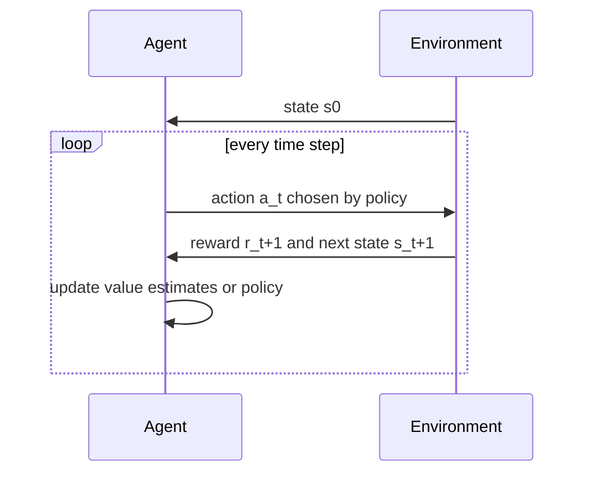
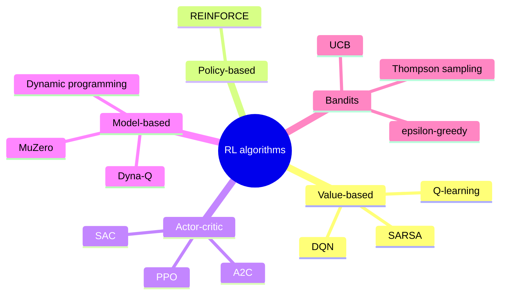
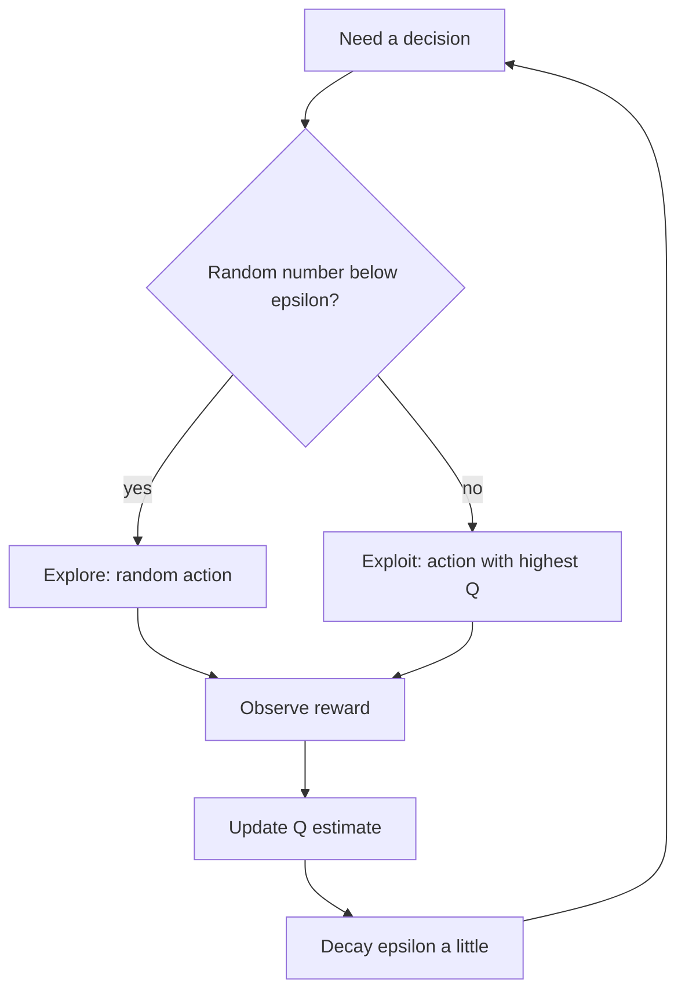
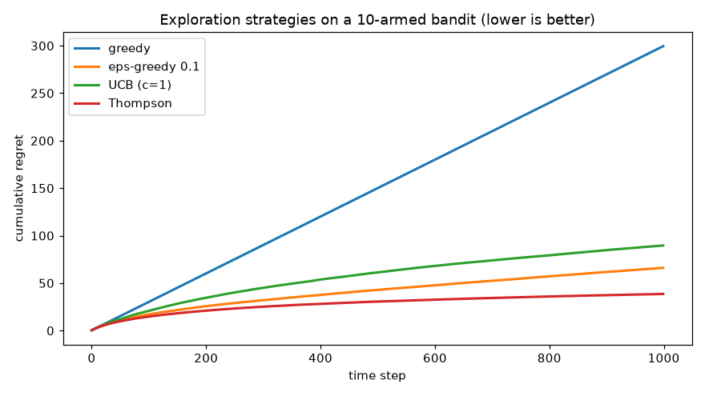
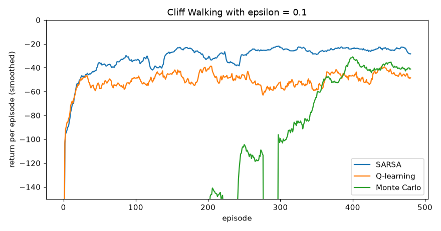
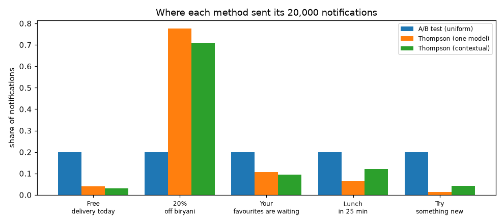

# Session 10 · Reinforcement Learning Basics

[](https://colab.research.google.com/github/Hamnakhan123/Diploma-in-Data-Science/blob/main/term-2/03-advanced-data-science-with-python/code/session-10-reinforcement-learning-basics.ipynb)

> 📍 [Diploma in Data Science](../../README.md) › [Term 2](../README.md) › [Advanced Data Science with Python](README.md) › **Session 10**

| ⏱ Estimated time | 🧩 Prerequisites | 💻 Tools |
|---|---|---|
| 3 hours | Session 1 (types of ML), Python loops and NumPy, basic probability | Python 3.10+, NumPy, Matplotlib (optional: Gymnasium) |

[⬅ Previous: Session 9 · Pattern Mining and Visualization with Seaborn](session-09-pattern-mining-and-seaborn.md) · [🏠 Module home](README.md) · [Next: Session 11 · Reinforcement Learning Principles ➡](session-11-reinforcement-learning-principles.md)

---

## 🎯 Learning objectives

- Describe the basics of **reinforcement learning (RL)**: agent, environment, state, action, reward, episode, policy, value and return.
- Explain the **exploration vs exploitation** dilemma and compare ε-greedy, decaying ε, UCB and Thompson sampling on a multi-armed bandit.
- Describe how to design a **reward function**, including sparse vs dense rewards, discounting, reward shaping and reward hacking.
- Explain the main **families of RL algorithms** (value-based, policy-based, actor-critic, model-based vs model-free, on-policy vs off-policy) and implement Monte Carlo, SARSA and Q-learning on small problems.

## 📖 Concepts

### 1. Learning by trial and error

Reinforcement learning is how a child learns to ride a bicycle: nobody gives a labelled data set of "correct pedal pressures". The child **tries actions**, **feels the result** (staying up feels good, falling hurts) and gradually learns what to do in each situation.

| Term | Meaning | Bicycle example | Delivery-robot example |
|---|---|---|---|
| **Agent** | the learner/decision maker | the child | the robot's controller |
| **Environment** | everything the agent interacts with | road, bicycle, gravity | the warehouse |
| **State (s)** | the situation now | speed, lean angle | robot position, battery level |
| **Action (a)** | a choice the agent makes | pedal, steer, brake | move N/S/E/W, charge |
| **Reward (r)** | a number of immediate feedback | +1 for each second upright, −10 for falling | +10 parcel delivered, −1 per step, −50 collision |
| **Episode** | one run from start to end | one ride | one delivery |
| **Policy (π)** | the agent's strategy: state → action | "lean left when tilting right" | the route rule |
| **Return (G)** | total (discounted) future reward | | |
| **Value V(s), Q(s,a)** | expected return from a state, or from a state-action pair | | |

The interaction loop: observe state sₜ → choose action aₜ → environment returns reward rₜ₊₁ and next state sₜ₊₁ → repeat.

**How RL differs from supervised learning**: there are no correct answers, only rewards; rewards can be **delayed** (a chess move pays off 30 moves later); and the agent's own actions change the data it sees.

**Discounted return**: `G = r₁ + γ r₂ + γ² r₃ + …` with discount factor **γ** between 0 and 1. γ = 0 means "only care about now"; γ close to 1 means "plan far ahead". It is like money: a reward today is worth more than the same reward next year.

### 2. Exploration vs exploitation

A new student in Karachi has a favourite biryani shop. Every lunch she must choose: **exploit** (go to the shop she knows is good) or **explore** (try a new one that might be better, or worse). Exploit only, and she may never find the best shop; explore only, and she eats many bad lunches.

This is the **multi-armed bandit** problem: k slot machines (arms) with unknown payout rates. Strategies:

| Strategy | Rule | Pros / cons |
|---|---|---|
| Greedy | always pick the arm with the highest estimated value | gets stuck on an early lucky arm |
| **ε-greedy** | with probability ε pick a random arm, otherwise the best | simple; keeps exploring forever at rate ε |
| Decaying ε | start with ε = 1 and shrink it over time | explores early, exploits later |
| Optimistic initial values | start all estimates high, so every arm gets tried | simple trick, only early exploration |
| **UCB** (Upper Confidence Bound) | pick argmax of `Q(a) + c √(ln t / N(a))` | explores arms that are uncertain; no randomness |
| **Thompson sampling** | keep a probability distribution (e.g. Beta) for each arm's rate, sample from each, pick the highest sample | Bayesian, often the best in practice |

Performance is measured by **regret**: the reward lost compared with always pulling the best arm.

Incremental average update (used everywhere in RL): `Q ← Q + (1/N)(r − Q)`, or with a fixed step size α for changing environments: `Q ← Q + α(r − Q)`.

### 3. The reward function

The reward is the **only** way you tell the agent what you want. It is like setting targets for a sales team: get it wrong and people optimise the wrong thing.

| Design choice | Explanation | Example |
|---|---|---|
| **Sparse** reward | reward only at the goal | +1 when the maze is solved, 0 otherwise: very slow to learn |
| **Dense** reward | feedback every step | −1 per step (encourages short paths) + progress bonus |
| Penalties | negative rewards for unwanted events | −50 for hitting a wall or a person |
| **Reward shaping** | add helpful intermediate rewards | + (old distance − new distance) to the goal |
| **Discounting** | γ < 1 prefers sooner rewards | γ = 0.99 for long tasks, 0.9 for short ones |
| Scale | keep rewards in a modest range (e.g. −1…+1 per step) | helps neural-network training |

**Reward hacking**: the agent finds a loophole that maximises the reward without doing the task. A boat-racing agent learnt to spin in circles collecting bonus points instead of finishing the race; a cleaning robot rewarded for "no visible mess" might learn to cover the camera. Defences: reward the real outcome, add constraints and penalties, test in varied environments, and watch the agent's behaviour, not only its score.

**Potential-based shaping** `F = γΦ(s') − Φ(s)` (Φ = a "potential", e.g. negative distance to goal) provably does not change which policy is optimal; arbitrary bonuses can.

### 4. Families of RL algorithms

| Family | Learns | Examples | Notes |
|---|---|---|---|
| **Value-based** | Q(s, a), then acts greedily | Q-learning, SARSA, DQN | discrete actions |
| **Policy-based** | π(a \| s) directly | REINFORCE (policy gradient) | continuous actions, stochastic policies |
| **Actor-critic** | both: actor = policy, critic = value | A2C, PPO, SAC | most modern deep RL |
| **Model-based** | a model of the environment, then plans | dynamic programming, Dyna-Q, MuZero | sample-efficient, needs a model |
| **Model-free** | from experience only | Q-learning, PPO | simpler, needs more samples |

| | On-policy | Off-policy |
|---|---|---|
| Learns about | the policy it is following (including its exploration) | a different (usually greedy) policy than the one generating data |
| Example | SARSA, Monte Carlo control, PPO | Q-learning, DQN |
| Behaviour | safer, accounts for its own mistakes | learns the optimal path, can reuse old data (replay buffers) |

**Three ways to learn values from experience**

- **Monte Carlo (MC)**: play a full episode, then update each visited state towards the actual return G. Unbiased, high variance, needs episodes to end.
- **Temporal Difference (TD)**: update after every step using the next estimate: `V(s) ← V(s) + α[r + γV(s') − V(s)]`. Learns online.
- **SARSA** (on-policy TD control): `Q(s,a) ← Q(s,a) + α[r + γQ(s',a') − Q(s,a)]` where a' is the action actually taken next.
- **Q-learning** (off-policy TD control): `Q(s,a) ← Q(s,a) + α[r + γ maxₐ' Q(s',a') − Q(s,a)]`, learning about the best next action regardless of what is taken.

Session 11 formalises this with Markov Decision Processes and the Bellman equation.

### 5. Where RL is used

Game playing (chess, Go, video games), robotics and drones, recommendation and ad placement (bandits), dynamic pricing, traffic-signal control, data-centre cooling, portfolio management, and fine-tuning large language models from human feedback (RLHF).

## 🧭 Diagrams







## 💻 Worked examples

### Example 1 · Basic: the agent-environment loop and discounted return

📄 [`code/session-10_rl_loop.py`](code/session-10_rl_loop.py)

```python
"""A tiny corridor environment, a random policy and a smart policy, and the discounted return."""
import numpy as np

class Corridor:
    """States 0..5. Start at 0. Reaching 5 gives +10 and ends the episode. Each step costs -1."""
    def __init__(self, length=6):
        self.length = length
    def reset(self):
        self.s = 0
        return self.s
    def step(self, action):                       # action: 0 = left, 1 = right
        self.s = max(0, min(self.length - 1, self.s + (1 if action == 1 else -1)))
        done = self.s == self.length - 1
        return self.s, (10 if done else -1), done

def run(policy, env, gamma=0.9, seed=0, max_steps=200):
    rng = np.random.default_rng(seed)
    s, rewards = env.reset(), []
    for _ in range(max_steps):
        s, r, done = env.step(policy(s, rng))
        rewards.append(r)
        if done:
            break
    G = sum(gamma ** t * r for t, r in enumerate(rewards))
    return len(rewards), sum(rewards), G

env = Corridor()
random_policy = lambda s, rng: rng.integers(2)
right_policy = lambda s, rng: 1
for name, pol in [("random", random_policy), ("always right", right_policy)]:
    stats = np.array([run(pol, env, seed=k) for k in range(200)])
    print(f"{name:<13} avg steps {stats[:, 0].mean():6.1f}  avg total reward {stats[:, 1].mean():7.1f}  avg discounted return {stats[:, 2].mean():6.2f}")

rewards = [-1, -1, -1, -1, 10]
for g in [0.0, 0.5, 0.9, 1.0]:
    print(f"gamma = {g:<4} -> return of the optimal episode = {sum(g ** t * r for t, r in enumerate(rewards)):6.2f}")
```

**Output**

```text
random        avg steps   31.5  avg total reward   -20.5  avg discounted return  -6.20
always right  avg steps    5.0  avg total reward     6.0  avg discounted return   3.12
gamma = 0.0  -> return of the optimal episode =  -1.00
gamma = 0.5  -> return of the optimal episode =  -1.25
gamma = 0.9  -> return of the optimal episode =   3.12
gamma = 1.0  -> return of the optimal episode =   6.00
```

### Example 2 · Intermediate: four bandit strategies and regret

📄 [`code/session-10_bandits.py`](code/session-10_bandits.py)

```python
"""10-armed bandit: greedy, epsilon-greedy, UCB and Thompson sampling, averaged over 200 runs."""
import numpy as np
import matplotlib.pyplot as plt

K, T, RUNS = 10, 1000, 200
def run(strategy, seed):
    rng = np.random.default_rng(seed)
    p = rng.uniform(0.1, 0.9, K)                     # true click rates of 10 ad designs (unknown)
    Q, N = np.zeros(K), np.zeros(K)
    a_s, b_s = np.ones(K), np.ones(K)                # Beta(1,1) priors for Thompson
    regret, best = np.zeros(T), p.max()
    for t in range(T):
        if strategy == "greedy":
            a = int(np.argmax(Q))
        elif strategy == "eps-greedy 0.1":
            a = rng.integers(K) if rng.random() < .1 else int(np.argmax(Q))
        elif strategy == "UCB (c=1)":
            a = t if t < K else int(np.argmax(Q + np.sqrt(np.log(t + 1) / N)))
        else:                                        # Thompson sampling
            a = int(np.argmax(rng.beta(a_s, b_s)))
        r = float(rng.random() < p[a])
        N[a] += 1; Q[a] += (r - Q[a]) / N[a]
        a_s[a] += r; b_s[a] += 1 - r
        regret[t] = best - p[a]
    return regret.cumsum(), np.argmax(N) == np.argmax(p)

strategies = ["greedy", "eps-greedy 0.1", "UCB (c=1)", "Thompson"]
plt.figure(figsize=(8, 4.5))
print(f"{'strategy':<16}{'regret after 1000':>18}{'found best arm':>16}")
for s in strategies:
    out = [run(s, k) for k in range(RUNS)]
    reg = np.mean([o[0] for o in out], axis=0); found = np.mean([o[1] for o in out])
    print(f"{s:<16}{reg[-1]:>18.1f}{found:>15.0%}")
    plt.plot(reg, label=s, lw=2)
plt.xlabel("time step"); plt.ylabel("cumulative regret"); plt.title("Exploration strategies on a 10-armed bandit (lower is better)")
plt.legend(); plt.tight_layout(); plt.savefig("session-10_bandit_regret.png", dpi=110); plt.show()
```

**Output**

```text
strategy         regret after 1000  found best arm
greedy                       299.5             8%
eps-greedy 0.1                66.0            64%
UCB (c=1)                     89.6            86%
Thompson                      38.6            85%
```

**Chart produced by this code** (saved as [`code/session-10_bandit_regret.png`](code/session-10_bandit_regret.png)):



Greedy locks onto an early lucky arm (it finds the best arm in only 8% of runs). ε-greedy keeps wasting 10% of pulls on random arms forever. UCB identifies the best arm most often (86%) but with c = 1 it explores a lot early, so its regret after 1,000 steps is still higher than ε-greedy's; it keeps improving over longer horizons. **Thompson sampling** gives by far the lowest regret: it explores exactly where its uncertainty is high and stops wasting pulls quickly. This is why it is popular in production systems.

### Example 3 · Intermediate: reward design and reward hacking

📄 [`code/session-10_reward_design.py`](code/session-10_reward_design.py)

```python
"""Same Q-learning agent, three reward functions on a 6x6 grid: sparse, step penalty, and a hackable bonus."""
import numpy as np

SIZE, GOAL, COIN = 6, (5, 5), (0, 2)
MOVES = [(-1, 0), (1, 0), (0, -1), (0, 1)]

def step(s, a):
    r, c = s[0] + MOVES[a][0], s[1] + MOVES[a][1]
    return (min(max(r, 0), SIZE - 1), min(max(c, 0), SIZE - 1))

def reward(design, s, s2):
    if design == "sparse":
        return 1.0 if s2 == GOAL else 0.0
    if design == "step penalty":
        return 10.0 if s2 == GOAL else -1.0
    # 'hackable': +2 every time the agent stands on a coin square that never runs out
    return 10.0 if s2 == GOAL else (2.0 if s2 == COIN else -1.0)

def train(design, episodes=1500, alpha=.5, gamma=.95, eps=.2, seed=0):
    rng = np.random.default_rng(seed)
    Q = np.zeros((SIZE, SIZE, 4))
    for _ in range(episodes):
        s = (0, 0)
        for _ in range(100):
            a = rng.integers(4) if rng.random() < eps else int(np.argmax(Q[s]))
            s2 = step(s, a); r = reward(design, s, s2)
            target = r if s2 == GOAL else r + gamma * Q[s2].max()
            Q[s][a] += alpha * (target - Q[s][a]); s = s2
            if s == GOAL:
                break
    # evaluate greedy policy
    s, path = (0, 0), [(0, 0)]
    for _ in range(40):
        s = step(s, int(np.argmax(Q[s]))); path.append(s)
        if s == GOAL:
            break
    return path

for design in ["sparse", "step penalty", "hackable"]:
    path = train(design)
    reached = path[-1] == GOAL
    coin_visits = sum(p == COIN for p in path)
    print(f"{design:<13} reached goal: {reached!s:<5}  steps: {len(path) - 1:>2}  coin visits: {coin_visits}")
```

**Output**

```text
sparse        reached goal: False  steps: 40  coin visits: 0
step penalty  reached goal: True   steps: 10  coin visits: 0
hackable      reached goal: False  steps: 40  coin visits: 39
```

With the **sparse** reward, 1,500 episodes are not enough: almost all steps give 0, so there is little signal to learn from and the greedy policy wanders. With a step penalty the agent learns the shortest path (10 moves). With a bonus that can be collected repeatedly, the agent **hacks** the reward: it shuttles back and forth on the coin square and never finishes the delivery.

### Example 4 · Advanced: Monte Carlo, SARSA and Q-learning on Cliff Walking

The classic cliff: a 4 × 12 grid; start bottom-left, goal bottom-right, and the cells between them are a cliff (−100, back to start). Each step costs −1.

📄 [`code/session-10_cliff.py`](code/session-10_cliff.py)

```python
"""Cliff Walking: SARSA (on-policy) vs Q-learning (off-policy) vs Monte Carlo control, learning curves and paths."""
import numpy as np
import matplotlib.pyplot as plt

H, W = 4, 12
START, GOAL = (3, 0), (3, 11)
MOVES = [(-1, 0), (0, 1), (1, 0), (0, -1)]           # up, right, down, left
ARROWS = "^>v<"

def env_step(s, a):
    r, c = min(max(s[0] + MOVES[a][0], 0), H - 1), min(max(s[1] + MOVES[a][1], 0), W - 1)
    if r == 3 and 0 < c < 11:
        return START, -100, False                     # fell off the cliff
    return (r, c), -1, (r, c) == GOAL

def policy(Q, s, eps, rng):
    return rng.integers(4) if rng.random() < eps else int(np.argmax(Q[s]))

def train(method, episodes=500, alpha=.5, gamma=1.0, eps=.1, seed=0):
    rng = np.random.default_rng(seed)
    Q = np.zeros((H, W, 4)); returns = []
    for _ in range(episodes):
        s, a, total, traj = START, None, 0, []
        a = policy(Q, s, eps, rng)
        for _ in range(500):
            s2, r, done = env_step(s, a)
            a2 = policy(Q, s2, eps, rng)
            total += r
            if method == "SARSA":
                Q[s][a] += alpha * (r + gamma * Q[s2][a2] * (not done) - Q[s][a])
            elif method == "Q-learning":
                Q[s][a] += alpha * (r + gamma * Q[s2].max() * (not done) - Q[s][a])
            else:
                traj.append((s, a, r))
            s, a = s2, a2
            if done:
                break
        if method == "Monte Carlo":                   # every-visit MC update at the end of the episode
            G = 0
            for (st, at, rt) in reversed(traj):
                G = rt + gamma * G
                Q[st][at] += 0.05 * (G - Q[st][at])
        returns.append(total)
    return Q, np.array(returns)

def greedy_path(Q):
    grid = [["." for _ in range(W)] for _ in range(H)]
    for c in range(1, 11): grid[3][c] = "C"
    s = START
    for _ in range(40):
        a = int(np.argmax(Q[s])); grid[s[0]][s[1]] = ARROWS[a]
        s, _, done = env_step(s, a)
        if done or s == START: break
    grid[3][11] = "G"
    return "\n".join("".join(row) for row in grid)

plt.figure(figsize=(8, 4.2))
for method in ["SARSA", "Q-learning", "Monte Carlo"]:
    runs = [train(method, seed=k) for k in range(10)]
    curve = np.mean([r for _, r in runs], axis=0)
    smooth = np.convolve(curve, np.ones(20) / 20, mode="valid")
    print(f"{method:<12} average return (last 100 episodes, while exploring): {curve[-100:].mean():7.1f}")
    plt.plot(smooth, label=method)
    if method != "Monte Carlo":
        print(f"greedy path learned by {method}:\n{greedy_path(runs[0][0])}\n")
plt.ylim(-150, 0); plt.xlabel("episode"); plt.ylabel("return per episode (smoothed)")
plt.title("Cliff Walking with epsilon = 0.1"); plt.legend()
plt.tight_layout(); plt.savefig("session-10_cliff_learning.png", dpi=110); plt.show()
```

**Output**

```text
SARSA        average return (last 100 episodes, while exploring):   -25.2
greedy path learned by SARSA:
>>>>>>>>>>v.
^.........v.
^.........>v
^CCCCCCCCCCG

Q-learning   average return (last 100 episodes, while exploring):   -46.6
greedy path learned by Q-learning:
............
............
>>>>>>>>>>>v
^CCCCCCCCCCG

Monte Carlo  average return (last 100 episodes, while exploring):   -38.6
```

**Chart produced by this code** (saved as [`code/session-10_cliff_learning.png`](code/session-10_cliff_learning.png)):



**Q-learning** learns the optimal path right along the cliff edge, but while it still explores (ε = 0.1) it sometimes falls, so its *online* returns are worse. **SARSA** accounts for its own exploration and learns a **safer path** further from the edge, earning more while learning. This is the practical meaning of on-policy vs off-policy.

## 🏙️ Real-life data problem: choosing the best push-notification message

**Problem.** A food-delivery app has five push-notification texts. Showing a poor message wastes the chance to win an order. Instead of a fixed A/B test (equal traffic to all five for a month), the growth team wants to **learn while earning**: send more traffic to the better messages as evidence accumulates.

**Full solution.** Treat each message as a bandit arm with an unknown conversion rate. Compare a classic A/B test (uniform traffic) with Thompson sampling over 20,000 users, measuring total orders, regret and how confidently the best message is identified. Add a **contextual** twist: the best message differs for students and families.

📄 [`code/session-10_push_problem.py`](code/session-10_push_problem.py)

```python
"""Real-life problem: push-notification optimisation with Thompson sampling vs a fixed A/B test (plus context)."""
import numpy as np
import matplotlib.pyplot as plt

rng = np.random.default_rng(2026)
messages = ["Free delivery today", "20% off biryani", "Your favourites are waiting", "Lunch in 25 min", "Try something new"]
rate = {"student": np.array([.050, .072, .030, .061, .040]),        # true conversion rates (unknown)
        "family":  np.array([.048, .055, .066, .040, .035])}
USERS = 20000
segments = rng.choice(["student", "family"], USERS, p=[.55, .45])

def simulate(method):
    a_s = {g: np.ones(5) for g in rate}; b_s = {g: np.ones(5) for g in rate}
    shown = np.zeros(5, int); orders = 0; regret = 0
    for i, g in enumerate(segments):
        ctx = g if method == "Thompson (contextual)" else "student"        # non-contextual: one shared model
        if method == "A/B test (uniform)":
            a = i % 5
        else:
            a = int(np.argmax(rng.beta(a_s[ctx], b_s[ctx])))
        r = rng.random() < rate[g][a]
        a_s[ctx][a] += r; b_s[ctx][a] += 1 - r
        shown[a] += 1; orders += r; regret += rate[g].max() - rate[g][a]
    return orders, regret, shown

print(f"{'method':<24}{'orders':>8}{'regret':>9}   share of traffic per message")
results = {}
for m in ["A/B test (uniform)", "Thompson (one model)", "Thompson (contextual)"]:
    o, reg, shown = simulate(m)
    results[m] = shown / USERS
    print(f"{m:<24}{o:>8}{reg:>9.1f}   {np.round(shown / USERS, 2)}")

best_all = (rate["student"] * .55 + rate["family"] * .45)
print("\nbest single message overall:", messages[int(best_all.argmax())])
print("best for students:", messages[int(rate['student'].argmax())], "| best for families:", messages[int(rate['family'].argmax())])

x = np.arange(5)
plt.figure(figsize=(9, 4))
for k, (m, share) in enumerate(results.items()):
    plt.bar(x + (k - 1) * .27, share, width=.27, label=m)
plt.xticks(x, [m.replace(" ", "\n", 1) for m in messages], fontsize=8); plt.ylabel("share of notifications")
plt.title("Where each method sent its 20,000 notifications"); plt.legend(fontsize=8)
plt.tight_layout(); plt.savefig("session-10_push_traffic.png", dpi=110); plt.show()
```

**Output**

```text
method                    orders   regret   share of traffic per message
A/B test (uniform)          1054    390.0   [0.2 0.2 0.2 0.2 0.2]
Thompson (one model)        1238    174.2   [0.04 0.78 0.11 0.06 0.01]
Thompson (contextual)       1269    140.3   [0.03 0.71 0.1  0.12 0.04]

best single message overall: 20% off biryani
best for students: 20% off biryani | best for families: Your favourites are waiting
```

**Chart produced by this code** (saved as [`code/session-10_push_traffic.png`](code/session-10_push_traffic.png)):



**Answer.** Thompson sampling wins more orders than a uniform A/B test with the same users because it quickly shifts traffic to good messages, and the **contextual** version does best of all because it learns that students respond to the biryani discount while families respond to "Your favourites are waiting". The trade-off: bandits optimise reward during the test, while a classic A/B test gives cleaner statistical estimates of every message. Use bandits when the cost of showing bad options is high and decisions repeat continuously.

## ⚠️ Common mistakes

| Mistake | Fix |
|---|---|
| Never exploring (pure greedy) | ε-greedy, UCB or Thompson sampling |
| Exploring at a constant high rate forever | decay ε, or use UCB/Thompson |
| A reward that can be farmed in a loop | reward the real outcome; one-time bonuses; potential-based shaping |
| Only sparse rewards in a large world | add a step penalty or shaping; curriculum (easy tasks first) |
| Judging an agent by training returns while it still explores | evaluate the greedy policy separately |
| γ = 1 in never-ending tasks | use γ < 1 so returns stay finite |

## ✅ Best practices

- Start with the **simplest environment** that captures the problem and a random-policy baseline.
- Write the reward down in words first: what behaviour should be encouraged and punished?
- Log returns, episode lengths and exploration rate; plot learning curves averaged over several seeds.
- Watch the agent: print or animate its trajectory to catch reward hacking.
- For real products, prefer bandits before full RL: fewer moving parts, faster learning.

## 🧪 Lab / practice tasks

### 🟢 Task 1 · Easy

In Example 1 change the corridor length to 10 and γ to 0.99. How do the average steps of the random policy change?

<details><summary>💡 Hint</summary>

A random walk needs roughly length² steps to reach the end.

</details>

<details><summary>✅ Solution</summary>

Average steps grow from around 30 to roughly 80–100 (random walks scale with the square of the distance), so the random policy's return becomes very negative, while "always right" needs exactly 9 steps.

</details>


### 🟡 Task 2 · Medium

Add a **decaying ε-greedy** strategy (ε = 1/√t) and **optimistic initial values** (Q starts at 1.0, greedy) to Example 2 and compare their regret.

<details><summary>💡 Hint</summary>

Add two new branches in `run`; for optimistic values initialise `Q = np.ones(K)`.

</details>

<details><summary>✅ Solution</summary>

```python
elif strategy == "decaying eps":
    a = rng.integers(K) if rng.random() < 1 / np.sqrt(t + 1) else int(np.argmax(Q))
elif strategy == "optimistic":
    a = int(np.argmax(Q))   # with Q = np.ones(K) at the start
```
Both beat plain greedy; optimistic values are good early but stop exploring once estimates fall; decaying ε usually sits between ε-greedy and UCB.

</details>


### 🟡 Task 3 · Medium

Fix the hackable reward in Example 3 so the coin pays only **once per episode**. Does the agent now reach the goal?

<details><summary>💡 Hint</summary>

Track `collected = False` inside the episode loop and pass it to `reward`.

</details>

<details><summary>✅ Solution</summary>

With a one-time coin the agent reaches the goal; it may detour to collect the coin if the detour costs less than +2, otherwise it goes straight. A reward that cannot be farmed restores the intended behaviour.

</details>


### 🟠 Task 4 · Hard

In Example 4 change ε to 0.0 after training and evaluate both SARSA and Q-learning greedily. Which earns more now? Then train SARSA with ε decaying to 0. What path does it learn?

<details><summary>💡 Hint</summary>

With no exploration the cliff is no longer dangerous.

</details>

<details><summary>✅ Solution</summary>

Evaluated greedily, Q-learning's edge path earns −13 (optimal) and SARSA's safe path about −17. If SARSA's ε decays to 0 during training, it gradually converges to the optimal edge path too, because its own policy stops making random moves.

</details>


### 🔴 Task 5 · Challenge

Install Gymnasium (`pip install gymnasium`) and train tabular Q-learning on `FrozenLake-v1` (`is_slippery=True`). Report the success rate of the greedy policy over 1,000 episodes.

<details><summary>💡 Hint</summary>

States and actions are integers; use `Q = np.zeros((16, 4))`, α = 0.1, γ = 0.99 and many (≥ 10,000) episodes with decaying ε.

</details>

<details><summary>✅ Solution</summary>

```python
import gymnasium as gym
env = gym.make("FrozenLake-v1", is_slippery=True); Q = np.zeros((16, 4)); rng = np.random.default_rng(0)
for ep in range(20000):
    s, _ = env.reset(seed=ep); eps = max(.01, 1 - ep / 10000); done = False
    while not done:
        a = env.action_space.sample() if rng.random() < eps else int(Q[s].argmax())
        s2, r, term, trunc, _ = env.step(a); done = term or trunc
        Q[s, a] += .1 * (r + .99 * Q[s2].max() * (not term) - Q[s, a]); s = s2
```
A good slippery-lake policy succeeds about 70–75% of the time; the ice makes 100% impossible.

</details>


## 🧩 Mini project: a warehouse robot that learns to deliver

📄 [`code/session-10_mini_project.py`](code/session-10_mini_project.py)

```python
"""Mini project: Q-learning robot in a warehouse grid with shelves, a charging penalty and a delivery goal."""
import numpy as np

layout = ["S....#....",
          ".##..#.##.",
          ".#.......#",
          ".#.###.#..",
          "....#..#.D"]
H, W = len(layout), len(layout[0])
MOVES = {"up": (-1, 0), "down": (1, 0), "left": (0, -1), "right": (0, 1)}
names = list(MOVES)
start = next((r, c) for r in range(H) for c in range(W) if layout[r][c] == "S")
dock = next((r, c) for r in range(H) for c in range(W) if layout[r][c] == "D")

def step(s, a):
    dr, dc = MOVES[names[a]]
    r, c = s[0] + dr, s[1] + dc
    if not (0 <= r < H and 0 <= c < W) or layout[r][c] == "#":
        return s, -5, False                       # bumped into a shelf or wall
    if (r, c) == dock:
        return (r, c), 50, True
    return (r, c), -1, False

rng = np.random.default_rng(0)
Q = np.zeros((H, W, 4))
alpha, gamma = 0.3, 0.95
for ep in range(3000):
    eps = max(0.02, 1 - ep / 1500)
    s = start
    for _ in range(200):
        a = rng.integers(4) if rng.random() < eps else int(np.argmax(Q[s]))
        s2, r, done = step(s, a)
        Q[s][a] += alpha * (r + gamma * Q[s2].max() * (not done) - Q[s][a])
        s = s2
        if done:
            break
    if ep in (0, 500, 1500, 2999):
        print(f"after episode {ep:>4}: value of start state = {Q[start].max():6.2f}")

grid = [list(row) for row in layout]
s, steps = start, 0
while s != dock and steps < 50:
    a = int(np.argmax(Q[s]))
    if s != start:
        grid[s[0]][s[1]] = "^v<>"[a]
    s, _, _ = step(s, a); steps += 1
print(f"\ngreedy route found in {steps} moves:")
print("\n".join("".join(row) for row in grid))
```

**Output**

```text
after episode    0: value of start state =  -0.51
after episode  500: value of start state =  17.83
after episode 1500: value of start state =  17.83
after episode 2999: value of start state =  17.83

greedy route found in 13 moves:
S>>v.#....
.##v.#.##.
.#.>>>>>v#
.#.###.#v.
....#..#>D
```

## ✅ Quick quiz

**Q1.** In RL the policy is…

- **A)** the reward function
- **B)** a mapping from states to actions
- **C)** the environment's rules
- **D)** the discount factor

<details><summary>Show answer</summary>

**B** — It is the agent's strategy.

</details>

**Q2.** A discount factor γ close to 0 makes the agent…

- **A)** plan far ahead
- **B)** care mostly about immediate rewards
- **C)** explore more
- **D)** ignore rewards

<details><summary>Show answer</summary>

**B** — Future rewards are multiplied by γ^t.

</details>

**Q3.** UCB explores arms that…

- **A)** have the lowest estimated value
- **B)** are most uncertain (pulled least)
- **C)** were pulled most recently
- **D)** are chosen at random

<details><summary>Show answer</summary>

**B** — The bonus term grows when N(a) is small.

</details>

**Q4.** An agent that circles forever collecting a repeatable bonus is an example of…

- **A)** exploration
- **B)** reward hacking
- **C)** discounting
- **D)** overfitting

<details><summary>Show answer</summary>

**B** — It maximises the reward without doing the task.

</details>

**Q5.** Q-learning is off-policy because its update uses…

- **A)** the next action actually taken
- **B)** the maximum Q-value of the next state
- **C)** the full episode return
- **D)** a model of the environment

<details><summary>Show answer</summary>

**B** — It learns the greedy policy while behaving exploratively.

</details>


## 📝 Summary

- RL learns by **trial and error**: agent, environment, state, action, reward, policy, return and value.
- **Exploration vs exploitation**: ε-greedy, decaying ε, UCB and Thompson sampling; measure with regret.
- The **reward function** defines the task: dense vs sparse, discounting, shaping, and guarding against reward hacking.
- Algorithm families: value-based, policy-based, actor-critic, model-based; **Monte Carlo** vs **TD**; **SARSA** (on-policy) vs **Q-learning** (off-policy).

### 🎤 Interview / viva questions

1. How does reinforcement learning differ from supervised learning?
2. Explain the exploration–exploitation trade-off with a real example.
3. Compare ε-greedy, UCB and Thompson sampling.
4. What is reward hacking and how can you prevent it?
5. Write the Q-learning update and explain each term.
6. Why does SARSA learn a safer path than Q-learning on Cliff Walking?

---

[⬅ Previous: Session 9 · Pattern Mining and Visualization with Seaborn](session-09-pattern-mining-and-seaborn.md) · [🏠 Module home](README.md) · [Next: Session 11 · Reinforcement Learning Principles ➡](session-11-reinforcement-learning-principles.md)

<sub>Diploma in Data Science · Prepared by **Hamna Zahid Khan**, Junior Lecturer</sub>
