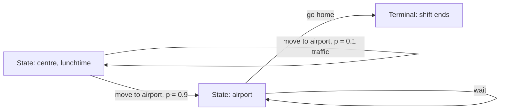
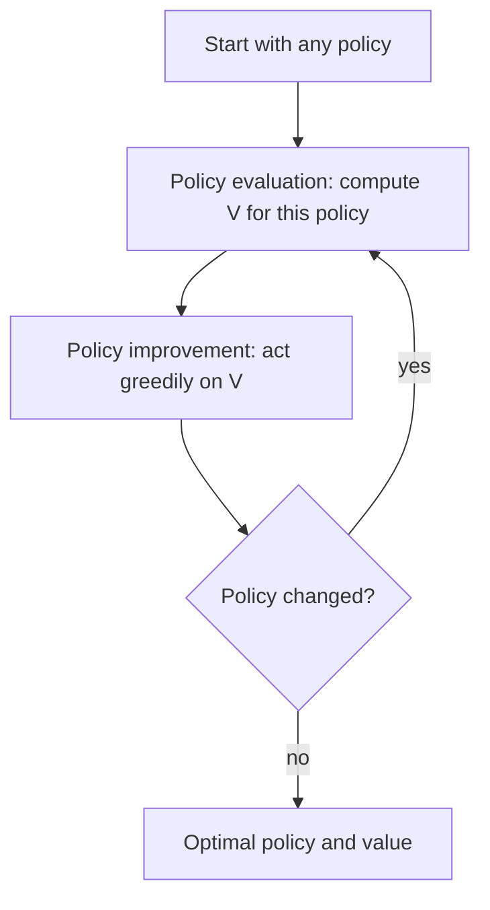
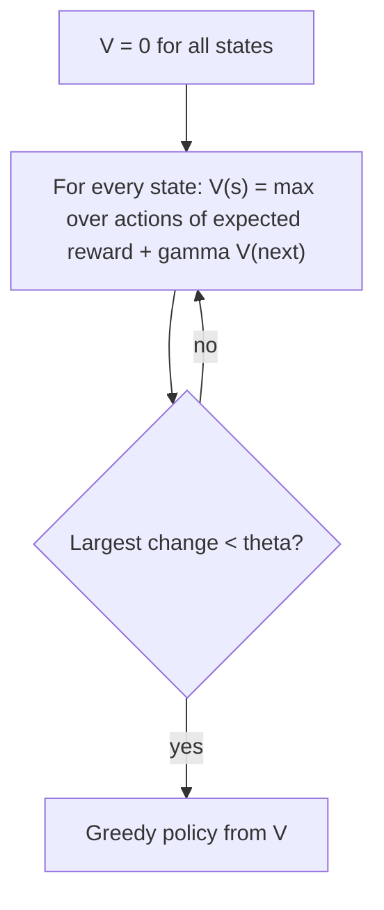
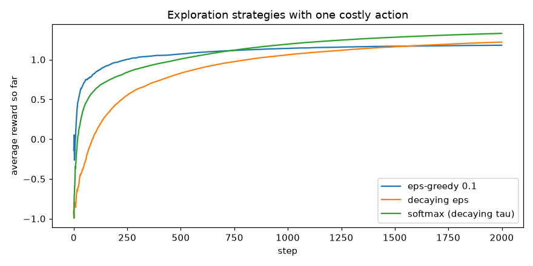
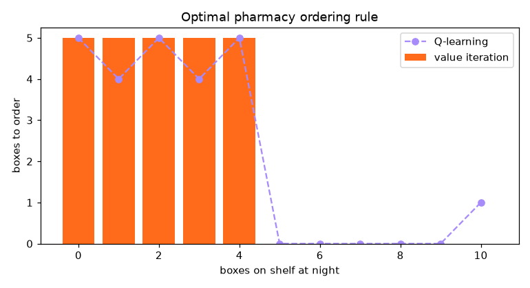

# Session 11 · Reinforcement Learning Principles

[](https://colab.research.google.com/github/Hamnakhan123/Diploma-in-Data-Science/blob/main/term-2/03-advanced-data-science-with-python/code/session-11-reinforcement-learning-principles.ipynb)

> 📍 [Diploma in Data Science](../../README.md) › [Term 2](../README.md) › [Advanced Data Science with Python](README.md) › **Session 11**

| ⏱ Estimated time | 🧩 Prerequisites | 💻 Tools |
|---|---|---|
| 3 hours | Session 10 (agent, reward, Q-learning idea), basic probability | Python 3.10+, NumPy, Matplotlib |

[⬅ Previous: Session 10 · Reinforcement Learning Basics](session-10-reinforcement-learning-basics.md) · [🏠 Module home](README.md) · [Next: Session 12 · Deep Learning Models ➡](session-12-deep-learning-models.md)

---

## 🎯 Learning objectives

- Define the key components of a **Markov Decision Process (MDP)**: states, actions, transition probabilities, rewards, discount factor and the Markov property.
- Describe the **Bellman expectation** and **Bellman optimality** equations and compute values by hand.
- Explain the **Q-learning** algorithm step by step and implement it with a convergence check.
- Distinguish **value iteration** from **policy iteration**, implement both and compare their cost.
- Define and compare exploration strategies such as **ε-greedy** and **Softmax (Boltzmann)**, including temperature and decay schedules.

## 📖 Concepts

### 1. Markov Decision Processes

An MDP is the formal "rule book" of an RL problem. Think of a board game: the board positions are **states**, the moves you may make are **actions**, the dice decide where you actually land (**transition probabilities**), and the points you score are **rewards**.

| Component | Symbol | Meaning | Example: a delivery rider's shift |
|---|---|---|---|
| States | S | all situations | zone (city centre, suburbs, airport), battery level |
| Actions | A | choices in each state | wait, move to another zone, go home |
| Transition model | P(s' \| s, a) | probability of landing in s' | moving to the airport succeeds 90%, traffic jam 10% |
| Reward function | R(s, a, s') | immediate reward | +Rs 300 per order, −Rs 50 fuel per move |
| Discount factor | γ ∈ [0, 1) | value of future vs present reward | 0.95 |
| Policy | π(a \| s) | strategy | "wait in the centre at lunchtime" |

**The Markov property**: the future depends only on the **current state**, not on how you got there. *The state must contain everything that matters.* A chess position is Markov (the board tells you everything); a single photo of a moving car is not (you need velocity too, so add it to the state).

### 2. Value functions and the Bellman equations

- **State value** `V^π(s)`: expected discounted return starting in s and following π.
- **Action value** `Q^π(s, a)`: expected return starting in s, taking a, then following π.

The **Bellman expectation equation** says a state's value = immediate reward + discounted value of where you go next, averaged over what can happen:

`V^π(s) = Σₐ π(a|s) Σₛ' P(s'|s,a) [ R(s,a,s') + γ V^π(s') ]`

The **Bellman optimality equation** replaces the average over actions with the **best** action:

`V*(s) = maxₐ Σₛ' P(s'|s,a) [ R(s,a,s') + γ V*(s') ]`
`Q*(s,a) = Σₛ' P(s'|s,a) [ R(s,a,s') + γ maxₐ' Q*(s',a') ]`

Analogy: the value of being at a railway junction equals the fare you collect on the next leg plus the (slightly discounted) value of the next junction. Once you know V* or Q*, the optimal policy is simply: **pick the action with the highest Q***.

### 3. Dynamic programming: value iteration vs policy iteration

When the model (P and R) is **known**, we can solve the MDP by planning.

**Policy iteration** alternates two steps until the policy stops changing:

1. **Policy evaluation**: compute V^π for the current policy (repeat the Bellman expectation update until it settles, or solve the linear system).
2. **Policy improvement**: make the policy greedy with respect to V^π.

**Value iteration** merges them: apply the Bellman *optimality* update to every state, repeatedly, until the largest change is below a small threshold θ; then read off the greedy policy.

| | Policy iteration | Value iteration |
|---|---|---|
| Iterates over | policies | value functions |
| Each iteration | full policy evaluation (expensive) + improvement | one sweep of Bellman optimality updates (cheap) |
| Number of iterations | few (often < 10) | many |
| Stops when | the policy is stable | max value change < θ |
| Typical use | small state spaces, when evaluation is cheap | general default; easy to implement |

Both converge to the same optimal policy for finite MDPs with γ < 1. **Generalised policy iteration** describes the general idea: evaluation and improvement pushing each other towards optimality, which also underlies Q-learning.

### 4. Q-learning (model-free)

When P and R are **unknown**, the agent learns Q* from experience:

```text
initialise Q(s, a) = 0 for all s, a
for each episode:
    s = start state
    repeat until terminal:
        choose a from s using an exploration strategy (e.g. epsilon-greedy on Q)
        take a, observe r and s'
        Q(s, a) <- Q(s, a) + alpha * [ r + gamma * max_a' Q(s', a') - Q(s, a) ]
        s <- s'
```

| Term | Meaning |
|---|---|
| α (learning rate) | how far each new experience moves the estimate (0.1–0.5 in tabular problems) |
| `r + γ max Q(s',·)` | **TD target**: a sample of the Bellman optimality right-hand side |
| `target − Q(s,a)` | **TD error** |

Q-learning converges to Q* if every state-action pair is visited infinitely often and α decreases suitably. For large state spaces, Q is approximated by a neural network (**Deep Q-Network**, Session 13).

### 5. Exploration strategies

| Strategy | Probability of choosing action a | Behaviour |
|---|---|---|
| **ε-greedy** | 1 − ε + ε/|A| for the best action, ε/|A| for each other | random exploration ignores how bad an action looks |
| **Decaying ε** | ε shrinks (e.g. ε = max(0.01, 0.995^episode)) | explore early, exploit later |
| **Softmax / Boltzmann** | `exp(Q(s,a)/τ) / Σ_b exp(Q(s,b)/τ)` | better-looking actions are tried more; terrible ones rarely |
| UCB | argmax `Q + c√(ln t / N)` | explores uncertain actions |

The **temperature τ** controls Softmax: high τ → almost uniform (lots of exploration); low τ → almost greedy. Analogy: ε-greedy is a diner who usually orders their favourite but sometimes points at a random menu item, even the one they hated; Softmax is a diner who tries the second- and third-best dishes now and then but almost never the awful one.

## 🧭 Diagrams







## 💻 Worked examples

### Example 1 · Basic: a three-state MDP and the Bellman equation by hand

📄 [`code/session-11_bellman_hand.py`](code/session-11_bellman_hand.py)

```python
"""A student's week as a 3-state MDP: evaluate a fixed policy exactly (linear algebra) and iteratively."""
import numpy as np

states = ["Study", "Social media", "Sleep"]
# Under the student's current policy, transition matrix P[s, s'] and expected reward R[s]
P = np.array([[0.5, 0.3, 0.2],
              [0.4, 0.5, 0.1],
              [0.6, 0.2, 0.2]])
R = np.array([+2.0, -1.0, +1.0])
gamma = 0.9

# Exact solution of V = R + gamma P V  ->  (I - gamma P) V = R
V_exact = np.linalg.solve(np.eye(3) - gamma * P, R)
print("exact values:", {st: round(float(v), 2) for st, v in zip(states, V_exact)})

# Iterative policy evaluation: repeat the Bellman expectation update
V = np.zeros(3)
for k in range(1, 200):
    V_new = R + gamma * P @ V
    if k in (1, 2, 3, 10, 50):
        print(f"sweep {k:>3}: {V_new.round(2)}")
    if np.max(np.abs(V_new - V)) < 1e-6:
        print(f"converged after {k} sweeps: {V_new.round(2)}")
        break
    V = V_new

# One Bellman update by hand for 'Study' using the exact values
s = 0
manual = R[s] + gamma * sum(P[s, j] * V_exact[j] for j in range(3))
print(f"\ncheck: V(Study) = 2 + 0.9 x (0.5 x {V_exact[0]:.2f} + 0.3 x {V_exact[1]:.2f} + 0.2 x {V_exact[2]:.2f}) = {manual:.2f}")
```

**Output**

```text
exact values: {'Study': 9.1, 'Social media': 5.52, 'Sleep': 8.43}
sweep   1: [ 2. -1.  1.]
sweep   2: [ 2.81 -0.64  2.08]
sweep   3: [ 3.47 -0.09  2.78]
sweep  10: [6.41 2.83 5.73]
sweep  50: [9.06 5.48 8.39]
converged after 130 sweeps: [9.1  5.52 8.43]

check: V(Study) = 2 + 0.9 x (0.5 x 9.10 + 0.3 x 5.52 + 0.2 x 8.43) = 9.10
```

### Example 2 · Intermediate: value iteration vs policy iteration on a stochastic grid

📄 [`code/session-11_dp_grid.py`](code/session-11_dp_grid.py)

```python
"""Value iteration and policy iteration on a 4x4 slippery grid world with a trap; compare iterations and time."""
import time
import numpy as np

N, GOAL, TRAP = 4, 15, 5
ACTIONS = ["^", ">", "v", "<"]
MOVES = [(-1, 0), (0, 1), (1, 0), (0, -1)]
gamma, slip = 0.95, 0.2                          # 20% of the time the agent slips sideways

def move(s, a):
    r, c = divmod(s, N); dr, dc = MOVES[a]
    r2, c2 = min(max(r + dr, 0), N - 1), min(max(c + dc, 0), N - 1)
    return r2 * N + c2

# Build P[s, a] as a list of (prob, next_state, reward, done)
P = {}
for s in range(N * N):
    for a in range(4):
        outcomes = []
        for prob, aa in [(1 - slip, a), (slip / 2, (a + 1) % 4), (slip / 2, (a + 3) % 4)]:
            s2 = s if s in (GOAL, TRAP) else move(s, aa)
            rew = 0 if s in (GOAL, TRAP) else (10 if s2 == GOAL else -10 if s2 == TRAP else -0.5)
            outcomes.append((prob, s2, rew, s2 in (GOAL, TRAP)))
        P[s, a] = outcomes

def q_from_v(V, s):
    return np.array([sum(p * (r + gamma * V[s2] * (not d)) for p, s2, r, d in P[s, a]) for a in range(4)])

def value_iteration(theta=1e-6):
    V, sweeps = np.zeros(N * N), 0
    while True:
        sweeps += 1
        V_new = np.array([q_from_v(V, s).max() for s in range(N * N)])
        if np.max(np.abs(V_new - V)) < theta:
            return V_new, np.array([q_from_v(V_new, s).argmax() for s in range(N * N)]), sweeps
        V = V_new

def policy_iteration():
    pi, rounds, evals = np.zeros(N * N, int), 0, 0
    while True:
        rounds += 1
        V = np.zeros(N * N)
        while True:                                   # policy evaluation
            evals += 1
            V_new = np.array([q_from_v(V, s)[pi[s]] for s in range(N * N)])
            if np.max(np.abs(V_new - V)) < 1e-6: break
            V = V_new
        new_pi = np.array([q_from_v(V, s).argmax() for s in range(N * N)])   # improvement
        if np.array_equal(new_pi, pi):
            return V, pi, rounds, evals
        pi = new_pi

def show(pi, V):
    for r in range(N):
        row = ""
        for c in range(N):
            s = r * N + c
            row += " G " if s == GOAL else " X " if s == TRAP else f" {ACTIONS[pi[s]]} "
        print(row + "   " + " ".join(f"{V[r * N + c]:6.2f}" for c in range(N)))

t0 = time.perf_counter(); V1, pi1, sweeps = value_iteration(); t1 = time.perf_counter() - t0
t0 = time.perf_counter(); V2, pi2, rounds, evals = policy_iteration(); t2 = time.perf_counter() - t0
print(f"value iteration : {sweeps} sweeps, {t1 * 1000:.0f} ms")
print(f"policy iteration: {rounds} improvement rounds ({evals} evaluation sweeps in total), {t2 * 1000:.0f} ms")
both_optimal = all(np.isclose(q_from_v(V1, s)[pi2[s]], q_from_v(V1, s).max()) for s in range(N * N))
print("max value difference:", float(np.abs(V1 - V2).max().round(5)),
      "| identical arrows:", bool(np.array_equal(pi1, pi2)), "| both policies optimal:", both_optimal)
# (arrows can differ only where two actions are exactly tied, e.g. the goal and trap cells)
print("\noptimal policy (X = trap, G = goal) and state values:")
show(pi1, V1)
```

**Output**

```text
value iteration : 29 sweeps, 4 ms
policy iteration: 5 improvement rounds (638 evaluation sweeps in total), 85 ms
max value difference: 0.0 | identical arrows: False | both policies optimal: True

optimal policy (X = trap, G = goal) and state values:
 >  >  >  v      2.78   3.53   6.11   7.03
 v  X  >  v      3.53   0.00   7.16   8.27
 v  v  >  v      6.11   7.16   8.40   9.61
 >  >  >  G      7.03   8.27   9.61   0.00
```

Notice how the policy steers **away from the trap** even when the direct route passes next to it: with a 20% slip chance, walking beside a trap is risky.

### Example 3 · Intermediate: Q-learning step by step with a TD-error trace

📄 [`code/session-11_qlearning_trace.py`](code/session-11_qlearning_trace.py)

```python
"""Q-learning on the same slippery grid without knowing the model; trace one update and compare with Q*."""
import numpy as np

N, GOAL, TRAP, gamma, slip = 4, 15, 5, 0.95, 0.2
MOVES = [(-1, 0), (0, 1), (1, 0), (0, -1)]
def env_step(s, a, rng):
    r = rng.random()
    a = a if r < 1 - slip else (a + 1) % 4 if r < 1 - slip / 2 else (a + 3) % 4
    row, col = divmod(s, N); dr, dc = MOVES[a]
    s2 = min(max(row + dr, 0), N - 1) * N + min(max(col + dc, 0), N - 1)
    if s2 == GOAL: return s2, 10.0, True
    if s2 == TRAP: return s2, -10.0, True
    return s2, -0.5, False

rng = np.random.default_rng(0)
Q = np.zeros((N * N, 4)); alpha = 0.1
for ep in range(20000):
    s, eps = 0, max(0.05, 1 - ep / 8000)
    for t in range(100):
        a = rng.integers(4) if rng.random() < eps else int(np.argmax(Q[s]))
        s2, r, done = env_step(s, a, rng)
        target = r + gamma * Q[s2].max() * (not done)
        td_error = target - Q[s, a]
        if ep == 15000 and t < 3:
            print(f"ep {ep} step {t}: s={s} a={'^>v<'[a]} r={r:+.1f} s'={s2}  "
                  f"Q={Q[s, a]:.3f} target={target:.3f} TD error={td_error:+.3f}")
        Q[s, a] += alpha * td_error
        s = s2
        if done: break

print("\nlearned greedy policy:")
for row in range(N):
    print(" ".join("G" if row * N + c == GOAL else "X" if row * N + c == TRAP else "^>v<"[int(np.argmax(Q[row * N + c]))] for c in range(N)))
print("learned V(start) = max Q(0, a) =", Q[0].max().round(2))
```

**Output**

```text
ep 15000 step 0: s=0 a=v r=-0.5 s'=1  Q=2.749 target=1.724 TD error=-1.026
ep 15000 step 1: s=1 a=> r=-0.5 s'=1  Q=2.341 target=1.724 TD error=-0.617
ep 15000 step 2: s=1 a=> r=-0.5 s'=2  Q=2.279 target=5.430 TD error=+3.151

learned greedy policy:
> > > v
< X > v
v v > v
> > > G
learned V(start) = max Q(0, a) = 1.65
```

Compare with Example 2: the arrows match the value-iteration policy in almost every cell (state 4, next to the trap, differs), learned purely from experience. The learned `V(start)` (≈ 1.7) is below the true 2.78 because with a constant α = 0.1 the estimates keep bouncing with the random slips and the start state's values are still being pulled by recent unlucky episodes. A decaying α, or more episodes, narrows the gap.

### Example 4 · Advanced: ε-greedy vs Softmax exploration

📄 [`code/session-11_exploration.py`](code/session-11_exploration.py)

```python
"""Exploration strategies: action probabilities under epsilon-greedy and softmax, then a learning comparison."""
import numpy as np
import matplotlib.pyplot as plt

Q = np.array([5.0, 4.5, 1.0, -20.0])                 # estimated values of 4 actions
def eps_greedy_probs(Q, eps):
    p = np.full(len(Q), eps / len(Q)); p[np.argmax(Q)] += 1 - eps; return p
def softmax_probs(Q, tau):
    z = (Q - Q.max()) / tau                          # subtract max for numerical stability
    e = np.exp(z); return e / e.sum()

print("action values:      ", Q)
print("eps-greedy (0.2):   ", eps_greedy_probs(Q, .2).round(3), "<- the -20 action still gets 5%")
for tau in [10, 2, 0.5, 0.1]:
    print(f"softmax (tau={tau:<4}): ", softmax_probs(Q, tau).round(3))

# Learning comparison on a 10-armed bandit with one disastrous arm
rng_master = np.random.default_rng(0)
def run(strategy, T=2000, seed=0):
    rng = np.random.default_rng(seed)
    means = rng.normal(0, 1, 10); means[3] = -10           # one very costly action
    Qh, N, total = np.zeros(10), np.zeros(10), np.zeros(T)
    for t in range(T):
        if strategy == "eps-greedy 0.1":
            a = rng.integers(10) if rng.random() < .1 else int(np.argmax(Qh))
        elif strategy == "decaying eps":
            a = rng.integers(10) if rng.random() < max(.01, 1 / (1 + t / 50)) else int(np.argmax(Qh))
        else:
            tau = max(.05, 1.0 * .998 ** t)                 # temperature decays from 1.0
            a = rng.choice(10, p=softmax_probs(Qh, tau))
        r = rng.normal(means[a], 1)
        N[a] += 1; Qh[a] += (r - Qh[a]) / N[a]; total[t] = r
    return total.cumsum() / np.arange(1, T + 1), N[3]

plt.figure(figsize=(8, 4))
for s in ["eps-greedy 0.1", "decaying eps", "softmax (decaying tau)"]:
    res = [run(s, seed=k) for k in range(100)]
    curve = np.mean([r[0] for r in res], axis=0); bad = np.mean([r[1] for r in res])
    print(f"{s:<23} average reward {curve[-1]:.3f} | pulls of the disastrous arm: {bad:.0f}")
    plt.plot(curve, label=s)
plt.xlabel("step"); plt.ylabel("average reward so far"); plt.title("Exploration strategies with one costly action")
plt.legend(); plt.tight_layout(); plt.savefig("session-11_exploration.png", dpi=110); plt.show()
```

**Output**

```text
action values:       [  5.    4.5   1.  -20. ]
eps-greedy (0.2):    [0.85 0.05 0.05 0.05] <- the -20 action still gets 5%
softmax (tau=10  ):  [0.37  0.352 0.248 0.03 ]
softmax (tau=2   ):  [0.522 0.407 0.071 0.   ]
softmax (tau=0.5 ):  [0.731 0.269 0.    0.   ]
softmax (tau=0.1 ):  [0.993 0.007 0.    0.   ]
eps-greedy 0.1          average reward 1.181 | pulls of the disastrous arm: 20
decaying eps            average reward 1.220 | pulls of the disastrous arm: 19
softmax (decaying tau)  average reward 1.329 | pulls of the disastrous arm: 1
```

**Chart produced by this code** (saved as [`code/session-11_exploration.png`](code/session-11_exploration.png)):



## 🏙️ Real-life data problem: stock control for a pharmacy

**Problem.** A pharmacy sells a fast-moving medicine. Each evening the owner decides how many boxes to order (0–5) for delivery next morning. Shelf capacity is 10 boxes. Daily demand is random. Each sale earns Rs 120 profit, each box held overnight costs Rs 8, every order costs Rs 60 for delivery, and every unmet customer costs Rs 100 in lost goodwill. **What ordering rule maximises long-run profit?**

**Full solution.** Model it as an MDP (state = boxes on the shelf at night, action = boxes to order), build the transition model from the demand distribution, solve with value iteration, compare with simple rules by simulation, and check with Q-learning that learns from simulated days only.

📄 [`code/session-11_pharmacy_problem.py`](code/session-11_pharmacy_problem.py)

```python
"""Real-life problem: pharmacy inventory as an MDP solved by value iteration, checked by simulation and Q-learning."""
import numpy as np
import matplotlib.pyplot as plt

CAP, MAX_ORDER, gamma = 10, 5, 0.95
PROFIT, HOLD, ORDER_FEE, LOST = 120, 8, 60, 100
demand_p = np.array([.05, .10, .20, .25, .20, .12, .08])          # P(demand = 0..6) per day
demand_vals = np.arange(len(demand_p))
print(f"expected daily demand: {demand_p @ demand_vals:.2f} boxes")

def outcome(stock, order, d):
    avail = min(CAP, stock + order)
    sold = min(avail, d)
    nxt = avail - sold
    reward = PROFIT * sold - HOLD * nxt - (ORDER_FEE if order > 0 else 0) - LOST * (d - sold)
    return nxt, reward

def q_values(V, s):
    return np.array([sum(p * (r + gamma * V[n]) for p, (n, r) in zip(demand_p, (outcome(s, a, d) for d in demand_vals)))
                     for a in range(MAX_ORDER + 1)])

V = np.zeros(CAP + 1)
for sweep in range(1000):
    V_new = np.array([q_values(V, s).max() for s in range(CAP + 1)])
    if np.abs(V_new - V).max() < 1e-4: break
    V = V_new
policy = np.array([q_values(V, s).argmax() for s in range(CAP + 1)])
print(f"value iteration converged in {sweep + 1} sweeps")
print("stock at night :", list(range(CAP + 1)))
print("optimal order  :", policy.tolist())
print("order-up-to level implied:", sorted(set((np.arange(CAP + 1) + policy)[policy > 0].tolist())))

def simulate(rule, days=20000, seed=1):
    rng = np.random.default_rng(seed); s, total = 5, 0.0
    for d in rng.choice(demand_vals, days, p=demand_p):
        s, r = outcome(s, rule(s), d); total += r
    return total / days

rules = {"optimal MDP policy": lambda s: policy[s], "never order": lambda s: 0,
         "always order 3": lambda s: 3, "order 5 when stock < 3": lambda s: 5 if s < 3 else 0}
print("\naverage daily profit by simulation:")
for name, rule in rules.items():
    print(f"  {name:<24} Rs {simulate(rule):7.1f}")

# Model-free check: Q-learning from simulated days only
rng = np.random.default_rng(3); Q = np.zeros((CAP + 1, MAX_ORDER + 1)); s = 5
for t in range(300_000):
    eps = max(.02, 1 - t / 150_000)
    a = rng.integers(MAX_ORDER + 1) if rng.random() < eps else int(Q[s].argmax())
    s2, r = outcome(s, a, rng.choice(demand_vals, p=demand_p))
    Q[s, a] += 0.05 * (r + gamma * Q[s2].max() - Q[s, a]); s = s2
print("\nQ-learning policy:", Q.argmax(axis=1).tolist())
print(f"Q-learning daily profit: Rs {simulate(lambda s: int(Q[s].argmax())):.1f}")

plt.figure(figsize=(7, 3.8))
plt.bar(range(CAP + 1), policy, color="#FF6B1A", label="value iteration")
plt.plot(range(CAP + 1), Q.argmax(axis=1), "o--", color="#A78BFA", label="Q-learning")
plt.xlabel("boxes on shelf at night"); plt.ylabel("boxes to order"); plt.title("Optimal pharmacy ordering rule")
plt.legend(); plt.tight_layout(); plt.savefig("session-11_pharmacy_policy.png", dpi=110); plt.show()
```

**Output**

```text
expected daily demand: 3.13 boxes
value iteration converged in 292 sweeps
stock at night : [0, 1, 2, 3, 4, 5, 6, 7, 8, 9, 10]
optimal order  : [5, 5, 5, 5, 5, 0, 0, 0, 0, 0, 0]
order-up-to level implied: [5, 6, 7, 8, 9]

average daily profit by simulation:
  optimal MDP policy       Rs   302.9
  never order              Rs  -312.2
  always order 3           Rs   244.5
  order 5 when stock < 3   Rs   284.0

Q-learning policy: [5, 4, 5, 4, 5, 0, 0, 0, 0, 0, 1]
Q-learning daily profit: Rs 299.4
```

**Chart produced by this code** (saved as [`code/session-11_pharmacy_policy.png`](code/session-11_pharmacy_policy.png)):



**Answer.** The optimal policy is a simple **reorder-point rule**: when 4 or fewer boxes are left at night, order the maximum of 5; otherwise order nothing. Because every order has a fixed Rs 60 fee, small top-up orders are wasteful, and the lost-goodwill cost makes running empty expensive. It earns about Rs 303 per day, more than the simple rules (Rs 244–284), and Q-learning, without ever seeing the demand table, discovers nearly the same rule (Rs 299 per day). Inventory managers call this family of rules *(s, S) policies*.

## ⚠️ Common mistakes

| Mistake | Fix |
|---|---|
| A state that is not Markov (missing information) | add the missing variables (velocity, time of day, stock level) |
| γ = 1 in continuing tasks | use γ < 1, or average reward formulations |
| Stopping value iteration after a fixed few sweeps | stop when the maximum change < θ |
| Forgetting `(not done)` in the TD target | terminal states have no future value |
| Too large α in noisy environments | use α ≈ 0.05–0.1 or decay it |
| Softmax with raw large Q values | subtract `max(Q)` before `exp` and tune τ to the reward scale |

## ✅ Best practices

- Write the MDP down explicitly (S, A, P, R, γ) before coding.
- If the model is known and small, solve it with **value/policy iteration**; use Q-learning when it is not.
- Validate a learned policy by **simulation** against simple baseline rules.
- Decay exploration (ε or τ) and log it with the learning curve.
- Check policies for sense: they should avoid traps and respect business logic.

## 🧪 Lab / practice tasks

### 🟢 Task 1 · Easy

In Example 1, change γ to 0.5 and 0.99. How do the values change, and why?

<details><summary>💡 Hint</summary>

Values are discounted sums of rewards: larger γ = more future reward counted.

</details>

<details><summary>✅ Solution</summary>

With γ = 0.5 values shrink towards the immediate rewards (around 2–4); with 0.99 they grow large (around 60–90) because many future steps count. The ranking of states stays the same.

</details>


### 🟡 Task 2 · Medium

In Example 2 set `slip = 0` (a deterministic grid). Does the optimal policy still avoid the trap's neighbourhood? Why?

<details><summary>💡 Hint</summary>

Without slipping, walking next to a trap is safe.

</details>

<details><summary>✅ Solution</summary>

With no slip the policy takes the shortest path even beside the trap, because there is no risk of sliding into it. Risk-avoiding behaviour only appears when transitions are stochastic.

</details>


### 🟡 Task 3 · Medium

Add a Softmax exploration option to the Q-learning code of Example 3 with τ decaying from 1.0 to 0.05. Compare `V(start)` after 20,000 episodes.

<details><summary>💡 Hint</summary>

Replace the ε-greedy line with `a = rng.choice(4, p=softmax(Q[s] / tau))`.

</details>

<details><summary>✅ Solution</summary>

Softmax reaches a similar V(start) and policy; it tends to avoid repeatedly testing actions that lead into the trap, so it collects fewer −10 rewards during learning.

</details>


### 🟠 Task 4 · Hard

In the pharmacy problem double the delivery fee to Rs 120. How does the optimal policy change? Explain in business terms.

<details><summary>💡 Hint</summary>

Re-run value iteration with `ORDER_FEE = 120`.

</details>

<details><summary>✅ Solution</summary>

Expect the reorder point to drop (the policy waits until stock is lower before paying the bigger fee), while orders stay at the maximum size. A higher fixed cost per order favours fewer, bigger orders, which is the classic (s, S) inventory logic. Run it and compare the new reorder point with the original one (4).

</details>


### 🔴 Task 5 · Challenge

Implement **policy iteration** for the pharmacy MDP using exact policy evaluation (solve the linear system `(I − γP_π)V = R_π`). Verify that it returns the same policy as value iteration in far fewer iterations.

<details><summary>💡 Hint</summary>

Build `P_pi` (11 × 11) and `R_pi` (11) from the current policy using `outcome` and `demand_p`.

</details>

<details><summary>✅ Solution</summary>

```python
pi = np.zeros(CAP + 1, int)
for it in range(20):
    P_pi = np.zeros((CAP + 1, CAP + 1)); R_pi = np.zeros(CAP + 1)
    for s in range(CAP + 1):
        for p, d in zip(demand_p, demand_vals):
            n, r = outcome(s, pi[s], d); P_pi[s, n] += p; R_pi[s] += p * r
    V = np.linalg.solve(np.eye(CAP + 1) - gamma * P_pi, R_pi)
    new = np.array([q_values(V, s).argmax() for s in range(CAP + 1)])
    if np.array_equal(new, pi): break
    pi = new
print(it, pi)   # converges in a handful of iterations to the value-iteration policy
```

</details>


## 🧩 Mini project: when should a student study? (an MDP planner)

📄 [`code/session-11_mini_project.py`](code/session-11_mini_project.py)

```python
"""Mini project: plan a student's evening as an MDP over energy and hours left; solve with value iteration."""
import numpy as np

HOURS, ENERGY = 5, 4                       # hours left tonight (0..5), energy level (0..3)
ACTIONS = ["study", "rest", "scroll phone"]
gamma = 0.97

def transitions(h, e, a):
    """Return list of (prob, h', e', reward)."""
    if h == 0:
        return [(1.0, 0, e, 0.0)]
    if a == 0:   # study: learning depends on energy, costs energy
        learn = [0.0, 1.0, 2.5, 3.5][e]
        return [(0.8, h - 1, max(e - 1, 0), learn), (0.2, h - 1, e, learn)]
    if a == 1:   # rest: regain energy, small reward
        return [(0.9, h - 1, min(e + 1, ENERGY - 1), 0.3), (0.1, h - 1, e, 0.3)]
    return [(0.7, h - 1, e, 0.8), (0.3, h - 1, max(e - 1, 0), 0.8)]     # scrolling: fun now, sometimes tiring

V = np.zeros((HOURS + 1, ENERGY))
for _ in range(200):
    V_new = np.zeros_like(V)
    for h in range(HOURS + 1):
        for e in range(ENERGY):
            V_new[h, e] = max(sum(p * (r + gamma * V[h2, e2]) for p, h2, e2, r in transitions(h, e, a)) for a in range(3))
    if np.abs(V_new - V).max() < 1e-8: break
    V = V_new

print("optimal action by (hours left, energy):")
print("hours\\energy   " + "".join(f"{e:>14}" for e in range(ENERGY)))
for h in range(HOURS, 0, -1):
    best = [ACTIONS[int(np.argmax([sum(p * (r + gamma * V[h2, e2]) for p, h2, e2, r in transitions(h, e, a)) for a in range(3)]))] for e in range(ENERGY)]
    print(f"{h:>5}          " + "".join(f"{b:>14}" for b in best))
print(f"\nexpected value of an evening starting with 5 hours and energy 1: {V[5, 1]:.2f}")
```

**Output**

```text
optimal action by (hours left, energy):
hours\energy                0             1             2             3
    5                    rest          rest          rest         study
    4                    rest          rest          rest         study
    3                    rest          rest          rest         study
    2            scroll phone          rest         study         study
    1            scroll phone         study         study         study

expected value of an evening starting with 5 hours and energy 1: 7.44
```

## ✅ Quick quiz

**Q1.** The Markov property states that…

- **A)** rewards are always positive
- **B)** the future depends only on the current state
- **C)** all actions are deterministic
- **D)** γ must equal 1

<details><summary>Show answer</summary>

**B** — The state must summarise all relevant history.

</details>

**Q2.** The Bellman optimality equation uses…

- **A)** the average over actions
- **B)** the maximum over actions
- **C)** only immediate rewards
- **D)** no discounting

<details><summary>Show answer</summary>

**B** — V*(s) = max over a of expected reward + γV*(s').

</details>

**Q3.** Policy iteration alternates between…

- **A)** exploration and exploitation
- **B)** policy evaluation and policy improvement
- **C)** training and testing
- **D)** actor and critic networks

<details><summary>Show answer</summary>

**B** — It stops when the policy is stable.

</details>

**Q4.** In Q-learning the TD target is…

- **A)** r only
- **B)** r + γ max Q(s', a')
- **C)** Q(s, a)
- **D)** the episode return G

<details><summary>Show answer</summary>

**B** — It bootstraps from the best next action.

</details>

**Q5.** With Softmax exploration, a very high temperature τ makes action choice…

- **A)** greedy
- **B)** nearly uniform random
- **C)** always the worst action
- **D)** deterministic

<details><summary>Show answer</summary>

**B** — High τ flattens the probabilities.

</details>


## 📝 Summary

- An **MDP** = states, actions, transition probabilities, rewards and a discount factor; states must be **Markov**.
- **Bellman equations** express a value as reward now plus discounted value next; the optimality version takes the max.
- **Value iteration** sweeps Bellman optimality updates; **policy iteration** alternates evaluation and improvement; both find the optimal policy when the model is known.
- **Q-learning** learns Q* from experience using the TD target `r + γ max Q(s',·)`.
- **ε-greedy** explores uniformly; **Softmax** explores in proportion to estimated value, controlled by temperature.

### 🎤 Interview / viva questions

1. List the components of an MDP and give a real-world example.
2. Write the Bellman optimality equation for Q* and explain each term.
3. Compare value iteration and policy iteration. When would you prefer each?
4. Why is Q-learning called model-free and off-policy?
5. What is the difference between ε-greedy and Softmax exploration?
6. How would you check that a learned policy is sensible before deploying it?

---

[⬅ Previous: Session 10 · Reinforcement Learning Basics](session-10-reinforcement-learning-basics.md) · [🏠 Module home](README.md) · [Next: Session 12 · Deep Learning Models ➡](session-12-deep-learning-models.md)

<sub>Diploma in Data Science · Prepared by **Hamna Zahid Khan**, Junior Lecturer</sub>
