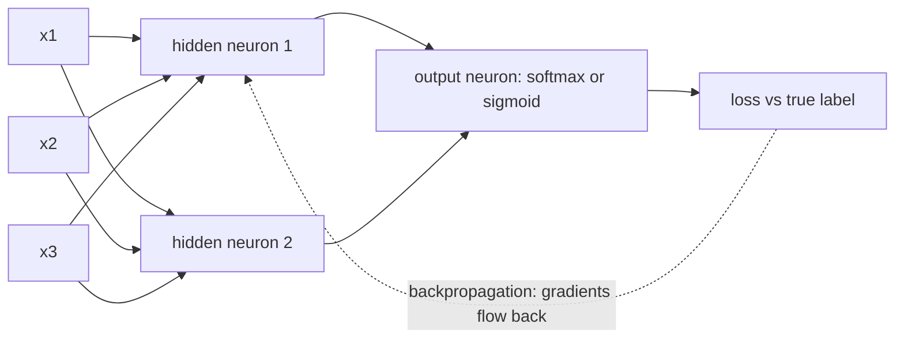
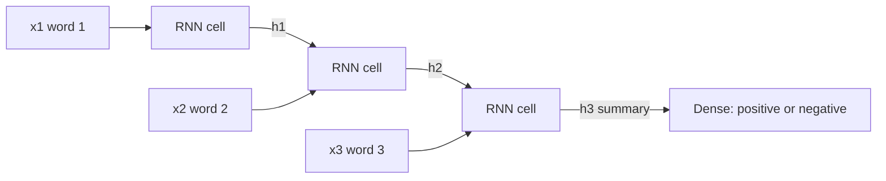
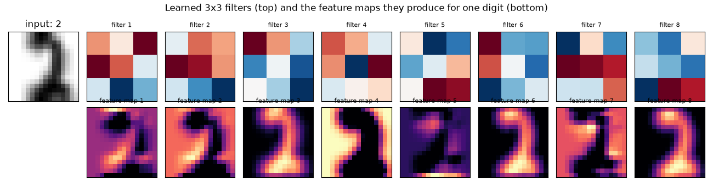

# Session 12 · Deep Learning Models

[](https://colab.research.google.com/github/Hamnakhan123/Diploma-in-Data-Science/blob/main/term-2/03-advanced-data-science-with-python/code/session-12-deep-learning-models.ipynb)

> 📍 [Diploma in Data Science](../../README.md) › [Term 2](../README.md) › [Advanced Data Science with Python](README.md) › **Session 12**

| ⏱ Estimated time | 🧩 Prerequisites | 💻 Tools |
|---|---|---|
| 3 hours | Session 2 (logistic regression, gradient descent), NumPy | Python 3.10+, PyTorch (CPU is enough), NumPy, Matplotlib, scikit-learn; Google Colab for a free GPU |

[⬅ Previous: Session 11 · Reinforcement Learning Principles](session-11-reinforcement-learning-principles.md) · [🏠 Module home](README.md) · [Next: Session 13 · Advanced Deep Learning Techniques ➡](session-13-advanced-deep-learning.md)

---

## 🎯 Learning objectives

- Define **Artificial Neural Networks (ANNs)**: neurons, weights, biases, activation functions, layers, forward pass, loss, **backpropagation** and optimisers.
- Build and train an ANN in **PyTorch** with a proper training loop, validation and early stopping.
- Explain how **Convolutional Neural Networks (CNNs)** process images and videos with filters, feature maps, pooling and parameter sharing, and train one.
- Describe the significance of **Recurrent Neural Networks (RNNs)**, LSTMs and GRUs for sequential data, text and speech, and train one on a sequence task.
- Choose regularisation tools (dropout, weight decay, batch normalisation, data augmentation) to control overfitting.

## 📖 Concepts

### 1. Artificial Neural Networks

An artificial **neuron** is a tiny decision maker. It takes inputs, multiplies each by a **weight** (how important it is), adds a **bias**, and passes the sum through an **activation function**: `output = f(w₁x₁ + w₂x₂ + … + b)`. Logistic regression (Session 2) is exactly one neuron with a sigmoid activation.

Stack neurons into **layers** and you get a network: an **input layer** (features), one or more **hidden layers** (learned intermediate features) and an **output layer** (prediction). It is like a company: junior staff (first layer) notice simple facts, managers (deeper layers) combine them into bigger judgements, and the director (output) makes the final call.

| Activation | Formula | Used for |
|---|---|---|
| **ReLU** | max(0, z) | default for hidden layers: fast, avoids vanishing gradients |
| Sigmoid | 1 / (1 + e^−z) | binary output probability |
| Tanh | (e^z − e^−z) / (e^z + e^−z) | hidden layers in RNNs (output −1…1) |
| **Softmax** | e^zᵢ / Σ e^zⱼ | multi-class output probabilities |
| Leaky ReLU / GELU | variants | deep nets, transformers |

Without non-linear activations, any stack of layers collapses into a single linear model.

**How a network learns**

1. **Forward pass**: compute predictions layer by layer.
2. **Loss**: measure the error: MSE (regression), binary cross-entropy (two classes), **cross-entropy** (many classes).
3. **Backpropagation**: apply the chain rule backwards to get the gradient of the loss with respect to every weight ("how much did each weight contribute to the error?").
4. **Optimiser step**: update weights: SGD `w ← w − η·∂L/∂w`, **Adam** (adaptive per-weight learning rates, a strong default).
5. Repeat over **mini-batches** (e.g. 32–256 rows) for several **epochs** (full passes over the data).

| Term | Meaning |
|---|---|
| Epoch | one pass through all training data |
| Batch size | rows per gradient step |
| Learning rate η | step size (Adam default 0.001) |
| Parameters | weights and biases (learned) |
| Hyperparameters | layers, units, η, batch size, dropout (chosen) |

**Universal approximation**: a network with one big enough hidden layer can approximate any continuous function. Deeper networks usually do it with far fewer neurons by building features in a hierarchy.

### 2. Controlling overfitting

| Technique | Idea |
|---|---|
| Validation set + **early stopping** | stop when validation loss stops improving |
| **Dropout** | randomly switch off a fraction of neurons in training so the network cannot rely on any single one |
| **Weight decay** (L2) | penalise large weights (as in Ridge) |
| **Batch normalisation** | normalise layer inputs per batch; faster, more stable training |
| **Data augmentation** | create varied copies of training examples (flips, shifts, noise) |
| Smaller network / more data | the classic cures |

### 3. Convolutional Neural Networks (CNNs)

A normal ANN treats a 224 × 224 colour image as 150,528 unrelated numbers: far too many weights and no notion that neighbouring pixels belong together. A **CNN** looks at the image through small **filters** (kernels), e.g. 3 × 3, that slide across it. Like reading a page with a magnifying glass: the same glass (the same weights) is used everywhere, so a filter that detects a vertical edge finds it in any position.

| Building block | What it does |
|---|---|
| **Convolution layer** | slides k filters over the input; each produces a **feature map** showing where its pattern appears |
| Stride / padding | step size of the slide; padding keeps the border |
| **ReLU** | keeps positive responses |
| **Pooling** (max/average) | shrinks feature maps (e.g. 2 × 2 → 1), keeping the strongest signal; adds small shift tolerance |
| Flatten + dense layers | combine features into a decision |
| Softmax | class probabilities |

Early layers learn **edges and colours**, middle layers learn **textures and parts** (eyes, wheels), deep layers learn **objects**. Parameter sharing makes CNNs small: a 3 × 3 filter on a colour image has only 28 weights, whatever the image size.

**Output size of a convolution**: `(W − K + 2P) / S + 1` (W = input width, K = kernel, P = padding, S = stride).

**Images and videos**: image classification, object detection (YOLO), segmentation (U-Net) and medical scans. For video, CNNs process each frame (2-D CNN + an RNN/temporal layer) or use **3-D convolutions** across height, width and time to recognise actions.

### 4. Recurrent Neural Networks (RNNs)

Text, speech, sensor readings and prices are **sequences**: order matters. An RNN reads a sequence one step at a time and keeps a **hidden state** `hₜ = tanh(W·xₜ + U·hₜ₋₁ + b)`, a running memory of what it has seen. Like reading a sentence word by word while remembering the gist so far.

**Problem**: in long sequences gradients are multiplied through many steps and **vanish** (or explode), so plain RNNs forget the distant past.

| Model | Fix | Gates |
|---|---|---|
| **LSTM** (Long Short-Term Memory) | adds a **cell state**, a conveyor belt of memory controlled by gates | forget, input, output |
| **GRU** (Gated Recurrent Unit) | simpler LSTM with fewer parameters | update, reset |
| Bidirectional RNN | reads the sequence forwards and backwards | — |

| Sequence task | Input → output | Example |
|---|---|---|
| Many-to-one | sequence → label | sentiment of a review, activity from a sensor window |
| Many-to-many (same length) | sequence → sequence | tagging each word (named-entity recognition) |
| Sequence-to-sequence | sequence → different-length sequence | translation, speech-to-text |
| One-to-many | single input → sequence | image captioning, music generation |

For text, words are first turned into **embeddings** (dense vectors where similar words are close). For speech, audio is turned into spectrograms (often processed by CNN + RNN). Since 2018, **transformers** with attention (Session 13) have replaced RNNs for most language tasks, but RNNs remain useful for small, streaming and sensor problems.

### 5. Choosing a network type

| Data | Network |
|---|---|
| Tabular rows | MLP (ANN), though gradient boosting often wins |
| Images | CNN (or a vision transformer) |
| Video | CNN + RNN, 3-D CNN |
| Text, speech, time series | RNN/LSTM/GRU, 1-D CNN, transformer |

## 🧭 Diagrams






## 💻 Worked examples

### Example 1 · Basic: one neuron and a tiny network in NumPy (forward + backprop)

📄 [`code/session-12_numpy_net.py`](code/session-12_numpy_net.py)

```python
"""XOR with a 2-4-1 network written in NumPy: forward pass, backpropagation and gradient descent."""
import numpy as np

X = np.array([[0, 0], [0, 1], [1, 0], [1, 1]], dtype=float)
y = np.array([[0], [1], [1], [0]], dtype=float)          # XOR: not linearly separable
rng = np.random.default_rng(1)
W1, b1 = rng.normal(0, 1, (2, 4)), np.zeros((1, 4))
W2, b2 = rng.normal(0, 1, (4, 1)), np.zeros((1, 1))
sigmoid = lambda z: 1 / (1 + np.exp(-z))

for epoch in range(5001):
    # forward pass
    h = np.tanh(X @ W1 + b1)                 # hidden layer (4 neurons)
    p = sigmoid(h @ W2 + b2)                 # output probability
    loss = -np.mean(y * np.log(p) + (1 - y) * np.log(1 - p))
    # backward pass (chain rule)
    dz2 = (p - y) / len(X)                   # dLoss/dz for sigmoid + cross-entropy
    dW2, db2 = h.T @ dz2, dz2.sum(0, keepdims=True)
    dh = dz2 @ W2.T * (1 - h ** 2)           # back through tanh
    dW1, db1 = X.T @ dh, dh.sum(0, keepdims=True)
    # gradient descent step
    for P, G in [(W1, dW1), (b1, db1), (W2, dW2), (b2, db2)]:
        P -= 1.0 * G
    if epoch in (0, 100, 1000, 5000):
        print(f"epoch {epoch:>4}: loss = {loss:.4f}  predictions = {p.ravel().round(3)}")
print("rounded predictions:", (p.ravel() > .5).astype(int), " true:", y.ravel().astype(int))
```

**Output**

```text
epoch    0: loss = 0.6712  predictions = [0.5   0.659 0.464 0.554]
epoch  100: loss = 0.0379  predictions = [0.011 0.962 0.958 0.057]
epoch 1000: loss = 0.0024  predictions = [0.    0.997 0.997 0.004]
epoch 5000: loss = 0.0005  predictions = [0.    0.999 0.999 0.001]
rounded predictions: [0 1 1 0]  true: [0 1 1 0]
```

A single neuron (logistic regression) cannot solve XOR; one hidden layer can, because it builds new features first.

### Example 2 · Intermediate: an ANN in PyTorch with validation and early stopping

📄 [`code/session-12_torch_ann.py`](code/session-12_torch_ann.py)

```python
"""A PyTorch multilayer perceptron for breast-cancer diagnosis: DataLoader, training loop, early stopping."""
import numpy as np
import torch
from torch import nn
from torch.utils.data import TensorDataset, DataLoader
from sklearn.datasets import load_breast_cancer
from sklearn.model_selection import train_test_split
from sklearn.preprocessing import StandardScaler
torch.manual_seed(0); torch.set_num_threads(2)

X, y = load_breast_cancer(return_X_y=True)
X_tr, X_te, y_tr, y_te = train_test_split(X, y, test_size=.2, random_state=0, stratify=y)
X_tr, X_va, y_tr, y_va = train_test_split(X_tr, y_tr, test_size=.2, random_state=0, stratify=y_tr)
sc = StandardScaler().fit(X_tr)
t = lambda a: torch.tensor(a, dtype=torch.float32)
X_tr, X_va, X_te = t(sc.transform(X_tr)), t(sc.transform(X_va)), t(sc.transform(X_te))
y_tr, y_va, y_te = t(y_tr).unsqueeze(1), t(y_va).unsqueeze(1), t(y_te).unsqueeze(1)
loader = DataLoader(TensorDataset(X_tr, y_tr), batch_size=32, shuffle=True)

model = nn.Sequential(nn.Linear(30, 32), nn.ReLU(), nn.Dropout(0.2),
                      nn.Linear(32, 16), nn.ReLU(), nn.Linear(16, 1))      # outputs a logit
print(model)
print("trainable parameters:", sum(p.numel() for p in model.parameters()))
loss_fn = nn.BCEWithLogitsLoss()                                         # sigmoid + binary cross-entropy
opt = torch.optim.Adam(model.parameters(), lr=1e-3, weight_decay=1e-4)

best, best_state, patience, wait = np.inf, None, 15, 0
for epoch in range(300):
    model.train()
    for xb, yb in loader:
        opt.zero_grad(); loss = loss_fn(model(xb), yb); loss.backward(); opt.step()
    model.eval()
    with torch.no_grad():
        val = loss_fn(model(X_va), y_va).item()
    if val < best - 1e-4:
        best, best_state, wait = val, {k: v.clone() for k, v in model.state_dict().items()}, 0
    else:
        wait += 1
    if epoch % 20 == 0:
        print(f"epoch {epoch:>3}: train loss {loss.item():.4f}  val loss {val:.4f}")
    if wait >= patience:
        print(f"early stopping at epoch {epoch} (best val loss {best:.4f})"); break

model.load_state_dict(best_state); model.eval()
with torch.no_grad():
    acc = ((model(X_te) > 0).float() == y_te).float().mean().item()
print(f"test accuracy: {acc:.3f}")
```

**Output**

```text
Sequential(
  (0): Linear(in_features=30, out_features=32, bias=True)
  (1): ReLU()
  (2): Dropout(p=0.2, inplace=False)
  (3): Linear(in_features=32, out_features=16, bias=True)
  (4): ReLU()
  (5): Linear(in_features=16, out_features=1, bias=True)
)
trainable parameters: 1537
epoch   0: train loss 0.6967  val loss 0.6831
epoch  20: train loss 0.0407  val loss 0.0350
epoch  40: train loss 0.0135  val loss 0.0214
epoch  60: train loss 0.0040  val loss 0.0164
epoch  80: train loss 0.0112  val loss 0.0143
epoch 100: train loss 0.0029  val loss 0.0136
early stopping at epoch 106 (best val loss 0.0119)
test accuracy: 0.956
```

### Example 3 · Intermediate: a CNN for handwritten digits, with feature maps

📄 [`code/session-12_torch_cnn.py`](code/session-12_torch_cnn.py)

```python
"""A small CNN on 8x8 digit images (upscaled to 16x16): training, test accuracy, filters and feature maps."""
import numpy as np
import torch
from torch import nn
import torch.nn.functional as F
import matplotlib.pyplot as plt
from sklearn.datasets import load_digits
from sklearn.model_selection import train_test_split
torch.manual_seed(0); torch.set_num_threads(2)

digits = load_digits()
X = torch.tensor(digits.images / 16.0, dtype=torch.float32).unsqueeze(1)      # (n, 1, 8, 8)
X = F.interpolate(X, size=16, mode="bilinear", align_corners=False)            # 16x16 for two pooling layers
y = torch.tensor(digits.target)
idx_tr, idx_te = train_test_split(np.arange(len(y)), test_size=.25, random_state=0, stratify=digits.target)

class SmallCNN(nn.Module):
    def __init__(self):
        super().__init__()
        self.conv1 = nn.Conv2d(1, 8, 3, padding=1)      # 16x16 -> 8 maps of 16x16
        self.conv2 = nn.Conv2d(8, 16, 3, padding=1)     # after pool 8x8 -> 16 maps of 8x8
        self.fc1 = nn.Linear(16 * 4 * 4, 64)
        self.fc2 = nn.Linear(64, 10)
        self.drop = nn.Dropout(0.3)
    def forward(self, x):
        x = F.max_pool2d(F.relu(self.conv1(x)), 2)      # -> 8 x 8 x 8
        x = F.max_pool2d(F.relu(self.conv2(x)), 2)      # -> 16 x 4 x 4
        x = self.drop(F.relu(self.fc1(x.flatten(1))))
        return self.fc2(x)

model = SmallCNN()
print("parameters:", sum(p.numel() for p in model.parameters()))
opt = torch.optim.Adam(model.parameters(), lr=2e-3)
for epoch in range(15):
    model.train()
    perm = torch.tensor(np.random.default_rng(epoch).permutation(idx_tr))
    for i in range(0, len(perm), 64):
        b = perm[i:i + 64]
        opt.zero_grad(); loss = F.cross_entropy(model(X[b]), y[b]); loss.backward(); opt.step()
    if epoch % 5 == 4:
        model.eval()
        with torch.no_grad():
            acc = (model(X[idx_te]).argmax(1) == y[idx_te]).float().mean().item()
        print(f"epoch {epoch + 1:>2}: last batch loss {loss.item():.3f}  test accuracy {acc:.3f}")

model.eval()
with torch.no_grad():
    maps = F.relu(model.conv1(X[idx_te[:1]]))[0]
fig, ax = plt.subplots(2, 9, figsize=(13, 3.4))
ax[0, 0].imshow(X[idx_te[0], 0], cmap="gray_r"); ax[0, 0].set_title(f"input: {y[idx_te[0]].item()}")
ax[1, 0].axis("off")
for k in range(8):
    ax[0, k + 1].imshow(model.conv1.weight[k, 0].detach(), cmap="RdBu"); ax[0, k + 1].set_title(f"filter {k + 1}", fontsize=8)
    ax[1, k + 1].imshow(maps[k], cmap="magma"); ax[1, k + 1].set_title(f"feature map {k + 1}", fontsize=8)
for a in ax.ravel(): a.set_xticks([]); a.set_yticks([])
fig.suptitle("Learned 3x3 filters (top) and the feature maps they produce for one digit (bottom)")
fig.tight_layout(); fig.savefig("session-12_cnn_feature_maps.png", dpi=100); plt.show()
```

**Output**

```text
parameters: 18346
epoch  5: last batch loss 0.339  test accuracy 0.898
epoch 10: last batch loss 0.210  test accuracy 0.949
epoch 15: last batch loss 0.260  test accuracy 0.958
```

**Chart produced by this code** (saved as [`code/session-12_cnn_feature_maps.png`](code/session-12_cnn_feature_maps.png)):



### Example 4 · Advanced: vanishing gradients (RNN vs LSTM) and an LSTM forecaster

📄 [`code/session-12_torch_rnn.py`](code/session-12_torch_rnn.py)

```python
"""Why LSTMs matter: how much does the FIRST input still influence the last hidden state? Then an LSTM forecaster."""
import numpy as np
import torch
from torch import nn
torch.set_num_threads(2)

def gradient_to_first_input(cell, length, trials=20):
    """Average |d h_last / d x_0| over random initialisations: the signal that reaches step 0 in backprop."""
    vals = []
    for k in range(trials):
        torch.manual_seed(k)
        rnn = {"RNN": nn.RNN, "LSTM": nn.LSTM}[cell](1, 32, batch_first=True)
        if cell == "LSTM":                       # common practice: forget-gate bias = 1 (remember by default)
            with torch.no_grad():
                for name, p in rnn.named_parameters():
                    if "bias_ih" in name:
                        p[32:64] = 1.0
        x = torch.randn(1, length, 1, requires_grad=True)
        h, _ = rnn(x)
        h[0, -1].sum().backward()
        vals.append(x.grad[0, 0, 0].abs().item())
    return np.mean(vals)

print("sequence length   gradient reaching step 0:  plain RNN      LSTM")
for length in [5, 20, 50, 100]:
    print(f"{length:>15}   {'':>24}{gradient_to_first_input('RNN', length):9.1e}{gradient_to_first_input('LSTM', length):10.1e}")

# Many-to-one forecasting: predict the next value from the previous 24
t = np.arange(1500)
series = np.sin(2 * np.pi * t / 50) + 0.5 * np.sin(2 * np.pi * t / 13) + np.random.default_rng(0).normal(0, .1, 1500)
W = 24
Xs = torch.tensor(np.stack([series[i:i + W] for i in range(len(series) - W)]), dtype=torch.float32).unsqueeze(2)
ys = torch.tensor(series[W:], dtype=torch.float32)
split = 1200
lstm = nn.LSTM(1, 32, batch_first=True); head = nn.Linear(32, 1)
opt = torch.optim.Adam(list(lstm.parameters()) + list(head.parameters()), lr=5e-3)
for epoch in range(20):
    for i in range(0, split, 64):
        h, _ = lstm(Xs[i:i + 64]); pred = head(h[:, -1]).squeeze(1)
        opt.zero_grad(); loss = nn.functional.mse_loss(pred, ys[i:i + 64]); loss.backward(); opt.step()
with torch.no_grad():
    h, _ = lstm(Xs[split:]); pred = head(h[:, -1]).squeeze(1)
mae = (pred - ys[split:]).abs().mean().item()
naive = (Xs[split:, -1, 0] - ys[split:]).abs().mean().item()
print(f"\nLSTM next-step forecast MAE on unseen data: {mae:.3f}  (naive 'same as last value': {naive:.3f})")
```

**Output**

```text
sequence length   gradient reaching step 0:  plain RNN      LSTM
              5                             3.0e-02   4.0e-02
             20                             1.3e-05   2.1e-03
             50                             8.1e-12   2.6e-05
            100                             3.0e-21   3.8e-08

LSTM next-step forecast MAE on unseen data: 0.099  (naive 'same as last value': 0.198)
```

The first table is the **vanishing gradient problem** in numbers. After 50 steps the learning signal reaching the first input of a plain RNN is about 10⁻¹¹ (effectively zero), so it cannot learn long-range dependencies. The LSTM's cell state, with its forget gate open by default, still passes about 10⁻⁵, millions of times more. (A GRU behaves like the plain RNN at initialisation and learns to open its gates during training.) The forecaster then halves the error of the naive "same as last value" forecast.

## 🏙️ Real-life data problem: classifying customer reviews (many-to-one text RNN)

**Problem.** A food-delivery platform receives thousands of short English reviews a day. The support team wants every review automatically tagged **positive** or **negative** so that negative ones are answered first.

**Full solution.** Build a vocabulary, turn words into integer IDs, pad sequences, train an **embedding + GRU** classifier in PyTorch, compare with a bag-of-words logistic regression baseline, test on unseen reviews, and inspect a few predictions, including a tricky negation.

📄 [`code/session-12_reviews_problem.py`](code/session-12_reviews_problem.py)

```python
"""Real-life problem: sentiment of food-delivery reviews with an Embedding + GRU network vs a TF-IDF baseline."""
import numpy as np
import torch
from torch import nn
from sklearn.feature_extraction.text import TfidfVectorizer
from sklearn.linear_model import LogisticRegression
torch.manual_seed(0); torch.set_num_threads(2)
rng = np.random.default_rng(0)

pos_bits = ["food was delicious", "rider was very polite", "arrived hot and fresh", "great taste", "fast delivery",
            "will order again", "portion was generous", "biryani was amazing", "packaging was neat", "excellent service"]
neg_bits = ["food was cold", "rider was rude", "arrived very late", "tasted stale", "order was missing items",
            "never ordering again", "portion was tiny", "biryani was too oily", "packaging was leaking", "terrible service"]
neutral = ["ordered on friday", "for my family", "at lunch time", "from the new branch", "", "using the app"]
def make_review(label):
    good, bad = (pos_bits, neg_bits) if label else (neg_bits, pos_bits)
    parts = list(rng.choice(good, 2, replace=False)) + [rng.choice(neutral)]
    if rng.random() < .40:                                  # mixed reviews: one opposite remark
        parts.append("but " + rng.choice(bad))
        parts.append(rng.choice(good))
    if rng.random() < .15:                                  # negation flips a positive phrase
        parts.append("not " + rng.choice(bad).split(" was ")[-1] if label else "not great at all")
    rng.shuffle(parts)
    return " ".join(p for p in parts if p)

labels = rng.integers(0, 2, 4000)
texts = [make_review(l) for l in labels]
noisy = rng.random(4000) < .06                              # 6% of reviews carry a wrong star rating (real data is noisy)
labels = np.where(noisy, 1 - labels, labels)
tr, te = np.arange(3200), np.arange(3200, 4000)
print("example reviews:"); [print(f"  [{labels[i]}] {texts[i]}") for i in range(3)]

# Baseline: TF-IDF + logistic regression
vec = TfidfVectorizer(ngram_range=(1, 2)).fit([texts[i] for i in tr])
base = LogisticRegression(max_iter=1000).fit(vec.transform([texts[i] for i in tr]), labels[tr])
print(f"\nTF-IDF + logistic regression test accuracy: {base.score(vec.transform([texts[i] for i in te]), labels[te]):.3f}")

# Vocabulary and padded integer sequences
vocab = {"<pad>": 0, "<unk>": 1}
for i in tr:
    for w in texts[i].split():
        vocab.setdefault(w, len(vocab))
MAXLEN = 30
def encode(s):
    ids = [vocab.get(w, 1) for w in s.split()][:MAXLEN]
    return ids + [0] * (MAXLEN - len(ids))
X = torch.tensor([encode(s) for s in texts]); Y = torch.tensor(labels, dtype=torch.float32)
print("vocabulary size:", len(vocab))

class ReviewGRU(nn.Module):
    def __init__(self, vocab_size, emb=32, hidden=32):
        super().__init__()
        self.emb = nn.Embedding(vocab_size, emb, padding_idx=0)
        self.gru = nn.GRU(emb, hidden, batch_first=True, bidirectional=True)
        self.out = nn.Linear(2 * hidden, 1)
    def forward(self, x):
        h, _ = self.gru(self.emb(x))
        mask = (x != 0).unsqueeze(2).float()
        pooled = (h * mask).sum(1) / mask.sum(1).clamp(min=1)     # average over real (non-pad) words
        return self.out(pooled).squeeze(1)

model = ReviewGRU(len(vocab)); opt = torch.optim.Adam(model.parameters(), lr=3e-3)
for epoch in range(8):
    model.train(); perm = torch.tensor(rng.permutation(tr))
    for i in range(0, len(perm), 64):
        b = perm[i:i + 64]
        opt.zero_grad(); loss = nn.functional.binary_cross_entropy_with_logits(model(X[b]), Y[b]); loss.backward(); opt.step()
    model.eval()
    with torch.no_grad():
        acc = ((model(X[te]) > 0).float() == Y[te]).float().mean().item()
    if epoch % 2 == 1:
        print(f"epoch {epoch + 1}: GRU test accuracy {acc:.3f}")

new = ["rider was very polite and food was delicious", "arrived very late and food was cold",
       "great taste but packaging was leaking", "biryani was amazing will order again"]
with torch.no_grad():
    probs = torch.sigmoid(model(torch.tensor([encode(s) for s in new]))).numpy()
for s, p in zip(new, probs):
    print(f"P(positive) = {p:.2f}  {s}")
```

**Output**

```text
example reviews:
  [1] excellent service ordered on friday great taste
  [1] arrived hot and fresh but tasted stale food was delicious will order again
  [1] great taste biryani was amazing ordered on friday

TF-IDF + logistic regression test accuracy: 0.931
vocabulary size: 59
epoch 2: GRU test accuracy 0.931
epoch 4: GRU test accuracy 0.931
epoch 6: GRU test accuracy 0.931
epoch 8: GRU test accuracy 0.931
P(positive) = 0.99  rider was very polite and food was delicious
P(positive) = 0.30  arrived very late and food was cold
P(positive) = 0.90  great taste but packaging was leaking
P(positive) = 0.96  biryani was amazing will order again
```

**Answer.** Both models reach about the ceiling allowed by the 6% of wrongly labelled reviews, so neither can be judged 'better' on accuracy alone; the GRU reads word order (useful for "but …" and "not …" patterns) and outputs a probability the support team can sort by. On short, phrase-based reviews like these a TF-IDF baseline is already strong, so in a real project you would keep the simpler model unless the network clearly wins, or move to a pre-trained transformer (Session 13) for messier real text.

## ⚠️ Common mistakes

| Mistake | Fix |
|---|---|
| Forgetting to scale inputs | standardise tabular data; divide pixels by 255 |
| Applying sigmoid/softmax and then `BCEWithLogitsLoss`/`CrossEntropyLoss` | these losses expect raw logits |
| Forgetting `model.eval()` and `torch.no_grad()` for evaluation | dropout stays on and memory grows |
| Forgetting `optimizer.zero_grad()` | gradients accumulate across batches |
| Training until training loss is tiny | watch validation loss; use early stopping |
| Using a plain RNN for long sequences | LSTM/GRU or a transformer |

## ✅ Best practices

- Start small (few layers) and grow only if validation performance improves.
- Use **Adam** (lr = 1e-3) as a first optimiser; tune learning rate before anything else.
- Fix seeds (`torch.manual_seed`) and log train/validation curves.
- Use a GPU (Colab: *Runtime → Change runtime type*) for images and long sequences: `model.to("cuda")`.
- Compare against a classical baseline (logistic regression, gradient boosting) on the same split.

## 🧪 Lab / practice tasks

### 🟢 Task 1 · Easy

In Example 1 replace `tanh` with ReLU in the hidden layer (remember the derivative is 1 for positive inputs, 0 otherwise). Does it still learn XOR?

<details><summary>💡 Hint</summary>

`h = np.maximum(0, X @ W1 + b1)`; `dh = dz2 @ W2.T * (h > 0)`.

</details>

<details><summary>✅ Solution</summary>

Usually yes, but with only 4 hidden ReLU units some random starts get "dead" units (always 0) and the network can stall. More hidden units or a different seed fix it, a nice illustration of why initialisation matters.

</details>


### 🟡 Task 2 · Medium

In Example 2 remove dropout and weight decay and increase the hidden layers to 256 units. Compare validation curves and test accuracy.

<details><summary>💡 Hint</summary>

Print train and validation loss every 10 epochs.

</details>

<details><summary>✅ Solution</summary>

The bigger network drives training loss lower and validation loss starts rising earlier: overfitting. Early stopping still rescues test accuracy, but the gap between train and validation loss is wider without regularisation.

</details>


### 🟡 Task 3 · Medium

Compute by hand the output shape and the number of parameters of each layer of the CNN in Example 3, then check with `print(model)` and `numel()`.

<details><summary>💡 Hint</summary>

Conv parameters = out_channels × (in_channels × k × k + 1).

</details>

<details><summary>✅ Solution</summary>

conv1: 8 × (1×3×3 + 1) = 80; conv2: 16 × (8×3×3 + 1) = 1,168; fc1: 256 × 64 + 64 = 16,448; fc2: 64 × 10 + 10 = 650; total 18,346. Shapes: 1×16×16 → 8×16×16 → pool 8×8×8 → 16×8×8 → pool 16×4×4 → 256 → 64 → 10.

</details>


### 🟠 Task 4 · Hard

Add **data augmentation** to the CNN: randomly shift each training image by up to one pixel each epoch (`torch.roll`). Does test accuracy improve?

<details><summary>💡 Hint</summary>

Apply the shift only to the training batch inside the loop.

</details>

<details><summary>✅ Solution</summary>

```python
shift = np.random.default_rng(i).integers(-1, 2, 2)
xb = torch.roll(X[b], shifts=(int(shift[0]), int(shift[1])), dims=(2, 3))
```
Accuracy typically improves slightly or becomes more stable across seeds, because the CNN learns that a digit is the same when moved.

</details>


### 🔴 Task 5 · Challenge

Train the review classifier with `nn.LSTM` instead of `nn.GRU`, and with a unidirectional instead of bidirectional layer. Report accuracy and parameter counts, and explain the trade-off.

<details><summary>💡 Hint</summary>

LSTM has four gate weight sets, GRU three.

</details>

<details><summary>✅ Solution</summary>

LSTM has about a third more parameters than GRU for the same hidden size. On short reviews accuracy is similar; bidirectional reading helps slightly with "but"/"not" phrases at the cost of twice the recurrent parameters. Prefer the smaller model when accuracy is equal.

</details>


## 🧩 Mini project: activity recognition from phone sensors with a 1-D CNN

📄 [`code/session-12_mini_project.py`](code/session-12_mini_project.py)

```python
"""Mini project: classify walking, running, sitting and climbing stairs from simulated accelerometer windows (1-D CNN)."""
import numpy as np
import torch
from torch import nn
torch.manual_seed(0); torch.set_num_threads(2)
rng = np.random.default_rng(0)

activities = ["sitting", "walking", "running", "stairs"]
def window(label, n=64):
    t = np.arange(n) / 32.0                                    # 2 seconds at 32 Hz
    if label == 0:
        sig = np.c_[0.02 * rng.normal(size=n), 0.02 * rng.normal(size=n), 1 + 0.02 * rng.normal(size=n)]
    else:
        f, amp = {1: (1.8, .35), 2: (2.6, .8), 3: (1.6, .4)}[label]
        ph = rng.uniform(0, 2 * np.pi)
        z = 1 + amp * np.sin(2 * np.pi * f * t + ph)
        x = .5 * amp * np.sin(2 * np.pi * f / 2 * t + ph)
        y = (.3 if label == 3 else .1) * np.sin(2 * np.pi * f * t + ph + 1)    # stairs: more sideways sway
        sig = np.c_[x, y, z] + 0.35 * rng.normal(size=(n, 3))          # noisy phone sensor
    return sig.T                                               # (3 channels, 64 time steps)

y = rng.integers(0, 4, 2400)
X = torch.tensor(np.stack([window(l) for l in y]), dtype=torch.float32)
Y = torch.tensor(y)
tr, te = np.arange(2000), np.arange(2000, 2400)

model = nn.Sequential(nn.Conv1d(3, 16, 5, padding=2), nn.ReLU(), nn.MaxPool1d(2),
                      nn.Conv1d(16, 32, 5, padding=2), nn.ReLU(), nn.AdaptiveAvgPool1d(1),
                      nn.Flatten(), nn.Linear(32, 4))
opt = torch.optim.Adam(model.parameters(), lr=3e-3)
for epoch in range(10):
    perm = torch.tensor(rng.permutation(tr))
    for i in range(0, len(perm), 64):
        b = perm[i:i + 64]
        opt.zero_grad(); loss = nn.functional.cross_entropy(model(X[b]), Y[b]); loss.backward(); opt.step()
model.eval()
with torch.no_grad():
    pred = model(X[te]).argmax(1)
print(f"test accuracy: {(pred == Y[te]).float().mean().item():.3f}")
conf = np.zeros((4, 4), int)
for t_, p_ in zip(Y[te].numpy(), pred.numpy()):
    conf[t_, p_] += 1
print("confusion matrix (rows = true, columns = predicted):")
print("          " + " ".join(f"{a[:7]:>8}" for a in activities))
for a, row in zip(activities, conf):
    print(f"{a:<10}" + " ".join(f"{v:>8}" for v in row))
```

**Output**

```text
test accuracy: 0.962
confusion matrix (rows = true, columns = predicted):
           sitting  walking  running   stairs
sitting        100        0        0        0
walking          0       88        1        4
running          0        0       92        0
stairs           0       10        0      105
```

## ✅ Quick quiz

**Q1.** Why do neural networks need non-linear activation functions?

- **A)** to speed up training
- **B)** without them stacked layers collapse into one linear model
- **C)** to reduce memory
- **D)** to scale inputs

<details><summary>Show answer</summary>

**B** — Non-linearity lets networks learn complex functions.

</details>

**Q2.** Backpropagation computes…

- **A)** the predictions
- **B)** gradients of the loss with respect to every weight using the chain rule
- **C)** the best learning rate
- **D)** the number of layers

<details><summary>Show answer</summary>

**B** — Gradients then drive the optimiser.

</details>

**Q3.** In a CNN the same filter weights are used across the whole image. This is called…

- **A)** pooling
- **B)** parameter sharing
- **C)** dropout
- **D)** padding

<details><summary>Show answer</summary>

**B** — It makes CNNs small and position-tolerant.

</details>

**Q4.** LSTMs were introduced mainly to fix…

- **A)** overfitting
- **B)** the vanishing gradient problem in long sequences
- **C)** slow GPUs
- **D)** class imbalance

<details><summary>Show answer</summary>

**B** — Gates and the cell state preserve information.

</details>

**Q5.** Which loss suits a 10-class image classifier in PyTorch?

- **A)** MSELoss
- **B)** BCEWithLogitsLoss
- **C)** CrossEntropyLoss on raw logits
- **D)** L1Loss

<details><summary>Show answer</summary>

**C** — CrossEntropyLoss applies log-softmax internally.

</details>


## 📝 Summary

- **ANNs**: weighted sums + non-linear activations in layers; trained by forward pass, loss, **backpropagation** and an optimiser (Adam) over mini-batches and epochs.
- Fight overfitting with validation, early stopping, dropout, weight decay, batch normalisation and augmentation.
- **CNNs** use sliding filters, feature maps and pooling to learn edges → parts → objects in images and videos.
- **RNNs** keep a hidden state for sequences; **LSTM/GRU** gates solve vanishing gradients; used for text, speech and sensor data.

### 🎤 Interview / viva questions

1. Explain what happens in one training step of a neural network.
2. Why is ReLU preferred over sigmoid in hidden layers?
3. How does a convolution layer differ from a fully connected layer?
4. What does max pooling do, and why is it useful?
5. Explain the vanishing gradient problem and how LSTMs address it.
6. When would you not use deep learning?

---

[⬅ Previous: Session 11 · Reinforcement Learning Principles](session-11-reinforcement-learning-principles.md) · [🏠 Module home](README.md) · [Next: Session 13 · Advanced Deep Learning Techniques ➡](session-13-advanced-deep-learning.md)

<sub>Diploma in Data Science · Prepared by **Hamna Zahid Khan**, Junior Lecturer</sub>
