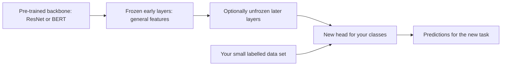
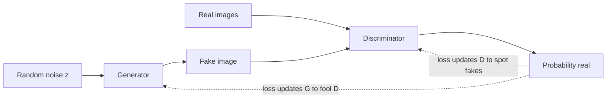
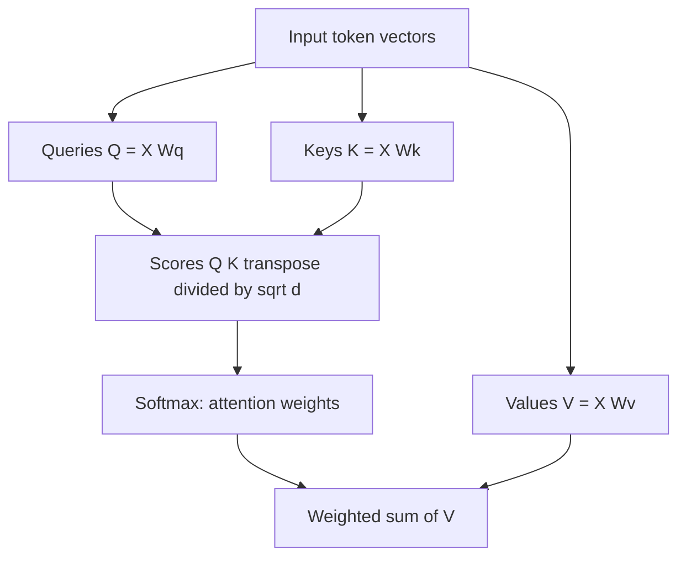
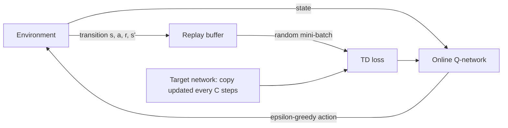
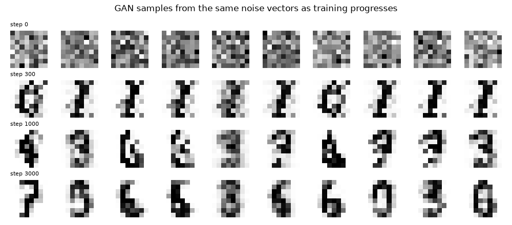
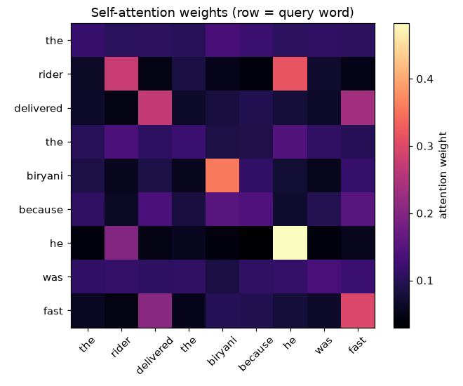

# Session 13 · Advanced Deep Learning Techniques

[](https://colab.research.google.com/github/Hamnakhan123/Diploma-in-Data-Science/blob/main/term-2/03-advanced-data-science-with-python/code/session-13-advanced-deep-learning.ipynb)

> 📍 [Diploma in Data Science](../../README.md) › [Term 2](../README.md) › [Advanced Data Science with Python](README.md) › **Session 13**

| ⏱ Estimated time | 🧩 Prerequisites | 💻 Tools |
|---|---|---|
| 3 hours | Session 12 (ANN, CNN, RNN in PyTorch), Session 11 (Q-learning) | Python 3.10+, PyTorch, NumPy, Matplotlib; optional: torchvision, Hugging Face `transformers` (Colab recommended) |

[⬅ Previous: Session 12 · Deep Learning Models](session-12-deep-learning-models.md) · [🏠 Module home](README.md) · [Next: Session 14 · Model Performance Evaluation ➡](session-14-model-performance-evaluation.md)

---

## 🎯 Learning objectives

- Define **transfer learning** and choose between feature extraction and fine-tuning.
- Explain the pre-trained models **VGG**, **ResNet** (residual connections) and **BERT** (bidirectional transformer encoder), and how to reuse them.
- Describe the architecture of **Generative Adversarial Networks (GANs)** and explain how they generate synthetic images; train a small GAN.
- Discuss **neural style transfer** (content and style losses, Gram matrices) and its applications.
- Explain the role of **attention mechanisms** (scaled dot-product, self-attention, multi-head) in deep learning.
- Describe how reinforcement learning is integrated with deep networks (**Deep Q-Networks**, policy networks) and implement a small DQN.

## 📖 Concepts

### 1. Transfer learning

Training a large network from scratch needs millions of labelled examples and days of GPU time. **Transfer learning** reuses a network already trained on a big data set (e.g. ImageNet: 1.2 million images, 1,000 classes) for a new task with little data. It is like hiring an experienced chef for a new restaurant: you don't teach them to hold a knife; you only teach the new menu.

| Strategy | What you train | When |
|---|---|---|
| **Feature extraction** | freeze all pre-trained layers; train only a new final classifier ("head") | small data set, similar to the original domain |
| **Fine-tuning** | start from pre-trained weights, unfreeze some/all layers, train with a **small learning rate** | more data, or a different domain (X-rays vs everyday photos) |
| Gradual unfreezing | train the head first, then unfreeze deeper blocks step by step | to avoid destroying useful features early |

Why it works: early layers learn **general** features (edges, textures, word meanings) that are useful for many tasks; only the last layers are task-specific.

### 2. Famous pre-trained models

| Model | Year | Key idea | Typical use |
|---|---|---|---|
| **VGG16/19** | 2014 | very simple design: stacks of 3×3 convolutions + pooling, 16–19 layers, ~138 M parameters | feature extraction, style transfer (its features describe style well) |
| **ResNet-18/50/152** | 2015 | **residual (skip) connections**: each block learns `F(x)` and outputs `F(x) + x`, so gradients flow through very deep networks (152 layers) | default image backbone |
| EfficientNet, MobileNet | 2017–19 | accuracy per computation; mobile devices | phones, edge devices |
| **BERT** | 2018 | transformer **encoder** pre-trained by predicting masked words in both directions (**M**asked **L**anguage **M**odelling) + next-sentence prediction | text classification, question answering, named entities |
| GPT family | 2018– | transformer **decoder** trained to predict the next word | text generation, chat |

**Residual connection analogy**: instead of rewriting a whole document at every review stage, each reviewer only adds tracked changes to the original. If a reviewer has nothing useful to add, the document passes through unchanged, so stacking many reviewers never makes things worse.

**Using BERT**: text is split into sub-word tokens, a special `[CLS]` token is added at the start, and its final vector is fed to a small classifier that is fine-tuned on your labelled examples (e.g. 2–4 epochs, learning rate 2e-5).

### 3. Generative Adversarial Networks (GANs)

A GAN is a contest between two networks:

- The **generator G** turns random noise `z` into fake samples (images). It is a **counterfeiter**.
- The **discriminator D** receives real and fake samples and outputs the probability that a sample is real. It is the **police detective**.

They train in turns: D learns to tell real from fake; G learns to fool D. As the detective improves, the counterfeiter must improve too, until fakes become realistic.

| Step | Loss |
|---|---|
| Train D | maximise log D(real) + log(1 − D(G(z))) (binary cross-entropy with labels 1 for real, 0 for fake) |
| Train G | maximise log D(G(z)) (label fakes as "real" when updating G) |

**Generating images**: for images, G uses transposed convolutions to upsample noise into a picture (**DCGAN**). Variants: **conditional GAN** (generate a requested class), **CycleGAN** (horse ↔ zebra without paired images), **StyleGAN** (photorealistic faces), **Pix2Pix** (sketch → photo).

**Challenges**: unstable training, **mode collapse** (G produces only a few kinds of output), and difficulty measuring quality (FID score). **Uses**: synthetic training data (rare defects, privacy-preserving medical images), image super-resolution, data augmentation, art. **Risks**: deepfakes; use responsibly and label synthetic content.

### 4. Neural style transfer

Style transfer paints the **content** of one image in the **style** of another (a photo of Mazar-e-Quaid in the style of truck art). It uses a pre-trained CNN (usually VGG) as a judge:

- **Content loss**: difference between deep-layer feature maps of the generated image and the content image (same objects and layout).
- **Style loss**: difference between **Gram matrices** of feature maps at several layers. A Gram matrix `G = F Fᵀ` records which features fire *together* (textures, colours, brush strokes), ignoring *where*.
- Total loss = α · content + β · style; optimise the **pixels** of the generated image by gradient descent (the network weights stay frozen).

Fast variants train a feed-forward network for one style so it works in real time (phone camera filters). Applications: art and design, film effects, fashion and textile patterns, data augmentation, game textures.

### 5. Attention mechanisms

RNNs squeeze a whole sentence into one hidden vector, so long inputs lose detail. **Attention** lets the model look back at **all** inputs and decide which matter most for the current step, like a student highlighting the relevant lines of a textbook when answering each question.

**Scaled dot-product attention**: each token has a **query** (what am I looking for?), a **key** (what do I contain?) and a **value** (what information do I pass on?).

`Attention(Q, K, V) = softmax(Q Kᵀ / √d) · V`

1. Score each query against every key (dot product), scale by √d to keep values stable.
2. Softmax turns scores into **attention weights** that sum to 1.
3. Output = weighted average of the values.

| Term | Meaning |
|---|---|
| **Self-attention** | queries, keys and values all come from the same sequence; every word looks at every other word |
| **Multi-head attention** | several attention heads in parallel, each learning a different relationship (grammar, coreference, position) |
| Positional encoding | adds order information, because attention itself ignores order |
| **Transformer** | stacks of self-attention + feed-forward layers with residual connections: the basis of BERT, GPT and vision transformers |

Attention weights are also a window into the model: they show which words or image regions influenced a prediction (with caution: they are not a full explanation).

### 6. Deep reinforcement learning

Tabular Q-learning needs one table cell per state; a game screen has more possible states than atoms in the universe. **Deep RL** replaces the table with a neural network.

| Method | Network | Key tricks |
|---|---|---|
| **DQN** (Deep Q-Network) | input state → output Q-value for each action | **experience replay** (store transitions, train on random mini-batches to break correlations) and a **target network** (a slowly updated copy that provides stable TD targets) |
| Double DQN, Dueling DQN | refinements | reduce over-estimation, separate state value and advantage |
| Policy gradient (REINFORCE) | state → action probabilities | increase the probability of actions that led to high returns |
| Actor-critic (A2C, PPO, SAC) | policy network + value network | lower-variance, stable updates; PPO is the most widely used |

Milestones: DQN learnt dozens of Atari games from pixels (2015); AlphaGo combined CNNs, policy/value networks and tree search to beat the Go world champion (2016); RLHF fine-tunes language models from human preferences.

## 🧭 Diagrams









## 💻 Worked examples

### Example 1 · Basic: transfer learning with a small CNN (pre-train, then fine-tune)

To keep everything runnable on a laptop, we "pre-train" a CNN on 900 clean scanned digits (the big source data set) and transfer it to a new domain, noisy, shifted "phone photos" of digits, where only **5 labelled images per class** exist. This is exactly what you do with ImageNet models, at a smaller scale.

📄 [`code/session-13_transfer_small.py`](code/session-13_transfer_small.py)

```python
"""Transfer learning in miniature: pre-train on clean digit scans, reuse for noisy 'phone photos' with 5 labels per class."""
import numpy as np
import torch
from torch import nn
import torch.nn.functional as F
from sklearn.datasets import load_digits
torch.set_num_threads(2)

d = load_digits()
X = F.interpolate(torch.tensor(d.images / 16.0, dtype=torch.float32).unsqueeze(1), size=16, mode="bilinear", align_corners=False)
y = torch.tensor(d.target)
rng = np.random.default_rng(0)
idx = rng.permutation(len(y))
src, tgt = idx[:900], idx[900:]                                    # different images for the two tasks
# Target domain = 'phone photos': lower contrast, background noise and random shifts
gen = torch.Generator().manual_seed(0)
Xt = 0.6 * X + 0.35 * torch.rand(X.shape, generator=gen)
Xt = torch.stack([torch.roll(img, shifts=(int(rng.integers(-2, 3)), int(rng.integers(-2, 3))), dims=(1, 2)) for img in Xt])
few = np.concatenate([rng.choice(tgt[d.target[tgt] == c], 5, replace=False) for c in range(10)])   # only 50 labels
test = np.setdiff1d(tgt, few)

def backbone():
    return nn.Sequential(nn.Conv2d(1, 16, 3, padding=1), nn.ReLU(), nn.MaxPool2d(2),
                         nn.Conv2d(16, 32, 3, padding=1), nn.ReLU(), nn.MaxPool2d(2), nn.Flatten())

def train(model, data, idx, epochs, lr, params=None):
    opt = torch.optim.Adam(params if params is not None else model.parameters(), lr=lr)
    for ep in range(epochs):
        perm = rng.permutation(idx)
        for i in range(0, len(perm), 32):
            b = perm[i:i + 32]
            opt.zero_grad(); F.cross_entropy(model(data[b]), y[b]).backward(); opt.step()

def acc(model, data, idx):
    model.eval()
    with torch.no_grad():
        return (model(data[idx]).argmax(1) == y[idx]).float().mean().item()

torch.manual_seed(0)
pre = nn.Sequential(backbone(), nn.Linear(512, 10))
train(pre, X, src, epochs=15, lr=2e-3)                               # source: 900 clean labelled scans
print(f"pre-trained model, clean scans (held out): {acc(pre, X, tgt):.3f}")
print(f"pre-trained model used as-is on noisy photos: {acc(pre, Xt, test):.3f}")

results = {}
torch.manual_seed(1)
scratch = nn.Sequential(backbone(), nn.Linear(512, 10)); train(scratch, Xt, few, 80, 2e-3)
results["from scratch (50 photos)"] = acc(scratch, Xt, test)
torch.manual_seed(1)
fe = nn.Sequential(backbone(), nn.Linear(512, 10)); fe.load_state_dict(pre.state_dict())
for p in fe[0].parameters(): p.requires_grad = False                 # freeze the backbone, retrain the head
train(fe, Xt, few, 80, 2e-3, params=fe[1].parameters())
results["feature extraction (frozen)"] = acc(fe, Xt, test)
torch.manual_seed(1)
ft = nn.Sequential(backbone(), nn.Linear(512, 10)); ft.load_state_dict(pre.state_dict())
train(ft, Xt, few, 80, 3e-4)                                         # small learning rate for all layers
results["fine-tuning (all layers)"] = acc(ft, Xt, test)
for k, v in results.items():
    print(f"{k:<30} accuracy on unseen noisy photos: {v:.3f}")
```

**Output**

```text
pre-trained model, clean scans (held out): 0.973
pre-trained model used as-is on noisy photos: 0.525
from scratch (50 photos)       accuracy on unseen noisy photos: 0.451
feature extraction (frozen)    accuracy on unseen noisy photos: 0.590
fine-tuning (all layers)       accuracy on unseen noisy photos: 0.583
```

Read the four numbers in order. The pre-trained model used unchanged drops from 97% to about 53% on the new domain (**domain shift**). Training from scratch on 50 photos is worse still (≈ 45%). Reusing the pre-trained stroke detectors and adapting with the same 50 photos lifts accuracy to about 59%, the best of all. With ImageNet-scale models and real photos the gain is usually much larger.

The same idea with a real pre-trained ResNet (illustrative; downloads weights, best run in Colab with a GPU):

```python
# Transfer learning with a pre-trained ResNet-18 from torchvision (illustrative)
import torch, torchvision
from torch import nn
weights = torchvision.models.ResNet18_Weights.DEFAULT
model = torchvision.models.resnet18(weights=weights)
for p in model.parameters():
    p.requires_grad = False                         # feature extraction: freeze everything
model.fc = nn.Linear(model.fc.in_features, 3)      # new head, e.g. 3 classes of crop disease
preprocess = weights.transforms()                   # resize, crop, normalise exactly as in pre-training
optimizer = torch.optim.Adam(model.fc.parameters(), lr=1e-3)
# ... train as usual; later unfreeze model.layer4 and continue with lr=1e-4 to fine-tune
```

And BERT for text classification with Hugging Face (illustrative):

```python
from transformers import AutoTokenizer, AutoModelForSequenceClassification
tok = AutoTokenizer.from_pretrained("bert-base-uncased")
bert = AutoModelForSequenceClassification.from_pretrained("bert-base-uncased", num_labels=2)
batch = tok(["the rider was very polite", "food arrived cold"], padding=True, return_tensors="pt")
logits = bert(**batch).logits      # fine-tune with lr=2e-5 for 2-4 epochs on your labelled reviews
```

### Example 2 · Intermediate: a residual block and why depth needs it

📄 [`code/session-13_resnet_block.py`](code/session-13_resnet_block.py)

```python
"""Plain deep MLP vs the same depth with residual connections: gradient flow and training loss."""
import torch
from torch import nn
torch.set_num_threads(2)

class Block(nn.Module):
    def __init__(self, width, residual):
        super().__init__()
        self.f = nn.Sequential(nn.Linear(width, width), nn.Tanh(), nn.Linear(width, width))
        self.residual = residual
    def forward(self, x):
        return torch.tanh(self.f(x) + x) if self.residual else torch.tanh(self.f(x))

def make(depth, residual):
    return nn.Sequential(nn.Linear(10, 32), *[Block(32, residual) for _ in range(depth)], nn.Linear(32, 1))

torch.manual_seed(0)
X = torch.randn(512, 10); y = (X[:, :3].sum(1, keepdim=True) > 0).float()
print("depth  type       grad norm at first layer   loss after 200 steps")
for depth in [2, 20, 40]:
    for residual in [False, True]:
        torch.manual_seed(0)
        m = make(depth, residual)
        loss = nn.functional.binary_cross_entropy_with_logits(m(X), y); loss.backward()
        g = m[0].weight.grad.norm().item()
        opt = torch.optim.Adam(m.parameters(), lr=1e-3)
        for _ in range(200):
            opt.zero_grad(); l = nn.functional.binary_cross_entropy_with_logits(m(X), y); l.backward(); opt.step()
        print(f"{depth:>5}  {'residual' if residual else 'plain':<9}  {g:>24.2e}   {l.item():>20.3f}")
```

**Output**

```text
depth  type       grad norm at first layer   loss after 200 steps
    2  plain                      1.54e-02                  0.004
    2  residual                   1.77e-01                  0.005
   20  plain                      1.20e-11                  0.692
   20  residual                   7.04e-02                  0.003
   40  plain                      2.75e-21                  0.692
   40  residual                   4.07e-02                  0.035
```

As depth grows, the gradient reaching the first layer of the **plain** network shrinks and training stalls, while the **residual** version keeps a healthy gradient and trains well, which is why ResNets can be 50–152 layers deep.

### Example 3 · Intermediate: a GAN that learns to draw digits

📄 [`code/session-13_gan_digits.py`](code/session-13_gan_digits.py)

```python
"""A small fully connected GAN trained on 8x8 digit images; saves a grid of generated samples over training."""
import numpy as np
import torch
from torch import nn
import matplotlib.pyplot as plt
from sklearn.datasets import load_digits
torch.manual_seed(0); torch.set_num_threads(2)

real = torch.tensor(load_digits().images.reshape(-1, 64) / 8.0 - 1.0, dtype=torch.float32)   # scale to [-1, 1]
Z = 16
G = nn.Sequential(nn.Linear(Z, 128), nn.LeakyReLU(0.2), nn.Linear(128, 128), nn.LeakyReLU(0.2), nn.Linear(128, 64), nn.Tanh())
D = nn.Sequential(nn.Linear(64, 128), nn.LeakyReLU(0.2), nn.Dropout(0.3), nn.Linear(128, 1))
optG = torch.optim.Adam(G.parameters(), lr=1e-3, betas=(0.5, 0.999))
optD = torch.optim.Adam(D.parameters(), lr=1e-3, betas=(0.5, 0.999))
bce = nn.BCEWithLogitsLoss()
fixed_z = torch.randn(10, Z)
snapshots = {}
for step in range(3001):
    xb = real[torch.randint(0, len(real), (64,))]
    fake = G(torch.randn(64, Z))
    # 1) discriminator: real -> 1 (smoothed to 0.9), fake -> 0
    optD.zero_grad()
    lossD = bce(D(xb), torch.full((64, 1), 0.9)) + bce(D(fake.detach()), torch.zeros(64, 1))
    lossD.backward(); optD.step()
    # 2) generator: wants D to say 'real' for fakes
    optG.zero_grad()
    lossG = bce(D(fake), torch.ones(64, 1))
    lossG.backward(); optG.step()
    if step in (0, 300, 1000, 3000):
        with torch.no_grad():
            snapshots[step] = G(fixed_z).numpy()
            dr, df = torch.sigmoid(D(xb)).mean().item(), torch.sigmoid(D(fake)).mean().item()
        print(f"step {step:>4}: loss D {lossD.item():.3f}  loss G {lossG.item():.3f}  D(real) {dr:.2f}  D(fake) {df:.2f}")

fig, ax = plt.subplots(4, 10, figsize=(10, 4.4))
for r, (step, imgs) in enumerate(snapshots.items()):
    for c in range(10):
        ax[r, c].imshow(imgs[c].reshape(8, 8), cmap="gray_r"); ax[r, c].axis("off")
    ax[r, 0].set_title(f"step {step}", fontsize=8, loc="left")
fig.suptitle("GAN samples from the same noise vectors as training progresses")
fig.tight_layout(); fig.savefig("session-13_gan_samples.png", dpi=100); plt.show()
```

**Output**

```text
step    0: loss D 1.482  loss G 0.653  D(real) 0.50  D(fake) 0.52
step  300: loss D 1.216  loss G 0.994  D(real) 0.51  D(fake) 0.37
step 1000: loss D 1.239  loss G 0.949  D(real) 0.51  D(fake) 0.39
step 3000: loss D 1.314  loss G 0.940  D(real) 0.47  D(fake) 0.43
```

**Chart produced by this code** (saved as [`code/session-13_gan_samples.png`](code/session-13_gan_samples.png)):



At step 0 the generator produces noise; by step 3000 the same noise vectors become recognisable digit-like strokes. The discriminator's scores for real and fake move towards each other as the contest balances.

### Example 4 · Intermediate: attention from scratch and multi-head attention in PyTorch

📄 [`code/session-13_attention.py`](code/session-13_attention.py)

```python
"""Scaled dot-product attention in NumPy on a toy sentence, then PyTorch MultiheadAttention shapes."""
import numpy as np
import torch
import matplotlib.pyplot as plt

words = ["the", "rider", "delivered", "the", "biryani", "because", "he", "was", "fast"]
rng = np.random.default_rng(0)
d = 8
# Hand-made embeddings: 'he' is similar to 'rider'; 'fast' is similar to 'delivered'
E = rng.normal(0, .3, (len(words), d))
E[1] += [2, 0, 0, 0, 0, 0, 0, 0]; E[6] += [2, 0, 0, 0, 0, 0, 0, 0]          # rider ~ he
E[2] += [0, 2, 0, 0, 0, 0, 0, 0]; E[8] += [0, 2, 0, 0, 0, 0, 0, 0]          # delivered ~ fast
E[4] += [0, 0, 2, 0, 0, 0, 0, 0]

def attention(Q, K, V):
    scores = Q @ K.T / np.sqrt(Q.shape[1])
    w = np.exp(scores - scores.max(axis=1, keepdims=True)); w /= w.sum(axis=1, keepdims=True)
    return w @ V, w

out, W = attention(E, E, E)                       # self-attention with identity projections
for i in [6, 8]:
    top = np.argsort(-W[i])[:3]
    print(f"'{words[i]}' attends most to: " + ", ".join(f"{words[j]} ({W[i, j]:.2f})" for j in top))
print("each row of weights sums to 1:", np.allclose(W.sum(1), 1))

mha = torch.nn.MultiheadAttention(embed_dim=8, num_heads=2, batch_first=True)
x = torch.tensor(E, dtype=torch.float32).unsqueeze(0)          # (batch 1, 9 tokens, 8 dims)
y, w = mha(x, x, x)
print("PyTorch multi-head output:", tuple(y.shape), "| averaged attention weights:", tuple(w.shape))

plt.figure(figsize=(6, 5))
plt.imshow(W, cmap="magma"); plt.colorbar(label="attention weight")
plt.xticks(range(len(words)), words, rotation=45); plt.yticks(range(len(words)), words)
plt.title("Self-attention weights (row = query word)")
plt.tight_layout(); plt.savefig("session-13_attention_heatmap.png", dpi=110); plt.show()
```

**Output**

```text
'he' attends most to: he (0.48), rider (0.20), the (0.06)
'fast' attends most to: fast (0.30), delivered (0.21), biryani (0.10)
each row of weights sums to 1: True
PyTorch multi-head output: (1, 9, 8) | averaged attention weights: (1, 9, 9)
```

**Chart produced by this code** (saved as [`code/session-13_attention_heatmap.png`](code/session-13_attention_heatmap.png)):



### Example 5 · Advanced: style transfer's key ingredient, the Gram matrix

Full style transfer needs a pre-trained VGG (see the lab). Here we show the core idea with a tiny random CNN: the **Gram matrix** captures texture regardless of position, so two images with the same texture but different layouts have similar Gram matrices, while content features differ.

📄 [`code/session-13_gram_style.py`](code/session-13_gram_style.py)

```python
"""Content vs style: feature maps differ when layout changes, Gram matrices (texture statistics) stay similar."""
import numpy as np
import torch
from torch import nn
torch.manual_seed(0)

def stripes(h=32, w=32, angle=0.0, freq=6, shift=0):
    yy, xx = np.mgrid[0:h, 0:w]
    return np.sin(freq * 2 * np.pi * (np.cos(angle) * (xx + shift) + np.sin(angle) * yy) / w)

def dots(h=32, w=32, shift=0):
    yy, xx = np.mgrid[0:h, 0:w]
    return np.sin(2 * np.pi * (xx + shift) / 8) * np.sin(2 * np.pi * yy / 8)

imgs = {"stripes": stripes(), "stripes moved": stripes(shift=3), "dots": dots()}
cnn = nn.Sequential(nn.Conv2d(1, 16, 5, padding=2), nn.ReLU(), nn.Conv2d(16, 16, 3, padding=1), nn.ReLU())

def features(img):
    with torch.no_grad():
        return cnn(torch.tensor(img, dtype=torch.float32)[None, None])[0]        # (C, H, W)

def gram(F):
    C = F.shape[0]; Fm = F.reshape(C, -1)
    return Fm @ Fm.T / Fm.shape[1]                                                # (C, C): which features co-occur

feats = {k: features(v) for k, v in imgs.items()}
grams = {k: gram(f) for k, f in feats.items()}
def dist(a, b): return (a - b).pow(2).mean().sqrt().item()
print(f"{'pair':<28}{'content distance':>18}{'style (Gram) distance':>24}")
for a, b in [("stripes", "stripes moved"), ("stripes", "dots")]:
    print(f"{a + ' vs ' + b:<28}{dist(feats[a], feats[b]):>18.4f}{dist(grams[a], grams[b]):>24.4f}")
```

**Output**

```text
pair                          content distance   style (Gram) distance
stripes vs stripes moved                0.0822                  0.0007
stripes vs dots                         0.0758                  0.0025
```

Moving the stripes changes the **content** features (pixels are in different places) but barely changes the **Gram matrix** (same texture). The dots have a genuinely different texture, so their Gram distance is large. Style transfer optimises an image to match the Gram matrices of a painting while keeping the content features of a photo.

## 🏙️ Real-life data problem: a Deep Q-Network for a smart thermostat

**Problem.** An office building wants a controller that switches air-conditioning between **off**, **eco** and **boost** every 15 minutes, keeping the room near 24 °C while saving electricity. The state is continuous (indoor temperature, outdoor temperature, time of day), so a Q-table will not do.

**Full solution.** Build a small simulator, train a **DQN** with experience replay and a target network, and compare its comfort and energy use with a simple thermostat rule over a simulated working day.

📄 [`code/session-13_dqn_thermostat.py`](code/session-13_dqn_thermostat.py)

```python
"""Real-life problem: DQN controller for office air-conditioning vs a rule-based thermostat."""
import random
from collections import deque
import numpy as np
import torch
from torch import nn
torch.manual_seed(0); random.seed(0); torch.set_num_threads(2)
rng = np.random.default_rng(0)

ACTIONS = ["off", "eco", "boost"]
COOL = [0.0, 1.0, 2.2]           # degrees removed per 15 min
POWER = [0.0, 1.0, 2.6]          # kWh per 15 min
STEPS = 40                       # 8 am to 6 pm

def outdoor(t):                  # hot afternoon peak
    return 31 + 7 * np.sin(np.pi * t / STEPS)

class Office:
    def reset(self):
        self.t, self.temp = 0, 27.0 + rng.normal(0, .5)
        return self.state()
    def state(self):
        return np.array([(self.temp - 24) / 4, (outdoor(self.t) - 32) / 5, self.t / STEPS], dtype=np.float32)
    def step(self, a):
        drift = 0.12 * (outdoor(self.t) - self.temp) + 0.25              # heat from outside + people/computers
        self.temp += drift - COOL[a] + rng.normal(0, .1)
        self.t += 1
        discomfort = max(0, abs(self.temp - 24) - 1)                      # within 23-25 °C is fine
        reward = -(2.0 * discomfort + 0.4 * POWER[a])
        return self.state(), reward, self.t >= STEPS, discomfort, POWER[a]

def qnet():
    return nn.Sequential(nn.Linear(3, 64), nn.ReLU(), nn.Linear(64, 64), nn.ReLU(), nn.Linear(64, 3))

env, online, target = Office(), qnet(), qnet()
target.load_state_dict(online.state_dict())
opt = torch.optim.Adam(online.parameters(), lr=1e-3)
buffer, gamma, batch = deque(maxlen=20000), 0.95, 64
for episode in range(300):
    s, done, eps = env.reset(), False, max(0.05, 1 - episode / 150)
    while not done:
        if random.random() < eps:
            a = random.randrange(3)
        else:
            with torch.no_grad():
                a = int(online(torch.tensor(s)).argmax())
        s2, r, done, _, _ = env.step(a)
        buffer.append((s, a, r, s2, done)); s = s2
        if len(buffer) >= 500:
            S, A, R, S2, Dn = map(np.array, zip(*random.sample(buffer, batch)))
            S, S2 = torch.tensor(S), torch.tensor(S2)
            q = online(S).gather(1, torch.tensor(A).unsqueeze(1)).squeeze(1)
            with torch.no_grad():
                y = torch.tensor(R, dtype=torch.float32) + gamma * target(S2).max(1).values * (1 - torch.tensor(Dn, dtype=torch.float32))
            loss = nn.functional.smooth_l1_loss(q, y)
            opt.zero_grad(); loss.backward(); opt.step()
    if episode % 10 == 0:
        target.load_state_dict(online.state_dict())          # refresh the target network

def evaluate(policy, days=30):
    tot_r = tot_d = tot_e = 0
    for _ in range(days):
        s, done = env.reset(), False
        while not done:
            s, r, done, disc, kwh = env.step(policy(s))
            tot_r += r; tot_d += disc; tot_e += kwh
    return tot_r / days, tot_d / days, tot_e / days

def rule(s):                                   # classic thermostat: boost above 25.5, eco above 24.5, else off
    temp = s[0] * 4 + 24
    return 2 if temp > 25.5 else 1 if temp > 24.5 else 0
def dqn(s):
    with torch.no_grad():
        return int(online(torch.tensor(s)).argmax())

print(f"{'controller':<22}{'reward/day':>11}{'discomfort/day':>16}{'energy kWh/day':>16}")
for name, pol in [("rule-based thermostat", rule), ("always eco", lambda s: 1), ("DQN agent", dqn)]:
    r, d, e = evaluate(pol)
    print(f"{name:<22}{r:>11.1f}{d:>16.2f}{e:>16.1f}")

env.reset(); env.temp = 27.0
plan = []
s = env.state()
for t in range(STEPS):
    a = dqn(s); plan.append(ACTIONS[a][0].upper())
    s, *_ = env.step(a)
print("\nDQN actions over the day (O=off, E=eco, B=boost):", "".join(plan))
```

**Output**

```text
controller             reward/day  discomfort/day  energy kWh/day
rule-based thermostat       -61.0           17.19            66.5
always eco                 -339.7          161.85            40.0
DQN agent                   -31.0            0.57            74.5

DQN actions over the day (O=off, E=eco, B=boost): BBBEEEBEBEBEBBEBBBEBBEBBEBBEBBEBEBEEEEEB
```

**Answer.** The DQN learns a strategy from experience alone: boost for the first 45 minutes to pull the morning heat down, then alternate eco and boost so the room stays inside the 23–25 °C band through the hot afternoon. Compared with the rule-based thermostat it cuts discomfort from about 17 to under 1 degree-step per day for roughly 12% more energy, giving the best overall reward; "always eco" saves energy but leaves the office far too hot. Before deployment, a real building would test the agent in a high-fidelity simulator, add safety limits (never let the room exceed 27 °C), tune the comfort/energy weights in the reward with facilities managers, and keep a manual override.

## ⚠️ Common mistakes

| Mistake | Fix |
|---|---|
| Fine-tuning a pre-trained model with a large learning rate | use 10–100× smaller learning rates (1e-4 images, 2e-5 BERT) |
| Forgetting the original preprocessing (resize, normalisation) | use the model's own `transforms()` / tokenizer |
| Unfreezing everything immediately on tiny data | train the head first, then unfreeze gradually |
| Judging a GAN only by its losses | look at samples; use FID; watch for mode collapse |
| Reading attention weights as a complete explanation | combine with other interpretability tools (Session 15) |
| DQN without replay or a target network | unstable, diverging Q-values |

## ✅ Best practices

- Always try a **pre-trained model** before training from scratch for images and text.
- Keep a simple baseline (logistic regression on embeddings) to justify fine-tuning cost.
- For GANs use LeakyReLU, Adam with β₁ = 0.5, label smoothing and fixed noise vectors to monitor progress.
- Log deep RL learning curves over several seeds; evaluate with exploration turned off.
- Document data sources and add watermarks or labels for synthetic content.

## 🧪 Lab / practice tasks

### 🟢 Task 1 · Easy

In Example 1 change the number of labelled target images from 10 to 3 and to 50 per class. How does the advantage of transfer learning change?

<details><summary>💡 Hint</summary>

Change the `10` in the `rng.choice(..., 10, ...)` line.

</details>

<details><summary>✅ Solution</summary>

With 3 per class the gap between scratch and transfer becomes large; with 50 per class training from scratch catches up. Transfer learning matters most when labelled data is scarce.

</details>


### 🟡 Task 2 · Medium

In Example 4 add learned projections: `Q = E @ Wq`, `K = E @ Wk`, `V = E @ Wv` with random 8 × 8 matrices. How do the attention patterns change? Why do real transformers learn these matrices?

<details><summary>💡 Hint</summary>

Random projections scramble the hand-made similarities.

</details>

<details><summary>✅ Solution</summary>

With random projections 'he' no longer attends mostly to 'rider': the similarity structure is lost. Transformers learn Wq, Wk and Wv during training so that the right words find each other for the task (coreference, syntax, topic).

</details>


### 🟡 Task 3 · Medium

Make the GAN conditional: feed a one-hot digit label to both G and D (concatenate it to the noise and to the image). Generate a row of each digit.

<details><summary>💡 Hint</summary>

`G` input size becomes Z + 10, `D` input size 64 + 10.

</details>

<details><summary>✅ Solution</summary>

After training, fixing the label to 3 and varying the noise produces different-looking 3s. Conditioning gives control over what is generated, the basis of text-to-image systems.

</details>


### 🟠 Task 4 · Hard

Run real neural style transfer in Colab: load `torchvision.models.vgg19(weights="DEFAULT").features`, take content features from layer `conv4_2` and style Gram matrices from `conv1_1 … conv5_1`, and optimise the pixels with Adam for 300 steps.

<details><summary>💡 Hint</summary>

Start the generated image as a copy of the content image; use style weight about 10⁶ × content weight.

</details>

<details><summary>✅ Solution</summary>

Key loop: `loss = α * mse(F_gen[conv4_2], F_content) + β * Σ mse(gram(F_gen[l]), gram(F_style[l]))`; `loss.backward()` updates only the image tensor (`requires_grad=True`). After a few hundred steps the photo takes on the painting's colours and strokes while keeping its layout.

</details>


### 🔴 Task 5 · Challenge

Extend the DQN with **Double DQN** (choose the next action with the online network, evaluate it with the target network) and compare learning stability over 3 seeds.

<details><summary>💡 Hint</summary>

`a_next = online(S2).argmax(1)`; `y = R + γ · target(S2).gather(1, a_next[:, None])`.

</details>

<details><summary>✅ Solution</summary>

Double DQN reduces the over-estimation of Q-values, usually giving smoother learning curves and similar or better final reward. Plot the average daily reward per 10 episodes for each seed to see the difference.

</details>


## 🧩 Mini project: a tiny transformer encoder classifier

Use self-attention for a task where **word interactions** matter: does a short customer message ask to **stop** an order? "cancel my order" and "do not deliver" both mean stop, while "deliver" and "do not cancel" mean continue. The meaning of "not" depends on which verb follows it (an XOR pattern), which a bag-of-words model cannot represent.

📄 [`code/session-13_mini_project.py`](code/session-13_mini_project.py)

```python
"""Mini project: a one-layer transformer encoder (self-attention) vs bag of words on messages where negation flips meaning."""
import numpy as np
import torch
from torch import nn
torch.manual_seed(0); torch.set_num_threads(2)
rng = np.random.default_rng(0)

subjects = ["please", "kindly", "i want to", "can you", "we need to", "urgent"]
items = ["my order", "the biryani", "order 4521", "the pizza", "this delivery", "my parcel"]
STOP, GO = ["cancel", "stop", "hold"], ["deliver", "send", "dispatch"]
def message():
    stop_verb = rng.random() < .5
    neg = rng.random() < .5
    verb = rng.choice(STOP if stop_verb else GO)
    text = f"{rng.choice(subjects)} {'do not ' if neg else ''}{verb} {rng.choice(items)}"
    # the customer wants the order STOPPED: 'cancel' or 'do not deliver' -> 1; 'deliver' or 'do not cancel' -> 0
    return text, int(stop_verb != neg)

data = [message() for _ in range(3000)]
vocab = {"<pad>": 0}
for t, _ in data:
    for w in t.split(): vocab.setdefault(w, len(vocab))
L = 10
enc = lambda t: ([vocab.get(w, 0) for w in t.split()] + [0] * L)[:L]
X = torch.tensor([enc(t) for t, _ in data]); Y = torch.tensor([y for _, y in data], dtype=torch.float32)
tr, te = slice(0, 2500), slice(2500, 3000)

class TinyTransformer(nn.Module):
    def __init__(self, V, d=32):
        super().__init__()
        self.emb = nn.Embedding(V, d, padding_idx=0)
        self.pos = nn.Parameter(torch.randn(L, d) * .1)              # learned positional encoding
        self.enc = nn.TransformerEncoder(nn.TransformerEncoderLayer(d, nhead=4, dim_feedforward=64, batch_first=True), 1)
        self.out = nn.Linear(d, 1)
    def forward(self, x):
        h = self.enc(self.emb(x) + self.pos, src_key_padding_mask=(x == 0))
        mask = (x != 0).unsqueeze(2).float()
        return self.out((h * mask).sum(1) / mask.sum(1)).squeeze(1)

class BagOfWords(nn.Module):                                          # baseline: ignores order and interactions
    def __init__(self, V, d=32):
        super().__init__(); self.emb = nn.EmbeddingBag(V, d, padding_idx=0); self.out = nn.Linear(d, 1)
    def forward(self, x): return self.out(self.emb(x)).squeeze(1)

for name, model in [("bag of words", BagOfWords(len(vocab))), ("tiny transformer", TinyTransformer(len(vocab)))]:
    opt = torch.optim.Adam(model.parameters(), lr=3e-3)
    for epoch in range(15):
        model.train(); perm = torch.randperm(2500)
        for i in range(0, 2500, 64):
            b = perm[i:i + 64]
            opt.zero_grad(); nn.functional.binary_cross_entropy_with_logits(model(X[b]), Y[b]).backward(); opt.step()
    model.eval()
    with torch.no_grad():
        acc = ((model(X[te]) > 0).float() == Y[te]).float().mean().item()
    print(f"{name:<17} test accuracy: {acc:.3f}")

tests = ["please cancel my order", "please do not cancel my order", "do not deliver the pizza", "kindly send my parcel"]
with torch.no_grad():
    p = torch.sigmoid(model(torch.tensor([enc(t) for t in tests])))
for t, v in zip(tests, p):
    print(f"P(stop order) = {v:.2f}  '{t}'")
```

**Output**

```text
bag of words      test accuracy: 0.532
tiny transformer  test accuracy: 1.000
P(stop order) = 1.00  'please cancel my order'
P(stop order) = 0.00  'please do not cancel my order'
P(stop order) = 1.00  'do not deliver the pizza'
P(stop order) = 0.00  'kindly send my parcel'
```

The bag-of-words model is stuck near chance (≈ 53%): it sees the same words ("not", "cancel", "deliver") in both classes and cannot tell which verb the "not" belongs to. Self-attention lets each word look at its neighbours, so the transformer learns the interaction perfectly.

## ✅ Quick quiz

**Q1.** In feature extraction transfer learning you…

- **A)** retrain every layer with a large learning rate
- **B)** freeze the pre-trained layers and train only a new head
- **C)** train from random weights
- **D)** delete the early layers

<details><summary>Show answer</summary>

**B** — The backbone acts as a fixed feature extractor.

</details>

**Q2.** ResNet's key innovation is…

- **A)** 3x3 convolutions only
- **B)** residual (skip) connections that add the input to the block output
- **C)** attention heads
- **D)** dropout

<details><summary>Show answer</summary>

**B** — Skip connections let gradients flow through very deep networks.

</details>

**Q3.** In a GAN the generator is trained to…

- **A)** classify real images
- **B)** fool the discriminator into labelling fakes as real
- **C)** minimise reconstruction error
- **D)** cluster images

<details><summary>Show answer</summary>

**B** — It improves by learning what the discriminator accepts as real.

</details>

**Q4.** In scaled dot-product attention, the softmax is applied to…

- **A)** the values
- **B)** the query-key similarity scores
- **C)** the embeddings
- **D)** the gradients

<details><summary>Show answer</summary>

**B** — Softmax turns scores into weights summing to 1.

</details>

**Q5.** Experience replay in DQN is used to…

- **A)** speed up the environment
- **B)** break the correlation between consecutive transitions by training on random past samples
- **C)** remove exploration
- **D)** replace the target network

<details><summary>Show answer</summary>

**B** — Random mini-batches stabilise learning.

</details>


## 📝 Summary

- **Transfer learning** reuses pre-trained networks via feature extraction or fine-tuning with small learning rates.
- **VGG** (simple deep stacks), **ResNet** (residual connections) and **BERT** (bidirectional transformer encoder) are standard starting points.
- **GANs** pit a generator against a discriminator to create synthetic images; watch for instability and mode collapse.
- **Style transfer** matches content features of one image and Gram-matrix style statistics of another.
- **Attention** computes softmax(QKᵀ/√d)·V; self-attention and multi-head attention power transformers.
- **Deep RL** (DQN with replay and target networks, actor-critic methods) brings neural networks into reinforcement learning.

### 🎤 Interview / viva questions

1. When would you fine-tune all layers instead of only the head?
2. Explain how a residual connection helps very deep networks train.
3. How is BERT pre-trained, and how do you adapt it to sentiment classification?
4. Describe the GAN training loop and what mode collapse is.
5. What does a Gram matrix capture in style transfer?
6. Why does DQN need a target network?

---

[⬅ Previous: Session 12 · Deep Learning Models](session-12-deep-learning-models.md) · [🏠 Module home](README.md) · [Next: Session 14 · Model Performance Evaluation ➡](session-14-model-performance-evaluation.md)

<sub>Diploma in Data Science · Prepared by **Hamna Zahid Khan**, Junior Lecturer</sub>
