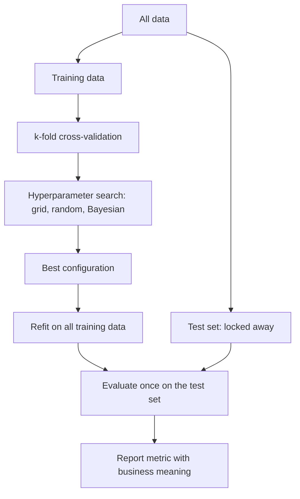
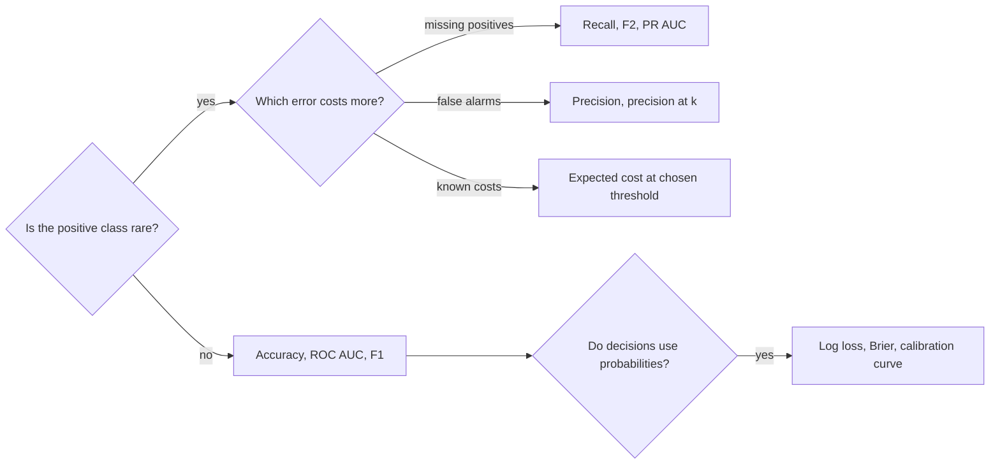
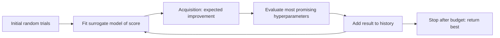
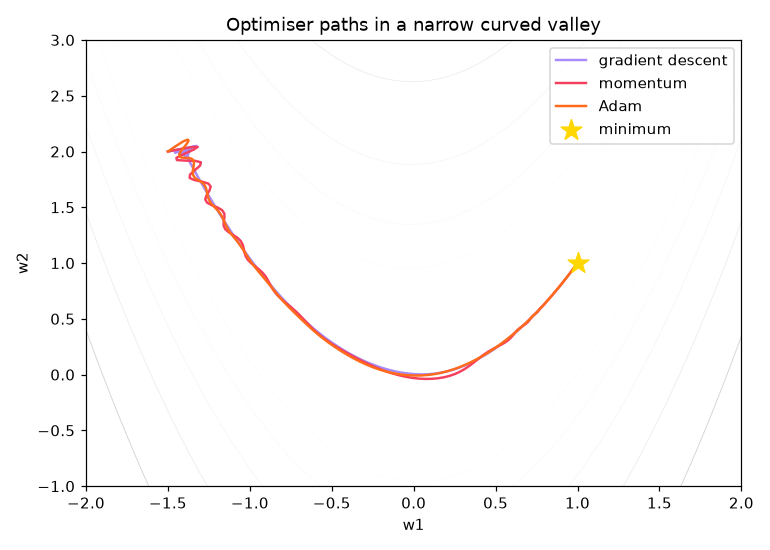
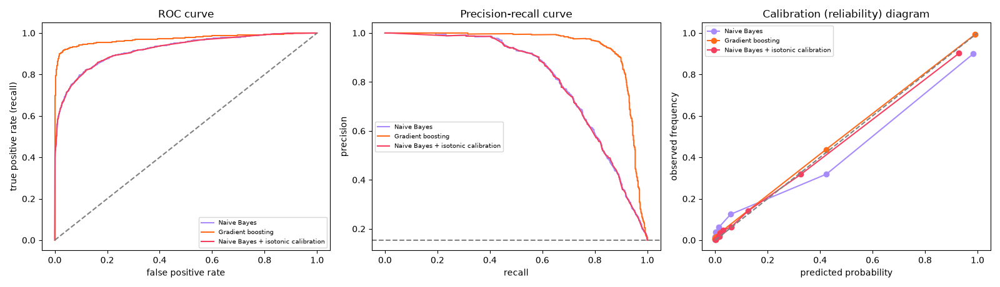

# Session 14 · Model Performance Evaluation

[](https://colab.research.google.com/github/Hamnakhan123/Diploma-in-Data-Science/blob/main/term-2/03-advanced-data-science-with-python/code/session-14-model-performance-evaluation.ipynb)

> 📍 [Diploma in Data Science](../../README.md) › [Term 2](../README.md) › [Advanced Data Science with Python](README.md) › **Session 14**

| ⏱ Estimated time | 🧩 Prerequisites | 💻 Tools |
|---|---|---|
| 3 hours | Sessions 2–4 (models, cross-validation, tuning), Session 12 (training loops) | Python 3.10+, scikit-learn, NumPy, pandas, Matplotlib, SciPy |

[⬅ Previous: Session 13 · Advanced Deep Learning Techniques](session-13-advanced-deep-learning.md) · [🏠 Module home](README.md) · [Next: Session 15 · Model Interpretability and Interoperability ➡](session-15-model-interpretability.md)

---

## 🎯 Learning objectives

- Describe **optimisation in machine learning**: loss functions, gradient descent variants (batch, stochastic, mini-batch, momentum, Adam) and learning-rate schedules.
- Explain and implement **hyperparameter optimisation**: grid search, random search, successive halving and **Bayesian optimisation**, with proper cross-validation.
- Describe and compute **model evaluation metrics** for classification (confusion matrix, accuracy, precision, recall, F1, ROC AUC, PR AUC, log loss, calibration) and regression (MAE, RMSE, R², MAPE).
- Choose metrics and validation schemes (stratified, grouped, time-series CV) that match the business problem, including **imbalanced** data.

## 📖 Concepts

### 1. Optimisation: two kinds

"Optimisation" means two different things in ML, like tuning a car: adjusting the **engine internals** while driving (model parameters) and choosing the **car settings** before the trip (hyperparameters).

| | Parameter optimisation | Hyperparameter optimisation |
|---|---|---|
| What | weights, coefficients, split thresholds | learning rate, depth, C, k, number of trees |
| How | minimise a **loss** on training data (gradient descent, closed form, greedy splits) | search for the setting with the best **validation** score |
| Done by | `fit()` | `GridSearchCV`, `RandomizedSearchCV`, Bayesian optimisation |

**Loss functions** (what the model minimises):

| Task | Loss | Notes |
|---|---|---|
| Regression | MSE, MAE, **Huber** | Huber = MSE near zero, MAE for big errors (robust to outliers) |
| Binary classification | **log loss** (binary cross-entropy), hinge (SVM) | log loss rewards good probabilities |
| Multi-class | categorical cross-entropy | with softmax outputs |
| Ranking/quantiles | pairwise loss, **quantile (pinball) loss** | e.g. predict the 90th-percentile delivery time |

**Gradient descent variants** (the hiker from Session 2, with different walking styles):

| Variant | Idea |
|---|---|
| Batch GD | gradient on all data per step: accurate, slow |
| Stochastic GD (SGD) | one example per step: noisy, fast, can escape shallow dips |
| Mini-batch GD | 32–256 examples: the standard compromise |
| **Momentum** | keep a running velocity, like a ball rolling downhill: faster through ravines, damps zig-zags |
| RMSProp / **Adam** | per-parameter adaptive step sizes; Adam = momentum + RMSProp, the default for deep learning |

**Learning-rate schedules**: start larger to move fast, shrink later to settle: step decay, exponential decay, cosine annealing, warm-up then decay, `ReduceLROnPlateau` (cut the rate when validation loss stalls).

**Regularisation** is part of optimisation too: the objective becomes `loss + penalty` (L1, L2), and **early stopping** halts optimisation before overfitting.

### 2. Hyperparameter optimisation

| Method | How it chooses the next trial | Pros | Cons |
|---|---|---|---|
| Manual | intuition | quick for experts | not reproducible |
| **Grid search** | every combination | exhaustive, simple | explodes with many hyperparameters |
| **Random search** | random samples from distributions | far more efficient when only a few hyperparameters matter | no learning from past trials |
| Successive halving / Hyperband | many configs on small budgets, keep the best | cheap screening | needs a "budget" (data size, epochs) |
| **Bayesian optimisation** | fits a **surrogate model** (e.g. Gaussian process) of score vs hyperparameters, then picks the point with the best **acquisition** value (expected improvement), balancing exploring uncertain regions and exploiting good ones | fewest expensive trials | sequential, more complex (Optuna, scikit-optimize) |

Bayesian optimisation is like an experienced cook adjusting salt: after each tasting she updates her belief about the best amount and chooses the next tasting where improvement is most likely, rather than trying every amount.

**Rules for honest tuning**

1. Keep a **test set** that tuning never sees.
2. Tune with **cross-validation** on the training data.
3. Search on **log scales** for rates and strengths.
4. Use **nested CV** to report the performance of the whole tuning procedure.
5. Put preprocessing inside the `Pipeline` so each fold is leak-free.

### 3. Classification metrics

Start from the **confusion matrix** (positive = the class you care about, e.g. "fraud"):

| | Predicted positive | Predicted negative |
|---|---|---|
| **Actually positive** | TP (caught) | FN (missed) |
| **Actually negative** | FP (false alarm) | TN |

| Metric | Formula | Question it answers | Use when |
|---|---|---|---|
| Accuracy | (TP + TN) / all | how often is it right? | classes balanced, errors cost the same |
| **Precision** | TP / (TP + FP) | when it says positive, how often is it right? | false alarms are expensive (spam filter deleting real mail) |
| **Recall** (sensitivity, TPR) | TP / (TP + FN) | of all real positives, how many did it catch? | misses are expensive (cancer screening, fraud) |
| Specificity (TNR) | TN / (TN + FP) | of all real negatives, how many were cleared? | medical tests |
| **F1** | 2·P·R / (P + R) | balance of precision and recall | imbalanced data, one number |
| F-beta | weights recall β times as much as precision | | F2 for recall-heavy problems |
| **ROC AUC** | area under TPR vs FPR curve over all thresholds | probability that a random positive is ranked above a random negative | ranking quality, roughly balanced data |
| **PR AUC** (average precision) | area under precision–recall curve | ranking quality focused on the rare class | heavily imbalanced data |
| Log loss | −mean[y log p + (1 − y) log(1 − p)] | are the probabilities good? | probabilities drive decisions |
| Brier score | mean (p − y)² | probability accuracy | calibration checks |
| Matthews correlation (MCC) | correlation between predicted and true labels | one balanced number even with imbalance | |

**The accuracy trap**: with 1% fraud, a model that always says "not fraud" is 99% accurate and completely useless. Use recall, precision, PR AUC or cost-based metrics.

**Calibration**: a model is calibrated if, among cases given probability 0.7, about 70% are positive. Check with a **reliability diagram**; fix with `CalibratedClassifierCV` (sigmoid/Platt or isotonic).

**Thresholds**: most classifiers output probabilities; the threshold turns them into decisions. Choose it from the business cost (Session 2) or a target recall/precision.

### 4. Regression metrics (recap) and others

| Metric | Use |
|---|---|
| MAE | typical error in units; robust |
| RMSE | punishes large errors |
| R² | variance explained vs predicting the mean |
| MAPE / sMAPE | percentage errors; avoid near zero |
| Pinball loss | quantile forecasts |
| Clustering: silhouette, ARI | Session 7 |
| Ranking: precision@k, NDCG | recommender systems |

### 5. Validation schemes

| Scheme | When |
|---|---|
| Hold-out (train/validation/test) | large data |
| **k-fold CV** | default for small/medium data |
| **Stratified k-fold** | classification, keeps class balance in each fold |
| **Group k-fold** | several rows per customer/patient: keep each group in one fold to avoid leakage |
| **Time-series split** | dated data: always train on the past (Session 5) |
| Repeated CV | smaller variance of the estimate |

## 🧭 Diagrams







## 💻 Worked examples

### Example 1 · Basic: optimisers on a difficult loss surface

📄 [`code/session-14_optimisers.py`](code/session-14_optimisers.py)

```python
"""Compare gradient descent, momentum and Adam on an elongated valley (Rosenbrock-like) loss surface."""
import numpy as np
import matplotlib.pyplot as plt

def loss(w):            # a long, narrow, curved valley; minimum at (1, 1)
    x, y = w
    return (1 - x) ** 2 + 20 * (y - x ** 2) ** 2
def grad(w):
    x, y = w
    return np.array([-2 * (1 - x) - 80 * x * (y - x ** 2), 40 * (y - x ** 2)])

def run(method, lr, steps=600):
    w = np.array([-1.5, 2.0]); v = np.zeros(2); m = np.zeros(2); s = np.zeros(2); path = [w.copy()]
    for t in range(1, steps + 1):
        g = grad(w)
        if method == "gradient descent":
            w = w - lr * g
        elif method == "momentum":
            v = 0.9 * v + g; w = w - lr * v
        elif method == "Adam":
            m = 0.9 * m + 0.1 * g; s = 0.999 * s + 0.001 * g ** 2
            mh, sh = m / (1 - 0.9 ** t), s / (1 - 0.999 ** t)
            w = w - lr * mh / (np.sqrt(sh) + 1e-8)
        path.append(w.copy())
    return np.array(path)

configs = [("gradient descent", 0.005), ("momentum", 0.002), ("Adam", 0.05)]
xx, yy = np.meshgrid(np.linspace(-2, 2, 200), np.linspace(-1, 3, 200))
plt.figure(figsize=(7, 5))
plt.contour(xx, yy, (1 - xx) ** 2 + 20 * (yy - xx ** 2) ** 2, levels=np.logspace(-1, 3, 15), cmap="Greys", linewidths=.6)
for (name, lr), c in zip(configs, ["#A78BFA", "#F43F5E", "#FF6B1A"]):
    p = run(name, lr)
    print(f"{name:<17} lr={lr:<6} final point ({p[-1, 0]:.3f}, {p[-1, 1]:.3f})  loss {loss(p[-1]):.5f}  "
          f"steps to loss<0.01: {next((i for i, w in enumerate(p) if loss(w) < .01), 'not reached')}")
    plt.plot(p[:, 0], p[:, 1], color=c, lw=1.6, label=name)
plt.scatter([1], [1], marker="*", s=200, color="gold", zorder=5, label="minimum")
plt.legend(); plt.title("Optimiser paths in a narrow curved valley"); plt.xlabel("w1"); plt.ylabel("w2")
plt.tight_layout(); plt.savefig("session-14_optimisers.png", dpi=110); plt.show()
```

**Output**

```text
gradient descent  lr=0.005  final point (0.781, 0.604)  loss 0.04867  steps to loss<0.01: not reached
momentum          lr=0.002  final point (0.997, 0.995)  loss 0.00001  steps to loss<0.01: 200
Adam              lr=0.05   final point (1.000, 0.999)  loss 0.00000  steps to loss<0.01: 265
```

**Chart produced by this code** (saved as [`code/session-14_optimisers.png`](code/session-14_optimisers.png)):



### Example 2 · Intermediate: Bayesian optimisation from scratch vs random search

📄 [`code/session-14_bayes_opt.py`](code/session-14_bayes_opt.py)

```python
"""Bayesian optimisation with a Gaussian-process surrogate and expected improvement, vs random search, tuning an SVM."""
import numpy as np
from scipy.stats import norm
from sklearn.datasets import load_breast_cancer
from sklearn.model_selection import cross_val_score, StratifiedKFold
from sklearn.pipeline import make_pipeline
from sklearn.preprocessing import StandardScaler
from sklearn.svm import SVC
from sklearn.gaussian_process import GaussianProcessRegressor
from sklearn.gaussian_process.kernels import Matern, WhiteKernel

X, y = load_breast_cancer(return_X_y=True)
cv = StratifiedKFold(5, shuffle=True, random_state=0)
def score(log_c, log_g):                       # the expensive black box we want to maximise
    model = make_pipeline(StandardScaler(), SVC(C=10 ** log_c, gamma=10 ** log_g))
    return cross_val_score(model, X, y, cv=cv).mean()
bounds = np.array([[-2, 3], [-5, 0]])          # log10 C, log10 gamma
rng = np.random.default_rng(0)
BUDGET = 15

# Random search
rand_pts = rng.uniform(bounds[:, 0], bounds[:, 1], (BUDGET, 2))
rand_scores = [score(*p) for p in rand_pts]

# Bayesian optimisation
pts = list(rng.uniform(bounds[:, 0], bounds[:, 1], (4, 2)))   # 4 random starting points
scores = [score(*p) for p in pts]
gp = GaussianProcessRegressor(Matern(nu=2.5) + WhiteKernel(1e-4), normalize_y=True, random_state=0)
while len(pts) < BUDGET:
    gp.fit(np.array(pts), np.array(scores))
    cand = rng.uniform(bounds[:, 0], bounds[:, 1], (2000, 2))
    mu, sd = gp.predict(cand, return_std=True)
    best = max(scores)
    z = (mu - best) / np.maximum(sd, 1e-9)
    ei = (mu - best) * norm.cdf(z) + sd * norm.pdf(z)          # expected improvement
    nxt = cand[np.argmax(ei)]
    pts.append(nxt); scores.append(score(*nxt))
    print(f"trial {len(pts):>2}: log10 C = {nxt[0]:5.2f}, log10 gamma = {nxt[1]:5.2f} -> CV accuracy {scores[-1]:.4f}")

print(f"\nbest after {BUDGET} trials | random search: {max(rand_scores):.4f} | Bayesian optimisation: {max(scores):.4f}")
print("best-so-far curve (random):  ", np.round(np.maximum.accumulate(rand_scores)[[3, 7, 11, 14]], 4))
print("best-so-far curve (Bayesian):", np.round(np.maximum.accumulate(scores)[[3, 7, 11, 14]], 4))
```

**Output**

```text
trial  5: log10 C =  1.42, log10 gamma = -3.16 -> CV accuracy 0.9736
trial  6: log10 C =  1.75, log10 gamma = -2.76 -> CV accuracy 0.9789
trial  7: log10 C =  1.37, log10 gamma = -2.60 -> CV accuracy 0.9824
trial  8: log10 C = -1.98, log10 gamma = -4.95 -> CV accuracy 0.6274
trial  9: log10 C = -1.93, log10 gamma = -0.01 -> CV accuracy 0.6274
trial 10: log10 C = -0.34, log10 gamma = -2.01 -> CV accuracy 0.9613
trial 11: log10 C =  2.94, log10 gamma = -0.32 -> CV accuracy 0.8418
trial 12: log10 C =  2.97, log10 gamma = -4.85 -> CV accuracy 0.9719
trial 13: log10 C =  2.99, log10 gamma = -3.56 -> CV accuracy 0.9807
trial 14: log10 C =  2.00, log10 gamma = -4.98 -> CV accuracy 0.9455
trial 15: log10 C =  2.70, log10 gamma = -4.06 -> CV accuracy 0.9772

best after 15 trials | random search: 0.9772 | Bayesian optimisation: 0.9824
best-so-far curve (random):   [0.9719 0.9719 0.9772 0.9772]
best-so-far curve (Bayesian): [0.9772 0.9824 0.9824 0.9824]
```

### Example 3 · Intermediate: every classification metric on an imbalanced problem

📄 [`code/session-14_metrics_imbalanced.py`](code/session-14_metrics_imbalanced.py)

```python
"""Accuracy trap, confusion matrix, precision/recall/F1, ROC AUC vs PR AUC, log loss and MCC on 3% fraud."""
import numpy as np
from sklearn.datasets import make_classification
from sklearn.model_selection import train_test_split
from sklearn.dummy import DummyClassifier
from sklearn.linear_model import LogisticRegression
from sklearn.ensemble import HistGradientBoostingClassifier
from sklearn.metrics import (accuracy_score, precision_score, recall_score, f1_score, roc_auc_score,
                             average_precision_score, log_loss, matthews_corrcoef, confusion_matrix)

X, y = make_classification(n_samples=20000, n_features=12, n_informative=6, weights=[.97], flip_y=.01, random_state=4)
X_tr, X_te, y_tr, y_te = train_test_split(X, y, test_size=.3, stratify=y, random_state=0)
print(f"fraud rate in test set: {y_te.mean():.3%}")

models = {"always 'not fraud'": DummyClassifier(strategy="most_frequent"),
          "logistic regression": LogisticRegression(max_iter=1000),
          "gradient boosting": HistGradientBoostingClassifier(random_state=0)}
print(f"\n{'model':<21}{'acc':>6}{'prec':>6}{'rec':>6}{'F1':>6}{'ROC':>6}{'PR AUC':>8}{'logloss':>8}{'MCC':>6}")
for name, m in models.items():
    m.fit(X_tr, y_tr)
    p = m.predict_proba(X_te)[:, 1]; pred = (p >= .5).astype(int)
    print(f"{name:<21}{accuracy_score(y_te, pred):>6.3f}{precision_score(y_te, pred, zero_division=0):>6.2f}"
          f"{recall_score(y_te, pred):>6.2f}{f1_score(y_te, pred):>6.2f}{roc_auc_score(y_te, p):>6.2f}"
          f"{average_precision_score(y_te, p):>8.2f}{log_loss(y_te, p):>8.3f}{matthews_corrcoef(y_te, pred):>6.2f}")

gb = models["gradient boosting"]; p = gb.predict_proba(X_te)[:, 1]
tn, fp, fn, tp = confusion_matrix(y_te, p >= .5).ravel()
print(f"\nconfusion matrix at 0.5 -> TP {tp}, FN {fn}, FP {fp}, TN {tn}")
for t in [.5, .3, .1]:
    pred = p >= t
    print(f"threshold {t:<4}: precision {precision_score(y_te, pred):.2f}  recall {recall_score(y_te, pred):.2f}  F1 {f1_score(y_te, pred):.2f}")
```

**Output**

```text
fraud rate in test set: 3.600%

model                   acc  prec   rec    F1   ROC  PR AUC logloss   MCC
always 'not fraud'    0.964  0.00  0.00  0.00  0.50    0.04   1.298  0.00
logistic regression   0.974  0.96  0.30  0.46  0.78    0.51   0.115  0.53
gradient boosting     0.982  0.91  0.54  0.68  0.89    0.71   0.074  0.70

confusion matrix at 0.5 -> TP 117, FN 99, FP 11, TN 5773
threshold 0.5 : precision 0.91  recall 0.54  F1 0.68
threshold 0.3 : precision 0.85  recall 0.60  F1 0.70
threshold 0.1 : precision 0.65  recall 0.68  F1 0.66
```

The dummy model scores **96.4% accuracy** while catching zero fraud: the accuracy trap. Logistic regression looks good on accuracy (97.4%) yet catches only 30% of frauds. Gradient boosting's ROC AUC of 0.89 sounds excellent, but its **PR AUC** of 0.71 gives a more sober picture of how well the rare class is found, and lowering the threshold trades precision for recall exactly as expected.

### Example 4 · Advanced: ROC, precision–recall and calibration curves

📄 [`code/session-14_curves.py`](code/session-14_curves.py)

```python
"""Plot ROC and precision-recall curves, and a calibration (reliability) diagram before and after calibration."""
import numpy as np
import matplotlib.pyplot as plt
from sklearn.datasets import make_classification
from sklearn.model_selection import train_test_split
from sklearn.naive_bayes import GaussianNB
from sklearn.ensemble import HistGradientBoostingClassifier
from sklearn.calibration import CalibratedClassifierCV, calibration_curve
from sklearn.metrics import roc_curve, precision_recall_curve, roc_auc_score, average_precision_score, brier_score_loss

X, y = make_classification(n_samples=12000, n_features=15, n_informative=6, n_redundant=6, weights=[.85], random_state=1)
X_tr, X_te, y_tr, y_te = train_test_split(X, y, test_size=.4, stratify=y, random_state=0)
models = {"Naive Bayes": GaussianNB(), "Gradient boosting": HistGradientBoostingClassifier(random_state=0),
          "Naive Bayes + isotonic calibration": CalibratedClassifierCV(GaussianNB(), method="isotonic", cv=5)}
fig, ax = plt.subplots(1, 3, figsize=(16, 4.6))
for (name, m), c in zip(models.items(), ["#A78BFA", "#FF6B1A", "#F43F5E"]):
    p = m.fit(X_tr, y_tr).predict_proba(X_te)[:, 1]
    fpr, tpr, _ = roc_curve(y_te, p); prec, rec, _ = precision_recall_curve(y_te, p)
    frac, mean_p = calibration_curve(y_te, p, n_bins=10, strategy="quantile")
    print(f"{name:<36} ROC AUC {roc_auc_score(y_te, p):.3f}  PR AUC {average_precision_score(y_te, p):.3f}  Brier {brier_score_loss(y_te, p):.4f}")
    ax[0].plot(fpr, tpr, color=c, label=name); ax[1].plot(rec, prec, color=c, label=name)
    ax[2].plot(mean_p, frac, "o-", color=c, label=name)
ax[0].plot([0, 1], [0, 1], "--", color="grey"); ax[0].set_title("ROC curve"); ax[0].set_xlabel("false positive rate"); ax[0].set_ylabel("true positive rate (recall)")
ax[1].axhline(y_te.mean(), ls="--", color="grey"); ax[1].set_title("Precision-recall curve"); ax[1].set_xlabel("recall"); ax[1].set_ylabel("precision")
ax[2].plot([0, 1], [0, 1], "--", color="grey"); ax[2].set_title("Calibration (reliability) diagram"); ax[2].set_xlabel("predicted probability"); ax[2].set_ylabel("observed frequency")
for a in ax: a.legend(fontsize=7)
fig.tight_layout(); fig.savefig("session-14_evaluation_curves.png", dpi=100); plt.show()
```

**Output**

```text
Naive Bayes                          ROC AUC 0.923  PR AUC 0.811  Brier 0.0639
Gradient boosting                    ROC AUC 0.972  PR AUC 0.942  Brier 0.0251
Naive Bayes + isotonic calibration   ROC AUC 0.922  PR AUC 0.804  Brier 0.0589
```

**Chart produced by this code** (saved as [`code/session-14_evaluation_curves.png`](code/session-14_evaluation_curves.png)):



Naive Bayes ranks reasonably (ROC AUC 0.92), but its independence assumption pushes probabilities towards 0 and 1, so its curve bends away from the diagonal in the reliability diagram. Isotonic calibration keeps the ranking almost unchanged and moves the curve towards the diagonal, improving the Brier score; gradient boosting is both the best ranker and the best calibrated here. Always look at the diagram, not only a single number.

### Example 5 · Advanced: the right cross-validation scheme (group leakage)

📄 [`code/session-14_group_cv.py`](code/session-14_group_cv.py)

```python
"""Leakage demo: several rows per patient. Plain KFold over-estimates accuracy; GroupKFold gives the honest number."""
import numpy as np
from sklearn.model_selection import KFold, GroupKFold, cross_val_score
from sklearn.ensemble import RandomForestClassifier

rng = np.random.default_rng(0)
patients, visits = 200, 6
pid = np.repeat(np.arange(patients), visits)
signature = rng.normal(0, 1, (patients, 8))[pid]                 # each patient has a personal 'fingerprint'
X = signature + rng.normal(0, .3, (len(pid), 8))
risk = rng.random(patients) < .5
y = risk[pid].astype(int)
X[:, 0] += 0.4 * y + rng.normal(0, 1, len(y))                    # only a weak real signal

rf = RandomForestClassifier(200, random_state=0, n_jobs=-1)
plain = cross_val_score(rf, X, y, cv=KFold(5, shuffle=True, random_state=0)).mean()
grouped = cross_val_score(rf, X, y, cv=GroupKFold(5), groups=pid).mean()
print(f"KFold (visits of the same patient in train and test): {plain:.3f}  <- optimistic, memorises patients")
print(f"GroupKFold (each patient only in one fold)          : {grouped:.3f}  <- what you get for NEW patients")
```

**Output**

```text
KFold (visits of the same patient in train and test): 0.806  <- optimistic, memorises patients
GroupKFold (each patient only in one fold)          : 0.472  <- what you get for NEW patients
```

## 🏙️ Real-life data problem: a hospital readmission model that the ward can trust

**Problem.** A hospital wants to predict which discharged patients will be **readmitted within 30 days** (about 17% are), so nurses can phone high-risk patients. Nurses can make 100 calls per 1,000 discharges. Management asks: which model, tuned how, evaluated with which metric, with what threshold, and are the probabilities trustworthy enough to show on screen?

**Full solution.** Locked test set → tune two models with randomised search on PR AUC (rare class) inside stratified CV → evaluate on the test set with PR AUC, recall at the call budget (top 10%) and calibration → calibrate → set the operating threshold from the call capacity.

📄 [`code/session-14_readmission_problem.py`](code/session-14_readmission_problem.py)

```python
"""Real-life problem: readmission risk model tuned on PR AUC, judged by recall@capacity and calibration."""
import numpy as np
import pandas as pd
from scipy.stats import loguniform, randint
from sklearn.model_selection import train_test_split, RandomizedSearchCV, StratifiedKFold
from sklearn.pipeline import make_pipeline
from sklearn.preprocessing import StandardScaler
from sklearn.linear_model import LogisticRegression
from sklearn.ensemble import HistGradientBoostingClassifier
from sklearn.calibration import CalibratedClassifierCV
from sklearn.metrics import average_precision_score, roc_auc_score, brier_score_loss

rng = np.random.default_rng(30)
n = 8000
df = pd.DataFrame({"age": rng.integers(18, 95, n), "length_of_stay": rng.gamma(2, 2.5, n).round(),
                   "prior_admissions": rng.poisson(.8, n), "num_medications": rng.poisson(6, n),
                   "chronic_conditions": rng.poisson(1.5, n), "lives_alone": rng.random(n) < .25,
                   "follow_up_booked": rng.random(n) < .6, "abnormal_labs": rng.poisson(1, n)})
z = (-3.4 + .02 * (df.age - 50) + .08 * df.length_of_stay + .55 * df.prior_admissions + .05 * df.num_medications
     + .25 * df.chronic_conditions + .5 * df.lives_alone - .7 * df.follow_up_booked + .2 * df.abnormal_labs
     + .4 * (df.prior_admissions >= 2) * df.lives_alone)
df["readmitted"] = (rng.random(n) < 1 / (1 + np.exp(-z))).astype(int)
X, y = df.drop(columns="readmitted").astype(float), df["readmitted"]
X_tr, X_te, y_tr, y_te = train_test_split(X, y, test_size=.25, stratify=y, random_state=0)
print(f"readmission rate: {y.mean():.1%} | train {len(X_tr)} | locked test {len(X_te)}")

cv = StratifiedKFold(5, shuffle=True, random_state=0)
searches = {
    "logistic regression": RandomizedSearchCV(make_pipeline(StandardScaler(), LogisticRegression(max_iter=2000)),
        {"logisticregression__C": loguniform(1e-3, 1e2)}, n_iter=12, cv=cv, scoring="average_precision", random_state=0),
    "gradient boosting": RandomizedSearchCV(HistGradientBoostingClassifier(random_state=0),
        {"learning_rate": loguniform(.02, .3), "max_depth": [2, 3, 4, None], "max_iter": randint(100, 500),
         "l2_regularization": loguniform(1e-3, 10)}, n_iter=12, cv=cv, scoring="average_precision", random_state=0),
}
CAP = 0.10
def recall_at_capacity(y_true, p, cap=CAP):
    top = np.argsort(-p)[: int(len(p) * cap)]
    return y_true.values[top].sum() / y_true.sum()

print(f"\n{'model':<22}{'CV PR AUC':>10}{'test PR AUC':>12}{'ROC AUC':>9}{'recall@top10%':>15}{'Brier':>8}")
for name, s in searches.items():
    s.fit(X_tr, y_tr); p = s.predict_proba(X_te)[:, 1]
    print(f"{name:<22}{s.best_score_:>10.3f}{average_precision_score(y_te, p):>12.3f}{roc_auc_score(y_te, p):>9.3f}"
          f"{recall_at_capacity(y_te, p):>15.1%}{brier_score_loss(y_te, p):>8.4f}")

best = max(searches, key=lambda k: searches[k].best_score_)
cal = CalibratedClassifierCV(searches[best].best_estimator_, method="isotonic", cv=5).fit(X_tr, y_tr)
p = cal.predict_proba(X_te)[:, 1]
threshold = np.quantile(p, 1 - CAP)
print(f"\nchosen model: {best} (+ isotonic calibration) | Brier {brier_score_loss(y_te, p):.4f}")
print(f"operating threshold for 100 calls per 1,000 discharges: risk >= {threshold:.2f}")
flagged = p >= threshold
print(f"patients flagged: {flagged.mean():.1%} | precision among calls: {y_te[flagged].mean():.1%} "
      f"(base rate {y_te.mean():.1%}) | readmissions caught: {y_te[flagged].sum() / y_te.sum():.1%}")
bins = pd.cut(p, [0, .05, .1, .2, .3, 1])
print("\ncalibration check on the test set (predicted vs observed):")
print(pd.DataFrame({"predicted": p, "observed": y_te.values}).groupby(bins, observed=True).mean().round(3).to_string())
```

**Output**

```text
readmission rate: 17.2% | train 6000 | locked test 2000

model                  CV PR AUC test PR AUC  ROC AUC  recall@top10%   Brier
logistic regression        0.394       0.406    0.738          26.2%  0.1251
gradient boosting          0.381       0.372    0.718          23.8%  0.1287

chosen model: logistic regression (+ isotonic calibration) | Brier 0.1258
operating threshold for 100 calls per 1,000 discharges: risk >= 0.34
patients flagged: 10.2% | precision among calls: 44.4% (base rate 17.2%) | readmissions caught: 26.5%

calibration check on the test set (predicted vs observed):
             predicted  observed
(0.0, 0.05]      0.035     0.025
(0.05, 0.1]      0.081     0.087
(0.1, 0.2]       0.151     0.167
(0.2, 0.3]       0.253     0.258
(0.3, 1.0]       0.463     0.419
```

**Answer.** Both models are tuned on **PR AUC** and judged on **recall at the nurses' capacity**. Here the simpler logistic regression wins (higher CV and test PR AUC), so it is chosen: easier to explain to clinicians, too. Calling the top 10% of patients by risk, 44% of those called are real future readmissions, about 2.6 times the 17% base rate, and these calls reach about a quarter of all readmissions. After isotonic calibration, predicted risks match observed rates closely in every band (e.g. 25% predicted vs 26% observed), so the risk can be shown on screen ("this patient has a 35% risk"). The operating threshold (risk ≥ 0.34) comes from the call budget, not the default 0.5. To catch more readmissions the hospital would need more nurse capacity or better features (e.g. medication adherence, social support).

## ⚠️ Common mistakes

| Mistake | Fix |
|---|---|
| Reporting accuracy on imbalanced data | precision, recall, F1, PR AUC, cost |
| Tuning on the test set | nested CV or a locked test set |
| Default 0.5 threshold for every problem | pick thresholds from costs or capacity |
| Plain KFold with repeated rows per person | GroupKFold |
| Showing raw probabilities from uncalibrated models | check reliability diagram; `CalibratedClassifierCV` |
| Huge grid searches over many hyperparameters | random search or Bayesian optimisation on log scales |

## ✅ Best practices

- Agree the **metric with stakeholders before modelling**, in business language.
- Use **stratified** (classification), **grouped** (entities) or **time-series** CV as the data demands.
- Report a **baseline**, the CV mean ± standard deviation, and one final test-set result.
- For deep learning use Adam with a schedule (warm-up, cosine or plateau) and early stopping.
- Save the search results (`cv_results_`) to see which hyperparameters actually matter.

## 🧪 Lab / practice tasks

### 🟢 Task 1 · Easy

A model screens 1,000 people; 50 have a disease. It flags 80 people, 40 of whom are sick. Compute accuracy, precision, recall, specificity and F1.

<details><summary>💡 Hint</summary>

TP = 40, FP = 40, FN = 10, TN = 910.

</details>

<details><summary>✅ Solution</summary>

Accuracy = 950/1000 = 0.95; precision = 40/80 = 0.50; recall = 40/50 = 0.80; specificity = 910/950 = 0.958; F1 = 2·0.5·0.8/1.3 = 0.615.

</details>


### 🟡 Task 2 · Medium

In Example 1 try learning rates 0.001, 0.005 and 0.01 for plain gradient descent and 0.01, 0.05, 0.2 for Adam. Which settings diverge or stall?

<details><summary>💡 Hint</summary>

Track the loss after 600 steps; values that explode to `nan` diverged.

</details>

<details><summary>✅ Solution</summary>

Plain gradient descent at 0.001 is far too slow (still far from the minimum after 600 steps), and as the learning rate grows it starts bouncing between the steep valley walls and can blow up. Adam is much less sensitive: 0.01–0.05 converge, 0.2 oscillates but stays bounded. This robustness is why Adam is the deep-learning default.

</details>


### 🟡 Task 3 · Medium

Replace the Gaussian-process loop in Example 2 with `HalvingRandomSearchCV` using the same budget idea. Compare the best score and run time.

<details><summary>💡 Hint</summary>

`from sklearn.experimental import enable_halving_search_cv` first.

</details>

<details><summary>✅ Solution</summary>

Halving evaluates many configurations on small subsets and promotes the best, so it is fast and usually reaches a similar best score (≈ 0.98) on this data set. Bayesian optimisation shines more when each evaluation is very expensive (deep networks).

</details>


### 🟠 Task 4 · Hard

In Example 3 compute the threshold that maximises F2 (recall weighted twice) for gradient boosting, and the resulting confusion matrix.

<details><summary>💡 Hint</summary>

Use `precision_recall_curve`, compute `F2 = 5PR / (4P + R)` for each threshold.

</details>

<details><summary>✅ Solution</summary>

```python
from sklearn.metrics import precision_recall_curve
prec, rec, thr = precision_recall_curve(y_te, p)
f2 = 5 * prec * rec / (4 * prec + rec + 1e-9)
t = thr[np.argmax(f2[:-1])]; print(t, confusion_matrix(y_te, p >= t))
```
The F2-optimal threshold is well below 0.5, catching many more frauds at the cost of more false alarms.

</details>


### 🔴 Task 5 · Challenge

For the readmission problem, compute a 95% **bootstrap confidence interval** for test PR AUC and recall@10% (1,000 resamples of the test set). Is the difference between the two models significant?

<details><summary>💡 Hint</summary>

Resample indices with replacement, recompute metrics for both models on the same resample, and look at the distribution of the difference.

</details>

<details><summary>✅ Solution</summary>

```python
diffs = []
for b in range(1000):
    i = rng.integers(0, len(y_te), len(y_te))
    diffs.append(average_precision_score(y_te.iloc[i], p_gb[i]) - average_precision_score(y_te.iloc[i], p_lr[i]))
print(np.percentile(diffs, [2.5, 97.5]))
```
If the interval contains 0 the models are statistically tied; prefer the simpler, more explainable one.

</details>


## 🧩 Mini project: a reusable model evaluation report

📄 [`code/session-14_mini_project.py`](code/session-14_mini_project.py)

```python
"""Mini project: a function that produces a complete evaluation report for any fitted binary classifier."""
import numpy as np
from sklearn.datasets import load_breast_cancer
from sklearn.model_selection import train_test_split
from sklearn.pipeline import make_pipeline
from sklearn.preprocessing import StandardScaler
from sklearn.linear_model import LogisticRegression
from sklearn.ensemble import RandomForestClassifier
from sklearn.metrics import (confusion_matrix, precision_score, recall_score, f1_score, roc_auc_score,
                             average_precision_score, brier_score_loss, log_loss)

def evaluation_report(name, model, X_te, y_te, threshold=0.5, positive="malignant"):
    p = model.predict_proba(X_te)[:, 1]; pred = (p >= threshold).astype(int)
    tn, fp, fn, tp = confusion_matrix(y_te, pred).ravel()
    lines = [f"=== {name} (threshold {threshold}) ===",
             f"confusion matrix: TP={tp} FP={fp} FN={fn} TN={tn}",
             f"precision {precision_score(y_te, pred):.3f} | recall {recall_score(y_te, pred):.3f} | F1 {f1_score(y_te, pred):.3f}",
             f"ROC AUC {roc_auc_score(y_te, p):.3f} | PR AUC {average_precision_score(y_te, p):.3f}",
             f"log loss {log_loss(y_te, p):.3f} | Brier {brier_score_loss(y_te, p):.4f}",
             f"plain-language: of {tp + fn} {positive} cases, the model caught {tp} and missed {fn}; it raised {fp} false alarms."]
    return "\n".join(lines)

X, y = load_breast_cancer(return_X_y=True)
y = 1 - y                                         # make 1 = malignant (the class we must not miss)
X_tr, X_te, y_tr, y_te = train_test_split(X, y, test_size=.3, stratify=y, random_state=0)
models = {"logistic regression": make_pipeline(StandardScaler(), LogisticRegression(max_iter=1000)),
          "random forest": RandomForestClassifier(300, random_state=0, n_jobs=-1)}
for name, m in models.items():
    m.fit(X_tr, y_tr)
    print(evaluation_report(name, m, X_te, y_te))
    print(evaluation_report(name, m, X_te, y_te, threshold=0.2).split("\n", 1)[1].split("\n")[-1], "(threshold 0.2)\n")
```

**Output**

```text
=== logistic regression (threshold 0.5) ===
confusion matrix: TP=60 FP=4 FN=4 TN=103
precision 0.938 | recall 0.938 | F1 0.938
ROC AUC 0.992 | PR AUC 0.989
log loss 0.107 | Brier 0.0326
plain-language: of 64 malignant cases, the model caught 60 and missed 4; it raised 4 false alarms.
plain-language: of 64 malignant cases, the model caught 61 and missed 3; it raised 13 false alarms. (threshold 0.2)

=== random forest (threshold 0.5) ===
confusion matrix: TP=60 FP=6 FN=4 TN=101
precision 0.909 | recall 0.938 | F1 0.923
ROC AUC 0.980 | PR AUC 0.980
log loss 0.334 | Brier 0.0414
plain-language: of 64 malignant cases, the model caught 60 and missed 4; it raised 6 false alarms.
plain-language: of 64 malignant cases, the model caught 62 and missed 2; it raised 20 false alarms. (threshold 0.2)
```

## ✅ Quick quiz

**Q1.** Adam combines…

- **A)** L1 and L2 penalties
- **B)** momentum and per-parameter adaptive learning rates
- **C)** bagging and boosting
- **D)** grid and random search

<details><summary>Show answer</summary>

**B** — Adam = momentum + RMSProp-style scaling.

</details>

**Q2.** Bayesian optimisation chooses the next hyperparameters by…

- **A)** trying all combinations
- **B)** maximising an acquisition function on a surrogate model
- **C)** random sampling only
- **D)** the largest learning rate

<details><summary>Show answer</summary>

**B** — It balances exploration and exploitation of the search space.

</details>

**Q3.** With 1% positives, which metric best reflects performance on the rare class?

- **A)** accuracy
- **B)** PR AUC
- **C)** R²
- **D)** MAE

<details><summary>Show answer</summary>

**B** — PR AUC focuses on the positive class.

</details>

**Q4.** Recall is…

- **A)** TP / (TP + FP)
- **B)** TP / (TP + FN)
- **C)** TN / (TN + FP)
- **D)** (TP + TN) / all

<details><summary>Show answer</summary>

**B** — The share of actual positives that were caught.

</details>

**Q5.** Patients have several rows each. Which CV avoids leakage?

- **A)** KFold
- **B)** StratifiedKFold
- **C)** GroupKFold
- **D)** LeaveOneOut on rows

<details><summary>Show answer</summary>

**C** — Each patient's rows stay in one fold.

</details>


## 📝 Summary

- **Optimisation** = learning parameters by minimising a loss (GD, SGD, momentum, Adam, schedules) + choosing hyperparameters on validation data.
- **Hyperparameter optimisation**: grid, random, halving and **Bayesian optimisation**; always cross-validated, test set locked, nested CV for honest estimates.
- **Metrics** must match the problem: precision/recall/F1, ROC vs PR AUC, log loss and **calibration**, regression errors; beware the accuracy trap.
- Use the right **validation scheme** (stratified, grouped, time-series) and choose thresholds from costs or capacity.

### 🎤 Interview / viva questions

1. What is the difference between a parameter and a hyperparameter? Give examples.
2. Explain why Adam often converges faster than plain gradient descent.
3. How does Bayesian optimisation differ from random search?
4. When is ROC AUC misleading, and what would you use instead?
5. What does it mean for a classifier to be well calibrated, and how do you check it?
6. Describe a case where plain k-fold cross-validation leaks information.

---

[⬅ Previous: Session 13 · Advanced Deep Learning Techniques](session-13-advanced-deep-learning.md) · [🏠 Module home](README.md) · [Next: Session 15 · Model Interpretability and Interoperability ➡](session-15-model-interpretability.md)

<sub>Diploma in Data Science · Prepared by **Hamna Zahid Khan**, Junior Lecturer</sub>
