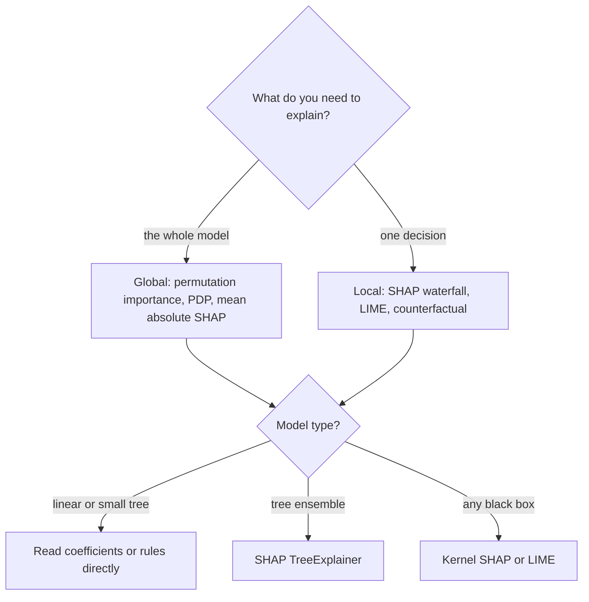
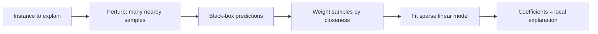
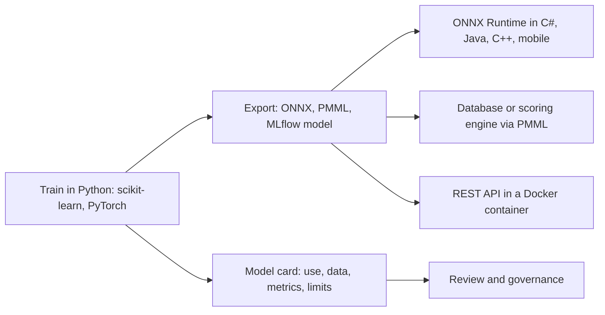
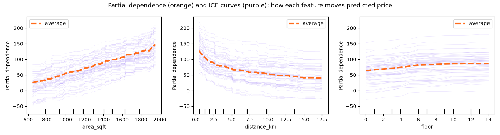
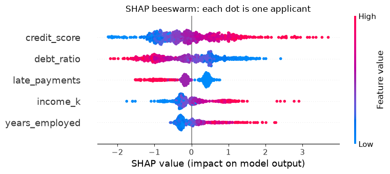
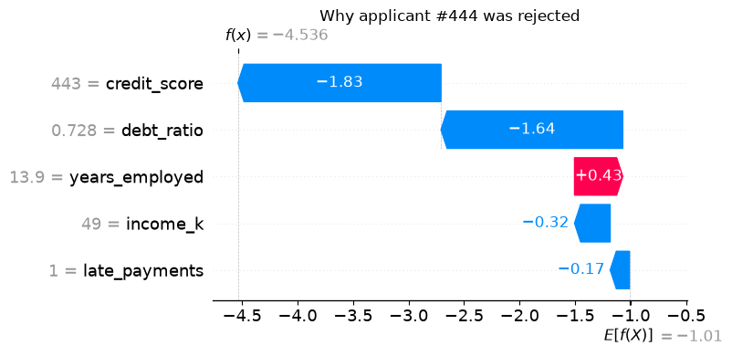

# Session 15 · Model Interpretability and Interoperability

[](https://colab.research.google.com/github/Hamnakhan123/Diploma-in-Data-Science/blob/main/term-2/03-advanced-data-science-with-python/code/session-15-model-interpretability.ipynb)

> 📍 [Diploma in Data Science](../../README.md) › [Term 2](../README.md) › [Advanced Data Science with Python](README.md) › **Session 15**

| ⏱ Estimated time | 🧩 Prerequisites | 💻 Tools |
|---|---|---|
| 3 hours | Sessions 3–4 and 14 (models, metrics), basic probability | Python 3.10+, scikit-learn, SHAP, LIME, skl2onnx + onnxruntime, pandas, Matplotlib |

[⬅ Previous: Session 14 · Model Performance Evaluation](session-14-model-performance-evaluation.md) · [🏠 Module home](README.md) · [Next: Practice test ➡](practice-test.md)

---

## 🎯 Learning objectives

- Explain the **significance of model interpretability**: trust, debugging, fairness, regulation and the accuracy–interpretability trade-off.
- Distinguish **global vs local** and **intrinsic vs post-hoc** explanations, and use permutation importance and partial dependence.
- Explain **SHAP** (SHapley Additive exPlanations) values, compute exact Shapley values by hand, and use the `shap` library.
- Describe the **LIME** (Local Interpretable Model-agnostic Explanations) framework and use it to explain single predictions.
- Identify key **standards and frameworks for interoperability** in ML (ONNX, PMML, pickle/joblib, MLflow, model cards, REST APIs) and export a model to ONNX.

## 📖 Concepts

### 1. Why interpretability matters

A model that says "loan rejected" with no reason is like a doctor who prescribes surgery but refuses to say why. People affected by a decision, the experts using it and the regulators overseeing it all need to understand it.

| Reason | Example |
|---|---|
| **Trust and adoption** | doctors use a risk score only if they see which factors drive it |
| **Debugging** | an image classifier "detecting wolves" was really detecting snow in the background |
| **Fairness** | checking that a hiring model does not rely on gender or a proxy such as a women's-college name |
| **Regulation** | credit decisions need reason codes; data-protection laws (e.g. the EU GDPR) give people rights around automated decisions; the EU AI Act requires transparency for high-risk systems |
| **Scientific insight** | which factors drive crop yield or hospital readmissions? |
| **Safety** | catching shortcuts and leakage before deployment |

**Accuracy vs interpretability**: linear models and short trees are **glass boxes** (intrinsically interpretable); gradient boosting, random forests and neural networks are **black boxes** that are usually more accurate. Post-hoc tools like SHAP and LIME let us keep accuracy *and* explain predictions.

| Type | Explains | Examples |
|---|---|---|
| **Global** | how the model behaves overall | coefficients, permutation importance, partial dependence, mean \|SHAP\| |
| **Local** | why *this* prediction was made | SHAP values for one row, LIME, counterfactuals ("approved if income were Rs 20k higher") |
| Intrinsic | the model itself is readable | linear/logistic regression, decision trees, rule lists |
| Post-hoc, model-agnostic | any model, by probing inputs and outputs | permutation importance, PDP/ICE, SHAP (Kernel), LIME |

### 2. Permutation importance and partial dependence

- **Permutation importance**: shuffle one feature's column in the test set and measure how much the score drops. A big drop = the model relies on that feature. Model-agnostic and honest (computed on held-out data), but correlated features share credit.
- **Partial dependence plot (PDP)**: the average prediction as one feature varies, holding the data distribution of the others. **ICE** curves show the same for each individual row, revealing interactions.

### 3. SHAP values

SHAP comes from **cooperative game theory**. Imagine three friends sharing a taxi fare: how much should each pay? Lloyd Shapley's answer: average each person's *extra* cost over every possible order in which they could have joined the ride. SHAP treats each **feature as a player** and the **prediction as the payout**.

For one prediction:

`prediction = base value + φ₁ + φ₂ + … + φₙ`

- **Base value**: the average model prediction over the background data.
- **φᵢ (SHAP value of feature i)**: how much feature i pushed this prediction above or below the base value, averaged over all coalitions (subsets) of other features:

`φᵢ = Σ over subsets S not containing i of [ |S|! (n − |S| − 1)! / n! ] · ( f(S ∪ {i}) − f(S) )`

| Property | Meaning |
|---|---|
| **Local accuracy (additivity)** | SHAP values add up exactly to prediction − base value |
| Consistency | if a model relies more on a feature, its SHAP value never decreases |
| Missingness | a feature that is absent gets 0 |

Exact computation needs 2ⁿ coalitions, so libraries use fast algorithms: **TreeExplainer** (exact and fast for tree ensembles), **LinearExplainer**, **KernelExplainer** (model-agnostic, slower), **DeepExplainer/GradientExplainer** (neural nets).

| Plot | Shows |
|---|---|
| Waterfall / force plot | one prediction: how each feature moved it from the base value |
| Beeswarm (summary) | every row's SHAP value per feature, coloured by feature value: global importance + direction |
| Bar of mean \|SHAP\| | global importance ranking |
| Dependence plot | SHAP value vs feature value: shape of the effect and interactions |

### 4. LIME

LIME explains one prediction by fitting a **simple model around it**. Analogy: the Earth is round, but your street looks flat; within a small neighbourhood, a straight line is a good approximation of a curve.

1. Take the instance to explain.
2. Generate many **perturbed samples** around it (tweak feature values).
3. Ask the black-box model for predictions on them.
4. Weight samples by **closeness** to the original (kernel).
5. Fit a weighted **interpretable model** (sparse linear regression) on them.
6. Its coefficients are the explanation: "income > 80k: +0.21, late payments ≥ 2: −0.35".

| | SHAP | LIME |
|---|---|---|
| Theory | Shapley values (game theory) with guarantees | local surrogate, heuristic |
| Additive to the prediction | yes, exactly | approximately |
| Stability | stable (deterministic for trees) | can vary between runs (random sampling) |
| Speed | very fast for trees, slow for kernel | fast-ish, independent of model type |
| Data types | tabular, text, images | tabular, text, images |
| Global view | yes (aggregate local values) | mainly local |

**Cautions**: explanations describe the **model**, not the real world (causal claims need experiments); correlated features can split or swap credit; always sanity-check explanations with domain experts.

### 5. Interoperability: models that travel

A model trained in a Python notebook often has to run in a Java banking system, a mobile app, a database or a cloud service. **Interoperability standards** let models, data and metadata move between tools without re-writing them.

| Standard / framework | What it is | Typical use |
|---|---|---|
| **ONNX** (Open Neural Network Exchange) | an open file format and operator set for ML models; ONNX Runtime executes it fast on CPU/GPU/mobile in many languages | export from PyTorch, TensorFlow, scikit-learn (`skl2onnx`) and serve anywhere |
| **PMML** (Predictive Model Markup Language) | XML standard for classic models (regression, trees, scorecards) | enterprise and database scoring engines |
| PFA | JSON successor to PMML | portable scoring |
| pickle / **joblib** | Python object serialisation | fast saving in Python only; **never load untrusted pickles** (they can run code); pin library versions |
| **MLflow** | open-source platform: experiment tracking, a standard "MLmodel" packaging format with flavours, model registry, serving | reproducible training and deployment |
| **REST/gRPC APIs** (FastAPI, Flask) + **Docker** | serve any model behind a language-neutral web interface | microservices |
| TensorFlow SavedModel, TorchScript | framework-native deployment formats | mobile and C++ serving |
| **Model cards** and datasheets | standard documentation: intended use, data, metrics by subgroup, limitations, ethics | transparency, governance |
| Data formats: CSV, **Parquet**, JSON, Arrow | shared data exchange | pipelines across tools |
| Hugging Face Hub conventions | model + tokenizer + config + card | sharing pre-trained models |

## 🧭 Diagrams







## 💻 Worked examples

### Example 1 · Basic: exact Shapley values by hand

📄 [`code/session-15_shapley_exact.py`](code/session-15_shapley_exact.py)

```python
"""Exact Shapley values for a tiny model by enumerating every coalition, and checking additivity."""
from itertools import combinations
from math import factorial
import numpy as np

# A loan score model with an interaction: f = 10 + 3*income + 2*history + 4*income*history - 5*debt
features = ["income", "history", "debt"]
x = {"income": 1.0, "history": 1.0, "debt": 0.5}          # the applicant (scaled values)
baseline = {"income": 0.2, "history": 0.4, "debt": 0.3}   # an 'average' applicant (background)

def f(v):
    return 10 + 3 * v["income"] + 2 * v["history"] + 4 * v["income"] * v["history"] - 5 * v["debt"]

def value(coalition):
    """Prediction when features in the coalition take the applicant's values, others the baseline."""
    v = {k: (x[k] if k in coalition else baseline[k]) for k in features}
    return f(v)

n = len(features)
phi = {}
for i in features:
    others = [k for k in features if k != i]
    total = 0.0
    for size in range(n):
        for S in combinations(others, size):
            weight = factorial(len(S)) * factorial(n - len(S) - 1) / factorial(n)
            total += weight * (value(set(S) | {i}) - value(set(S)))
    phi[i] = total

base, pred = value(set()), value(set(features))
print(f"base value f(baseline) = {base:.3f}   prediction f(x) = {pred:.3f}   difference = {pred - base:.3f}")
for k, v in phi.items():
    print(f"  SHAP value of {k:<8} = {v:+.3f}")
print(f"sum of SHAP values = {sum(phi.values()):.3f}  (equals the difference: additivity holds)")
```

**Output**

```text
base value f(baseline) = 10.220   prediction f(x) = 16.500   difference = 6.280
  SHAP value of income   = +4.640
  SHAP value of history  = +2.640
  SHAP value of debt     = -1.000
sum of SHAP values = 6.280  (equals the difference: additivity holds)
```

The interaction term (4 × income × history) is shared fairly between income and history, which is exactly what Shapley averaging does.

### Example 2 · Intermediate: permutation importance and partial dependence

📄 [`code/session-15_perm_pdp.py`](code/session-15_perm_pdp.py)

```python
"""Global explanations for a gradient-boosting model: permutation importance and partial dependence plots."""
import numpy as np
import pandas as pd
import matplotlib.pyplot as plt
from sklearn.model_selection import train_test_split
from sklearn.ensemble import HistGradientBoostingRegressor
from sklearn.inspection import permutation_importance, PartialDependenceDisplay

rng = np.random.default_rng(0)
n = 3000
X = pd.DataFrame({"area_sqft": rng.normal(1300, 400, n).clip(400, 3500), "age_years": rng.integers(0, 40, n),
                  "distance_km": rng.exponential(6, n).clip(0.5, 30), "floor": rng.integers(0, 15, n),
                  "random_noise": rng.normal(0, 1, n)}).astype(float)    # float dtypes for partial dependence
y = (0.09 * X.area_sqft - 1.2 * X.age_years - 25 * np.log(X.distance_km) + 3 * np.minimum(X.floor, 8)
     + rng.normal(0, 12, n))                                   # price in lakh (synthetic)
X_tr, X_te, y_tr, y_te = train_test_split(X, y, test_size=.25, random_state=0)
model = HistGradientBoostingRegressor(random_state=0).fit(X_tr, y_tr)
print(f"test R2: {model.score(X_te, y_te):.3f}")

imp = permutation_importance(model, X_te, y_te, n_repeats=10, random_state=0, scoring="r2")
order = imp.importances_mean.argsort()[::-1]
print("\npermutation importance (drop in R2 when shuffled):")
for j in order:
    print(f"  {X.columns[j]:<13} {imp.importances_mean[j]:.3f} ± {imp.importances_std[j]:.3f}")

fig, ax = plt.subplots(1, 3, figsize=(14, 3.8))
PartialDependenceDisplay.from_estimator(model, X_te, ["area_sqft", "distance_km", "floor"], kind="both",
                                        subsample=60, random_state=0, ax=ax,
                                        ice_lines_kw={"color": "#A78BFA", "alpha": .25}, pd_line_kw={"color": "#FF6B1A", "lw": 3})
fig.suptitle("Partial dependence (orange) and ICE curves (purple): how each feature moves predicted price")
fig.tight_layout(); fig.savefig("session-15_partial_dependence.png", dpi=100); plt.show()
```

**Output**

```text
test R2: 0.927

permutation importance (drop in R2 when shuffled):
  area_sqft     1.096 ± 0.035
  distance_km   0.636 ± 0.030
  age_years     0.155 ± 0.006
  floor         0.057 ± 0.004
  random_noise  0.000 ± 0.001
```

**Chart produced by this code** (saved as [`code/session-15_partial_dependence.png`](code/session-15_partial_dependence.png)):



The random-noise column gets about zero importance (a useful sanity check). The PDPs recover the shapes built into the data: linear in area, logarithmic decline with distance, and a floor effect that flattens after the 8th floor.

### Example 3 · Intermediate: SHAP with TreeExplainer (local and global)

📄 [`code/session-15_shap_tree.py`](code/session-15_shap_tree.py)

```python
"""SHAP values for a gradient-boosting classifier: additivity check, one explained prediction, global ranking, beeswarm."""
import warnings
import numpy as np
import pandas as pd
import matplotlib
import matplotlib.pyplot as plt
import shap
from sklearn.model_selection import train_test_split
from sklearn.ensemble import GradientBoostingClassifier
warnings.filterwarnings("ignore")

rng = np.random.default_rng(1)
n = 3000
X = pd.DataFrame({"income_k": rng.lognormal(4.2, .4, n).round(), "credit_score": rng.normal(650, 70, n).round(),
                  "debt_ratio": rng.beta(2, 5, n).round(3), "late_payments": rng.poisson(.7, n),
                  "years_employed": rng.exponential(5, n).round(1)})
z = -1 + .02 * (X.income_k - 70) + .015 * (X.credit_score - 650) - 6 * (X.debt_ratio - .3) - .8 * X.late_payments + .08 * X.years_employed
y = (rng.random(n) < 1 / (1 + np.exp(-z))).astype(int)                           # 1 = loan approved
X_tr, X_te, y_tr, y_te = train_test_split(X, y, test_size=.25, random_state=0)
model = GradientBoostingClassifier(random_state=0).fit(X_tr, y_tr)
print(f"test accuracy: {model.score(X_te, y_te):.3f}")

explainer = shap.TreeExplainer(model)
sv = explainer(X_te)                       # values are in log-odds for this model
base = float(np.ravel(explainer.expected_value)[0])
i = int(np.argmin(model.predict_proba(X_te)[:, 1]))                    # the most strongly rejected applicant
row = sv[i]
logit = model.decision_function(X_te.iloc[[i]])[0]
print(f"\napplicant #{i}: P(approve) = {model.predict_proba(X_te.iloc[[i]])[0, 1]:.3f}")
print(f"base value (log-odds) {base:.3f} + sum of SHAP {row.values.sum():.3f} = {base + row.values.sum():.3f} | model log-odds {logit:.3f}")
for name, val, v in sorted(zip(X.columns, X_te.iloc[i], row.values), key=lambda t: -abs(t[2])):
    print(f"  {name:<15} = {val:>8}   SHAP {v:+.3f}  ({'pushes towards approve' if v > 0 else 'pushes towards reject'})")

mean_abs = pd.Series(np.abs(sv.values).mean(0), index=X.columns).sort_values(ascending=False)
print("\nglobal importance (mean |SHAP|):\n", mean_abs.round(3).to_string())

shap.plots.beeswarm(sv, show=False)
plt.title("SHAP beeswarm: each dot is one applicant"); plt.tight_layout()
plt.savefig("session-15_shap_beeswarm.png", dpi=100, bbox_inches="tight"); plt.show(); plt.close("all")
shap.plots.waterfall(row, show=False)
plt.title(f"Why applicant #{i} was rejected"); plt.tight_layout()
plt.savefig("session-15_shap_waterfall.png", dpi=100, bbox_inches="tight"); plt.show()
```

**Output**

```text
test accuracy: 0.788

applicant #444: P(approve) = 0.011
base value (log-odds) -1.010 + sum of SHAP -3.527 = -4.536 | model log-odds -4.536
  credit_score    =    443.0   SHAP -1.829  (pushes towards reject)
  debt_ratio      =    0.728   SHAP -1.638  (pushes towards reject)
  years_employed  =     13.9   SHAP +0.435  (pushes towards approve)
  income_k        =     49.0   SHAP -0.321  (pushes towards reject)
  late_payments   =      1.0   SHAP -0.173  (pushes towards reject)

global importance (mean |SHAP|):
 credit_score      0.755
debt_ratio        0.721
late_payments     0.424
income_k          0.385
years_employed    0.324
```

**Chart produced by this code** (saved as [`code/session-15_shap_beeswarm.png`](code/session-15_shap_beeswarm.png)):



**Chart produced by this code** (saved as [`code/session-15_shap_waterfall.png`](code/session-15_shap_waterfall.png)):



### Example 4 · Advanced: LIME for the same applicant, compared with SHAP

📄 [`code/session-15_lime_explain.py`](code/session-15_lime_explain.py)

```python
"""LIME explanation of one prediction from a random forest, its stability across runs, and agreement with SHAP."""
import warnings
import numpy as np
import pandas as pd
import shap
from lime.lime_tabular import LimeTabularExplainer
from sklearn.model_selection import train_test_split
from sklearn.ensemble import RandomForestClassifier
warnings.filterwarnings("ignore")

rng = np.random.default_rng(1)
n = 3000
X = pd.DataFrame({"income_k": rng.lognormal(4.2, .4, n).round(), "credit_score": rng.normal(650, 70, n).round(),
                  "debt_ratio": rng.beta(2, 5, n).round(3), "late_payments": rng.poisson(.7, n),
                  "years_employed": rng.exponential(5, n).round(1)})
z = -1 + .02 * (X.income_k - 70) + .015 * (X.credit_score - 650) - 6 * (X.debt_ratio - .3) - .8 * X.late_payments + .08 * X.years_employed
y = (rng.random(n) < 1 / (1 + np.exp(-z))).astype(int)
X_tr, X_te, y_tr, y_te = train_test_split(X, y, test_size=.25, random_state=0)
rf = RandomForestClassifier(300, min_samples_leaf=5, random_state=0, n_jobs=-1).fit(X_tr, y_tr)

applicant = X_te.iloc[0]
print("applicant:", applicant.to_dict())
print(f"random forest P(approve) = {rf.predict_proba(applicant.to_frame().T)[0, 1]:.3f}")

lime_exp = LimeTabularExplainer(X_tr.values, feature_names=list(X.columns), class_names=["reject", "approve"],
                                mode="classification", discretize_continuous=True, random_state=0)
exp = lime_exp.explain_instance(applicant.values, rf.predict_proba, num_features=5, num_samples=3000)
print("\nLIME explanation (weight towards 'approve'):")
for rule, w in exp.as_list():
    print(f"  {rule:<32} {w:+.3f}")
print(f"LIME local model R2 (how well the line fits locally): {exp.score:.2f}")

tops = []
for seed in range(5):
    e = LimeTabularExplainer(X_tr.values, feature_names=list(X.columns), mode="classification",
                             random_state=seed).explain_instance(applicant.values, rf.predict_proba, num_features=2, num_samples=1000)
    tops.append(tuple(r.split(" ")[0] if r.split(" ")[0] in X.columns else r.split(" ")[2] for r, _ in e.as_list()))
print("\ntop-2 features over 5 LIME runs with different seeds:", tops)

sv = shap.TreeExplainer(rf)(X_te.iloc[[0]])
vals = sv.values[0, :, 1] if sv.values.ndim == 3 else sv.values[0]
print("SHAP ranking for the same applicant:", list(X.columns[np.argsort(-np.abs(vals))][:3]))
```

**Output**

```text
applicant: {'income_k': 118.0, 'credit_score': 537.0, 'debt_ratio': 0.116, 'late_payments': 0.0, 'years_employed': 15.6}
random forest P(approve) = 0.514

LIME explanation (weight towards 'approve'):
  credit_score <= 602.00           -0.238
  debt_ratio <= 0.16               +0.238
  income_k > 87.00                 +0.167
  years_employed > 7.07            +0.125
  late_payments <= 0.00            +0.101
LIME local model R2 (how well the line fits locally): 0.51

top-2 features over 5 LIME runs with different seeds: [('credit_score', 'income_k'), ('credit_score', 'debt_ratio'), ('credit_score', 'debt_ratio'), ('credit_score', 'debt_ratio'), ('debt_ratio', 'credit_score')]
SHAP ranking for the same applicant: ['credit_score', 'income_k', 'years_employed']
```

LIME gives readable rules ("late_payments > 1 lowers approval"), but its exact weights change with the random seed; SHAP values for trees are deterministic and add up to the prediction. When both methods agree on the top factors, you can explain the decision with more confidence.

### Example 5 · Advanced: interoperability: export to ONNX and run without scikit-learn

📄 [`code/session-15_onnx_export.py`](code/session-15_onnx_export.py)

```python
"""Export a scikit-learn pipeline to ONNX, run it with ONNX Runtime, check identical predictions, save a model card."""
import json
import numpy as np
import onnxruntime as ort
from skl2onnx import to_onnx
from sklearn.datasets import load_breast_cancer
from sklearn.model_selection import train_test_split
from sklearn.pipeline import make_pipeline
from sklearn.preprocessing import StandardScaler
from sklearn.linear_model import LogisticRegression

X, y = load_breast_cancer(return_X_y=True)
X = X.astype(np.float32)
X_tr, X_te, y_tr, y_te = train_test_split(X, y, test_size=.25, random_state=0, stratify=y)
pipe = make_pipeline(StandardScaler(), LogisticRegression(max_iter=1000)).fit(X_tr, y_tr)

onx = to_onnx(pipe, X_tr[:1], options={id(pipe[-1]): {"zipmap": False}}, target_opset=17)
with open("tumour_model.onnx", "wb") as fh:
    fh.write(onx.SerializeToString())
print(f"ONNX file size: {len(onx.SerializeToString()) / 1024:.1f} KB | inputs: {[i.name for i in onx.graph.input]} "
      f"| outputs: {[o.name for o in onx.graph.output]}")
print("operators used:", sorted({node.op_type for node in onx.graph.node}))

sess = ort.InferenceSession("tumour_model.onnx", providers=["CPUExecutionProvider"])
labels, probs = sess.run(None, {sess.get_inputs()[0].name: X_te})
same_labels = np.array_equal(labels, pipe.predict(X_te))
max_diff = np.abs(probs - pipe.predict_proba(X_te)).max()
print(f"ONNX Runtime vs scikit-learn: identical labels = {same_labels}, max probability difference = {max_diff:.2e}")

card = {
    "model_name": "tumour-malignancy-logreg", "version": "1.0.0", "format": "ONNX opset 17",
    "intended_use": "decision support for clinicians reviewing biopsy measurements; not a diagnosis",
    "training_data": "Wisconsin breast cancer measurements (569 cases, 30 features)",
    "metrics": {"test_accuracy": round(float((labels == y_te).mean()), 3)},
    "limitations": ["trained on one hospital's data", "not validated on other populations"],
    "owner": "data science team", "explainability": "coefficients and SHAP values available"}
with open("model_card.json", "w") as fh:
    json.dump(card, fh, indent=2)
print("\nmodel card saved:", json.dumps(card)[:160], "...")
```

**Output**

```text
ONNX file size: 1.0 KB | inputs: ['X'] | outputs: ['label', 'probabilities']
operators used: ['LinearClassifier', 'Scaler']
ONNX Runtime vs scikit-learn: identical labels = True, max probability difference = 1.79e-07

model card saved: {"model_name": "tumour-malignancy-logreg", "version": "1.0.0", "format": "ONNX opset 17", "intended_use": "decision support for clinicians reviewing biopsy meas ...
```

The `.onnx` file can now be loaded by ONNX Runtime from C#, Java, C++, JavaScript or a mobile app, with no Python or scikit-learn needed, and the model card travels with it.

## 🏙️ Real-life data problem: explaining credit decisions with reason codes

**Problem.** A digital lender uses a gradient-boosting model to approve personal loans. The regulator and the customer-care team require: (1) the main factors behind the model overall, (2) the top **three reason codes** for every rejected applicant in plain language, (3) a check that the model does not lean on a sensitive attribute (gender is in the data but must not drive decisions), and (4) a portable model file for the bank's core system.

**Full solution.** Train → global SHAP importance → per-applicant reason codes from negative SHAP values → fairness check (approval rates and SHAP of the sensitive feature; retrain without it) → export to ONNX.

📄 [`code/session-15_credit_problem.py`](code/session-15_credit_problem.py)

```python
"""Real-life problem: SHAP reason codes for rejected loan applicants, a fairness check, and ONNX export."""
import warnings
import numpy as np
import pandas as pd
import shap
import onnxruntime as ort
from skl2onnx import to_onnx
from sklearn.model_selection import train_test_split
from sklearn.ensemble import GradientBoostingClassifier
warnings.filterwarnings("ignore")

rng = np.random.default_rng(8)
n = 5000
df = pd.DataFrame({"income_k": rng.lognormal(4.2, .45, n).round(), "credit_score": rng.normal(640, 75, n).round(),
                   "debt_ratio": rng.beta(2, 5, n).round(3), "late_payments": rng.poisson(.8, n),
                   "years_employed": rng.exponential(5, n).round(1), "existing_loans": rng.poisson(1, n),
                   "gender_female": (rng.random(n) < .4).astype(int)})
# Historical decisions contain a small unfair penalty for women (bias in past data)
z = (-0.8 + .02 * (df.income_k - 70) + .014 * (df.credit_score - 640) - 5 * (df.debt_ratio - .3)
     - .7 * df.late_payments + .07 * df.years_employed - .3 * df.existing_loans - .5 * df.gender_female)
df["approved"] = (rng.random(n) < 1 / (1 + np.exp(-z))).astype(int)
X, y = df.drop(columns="approved"), df["approved"]
X_tr, X_te, y_tr, y_te = train_test_split(X, y, test_size=.3, random_state=0, stratify=y)

model = GradientBoostingClassifier(random_state=0).fit(X_tr, y_tr)
sv = shap.TreeExplainer(model)(X_te)
imp = pd.Series(np.abs(sv.values).mean(0), index=X.columns).sort_values(ascending=False)
print(f"model with gender: test accuracy {model.score(X_te, y_te):.3f}")
print("global importance (mean |SHAP|):", imp.round(3).to_dict())

pred = model.predict(X_te)
rates = pd.Series(pred).groupby(X_te["gender_female"].values).mean()
print(f"\nFAIRNESS CHECK -> approval rate men {rates[0]:.1%} vs women {rates[1]:.1%} "
      f"| mean SHAP of gender for women: {sv.values[X_te.gender_female.values == 1, list(X.columns).index('gender_female')].mean():+.3f}")

# Remove the sensitive attribute and retrain
fair_cols = [c for c in X.columns if c != "gender_female"]
fair = GradientBoostingClassifier(random_state=0).fit(X_tr[fair_cols], y_tr)
pred_f = fair.predict(X_te[fair_cols])
rates_f = pd.Series(pred_f).groupby(X_te["gender_female"].values).mean()
print(f"model without gender: accuracy {fair.score(X_te[fair_cols], y_te):.3f} | approval men {rates_f[0]:.1%} vs women {rates_f[1]:.1%}")

# Reason codes for rejected applicants (from the fair model)
phrases = {"income_k": "income is low for the amount requested", "credit_score": "credit score is below our range",
           "debt_ratio": "existing debt is high compared with income", "late_payments": "recent late payments on record",
           "years_employed": "short employment history", "existing_loans": "several loans already active"}
sv_f = shap.TreeExplainer(fair)(X_te[fair_cols])
rejected = np.where(pred_f == 0)[0][:4]
print("\nREASON CODES (top 3 negative SHAP contributions):")
for r in rejected:
    contrib = pd.Series(sv_f.values[r], index=fair_cols).sort_values()
    reasons = [phrases[c] for c in contrib.index[:3] if contrib[c] < 0]
    print(f"  applicant {X_te.index[r]}: " + "; ".join(reasons))

onx = to_onnx(fair, X_tr[fair_cols].values[:1].astype(np.float32), options={id(fair): {"zipmap": False}}, target_opset=17)
sess = ort.InferenceSession(onx.SerializeToString(), providers=["CPUExecutionProvider"])
onnx_pred = sess.run(None, {sess.get_inputs()[0].name: X_te[fair_cols].values.astype(np.float32)})[0]
print(f"\nONNX export of the fair model agrees with scikit-learn on {np.mean(onnx_pred == pred_f):.1%} of test applicants")
```

**Output**

```text
model with gender: test accuracy 0.797
global importance (mean |SHAP|): {'credit_score': 0.709, 'debt_ratio': 0.579, 'income_k': 0.525, 'late_payments': 0.313, 'gender_female': 0.213, 'existing_loans': 0.197, 'years_employed': 0.176}

FAIRNESS CHECK -> approval rate men 23.8% vs women 13.7% | mean SHAP of gender for women: -0.266
model without gender: accuracy 0.794 | approval men 20.4% vs women 17.9%

REASON CODES (top 3 negative SHAP contributions):
  applicant 2271: credit score is below our range; income is low for the amount requested; short employment history
  applicant 3828: several loans already active; credit score is below our range; short employment history
  applicant 1725: short employment history
  applicant 3820: several loans already active; short employment history; recent late payments on record

ONNX export of the fair model agrees with scikit-learn on 100.0% of test applicants
```

**Answer.** SHAP shows credit score, late payments, debt ratio and income drive decisions. It also exposes that the model **learnt the historical penalty against women**: gender has a clearly negative SHAP value for female applicants and their approval rate is lower. Removing the attribute costs almost no accuracy and narrows the gap (any remaining gap should be investigated for proxy features). Every rejected applicant now receives three plain-language reasons, and the fair model is exported to ONNX for the core banking system.

## ⚠️ Common mistakes

| Mistake | Fix |
|---|---|
| Treating SHAP/LIME explanations as causal effects | they explain the model; test causal claims with experiments |
| Impurity-based `feature_importances_` as the truth | prefer permutation importance or SHAP on held-out data |
| Ignoring correlated features | group them, or explain with conditional methods; be cautious with credit splits |
| Trusting a single LIME run | fix `random_state`, increase samples, check stability |
| Removing a sensitive column and declaring the model fair | check outcomes by group and look for proxies (postcode, college) |
| Loading pickles from unknown sources | use ONNX or safe formats; pin versions |

## ✅ Best practices

- Plan interpretability from the start: who needs explanations, at what level (global, local), in what language.
- Use glass-box models where they are accurate enough; otherwise pair black boxes with SHAP.
- Validate explanations with domain experts and sanity checks (a random-noise feature should rank last).
- Document models with **model cards**: intended use, data, metrics by subgroup, limitations.
- Export with open standards (ONNX, PMML, MLflow) and test that the exported model gives identical predictions.

## 🧪 Lab / practice tasks

### 🟢 Task 1 · Easy

In Example 1 set the interaction coefficient to 0. Verify that each SHAP value now equals coefficient × (x − baseline).

<details><summary>💡 Hint</summary>

For a purely additive model Shapley values reduce to each term's change from the baseline.

</details>

<details><summary>✅ Solution</summary>

With no interaction: income 3 × (1 − 0.2) = 2.4, history 2 × (1 − 0.4) = 1.2, debt −5 × (0.5 − 0.3) = −1.0. The code prints exactly these values, and they sum to the prediction difference.

</details>


### 🟡 Task 2 · Medium

Add a copy of `area_sqft` with small noise (`area_copy`) to Example 2 and recompute permutation importance. What happens to the importance of the original column? Why?

<details><summary>💡 Hint</summary>

The model can use either column; shuffling one leaves the other intact.

</details>

<details><summary>✅ Solution</summary>

Both columns get much lower permutation importance than area had alone, because when one is shuffled the model still has the other. Correlated features share (and hide) importance. Group correlated features or drop duplicates before interpreting.

</details>


### 🟡 Task 3 · Medium

Draw a SHAP **dependence plot** for `debt_ratio` in Example 3 (`shap.plots.scatter(sv[:, "debt_ratio"], color=sv)`). Describe the shape and any interaction shown by the colour.

<details><summary>💡 Hint</summary>

The colour is automatically the feature that interacts most.

</details>

<details><summary>✅ Solution</summary>

SHAP values fall steadily as debt ratio rises (a near-linear negative effect in log-odds); the colouring (often credit score or late payments) shows that the penalty differs slightly by that feature, revealing learned interactions.

</details>


### 🟠 Task 4 · Hard

Use LIME's text explainer to explain the spam classifier from Session 2 for the message "free cash prize claim now".

<details><summary>💡 Hint</summary>

`from lime.lime_text import LimeTextExplainer`; pass a function that maps a list of strings to `nb.predict_proba(vec.transform(texts))`.

</details>

<details><summary>✅ Solution</summary>

```python
from lime.lime_text import LimeTextExplainer
exp = LimeTextExplainer(class_names=["ham", "spam"]).explain_instance(
    "free cash prize claim now", lambda t: nb.predict_proba(vec.transform(t)), num_features=5)
print(exp.as_list())   # 'free', 'claim', 'prize' carry the largest positive weights for spam
```

</details>


### 🔴 Task 5 · Challenge

Export the gradient-boosting credit model with **MLflow** (`mlflow.sklearn.log_model`) including an input example and signature, then load it back with `mlflow.pyfunc.load_model` and compare predictions. Write a one-page model card in Markdown.

<details><summary>💡 Hint</summary>

`pip install mlflow`; `mlflow.models.infer_signature(X_tr, model.predict(X_tr))`.

</details>

<details><summary>✅ Solution</summary>

`log_model(fair, "credit_model", signature=sig, input_example=X_tr[fair_cols].head(3))` creates an MLmodel folder with flavours (`python_function`, `sklearn`), a conda/requirements file and the signature. `pyfunc.load_model(uri).predict(X_te[fair_cols])` matches `fair.predict`. The model card should state intended use, data, overall and per-group metrics, fairness findings, limitations and contact owner.

</details>


## 🧩 Mini project: an "explain my prediction" tool for house prices

📄 [`code/session-15_mini_project.py`](code/session-15_mini_project.py)

```python
"""Mini project: a reusable explain() function that prints a plain-language SHAP explanation for any house."""
import warnings
import numpy as np
import pandas as pd
import shap
from sklearn.ensemble import RandomForestRegressor
from sklearn.model_selection import train_test_split
warnings.filterwarnings("ignore")

rng = np.random.default_rng(3)
n = 2500
houses = pd.DataFrame({"area_sqft": rng.normal(1400, 450, n).clip(400, 4000).round(), "bedrooms": rng.integers(1, 6, n),
                       "age_years": rng.integers(0, 45, n), "distance_to_centre_km": rng.exponential(7, n).clip(.5, 35).round(1),
                       "has_parking": rng.integers(0, 2, n), "corner_plot": (rng.random(n) < .15).astype(int)})
price = (0.085 * houses.area_sqft + 6 * houses.bedrooms - 0.9 * houses.age_years - 22 * np.log(houses.distance_to_centre_km)
         + 12 * houses.has_parking + 9 * houses.corner_plot + 80 + rng.normal(0, 10, n))
X_tr, X_te, y_tr, y_te = train_test_split(houses, price, test_size=.2, random_state=0)
model = RandomForestRegressor(300, min_samples_leaf=3, random_state=0, n_jobs=-1).fit(X_tr, y_tr)
explainer = shap.TreeExplainer(model)
print(f"model R2 on test houses: {model.score(X_te, y_te):.3f}")

def explain(house: pd.DataFrame, top=4):
    sv = explainer(house)
    base = float(np.ravel(explainer.expected_value)[0]); pred = model.predict(house)[0]
    contrib = pd.Series(sv.values[0], index=house.columns).sort_values(key=np.abs, ascending=False)
    print(f"\nEstimated price: Rs {pred:.1f} lakh (average house: Rs {base:.1f} lakh)")
    for feat in contrib.index[:top]:
        v = contrib[feat]
        print(f"  {'+' if v > 0 else '-'} Rs {abs(v):5.1f} lakh because {feat.replace('_', ' ')} = {house.iloc[0][feat]}")
    print(f"  (all contributions sum to {contrib.sum():+.1f}; base + sum = {base + contrib.sum():.1f})")

explain(pd.DataFrame([{"area_sqft": 2400, "bedrooms": 4, "age_years": 3, "distance_to_centre_km": 2.5, "has_parking": 1, "corner_plot": 1}]))
explain(pd.DataFrame([{"area_sqft": 800, "bedrooms": 2, "age_years": 35, "distance_to_centre_km": 25.0, "has_parking": 0, "corner_plot": 0}]))
```

**Output**

```text
model R2 on test houses: 0.929

Estimated price: Rs 294.6 lakh (average house: Rs 175.0 lakh)
  + Rs  88.3 lakh because area sqft = 2400.0
  + Rs  15.3 lakh because distance to centre km = 2.5
  + Rs  11.5 lakh because age years = 3.0
  + Rs   2.7 lakh because bedrooms = 4.0
  (all contributions sum to +119.6; base + sum = 294.6)

Estimated price: Rs 70.3 lakh (average house: Rs 175.0 lakh)
  - Rs  51.1 lakh because area sqft = 800.0
  - Rs  34.4 lakh because distance to centre km = 25.0
  - Rs  11.2 lakh because age years = 35.0
  - Rs   5.1 lakh because bedrooms = 2.0
  (all contributions sum to -104.7; base + sum = 70.3)
```

## ✅ Quick quiz

**Q1.** A local explanation answers…

- **A)** how the model behaves on average
- **B)** why this particular prediction was made
- **C)** which algorithm was used
- **D)** how long training took

<details><summary>Show answer</summary>

**B** — Local = one instance.

</details>

**Q2.** SHAP values for one prediction add up to…

- **A)** 1
- **B)** the prediction minus the base value
- **C)** the number of features
- **D)** the accuracy

<details><summary>Show answer</summary>

**B** — This is the local accuracy (additivity) property.

</details>

**Q3.** LIME explains a prediction by…

- **A)** computing exact Shapley values
- **B)** fitting a simple weighted model on perturbed samples near the instance
- **C)** retraining the black box
- **D)** removing features permanently

<details><summary>Show answer</summary>

**B** — A local surrogate approximates the model nearby.

</details>

**Q4.** Permutation importance measures…

- **A)** the size of coefficients
- **B)** the drop in score when a feature's values are shuffled
- **C)** the number of splits on a feature
- **D)** correlation with the target

<details><summary>Show answer</summary>

**B** — It is model-agnostic and computed on held-out data.

</details>

**Q5.** ONNX is…

- **A)** a Python-only pickle format
- **B)** an open format for ML models runnable in many languages and devices
- **C)** a hyperparameter search method
- **D)** a fairness metric

<details><summary>Show answer</summary>

**B** — ONNX Runtime executes models from many frameworks.

</details>


## 📝 Summary

- Interpretability builds **trust**, enables **debugging**, supports **fairness** and meets **regulation**; balance it against accuracy.
- Global tools: coefficients, permutation importance, PDP/ICE, mean |SHAP|; local tools: SHAP waterfalls, LIME, counterfactuals.
- **SHAP** fairly distributes a prediction among features using Shapley values; additive, consistent, fast for trees.
- **LIME** fits a local interpretable surrogate around one prediction; useful but check stability.
- **Interoperability**: ONNX, PMML, MLflow, joblib (trusted only), REST APIs + Docker, and model cards let models travel and be governed.

### 🎤 Interview / viva questions

1. Why is interpretability important in credit scoring or healthcare?
2. Explain Shapley values with a simple example.
3. Compare SHAP and LIME: strengths, weaknesses and when to use each.
4. What are the limitations of permutation importance with correlated features?
5. How would you check whether a model is unfair to a group, beyond dropping the sensitive column?
6. Why would you export a model to ONNX instead of pickling it?

---

[⬅ Previous: Session 14 · Model Performance Evaluation](session-14-model-performance-evaluation.md) · [🏠 Module home](README.md) · [Next: Practice test ➡](practice-test.md)

<sub>Diploma in Data Science · Prepared by **Hamna Zahid Khan**, Junior Lecturer</sub>
